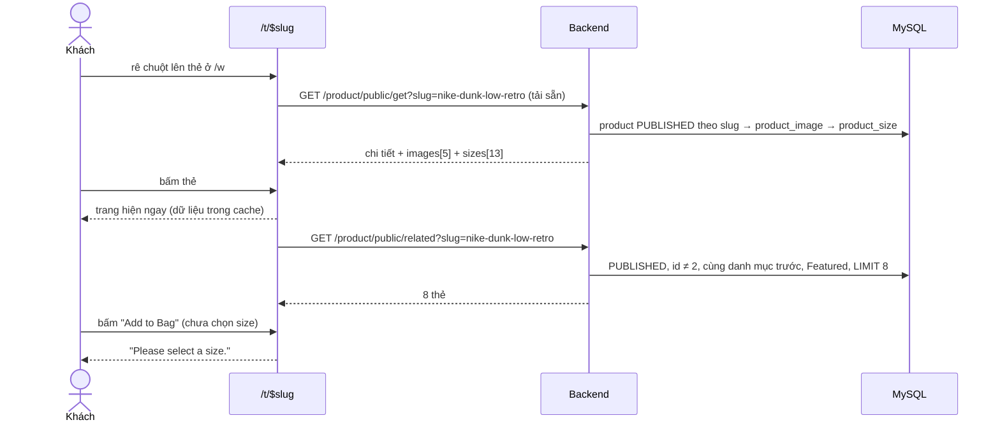
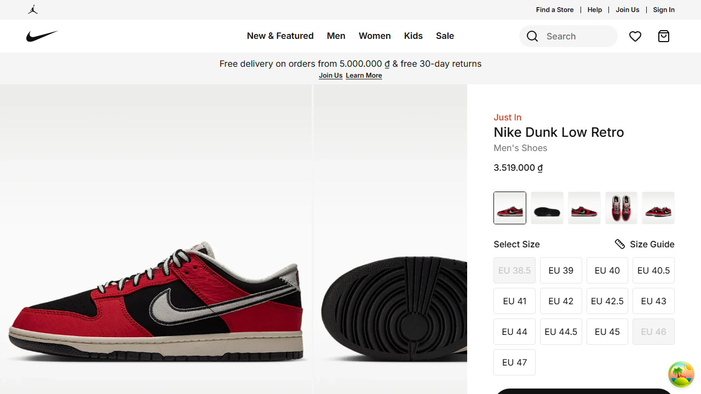
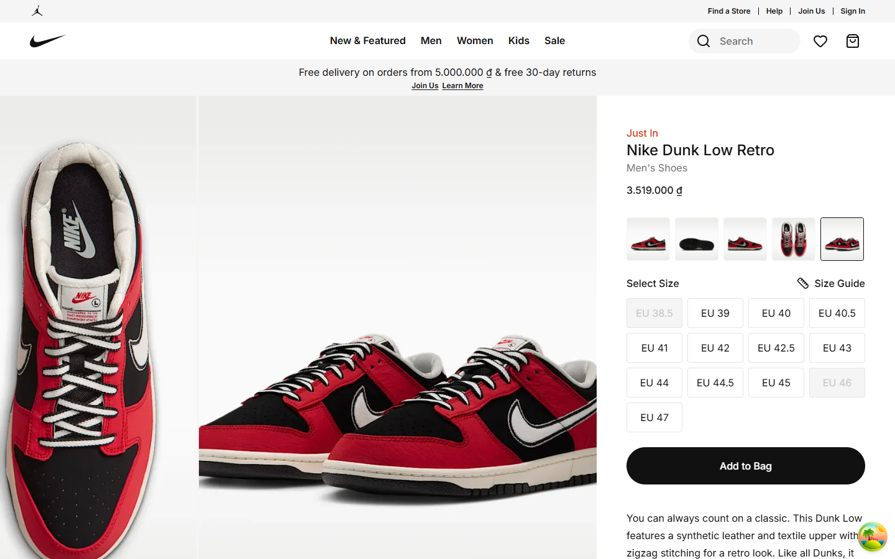
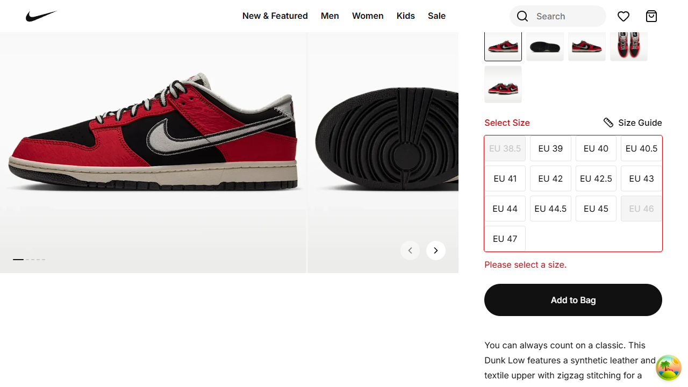
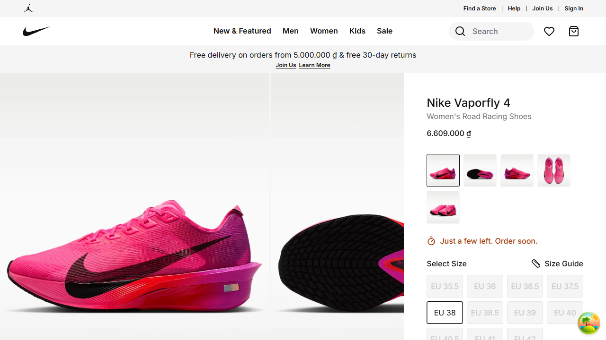
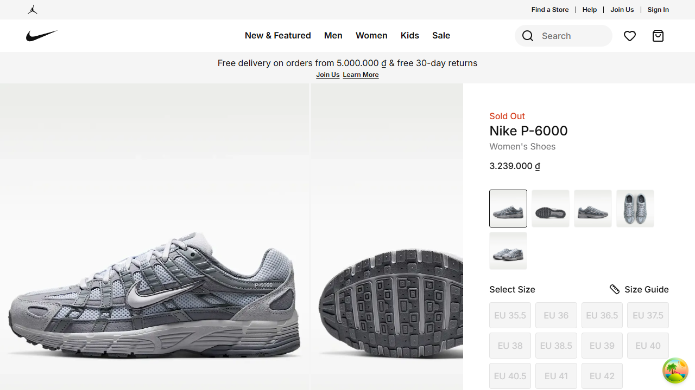
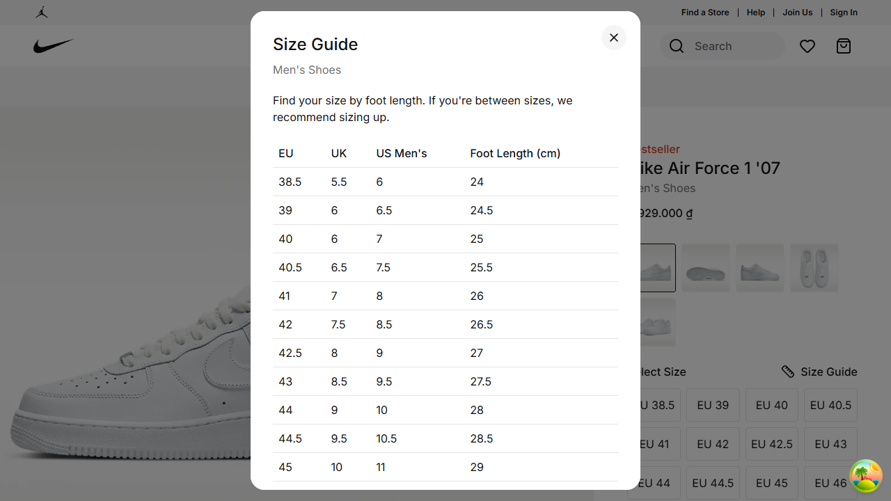
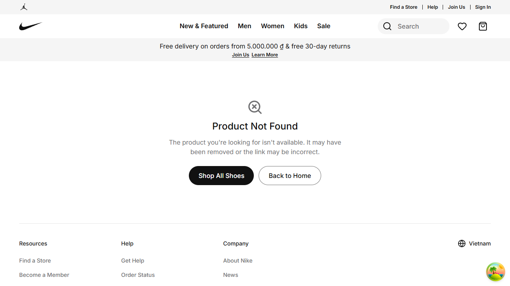
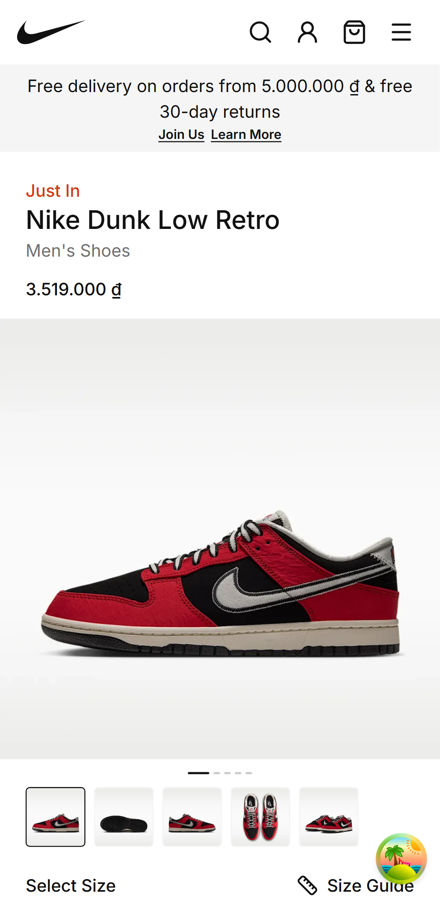

# Chi tiết giày: trang /t/$slug có gallery kéo ngang, chọn size, bảng size, "You Might Also Like"

> Lát 1.5 · plan: [plan/chi-tiet-giay.md](../../plan/chi-tiet-giay.md) · module: `entity`, `business.product`; `frontend/` (khu cửa hàng), `automation/`

## 1. Mục tiêu

Sau lát 1.4 mọi thẻ giày (trang danh sách, trang chủ, gợi ý tìm kiếm) vẫn dẫn tới trang tạm "Coming Soon". Lát này thay bằng **trang chi tiết thật** `/t/<slug>`: khách (không cần đăng nhập) xem 5 ảnh, đọc giá / giảm giá / mô tả / mã sản phẩm, tra bảng quy đổi size, chọn một size còn hàng, được báo khi sắp hết hoặc hết hàng, rồi lướt sang sản phẩm khác ở "You Might Also Like".

| Có làm | Không làm (để lát sau) |
|---|---|
| `GET /product/public/get` (chi tiết + 5 ảnh + lưới size có tồn kho) và `GET /product/public/related` (8 thẻ), công khai | Thêm vào giỏ, popup "Added to Bag" (lát `gio-hang`); nút "Add to Bag" đã chọn size mà bấm thì chưa làm gì |
| Gallery cuộn ngang, nút ‹ ›, kéo chuột sang bên, thanh vị trí, 5 ảnh nhỏ | Nút "Favourite ♡" (lát `yeu-thich`) |
| Nhãn, giá + giá gốc + "% off", cảnh báo "Just a few left. Order soon.", lưới size, lỗi "Please select a size.", "Sold Out" | "View Product Details", "Colour Shown", "Country/Region of Origin", đánh giá |
| Hộp thoại "Size Guide" theo giới tính, accordion "Free Delivery and Returns", "You Might Also Like", "Product Not Found", skeleton, lỗi + "Try Again" | Chọn màu, breadcrumb, chia sẻ |
| Thẻ sản phẩm tải sẵn dữ liệu khi rê chuột; Back về `/w` giữ vị trí cuộn | Visual regression / a11y của trang |

## 2. Tác nhân và phân quyền

| Tác nhân | Quyền | Ghi chú |
|---|---|---|
| Khách chưa đăng nhập, khách đã đăng nhập, quản trị | `GET /product/public/get`, `GET /product/public/related` | Công khai nhờ mẫu `^/[a-z0-9-]+/public/.*` của `JwtAuthenticationFilter`, không `checkPermission`, không thêm resource. Token sai / hết hạn vẫn trả 200 |

Chỉ sản phẩm `PUBLISHED` có trang chi tiết. Sản phẩm `HIDDEN` / `DRAFT` coi như không tồn tại (404, kể cả với quản trị) và không bao giờ có trong `related`.

## 3. Luồng hoạt động

1. Khách rê chuột lên thẻ "Nike Dunk Low Retro" ở `/w` → router tải sẵn `GET /product/public/get?slug=nike-dunk-low-retro`. Bấm thẻ → `/t/nike-dunk-low-retro`, trang hiện ngay, cuộn về đầu.
2. Trang hiện gallery 5 ảnh (ảnh 1 trọn, ảnh 2 lộ một phần) và cột thông tin: nhãn "Just In", tên, "Men's Shoes", "3.519.000 ₫", 5 ảnh nhỏ, "Select Size" + "Size Guide", 13 ô size, "Add to Bag", mô tả, "Style: IQ0157-001", "Free Delivery and Returns". Song song FE gọi `related` → dải "You Might Also Like" 8 thẻ.
3. Bấm › hoặc ảnh nhỏ → gallery cuộn tới ảnh đó; giữ chuột trên ảnh và kéo sang bên → dải trượt theo tay, thả ra thì dừng ở ảnh gần nhất.
4. Bấm "Size Guide" → bảng quy đổi các size của sản phẩm; bấm "EU 42" → ô được chọn.

Luồng thay thế:
- **Chưa chọn size** mà bấm "Add to Bag": "Select Size" đỏ, lưới size viền đỏ, dòng "Please select a size.", lưới cuộn vào giữa màn hình; chọn size thì lỗi biến mất.
- **Sắp hết hàng**: tổng tồn (chưa chọn size) hoặc tồn của size đang chọn nằm trong 1–3 → dòng "Just a few left. Order soon.".
- **Hết hàng** (mọi size tồn 0): nhãn "Sold Out", mọi ô size mờ, nút "Sold Out" bị khoá.
- **Sản phẩm khác**: bấm thẻ ở "You Might Also Like" → trang mới, cuộn về đầu, size bỏ chọn, gallery về ảnh 1.
- **Back**: từ trang chi tiết về `/w…` giữ bộ lọc và thẻ vừa bấm vẫn nằm trong khung nhìn.
- **Mobile**: tên / giá nằm trên gallery, vuốt ngang đổi ảnh (1 ảnh / màn), lưới size 3 cột.
- **Từ tìm kiếm**: gõ "pegasus", bấm gợi ý "Nike Pegasus 42" → `/t/nike-pegasus-42`.

Ngoại lệ:
- Slug không có / sản phẩm ẩn / nháp → trang **Product Not Found** (vẫn có header + footer) với "Shop All Shoes" và "Back to Home".
- `get` lỗi → "Couldn't load this product." + "Try Again"; `related` lỗi → chỉ khối "You Might Also Like" hiện "Couldn't load recommendations." + "Try Again", phần trên vẫn dùng được.
- `get` chậm hơn 1 giây → khung xương (skeleton) của trang.

## 4. Cơ sở dữ liệu

**Không có migration.** Lát dùng bốn bảng của `du-lieu-giay` (`product`, `product_image`, `product_size`, `product_category`). Quy ước dữ liệu:

- Mỗi sản phẩm có 5 ảnh, `sort_order` 1 → 5, id = `productId × 10 + sort_order`.
- Lưới size theo giới tính: MEN / UNISEX 13 size (EU 38.5 → 47), WOMEN 11 size (EU 35.5 → 42), BOYS / GIRLS 8 size (EU 35.5 → 40); id = `productId × 100 + thứ tự`, sắp theo `size_value` tăng dần.
- **Tổng tồn** (`totalStock`) = `COALESCE(SUM(product_size.stock), 0)`.
- `product.slug` đã UNIQUE với collation không phân biệt hoa thường nên `/t/NIKE-DUNK-LOW-RETRO` vẫn mở được.

## 5. API

Mọi response bọc `{ code, message, result }`, prefix `/api`. Cả hai endpoint nằm ở [`ProductPublicController`](../../backend/business/src/main/java/vn/aeoc/business/product/controller/ProductPublicController.java), **không cần token**.

| Method | Đường dẫn | Mô tả |
|---|---|---|
| GET | `/product/public/get?slug=` | Thẻ sản phẩm (mọi cột `product` + `imageUrl` + `totalStock`) cộng `images` (5 phần tử) và `sizes` (theo `sizeValue` tăng dần, `stock` ≥ 0) |
| GET | `/product/public/related?slug=` | Tối đa 8 thẻ: sản phẩm `PUBLISHED` khác chính nó, **cùng danh mục trước** rồi bù danh mục khác, mỗi phần theo thứ tự Featured |

`images` / `sizes` chỉ có ở `get`: các API trả thẻ (`list`, `new-arrivals`, `suggest`, `related`) không có hai khoá này (`@JsonInclude(NON_NULL)` trên hai field không phải cột của `Product`).

`slug` được `trim` rồi đổi chữ thường. Ví dụ `related` của `nike-dunk-low-retro` trả id `5, 8, 1, 3, 11, 7, 4, 12` (không có id 2 là chính nó, id 9 hết hàng nằm ngoài 8 thẻ đầu, id 31 bị ẩn); `nike-mercurial-vapor-17-elite` (Football chỉ có 2 đôi) trả `30` rồi bù `2, 5, 14, 20, 23, 24, 25`.

| Tình huống | HTTP | Thông báo |
|---|---|---|
| `slug` không có, sản phẩm `HIDDEN` / `DRAFT`, hoặc rỗng sau `trim` (cả `get` lẫn `related`) | 404 | Product not found |
| Thiếu hẳn tham số `slug` | 400 | Missing required parameter: slug |
| Sai method (`POST` vào hai đường dẫn) | 405 | HTTP method not supported |

Điểm đáng chú ý ở phần cài đặt:
- Tách `ProductDetailService` khỏi `ProductCatalogService` để không đổi constructor / test của lát trước. `findPublished` chuẩn hoá slug và ném 404 **trước** khi gọi repository nếu slug rỗng.
- `ProductRepository.listRelated` là **một truy vấn**: `WHERE status = 'PUBLISHED' AND id <> :id ORDER BY (category_id = :categoryId) DESC, <Featured> LIMIT 8`, dùng lại `catalogOrders(FEATURED)` của lát danh sách nên sản phẩm hết hàng tự xuống cuối phần của nó.
- `get` trả số tồn kho thật của từng size để FE tính cảnh báo "Just a few left" và để lát `gio-hang` chặn số lượng (đồ án chạy local nên chấp nhận lộ số).

## 6. Giao diện

**Route** `routes/_shop/t.$slug.tsx` thay trang tạm: `loader` = `ensureQueryData` (khoá `["products","detail",slug]`, `staleTime` 60 giây, 404 không thử lại), 404 → `notFound()`; `<title>` là `<tên sản phẩm> | Nike`. Thành phần nằm ở `components/shop/product-detail/` (`ProductDetailPage`, `ProductGallery`, `ProductSummary`, `SizePicker`, `SizeGuideDialog`, `RelatedProducts`, …); logic thuần ở `lib/shop/{product-detail,size-guide,shipping}.ts`. Desktop (≥ 1024 px) chia hai cột `2fr / 1fr`, mobile một cột, render riêng theo `useIsDesktop()`.

Trang `/t/nike-dunk-low-retro` ở 1440 px: gallery sát mép trái, cột thông tin với nhãn "Just In", giá, 5 ảnh nhỏ, 13 ô size (EU 38.5 và EU 46 mờ), "Add to Bag" (TC-10).

**Gallery.** Dải ảnh cuộn ngang native + `scroll-snap`, mỗi ảnh rộng 2/3 khung nên thấy khoảng 1,5 ảnh. Nút ‹ › cuộn đúng một ảnh và khoá ở hai đầu; ảnh nhỏ có `aria-current` theo ảnh hiện tại. Kéo chuột dùng pointer events: tắt snap khi kéo, thả ra thì về ảnh gần nhất, kéo quá 15% bề rộng một ảnh thì sang hẳn ảnh kế theo hướng kéo. Bấm ảnh không mở gì (không có khung phóng to).

Sau khi kéo dải ảnh sang trái: ảnh nhỏ thứ 2 có viền đen, nút "Previous image" bấm được (TC-17).

**Chọn size.** Lưới `RadioGroup` 4 cột (mobile 3 cột); ô hết hàng bị `disabled`, mũi tên đi qua các ô còn hàng. Bấm "Add to Bag" khi chưa chọn → lỗi như luồng thay thế ở mục 3.

"Select Size" đổi đỏ, lưới size viền đỏ và dòng "Please select a size." ngay dưới lưới (TC-13).

`nike-vaporfly-4` chỉ còn EU 38 (3 đôi): dòng cam "Just a few left. Order soon." hiện ngay khi chưa chọn size, 10 ô còn lại mờ (TC-14).

`nike-p-6000` hết sạch: nhãn "Sold Out", 11 ô size mờ, nút chính đổi thành "Sold Out" và bị khoá (TC-15).

**Giá giảm.** Giá bán, giá gốc trong `<s>` và `n% off` với `n = floor((price − salePrice) × 100 / price)` (làm tròn xuống để không ghi quá mức giảm thật: id 19 giảm 5,6% hiện "5% off", năm sản phẩm còn lại "20% off").

**Size Guide.** Bảng tĩnh `SIZE_CHART` ở `lib/shop/size-guide.ts` (theo bảng nam của nike.com; US nữ = nam + 1,5; trẻ em = số US nam + "Y"). Cột US đổi theo giới tính: "US Men's", "US Women's", "US" (`M 8.5 / W 10`), "US Kids'". Chỉ hiện các size của sản phẩm đang xem, dòng của size đang chọn có `data-selected="true"`.

Hộp thoại "Size Guide" với cột EU, UK, US, Foot Length (cm); dòng của size đang chọn được tô nền xám và chữ đậm (TC-18, TC-19).

**Accordion** "Free Delivery and Returns" mặc định đóng; mở ra có chính sách giao hàng (miễn phí từ 5.000.000 ₫, dưới mức đó phí 30.000 ₫, lấy từ hằng `FREE_SHIPPING_THRESHOLD`, `SHIPPING_FEE` ở `lib/shop/shipping.ts` để lát giỏ hàng dùng lại), chính sách đổi trả 30 ngày và hai link tới `/info/delivery`, `/info/returns` (TC-20).

**You Might Also Like** dùng lại `ProductRail` + `ProductCard`; bấm thẻ thì component chi tiết được dựng lại (`key={slug}`) nên size, lỗi và gallery về trạng thái đầu (TC-21). `ProductCard` có `preload="intent"` nên rê chuột lên thẻ ở mọi nơi tải sẵn `get` (TC-11); Back về `/w` dùng vị trí cuộn do router khôi phục (TC-24).

Slug không có hoặc sản phẩm đã ẩn: h1 "Product Not Found", lời giải thích, hai nút "Shop All Shoes" và "Back to Home", header + footer vẫn còn (TC-22).

Trên điện thoại tên và giá nằm trên gallery, ảnh rộng đúng một màn hình, lưới size 3 cột, "Add to Bag" rộng hết cột (TC-26).

## 7. Kiểm thử

Test nghiệm thu viết trước khi code: API ở [`chi-tiet-giay.api.spec.js`](../../automation/tests/api/chi-tiet-giay.api.spec.js) (TC-01 → TC-09), giao diện ở [`chi-tiet-giay.spec.js`](../../automation/tests/product-detail/chi-tiet-giay.spec.js) (TC-10 → TC-26), JUnit ở [`ProductDetailServiceTest.java`](../../backend/business/src/test/java/vn/aeoc/business/product/service/ProductDetailServiceTest.java). Kết quả mong đợi tính bằng `expectedDetail` / `expectedRelated` từ `products.json`.

| ID | Loại | Nội dung | Kết quả |
|---|---|---|---|
| TC-01 | api | Chi tiết `nike-dunk-low-retro` (5 ảnh, 13 size) | Pass |
| TC-02 | api | Chi tiết khớp `products.json` với mọi sản phẩm (30 slug) | Pass |
| TC-03 | api | `get` không tìm thấy (ẩn, không có, rỗng) → 404; thiếu `slug` → 400 | Pass |
| TC-04 | api | Chuẩn hoá slug (khoảng trắng, chữ hoa) | Pass |
| TC-05 | api | `related` cùng danh mục trước | Pass |
| TC-06 | api | `related` bù danh mục khác (30 slug) | Pass |
| TC-07 | api | `related` không tìm thấy / thiếu `slug` | Pass |
| TC-08 | api | Công khai (token sai vẫn 200) + sai method 405 | Pass |
| TC-09 | api | Thẻ ở `list`, `new-arrivals`, `suggest` không có khoá `images` / `sizes` | Pass |
| TC-10 | e2e | Trang chi tiết mặc định (desktop) | Pass |
| TC-11 | e2e | Từ danh sách vào chi tiết, tải sẵn khi rê chuột, Back | Pass |
| TC-12 | e2e | Giá giảm và "% off" (6 sản phẩm) | Pass |
| TC-13 | e2e | Chọn size + lỗi chưa chọn size + phím mũi tên | Pass |
| TC-14 | e2e | Cảnh báo sắp hết hàng | Pass |
| TC-15 | e2e | Hết hàng | Pass |
| TC-16 | e2e | Gallery: nút ‹ › và ảnh nhỏ | Pass |
| TC-17 | e2e | Kéo ảnh sang bên | Pass |
| TC-18 | e2e | Bảng size theo giới tính (4 ca) | Pass |
| TC-19 | e2e | Bảng size đánh dấu size đang chọn | Pass |
| TC-20 | e2e | Accordion "Free Delivery and Returns" | Pass |
| TC-21 | e2e | "You Might Also Like" + sang sản phẩm khác | Pass |
| TC-22 | e2e | Product Not Found | Pass |
| TC-23 | e2e | Lỗi mạng (`get` 500, `related` 500, `get` chậm) | Pass |
| TC-24 | e2e | Back giữ vị trí cuộn trang danh sách | Pass (xem mục 8) |
| TC-25 | e2e | Từ gợi ý tìm kiếm vào chi tiết | Pass |
| TC-26 | e2e | Bố cục + thao tác mobile (mobile-chrome) | Pass |
| TC-27 | e2e | Hồi quy: `giao-dien-nike`, `tieng-anh-cua-hang`, `danh-sach-giay`, smoke | Pass (xem mục 8) |
| TC-U1 | unit | Chuẩn hoá slug + không tìm thấy | Pass |
| TC-U2 | unit | Ghép ảnh + size | Pass |
| TC-U3 | unit | `related` (gọi `listRelated(19, 3, 8)`, 404) | Pass |

| Tổng hợp | Kết quả |
|---|---|
| JUnit `ProductDetailServiceTest` | 8/8 pass (TC-U1 → TC-U3); test cũ của `business` 0 lỗi |
| Playwright API (`pnpm test:api`) | 121/121 pass, gồm 9 test mới |
| Playwright lát này, chromium (`--headed`, slowMo 400) | 30/30 pass (9 API + 21 UI; TC-26 bỏ qua ở chromium) |
| Playwright TC-26, mobile-chrome | Pass |
| Hồi quy TC-27 + lát này, 4 project UI (`--workers=4`) | 275 pass / 2 đỏ (firefox `giao-dien-nike` TC-22 quá 30 giây khi tải nặng, chạy riêng xanh; chromium TC-24 một lần) |
| `pnpm test:smoke --workers=4` | 85/85 pass |
| `pnpm build`, `pnpm lint` | Xanh; frontend 1 cảnh báo cũ, automation 8 cảnh báo cũ |

Số vòng sửa: backend 0 (121/121 API xanh ngay lần đầu), frontend 2 (khi chạy E2E): (1) Radix RadioGroup chỉ chọn ô khi phím mũi tên còn giữ lúc focus tới nên `size-picker.tsx` tự ghi nhận phím mũi tên và chọn ô nhận focus; (2) trên mobile chữ `sr-only` "Original price" của thẻ giảm giá thoát vùng cắt của dải nên `#app-scroll` rộng 1790 px, sửa bằng `relative` cho `<ul>` của `ProductRail`.

## 8. Điểm lệch plan và việc còn lại

- **Bỏ khung xem ảnh lớn** theo yêu cầu người dùng giữa phiên: plan sửa trước (§1, §3, §6.2, §6.3, TC-10 / TC-17 / TC-26), spec sửa theo plan mới; đổi ảnh bằng kéo sang bên, nút ‹ › hoặc ảnh nhỏ.
- `ProductGallery` điều khiển bằng ref (`scrollToImage`) thay vì prop `imageIndex` (không ảnh hưởng hợp đồng).
- Không sửa `__root.tsx`: TC-24 xanh với `scrollRestoration` sẵn có của router.
- **Rủi ro còn lại (TC-24)**: router-core lưu vị trí cuộn bằng `throttle(100ms)` và đọc key theo vị trí hiện tại lúc hàm chạy, nên nếu bấm thẻ chưa tới 100 ms sau lần cuộn cuối thì Back về `/w` dùng vị trí cũ. Người dùng thật hầu như không gặp; test (cuộn rồi bấm ngay) thỉnh thoảng gặp khi máy tải nặng. Sửa phía app phải chạm nội bộ `@tanstack/router-core`; phương án khác là spec chờ router lưu xong trước khi bấm. Chưa sửa, để người dùng quyết.
- Firefox / WebKit chạy `--workers=4` cho ổn định khi tải nặng (TC-23 (c), TC-24 phụ thuộc thời gian).
- Còn lại cho lát sau: thêm vào giỏ (`gio-hang`), "Favourite" (`yeu-thich`), quản trị sản phẩm (`quan-ly-giay`), visual regression / a11y.
