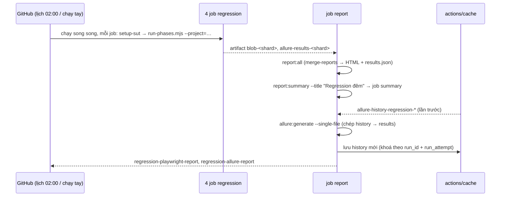
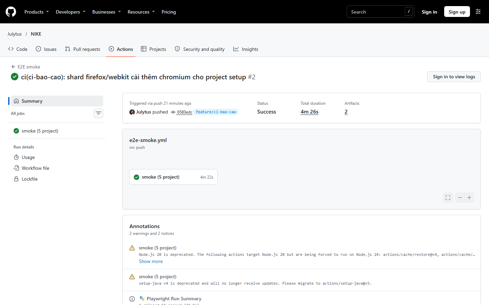
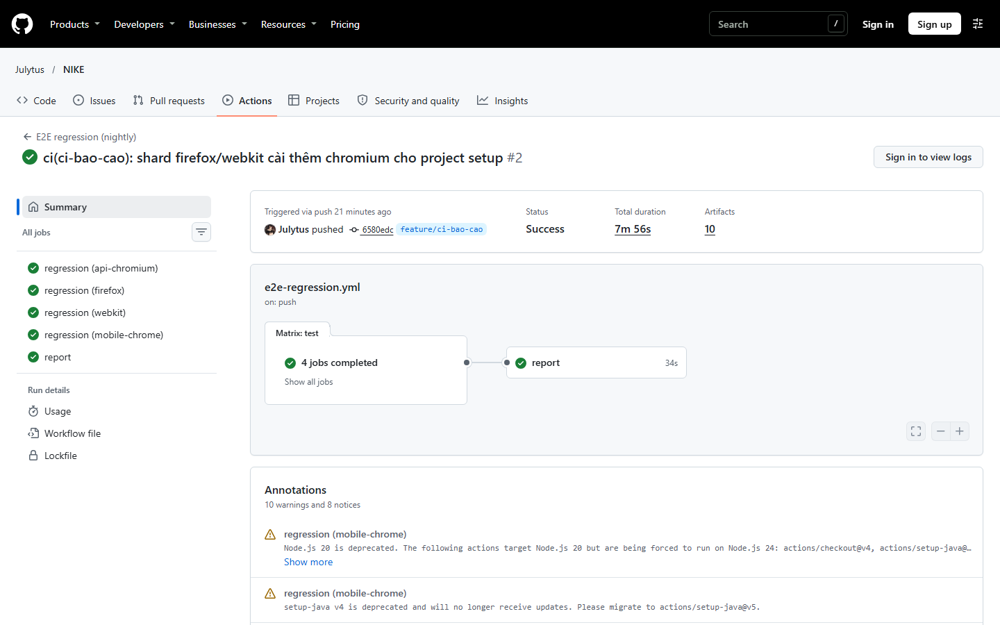
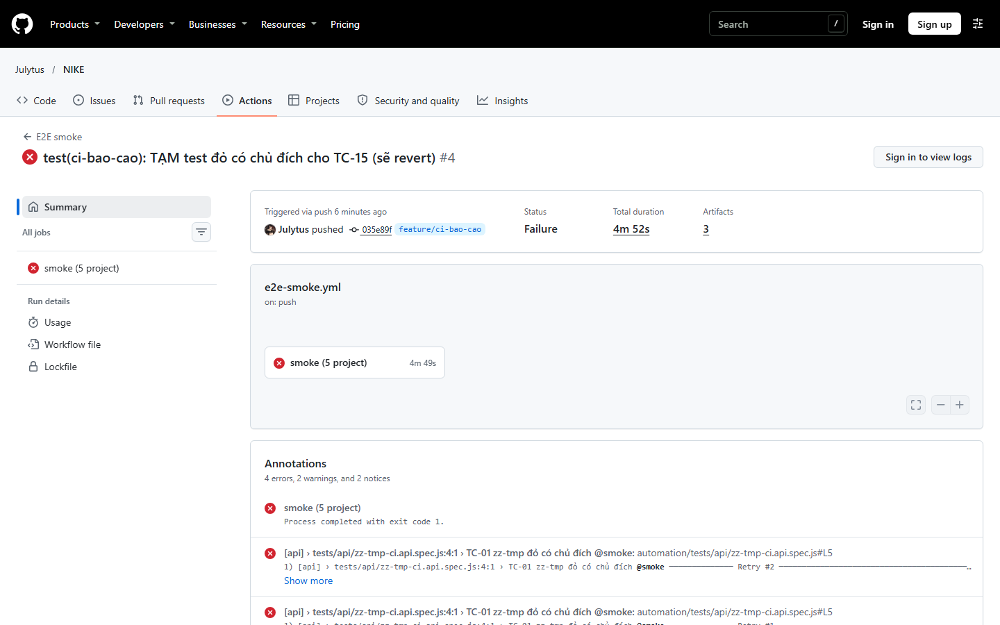
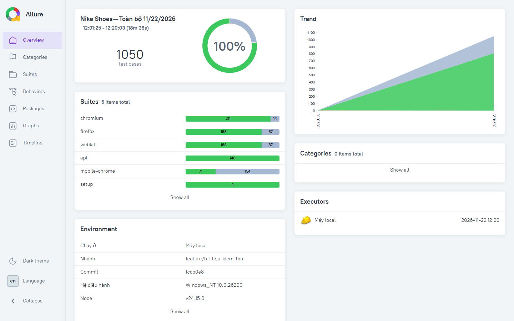
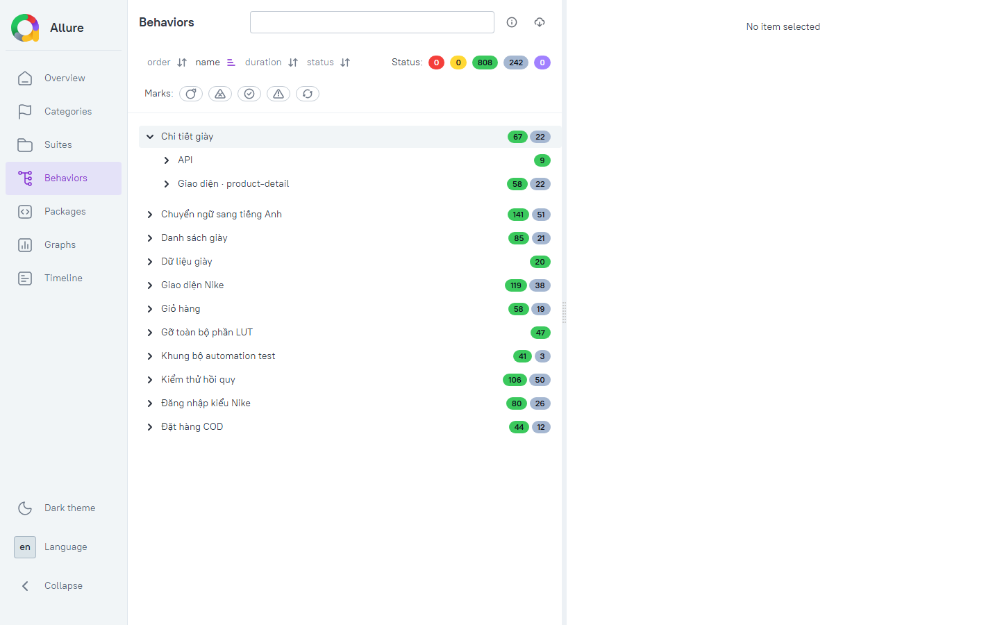
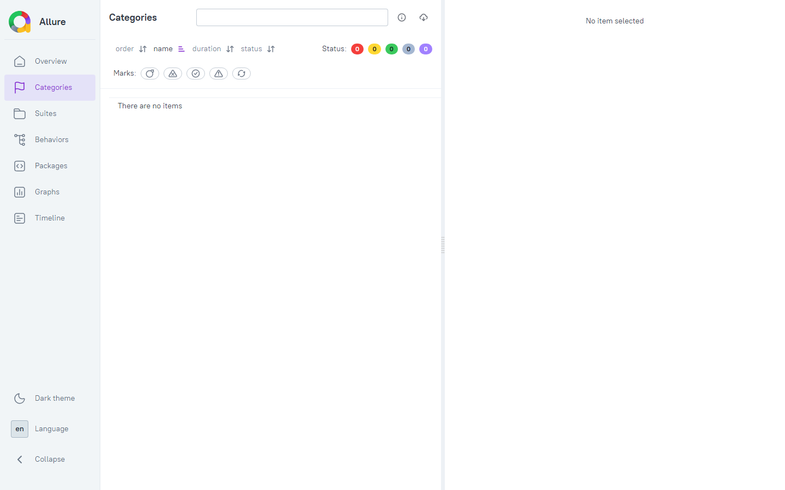
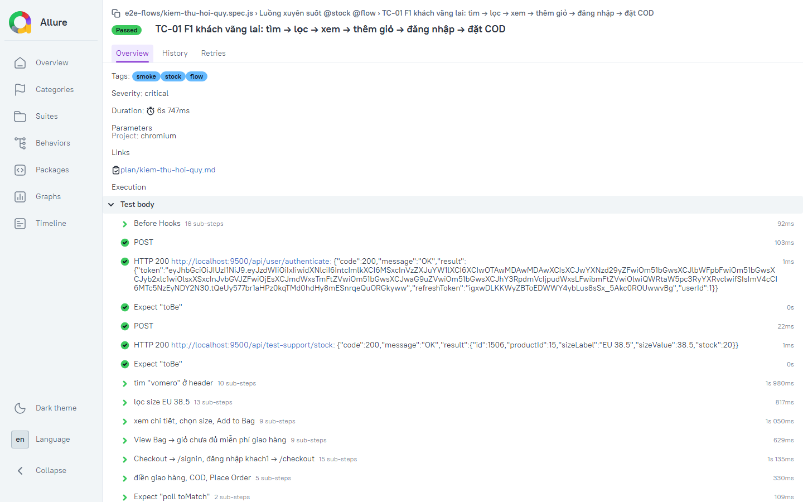
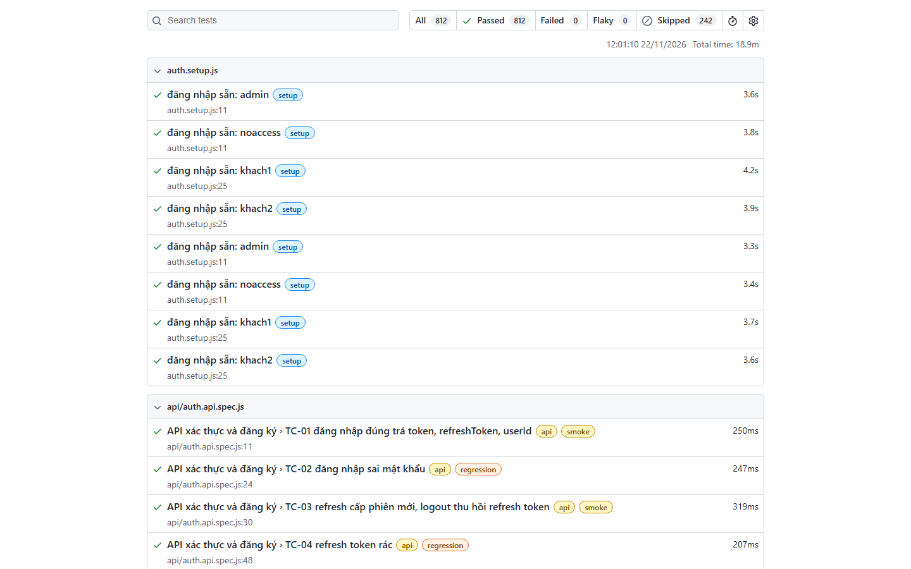

# Tích hợp liên tục và báo cáo kiểm thử

> Lát 4.3 · plan: [plan/ci-bao-cao.md](../../plan/ci-bao-cao.md) · không đổi backend, không đổi frontend; toàn bộ nằm ở `.github/` và `automation/`

## 1. Mục tiêu

Bộ automation đã có 1046 test nhưng trước lát này chỉ chạy được ở máy cá nhân: workflow CI cũ chưa chạy thành công lần nào, còn báo cáo Allure thì sai số liệu. Lát này **không thêm chức năng và không thêm test nghiệp vụ**, chỉ làm hạ tầng chạy test và báo cáo.

| Có làm | Không làm |
|---|---|
| Workflow **E2E smoke**: mỗi lần push chạy nhóm `@smoke` trên 5 project | Đăng báo cáo công khai (GitHub Pages), thông báo Slack / email, branch protection |
| Workflow **E2E regression (nightly)**: 02:00 giờ VN chạy toàn bộ bộ test, chia 4 job theo trình duyệt, rồi gộp báo cáo | Self-hosted runner, chia `--shard` trong cùng một project |
| Composite action `setup-sut` dùng chung: MySQL + MinIO, backend, frontend bản build, trình duyệt | Visual regression, kiểm thử khả năng truy cập (lát 4.2) |
| Báo cáo HTML gộp + bảng số liệu theo project / khu vực / tag + Allure có lịch sử (Trend), nhóm lỗi, nhãn theo lát | Test plan, ma trận truy vết, bug report hoàn chỉnh (lát 4.4, dùng lại bảng số liệu của lát này) |

### Hiện trạng trước khi làm

- 45 lần chạy CI từ 18/11 đến 20/11 đều dừng ngay (`startup_failure`, 0 giây, 0 job) vì tài khoản GitHub bị khoá Actions do lỗi thanh toán, không phải do file YAML. Sau khi người dùng xử lý thanh toán, CI chạy được bình thường.
- `allure-results/` không bao giờ được dọn nên dồn 13.014 file của mọi lần chạy cũ; hai pha test ghi chung một thư mục; lệnh sinh báo cáo xoá luôn `history/` nên không bao giờ có Trend.
- Báo cáo HTML tách theo pha, chưa có bảng tổng hợp theo project.

## 2. Thành phần

```
.github/
├─ actions/setup-sut/action.yml     dựng hệ thống để test: Java, Node, MySQL + MinIO, backend, frontend build, trình duyệt
├─ actions/setup-sut/wait-backend.sh   chờ GET /api/v3/api-docs = 200 (tối đa 180 giây), in 80 dòng cuối log nếu quá hạn
└─ workflows/
   ├─ e2e-smoke.yml                 push (mọi nhánh) → nhóm @smoke, 5 project
   └─ e2e-regression.yml            lịch 02:00 giờ VN / chạy tay → 4 job theo trình duyệt + job report
automation/
├─ allure/categories.json           5 nhóm lỗi tiếng Việt
├─ scripts/
│  ├─ run-phases.mjs                (sửa) dọn allure-results/ + blob-report/ ở đầu mỗi lần chạy
│  ├─ merge-reports.mjs             pnpm report:all     gộp blob của hai pha / các shard → HTML + results.json
│  ├─ summarize.mjs                 pnpm report:summary bảng số liệu Markdown (stdout, --out, job summary)
│  ├─ allure-generate.mjs           pnpm allure:generate giữ history, ghi executor.json, sinh bản một file
│  └─ report-shots.mjs              pnpm report:shots   chụp ảnh Allure / HTML / trang Actions cho quyển
└─ utils/report-env.js, report-labels.js   thông tin môi trường, nhãn epic / feature / severity / link plan
```

### 2.1 Hai workflow

| | E2E smoke | E2E regression (nightly) |
|---|---|---|
| Kích hoạt | `push` mọi nhánh (bỏ qua commit chỉ sửa `docs/`, `plan/`, `*.md`, `.claude/`), chạy tay | `cron 0 19 * * *` (02:00 giờ VN, chỉ trên `main`), chạy tay |
| Phạm vi | Nhóm `@smoke`, 5 project: api, chromium, firefox, webkit, mobile-chrome | Toàn bộ test, 4 job song song: `api-chromium`, `firefox`, `webkit`, `mobile-chrome` |
| Frontend | Bản build, chạy bằng `vite preview` | như trái |
| Gộp báo cáo | Cuối job `smoke (5 project)` | Job `report` riêng, chạy cả khi có shard đỏ |
| Trùng lặp | Push mới thì run cũ của cùng nhánh bị huỷ | Không huỷ |
| Timeout | 40 phút | 60 phút mỗi job |



Mỗi job dùng MySQL + MinIO riêng trong máy ảo của nó, dữ liệu nạp từ Flyway + seed như máy local. `TZ=Asia/Ho_Chi_Minh` được đặt cho cả job vì mã đơn `DH` + yyMMdd và `timezoneId` của Playwright đều theo giờ Việt Nam, kể cả lúc chạy 02:00 khi giờ UTC vẫn còn ở ngày hôm trước.

Shard `firefox` / `webkit` vẫn cài thêm `chromium` vì project `setup` (đăng nhập sẵn) dùng Chrome ở mọi shard.

### 2.2 Artifact

| Artifact | Từ | Nội dung | Lưu |
|---|---|---|---|
| `smoke-playwright-report` | smoke | `playwright-report-all/` (HTML gộp + `results.json`) | 14 ngày |
| `smoke-allure-report` | smoke | `allure-report-single/index.html` (mở thẳng bằng `file://`) | 14 ngày |
| `blob-<shard>`, `allure-results-<shard>` | regression, từng shard | dữ liệu thô để job `report` gộp | 3 ngày |
| `regression-playwright-report`, `regression-allure-report` | job `report` | như smoke, cho toàn bộ bộ test | 14 ngày |
| `backend-log`, `backend-log-<shard>` | chỉ khi job đỏ | log backend | 7 ngày |

### 2.3 Lệnh ở máy local

```bash
cd automation
pnpm test                          # dọn kết quả cũ → pha thường → pha @stock (blob theo pha)
pnpm report:all                    # gộp hai pha → playwright-report-all/index.html + results.json
pnpm report:summary [--out f.md]   # bảng số liệu (Markdown); có GITHUB_STEP_SUMMARY thì nối vào job summary
pnpm allure:generate [--single-file]   # giữ Trend giữa các lần chạy
pnpm allure:open
pnpm report:shots --out <thư mục> [--run <url run Actions>…]
```

| Biến | Ý nghĩa |
|---|---|
| `E2E_FRONTEND` | `dev` (mặc định) hoặc `preview` (phải `pnpm build` trước) |
| `E2E_WORKERS` | số worker; mặc định 2 trên CI, 4 ở local |
| `E2E_REPORT_TAG` | tên đặt cho file blob (`smoke`, tên shard, mặc định `local`) |
| `E2E_KEEP_RESULTS=1` | không dọn `allure-results/` và `blob-report/` |

Gọi thẳng `playwright test` thì không dọn kết quả cũ (cộng dồn); chỉ `pnpm test*` qua `run-phases.mjs` mới dọn.

## 3. Báo cáo

### 3.1 Bảng số liệu (`report:summary`)

Đọc `results.json` của báo cáo gộp và in ba bảng: theo project, theo khu vực (thư mục cấp 1 dưới `tests/`), theo tag (`@smoke`, `@regression`, `@stock`, `@flow`, `@mock`); có test đỏ hoặc chập chờn thì thêm mục "Test lỗi" / "Test chập chờn". Một dòng là một cặp (test, project), project `setup` không tính. Tỉ lệ đạt = (Đạt + Chập chờn) / (Tổng − Bỏ qua). Trên CI bảng được nối vào job summary; ở local ghi ra file cho quyển báo cáo và lát 4.4 (`docs/kiem-thu/so-lieu/`).

### 3.2 Allure

| Tính năng | Cách làm |
|---|---|
| Số liệu đúng | `run-phases.mjs` dọn `allure-results/` mỗi lần chạy; muốn gộp nhiều lần thì `E2E_KEEP_RESULTS=1` |
| Lịch sử (Trend) | `allure-generate.mjs` chép `allure-report/history/` vào `allure-results/` trước khi sinh; trên CI lưu bằng `actions/cache` (khoá `allure-history-<workflow>-…`), không dùng GitHub Pages để không công khai ảnh / video của trang mô phỏng Nike |
| Environment, executor | `utils/report-env.js`: 9 khoá (Chạy ở, Nhánh, Commit, Hệ điều hành, Node, Playwright, Frontend, Backend, Worker); executor có link về đúng run Actions |
| Nhóm lỗi (`categories.json`) | Lỗi kết nối / hạ tầng · Hết thời gian của test · Sai kết quả mong đợi · Lỗi khác · Test chập chờn; mỗi test đỏ chỉ nằm trong một nhóm |
| Behaviors | Auto fixture `allureLabels` gắn `epic` = tên lát (đọc từ `plan/<slug>.md`), `feature` = "API" hoặc "Giao diện · <khu vực>", `severity` theo tag, link về plan; **không sửa spec nào** |
| Một file | `--single-file` sinh `allure-report-single/index.html` để mở thẳng từ artifact |

Toàn bộ bộ test có 11 epic (riêng project `api` có 10).

## 4. Kết quả kiểm thử

Lát không đổi hệ thống được kiểm nên không có JUnit mới và không có test nghiệp vụ mới (1046 test không đổi, `check:tags` 0 lỗi). Các TC kiểm chính hạ tầng: TC-01 → TC-10 ở máy local, TC-11 → TC-15 trên GitHub Actions.

| ID | Nội dung | Kết quả |
|---|---|---|
| TC-01 | `pnpm test*` dọn kết quả cũ, blob theo pha, `E2E_KEEP_RESULTS=1` giữ lại | Pass: xoá 13.014 file cũ, còn 146 file của project api; giữ kết quả thì 292 |
| TC-02 | `report:all` gộp hai pha; thiếu blob báo lỗi đúng | Pass: 146 test (130 + 16 `@stock`); thiếu blob thoát 2 |
| TC-03 | `report:summary` đúng định dạng, `--out`, nối vào `GITHUB_STEP_SUMMARY` | Pass |
| TC-04 | Allure đúng số, có Trend, thiếu Java / thiếu kết quả báo lỗi đúng | Pass: Trend 2 phần tử, `total` không cộng dồn |
| TC-05 | Environment + executor (local và giả lập CI) | Pass |
| TC-06 | Nhãn Behaviors tự động, không sửa spec | Pass: 10 epic (api) |
| TC-07 | Nhóm lỗi + bảng có test đỏ / chập chờn (4 test tạm) | Pass: Lỗi 3, Chập chờn 1, `25,0 %`; mỗi test đỏ đúng một nhóm |
| TC-08 | Smoke với frontend bản build | Pass: 126 giây, 0 lỗi (dev cùng máy: 160 giây, 1 đỏ do worker Node crash) |
| TC-09 | Toàn bộ local, ba nguồn số khớp | Pass: 1046 test, 0 lỗi, 0 chập chờn, 1136 giây; 11 epic |
| TC-10 | actionlint, ESLint, Prettier, `check:tags`, `wait-backend.sh` | Pass |
| TC-11 | Smoke xanh khi push | Pass: job 4 phút 34 giây; 5 project, Tổng 118, Lỗi 0 |
| TC-12 | Commit chỉ sửa tài liệu không chạy smoke | Pass: 0 run cho commit đó |
| TC-13 | Regression ma trận 4 shard + gộp báo cáo | Pass (lần 2, sau khi sửa ma trận): cả run 8 phút; Tổng 1046, Đạt 804, Bỏ qua 242, Lỗi 0 |
| TC-14 | Allure có lịch sử trên CI | Pass: Trend 2 cột ở cả smoke và regression |
| TC-15 | Đường đỏ có đủ dấu vết | Pass: annotation `file:dòng`, "Test lỗi (1)", test chạy 3 lần, đủ artifact + `backend-log`; revert thì xanh |
| | **Tổng** | **15/15 TC pass** — Playwright 1046 test (804 đạt, 242 bỏ qua theo thiết kế, 0 lỗi) trên 5 project; JUnit không đổi |

### Thời gian trên CI

| Run | Thời gian |
|---|---|
| Smoke (5 project) | 4 phút 34 giây (dựng hạ tầng 2 phút 01, test 2 phút 16) |
| Regression `api-chromium` / `firefox` / `webkit` / `mobile-chrome` | 4:59 / 5:58 / 7:16 / 3:39 |
| Regression: job `report` / cả run | 34 giây / 8 phút (so với khoảng 19 phút chạy tuần tự ở máy local) |

Số từng project của regression trùng với lần chạy local (api 146; chromium 211 + 14 bỏ qua; firefox và webkit 188 + 37; mobile-chrome 71 + 154). Chi tiết ở `docs/kiem-thu/so-lieu/2026-11-22-local.md` và `2026-11-22-ci-regression.md`.

### Điểm lệch so với plan

- **Ma trận regression (plan §5.3 sai).** Lần chạy đầu, shard `firefox` / `webkit` đỏ: project `setup` luôn dùng Chrome nhưng ma trận chỉ cài trình duyệt của shard. Đã sửa plan và workflow: cài thêm `chromium` cho hai shard này.
- `allure-generate.mjs` nhận thêm `--title` để tên báo cáo trên CI là "Nike Shoes — Smoke" / "— Regression đêm".
- Allure 2 và `allure-playwright` không tự gắn flaky từ retry, nên script thêm bước đánh dấu `flaky` (lần cuối `passed`, lần trước đỏ); thiếu bước này thì nhóm "Test chập chờn" luôn trống.
- Khoá cache lịch sử thêm `run_attempt` để "Re-run all jobs" lưu được lịch sử mới (khoá trùng thì `cache/save` bỏ qua).
- Các bước báo cáo trên CI có điều kiện `hashFiles`: không có blob thì in cảnh báo thay vì làm đỏ thêm.
- Allure `statistic.total` lớn hơn bảng số liệu 4 test (1050 so với 1046): 4 test `setup` chạy ở cả hai pha cùng `historyId` nên Allure coi lần pha 2 là retry.
- Trigger `push` tạm của regression (để kiểm trước khi merge) đã bỏ; từ nay chỉ còn lịch và chạy tay. Lịch chỉ chạy trên `main` nên **lần chạy đêm đầu tiên cần kiểm sau khi merge**.

### Ghi nhận cho lát 4.4

- Hai lần worker Node tự thoát `code=3221226505` (0xC0000409) trên Windows local (một lần ở `api` TC-07, một lần ở `firefox` F1); không lặp lại ở các lần chạy sau và không xảy ra trên CI (Linux). Coi là lỗi môi trường máy local.
- GitHub cảnh báo Node.js 20 / `setup-java@v4` sắp lỗi thời ở các action đang dùng (chưa đổi trong lát này).

## 5. Hình ảnh

Ảnh Allure chụp từ lần chạy local (`pnpm report:shots`), ảnh Actions chụp từ trang run công khai.


Trang run "E2E smoke" `success` với job "smoke (5 project)" (TC-11).


Đồ thị run "E2E regression (nightly)": 4 job theo trình duyệt chạy song song rồi job `report` (TC-13).


Run smoke đỏ có chủ đích với annotation trỏ `file:dòng` (TC-15).


Trang Overview của Allure: tổng số, biểu đồ Trend theo các lần chạy, Environment.


Tab Behaviors nhóm test theo lát (epic) và khu vực (feature).


Tab Categories phân loại lỗi theo 5 nhóm tiếng Việt.


Chi tiết một test luồng xuyên suốt, hiện từng `test.step`.


Báo cáo HTML của Playwright sau khi gộp hai pha, đủ các project.

> Còn thiếu ảnh `02-actions-summary.png` (bảng số liệu trong job summary): GitHub chỉ hiện job summary cho người đã đăng nhập nên script chụp ẩn danh không lấy được. Nội dung bảng nằm ở mục 3.1 và ở `docs/kiem-thu/so-lieu/2026-11-22-ci-regression.md`; có thể chụp tay từ run smoke 45024434362 và đặt vào `img/ci-bao-cao/` khi cần.
