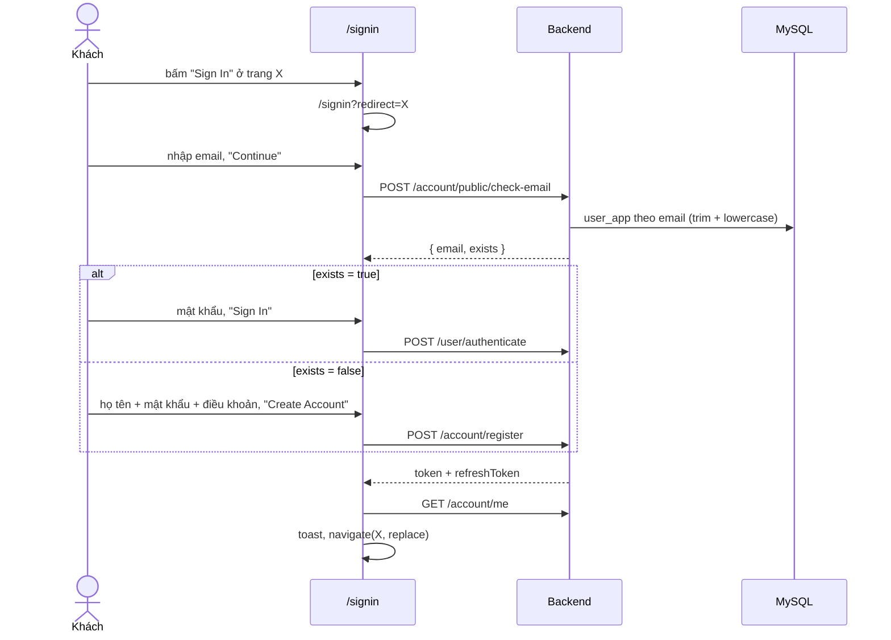
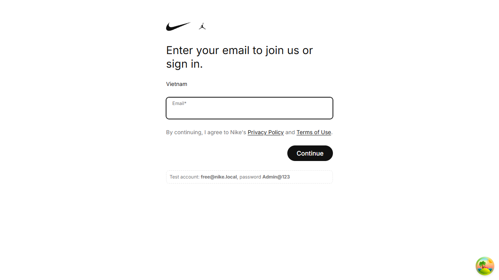
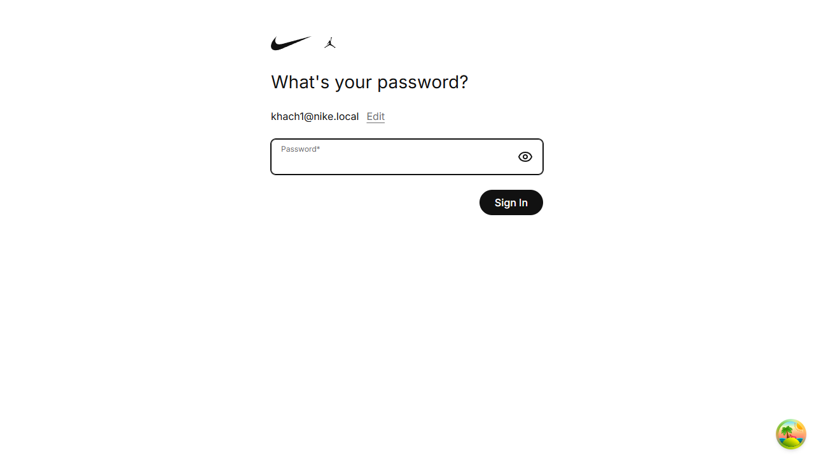
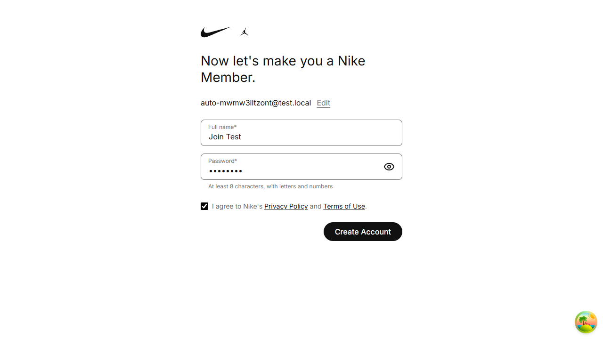
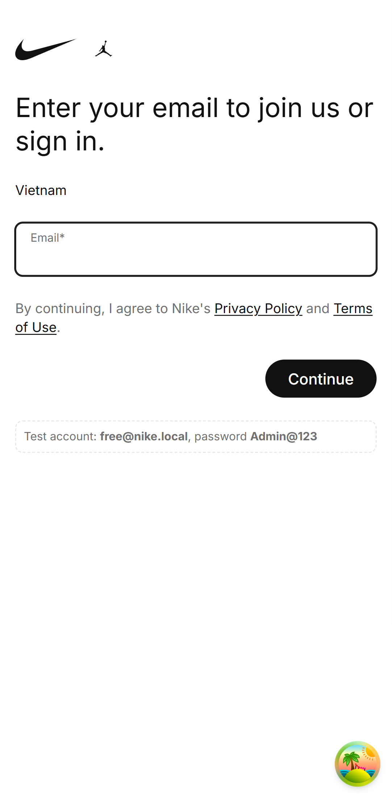

# Đăng nhập kiểu Nike: trang /signin nhập email trước

> Lát 1.3b · plan: [plan/dang-nhap-nike.md](../../plan/dang-nhap-nike.md) · module: `business.account`, `entity`; `frontend/` (khu cửa hàng), `automation/`

## 1. Mục tiêu

Sau lát 1.3, "Sign In" và "Join Us" vẫn mở hộp thoại đăng nhập / đăng ký kiểu LUT cũ. Lát này thay hai hộp thoại đó bằng **trang riêng `/signin` bám nike.com/vn**: khách nhập email trước, hệ thống cho biết email đã có tài khoản hay chưa, rồi đưa sang bước nhập mật khẩu hoặc bước tạo tài khoản. Đăng nhập xong khách quay về đúng trang đang xem. Lát đặt sẵn nền cho `dat-hang` (D8: thanh toán bắt buộc đăng nhập) qua `/signin?redirect=/checkout`.

| Có làm | Không làm (để lát sau) |
|---|---|
| `POST /api/account/public/check-email` (công khai, chỉ đọc) | Quên / đặt lại mật khẩu, xác minh email bằng mã |
| Route `/signin` (không header / footer), 3 bước trên một trang: email → mật khẩu / tạo tài khoản | Đăng nhập Google / Facebook |
| Tham số `?redirect=` chỉ nhận đường dẫn nội bộ (chặn open redirect); đã đăng nhập mà vào `/signin` thì đi thẳng tới đích | Chọn quốc gia: chỉ hiện chữ "Vietnam", không có link "Change" |
| Mọi lối vào "Sign In" / "Join Us" (dải trên, icon mobile, menu trượt, dải thông báo) thành link tới `/signin?redirect=<trang hiện tại>` | Trang `/login` quản trị (giữ nguyên) |
| Xoá hộp thoại `ShopDialogs` + store `shop-dialog` | Giới hạn số lần gọi `check-email` |

## 2. Tác nhân và phân quyền

| Tác nhân | Quyền | Ghi chú |
|---|---|---|
| Khách chưa đăng nhập | `check-email`, `/account/register`, `/user/authenticate` | Cả ba đều công khai |
| Người đã đăng nhập (khách hoặc quản trị) | — | Vào `/signin` thì bị chuyển thẳng tới `redirect` hợp lệ hoặc `/` |

`/account/public/check-email` công khai nhờ mẫu `^/[a-z0-9-]+/public/.*` sẵn có trong `JwtAuthenticationFilter`, nên không sửa bộ lọc. Gửi token sai vẫn trả 200. Lát không thêm resource hay quyền mới.

## 3. Luồng hoạt động

**Đăng nhập.**
1. Đang ở trang X, khách bấm "Sign In" → `/signin?redirect=X`.
2. Nhập email, bấm "Continue" → FE gọi `check-email`.
3. `exists = true` → bước "What's your password?".
4. Nhập mật khẩu, bấm "Sign In" → `POST /user/authenticate` → lưu token, nạp `/account/me` → toast "Welcome back, <tên>!" → về X bằng `replace` (nút Back không quay lại `/signin`).

**Luồng thay thế.**
- Tạo tài khoản: `exists = false` → "Now let's make you a Nike Member." → họ tên, mật khẩu, tick điều khoản → `POST /account/register` → toast "Account created. Welcome, <tên>!" → về X.
- Sửa email: ở bước mật khẩu / tạo tài khoản bấm "Edit" → về bước email, ô email giữ giá trị cũ.
- Đã đăng nhập: mở `/signin?redirect=X` khi có token → chuyển ngay tới X, không hiện form.
- `redirect` thiếu hoặc không hợp lệ → sau đăng nhập về `/`.

**Ngoại lệ.** Email trống / sai định dạng → lỗi dưới ô, không gọi API. Sai mật khẩu → "Incorrect email or password.", ô mật khẩu xoá trắng và focus lại. Sai quá 10 lần → "Too many failed sign-in attempts. Please try again in a few minutes." Email vừa được đăng ký ở nơi khác giữa hai bước → "This email is already registered." kèm nút "Sign in with this email" sang bước mật khẩu. Tài khoản bị khoá → "This account has been locked" (hành vi sẵn có, không có tài khoản mẫu bị khoá nên không kiểm thử).

## 4. Cơ sở dữ liệu

**Không có migration** (V20 vẫn là mới nhất). Lát dùng bảng `user_app` sẵn có, tìm theo email qua `UserService.getUserByEmail` (trả `User` rỗng, `id = null` khi không thấy).

## 5. API

Mọi response bọc `{ code, message, result }`, prefix `/api`.

| Method | Đường dẫn | Quyền | Mô tả |
|---|---|---|---|
| POST | `/account/public/check-email` | Công khai | Chuẩn hoá email (`trim`, chữ thường), trả `{ email, exists }` |
| POST | `/user/authenticate` | Công khai | Dùng lại, không đổi |
| POST | `/account/register` | Công khai | Dùng lại, không đổi |
| GET | `/account/me` | Đã đăng nhập | Dùng lại, không đổi |

Ví dụ `check-email`: gửi `{ "email": "  KHACH1@nike.Local " }` nhận `{ "email": "khach1@nike.local", "exists": true }`; email chưa có nhận `exists: false` với `email` đã viết thường. Tài khoản bị khoá vẫn tính là `exists = true`.

| Tình huống | HTTP | Thông báo |
|---|---|---|
| Thiếu `email`, `""` hoặc chỉ khoảng trắng | 400 | `Please enter your email.` |
| Không có `@` hoặc dài hơn 255 ký tự | 400 | `Please enter a valid email address.` |
| authenticate: sai mật khẩu | 400 | `Incorrect email or password.` |
| authenticate: sai quá 10 lần | 429 | `Too many failed sign-in attempts. Please try again in a few minutes.` |
| register: email đã có | 400 | `This email is already registered.` |

Điểm đáng chú ý ở phần cài đặt:
- `AccountService.checkEmail` chỉ đọc, không ghi DB và không dùng `LoginAttemptService`; kết quả là POJO `CheckEmailResponse { email, boolean exists }` đặt cạnh `TokenResponse`, `UserInfoResponse`.
- Quy tắc `redirect` nằm hoàn toàn ở FE (`safeRedirect`): chỉ nhận chuỗi bắt đầu bằng `/`, ký tự thứ hai không phải `/` hoặc `\`, không bắt đầu bằng `/signin`; còn lại về `/`. Vì thế `https://example.com`, `//example.com`, `/\example.com`, `javascript:alert(1)` đều bị chặn.

## 6. Giao diện

**Khung trang.** Route `/signin` nằm ngoài `_shop` và `_auth` (`_auth` đẩy người có token sang `/admin`, không hợp với khách), tự bọc `ShopShell` để dùng token màu cửa hàng nhưng **không** có header, dải thông báo hay footer. Nền trắng, khối giữa rộng tối đa 460 px, swoosh + Jumpman ở đầu trang (swoosh là link `aria-label="Nike Home"` về `/`). Ô nhập cao 56 px với nhãn nổi trong ô, nút chính đen bo tròn căn phải. Ba bước là ba component `email-step`, `password-step`, `join-step`; bước giữ trong state của `sign-in-page`, không lên URL, nên F5 ở bước sau sẽ về bước email. Đổi bước thì focus vào ô đầu của bước mới; Enter trong ô nào cũng gửi form của bước đó.

Bước 1 (desktop): h1 "Enter your email to join us or sign in.", dòng "Vietnam", ô "Email" đã focus, hai link "Privacy Policy" / "Terms of Use" và nút "Continue"; không có header hay footer (TC-07).

Bước 2a: h1 "What's your password?", dòng email đã chuẩn hoá kèm nút "Edit", ô "Password" có nút mắt "Show password" (TC-09, TC-10).

Bước 2b: h1 "Now let's make you a Nike Member.", ô "Full name", ô "Password" kèm gợi ý "At least 8 characters, with letters and numbers", checkbox điều khoản và nút "Create Account" (TC-12, TC-13).

Bước 1 trên điện thoại (Pixel 7): lề 16 px hai bên, không cuộn ngang, nút "Continue" thấy được ngay không cần cuộn (TC-19).

**Validate phía client** (không gọi API khi sai): email trống / sai định dạng; mật khẩu trống; họ tên trống hoặc > 100 ký tự; mật khẩu < 8, > 72, thiếu chữ hoặc thiếu số; chưa tick điều khoản. Khi đang gọi API nút khoá, có spinner và `aria-busy="true"`.

**Lối vào trong khung cửa hàng** đều là link `href = /signin?redirect=<mã hoá path + search>`: "Join Us" / "Sign In" ở dải trên (`data-testid` `header-register`, `header-login` giữ nguyên), icon tài khoản trên mobile, hai mục trong menu trượt, "Join Us" ở dải thông báo. Trang không còn phần tử `role="dialog"` tên "Sign In" hay "Become a Nike Member".

**Dọn dẹp.** Xoá `shop-dialogs.tsx`, `login-form.tsx`, `register-form.tsx`, `stores/shop-dialog.ts` và page object `ShopLoginDialog`, `ShopRegisterDialog`; mục "Khu cửa hàng" của `frontend/AGENTS.md` được cập nhật.

## 7. Kiểm thử

Test nghiệm thu viết trước khi code: API ở [`dang-nhap-nike.api.spec.js`](../../automation/tests/api/dang-nhap-nike.api.spec.js) (TC-01 → TC-06), giao diện ở [`dang-nhap-nike.spec.js`](../../automation/tests/account/dang-nhap-nike.spec.js) (TC-07 → TC-20), JUnit ở [`AccountServiceTest`](../../backend/business/src/test/java/vn/aeoc/business/account/service/AccountServiceTest.java) (TC-U1 → TC-U3). Dữ liệu chạy lặp nằm ở `data/check-email-invalid.json`, `signin-redirect.json`, `join-invalid.json`.

| ID | Loại | Nội dung | Kết quả |
|---|---|---|---|
| TC-01 | api | check-email: email đã có → `exists = true` | Pass |
| TC-02 | api | check-email: email chưa có → `exists = false`, email viết thường | Pass |
| TC-03 | api | Chuẩn hoá `trim` + chữ thường | Pass |
| TC-04 | api | Validate (5 ca data-driven): 3 ca "Please enter your email.", 2 ca "Please enter a valid email address." | Pass |
| TC-05 | api | Token sai vẫn dùng được (công khai) | Pass |
| TC-06 | api | Khớp với đăng ký / đăng nhập: `false` → register → `true` → authenticate có token | Pass |
| TC-07 | e2e | Bước email: title, h1, "Vietnam", focus, link điều khoản, không header / footer | Pass |
| TC-08 | e2e | Validate email phía client, không có request `check-email` | Pass |
| TC-09 | e2e | Đăng nhập sai rồi đúng mật khẩu, toast "Welcome back, Customer One!" | Pass |
| TC-10 | e2e | Mật khẩu trống; hiện / ẩn mật khẩu | Pass |
| TC-11 | e2e | "Edit" quay về bước email, giữ giá trị | Pass |
| TC-12 | e2e | Tạo tài khoản thành công, `account/me` khớp email | Pass |
| TC-13 | e2e | Validate tạo tài khoản (6 ca data-driven), không gọi `register` | Pass |
| TC-14 | e2e | Email vừa bị đăng ký ở nơi khác → "Sign in with this email" | Pass |
| TC-15 | e2e | Chặn open redirect (6 ca data-driven) | Pass |
| TC-16 | e2e | Quay lại trang trước sau đăng nhập, Back không về `/signin` | Pass |
| TC-17 | e2e | Đã đăng nhập mà vào `/signin` → đi thẳng tới đích | Pass |
| TC-18 | e2e | Lối vào desktop là link, không còn hộp thoại | Pass |
| TC-19 | e2e | Mobile: lối vào, không cuộn ngang, menu trượt (chỉ `mobile-chrome`) | Pass |
| TC-20 | e2e | Sai quá số lần → alert 429 | Pass |
| TC-U1 | unit | `checkEmail` chuẩn hoá + tồn tại, gọi `getUserByEmail` đúng 1 lần | Pass |
| TC-U2 | unit | `checkEmail` email không tồn tại | Pass |
| TC-U3 | unit | Validate: null / rỗng / khoảng trắng / không có `@` / 256 ký tự, không gọi `UserService` | Pass |

| Tổng hợp | Kết quả |
|---|---|
| JUnit `AccountServiceTest` | 8/8 pass; `mvn -pl business -am test` 31 test xanh |
| Playwright lát này (chromium, `--headed`): API + giao diện | 35/35 pass (TC-19 bỏ qua ở chromium) |
| Playwright TC-19 (`mobile-chrome`) | Pass |
| Playwright Firefox + WebKit, spec của lát | 48/48 pass (`--workers=4`, 2 lần) |
| Playwright nhóm API toàn bộ | 74/74 pass |
| Playwright smoke toàn bộ 5 project | 67 pass, 21 skip |
| Spec cũ đã sửa (`giao-dien-nike`, `go-lut`, `tieng-anh-cua-hang`), chromium | 61 pass, 4 skip |
| `pnpm build`, `pnpm lint` (frontend, automation) | Xanh; automation còn 8 cảnh báo `no-conditional-expect` có sẵn ở spec `tieng-anh-cua-hang` |

Số vòng sửa: backend 0, frontend 0 (2 lỗi ở phía test, xem mục 8).

## 8. Điểm lệch plan và việc còn lại

- **DTO backend:** `backend/AGENTS.md` cấm DTO `XxxRequest` / `XxxResponse` nên body của `check-email` dùng thẳng entity `User` (chỉ đọc `email`, giống `/account/register`) và kết quả là POJO `CheckEmailResponse`. Hợp đồng JSON ở §5 không đổi.
- **Lỗi dữ liệu test, không phải lỗi trang:** `signin-redirect.json` ghi `"/example.com"` trong khi plan là `/\example.com`; sửa thành `"/\\example.com"` (`/example.com` là đường dẫn nội bộ hợp lệ nên FE giữ nguyên là đúng). TC-17 trên WebKit bị báo "interrupted" do `replaceState` của router nên thêm `goto('about:blank')` trước lần mở thứ hai; sau sửa 24/24 xanh trên ba trình duyệt.
- **Spec cũ sửa theo plan mới** (hộp thoại bị bỏ, ý nghĩa ca kiểm giữ nguyên): `giao-dien-nike` TC-23a, 24, 27, 28; `go-lut` TC-13 → 15; `tieng-anh-cua-hang` TC-11, 12, 15, 16. Ca "email trùng" không còn đường nhập email đã có vào form tạo tài khoản nên được tái hiện bằng cách đăng ký qua API giữa hai bước (giống TC-14).
- **`ShopField`** viết lại kiểu nhãn nổi trong ô (thêm `hint`, `trailing`); chỉ hai form bị xoá dùng nó trước đây.
- **Firefox với 8 worker** thỉnh thoảng treo lệnh click ~30 giây rồi timeout do quá tải máy (spec cũ `giao-dien-nike` cũng vậy); chạy Firefox / WebKit toàn bộ nên dùng `--workers=4`.
- **Rủi ro đã biết:** `check-email` cho biết email nào đã có tài khoản (nike.com cũng làm vậy) trong khi đăng nhập cố ý trả cùng một lỗi. Đồ án chỉ chạy local nên chấp nhận, không giới hạn số lần gọi.
- Còn lại: bước nằm trong state nên F5 mất email; đăng nhập Google / Facebook, quên mật khẩu và `dat-hang` (dùng `/signin?redirect=/checkout`) thuộc các lát sau.
