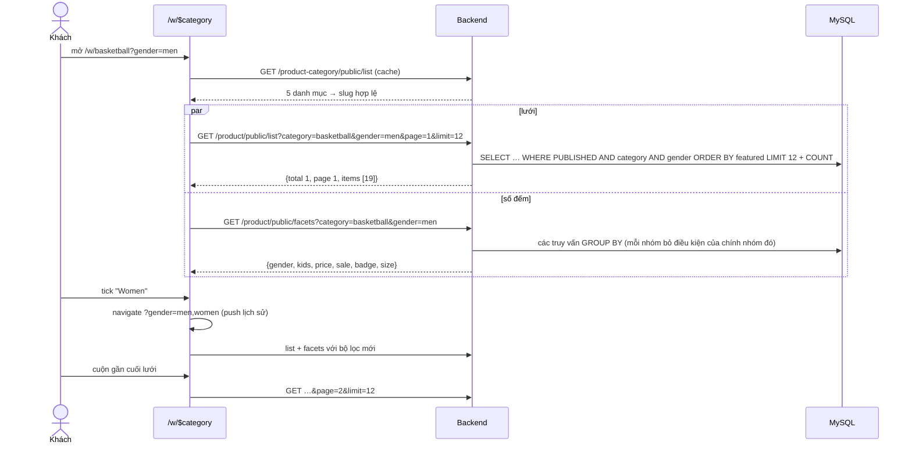
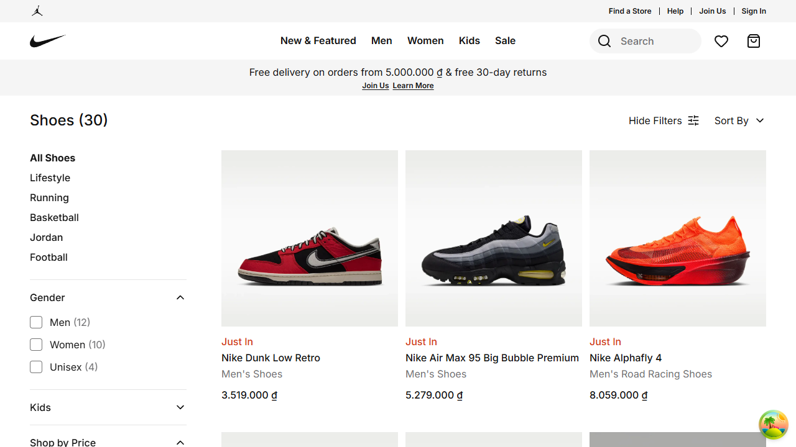
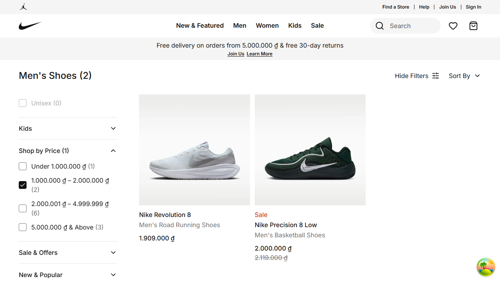
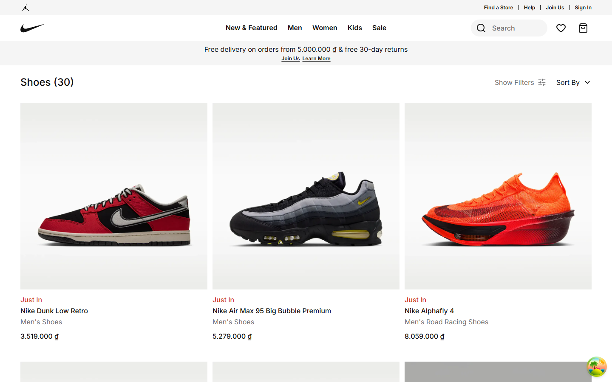
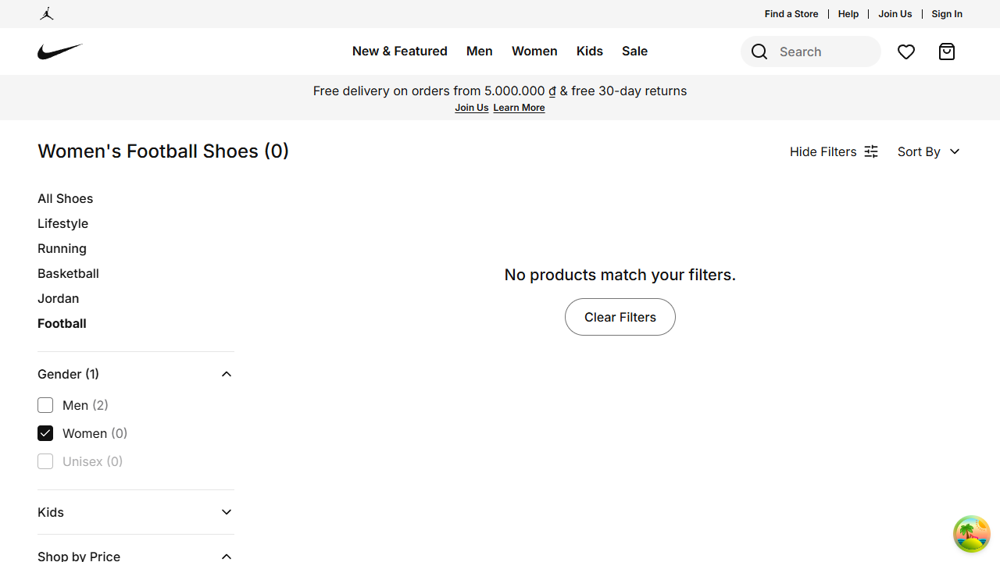
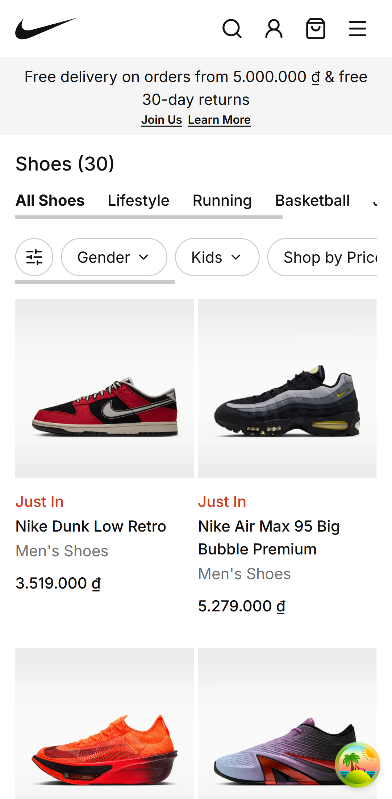
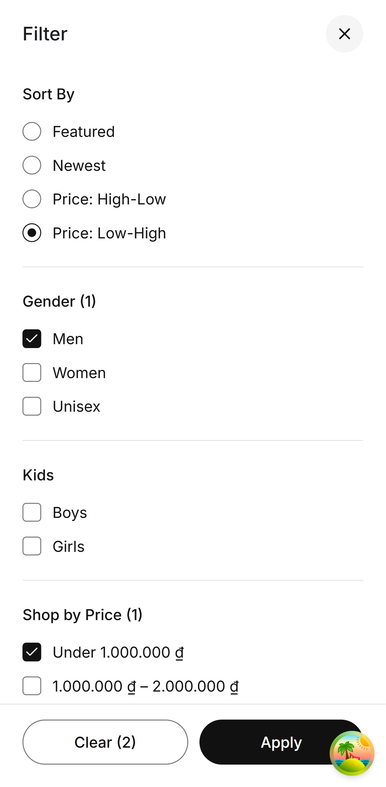

# Danh sách giày: trang /w có bộ lọc, đếm theo bộ lọc, sắp xếp, tải thêm khi cuộn

> Lát 1.4 · plan: [plan/danh-sach-giay.md](../../plan/danh-sach-giay.md) · module: `entity`, `business.product`; `frontend/` (khu cửa hàng), `automation/`

## 1. Mục tiêu

Sau lát 1.3 mọi link vào `/w` (mega menu, menu trượt, trang chủ, khung tìm kiếm) đều dẫn tới trang tạm "Coming Soon". Lát này thay trang tạm bằng **trang danh sách giày thật**: khách (không cần đăng nhập) mở `/w` hoặc `/w/<danh mục>` và thấy lưới sản phẩm, lọc theo giới tính, trẻ em, khoảng giá, giảm giá, nhóm "Just In" / "Bestsellers" và size, sắp xếp 4 kiểu, cuộn để tải thêm. Bộ lọc nằm trên URL nên F5, Back / Forward và chia sẻ link đều giữ nguyên.

Mỗi lựa chọn lọc có số sản phẩm bên cạnh (ví dụ "Men (12)") để khách biết trước khi bấm; lựa chọn ra 0 sản phẩm thì bị mờ.

| Có làm | Không làm (để lát sau) |
|---|---|
| `GET /product/public/list` (lọc + sắp xếp + phân trang) và `GET /product/public/facets` (đếm theo từng lựa chọn), công khai | Trang chi tiết `/t/$slug` (lát `chi-tiet-giay`, vẫn là trang tạm) |
| Trang `/w`, `/w/$category`: tiêu đề có số lượng, sidebar 6 nhóm lọc, "Hide Filters", "Sort By", lưới 3 cột, tải thêm khi cuộn, skeleton, trạng thái rỗng / lỗi, "Related Categories" | Ô banner xen giữa lưới, breadcrumb |
| Mobile: hàng pill lọc, ngăn kéo "Filter" toàn màn hình, lưới 2 cột | ♡ yêu thích trên thẻ (lát `yeu-thich`) |
| Mở rộng hợp đồng URL `/w`: thêm khoá `size`; `price`, `badge` nhận nhiều giá trị ngăn dấu phẩy | Lọc theo màu (dữ liệu không có màu) |
| Danh mục lạ `/w/khong-co` → trang 404 chung | Ghi nhớ vị trí cuộn khi Back từ trang chi tiết |

## 2. Tác nhân và phân quyền

| Tác nhân | Quyền | Ghi chú |
|---|---|---|
| Khách chưa đăng nhập, khách đã đăng nhập, quản trị | `GET /product/public/list`, `GET /product/public/facets` | Công khai nhờ mẫu `^/[a-z0-9-]+/public/.*` của `JwtAuthenticationFilter`, không `checkPermission`, không thêm resource. Token sai / hết hạn vẫn trả 200 |

Chỉ sản phẩm `PUBLISHED` xuất hiện; sản phẩm `HIDDEN` (id 31) không bao giờ có trong `items` và không được đếm trong `facets`.

## 3. Luồng hoạt động

1. Khách rê "Men" ở header → bấm "Basketball" → `/w/basketball?gender=men`.
2. Route nạp danh mục (đã có cache), slug hợp lệ → FE gọi song song `list?category=basketball&gender=men&page=1&limit=12` và `facets` cùng bộ lọc.
3. Trang hiện h1 "Men's Basketball Shoes (1)", thẻ "Nike Precision 8 Low"; sidebar nhóm "Gender (1)" mở, ô "Men" được tick, mỗi lựa chọn có số đếm.
4. Khách tick "Women" → URL thành `?gender=men,women` (thêm một mục lịch sử) → gọi lại hai API, trang cuộn về đầu; trong lúc chờ lưới cũ vẫn hiện, mờ đi (`aria-busy="true"`).
5. Khách cuộn gần cuối lưới → FE gọi `page=2`, và cứ thế cho tới khi đủ `total`.

Luồng thay thế:
- **Sắp xếp**: "Sort By" → "Price: Low-High" → URL thêm `sort=price-asc`; "Featured" → bỏ khoá `sort`.
- **Ẩn bộ lọc**: "Hide Filters" → sidebar ẩn, lưới vẫn 3 cột nhưng thẻ to hơn, nút thành "Show Filters"; không ghi lên URL.
- **Đổi danh mục**: link danh mục đầu sidebar giữ mọi bộ lọc và sắp xếp, bỏ `q`.
- **Từ tìm kiếm**: gõ "air max" + Enter → `/w?q=air+max`, dòng "Search Results for", h1 `air max (2)`; lọc thêm vẫn giữ `q`.
- **Mobile**: bấm pill "Shop by Price" → ngăn kéo "Filter" mở và cuộn tới nhóm đó → chọn → "Apply" ghi lên URL; "Close" / Esc bỏ thay đổi chưa áp dụng.
- **Back từ trang chi tiết**: dữ liệu các trang đã tải còn cache 60 giây nên lưới hiện ngay.

Ngoại lệ:
- Không có sản phẩm khớp → "No products match your filters." + "Clear Filters"; tìm `q` không ra → `We couldn't find anything for "<q>".` + "Shop All Shoes".
- Slug danh mục không có → 404 chung "We can't find the page you're looking for." (API cũng trả 404 "Category not found").
- Giá trị lạ trên URL (`gender=xyz`, `price=abc`, `sort=bad`, `size=abc`) bị bỏ qua, trang vẫn mở.
- `list` lỗi → "Couldn't load products." + "Try Again"; lỗi khi tải thêm → "Couldn't load more products." dưới lưới, các thẻ đã có giữ nguyên; `facets` lỗi → sidebar vẫn đủ lựa chọn nhưng không có số đếm, không ô nào bị mờ.

## 4. Cơ sở dữ liệu

**Không có migration.** Lát dùng bốn bảng của `du-lieu-giay` (`product`, `product_size`, `product_image`, `product_category`) và các index sẵn có. Quy ước dữ liệu:

- **Giá đang bán** = `COALESCE(sale_price, price)`; khoảng giá và sắp xếp theo giá đều dùng giá này.
- **Còn hàng ở size v** = có dòng `product_size` với `size_value = v` và `stock > 0`.
- **Tổng tồn** (`totalStock`) = `COALESCE(SUM(product_size.stock), 0)`.

## 5. API

Mọi response bọc `{ code, message, result }`, prefix `/api`. Cả hai endpoint nằm ở [`ProductPublicController`](../../backend/business/src/main/java/vn/aeoc/business/product/controller/ProductPublicController.java), **không cần token**.

| Method | Đường dẫn | Mô tả |
|---|---|---|
| GET | `/product/public/list` | Danh sách `Page` thẻ sản phẩm (cùng dạng `new-arrivals` / `suggest`), có lọc, `sort`, `page`, `limit` |
| GET | `/product/public/facets` | Số sản phẩm theo từng lựa chọn: `gender`, `kids`, `price`, `sale`, `badge`, `size[]` |

**Tham số lọc** (dùng chung, trùng khoá URL `/w`, mọi tham số tuỳ chọn; server `trim`, so chữ thường, giá trị không nhận ra bị bỏ qua chứ không báo lỗi):

| Tham số | Giá trị | Ý nghĩa |
|---|---|---|
| `category` | `lifestyle`, `running`, `basketball`, `jordan`, `football` | Slug danh mục; không có → 404 |
| `gender`, `kids` | `men`, `women`, `unisex`; `boys`, `girls` (ngăn dấu phẩy) | Gộp thành **một** tập trên cột `gender`, khớp đúng giá trị: `men` không gồm `UNISEX` |
| `price` | `under-1m`, `1m-2m`, `2m-5m`, `5m-plus` (ngăn dấu phẩy) | Khoảng giá đang bán, hai đầu đều tính (1.000.000 thuộc `1m-2m`, 5.000.000 thuộc `5m-plus`) |
| `sale` | `1` | Đang có giá giảm |
| `badge` | `just-in`, `bestseller` (ngăn dấu phẩy) | Nhãn sản phẩm |
| `size` | số EU, ngăn dấu phẩy (`40.5,42`) | Còn hàng ở ít nhất một size đã chọn |
| `q` | chuỗi | Cùng điều kiện với `suggest`: tên / phụ đề / mã, không phân biệt hoa thường / dấu |

Các nhóm khác nhau kết hợp bằng **AND**, các giá trị trong một nhóm bằng **OR**. `list` thêm `sort` (`featured` mặc định, `newest`, `price-desc`, `price-asc`), `page` (< 1 → 1), `limit` (mặc định 12, tối đa 48). "Featured" xếp còn hàng trước, rồi Just In → Bestseller → còn lại, cùng nhóm thì mới trước; sản phẩm hết hàng luôn cuối.

**`facets`** đếm kiểu "bỏ nhóm của chính mình": số cạnh mỗi lựa chọn là số sản phẩm khớp mọi bộ lọc của các nhóm *khác* cộng thêm lựa chọn đó, để tick thêm một ô trong cùng nhóm biết trước sẽ ra bao nhiêu. Khoá luôn đủ, thứ tự cố định, lựa chọn không có sản phẩm trả `0`; `size` liệt kê 18 size EU 35.5 → 47, `label` dạng "EU 42". Ví dụ thật: không tham số → `gender` 12 / 10 / 4, `kids` 2 / 2, `price` 4 / 5 / 16 / 5, `sale` 6, `badge` 8 / 5; `gender=men&price=1m-2m&size=42` → `list` ra 2 sản phẩm (id 13, 19) còn `facets` vẫn cho `price` 1 / 2 / 6 / 3.

| Tình huống | HTTP | Thông báo |
|---|---|---|
| `category` là slug không có (cả `list` lẫn `facets`) | 404 | Category not found |
| `page` / `limit` không phải số nguyên | 400 | Invalid parameter: page / limit |
| Sai method (`POST` vào hai đường dẫn) | 405 | HTTP method not supported |

Điểm đáng chú ý ở phần cài đặt:
- `ProductRepository.catalogCondition(filter, skip)` dựng điều kiện chỉ tham chiếu bảng `PRODUCT` (size qua `EXISTS` trên `product_size`); tham số `skip` chính là cách `facets` bỏ nhóm của chính nó. `list` và mọi truy vấn đếm dùng chung hàm này nên số đếm khớp `total` của `list`.
- `countByPriceRange` dùng một truy vấn `GROUP BY CASE` trên giá đang bán; các hằng số trong CASE dùng `DSL.inline` để SELECT và GROUP BY trùng nhau dưới `ONLY_FULL_GROUP_BY`.
- Kiểm tra danh mục xảy ra **trước** khi truy vấn sản phẩm, nên `category=khong-co&page=abc` vẫn trả 400 do kiểm tham số ở tầng khung.
- Không có cache phía server (dữ liệu nhỏ và `test-support/reset` đổi dữ liệu giữa các lần chạy test).

## 6. Giao diện

**Route và URL.** `routes/_shop/w.index.tsx` và `w.$category.tsx` thay trang tạm; cả hai dùng `catalogSearchSchema` ([`catalog-search.ts`](../../frontend/src/lib/shop/catalog-search.ts)): `price` và `badge` nhận nhiều giá trị, `size` là khoá mới, mọi giá trị đơn cũ vẫn hợp lệ nên link mega menu không đổi. Khi FE ghi URL, giá trị theo thứ tự lựa chọn hiển thị, `size` tăng dần, bỏ khoá rỗng, `sort=featured` bị bỏ; mỗi lần đổi là một mục lịch sử và cuộn `#app-scroll` về đầu.

**Tiêu đề** có dạng `[đối tượng] [danh mục] Shoes (<total>)`: `/w` → "Shoes (30)", `/w?gender=men` → "Men's Shoes (12)", `/w?kids=boys,girls` → "Kids' Shoes (4)", `/w/basketball?gender=men` → "Men's Basketball Shoes (1)"; có `q` thì tiêu đề là chính từ khoá kèm dòng nhỏ "Search Results for". Tab trình duyệt không có số (`Shoes | Nike`).

Trang `/w` ở 1440 px: h1 "Shoes (30)", link danh mục ở đầu sidebar, sáu nhóm lọc (chỉ "Gender" và "Shop by Price" mở), số đếm cạnh mỗi lựa chọn, nút "Hide Filters" / "Sort By" và lưới 3 cột với nhãn "Just In", "Sold Out", "Sale" (TC-14).

Sau khi lọc theo Men, giá 1.000.000 – 2.000.000 ₫ và size EU 42: nhóm nào có lựa chọn thì tự mở và hiện `(n)` cạnh tên, Women bị mờ vì ra 0 sản phẩm, h1 cập nhật số lượng (TC-16).

Sau khi bấm "Hide Filters": sidebar ẩn hẳn, nút đổi thành "Show Filters", lưới vẫn 3 cột nhưng mỗi thẻ rộng hơn (TC-19).

`/w/football?gender=women` không có sản phẩm nào: h1 "Women's Football Shoes (0)", thông báo "No products match your filters." và nút "Clear Filters" (TC-20).

Trang `/w` trên điện thoại: hàng link danh mục và hàng pill lọc cuộn ngang dưới h1, lưới 2 cột, không có sidebar (TC-30).

Ngăn kéo "Filter" toàn màn hình: nhóm "Sort By" dạng radio, các nhóm lọc luôn mở và không có số đếm, hai nút "Clear (n)" / "Apply" dính đáy (TC-29).

**Sidebar (desktop)** có `<nav aria-label="Categories">` ("All Shoes" + 5 danh mục, giữ bộ lọc khi đổi) và 6 nhóm: Gender, Kids, Shop by Price, Sale & Offers, New & Popular, Size (lưới nút bật / tắt `aria-pressed`). Lựa chọn có số đếm 0 và chưa chọn thì `disabled`; lựa chọn đã chọn luôn bấm được để bỏ. Thanh tiêu đề và sidebar dính theo biến CSS `--sh-header-offset` (60 px, về 0 khi header ẩn lúc cuộn xuống).

**Lưới sản phẩm** dùng lại `ProductCard`; trang đầu có 6 skeleton, đổi bộ lọc thì giữ lưới cũ mờ 50%. Tải thêm bằng `IntersectionObserver` (root `#app-scroll`, `rootMargin` 600 px, 12 thẻ mỗi lần, thêm một hàng skeleton) trong hook `use-load-more`. Cuối trang là "Related Categories" (mọi danh mục trừ danh mục đang xem).

**Mobile (< 1024 px)** render riêng theo `useIsDesktop()` (không render cả hai rồi ẩn bằng CSS). Ngăn kéo sửa một **bản nháp** trong state, khởi tạo từ URL mỗi lần mở; "Apply" mới ghi lên URL, ✕ / Esc bỏ bản nháp. Ngăn kéo không hiện số đếm vì số theo URL sẽ sai khi đang tick thêm.

Dữ liệu: `infiniteQueryOptions` cho `list` (`staleTime` 60 giây, `keepPreviousData`) và `queryOptions` cho `facets` (khoá không có `sort`), nên Back từ trang chi tiết dùng lại dữ liệu cũ (TC-28).

## 7. Kiểm thử

Test nghiệm thu viết trước khi code: API ở [`danh-sach-giay.api.spec.js`](../../automation/tests/api/danh-sach-giay.api.spec.js) (TC-01 → TC-13, 38 test), giao diện ở [`danh-sach-giay.spec.js`](../../automation/tests/product-list/danh-sach-giay.spec.js) (TC-14 → TC-30), JUnit ở `ProductCatalogServiceTest` (TC-U1 → TC-U4). Kết quả mong đợi không ghi cứng mà tính từ `products.json` bằng `expectedList`, `expectedFacets`, `catalogTitle` trong `data/seed-products.js`; các ca lọc data-driven nằm ở `data/catalog-filters.json`. Page object mới: `ProductListPage`, `FilterSidebar`, `FilterDrawer`.

| ID | Loại | Nội dung | Kết quả |
|---|---|---|---|
| TC-01 | api | Danh sách mặc định `@smoke`: 30 sản phẩm, 12 thẻ đúng thứ tự, không có id 31 | Pass |
| TC-02 | api | Phân trang 3 trang + trang 4 rỗng, id 9 (Sold Out) cuối cùng | Pass |
| TC-03 | api | 4 kiểu sắp xếp (data-driven), giá đang bán không giảm / không tăng | Pass |
| TC-04 | api | Lọc từng nhóm + giá trị biên 1.000.000 / 2.000.000 / 4.999.000 / 5.000.000 | Pass |
| TC-05 | api | Kết hợp nhiều nhóm (AND giữa nhóm, OR trong nhóm) | Pass |
| TC-06 | api | Lọc size = còn hàng ở size đó | Pass |
| TC-07 | api | Tham số lạ bị bỏ qua, chữ hoa vẫn nhận | Pass |
| TC-08 | api | Facets mặc định, 18 size, `label` không có ".0" | Pass |
| TC-09 | api | Facets "bỏ nhóm của chính mình", mọi số khớp `total` của `list` | Pass |
| TC-10 | api | Facets theo danh mục / từ khoá | Pass |
| TC-11 | api | Danh mục không tồn tại → 404; `page=abc` kèm danh mục lạ → 400 | Pass |
| TC-12 | api | Biên `page` / `limit` | Pass |
| TC-13 | api | Công khai (token sai vẫn 200), sai method → 405 | Pass |
| TC-14 | e2e | Trang `/w` mặc định (desktop) `@smoke` | Pass |
| TC-15 | e2e | Tải thêm khi cuộn + skeleton, không gọi `page=4` | Pass |
| TC-16 | e2e | Lọc bằng checkbox, số đếm cập nhật, cuộn về đầu | Pass |
| TC-17 | e2e | URL giữ trạng thái: mở thẳng, F5, Back / Forward | Pass |
| TC-18 | e2e | Sắp xếp 4 kiểu (data-driven) | Pass (sau 1 vòng sửa) |
| TC-19 | e2e | Ẩn / hiện bộ lọc, vẫn 3 cột | Pass |
| TC-20 | e2e | Trạng thái rỗng + "Clear Filters", tìm không ra | Pass |
| TC-21 | e2e | Từ khung tìm kiếm sang kết quả, giữ `q` khi lọc thêm | Pass |
| TC-22 | e2e | Vào từ menu / trang chủ ra đúng kết quả | Pass |
| TC-23 | e2e | Link danh mục giữ bộ lọc + "Related Categories" | Pass |
| TC-24 | e2e | Danh mục lạ → 404; tham số lạ không vỡ trang | Pass |
| TC-25 | e2e | Lưới size (18 nút, bật / tắt, mờ theo giới tính) | Pass |
| TC-26 | e2e | Thanh tiêu đề + sidebar dính khi cuộn | Pass |
| TC-27 | e2e | Lỗi mạng / chậm (network mocking, 4 ca) | Pass (xem mục 8) |
| TC-28 | e2e | Back từ trang sản phẩm dùng lại dữ liệu | Pass |
| TC-29 | e2e | Ngăn kéo lọc (mobile) | Pass |
| TC-30 | e2e | Bố cục mobile | Pass |
| TC-31 | e2e | Hồi quy: `tieng-anh-cua-hang` TC-13 / TC-14 (đã sửa), `giao-dien-nike`, `dang-nhap-nike`, `go-lut`, `pnpm test:smoke` | Pass (xem mục 8) |
| TC-U1 | unit | Chuẩn hoá bộ lọc, `parseSort` | Pass |
| TC-U2 | unit | Kẹp `page` / `limit` | Pass |
| TC-U3 | unit | Danh mục không tồn tại → 404, không gọi `ProductRepository` | Pass |
| TC-U4 | unit | Ghép facets: đủ khoá, thứ tự, nhãn size | Pass |

| Tổng hợp | Kết quả |
|---|---|
| JUnit `ProductCatalogServiceTest` | 8/8 pass (gồm TC-U1 → TC-U4) |
| Playwright API `danh-sach-giay.api.spec.js` | 38/38 pass; toàn bộ nhóm API 112/112 pass |
| Playwright giao diện lát này, chromium (`--headed`, slowMo 400) | 15/15 pass; mobile-chrome 2/2 pass |
| Playwright giao diện lát này, firefox / webkit | 15/15 pass mỗi trình duyệt |
| Hồi quy TC-31 | `tieng-anh-cua-hang` 3 trình duyệt xanh; `giao-dien-nike` + `dang-nhap-nike` + `go-lut` 150/152; `pnpm test:smoke` 73/76 với 8 worker, chạy lại firefox `@smoke` 4 worker 16/16 |
| `pnpm build`, `pnpm lint` (frontend, automation) | Xanh; frontend 0 lỗi, 1 cảnh báo có sẵn (`data-table-advanced.tsx`) |

Số vòng sửa: backend 0 (38/38 API xanh ngay lần đầu), frontend 1 (TC-18: Radix `DropdownMenu` khi bấm lại nút lúc menu cũ còn đang mờ dần thì trả focus về nút muộn, làm menu mới đóng ngay; sửa bằng tắt hiệu ứng đóng `data-[state=closed]:animate-none!`, không sửa spec).

## 8. Điểm lệch plan và việc còn lại

- **Danh mục ở `/w`** nạp bằng `prefetchQuery` (không ném lỗi) thay vì `ensureQueryData`, để danh mục lỗi chỉ còn link "All Shoes" đúng §6.3 của plan; `/w/$category` vẫn dùng `ensureQueryData` + `notFound()` + `errorComponent`.
- Khi đổi bộ lọc, h1 tạm chỉ hiện tiêu đề (chưa có số) tới khi có `total` mới, để không hiện số cũ sai.
- Schema `size` nhận số hoặc chuỗi vì router đọc `size=42` thành số; một size ghi lại dạng số (`size=42`, không bọc ngoặc kép).
- shadcn `toggle` thêm bằng CLI sinh sai `import { cn } from "cn"` và cài nhầm gói npm `cn`; đã sửa import và gỡ gói.
- Ca chập chờn khi chạy nhiều worker (đúng rủi ro đã nêu ở plan §11): TC-27 firefox hết 30 giây một lần với 4 worker (chạy riêng 3/3 xanh); TC-16 firefox bấm trượt khi header ẩn / hiện làm sidebar dịch chuyển (chạy riêng 5/5 xanh); TC-22 footer firefox / webkit của `giao-dien-nike` hết 30 giây dưới tải (chạy riêng 4/4 xanh). Khuyến nghị chạy firefox / webkit với `--workers=4`.
- Ảnh tài liệu chụp từ `pnpm dev` nên góc phải dưới có nút TanStack Query devtools.
- Spec cũ `tieng-anh-cua-hang.spec.js` TC-13 (h1 = tiêu đề + số tính từ href menu) và TC-14 (h1 "Shoes (30)") được sửa theo plan này vì trang tạm "Coming Soon" đã bị thay; ý nghĩa ca kiểm giữ nguyên.
- Câu cũ "Claude không sửa `backend/src`" trong `backend/CLAUDE.md` đã sửa theo `CLAUDE.md` gốc.
- Còn lại: lọc theo màu, ô banner xen lưới, breadcrumb, ♡ yêu thích trên thẻ, khôi phục vị trí cuộn khi Back, trang chi tiết `/t/$slug` thuộc các lát sau; visual regression / a11y của trang thuộc lát kiểm thử giao diện.
