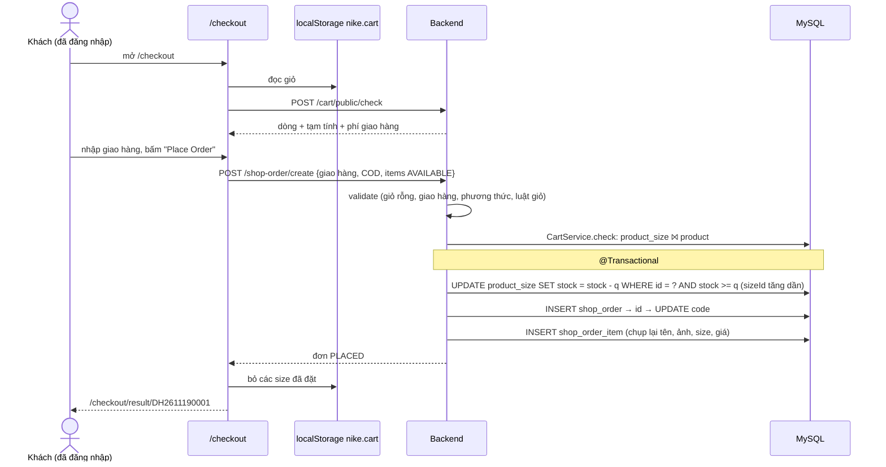
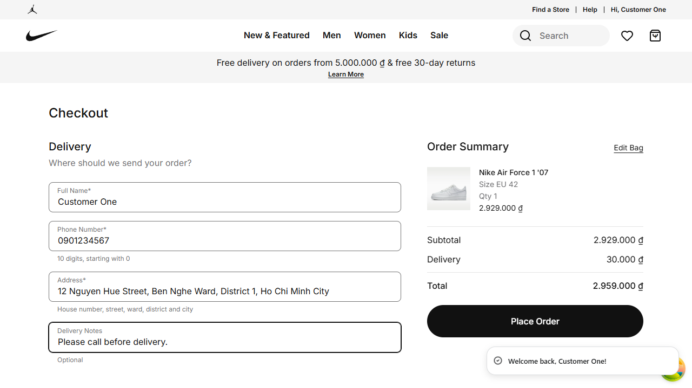
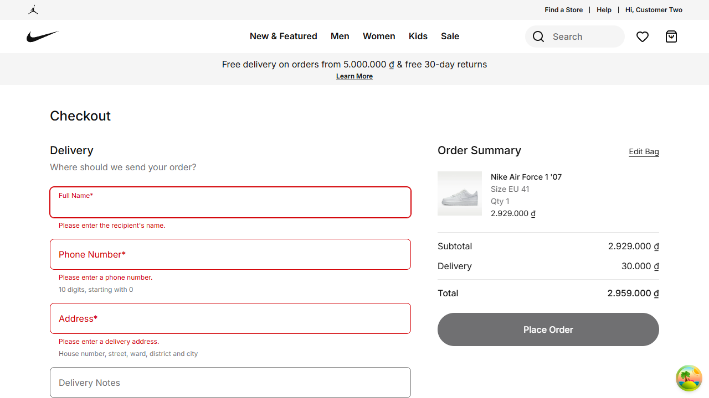
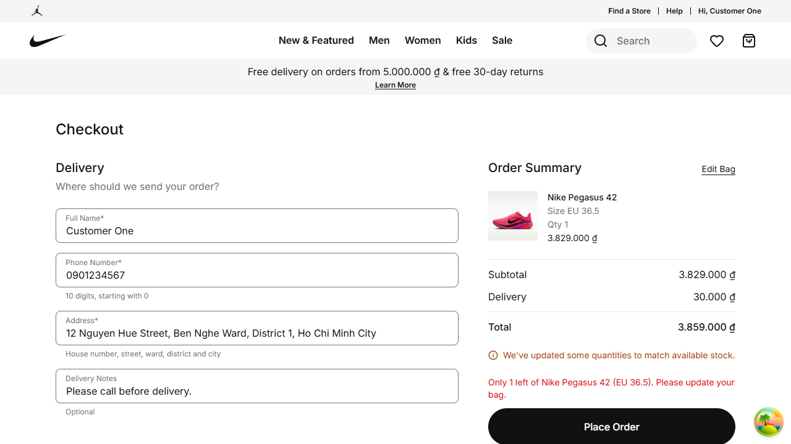
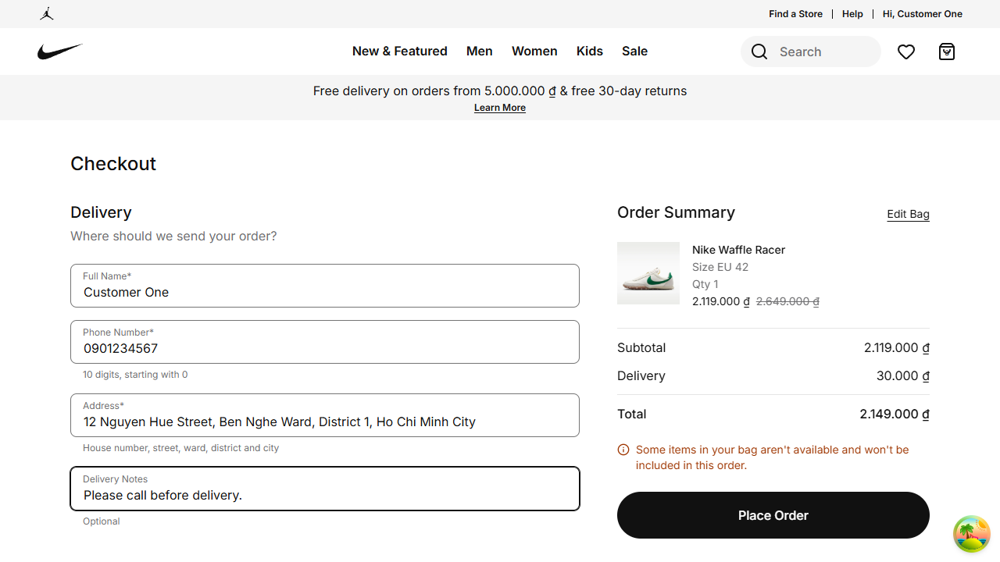
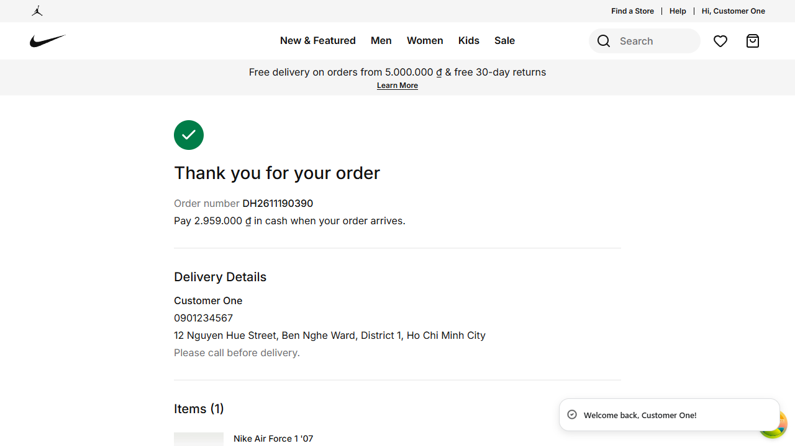
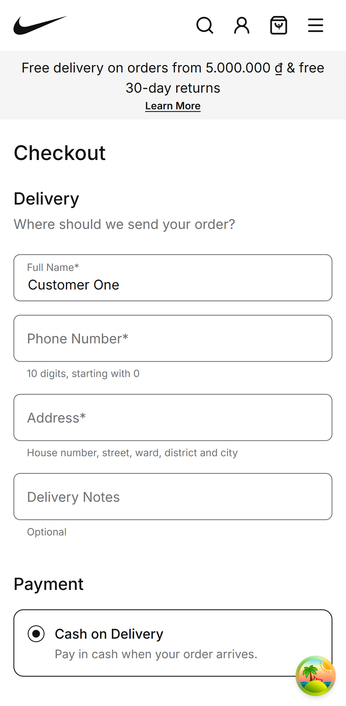
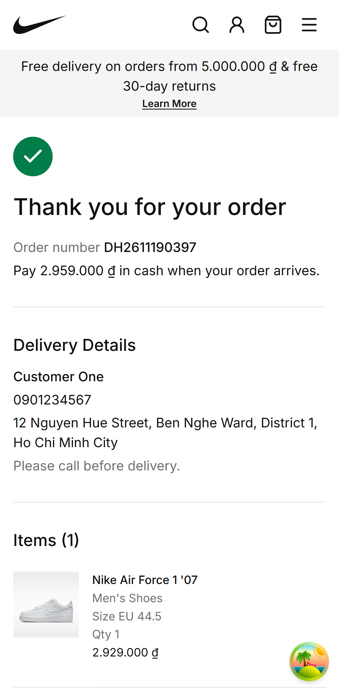

# Đặt hàng COD: trang /checkout, tạo đơn + trừ kho, trang xác nhận

> Lát 2.3 · plan: [plan/dat-hang.md](../../plan/dat-hang.md) · module: `entity`, `business.shoporder`, `business.product`; `frontend/` (khu cửa hàng), `automation/`

## 1. Mục tiêu

Sau lát `gio-hang`, nút "Checkout" mới dẫn tới một trang tạm. Lát này làm trọn vòng mua hàng cho khách **đã đăng nhập**: mở `/checkout`, nhập thông tin giao hàng, chọn "Cash on Delivery", xem "Order Summary" rồi bấm **Place Order**. Server tính lại giá từ DB, **trừ kho có điều kiện trong cùng một transaction** (hai khách tranh đôi cuối thì chỉ một người mua được, tồn kho không bao giờ âm), sinh mã đơn và chụp lại thông tin sản phẩm vào dòng đơn. Đặt xong, các dòng đã đặt biến mất khỏi giỏ và khách sang trang xác nhận `/checkout/result/$code`.

Lát 2.3 của thiết kế tổng được tách làm ba để vừa cỡ hai phiên làm việc: `dat-hang` (đơn COD, lát này), `thanh-toan-payos` (2.3a) và `don-cua-toi` (2.4).

| Có làm | Không làm (để lát sau) |
|---|---|
| Migration V21: bảng `shop_order`, `shop_order_item` (chụp lại tên / ảnh / size / giá lúc đặt) | Phương thức payOS, webhook, trang thanh toán giả, job huỷ đơn quá hạn (`thanh-toan-payos`) |
| `POST /shop-order/create` (chỉ `COD`): validate, giá từ DB, phí giao hàng, trừ kho có điều kiện, rollback cả đơn khi một bước lỗi | Danh sách đơn của tôi, huỷ đơn + hoàn kho, `/orders` (`don-cua-toi`) |
| `GET /shop-order/get?code=`: chỉ chủ đơn xem được | Quản trị đơn, đổi trạng thái, resource `SHOP_ORDER` (`quan-ly-don-hang`) |
| `POST /test-support/stock` (đặt tồn kho một size, chỉ profile local / test); `test-support/reset` xoá luôn đơn | Sổ địa chỉ, nhớ địa chỉ lần trước, mã giảm giá, email xác nhận, header thu gọn |
| Trang `/checkout` thật, trang xác nhận `/checkout/result/$code`, "Order Not Found" | Ca kiểm "giá trong đơn không đổi khi quản trị sửa giá" (cần API sửa giá của `quan-ly-giay`) |
| Pha test `@stock` chạy riêng cho test tạo đơn / đổi tồn kho | |

## 2. Tác nhân và phân quyền

| Tác nhân | Quyền | Ghi chú |
|---|---|---|
| Người đã đăng nhập (mọi chức vụ) | `POST /shop-order/create`, `GET /shop-order/get` | Chỉ cần token hợp lệ (filter JWT chặn khi thiếu), không `checkPermission`, không resource. `get` chỉ trả đơn có `user_id` là người gọi; admin cũng không xem được đơn của khách ở endpoint này |
| Chưa đăng nhập | — | API: 401 "Please sign in". Giao diện: `/checkout` và `/checkout/result/$code` chuyển sang `/signin?redirect=<đường dẫn>` |
| Operator (`admin@nike.local`) | `POST /test-support/stock` | Như `test-support/reset`; controller chỉ tồn tại ở profile `local` / `test` |

## 3. Luồng hoạt động

1. Khách chưa đăng nhập ở `/t/nike-air-force-1-07`, chọn "EU 42", "Add to Bag", bấm "Checkout" trong popup → `/signin?redirect=/checkout` → đăng nhập `khach1@nike.local` → về `/checkout`.
2. Trang gọi `POST /cart/public/check` với giỏ và hiện "Order Summary": 1 dòng "Nike Air Force 1 '07", "Size EU 42", "Qty 1", "2.929.000 ₫"; Subtotal 2.929.000 ₫, Delivery 30.000 ₫, Total 2.959.000 ₫. Ô "Full Name" điền sẵn theo tài khoản, "Cash on Delivery" đã chọn.
3. Khách nhập "Phone Number", "Address", "Delivery Notes" (tuỳ chọn) rồi bấm **Place Order**; nút đổi thành "Placing Order…" và khoá.
4. `POST /shop-order/create`: server kiểm lại giỏ + tồn kho, trừ kho size 106 từ 20 xuống 19, ghi đơn `PLACED` cùng một dòng đơn, trả đơn `DH2611190001`.
5. FE bỏ size đã đặt khỏi giỏ `nike.cart` rồi chuyển (thay lịch sử) sang `/checkout/result/DH2611190001`: "Thank you for your order", mã đơn, "Pay 2.959.000 ₫ in cash when your order arrives.", thông tin giao hàng, các dòng, tổng, "Continue Shopping".

Luồng thay thế:
- **Giỏ có dòng không mua được** (hết hàng / ngừng bán): không hiện ở "Order Summary", không gửi lên server, có thông báo "Some items in your bag aren't available and won't be included in this order."; đặt xong các dòng này vẫn nằm trong giỏ.
- **Số lượng vượt tồn kho lúc mở trang**: tự giảm về tồn kho như trang `/cart` + "We've updated some quantities to match available stock."
- **Tồn kho đổi giữa lúc xem và lúc bấm**: server trả 400 "Only 1 left of Nike Pegasus 42 (EU 36.5). Please update your bag." hiện trên nút, trang tải lại giỏ (giảm số lượng), khách bấm lại để đặt.
- **Hai khách tranh đôi cuối**: một đơn thành công, người kia nhận "… is sold out. Please update your bag."
- **Đặt nhiều dòng**: trừ kho theo thứ tự `sizeId` tăng dần (tránh deadlock khi hai đơn khoá chéo); một dòng lỗi thì rollback cả đơn, dòng trừ trước đó được trả lại.
- **Giỏ trống / không còn dòng mua được**: "Your bag is empty." + "Shop All Shoes", hoặc "None of the items in your bag are available right now." + "Go to Bag"; không có nút "Place Order".
- **Mobile**: một cột theo thứ tự Delivery → Payment → Order Summary.

Ngoại lệ:
- Form thiếu / sai → lỗi dưới ô, focus ô lỗi đầu tiên, không gọi API.
- Mạng lỗi / server 500 → thông báo trên nút, giỏ giữ nguyên, bấm lại được; bấm hai lần chỉ gửi một request.
- Gọi API trực tiếp với dữ liệu sai → 400; giá, tổng, trạng thái, chủ đơn client gửi kèm đều bị bỏ qua.
- Lỗi ghi DB sau khi đã trừ kho (chuỗi dài quá cột) → 400 "Invalid request", rollback, tồn kho không đổi.
- Mở `/checkout/result/<mã>` của người khác hoặc mã không có → "Order Not Found".

## 4. Cơ sở dữ liệu

Migration [`V21__dat_hang.sql`](../../backend/app/src/main/resources/db/migration/V21__dat_hang.sql), không thêm resource / permission.

**`shop_order`**: `id`, `code` (UNIQUE, chỉ NULL trong lúc transaction đang tạo đơn), `user_id` (FK `user_app`), `receiver_name`, `phone`, `address`, `note` (rỗng → NULL), `item_count`, `subtotal`, `shipping_fee`, `total`, `payment_method` (lát này chỉ `COD`), `status` (lát này chỉ `PLACED`), `created_time`, `updated_time`; index `idx_shop_order_user (user_id, created_time)` cho `my-list` của lát sau.

**`shop_order_item`** chụp lại lúc đặt nên sửa / ẩn sản phẩm sau đó không làm đổi đơn: `order_id` (FK, ON DELETE CASCADE), `size_id` / `product_id` (FK, ON DELETE SET NULL), `product_slug`, `product_name`, `product_subtitle`, `size_label`, `image_url`, `unit_price` (`salePrice ?? price` lúc đặt), `quantity` (1–10), `line_total`.

**Mã đơn** = `DH` + `yyMMdd` (ngày của `created_time`) + 4 số `id % 10000`, ví dụ id 7 ngày 19/11/2026 → `DH2611190007`. Mã lấy từ `id` nên không đụng nhau khi tạo song song và không cần bảng đếm; unique của DB vẫn chặn trùng.

`POST /test-support/reset` xoá toàn bộ `shop_order_item` rồi `shop_order` trước khi xoá bảng sản phẩm.

## 5. API

Mọi response bọc `{ code, message, result }`, prefix `/api`; body / response là entity `ShopOrder`, `ShopOrderItem` (không DTO). Controller: [`ShopOrderController`](../../backend/business/src/main/java/vn/aeoc/business/shoporder/controller/ShopOrderController.java), nghiệp vụ ở [`ShopOrderService`](../../backend/business/src/main/java/vn/aeoc/business/shoporder/service/ShopOrderService.java), trừ kho ở [`ProductStockService`](../../backend/business/src/main/java/vn/aeoc/business/product/service/ProductStockService.java).

| Method | Đường dẫn | Quyền | Mô tả |
|---|---|---|---|
| POST | `/shop-order/create` | đã đăng nhập | Tạo đơn COD từ `{ receiverName, phone, address, note, paymentMethod: "COD", items: [{ sizeId, quantity }] }`; trả đơn đọc lại từ DB (có `items`) |
| GET | `/shop-order/get?code=` | đã đăng nhập, chỉ chủ đơn | Trả đơn; không có / của người khác / `code` rỗng → 404 "Order not found." |
| POST | `/test-support/stock` | operator, profile `local` / `test` | Body `{ id, stock }`, đặt tồn kho một size để chuẩn bị dữ liệu test |

Thứ tự kiểm khi tạo đơn (gặp lỗi đầu tiên thì dừng; bước 1–5 không ghi DB):

1. Thiếu token → 401; body hỏng / sai kiểu → "Malformed request body".
2. `items` thiếu / rỗng → "Your bag is empty."
3. Thông tin giao hàng sau trim: tên → SĐT → địa chỉ rỗng thì báo "Please enter the recipient's name." / "Please enter a phone number." / "Please enter a delivery address." Backend không kiểm định dạng SĐT hay độ dài (việc của FE).
4. `paymentMethod` khác đúng chuỗi `"COD"` → "This payment method is not available."
5. Luật giỏ của lát `gio-hang` qua `CartService.check` (tối đa 50 dòng, `sizeId` hợp lệ, số lượng 1–10, không trùng size).
6. Duyệt dòng theo thứ tự request; dòng đầu tiên không `AVAILABLE` → "An item in your bag is no longer available. Please update your bag." / "`<tên>` (`<size>`) is sold out. Please update your bag." / "Only `<n>` left of `<tên>` (`<size>`). Please update your bag."
7. Trừ kho theo `sizeId` tăng dần bằng `UPDATE product_size SET stock = stock - q WHERE id = ? AND stock >= q`; 0 dòng (bị người khác mua trước) thì kiểm lại dòng đó và báo lỗi theo trạng thái mới, transaction rollback.
8. Ghi đơn, mã đơn và các dòng chụp lại; lỗi DB → 400 "Invalid request" + rollback.

Điểm đáng chú ý ở phần cài đặt:
- `create` chạy `@Transactional(isolation = READ_COMMITTED)`. Với REPEATABLE READ mặc định, lần kiểm lại ở bước 7 đọc snapshot đầu transaction nên báo sai trạng thái dòng vừa bị mua trước.
- Tổng tiền, trạng thái, chủ đơn, thời gian đều do server ghi đè; field client gửi kèm bị bỏ qua.
- Gói `shoporder` gọi kho qua `ProductStockService`, không gọi repository của gói `product`.

## 6. Giao diện

Thành phần ở `components/shop/checkout/` (`CheckoutPage`, `DeliveryForm`, `PaymentMethod`, `CheckoutSummary`, `CheckoutEmpty`, `CheckoutSkeleton`) và `components/shop/order/` (`OrderResultPage`, `OrderItems`, `OrderTotals`, `OrderNotFound`, `OrderSkeleton`; lát `don-cua-toi` dùng lại `OrderItems` / `OrderTotals`). Form kiểm bằng zod ở `lib/shop/checkout-form.ts`; hàm `requireShopSignIn` (`lib/shop/require-sign-in.ts`) dùng ở `beforeLoad` của hai route `checkout.index.tsx` (`<title>` "Checkout | Nike") và `checkout.result.$code.tsx` ("Order Confirmation | Nike"). Desktop (≥ 1024 px) hai cột, mobile một cột theo `useIsDesktop()`.

`/checkout` desktop: cột trái là Delivery (Full Name điền sẵn) và Payment ("Cash on Delivery"), cột phải là "Order Summary" dính khi cuộn với Subtotal, Delivery, Total và nút "Place Order" (TC-14).

**Validate form** (kiểm khi bấm "Place Order", lỗi dưới từng ô, focus ô lỗi đầu tiên, sửa ô nào thì lỗi ô đó mất): tên bắt buộc, tối đa 100 ký tự; SĐT bỏ khoảng trắng / `.` / `-` rồi phải khớp `^0\d{9}$`; địa chỉ bắt buộc, tối đa 255; ghi chú tuỳ chọn, tối đa 255.

Bấm "Place Order" khi để trống ba ô bắt buộc: ba thông báo đỏ, ô tên `aria-invalid` và đang giữ focus, không có request nào gửi đi (TC-17).

Tồn kho giảm xuống 1 sau khi mở trang: nút hiện "Only 1 left of Nike Pegasus 42 (EU 36.5). Please update your bag." và trang tự giảm "Qty" kèm "We've updated some quantities to match available stock." (TC-18).

Giỏ có thêm hai dòng hết hàng / ngừng bán: "Order Summary" chỉ còn dòng mua được (giá giảm kèm giá gạch), có thông báo "Some items in your bag aren't available and won't be included in this order." (TC-19).

**Bấm "Place Order"**: nút là `type="submit"` của form (Enter trong ô cũng đặt hàng) và có khoá `useRef` chống bấm hai lần trước khi React kịp vẽ "Placing Order…". Thành công thì `removeMany` bỏ đúng các `sizeId` đã gửi khỏi giỏ **trước** khi `navigate` (`replace: true`, nên Back không quay lại form đã đặt). Lỗi có message từ server hiện nguyên văn trên nút và tải lại giỏ; lỗi không có phản hồi hiện "Couldn't place your order. Please check your connection and try again." Mutation dùng `meta: { silentError: true }` nên lỗi hiện trong trang, không có toast.

`/checkout/result/$code`: dấu ✓ xanh, "Thank you for your order", mã đơn, dòng "Pay … in cash when your order arrives.", Delivery Details, danh sách dòng (ảnh và tên là link tới trang sản phẩm), Subtotal / Delivery / Total, "Payment Method — Cash on Delivery" và nút "Continue Shopping" (TC-14, TC-15).

Trang xác nhận tải `GET /shop-order/get` (404 không thử lại, lỗi khác thử lại một lần); đơn không thấy → "Order Not Found", lỗi tải → "Couldn't load your order." + "Try Again".

Trên điện thoại `/checkout` một cột: Delivery nằm trên Payment và Order Summary, ô nhập rộng hết khối, "Place Order" ở cuối (TC-23).

Trang xác nhận trên điện thoại cũng một cột, không cuộn ngang (TC-23).

## 7. Kiểm thử

Test nghiệm thu viết trước khi code: API ở [`dat-hang.api.spec.js`](../../automation/tests/api/dat-hang.api.spec.js) (TC-01 → TC-13), giao diện ở [`dat-hang.spec.js`](../../automation/tests/checkout/dat-hang.spec.js) (TC-14 → TC-23), JUnit ở [`ShopOrderServiceTest`](../../backend/business/src/test/java/vn/aeoc/business/shoporder/service/ShopOrderServiceTest.java), [`ProductStockServiceTest`](../../backend/business/src/test/java/vn/aeoc/business/product/service/ProductStockServiceTest.java) và [`ShoeSeedResetTest`](../../backend/app/src/test/java/vn/aeoc/app/ShoeSeedResetTest.java). Cả hai spec nằm trong `test.describe('… @stock')`.

**Pha `@stock`.** Nhiều spec cũ so tồn kho chính xác với `products.json` nên không thể chạy chung với test tạo đơn. `pnpm test*` đi qua `scripts/run-phases.mjs`: pha thường (trừ `@stock`) rồi pha `@stock` (`E2E_STOCK=1`), mỗi pha reset dữ liệu. Test API đặt lại tồn kho các size của mình bằng `setStock` ở đầu test; test giao diện cần đặt tồn kho dùng size riêng theo project (`laneOf`).

| ID | Loại | Nội dung | Kết quả |
|---|---|---|---|
| TC-01 | api | Đặt COD hai dòng: giá giảm, chụp lại dòng đơn, `get` = `create`, trừ kho | Pass |
| TC-02 | api | Phí giao hàng biên (4 ca: 4.999.000, 5.000.000, 5 × 1.000.000, giá giảm 815.000) | Pass |
| TC-03 | api | Field do server quản, giá theo DB (bỏ qua `id`, `code`, `userId`, `status`, tổng client gửi) | Pass |
| TC-04 | api | Validate (17 ca) và tồn kho không đổi sau các ca lỗi | Pass |
| TC-05 | api | Dòng không mua được (7 ca, báo dòng lỗi đầu tiên theo thứ tự request) | Pass |
| TC-06 | api | Mua đúng hết tồn kho, lần sau báo hết hàng | Pass |
| TC-07 | api | Tranh mua đôi cuối đồng thời (2 người × 3 vòng; 5 request / 3 tồn) | Pass |
| TC-08 | api | Chuẩn hoá chuỗi (trim, ghi chú rỗng → `null`) | Pass |
| TC-09 | api | Mã đơn: ba đơn song song, khác nhau, đúng `DH` + yyMMdd + `id % 10000` | Pass |
| TC-10 | api | Xem đơn: chỉ chủ đơn (khach2, admin → 404; thiếu tham số → 400) | Pass |
| TC-11 | api | Đăng nhập (401 thiếu / sai token) + sai method (405) | Pass |
| TC-12 | api | `test-support/stock` (operator, quyền, 404, validate) | Pass |
| TC-13 | api | Rollback khi ghi đơn lỗi (địa chỉ 300 ký tự), tồn kho vẫn 20 | Pass |
| TC-14 | e2e | Đặt COD từ trang chi tiết khi chưa đăng nhập (đi vòng qua `/signin`) | Pass |
| TC-15 | e2e | Nhiều dòng, miễn phí giao hàng, Back sau khi đặt không quay lại `/checkout` | Pass |
| TC-16 | e2e | Bắt đăng nhập ở route, quay lại trang xác nhận → "Order Not Found" | Pass |
| TC-17 | e2e | Validate form (9 nhóm ca, gồm biên hợp lệ) | Pass |
| TC-18 | e2e | Tồn kho đổi trước khi bấm "Place Order", bấm lại thì đặt được | Pass |
| TC-19 | e2e | Giỏ có dòng không mua được: chỉ đặt dòng mua được, các dòng kia ở lại giỏ | Pass |
| TC-20 | e2e | Giỏ trống / không còn gì để đặt | Pass |
| TC-21 | e2e | Lỗi mạng (500, `abort`), request chậm, bấm hai lần chỉ một request | Pass |
| TC-22 | e2e | Trang xác nhận: đơn của người khác, lỗi tải + "Try Again" | Pass |
| TC-23 | e2e | Bố cục mobile (mobile-chrome) | Pass |
| TC-24 | e2e | Hồi quy: `gio-hang`, `tieng-anh-cua-hang`, `chi-tiet-giay`, smoke, API | Pass, trừ 1 test cũ (xem mục 8) |
| TC-U1 | unit | Thứ tự validate, không gọi `CartService` / kho / repository khi lỗi | Pass |
| TC-U2 | unit | Dòng không mua được (không trừ kho, không ghi đơn) | Pass |
| TC-U3 | unit | Tạo đơn thành công: thứ tự trừ kho, field ghi đè, mã đơn, dòng chụp lại | Pass |
| TC-U4 | unit | Trừ kho thất bại (bị mua trước) → "sold out", không ghi đơn | Pass |
| TC-U5 | unit | Sinh mã đơn (`DH2611190007`, `DH2611192345`, `DH2601020000`) | Pass |
| TC-U6 | unit | `get`: người khác / không có → 404, chủ đơn có `items` | Pass |
| TC-U7 | unit | `ProductStockService.setStock` (404, 400 × 2, thành công) | Pass |
| TC-U8 | unit | Reset xoá đơn + khôi phục tồn kho (tích hợp, cần DB local) | Pass |

| Tổng hợp | Kết quả |
|---|---|
| JUnit `ShopOrderServiceTest` + `ProductStockServiceTest` + `ShoeSeedResetTest` | 6 + 2 + 2 = 10/10 pass (TC-U1 → TC-U8); toàn bộ test của `business` 0 lỗi |
| Playwright API `dat-hang` (pha `@stock`) | 16/16 pass; `--repeat-each=3` 48/48 |
| Playwright giao diện, chromium (`--headed`, slowMo 400) + mobile-chrome | 10/10 pass (TC-14 → TC-22 chromium, TC-23 mobile-chrome) |
| Playwright giao diện, chromium + firefox `--repeat-each=3` | 54/54 pass |
| Playwright giao diện, webkit `--repeat-each=3` | 27/27 pass |
| `pnpm test:api` (hai pha) | 130 + 16 pass |
| `pnpm test:smoke` (hai pha) | 94/94 + 8/8 pass |
| Hồi quy TC-24 (`gio-hang`, `tieng-anh-cua-hang`, `chi-tiet-giay`, 5 project) | 215 pass, 1 đỏ có từ trước lát này |
| `pnpm build`, `pnpm lint` | Xanh; frontend 1 cảnh báo cũ, automation 18 cảnh báo cũ |

Số vòng sửa: backend 2 (đổi isolation sang READ_COMMITTED sau khi thiết kế ca tranh mua; sửa spec TC-12 cho đúng message có sẵn của `checkPermission`), frontend 5 khi chạy E2E (xem mục 8).

## 8. Điểm lệch plan và việc còn lại

- **Isolation `READ_COMMITTED`** cho `create` (mục 5): plan chưa nêu, cần để lần kiểm lại sau khi trừ kho thất bại thấy dữ liệu mới.
- **Plan TC-12 / §5.5 sửa cho đúng hệ thống**: người không phải operator gọi `test-support/stock` nhận message có sẵn "You don't have permission to perform this action. Path: /test-support/, Action: UPDATE" (như `test-support/reset`), không phải "Access denied".
- **Chi tiết cài đặt FE** (không đổi hợp đồng API hay chuỗi giao diện): nút "Place Order" là `submit` của form kèm khoá `useRef`; lúc chờ đối soát, dòng `INSUFFICIENT_STOCK` vẫn hiện với số lượng mua được (nút khoá) để danh sách không nháy rỗng; cột Order Summary không có `transition-[top]` vì khi header ẩn / hiện cột trượt dần làm Playwright click trượt khỏi nút (TC-18 firefox); `removeMany` chạy trước `navigate` (làm ngược thì TC-19 webkit đọc giỏ còn dòng đã đặt).
- **Sửa kỹ thuật test cho WebKit** (ý nghĩa ca kiểm giữ nguyên): WebKit báo trễ `history.replaceState` của router thành điều hướng mới và cắt ngang `goto` kế tiếp, nên `setCart` chờ `networkidle` sau khi mở `/` và TC-16 `goto('about:blank')` trước khi mở trang xác nhận.
- **Spec cũ sửa theo plan**: `gio-hang` TC-21 kiểm h1 "Checkout" thay cho "Coming Soon"; `shop-routes.json` bỏ `/checkout` (khách chưa đăng nhập bị chuyển sang `/signin`); quét chữ tiếng Việt của hai trang mới chuyển sang TC-14 / TC-23.
- **Còn đỏ, không thuộc lát này**: `chi-tiet-giay` TC-24 ("Back giữ vị trí cuộn") trên chromium, đã ghi ở tài liệu `gio-hang` và `chi-tiet-giay`, chờ quyết định riêng.
- Một vài test firefox của lát cũ có lúc quá tải khi chạy smoke cả bộ (chạy riêng xanh 12/12).
- **Không chống đặt trùng** ngoài việc khoá nút khi đang gửi (không dùng `Idempotency-Key`): mở hai tab cùng bấm có thể ra hai đơn, mỗi đơn trừ kho riêng.
- Còn lại cho lát sau: `thanh-toan-payos` (PENDING_PAYMENT, webhook, job huỷ quá hạn), `don-cua-toi` (`/orders`, huỷ đơn + hoàn kho), `quan-ly-don-hang`, ca "giá trong đơn không đổi khi sửa giá" (`quan-ly-giay`).
