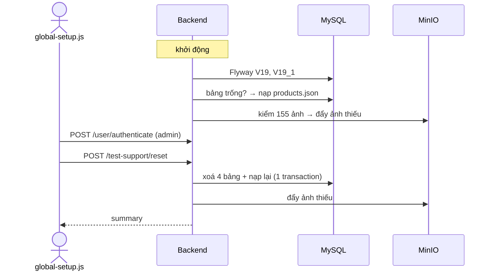
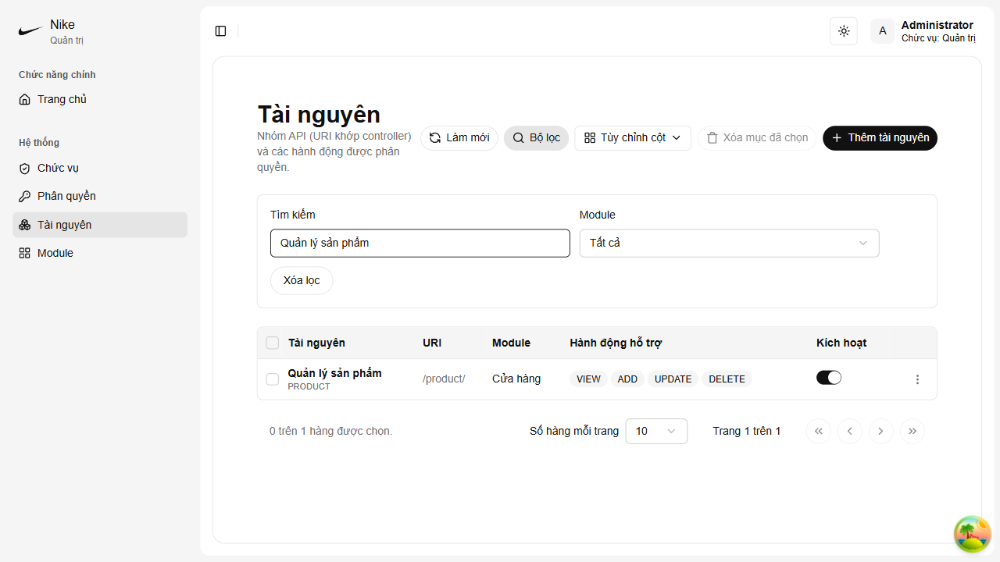
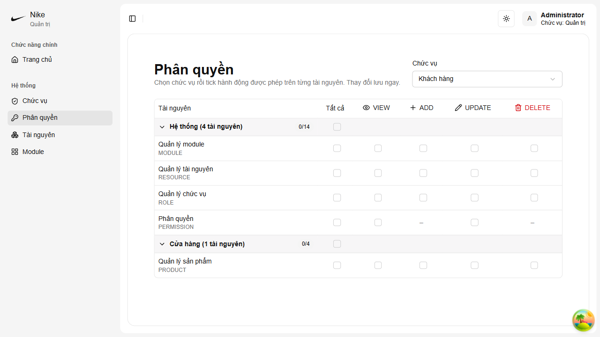

# Dữ liệu giày: schema sản phẩm, 30 sản phẩm × 5 ảnh, API hỗ trợ kiểm thử

> Lát 1.2 · plan: [plan/du-lieu-giay.md](../../plan/du-lieu-giay.md) · module: `app` (migration), `entity`, `business.product`, `business.testsupport`; thư mục `tools/seed/giay/`, `automation/`

## 1. Mục tiêu

Sau lát 1.1 hệ thống chỉ còn nền đăng nhập và phân quyền. Lát này dựng **dữ liệu cửa hàng giày cố định, lặp lại được** để các lát giao diện (danh sách, chi tiết, giỏ hàng, đặt hàng) và bộ automation test có cùng một nguồn dữ liệu: 5 danh mục, 30 sản phẩm đang bán và 1 sản phẩm ẩn, mỗi sản phẩm 5 ảnh webp và lưới size EU với tồn kho định sẵn.

Để test chạy lặp lại được, backend có hai API hỗ trợ chỉ bật ở profile `local` / `test`: `POST /test-support/reset` đưa dữ liệu về trạng thái ban đầu (`global-setup.js` gọi một lần trước mỗi lần chạy test) và `GET /test-support/summary` để đối chiếu số liệu. Đây là lát **chỉ backend và dữ liệu**, không có màn hình mới.

| Có làm | Không làm (để lát sau) |
|---|---|
| Migration `V19`: bốn bảng `product_category`, `product`, `product_image`, `product_size`; module `CATALOG`, resource `PRODUCT` | Bảng yêu thích, đơn hàng (`dat-hang`) |
| `products.json` (31 sản phẩm chọn tay từ nike.com/vn) và 155 ảnh webp 1000 px trong repo | API công khai danh sách / chi tiết giày |
| `ShoeSeedService`: nạp DB khi trống, đẩy ảnh còn thiếu lên MinIO, `reset`, `summary` | API quản trị sản phẩm `/product/*` (`quan-ly-giay`) |
| `POST /test-support/reset`, `GET /test-support/summary` (profile `local` / `test`, chỉ operator) | Giao diện mới |
| Hai tài khoản khách `khach1@`, `khach2@nike.local` | Reset giỏ / đơn / yêu thích, dọn tài khoản `auto+…` |
| `automation/`: `TestSupportApi`, `data/seed-products.js`, `global-setup.js` gọi reset | |

## 2. Tác nhân và phân quyền

| Tác nhân | Quyền | Ghi chú |
|---|---|---|
| Quản trị (`admin@nike.local`, operator) | Gọi `test-support/reset`, `test-support/summary` | Controller kiểm `checkPermission(…, "/test-support/", …)`; URI này không có dòng `resource` nên chỉ operator (hoặc API key) qua được |
| `noaccess@`, khách (`free@`, `khach1@`, `khach2@`) | Không | 403 |
| Chưa đăng nhập / token sai | Không | 401 |
| Resource `PRODUCT` (module `CATALOG` "Cửa hàng") | VIEW, ADD, UPDATE, DELETE | Chỉ tạo dòng để lát `quan-ly-giay` dùng; hiện ở trang Tài nguyên và Phân quyền |

## 3. Luồng hoạt động

1. Backend khởi động → Flyway chạy `V19__du_lieu_giay.sql` (bốn bảng, module, resource) và seed local `V19_1__seed_khach_test.sql` (hai tài khoản khách).
2. `ShoeSeedRunner` chạy sau Flyway: bảng `product_category` trống thì nạp toàn bộ từ `seed/giay/products.json` trong một transaction (5 danh mục, 31 sản phẩm, 155 ảnh, 363 size); sau đó đẩy lên MinIO các ảnh `products/<slug>/<n>.webp` còn thiếu.
3. `global-setup.js` đăng nhập admin và gọi `POST /test-support/reset` → dữ liệu về đúng `products.json` (kể cả id, tồn kho, giá, trạng thái).
4. Test gọi `GET /test-support/summary` và so với `expectedSummary()` tính từ chính `products.json`, không ghi cứng số.

Ngoại lệ: khởi động lại khi DB đã có dữ liệu thì **không** nạp lại (giữ thay đổi của quản trị), chỉ đẩy ảnh thiếu; MinIO không chạy lúc khởi động chỉ ghi cảnh báo, `summary.missingImages` > 0 và lần `reset` sau đẩy lại; `reset` xoá sạch bốn bảng rồi nạp lại nên sản phẩm thêm tay (id > 31) biến mất.

## 4. Cơ sở dữ liệu

Migration [`V19__du_lieu_giay.sql`](../../backend/app/src/main/resources/db/migration/V19__du_lieu_giay.sql) chỉ chứa **schema** và dòng module / resource. Dữ liệu sản phẩm nạp bằng code từ `products.json` thay vì migration, vì `reset` cần dùng lại đúng nguồn dữ liệu đó và sửa dữ liệu mẫu không phải viết migration mới.

| Bảng | Cột chính | Ràng buộc |
|---|---|---|
| `product_category` | `id` (1–5), `slug`, `name`, `sort_order` | `slug` UNIQUE |
| `product` | `id` (1–31), `slug`, `style_code`, `name`, `subtitle`, `gender`, `category_id`, `description`, `price`, `sale_price`, `badge`, `status`, `created_time`, `updated_time` | `slug`, `style_code` UNIQUE; FK `category_id`; `CHECK (sale_price IS NULL OR sale_price < price)`; `created_time` lấy từ JSON để sắp xếp "Mới nhất" lặp lại được |
| `product_image` | `id = product_id*10 + sort_order`, `product_id`, `url`, `sort_order` (1–5) | UNIQUE `(product_id, sort_order)`; xoá theo sản phẩm (CASCADE) |
| `product_size` | `id = product_id*100 + k`, `product_id`, `size_label` ("EU 42"), `size_value`, `stock` | UNIQUE `(product_id, size_label)`; `CHECK (stock >= 0)`; CASCADE |

Index: `product(category_id)`, `product(status, gender)`, `product_size(product_id, size_value)`. Cùng file có module `CATALOG` ("Cửa hàng") và resource `PRODUCT` ("Quản lý sản phẩm", `/product/`, bốn action). Seed local thêm `khach1@` "Khách Một" và `khach2@` "Khách Hai", role "Khách hàng", mật khẩu `Admin@123`.

### Dữ liệu mẫu `products.json`

Nằm ở [`seed/giay/products.json`](../../backend/business/src/main/resources/seed/giay/products.json), ảnh ở `seed/giay/<slug>/<1..5>.webp` (155 file, tổng khoảng 6 MB, mỗi file dưới 300 KB). Size suy ra từ giới tính: MEN / UNISEX 13 size (EU 38.5 → 47), WOMEN 11 size (EU 35.5 → 42), BOYS / GIRLS 8 size (EU 35.5 → 40); tồn mặc định 20, khoá `stock` chỉ ghi ngoại lệ.

Phân bố được thiết kế để các lát sau có đủ ca kiểm thử:

| Tiêu chí | Giá trị (30 sản phẩm đang bán) |
|---|---|
| Danh mục | Lifestyle 12 · Chạy bộ 6 · Bóng rổ 5 · Jordan 5 · Bóng đá 2 |
| Giới tính | MEN 12 · WOMEN 10 · UNISEX 4 · BOYS 2 · GIRLS 2 |
| Giá biên | có sản phẩm giá đang bán đúng 1.000.000 ₫, 2.000.000 ₫, 5.000.000 ₫ |
| Giảm giá / nhãn | 6 sản phẩm giảm giá · 8 `JUST_IN` (là 8 sản phẩm mới nhất) · 5 `BESTSELLER` |
| Tồn kho | 1 hết hàng · 1 ít hàng (tổng 1–3) · 2 sản phẩm có đúng một size còn 1 · còn lại 1–2 size hết |
| Sản phẩm ẩn | id 31 "Nike Air Max Plus Premium" (`HIDDEN`, Lifestyle, MEN) |

Giá lấy theo nike.com/vn, một số giá được chỉnh để đủ phân bố trên. Tên, mô tả và ảnh Nike **chỉ dùng để học, chạy local**.

| Id | Sản phẩm | Mã | Danh mục | Giới tính | Giá | Giá giảm | Nhãn |
|---|---|---|---|---|---|---|---|
| 1 | Nike Air Force 1 '07 | CW2288-111 | Lifestyle | MEN | 2.929.000 ₫ | — | BESTSELLER |
| 2 | Nike Dunk Low Retro | IQ0157-001 | Lifestyle | MEN | 3.519.000 ₫ | — | JUST_IN |
| 3 | Nike Marina | IH2380-001 | Lifestyle | MEN | 769.000 ₫ | — | BESTSELLER |
| 4 | Nike Waffle Racer | IM8658-103 | Lifestyle | MEN | 2.649.000 ₫ | 2.119.000 ₫ | — |
| 5 | Nike Air Max 95 Big Bubble Premium | IQ0229-001 | Lifestyle | MEN | 5.279.000 ₫ | — | JUST_IN |
| 6 | Nike Offcourt | BQ4632-002 | Lifestyle | WOMEN | 1.000.000 ₫ | — | — |
| 7 | Nike Sprint Sister | IV6173-700 | Lifestyle | WOMEN | 2.929.000 ₫ | 2.343.000 ₫ | — |
| 8 | Nike Air Max Phenomena | IM8814-200 | Lifestyle | WOMEN | 4.409.000 ₫ | — | BESTSELLER |
| 9 | Nike P-6000 | IV2501-001 | Lifestyle | WOMEN | 3.239.000 ₫ | — | — |
| 10 | Nike Victori One | CN9675-002 | Lifestyle | UNISEX | 889.000 ₫ | — | — |
| 11 | Nike V5 RNR | IU7230-103 | Lifestyle | BOYS | 1.909.000 ₫ | — | — |
| 12 | Nike Calm 2.0 | IF9306-001 | Lifestyle | GIRLS | 1.019.000 ₫ | 815.000 ₫ | — |
| 13 | Nike Revolution 8 | HJ9198-100 | Chạy bộ | MEN | 1.909.000 ₫ | — | — |
| 14 | Nike Alphafly 4 | IM5546-800 | Chạy bộ | MEN | 8.059.000 ₫ | — | JUST_IN |
| 15 | Nike Vomero 18 | HM6804-013 | Chạy bộ | WOMEN | 4.259.000 ₫ | — | BESTSELLER |
| 16 | Nike Pegasus 42 | IB1881-601 | Chạy bộ | WOMEN | 3.829.000 ₫ | — | — |
| 17 | Nike Zoom Fly 6 | FN8455-603 | Chạy bộ | WOMEN | 5.000.000 ₫ | — | — |
| 18 | Nike Vaporfly 4 | HF6412-602 | Chạy bộ | WOMEN | 6.609.000 ₫ | — | — |
| 19 | Nike Precision 8 Low | IH1104-300 | Bóng rổ | MEN | 2.119.000 ₫ | 2.000.000 ₫ | — |
| 20 | Ja 4 'Blur' EP | IM4136-501 | Bóng rổ | UNISEX | 3.669.000 ₫ | — | JUST_IN |
| 21 | A'Two "Dawn Staley" EP | IX1924-100 | Bóng rổ | UNISEX | 3.829.000 ₫ | 3.063.000 ₫ | — |
| 22 | Nike S.T. Dynamite 'Werewolf' | IZ1672-100 | Bóng rổ | BOYS | 1.529.000 ₫ | — | BESTSELLER |
| 23 | Caitlin 1 'Midnight Fever' | IQ2350-600 | Bóng rổ | GIRLS | 2.809.000 ₫ | — | JUST_IN |
| 24 | Air Jordan 1 Low SE 'Magic Ball' | IX6375-001 | Jordan | MEN | 3.669.000 ₫ | — | JUST_IN |
| 25 | Jordan Spizike Low 'Jam Central' | IX6381-001 | Jordan | MEN | 4.999.000 ₫ | — | JUST_IN |
| 26 | Air Jordan 1 Low SE 'Lola Bunny' | IX6038-100 | Jordan | WOMEN | 3.669.000 ₫ | — | JUST_IN |
| 27 | Air Jordan Mule | IW0766-121 | Jordan | WOMEN | 4.699.000 ₫ | 3.759.000 ₫ | — |
| 28 | Jordan Franchise | HF3263-001 | Jordan | UNISEX | 889.000 ₫ | — | — |
| 29 | Nike Mercurial Vapor 17 Elite | IF8508-102 | Bóng đá | MEN | 7.479.000 ₫ | — | — |
| 30 | Nike Phantom 6 Low Academy | HJ4564-100 | Bóng đá | MEN | 2.629.000 ₫ | — | — |

Ảnh được tải một lần bằng [`tools/seed/giay/fetch-images.mjs`](../../tools/seed/giay/README.md) (đổi sang webp rộng 1000 px, chất lượng 80) rồi commit vào repo, nên máy khác không cần mạng.

## 5. API

Mọi response bọc `{ code, message, result }`, prefix `/api`. Chỉ có khi profile là `local` hoặc `test` (`@Profile` trên [`TestSupportController`](../../backend/business/src/main/java/vn/aeoc/business/testsupport/TestSupportController.java)); profile khác trả 404.

| Method | Đường dẫn | Quyền | Mô tả |
|---|---|---|---|
| GET | `/test-support/summary` | operator (VIEW) | Số liệu dữ liệu giày: tổng danh mục / sản phẩm / ảnh / size, ảnh thiếu trên MinIO, phân bố theo danh mục, giới tính, giảm giá, nhãn, và `sample` (sản phẩm id nhỏ nhất kèm URL ảnh và size) |
| POST | `/test-support/reset` | operator (UPDATE) | Xoá bốn bảng sản phẩm, nạp lại từ `products.json` trong một transaction, đẩy ảnh thiếu lên MinIO; trả cấu trúc như `summary` kèm `resetAt` |

Số liệu thật sau reset: 5 danh mục, 31 sản phẩm (30 đang bán, 1 ẩn), 155 ảnh, 363 size trong đó 59 size hết hàng, tổng tồn 6.025.

| Tình huống | HTTP | Thông báo |
|---|---|---|
| Không token | 401 | "Chưa đăng nhập" |
| Token sai | 401 | "Token không hợp lệ hoặc sai chữ ký" |
| Không phải operator | 403 | "Bạn không có quyền thực hiện thao tác này! Path: /test-support/, Action: VIEW" (hoặc UPDATE) |
| Sai method (vd `GET /test-support/reset`) | 405 | "Phương thức HTTP không được hỗ trợ" |

Điểm đáng chú ý ở phần cài đặt:
- `ShoeSeedData` là hàm thuần (đọc JSON, suy size, tính id, kiểm cấu trúc) nên được unit test không cần DB.
- `ShoeSeedService.reset()` dùng `TransactionTemplate` và một khoá `ReentrantLock` để hai lần reset song song không đan xen; việc đẩy ảnh nằm ngoài transaction, lỗi MinIO chỉ ghi cảnh báo.
- `ShoeSeedRunner` gọi `ensureBucket()` trước khi đẩy ảnh vì runner chạy trước `ApplicationReadyEvent`.

## 6. Giao diện

Lát này không thêm màn hình. Dữ liệu mới chỉ lộ ra ở hai trang quản trị đã có.

Trang Tài nguyên có dòng "Quản lý sản phẩm", mã `PRODUCT`, URI `/product/`, thuộc module "Cửa hàng" (TC-13).

Ma trận phân quyền có nhóm "Cửa hàng (1 tài nguyên)" với hàng "Quản lý sản phẩm" (TC-14).

## 7. Kiểm thử

Test nghiệm thu viết trước khi code: API ở [`du-lieu-giay.api.spec.js`](../../automation/tests/api/du-lieu-giay.api.spec.js) (TC-01 → TC-12), giao diện ở [`du-lieu-giay.spec.js`](../../automation/tests/admin/du-lieu-giay.spec.js) (TC-13, TC-14), JUnit ở `ShoeSeedDataTest` (TC-U1 → U6, module `business`) và `ShoeSeedResetTest` (TC-U7, module `app`).

| ID | Loại | Nội dung | Kết quả |
|---|---|---|---|
| TC-01 | api | Summary: số lượng tổng | Pass |
| TC-02 | api | Summary: phân bố theo kế hoạch | Pass |
| TC-03 | api | Summary khớp `products.json` | Pass |
| TC-04 | api | Sản phẩm mẫu: 5 ảnh truy cập được (webp), size đúng thứ tự | Pass |
| TC-05 | api | Reset trả về đúng dữ liệu ban đầu | Pass |
| TC-06 | api | Reset gọi lặp không lỗi, id ổn định | Pass |
| TC-07 | api | Không token / token sai → 401 | Pass |
| TC-08 | api | Không phải operator → 403 | Pass |
| TC-09 | api | Resource `PRODUCT`, module `CATALOG` | Pass |
| TC-10 | api | Tài khoản `khach1@`, `khach2@` đăng nhập được | Pass |
| TC-11 | api | Sai method không trả 200, dữ liệu không đổi | Pass |
| TC-12 | api | `global-setup` đã reset trước khi chạy | Pass |
| TC-13 | e2e | Tài nguyên "Quản lý sản phẩm" hiện ở trang quản trị | Pass |
| TC-14 | e2e | Ma trận phân quyền có hàng sản phẩm | Pass |
| TC-U1 | unit | `products.json` hợp lệ về cấu trúc | Pass |
| TC-U2 | unit | Phân bố danh mục / giới tính / nhãn / giảm giá | Pass |
| TC-U3 | unit | Khoảng giá và giá biên | Pass |
| TC-U4 | unit | Size và công thức id | Pass |
| TC-U5 | unit | Quy tắc tồn kho | Pass |
| TC-U6 | unit | 155 file ảnh webp có trong resources | Pass |
| TC-U7 | unit | `reset()` khôi phục dữ liệu bị đổi (Docker MySQL + MinIO) | Pass |

| Tổng hợp | Kết quả |
|---|---|
| JUnit (module `app`, `business`) | 12/12 pass (ShoeSeedData 7, ShoeSeedReset 1, ApplicationContext 1, PayosSignature 3) |
| Playwright nhóm API | 35/35 pass (du-lieu-giay 12, go-lut 11, auth 10, role 2) |
| Playwright giao diện lát này (chromium, `--headed`) | 2/2 pass |
| Playwright smoke toàn bộ 5 project | 32/32 pass |
| `pnpm build`, `pnpm lint` (frontend, automation) | Xanh; frontend 0 lỗi, 1 cảnh báo có sẵn không thuộc lát này |

Số vòng sửa: backend 0, frontend 0. Phiên backend có một lần tự review sửa một lỗi theo checklist (điều kiện jOOQ đếm sản phẩm giảm giá / theo nhãn chuyển từ service vào `ProductRepository`).

## 8. Điểm lệch plan và việc còn lại

- Plan §5.4 / TC-07 ghi nhầm thông báo khi không có token: bộ lọc JWT dùng chung trả "Chưa đăng nhập", còn "Token không hợp lệ hoặc sai chữ ký" là của token sai; plan được sửa, TC-07 kiểm cả hai.
- TC-11: sai method trước đây trả 500 "Lỗi hệ thống"; thêm `ErrorCode.METHOD_NOT_ALLOWED` và handler ở `GlobalExceptionHandler` nên **mọi API** nay trả 405.
- `go-lut.api.spec.js` TC-11 bỏ `CATALOG` khỏi danh sách module phải vắng vì lát này thêm lại module có chủ đích; đây là spec sai so với plan mới, không phải sửa để test xanh.
- Dòng `backend/**/src/test/` trong `.gitignore` được bỏ để JUnit (kể cả `ApplicationContextTest`, `PayosSignatureTest` còn nằm ngoài git từ lát 1.1) vào repo.
- Plan §8 ghi nhầm "TC-14, TC-15" cho phần giao diện; thực tế là TC-13, TC-14.
- Số size, size hết hàng, tổng tồn ở ví dụ trong plan chỉ là minh hoạ; số thật ghi ở mục 5.
- Reset chưa xoá tài khoản `auto+…@nike.local` do test đăng ký (tránh làm test chập chờn khi nhiều worker); các lát sau mở rộng `reset` khi thêm bảng tham chiếu `product` / `product_size`, xoá bảng con trước (ghi ở `backend/AGENTS.md`).
