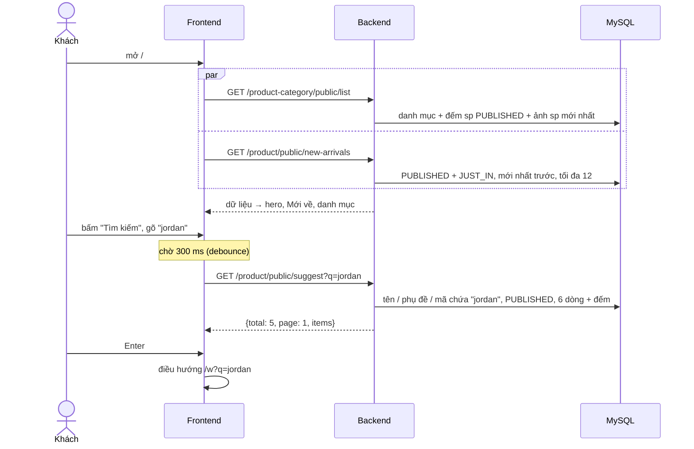
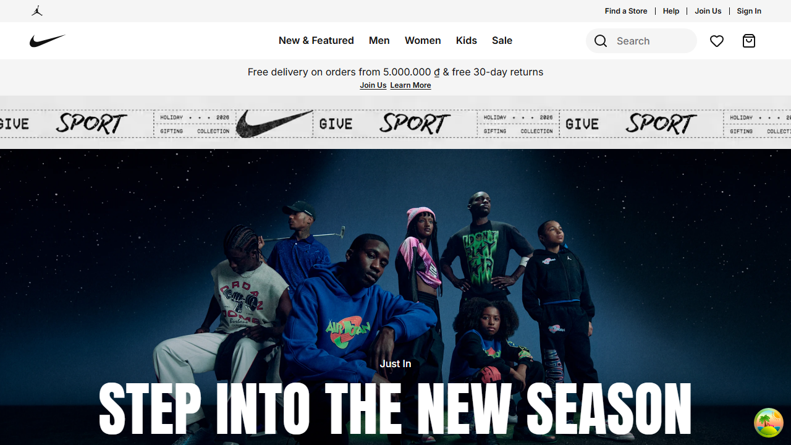
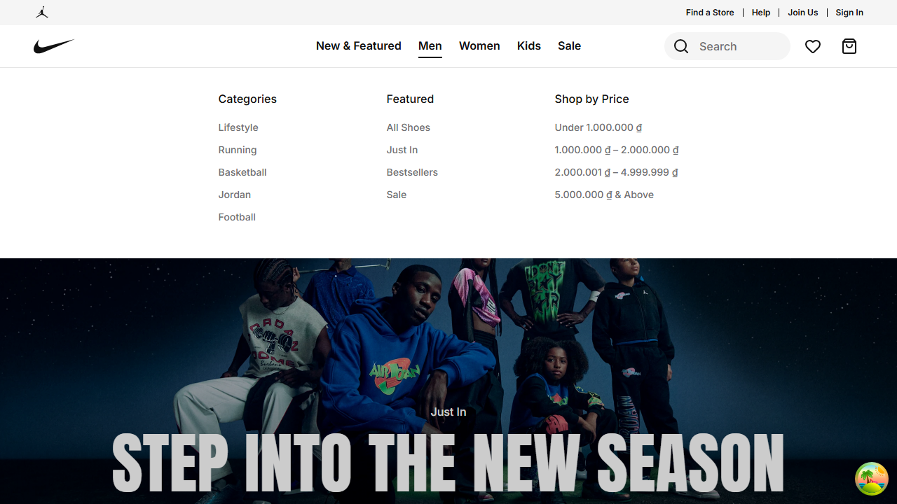
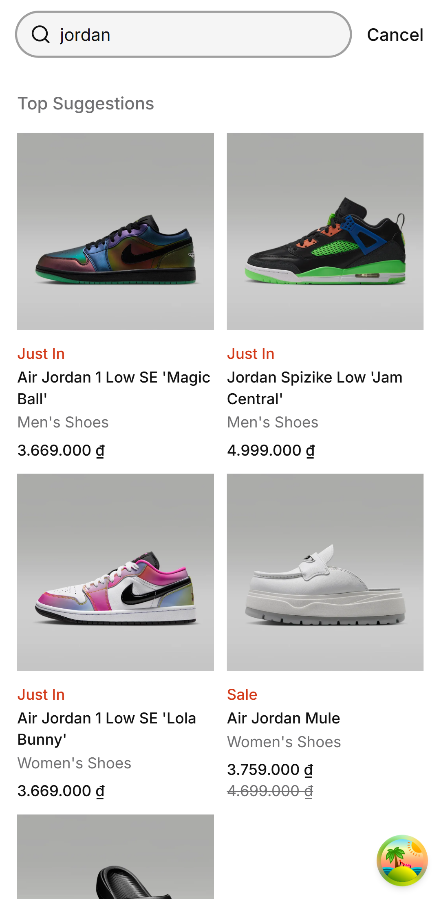
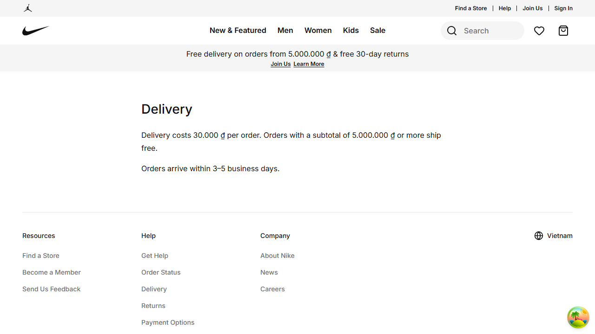
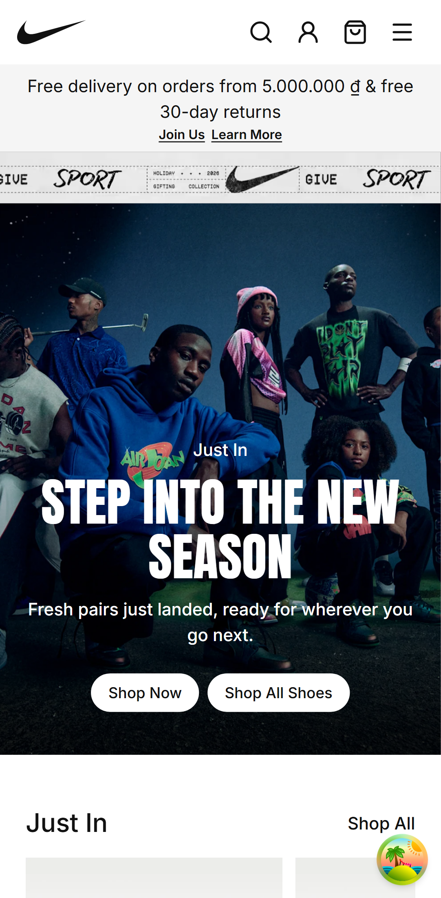
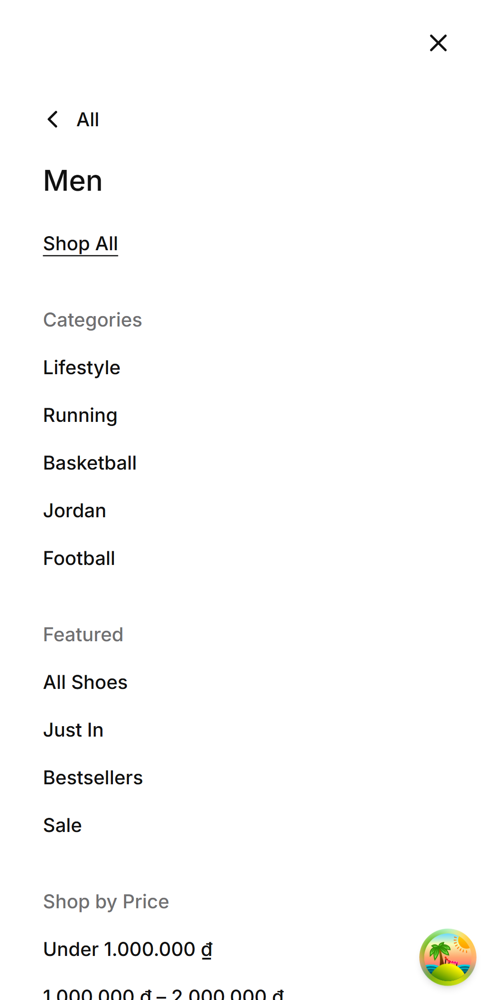

# Giao diện Nike: khung cửa hàng, tìm kiếm và trang chủ

> Lát 1.3 · plan: [plan/giao-dien-nike.md](../../plan/giao-dien-nike.md) · module: `entity`, `business.product`; `frontend/` (khu cửa hàng), `automation/`

## 1. Mục tiêu

Sau lát 1.2 hệ thống đã có dữ liệu giày nhưng trang `/` vẫn là trang tạm "Cửa hàng đang được nâng cấp" mang giao diện LUT cũ. Lát này dựng **khung giao diện bám nike.com/vn** dùng chung cho mọi trang cửa hàng (header có mega menu, khung tìm kiếm có gợi ý sản phẩm thật, dải thông báo, footer, menu trượt trên điện thoại) và **trang chủ** với dữ liệu thật: hero, dải "Mới về" 8 sản phẩm, khối Jordan và "Mua theo danh mục" 5 danh mục.

Các lát sau (`danh-sach-giay`, `chi-tiet-giay`, `gio-hang`…) chỉ cần đặt trang của mình vào khung này, dùng lại `ProductCard`, `ProductRail` và hợp đồng URL `/w` đã chốt ở đây.

| Có làm | Không làm (để lát sau) |
|---|---|
| Token màu / font Nike cho khu cửa hàng, `formatVnd` ra `5.279.000 ₫`, favicon swoosh, dọn ảnh / video LUT trong `frontend/public/` | Trang đăng nhập "nhập email trước" (`dang-nhap-nike`); lát này giữ hộp thoại đăng nhập / đăng ký, chỉ đổi style |
| Header: dải trên, thanh chính, mega menu 5 mục, ẩn khi cuộn xuống / hiện khi cuộn lên; dải thông báo | Số lượng trên icon giỏ, trang yêu thích / giỏ hàng thật |
| Menu trượt có panel con, footer accordion trên điện thoại | Trang danh sách `/w` thật và bộ lọc (`danh-sach-giay`) |
| Khung tìm kiếm: "Tìm kiếm phổ biến", gợi ý sản phẩm, Enter → `/w?q=` | Trang chi tiết `/t/$slug` thật (`chi-tiet-giay`) |
| 3 API công khai chỉ đọc: danh mục, sản phẩm mới về, gợi ý tìm kiếm | Dark mode cho cửa hàng (Nike không có; trang quản trị vẫn đổi được) |
| 15 trang thông tin tĩnh `/thong-tin/$trang`, 5 trang tạm "Sắp ra mắt" để link không ra 404 | Visual regression |

## 2. Tác nhân và phân quyền

| Tác nhân | Quyền | Ghi chú |
|---|---|---|
| Khách chưa đăng nhập | Xem mọi trang của lát, gọi 3 API công khai | Đường dẫn `/<x>/public/...` đã được bộ lọc JWT mở sẵn; token sai / hết hạn bị bỏ qua, không trả 401 |
| Khách đã đăng nhập (`free@`, `khach1@`, `khach2@`) | Như trên + menu "Xin chào, <tên>" | Không thấy mục "Trang quản trị" |
| Quản trị (`admin@` hoặc có quyền VIEW bất kỳ) | Như trên + mục "Trang quản trị" trong menu tài khoản | Giữ nguyên quy tắc `useCanOpenAdmin` |

Lát không thêm resource, không có ca 403.

## 3. Luồng hoạt động

1. Khách mở `/`. Trang gọi song song danh mục và sản phẩm mới về, hiện header, hero, dải "Mới về" 8 thẻ, khối Jordan, 5 ô danh mục, footer.
2. Rê chuột vào "Nam" ≥ 150 ms → mega menu 3 cột ("Danh mục", "Nổi bật", "Theo giá"); mọi link gắn thêm `gioiTinh=nam`, ví dụ "Bóng rổ" → `/w/bong-ro?gioiTinh=nam`.
3. Bấm "Tìm kiếm" → khung tìm kiếm phủ đầu trang, ô nhập có focus sẵn, hiện "Tìm kiếm phổ biến". Gõ "jordan" → sau 300 ms gọi API gợi ý → 5 thẻ + "Xem tất cả 5 kết quả". Enter → `/w?q=jordan`.
4. Cuộn xuống quá 96 px → thanh chính trượt ẩn; cuộn lên → hiện lại và dính đầu trang.
5. Bấm "Giao hàng" ở footer → `/thong-tin/giao-hang` (phí 30.000 ₫, miễn phí từ 5.000.000 ₫).

Luồng thay thế: màn dưới 1024 px chỉ còn swoosh + 4 icon (Tìm kiếm, tài khoản, Giỏ hàng, Menu), menu trượt từ phải có panel con cho từng mục, footer thành accordion; đã đăng nhập thì dải trên thay "Tham gia | Đăng nhập" bằng "Xin chào, <tên>" và ẩn "Tham gia ngay".

Ngoại lệ: API mới về / danh mục lỗi → khối tương ứng hiện thông báo + nút "Thử lại" (mega menu bỏ cột "Danh mục", hai cột kia vẫn hiện); API gợi ý lỗi → "Không tải được gợi ý. Nhấn Enter để xem tất cả kết quả." và Enter vẫn điều hướng; không có kết quả (kể cả khi chỉ khớp sản phẩm ẩn) → `Không tìm thấy sản phẩm nào cho "<từ khoá>".`; ô rỗng + Enter → không làm gì; slug trang thông tin lạ → trang 404 chung trong khung cửa hàng.

## 4. Cơ sở dữ liệu

**Không có migration.** Lát dùng bốn bảng của `du-lieu-giay`, chỉ thêm field không phải cột vào POJO, giá trị lấy từ subquery:

| POJO | Field | Cách tính |
|---|---|---|
| `Product` | `imageUrl` | `product_image.url` có `sort_order = 1` |
| | `totalStock` | `COALESCE(SUM(product_size.stock), 0)` |
| `ProductCategory` | `productCount` | số sản phẩm `PUBLISHED` thuộc danh mục |
| | `imageUrl` | ảnh số 1 của sản phẩm `PUBLISHED` mới nhất trong danh mục (null nếu không có) |

Bảng dùng collation `utf8mb4_0900_ai_ci` nên tìm kiếm `LIKE` không phân biệt hoa thường và dấu: "giay bong ro" khớp "Giày bóng rổ".

## 5. API

Mọi response bọc `{ code, message, result }`, prefix `/api`. Cả ba endpoint nằm ở [`ProductPublicController`](../../backend/business/src/main/java/vn/aeoc/business/product/controller/ProductPublicController.java), **không cần token**; gửi token sai vẫn trả 200 như không gửi.

| Method | Đường dẫn | Mô tả |
|---|---|---|
| GET | `/product-category/public/list` | Mọi danh mục theo `sortOrder`, kèm `productCount` và `imageUrl`. Dữ liệu mẫu: Lifestyle 12, Chạy bộ 6, Bóng rổ 5, Jordan 5, Bóng đá 2 |
| GET | `/product/public/new-arrivals` | Sản phẩm `PUBLISHED` có nhãn `JUST_IN`, mới nhất trước, tối đa 12. Dữ liệu mẫu: 8 sản phẩm, id `2, 5, 14, 20, 23, 24, 25, 26` |
| GET | `/product/public/suggest?q=` | Sản phẩm `PUBLISHED` có tên / phụ đề / mã chứa `q` (đã `trim`), mới nhất trước, tối đa 6, kèm `total`. `q` rỗng → `{total: 0, page: 1, items: []}` không truy vấn DB |

Mỗi phần tử sản phẩm là "thẻ sản phẩm" (`id, slug, styleCode, name, subtitle, gender, categoryId, price, salePrice, badge, createdTime, imageUrl, totalStock`), cùng dạng sẽ được trang danh sách ở lát 1.4 dùng lại. Ví dụ thật: `q=nike` → `total = 22`, 6 phần tử id `2, 5, 14, 30, 29, 22`; `q=mule` → id 27, giá 4.699.000 ₫, giá giảm 3.759.000 ₫.

| Tình huống | HTTP | Thông báo |
|---|---|---|
| Sai method (vd `POST /api/product/public/suggest`) | 405 | "Phương thức HTTP không được hỗ trợ" |
| Đường dẫn không tồn tại | 404 | "Không tìm thấy API" |

Điểm đáng chú ý ở phần cài đặt:
- `ProductRepository.keywordCondition(q)` dùng `containsIgnoreCase` của jOOQ nên `%`, `_`, `'` trong từ khoá là ký tự thường (không phải ký tự đại diện, không lỗi SQL). Hàm để `public` vì `?q=` của trang `/w` ở lát 1.4 dùng đúng điều kiện này.
- `ProductCatalogService` không cache: dữ liệu nhỏ và `test-support/reset` đổi dữ liệu giữa các lần chạy test.

## 6. Giao diện

**Khung cửa hàng.** Route layout `_shop` bọc mọi trang cửa hàng: header (dải trên chỉ desktop + thanh chính dính đầu vùng cuộn), dải thông báo, `<main id="shop-main">`, footer. Token màu Nike thay token LUT (`--sh-fg #111`, `--sh-muted #707072`, `--sh-surface #f5f5f5`, nhãn đỏ `#d33918`…), chữ thường dùng Inter (gần Helvetica Now Text của nike.com nhất trong các font miễn phí), tiêu đề lớn dùng Anton (gần Nike Futura Condensed), cả hai tự host qua Fontsource; không đưa font bản quyền của Nike vào repo. Khu cửa hàng luôn sáng: `ShopShell` gỡ class `dark` khỏi `<html>` khi vào và trả lại khi rời.

Trang chủ ở 1440 px, so trực tiếp với nike.com/vn: hero tràn hết chiều ngang (ảnh campaign từ nike.com), chữ trắng và nút trắng đè lên ảnh; dải trên có icon Jumpman, "Tìm cửa hàng", "Trợ giúp", "Tham gia", "Đăng nhập"; thanh chính có 5 mục menu và ô "Tìm kiếm"; dải thông báo ghi rõ ngưỡng miễn phí giao hàng 5.000.000 ₫; bên dưới là hero "Bước vào mùa mới" (TC-10, TC-13).

Mega menu khi rê chuột vào một mục: ba cột "Danh mục" (lấy từ API), "Nổi bật", "Theo giá", phần trang bên dưới phủ đen 20%; mọi link gắn tham số phạm vi của mục (TC-14).

Khung tìm kiếm sau khi gõ "jordan": 5 thẻ gợi ý theo thứ tự mới nhất và link "Xem tất cả 5 kết quả" → `/w?q=jordan` (TC-18).

Trang thông tin "Giao hàng", một trong 15 trang tĩnh mở từ dải trên / footer, khối giữa rộng tối đa 720 px (TC-22).

Trang chủ trên điện thoại (Pixel 7): thanh chính chỉ còn swoosh và 4 icon Tìm kiếm, Đăng nhập, Giỏ hàng, Menu; không có dải trên và menu giữa (TC-27).

Menu trượt sau khi bấm "Nam": nút "Tất cả" để quay lại, tiêu đề "Nam", link "Xem tất cả" và ba nhóm link giống mega menu (TC-28).

**Trang chủ** gồm 4 khối: hero (ảnh tràn ngang, chữ đè lên ảnh, h1 "Bước vào mùa mới", nút "Mua ngay" → `/w?nhan=moi-ve`, "Xem tất cả giày" → `/w`); "Mới về" là `ProductRail` cuộn ngang có scroll-snap và hai nút ‹ › bị khoá ở đầu / cuối dải; khối Jordan ("Bay cao cùng Jordan", nút "Mua Jordan" → `/w/jordan`); "Mua theo danh mục" lưới 2 / 3 / 5 cột, mỗi ô ghi "<n> sản phẩm".

**`ProductCard`** (dùng lại ở lát 1.4) hiện một nhãn đỏ theo thứ tự ưu tiên "Hết hàng" → "Mới về" → "Bán chạy" → "Giảm giá"; giá qua `formatVnd`, sản phẩm đang giảm hiện giá giảm và giá gốc gạch ngang trong thẻ `<s>`.

**Hợp đồng URL `/w`** chốt ở [`lib/shop/catalog-search.ts`](../../frontend/src/lib/shop/catalog-search.ts) vì link mega menu cần nó: khoá `gioiTinh`, `treEm`, `gia` (`duoi-1tr`, `1-2tr`, `2-5tr`, `tu-5tr`), `giamGia`, `nhan` (`moi-ve`, `ban-chay`), `sapXep`, `q`; giá trị sai bị bỏ. Trang `/w`, `/w/$danhMuc`, `/t/$slug`, `/yeu-thich`, `/gio-hang` hiện là trang tạm "Sắp ra mắt", mỗi lát sau thay nội dung route của mình.

Dọn dẹp: xoá `home.mp4` (51 MB), ảnh hero / logo nike, `favicon.ico`; `favicon.svg` thành swoosh đen; manifest đổi tên "Nike"; mục "Khu cửa hàng" trong `frontend/AGENTS.md` được viết lại.

## 7. Kiểm thử

Test nghiệm thu viết trước khi code: API ở [`giao-dien-nike.api.spec.js`](../../automation/tests/api/giao-dien-nike.api.spec.js) (TC-01 → TC-09), giao diện ở [`giao-dien-nike.spec.js`](../../automation/tests/home/giao-dien-nike.spec.js) (TC-10 → TC-30), JUnit ở `ProductCatalogServiceTest` (TC-U1, TC-U2). Số liệu mong đợi tính từ `products.json` qua `data/seed-products.js` (`expectedCategories`, `expectedNewArrivals`, `expectedSuggest`), link menu / footer lấy từ `data/nav-links.json`, không ghi cứng trong test. Page object mới: `HeaderComponent`, `SearchOverlay`, `MobileMenu`, `FooterComponent`, `ProductCard`, `HomePage`, `InfoPage` (thay `ShopHomePage`).

| ID | Loại | Nội dung | Kết quả |
|---|---|---|---|
| TC-01 | api | Danh mục công khai: thứ tự, `productCount`, ảnh webp truy cập được | Pass |
| TC-02 | api | Mới về: 8 sản phẩm `JUST_IN`, thứ tự, `totalStock` | Pass |
| TC-03 | api | Gợi ý: tối đa 6, `total` đúng, mới nhất trước | Pass |
| TC-04 | api | Gợi ý không phân biệt hoa thường / dấu, tìm cả phụ đề | Pass |
| TC-05 | api | Gợi ý theo mã sản phẩm, sản phẩm giảm giá | Pass |
| TC-06 | api | Sản phẩm ẩn không xuất hiện | Pass |
| TC-07 | api | Từ khoá rỗng / `%` / `_` / `' OR 1=1 --` / `a'two` | Pass |
| TC-08 | api | Token sai vẫn đọc được | Pass |
| TC-09 | api | Sai method → 405, đường dẫn lạ → 404 | Pass |
| TC-10 | e2e | Trang chủ đầy đủ (desktop) `@smoke` | Pass |
| TC-11 | e2e | Dải "Mới về" cuộn ngang, nút khoá ở hai đầu | Pass |
| TC-12 | e2e | Trạng thái tải / lỗi (network mocking) | Pass |
| TC-13 | e2e | Header desktop + link, "Xem chi tiết" → trang Giao hàng | Pass |
| TC-14 | e2e | Mega menu 5 mục, 13 link mỗi mục (data-driven) | Pass |
| TC-15 | e2e | Điều hướng từ menu không ra 404 | Pass |
| TC-16 | e2e | Header ẩn / hiện khi cuộn | Pass |
| TC-17 | e2e | Mở / đóng khung tìm kiếm, focus trả về nút "Tìm kiếm" | Pass (sau 1 vòng sửa) |
| TC-18 | e2e | Gợi ý khi gõ, bấm thẻ gợi ý | Pass |
| TC-19 | e2e | Enter / pill điều hướng, ô rỗng không làm gì | Pass |
| TC-20 | e2e | Không có kết quả / sản phẩm ẩn / giá giảm | Pass |
| TC-21 | e2e | Gợi ý lỗi (network mocking) | Pass |
| TC-22 | e2e | Footer + 15 trang thông tin (data-driven), slug lạ → 404 | Pass |
| TC-23 | e2e | Tài khoản ở dải trên (khách / quản trị) | Pass |
| TC-24 | e2e | "Tham gia" / "Tham gia ngay" mở đăng ký | Pass |
| TC-25 | e2e | 5 trang tạm không 404 | Pass |
| TC-26 | e2e | Axe (wcag2a, wcag2aa) 0 vi phạm serious / critical; link "Bỏ qua menu" | Pass |
| TC-27 | e2e | Header + trang chủ mobile `@smoke` | Pass |
| TC-28 | e2e | Menu trượt mobile, panel con | Pass |
| TC-29 | e2e | Footer accordion mobile | Pass |
| TC-30 | e2e | Tìm kiếm mobile | Pass |
| TC-U1 | unit | `suggest` từ khoá null / rỗng / khoảng trắng không gọi repository | Pass |
| TC-U2 | unit | `suggest` trim từ khoá, giới hạn 6, `total` từ đếm | Pass |

| Tổng hợp | Kết quả |
|---|---|
| JUnit (module `business`, `app`) | 16/16 pass (ProductCatalogService 4, ShoeSeedData 7, PayosSignature 3, ApplicationContext 1, ShoeSeedReset 1) |
| Playwright nhóm API | 44/44 pass (giao-dien-nike 9) |
| Playwright giao diện lát này + `go-lut.spec.js` (chromium, `--headed`) | 29 pass, 4 skip (nhóm chỉ chạy mobile) |
| Playwright `mobile-chrome` | 22 pass, 11 skip (nhóm chỉ chạy desktop) |
| Playwright smoke toàn bộ 5 project | 43 pass, 4 skip |
| `pnpm build`, `pnpm lint` (frontend, automation) | Xanh; frontend 0 lỗi, 1 cảnh báo có sẵn không thuộc lát này |

Số vòng sửa: backend 0, frontend 1 (TC-17: Radix Dialog không tự trả focus về nút mở khi không dùng `DialogTrigger`, sửa bằng `onCloseAutoFocus`).

## 8. Điểm lệch plan và việc còn lại

- **Mega menu tự làm** bằng sự kiện pointer / focus / Esc thay cho `NavigationMenu` của shadcn, vì trigger của Radix là nút bật / tắt trong khi mục menu phải là link điều hướng; không thêm `navigation-menu`. Mega menu đóng khi cuộn trang.
- Phần chỉ có ở một màn hình (nút tài khoản, "Yêu thích", "Menu") render theo `useIsDesktop()` thay vì ẩn bằng CSS, để không có hai phần tử trùng tên / testid; nút "Tìm kiếm" là một nút dùng cho cả hai màn hình.
- `components/ui/sheet.tsx` thêm prop `showCloseButton` để nút đóng menu trượt có tên "Đóng menu"; `NotFoundPage` nhận prop `home` để trang 404 hiện trong khung cửa hàng.
- `__root.tsx`: về đầu trang khi đổi đường dẫn bằng cách cuộn `#app-scroll` (trước đây gọi `window.scrollTo`, không có tác dụng vì vùng cuộn là `#app-scroll`).
- Menu trượt mở hộp thoại "Tham gia" / "Đăng nhập" sau khi ngăn trượt đóng hẳn, để hai lớp modal không tranh focus.
- Ảnh tĩnh: ban đầu chép từ ảnh seed; theo góp ý của người dùng (ảnh sản phẩm làm hero trông xấu) đổi sang ảnh campaign tải từ static.nike.com cho hero và khối Jordan (chỉ học tập, chạy local). Font Oswald đổi sang Anton + Inter sau khi so với nike.com.
- `go-lut.spec.js` TC-12 → TC-15 được sửa theo header mới (nút "Đăng ký" thành "Tham gia", trang tạm thành trang chủ mới); đây là spec sai so với plan mới, không phải sửa để test xanh.
- Ảnh mobile (05, 06) chụp bằng script với thiết bị Pixel 7 (412 px) vì tiện ích `docShot` chỉ chụp ở project `chromium`.
- Còn lại: so tay chi tiết từng số đo với ảnh tham chiếu `plan/ui-nike/` (1440 px / 390 px) chưa làm; số lượng trên icon giỏ, trang `/w`, `/t/$slug` thật thuộc các lát sau.
