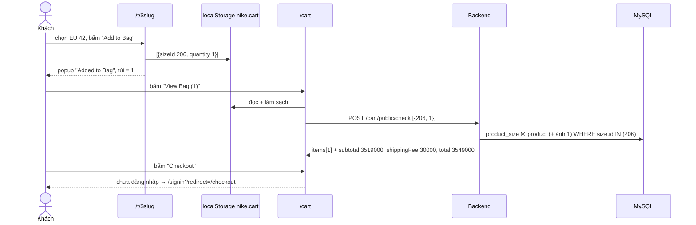
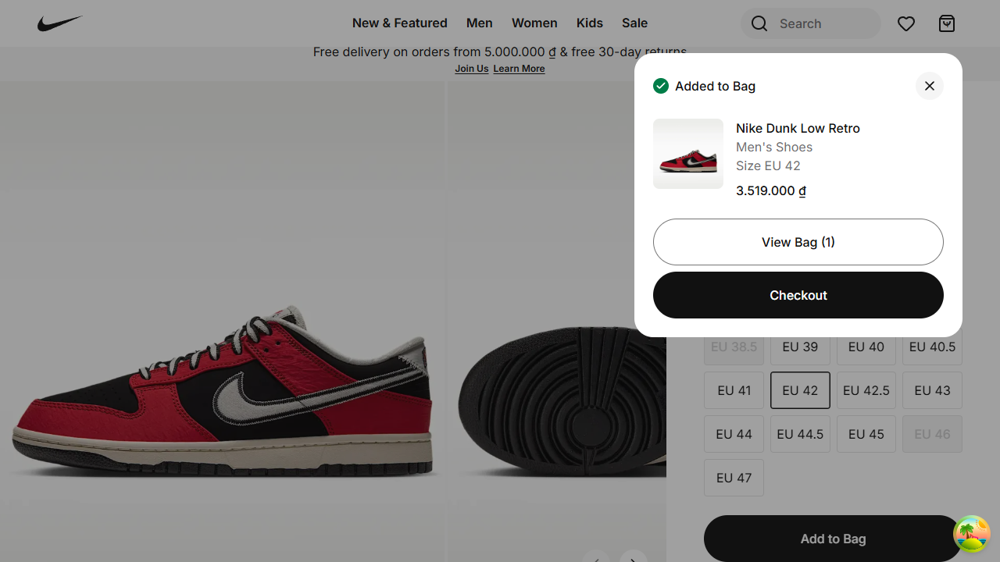
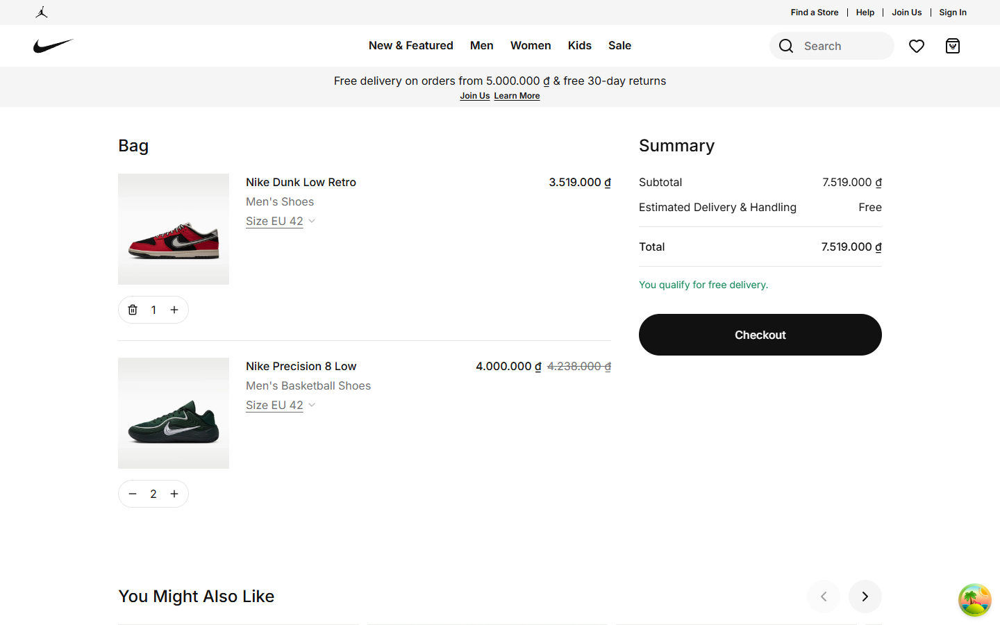
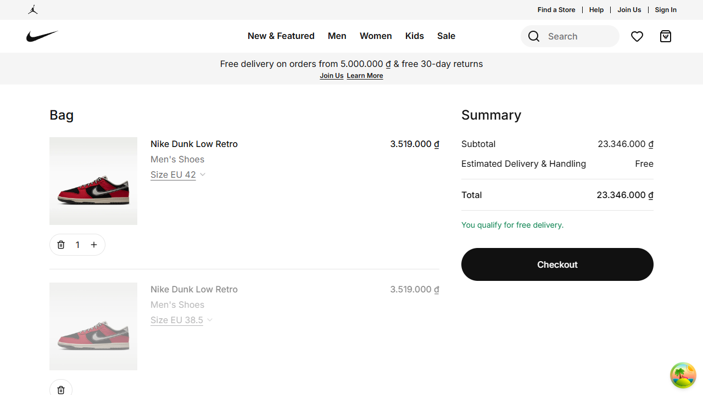
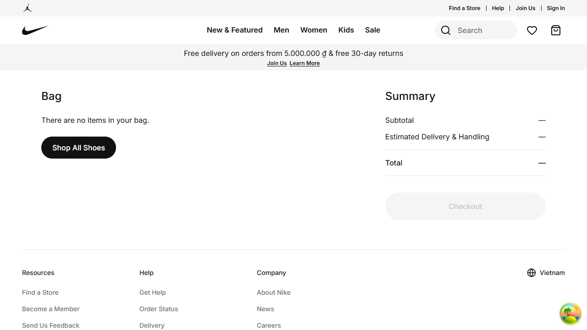
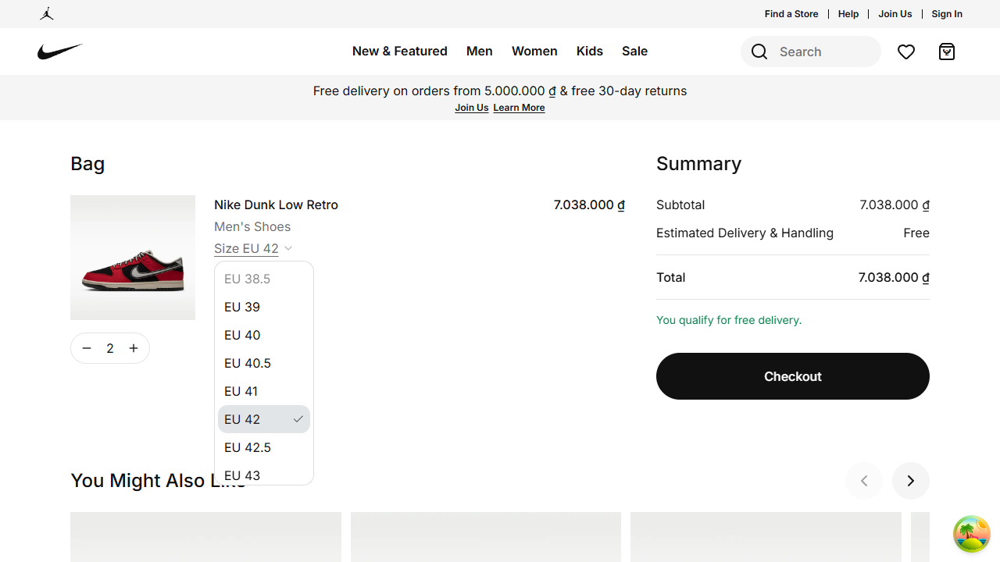
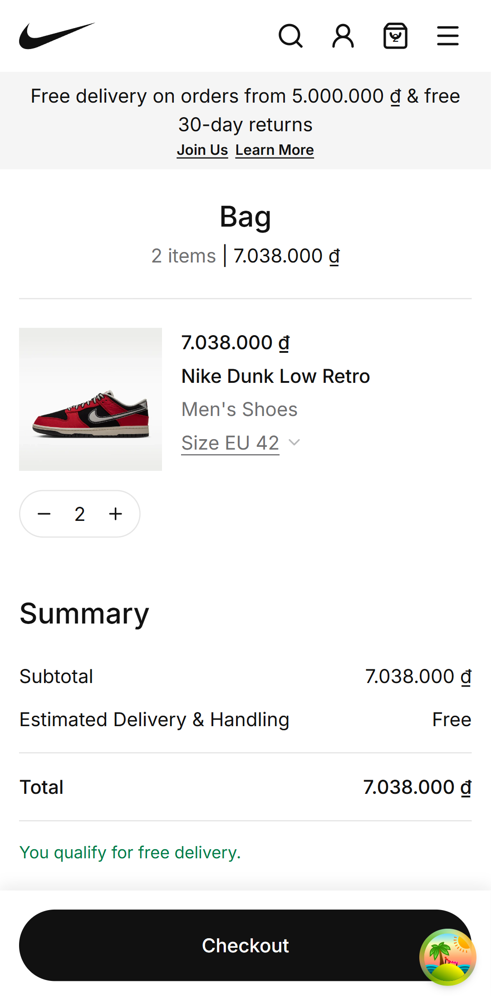
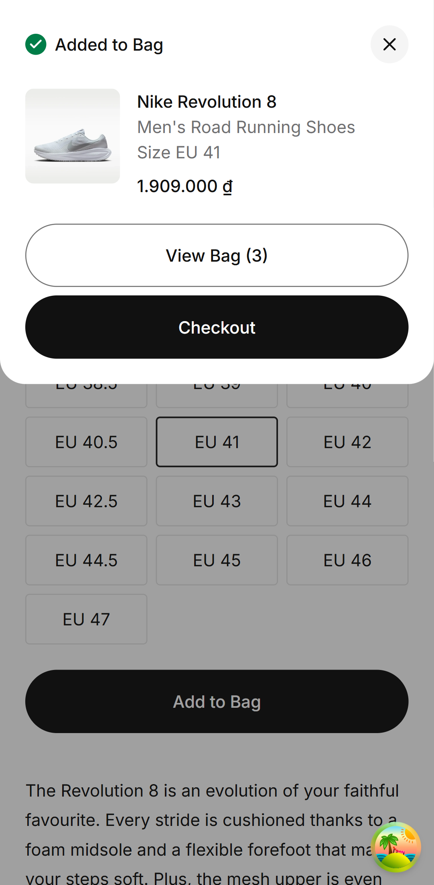

# Giỏ hàng: "Add to Bag" thật, popup "Added to Bag", số trên icon túi, trang /cart

> Lát 2.2 · plan: [plan/gio-hang.md](../../plan/gio-hang.md) · module: `entity`, `business.cart`; `frontend/` (khu cửa hàng), `automation/`

## 1. Mục tiêu

Sau lát `chi-tiet-giay`, nút "Add to Bag" mới chỉ kiểm tra đã chọn size mà chưa làm gì. Lát này làm trọn vòng giỏ hàng cho khách (không cần đăng nhập): chọn size, bấm "Add to Bag", popup "Added to Bag" xác nhận, số trên icon túi tăng, rồi ở `/cart` xem lại từng dòng với giá / ảnh / tồn kho **mới nhất từ server**, tăng giảm số lượng, đổi size, xoá, xem tạm tính + phí giao hàng và bấm "Checkout".

Giỏ lưu ở **localStorage** (khoá `nike.cart`, quyết định D8), không có bảng giỏ; server chỉ có một API công khai để tính lại giỏ.

| Có làm | Không làm (để lát sau) |
|---|---|
| `POST /cart/public/check`: tính lại giỏ (tên, ảnh, size, giá đang bán, tồn kho, trạng thái từng dòng, tạm tính, phí giao hàng, tổng) | Trang `/checkout` thật, tạo đơn, trừ kho (lát `dat-hang`); lát này `/checkout` là trang tạm "Coming Soon" |
| Giỏ ở localStorage, làm sạch dữ liệu hỏng khi đọc, đồng bộ giữa các tab | Đồng bộ giỏ theo tài khoản, gộp giỏ khi đăng nhập |
| "Add to Bag" cộng dồn (tối đa `min(10, tồn kho)`), popup "Added to Bag" tự đóng sau 5 giây, số trên icon túi ở mọi trang cửa hàng | Nút "Favourite ♡" và khối "Favourites" (lát `yeu-thich`), mã giảm giá |
| Trang `/cart`: số lượng, đổi size, xoá, cảnh báo "Just a few left", dòng hết hàng / ngừng bán / tự giảm số lượng, Summary, giỏ trống, skeleton, lỗi + "Try Again", "You Might Also Like" | Visual regression / a11y |
| Mobile: popup trượt từ trên, giỏ một cột, "n items \| tổng", nút "Checkout" dính đáy | |

## 2. Tác nhân và phân quyền

| Tác nhân | Quyền | Ghi chú |
|---|---|---|
| Khách chưa đăng nhập, khách đã đăng nhập, quản trị | `POST /cart/public/check` | Công khai nhờ mẫu `^/[a-z0-9-]+/public/.*` của `JwtAuthenticationFilter`; không sửa filter, không `checkPermission`, không thêm resource. Token sai / hết hạn vẫn trả 200 |
| Khách chưa đăng nhập | Thêm vào giỏ, xem / sửa giỏ; "Checkout" → `/signin?redirect=/checkout` | Thanh toán bắt buộc đăng nhập (D8) |
| Khách đã đăng nhập | Như trên; "Checkout" → `/checkout` | |

Giỏ gắn với **trình duyệt**, không gắn tài khoản: đăng nhập / đăng xuất không làm đổi giỏ, hai người dùng chung máy thấy chung giỏ.

## 3. Luồng hoạt động

1. Khách ở `/t/nike-dunk-low-retro` chọn "EU 42", bấm "Add to Bag" → `nike.cart` = `[{"sizeId":206,"quantity":1}]`; icon túi hiện số **1** (tên "Bag, 1 item"); popup "Added to Bag" mở ở góc phải dưới header với ảnh, tên, "Men's Shoes", "Size EU 42", "3.519.000 ₫", nút "View Bag (1)" và "Checkout". Popup tự đóng sau 5 giây.
2. Bấm "Add to Bag" lần nữa (vẫn EU 42) → cùng dòng thành `quantity 2`, popup "View Bag (2)", túi hiện **2**.
3. Bấm "View Bag (2)" → `/cart`. FE đọc giỏ, gọi `POST /cart/public/check` → dòng "Nike Dunk Low Retro" 7.038.000 ₫; Subtotal 7.038.000 ₫, Estimated Delivery & Handling "Free", Total 7.038.000 ₫, "You qualify for free delivery."
4. Bấm − → số lượng 1 → gọi lại `check` → Subtotal 3.519.000 ₫, phí 30.000 ₫, Total 3.549.000 ₫, "Add 1.481.000 ₫ more to get free delivery."
5. Bấm "Checkout": chưa đăng nhập → `/signin?redirect=/checkout`, đăng nhập xong về `/checkout`, giỏ vẫn nguyên; đã đăng nhập → `/checkout` ngay.

Luồng thay thế:
- **Đủ số lượng**: size đang chọn đã có `min(10, tồn kho)` đôi trong giỏ → không thêm, không mở popup, dưới nút hiện "You've reached the maximum quantity for this size."
- **Đóng popup**: ✕ "Close", Esc, bấm nền, hoặc tự đóng sau 5 giây (rê chuột lên popup thì tạm dừng đếm).
- **Đổi size trong giỏ**: bấm "Size EU 42" → danh sách size của sản phẩm (size hết hàng mờ) → chọn size khác; nếu size mới đã có trong giỏ thì gộp thành một dòng, số lượng cộng dồn (tối đa `min(10, tồn kho)`).
- **Xoá**: số lượng 1 thì nút trái là 🗑 "Remove"; hết dòng → "There are no items in your bag."
- **Giỏ lệch với server**: size hết hàng → "This size is sold out. Choose another size or remove it."; sản phẩm bị ẩn → "This product is no longer available."; số lượng vượt tồn kho → tự giảm về tồn kho + "Only 3 left in this size. We've updated your quantity."; `sizeId` không còn tồn tại → dòng tự bỏ khỏi giỏ. Dòng không mua được không tính vào tạm tính và không chặn "Checkout".
- **Nhiều tab**: tab A sửa giỏ → tab B đang mở cập nhật số trên túi và danh sách (sự kiện `storage`).
- **Mobile**: popup trượt từ trên, rộng hết màn hình; giỏ một cột, dưới tiêu đề "2 items | 7.038.000 ₫", nút "Checkout" dính đáy.

Ngoại lệ:
- localStorage hỏng (không phải JSON, không phải mảng, phần tử sai kiểu, số lượng ngoài 1–10, trùng size, quá 50 dòng) → FE làm sạch khi đọc rồi ghi lại; không bao giờ gửi dữ liệu sai lên server.
- `check` lỗi (500, mất mạng) → "Couldn't load your bag." + "Try Again", "Checkout" bị khoá.
- `check` chậm → khung xương (skeleton) lần đầu; các lần sau giữ dữ liệu cũ (`aria-busy="true"`).
- Gọi thẳng API với dữ liệu sai → 400; giá client gửi kèm bị bỏ qua (giá luôn lấy từ DB).

## 4. Cơ sở dữ liệu

**Không có migration, không có bảng giỏ.** `check` chỉ đọc `product_size`, `product`, `product_image` của lát `du-lieu-giay`; không giữ chỗ, không trừ kho.

**localStorage** (khoá `nike.cart`): mảng JSON `[{ "sizeId": 206, "quantity": 2 }]`, thứ tự = thứ tự thêm (dòng mới ở cuối). Mỗi lần đọc `sanitizeCart` làm sạch theo thứ tự: không parse được / không phải mảng → `[]`; bỏ phần tử không phải object hoặc `sizeId` / `quantity` không phải số nguyên ≥ 1; `quantity > 10` → 10; trùng `sizeId` thì gộp vào dòng đầu (cộng số lượng, tối đa 10); quá 50 dòng thì giữ 50 dòng đầu. Kết quả khác bản đọc thì ghi lại.

## 5. API

Mọi response bọc `{ code, message, result }`, prefix `/api`, **không cần token**. Controller: [`CartPublicController`](../../backend/business/src/main/java/vn/aeoc/business/cart/controller/CartPublicController.java), nghiệp vụ ở [`CartService`](../../backend/business/src/main/java/vn/aeoc/business/cart/service/CartService.java), phí giao hàng ở [`ShippingPolicy`](../../backend/business/src/main/java/vn/aeoc/business/cart/ShippingPolicy.java).

| Method | Đường dẫn | Mô tả |
|---|---|---|
| POST | `/cart/public/check` | Body là mảng `[{ sizeId, quantity }]` (rỗng hợp lệ); trả `items`, `itemCount`, `subtotal`, `shippingFee`, `total` |

Mỗi phần tử `items` đúng thứ tự request, có `status`: `AVAILABLE` (tồn ≥ số lượng), `INSUFFICIENT_STOCK` (0 < tồn < số lượng; `availableQuantity` = tồn), `OUT_OF_STOCK` (tồn 0), `UNAVAILABLE` (size không tồn tại hoặc sản phẩm không `PUBLISHED`). Cùng các field hiển thị (`name`, `subtitle`, `slug`, `imageUrl`, `sizeLabel`), `price`, `salePrice`, `unitPrice = salePrice ?? price`, `lineTotal = unitPrice × availableQuantity`. Size không tồn tại thì mọi field thông tin là `null`; sản phẩm ẩn vẫn có tên / ảnh để khách biết dòng nào bị bỏ nhưng `stock` = 0 (không lộ tồn của sản phẩm ẩn).

`itemCount = Σ availableQuantity`; `subtotal = Σ lineTotal`; `shippingFee` = 0 khi `subtotal = 0` hoặc `≥ 5.000.000`, ngược lại 30.000; `total = subtotal + shippingFee`.

Quy tắc validate (theo thứ tự, gặp lỗi đầu tiên thì dừng, **không** truy vấn DB):

| Tình huống | HTTP | Thông báo |
|---|---|---|
| Body thiếu, không phải mảng, JSON hỏng, sai kiểu field | 400 | Malformed request body |
| Hơn 50 dòng | 400 | Your bag can hold up to 50 different items. |
| `sizeId` thiếu / < 1, phần tử `null` | 400 | Invalid size in bag. |
| `quantity` thiếu / < 1 / > 10 | 400 | Quantity must be between 1 and 10. |
| Trùng `sizeId` | 400 | Each size can only appear once in the bag. |
| Sai method (`GET`) | 405 | HTTP method not supported |

`sizeId` không tồn tại / sản phẩm ẩn **không** phải lỗi (200, dòng `UNAVAILABLE`) để giỏ cũ của khách vẫn mở được.

Điểm đáng chú ý ở phần cài đặt:
- `ProductSizeRepository.listCartRows` là **một truy vấn** `product_size ⨝ product` + subquery ảnh `sort_order = 1`; giỏ rỗng thì bỏ qua truy vấn (unit test đã bắt lỗi thật này lần chạy đầu).
- Entity `CartItem`, `CartLine`, `CartCheck` là POJO không ánh xạ bảng; `productStatus` chỉ dùng nội bộ (`@JsonIgnore`) để xét `UNAVAILABLE`.
- `CartService` gọi thẳng `ProductSizeRepository` của package `product` (lệch quy tắc "không gọi repository package khác" của `backend/AGENTS.md`, đúng như plan đã duyệt).

## 6. Giao diện

Thành phần ở `components/shop/cart/` (`CartPage`, `CartLine`, `CartQuantity`, `CartSizeSelect`, `CartSummary`, `CartEmpty`, `CartSkeleton`) và `components/shop/product-detail/added-to-bag-dialog.tsx`. Trạng thái giỏ ở `lib/stores/cart.ts` (zustand, ghi `writeCart` mỗi lần đổi, nghe sự kiện `storage`); hàm thuần ở `lib/shop/cart-storage.ts` (`sanitizeCart`, `addItem`, `changeSize`, …) và `lib/shop/checkout.ts` (luật "Checkout"). Route `routes/_shop/cart.tsx` (`<title>` "Bag | Nike") và `routes/_shop/checkout.tsx` (trang tạm). Desktop (≥ 1024 px) hai cột, mobile một cột theo `useIsDesktop()`.

**Số trên icon túi** = tổng `quantity` trong localStorage (cả dòng không mua được), hiện giữa icon ở desktop và mobile, link đọc "Bag, 2 items"; `> 99` hiện `99+`.

Popup "Added to Bag" ở góc phải dưới header: ảnh, tên, phụ đề, "Size EU 42", giá, nút "View Bag (1)" và "Checkout"; số 1 hiện trên icon túi (TC-10).

**Popup** là dialog modal (nền `rgba(17,17,17,0.4)`), focus vào "Close" khi mở. Hẹn giờ 5 giây dừng khi khách di chuyển chuột trên popup (dùng `pointermove` thay vì `pointerenter` vì Firefox cuộn nút "Add to Bag" lên đúng vùng popup và bắn `pointerenter` khi con trỏ đứng yên).

`/cart` desktop: hai dòng (Dunk Low Retro 1 đôi; Precision 8 Low 2 đôi, giá giảm 4.000.000 ₫ kèm giá gạch 4.238.000 ₫), Summary bên phải với phí "Free", gợi ý miễn phí giao hàng và "You Might Also Like" phía dưới (TC-13).

**Dòng sản phẩm.** Pill số lượng: nút trái là 🗑 "Remove" khi `quantity = 1`, ngược lại − "Decrease quantity"; nút ＋ "Increase quantity" khoá khi đạt `min(10, tồn kho)`. Mỗi lần bấm đổi localStorage ngay (lạc quan) rồi gọi lại `check`. Tồn 1–3 hiện "Just a few left. Order soon.".

Giỏ có dòng hết hàng ("This size is sold out…"), sản phẩm ngừng bán ("This product is no longer available.", tên không còn là link) và dòng tự giảm số lượng ("Only 3 left in this size. We've updated your quantity."); ba dòng đầu mờ và không tính vào Subtotal (TC-17).

Giỏ trống: "There are no items in your bag.", nút "Shop All Shoes", Subtotal / Delivery / Total là "—" và "Checkout" bị khoá (TC-14, TC-26).

Bấm "Size EU 42" mở danh sách 13 size của sản phẩm, "EU 38.5" và "EU 46" mờ vì hết hàng, mục đang chọn có dấu ✓ (TC-18).

**Đổi size** dùng `Select` ngay tại dòng; dữ liệu size tải từ `GET /product/public/get` (có cache). Size mới chưa có trong giỏ thì thay tại chỗ (số lượng không quá `min(10, tồn mới)`); đã có thì bỏ dòng cũ và cộng dồn vào dòng có sẵn.

**Đối soát với server.** Sau mỗi kết quả `check` khớp giỏ hiện tại, FE bỏ dòng `productId = null` và đặt lại `quantity = stock` cho dòng `INSUFFICIENT_STOCK` (hàm thuần `reconcileCart`), rồi ghi thông báo "Only n left…".

**Checkout.** Đã đăng nhập → `/checkout`; chưa đăng nhập → `/signin?redirect=/checkout` (lối vào `dang-nhap-nike` đưa về đúng trang sau khi đăng nhập); phiên đang tải thì nút tạm khoá. Nút khoá khi giỏ trống, đang tải lần đầu, lỗi tải hoặc không có dòng nào mua được.

Trên điện thoại: một cột, dòng "2 items | 7.038.000 ₫" dưới tiêu đề, ảnh 120 px và nút "Checkout" dính đáy màn hình (TC-25).

Trên điện thoại popup trượt từ trên xuống, rộng hết màn hình, nút "View Bag (3)" và "Checkout" (TC-25).

## 7. Kiểm thử

Test nghiệm thu viết trước khi code: API ở [`gio-hang.api.spec.js`](../../automation/tests/api/gio-hang.api.spec.js) (TC-01 → TC-09), giao diện ở [`gio-hang.spec.js`](../../automation/tests/cart/gio-hang.spec.js) (TC-10 → TC-26), JUnit ở [`CartServiceTest.java`](../../backend/business/src/test/java/vn/aeoc/business/cart/service/CartServiceTest.java) và [`ShippingPolicyTest.java`](../../backend/business/src/test/java/vn/aeoc/business/cart/ShippingPolicyTest.java). Kết quả mong đợi tính bằng `expectedCartCheck` / `sizeIdOf` từ `products.json`.

| ID | Loại | Nội dung | Kết quả |
|---|---|---|---|
| TC-01 | api | Kiểm tra giỏ nhiều trạng thái (6 dòng, bỏ qua `price` client gửi) | Pass |
| TC-02 | api | Mỗi sản phẩm đang bán (29 sản phẩm; `nike-p-6000` hết hàng mọi size nên bỏ qua) | Pass |
| TC-03 | api | Phí giao hàng — giá trị biên (6 ca) | Pass |
| TC-04 | api | Số lượng biên hợp lệ (1, 10, 50 dòng) | Pass |
| TC-05 | api | Validate (14 ca) | Pass |
| TC-06 | api | Size không mua được (hết hàng, ẩn, không tồn tại, thiếu tồn) | Pass |
| TC-07 | api | Công khai (token sai vẫn 200) + `GET` → 405 | Pass |
| TC-08 | api | `check` không giữ chỗ / không đổi kho | Pass |
| TC-09 | api | Giá luôn theo DB | Pass |
| TC-10 | e2e | Thêm vào giỏ từ trang chi tiết (popup, số trên túi, localStorage) | Pass |
| TC-11 | e2e | Đóng popup (✕, nền, tự đóng 5 giây, dừng khi rê chuột, "View Bag") | Pass |
| TC-12 | e2e | Giới hạn khi thêm ("maximum quantity") | Pass |
| TC-13 | e2e | Trang giỏ có hàng | Pass |
| TC-14 | e2e | Số lượng, xoá, phí giao hàng biên | Pass |
| TC-15 | e2e | Ngưỡng miễn phí giao hàng (2 ca) | Pass |
| TC-16 | e2e | Giới hạn số lượng trong giỏ | Pass |
| TC-17 | e2e | Dòng không mua được + tự giảm số lượng | Pass |
| TC-18 | e2e | Đổi size trong giỏ (thay tại chỗ, gộp dòng) | Pass |
| TC-19 | e2e | localStorage hỏng (5 ca) | Pass |
| TC-20 | e2e | Giữ giỏ qua F5, tab mới, đồng bộ hai tab | Pass |
| TC-21 | e2e | Checkout khi chưa đăng nhập | Pass |
| TC-22 | e2e | Checkout khi đã đăng nhập | Pass |
| TC-23 | e2e | Lỗi mạng (500 + "Try Again", `check` chậm → skeleton) | Pass |
| TC-24 | e2e | Số trên túi ở mọi trang + "You Might Also Like" | Pass |
| TC-25 | e2e | Bố cục + thao tác mobile (mobile-chrome) | Pass |
| TC-26 | e2e | Giỏ trống ban đầu + điều hướng | Pass |
| TC-27 | e2e | Hồi quy: `chi-tiet-giay`, `giao-dien-nike`, `tieng-anh-cua-hang`, smoke | Pass (xem mục 8) |
| TC-U1 | unit | Validate (không gọi repository khi lỗi) | Pass |
| TC-U2 | unit | Dựng dòng + tổng, đúng thứ tự request | Pass |
| TC-U3 | unit | Phí giao hàng biên | Pass |

| Tổng hợp | Kết quả |
|---|---|
| JUnit `CartServiceTest` + `ShippingPolicyTest` | 10/10 pass (TC-U1 → TC-U3); test cũ của `business` 0 lỗi |
| Playwright API (`pnpm test:api`) | 130/130 pass, gồm 9 test mới |
| Playwright lát này, chromium (`--headed`, slowMo 400) | 17/17 giao diện pass (TC-25 bỏ qua ở chromium) |
| Playwright TC-25, mobile-chrome | 1/1 pass |
| Playwright firefox + webkit, `gio-hang` + `chi-tiet-giay` (`--workers=4`) | 72/72 pass |
| `pnpm test:smoke --workers=4` | 92/92 pass |
| `pnpm build`, `pnpm lint` | Xanh; frontend 1 cảnh báo cũ, automation 18 cảnh báo cũ (`no-conditional-expect`) |

Số vòng sửa: backend 1 (unit test đầu tiên bắt `check([])` vẫn gọi `listCartRows`; API 9/9 xanh ngay lần đầu), frontend 3 khi chạy E2E (xem mục 8).

## 8. Điểm lệch plan và việc còn lại

- **Popup dừng đếm theo `pointermove`** thay vì `pointerenter` (nguyên nhân ở mục 6): khách chưa rê chuột thì popup vẫn tự đóng đúng ý plan.
- **Spec sửa cho đúng plan** (TC-10): bỏ hai dòng kiểm `header-cart-count` lúc popup đang mở, vì popup là dialog modal nên Radix `aria-hidden` cả header; số trên túi vẫn được kiểm ngay sau Esc. (TC-22): sau đăng nhập chờ nút "Hi, …" rồi mới `goto('/cart')` vì Firefox huỷ `goto` khi router còn chốt điều hướng SPA.
- **Testid thêm ngoài §6 của plan** (không đổi chuỗi hiển thị): `added-to-bag-{name,subtitle,size,price}`, `cart-item-subtitle`. TC-25 "Checkout dính đáy" kiểm bằng vị trí nút so với đáy màn hình, trước và sau khi cuộn.
- `chi-tiet-giay.spec.js` TC-13 sửa theo plan: bấm "Add to Bag" khi đã chọn size nay mở popup, test đóng bằng Esc rồi mới thử phím mũi tên.
- **Còn đỏ, không thuộc lát này**: `chi-tiet-giay` TC-24 ("Back giữ vị trí cuộn") trên chromium nay đỏ ổn định (firefox / webkit xanh). Đây chính là rủi ro đã ghi ở tài liệu `chi-tiet-giay` (router lưu vị trí cuộn bằng `throttle(100ms)`, test cuộn rồi bấm ngay nên `/w` lưu 1961 thay vì 2820). Đã loại trừ lát giỏ hàng (tạm bỏ popup và số trên túi vẫn đỏ 3/3; cuộn xong chờ 500 ms rồi bấm thì Back khôi phục đúng). Cần quyết định: sửa spec chờ router lưu xong, hay sửa app.
- Firefox `giao-dien-nike` TC-22 hết 30 giây một lần khi tải nặng (như các lát trước), chạy riêng xanh.
- Còn lại cho lát sau: `/checkout` và tạo đơn (`dat-hang`), "Favourite" (`yeu-thich`), đồng bộ giỏ theo tài khoản, visual regression / a11y.
