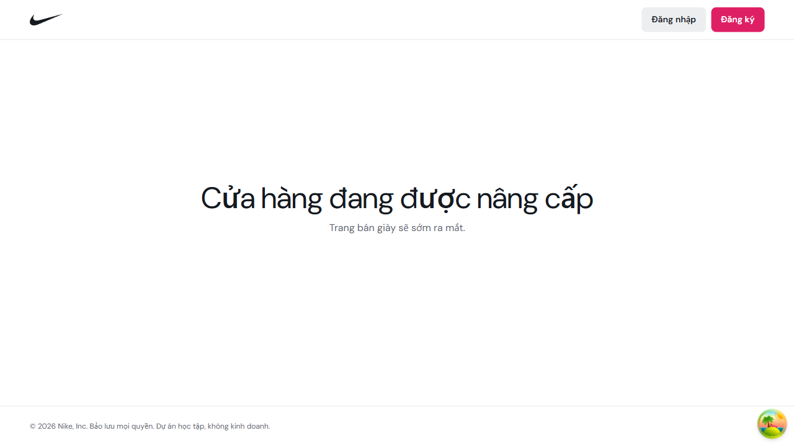
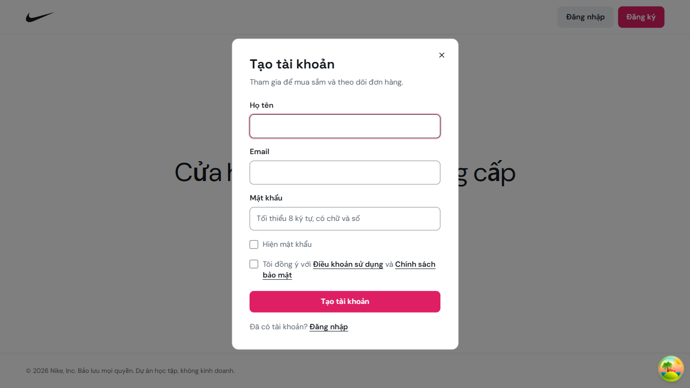
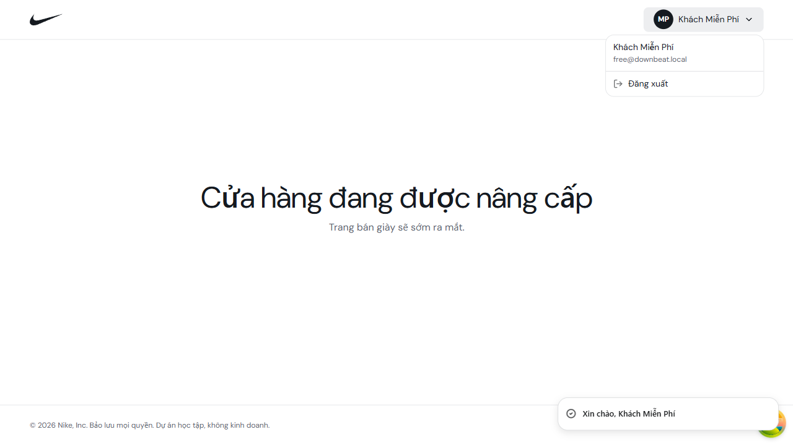
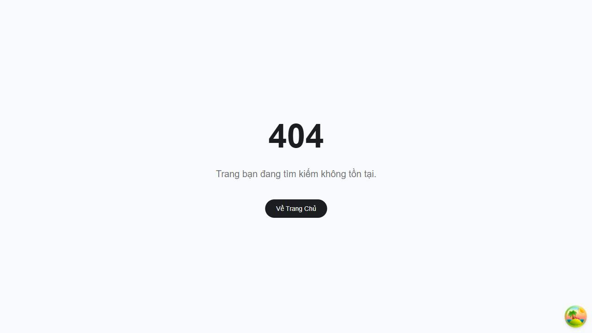
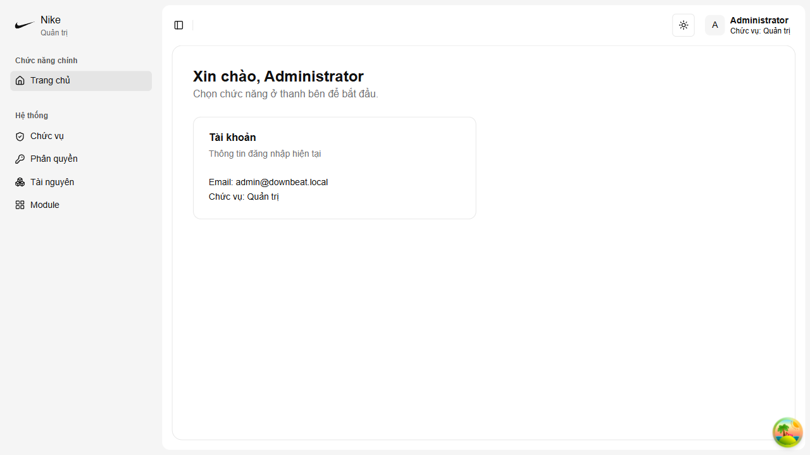
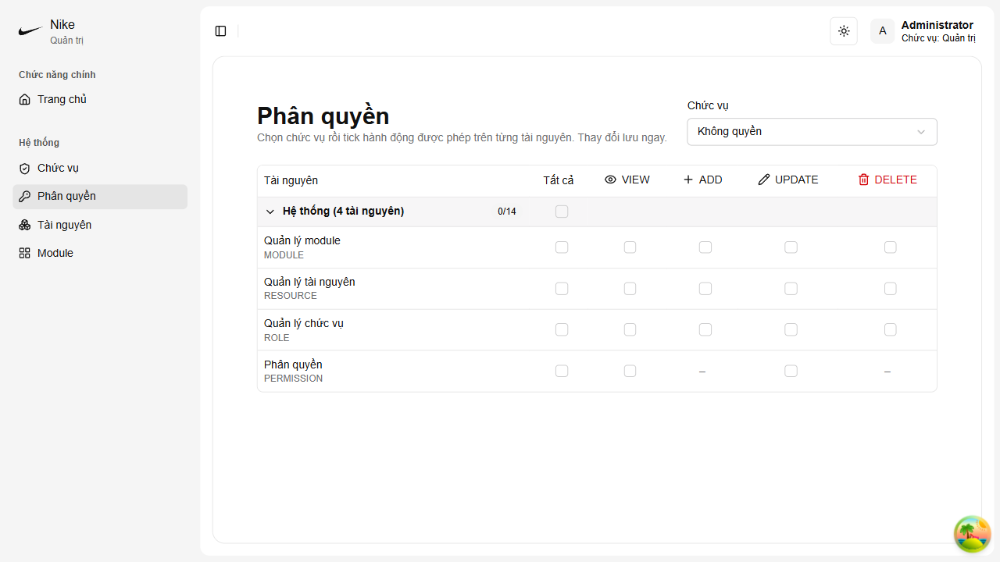

# Gỡ toàn bộ phần LUT khỏi hệ thống

> Lát 1.1 · plan: [plan/go-lut.md](../../plan/go-lut.md) · module: `business`, `entity`, `authenticate`, `base`; frontend `routes/`, `components/`

## 1. Mục tiêu

Dự án chuyển từ cửa hàng LUT chỉnh màu cũ sang cửa hàng giày mô phỏng nike.com/vn. Lát này xoá hẳn mọi thứ của cửa hàng LUT (kho, gói và thanh toán gói, tải, bộ sưu tập, gợi ý, bảng số liệu) để các lát cửa hàng giày sau bắt đầu từ một nền sạch.

Sau lát này hệ thống chỉ còn **nền dùng chung**: đăng nhập / làm mới token, đăng ký khách, `account/me`, phân quyền (module, tài nguyên, chức vụ, phân quyền), MinIO (bucket công khai) và client payOS (giữ lại cho lát đặt hàng). Trang `/` tạm thời là "Cửa hàng đang được nâng cấp".

| Có làm | Không làm (để lát sau) |
|---|---|
| Migration `V18` xoá 18 bảng LUT, resource `LUT`, `RECOMMEND`, `DASHBOARD`, module `CATALOG`, `RECOMMENDER`, `SALES` | Bảng giày, ảnh sản phẩm (`du-lieu-giay`) |
| Xoá package backend `lut`, `billing`, `download`, `collection`, `recommend`, `dashboard`, phần sở thích của `account` | Header / footer / trang chủ kiểu Nike (`giao-dien-nike`) |
| Chuyển client payOS sang `business.payment.payos`, bỏ phụ thuộc vào gói | Đơn hàng giày, webhook (`dat-hang`) |
| `account/me` bỏ trường gói; xoá `account/preference` | Dọn object LUT cũ trên MinIO (vô hại) |
| Xoá route, component, store, API client frontend của LUT; `/` thành trang tạm | |

## 2. Tác nhân và phân quyền

| Tác nhân | Sau lát này |
|---|---|
| Khách vãng lai | Xem trang tạm `/`, mở hộp thoại "Đăng nhập" / "Đăng ký" |
| Khách hàng (`free@nike.local`) | Đăng nhập; menu tài khoản chỉ còn tên, email và "Đăng xuất" |
| Quản trị (`admin@nike.local`) | `/admin`: trang chào và nhóm Hệ thống (Chức vụ, Phân quyền, Tài nguyên, Module) |
| Không quyền (`noaccess@nike.local`) | `/admin` chỉ thấy trang chào, sidebar không có mục chức năng |

## 3. Cơ sở dữ liệu

Migration `V18__go_lut.sql` (lúc làm lát này). Các migration V3 → V17 và seed V3_1 / V5_1 **giữ nguyên** vì Flyway kiểm checksum: DB đang chạy không báo lỗi validate, DB mới tạo bảng LUT rồi V18 xoá ngay.

- `DROP TABLE` 18 bảng (`lut`, `lut_*`, `creator`, `collection*`, `download_log`, `plan`, `payment_order`, `subscription`, `user_preference`, `user_event`, `rec_*`), tắt `FOREIGN_KEY_CHECKS` trong lúc xoá.
- Xoá resource `LUT`, `RECOMMEND`, `DASHBOARD` (permission xoá theo `ON DELETE CASCADE`).
- Xoá module `CATALOG`, `RECOMMENDER`, `SALES` khi không còn resource nào thuộc về.

Sau V18 còn đúng 6 bảng `module`, `resource`, `role`, `permission`, `user_app`, `refresh_token` (và `flyway_schema_history`). Đã kiểm trên DB local có sẵn dữ liệu LUT: Flyway áp V18 thành công, `SHOW TABLES` đúng như trên.

> Ngày 20/11/2026 toàn bộ migration được gộp thành [`V1__baseline.sql`](../../backend/app/src/main/resources/db/migration/V1__baseline.sql) (seed local: `db/seed/V1_1__seed_tai_khoan.sql`), bỏ hẳn các file LUT V3 → V18; schema không đổi, đã so bằng `mysqldump --no-data`.

## 4. API

Mọi response bọc `{ code, message, result }`, prefix `/api`.

| Method | Đường dẫn | Thay đổi |
|---|---|---|
| POST | `/user/authenticate`, `/auth/refresh`, `/auth/logout`, `/user/update-password` | Giữ nguyên |
| GET | `/user/info` | Giữ nguyên |
| POST | `/account/register` | Giữ nguyên, đăng ký xong có `token` / `refreshToken` |
| GET | `/account/me` | **Đổi**: trả `id, isOperator, roleId, roleName, name, email, hasPassword, active, firstTime`; bỏ `plan`, `planExpiresAt`, `planAutoRenew` |
| * | `/module/*`, `/resource/*`, `/role/*`, `/permission/*` | Giữ nguyên |
| * | `/lut/**`, `/lut-category/**`, `/plan/**`, `/order/**`, `/subscription/**`, `/collection/**`, `/recommend/**`, `/account/preference`, `/dashboard/summary` | **Xoá**, trả 404 "Không tìm thấy API" |

Điểm đáng chú ý: trước lát này `account/me` chỉ trả `{id, name, email, plan}`; nay trả đủ các trường theo plan §5.2. `hasPassword` lấy qua hàm mới `UserService.hasPassword` vì mật khẩu không nằm trong cache user.

## 5. Giao diện

- **Trang tạm `/`** (tiêu đề tab "Nike. Just Do It."): header tối giản (logo swoosh; "Đăng nhập" / "Đăng ký" cho khách), nội dung "Cửa hàng đang được nâng cấp" / "Trang bán giày sẽ sớm ra mắt.", footer "© 2026 Nike, Inc. Bảo lưu mọi quyền. Dự án học tập, không kinh doanh."
- **Hộp thoại đăng nhập / đăng ký** giữ lại; đăng ký xong đóng hộp thoại và đăng nhập ngay, không còn bước "Bạn thích phong cách màu nào?". Mô tả đăng nhập chung: "Đăng nhập để mua sắm và theo dõi đơn hàng."
- **Menu tài khoản**: tên + email, "Trang quản trị" (chỉ khi là quản trị hoặc có quyền VIEW), "Đăng xuất".
- **Admin**: sidebar còn "Trang chủ" và nhóm "Hệ thống" (4 mục); `/admin` luôn là trang chào, không còn bảng số liệu.
- **Route cũ** (`/luts`, `/pricing`, `/bo-suu-tap`, `/goi-cua-toi`, `/admin/luts`, `/admin/goi-y`, `/admin/dac-trung-mau`, …) hiện trang "không tìm thấy" dùng chung (`not-found-page.tsx`), nút "Về Trang Chủ" trỏ về `/`.

Trang `/` tạm thời cho khách (TC-12).

Hộp thoại đăng ký đã điền, không còn bước chọn phong cách màu (TC-13).

Menu tài khoản khách chỉ còn tên, email và "Đăng xuất" (TC-14).

Mở `/luts` hiện trang không tìm thấy của cửa hàng (TC-16).

`/admin` chỉ còn lời chào và nhóm Hệ thống, không có "LUT", "Gợi ý" (TC-17).

Ma trận phân quyền vẫn tải được, không còn hàng LUT / Gợi ý / Bảng số liệu (TC-19).

## 6. Kiểm thử

Bộ test nghiệm thu viết trước khi code: API ở [`go-lut.api.spec.js`](../../automation/tests/api/go-lut.api.spec.js) (TC-01 → TC-11), giao diện ở [`go-lut.spec.js`](../../automation/tests/system/go-lut.spec.js) (TC-12 → TC-20). Plan ghi một file duy nhất nhưng đã tách hai file vì project `api` chỉ nhận `tests/api/**`.

| ID | Loại | Nội dung | Kết quả |
|---|---|---|---|
| TC-01 | api | API kho LUT công khai trả 404 | Pass |
| TC-02 | api | API quản trị LUT trả 404 (không phải 403 / 500) | Pass |
| TC-03 | api | API gói / đơn gói trả 404 | Pass |
| TC-04 | api | API tải và bộ sưu tập trả 404 | Pass |
| TC-05 | api | API gợi ý, sở thích, dashboard trả 404 | Pass |
| TC-06 | api | `account/me` không còn trường gói | Pass |
| TC-07 | api | `account/me` không token → 401 | Pass |
| TC-08 | api | Đăng ký vẫn chạy, `me` trả "Khách hàng" | Pass |
| TC-09 | api | Đăng nhập / refresh / role list vẫn chạy | Pass |
| TC-10 | api | Resource `LUT`, `RECOMMEND`, `DASHBOARD` biến mất | Pass |
| TC-11 | api | Module `CATALOG`, `RECOMMENDER`, `SALES` biến mất | Pass |
| TC-12 | e2e | Trang tạm `/` cho khách | Pass |
| TC-13 | e2e | Đăng ký không còn bước chọn phong cách | Pass |
| TC-14 | e2e | Menu tài khoản khách chỉ còn mục cơ bản | Pass |
| TC-15 | e2e | Đăng xuất | Pass |
| TC-16 | e2e | Route cửa hàng cũ là 404 | Pass |
| TC-17 | e2e | Admin: menu chỉ còn Hệ thống, không bảng số liệu | Pass |
| TC-18 | e2e | Route admin cũ là 404 | Pass |
| TC-19 | e2e | Trang phân quyền vẫn chạy | Pass |
| TC-20 | e2e | `noaccess` vào admin | Pass |
| TC-U1 | unit | `PayosSignature` ký đúng sau khi chuyển package (3 ca) | Pass |
| TC-U2 | unit | Context Spring khởi động sau khi xoá package | Pass |

| Tổng hợp | Kết quả |
|---|---|
| JUnit (module `app`, `business`) | 4/4 pass |
| Playwright, chromium + project `api` | 20/20 pass (11 API + 9 giao diện) |
| Playwright toàn bộ 6 project (api, setup, chromium, firefox, webkit, mobile-chrome) | 86 pass + 3 skip / 89 (skip = TC-13 cũ của `khung-automation`, chỉ chạy chromium) |
| `pnpm build`, `pnpm lint` | Xanh; lint 0 lỗi, 1 cảnh báo cũ (trước lát là 11) |

Số vòng sửa: backend 0, frontend 1 (xem mục 7).

## 7. Điểm lệch plan và việc còn lại

- Test nghiệm thu tách hai file thay vì một (lý do ở mục 6).
- E2E lần 1 đỏ 5 ca, đều do frontend: title vẫn là "nike" (thiếu `HeadContent`); layout gốc bọc mọi trang trong `<main>` làm header / footer mất landmark (đổi thành `div#app-scroll`); route admin cũ rơi vào trang Not Found mặc định của router (thêm `NotFoundPage` dùng chung và `notFoundComponent` cho `/admin`). Không sửa spec.
- Ảnh / video LUT không còn dùng trong `frontend/public/` (`home.mp4`, `hero-wave-*.webp`, `nike.png`, `brand/`) và favicon nike để nguyên cho lát `giao-dien-nike`.
- Hai unit test backend (`PayosSignatureTest`, `ApplicationContextTest`) nằm trong `backend/**/src/test/`, vốn bị `.gitignore` bỏ qua nên chỉ có trên máy phát triển, không vào commit.
- Tài liệu cửa hàng LUT cũ chuyển vào [docs/archive/lut/](../archive/lut/README.md).
