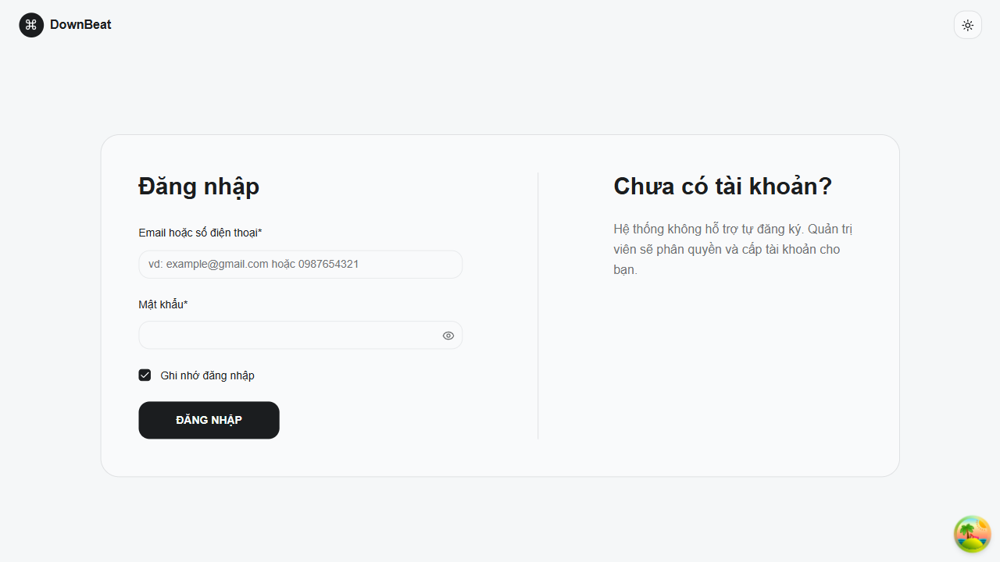
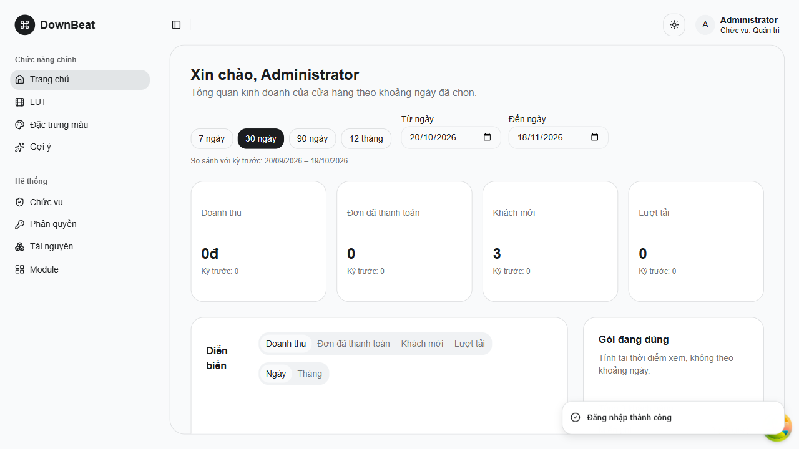
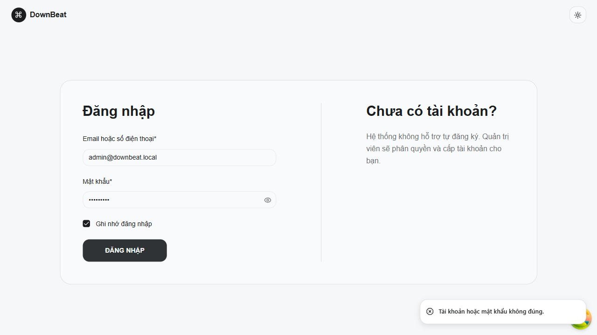
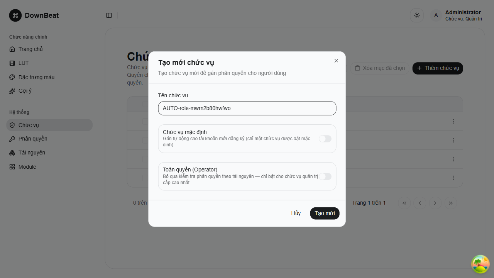
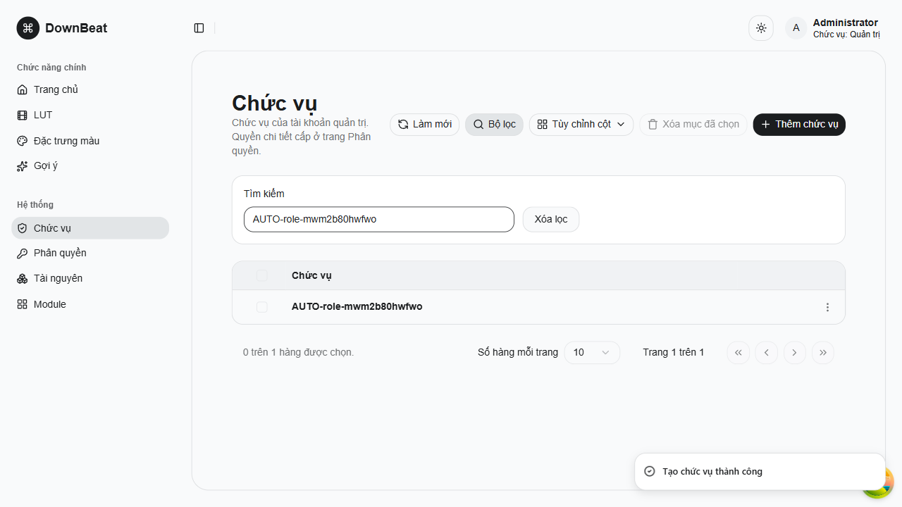
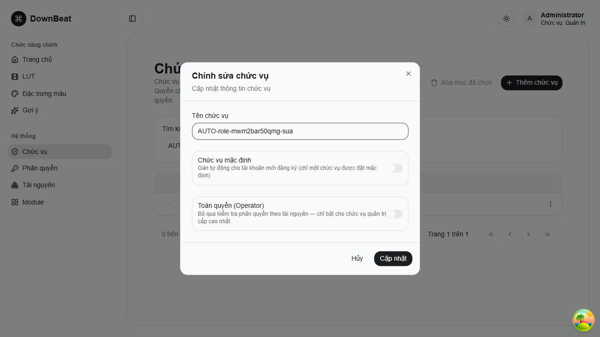
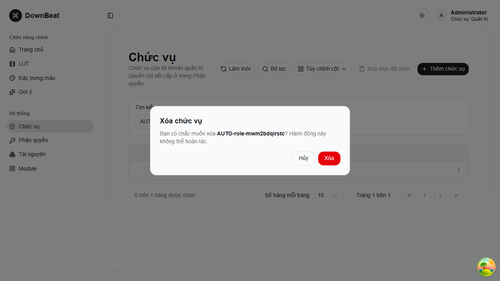
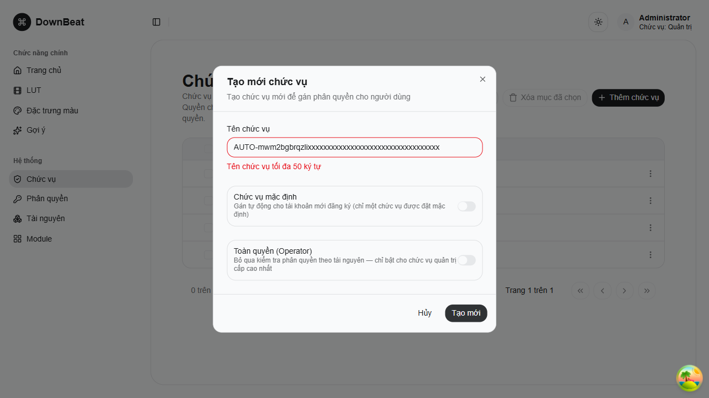
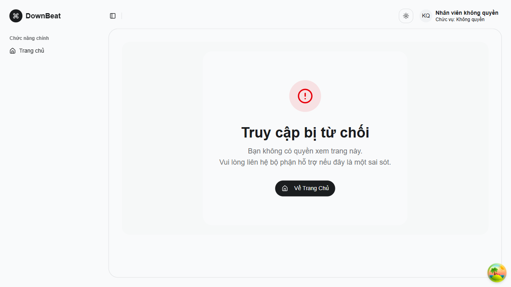

# Kiến trúc bộ kiểm thử tự động (khung automation)

> Lát 0.1 · plan: [plan/khung-automation.md](../../plan/khung-automation.md) · không đổi backend / frontend

## 1. Mục tiêu

Dựng thư mục `automation/` làm nền cho toàn bộ đồ án: một project Playwright viết bằng JavaScript (ESM) theo mô hình Page Object (POM), có fixture, API client, dữ liệu kiểm thử tách riêng, chạy đa trình duyệt, báo cáo HTML + Allure, kiểm tra mã bằng ESLint / Prettier và chạy nhóm `@smoke` tự động trên GitHub Actions.

Bộ test đầu tiên phủ những phần không đổi trong suốt dự án: API xác thực / đăng ký và trang quản trị **Chức vụ** (đăng nhập `/login`, thêm / sửa / xoá, phân quyền). Từ các lát sau, test nghiệm thu của mỗi chức năng viết thẳng vào `automation/` bằng chính khung này.

## 2. Cấu trúc thư mục

```
automation/
├─ playwright.config.js     cấu hình: 6 project, reporter, webServer
├─ global-setup.js          kiểm backend sống trước khi chạy
├─ tests/
│  ├─ auth.setup.js         đăng nhập UI, lưu storageState theo vai trò
│  ├─ api/                  *.api.spec.js — test API (không mở trình duyệt)
│  ├─ admin/                *.spec.js — test giao diện quản trị
│  └─ visual/ a11y/ e2e-flows/   chỗ dành sẵn cho lát sau
├─ fixtures/index.js        test = base.extend({ api, apiAs, pages… })
├─ pages/                   Page Object (AdminLoginPage, AdminLayout, RolePage, components/)
├─ api/                     ApiClient, AuthApi, AccountApi, RoleApi
├─ data/                    accounts.js, register-invalid.json, role-names.json
└─ utils/                   unique, format, jwt, env, doc-shot
```

Luồng phụ thuộc: **spec → fixture → page object / API client → trình duyệt / HTTP**. Spec chỉ gọi hành vi nghiệp vụ (`rolePage.create(tên)`), không chứa selector; selector nằm trong page object và ưu tiên `getByRole` / `getByLabel` theo chuỗi giao diện thật.

## 3. Thành phần chính

| Thành phần | Vai trò |
|---|---|
| Project `setup` | Đăng nhập UI bằng `admin` và `noaccess`, lưu `.auth/<vai-trò>.json` để các test sau không phải đăng nhập lại |
| Project `api` | Chạy `tests/api/**`, không trình duyệt |
| Project `chromium`, `firefox`, `webkit`, `mobile-chrome` (Pixel 7) | Chạy test giao diện, phụ thuộc `setup` |
| Fixture `api`, `apiAs(vai-trò)` | Client API đã gắn token (admin / noaccess / customer), cache token theo worker |
| `ApiClient` | Bọc `request`, tự thêm `Authorization`, có `expectOk` và `expectError(status, message)` |
| `global-setup.js` | Gọi `GET /api/v3/api-docs`; backend chưa chạy thì dừng ngay với thông báo hướng dẫn thay vì để hàng loạt test đỏ |
| Dữ liệu sinh ra | Tên có tiền tố `AUTO-` + thời gian; `afterAll` xoá qua API để chạy lại không làm bẩn DB |
| Báo cáo | Playwright HTML (`playwright-report/`) và Allure (`allure-report/`) |
| Chất lượng mã | ESLint (`eslint-plugin-playwright`) + Prettier |
| CI | `.github/workflows/e2e-smoke.yml`: dựng MySQL + MinIO, chạy jar backend, chạy `@smoke` trên project `api` + `chromium`, upload báo cáo |

Tag: `@smoke` cho TC-01, 03, 12, 14 (chạy mỗi lần push); còn lại `@regression`.

## 4. Lệnh chạy

```bash
cd automation
pnpm test:smoke     # nhóm @smoke, mọi trình duyệt
pnpm test:api       # chỉ API, không cần frontend
pnpm lint
pnpm allure:generate && pnpm allure:open
E2E_SLOWMO=400 pnpm exec playwright test <spec> --project=chromium --headed --workers=1
```

## 5. Hình ảnh chạy thử

Ảnh chụp khi chạy test giao diện có giao diện (chromium).


Trang `/login` trước khi nhập (TC-12).


Sau đăng nhập vào `/admin`, sidebar có mục "Chức vụ" (TC-12).


Mật khẩu sai: ở lại `/login`, hiện "Tài khoản hoặc mật khẩu không đúng." (TC-13).


Hộp thoại "Tạo mới chức vụ" đã nhập tên `AUTO-…` (TC-14).


Tìm theo tên thấy đúng một dòng vừa tạo (TC-14).


Hộp thoại "Chỉnh sửa chức vụ" với tên mới (TC-15).


Hộp thoại xác nhận xoá (TC-16).


Nhập 51 ký tự: báo "Tên chức vụ tối đa 50 ký tự" (TC-17).


Tài khoản `noaccess` mở `/admin/chuc-vu`: không có quyền, sidebar không có "Chức vụ" (TC-18).

Chưa có ảnh báo cáo HTML / Allure / trang workflow CI (chụp khi workflow chạy lần đầu trên GitHub).

## 6. Kiểm thử

| ID | Loại | Nội dung | Kết quả |
|---|---|---|---|
| TC-01 | api | Đăng nhập đúng `@smoke` | Pass |
| TC-02 | api | Đăng nhập sai mật khẩu → 400 | Pass |
| TC-03 | api | Refresh + logout `@smoke` (refresh token dùng một lần) | Pass |
| TC-04 | api | Refresh token rác → 401 | Pass |
| TC-05 | api | Đăng ký rồi `account/me`, `roleId` = "Khách hàng" | Pass |
| TC-06 → TC-09 | api | Đăng ký sai dữ liệu (4 ca, data-driven) | Pass |
| TC-10 | api | `me` không token → 401 | Pass |
| TC-11 | api | `noaccess` → 403; `role/get` id lạ → 404 | Pass |
| TC-11b (bổ sung) | api | Vòng đời chức vụ: tạo → get → list → sửa → xoá → 404 | Pass |
| TC-12 | e2e | Đăng nhập quản trị `@smoke` | Pass |
| TC-13 | e2e | Đăng nhập sai trên UI (chỉ chromium) | Pass; 3 skip ở firefox / webkit / mobile-chrome theo rủi ro 429 |
| TC-14 | e2e | Tạo chức vụ `@smoke` | Pass |
| TC-15 | e2e | Sửa chức vụ | Pass |
| TC-16 | e2e | Xoá chức vụ | Pass |
| TC-17 | e2e | Validate tên: rỗng, chỉ khoảng trắng (bổ sung), 51, 50 ký tự | Pass |
| TC-18 | e2e | `noaccess` không thấy / không vào được Chức vụ | Pass |
| TC-19 | e2e | `@smoke` trên 4 project UI | Pass (webkit chạy được trên Windows) |
| TC-20 | khung | Báo cáo HTML + Allure | Phần báo cáo pass; phần CI chờ workflow chạy trên GitHub |
| TC-21 | khung | Backend tắt → dừng ở global setup | Pass (0,5 s, 0 test chạy) |

Số liệu:

- `pnpm test:api`: 12/12.
- Toàn bộ `pnpm exec playwright test` (6 project): **39 pass + 3 skip / 42**.
- `pnpm test:smoke`: 12/12.
- Chạy có giao diện (`--headed`, slowMo 400, chromium): 9/9, sinh 9 ảnh ở mục 5.
- `pnpm lint` 0 lỗi, 0 cảnh báo; Prettier sạch.
- JUnit: không áp dụng (không đổi backend). Frontend sau khi gỡ Playwright cũ: `pnpm build` xanh, `pnpm lint` 0 lỗi.

Số vòng sửa: backend 0, frontend 0; một vòng chỉnh cấu hình test (tăng `expect.timeout` lên 10 s, `goto` chờ `load`) vì TC-12 firefox quá hạn khi 42 test chạy song song và Vite biên dịch lần đầu.

## 7. Điểm lệch so với plan ban đầu

1. `role/list` của tài khoản không quyền trả message "Bạn không có quyền thực hiện thao tác này! Path: /role/, Action: VIEW" (do `BaseController.checkPermission` ghi đè), không phải "Không có quyền truy cập".
2. `account/me` không trả `roleName`; TC-05 đối chiếu `roleId` trong JWT với id chức vụ "Khách hàng" lấy qua `role/list`.
3. Toast xoá là "Xóa chức vụ thành công"; thêm toast tạo / sửa.
4. TC-03 không so sánh access token (JWT cấp trong cùng một giây có thể trùng); kiểm refresh token mới khác cũ và token mới gọi được `me`.
5. Nút "Thêm chức vụ" ở màn hẹp chỉ còn icon, không có nhãn → page object có selector dự phòng; sẽ thay bằng `data-testid` ở lát `giao-dien-nike`.

## 8. Việc còn lại

- Workflow CI chưa chạy thật lần nào; sau khi push nhánh cần xem "E2E smoke" xanh và có artifact.
- Chức vụ `AUTO-probe-1` (id 4) tạo lúc dò API còn trong DB local; xoá tay ở `/admin/chuc-vu` nếu muốn.
