# Kiểm thử giao diện: so ảnh chụp và khả năng truy cập

> Lát 4.2 · plan: [plan/kiem-thu-giao-dien.md](../../plan/kiem-thu-giao-dien.md) · không đổi backend; frontend chỉ sửa 6 file để khắc phục lỗi truy cập mà test tìm ra

## 1. Mục tiêu

Hai lát trước kiểm hành vi (bấm gì thì ra gì) nhưng chưa kiểm **giao diện trông thế nào** và **người dùng bàn phím / trình đọc màn hình có dùng được không**. Lát này thêm hai nhóm test cho các trang đã có, trên desktop (`chromium`) và mobile (`mobile-chrome`, Pixel 7).

| Có làm | Không làm |
|---|---|
| **Visual regression**: so ảnh chụp bằng `toHaveScreenshot` cho 14 trang / trạng thái (khung nhìn, header, footer, thẻ sản phẩm, hộp thoại) và một ca chứng minh test bắt được thay đổi | So ảnh trên `firefox` / `webkit` (mỗi engine vẽ khác nhau, phải giữ thêm hai bộ ảnh); chụp nguyên trang dài |
| **Accessibility**: quét `@axe-core/playwright` theo WCAG 2.1 A + AA trên 28 trang / trạng thái, kể cả hộp thoại, menu, form lỗi; một ca chứng minh axe bắt được lỗi | Kiểm thử bàn phím / trình đọc màn hình thủ công, WCAG 2.2 |
| Sửa 4 lỗi truy cập tìm thấy, có bảng vi phạm **trước và sau** | Sửa lỗi lớn phải đổi thiết kế (không có lỗi nào như vậy) |
| Gắn cả hai nhóm vào CI: artifact ảnh diff khi đỏ, bảng a11y trong job summary | Dịch vụ so ảnh bên ngoài (Percy, Chromatic…) |

## 2. Thiết kế

### 2.1 Vì sao trình duyệt chụp ảnh chạy trong Docker

Máy phát triển là Windows, CI là Ubuntu. Hai nơi vẽ chữ khác nhau nên ảnh chụp không bao giờ trùng từng pixel. Thay vì giữ hai bộ ảnh, lát này dùng **một bộ ảnh Linux duy nhất**: trình duyệt luôn chạy trong container `mcr.microsoft.com/playwright:v1.63.0-noble` (Playwright server), còn test runner vẫn chạy trên máy và kết nối vào server bằng `connectOptions` với `exposeNetwork: '<loopback>'` để trình duyệt trong container mở được `localhost:4500` (frontend), `:9500` (backend), `:9000` (MinIO).

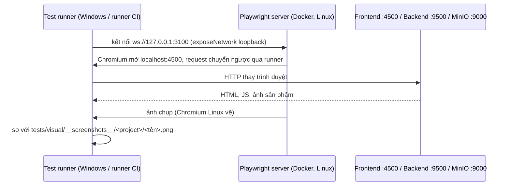

Không đặt `E2E_PW_WS` (ví dụ `pnpm test` thường ở máy) thì test `@visual` **bỏ qua** với lý do ghi rõ, không bao giờ chụp bằng trình duyệt Windows nên không sinh nhầm ảnh chuẩn sai.

### 2.2 Thành phần

| Thành phần | Việc |
|---|---|
| `scripts/visual-server.mjs` | `pnpm visual:server [start\|stop\|status]`: chạy container `nike-pw-server` (tag image = phiên bản `@playwright/test` đang cài, nên tự khớp), chờ cổng tối đa 120 giây; báo lỗi rõ khi Docker tắt (thoát 2) hoặc cổng 3100 bận (thoát 2). `pnpm test:visual`, `test:visual:update` bật server rồi chạy |
| `utils/visual.js` | `visualConnect()`, `requireVisualServer()` (skip nếu thiếu server), `settle()` (chờ mạng yên, font, hết skeleton, ảnh trong khung nhìn tải xong, cuộn về đầu, bỏ focus), `masks()` |
| `tests/visual/screenshot.css` | chỉ áp lúc chụp: tắt animation / caret / thanh cuộn, ẩn devtools và dòng gợi ý dev (chỉ có ở Vite dev), cố định bố cục bảng quản trị |
| `utils/a11y.js` | `scanA11y()`: axe với 4 tag WCAG, đối chiếu `data/a11y-known.json`, ghi `a11y-results/<project>/<tên>.json`, thông báo lỗi dạng bảng; có `E2E_DOC_SHOTS` thì khoanh đỏ phần tử vi phạm và chụp |
| `data/a11y-known.json` | danh sách vi phạm đã biết nhưng chưa sửa (kèm lý do, chuyển lát 4.4). **Hiện rỗng**: mọi vi phạm đã sửa |
| `scripts/a11y-report.mjs` | `pnpm report:a11y`: bảng Markdown vi phạm theo trang × thiết bị × rule; nối vào job summary trên CI |
| Tag `@visual`, `@a11y` | `check:tags` thêm 2 luật kiểm, `report:summary` thêm 2 dòng, Allure thêm 2 nhóm lỗi "Khác biệt giao diện (ảnh chụp)" và "Vi phạm khả năng truy cập" |

Cấu hình so ảnh: `animations: 'disabled'`, `threshold: 0.2`, **`maxDiffPixels: 0`**. Plan dự kiến ngưỡng 0,2 % số pixel, nhưng đo thực tế cho thấy ảnh cùng một trang luôn lệch **0 pixel** qua nhiều lần chạy, còn ngưỡng 0,2 % lại bỏ sót thay đổi nhỏ (dời giá 6px chỉ đổi vài trăm pixel, dưới 0,2 %). Vì vậy dùng ngưỡng 0.

Ảnh sản phẩm là file mẫu cố định trên MinIO nên **được chờ tải xong rồi chụp, không che**: che đi thì test không còn bắt được lỗi ảnh sai hoặc vỡ khung. Chỉ che phần thật sự thay đổi giữa các lần chạy: mã đơn hàng, thân bảng quản trị và dòng tổng số bản ghi (test khác chạy song song có thể thêm chức vụ).

### 2.3 Danh sách kiểm

| Visual (14 trang / trạng thái) | A11y (28 trang / trạng thái) |
|---|---|
| `/` (home, header, footer), `/w` (+ ngăn kéo Filter ở mobile), thẻ sản phẩm thường và giảm giá, `/t/<slug>` (+ lỗi chưa chọn size), sản phẩm ẩn, `/cart` (có hàng, rỗng), `/signin` (bước email, bước mật khẩu), `/checkout` (+ form lỗi), `/checkout/result/<mã>`, 404, `/login`, `/admin`, `/admin/roles` (+ hộp thoại thêm chức vụ) | home, catalog (+ menu Sort By / ngăn kéo Filter), pdp (+ lỗi size, Size Guide, "Added to Bag"), search, mobile-menu, cart (+ rỗng), signin (3 bước), checkout (+ lỗi), order-result, not-found, pdp-not-found, admin-login (+ lỗi), admin-dashboard / roles / role-dialog / permissions / resources / modules |

## 3. Lỗi truy cập tìm được và đã sửa

Lần quét "trước" (52 lần quét) **chặn 12**, thuộc đúng 4 rule. Không có vi phạm nào ngoài bốn rule này; 23 trang / trạng thái sạch ngay từ đầu, kể cả các trạng thái chưa quét thử lúc lập plan (`pdp-added`, `checkout-errors`, `order-result`). Sau khi sửa: **chặn 0, 28/28 trang sạch**. Bảng đầy đủ: `docs/kiem-thu/so-lieu/2026-11-22-a11y-truoc.md` và `…-a11y-sau.md`.

| # | Rule (mức) | Chỗ bị | Nguyên nhân | Cách sửa |
|---|---|---|---|---|
| V1 | `scrollable-region-focusable` (serious) | `pdp`, `pdp-size-error` (desktop + mobile) | dải ảnh cuộn ngang của gallery không focus được bằng bàn phím | track có `tabIndex=0`, `role="region"`, `aria-label="Product images"`, viền focus `ring-2` (chỉ hiện khi focus bàn phím); bỏ `aria-label` trùng ở thẻ `<section>` bao ngoài |
| V2 | `aria-prohibited-attr` (serious) | `admin-login(-errors)` (desktop + mobile) | `
` bọc logo: `aria-label` không được dùng trên `div` | bỏ `aria-label` ở `div`; `NikeSwoosh` nhận prop `label` thì có `role="img"` + `aria-label` |
| V3 | `button-name` (**critical**) | `admin-roles`, `admin-resources`, `admin-modules` (mobile), mỗi trang 3 nút | chữ trên nút thanh công cụ bảng bị `hidden lg:inline`, dưới breakpoint `lg` nút không còn tên | thêm `aria-label` đúng chữ đang hiện cho 4 nút ("Refresh", "Customize Columns", nút xoá, nút thêm); sửa một chỗ trong `data-table-advanced.tsx` là hết cả ba trang |
| V4 | `aria-hidden-focus` (serious) | `catalog-sort` (desktop) | `DropdownMenu` của Radix ở chế độ modal gắn `aria-hidden` lên phần còn lại của trang trong khi vẫn còn phần tử focus được | `<DropdownMenu modal={false}>` |

Ngoài ra đã thêm `data-testid="signin-dev-hint"` cho dòng gợi ý dev ở trang đăng nhập để `screenshot.css` ẩn được. Giao diện nhìn thấy không đổi (trừ viền focus của gallery), nên ảnh chuẩn không phải sinh lại vì các sửa này.

Một lỗi thứ năm (V5) là TanStack Query Devtools gắn `aria-hidden` lên phần tử còn focus được. Nó chỉ có ở bản dev, không có ở bản build, nên được loại khỏi phạm vi quét thay vì ghi vào danh sách chấp nhận.

## 4. Kết quả kiểm thử

| ID | Nội dung | Kết quả |
|---|---|---|
| TC-01 → TC-14 | Ảnh chụp 14 trang / trạng thái, `chromium` + `mobile-chrome` (28 ảnh test, TC-10 ở pha `@stock`) | Pass: 43 ảnh chuẩn (21 + 22) đã mở xem bằng mắt: không skeleton, ảnh sản phẩm tải đủ |
| TC-15 | Test bắt được thay đổi giao diện (đổi nền nút, dời giá 6px) | Pass cả hai project; `pdp.png` không bị ghi đè; desktop 3317 pixel khác |
| TC-16 | Không có `E2E_PW_WS` thì bỏ qua visual | Pass: 15 skip đúng thông báo, không sinh ảnh |
| TC-17 | Ảnh ổn định qua nhiều lần chạy | Pass: `--repeat-each=3` cả hai pha, 84/84 + 6/6, 0 chập chờn, mọi ảnh lệch **0 pixel** |
| TC-18 | Cập nhật ảnh chuẩn chỉ đụng `.png` | Pass: đúng 43 file `.png` |
| TC-19 | `visual:server` bật / tắt / lỗi | Pass: không tạo container thứ hai; cổng bận → thoát 2; không gọi được Docker → thoát 2 (giả lập bằng `PATH` không có `docker`) |
| TC-20 → TC-30 | Quét WCAG 2.1 AA theo 11 nhóm trang | Pass sau khi sửa: 22/22 (trước khi sửa **đỏ đúng 6 test** vì V1 → V4) |
| TC-31 | axe bắt được nút không có tên | Pass: `[critical] button-name × 1 — #zz-a11y` |
| TC-32 | `report:a11y` đúng định dạng, có bảng trước / sau | Pass: trước chặn 12, sau chặn 0 |
| TC-33 | `check:tags`, summary, Allure nhận tag mới | Pass: 1100 test = 1046 + 54; thêm test sai thì báo đúng 2 lỗi; Allure xếp lỗi so ảnh vào nhóm "Khác biệt giao diện (ảnh chụp)" |
| TC-34 | Bản build (`E2E_FRONTEND=preview`) cho ảnh giống bản dev | Pass: 32/32 + 6/6 |
| TC-35 | Toàn bộ bộ test vẫn xanh | **Đạt có ghi chú**: 1100 test, 0 lỗi khi chạy lại; lần chạy đầy đủ có 3 timeout ở `webkit` do tải, chạy riêng 9/9 xanh |
| TC-36 | Smoke xanh trên CI, ảnh sinh ở Windows khớp trên CI | Pass: run xanh, `@visual` 2/2, `@a11y` 2/2, bảng a11y "Smoke" chặn 0 |
| TC-37 | Đỏ có chủ đích → có artifact ảnh diff | **Chưa làm**: xem mục 6 |
| TC-38 | Regression có visual + a11y ở 2 shard | Pass: 4 shard + `report` xanh, `@visual` 30/30, `@a11y` 24/24 (22 đạt + 2 chập chờn), bảng a11y "Regression đêm" chặn 0; `firefox` / `webkit` không chạy visual / a11y |
| TC-40 | Gallery focus được bằng bàn phím (Tab, `ArrowRight`, `scrollLeft` tăng) | Pass, kiểm trong TC-22 |
| TC-41 | Không làm vỡ E2E cũ | Pass: `product-detail`, `product-list`, `admin`, `account` × 4 project UI: 304 passed, 0 failed |
| TC-42 | `pnpm build` + `pnpm lint` (frontend) | Pass |
| | **Tổng** | **Playwright: visual 30/30 + a11y 24/24 pass; 29 / 30 TC pass, TC-37 chưa làm** (TC-35 đạt có ghi chú). Backend không đổi nên không có JUnit mới |

### Thời gian

| Hạng mục | Thời gian |
|---|---|
| Visual / a11y khi chạy riêng ở máy | khoảng 50 giây / 70 giây |
| Toàn bộ bộ test ở máy (1100 test) | 17–23 phút |
| Smoke trên CI (có dựng Playwright server) | khoảng 5 phút |
| Regression trên CI | khoảng 8 phút cả run (4 shard song song rồi job `report`); `mobile-chrome` có 2 test a11y chập chờn nhưng đạt ở lần chạy lại |

## 5. Hình ảnh

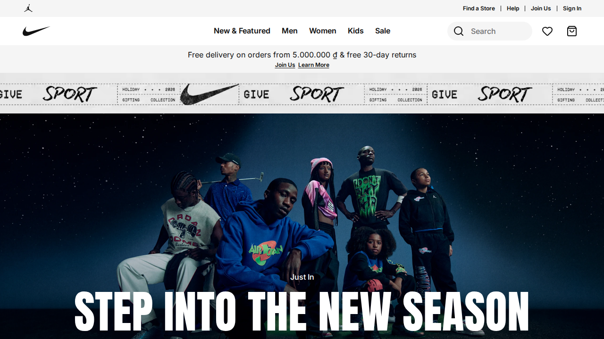
Ảnh chuẩn trang chủ trên desktop (`home.png` của project `chromium`), do Chromium Linux trong Docker chụp.

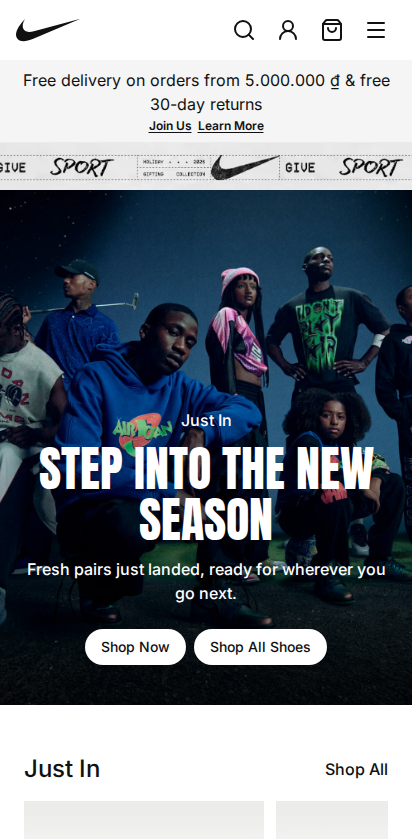
Ảnh chuẩn trang chủ trên Pixel 7 (`mobile-chrome`).

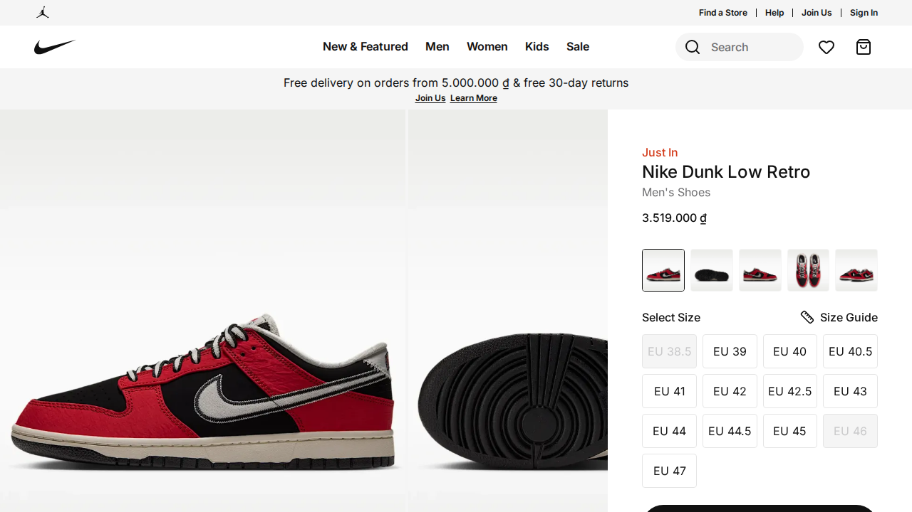
Ảnh chuẩn trang chi tiết giày (TC-15).

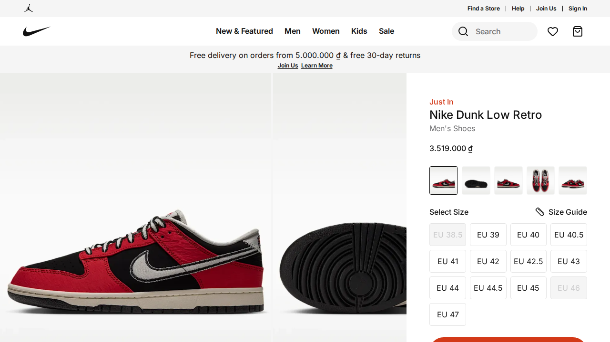
Ảnh thực tế sau khi chèn CSS đổi nền nút "Add to Bag" và dời giá xuống 6px.

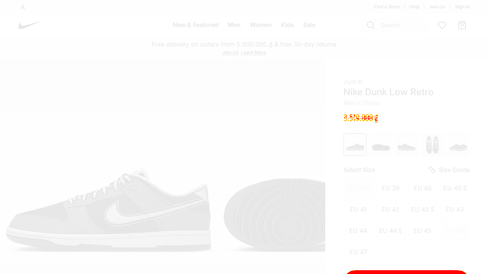
Ảnh khác biệt: chỉ tô đúng giá và nút bị đổi, phần còn lại không bị đánh dấu.

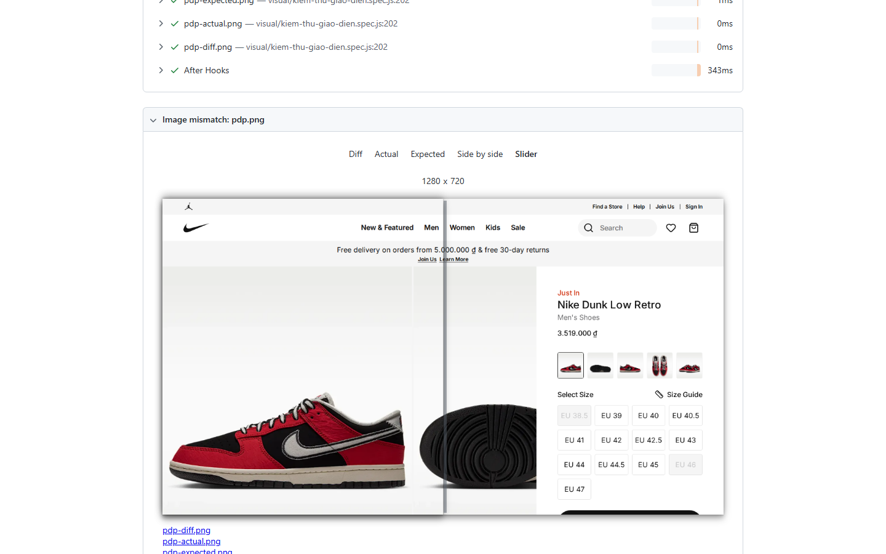
Báo cáo HTML của Playwright hiện thanh kéo so sánh expected / actual cho ca TC-15.

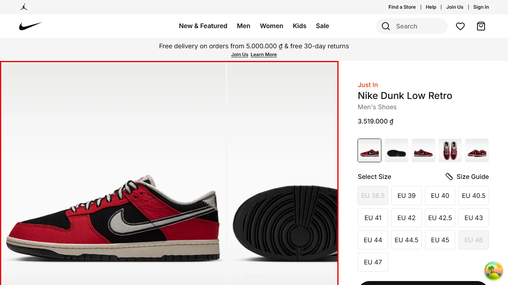
Vi phạm V1: dải ảnh gallery (khung đỏ) cuộn ngang nhưng không focus được bằng bàn phím.

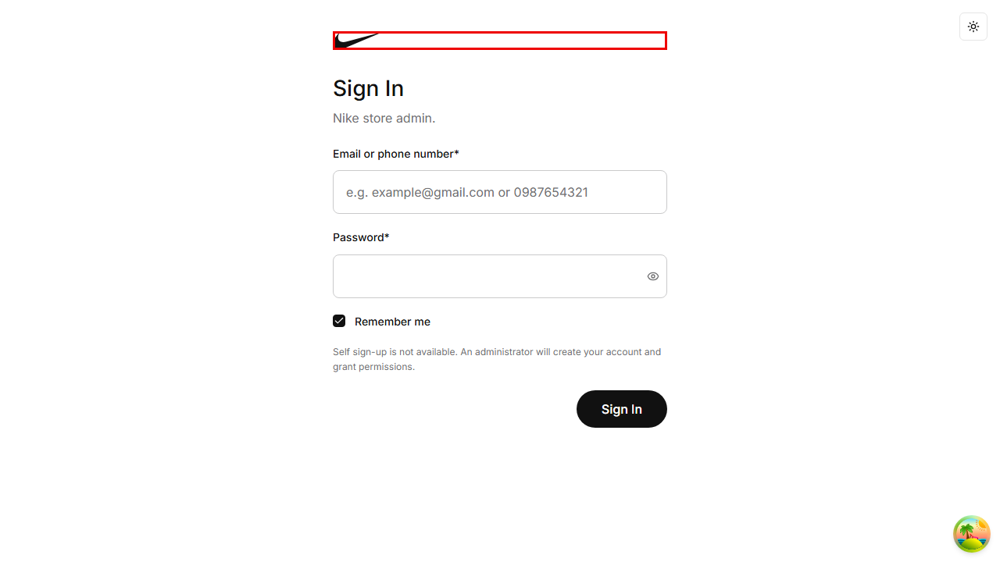
Vi phạm V2: `aria-label` đặt trên `div` bọc logo ở trang đăng nhập quản trị.

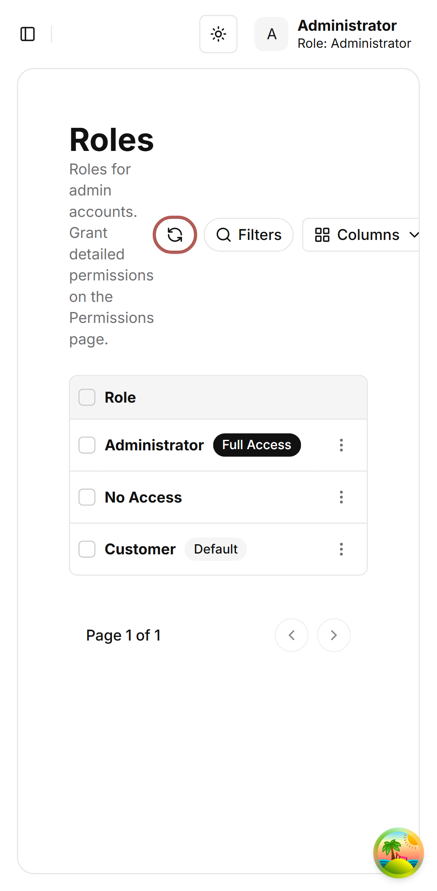
Vi phạm V3 (critical): ba nút thanh công cụ của bảng chức vụ không có tên khi màn hình hẹp.

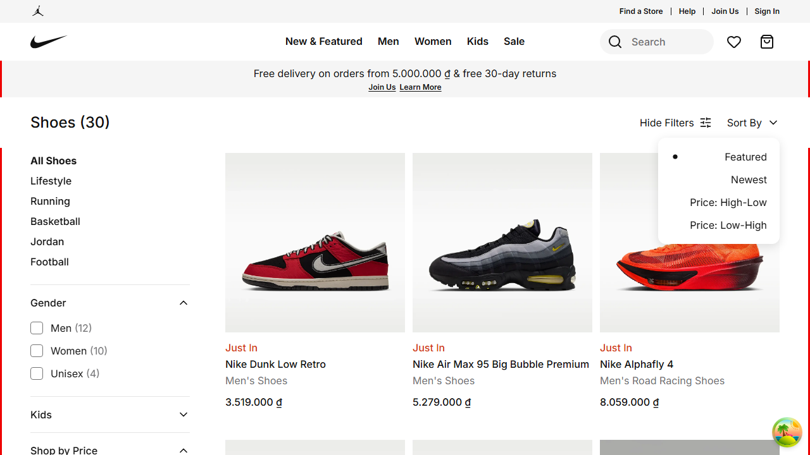
Vi phạm V4: menu "Sort By" đang mở nhưng phần còn lại của trang bị `aria-hidden` mà vẫn có phần tử focus được.

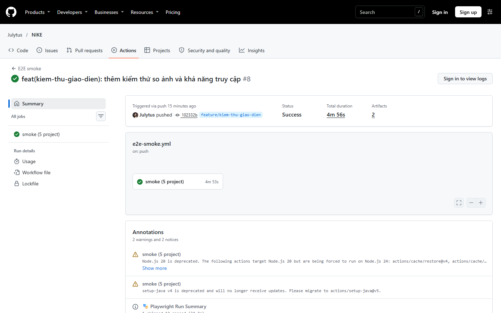
Run "E2E smoke" xanh có Playwright server và test visual / a11y (TC-36).

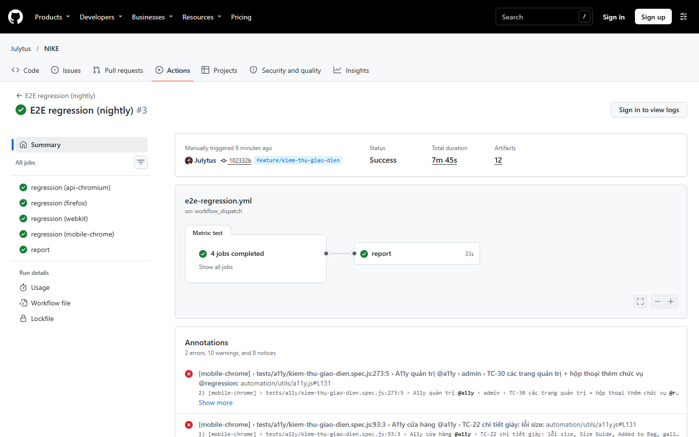
Run "E2E regression" thủ công trên nhánh: 4 job theo trình duyệt rồi job `report` (TC-38).

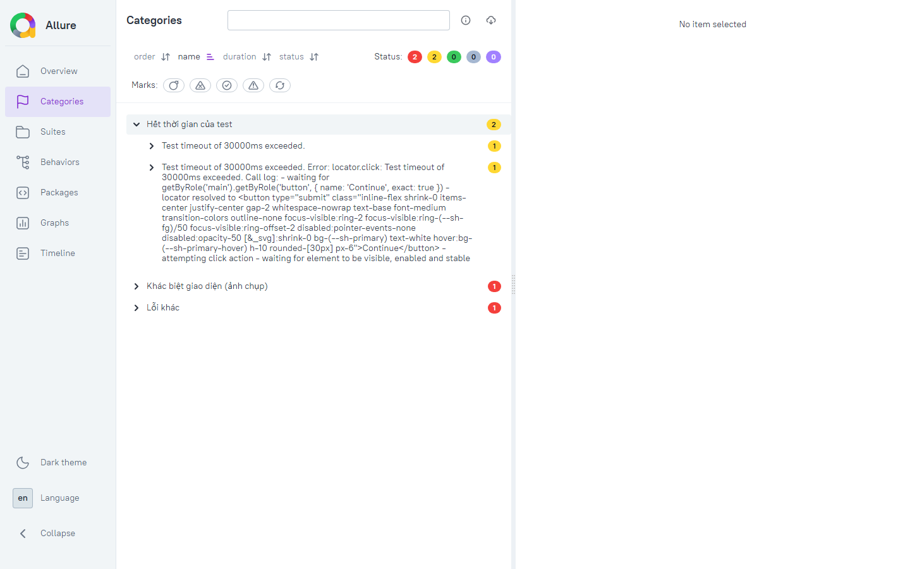
Tab Categories của Allure có nhóm "Khác biệt giao diện (ảnh chụp)" (từ ca chạy thử TC-33).

Còn thiếu ảnh job summary trên Actions (GitHub chỉ hiện cho người đã đăng nhập) và ảnh diff từ CI (TC-37).

## 6. Điểm lệch so với plan và việc còn lại

- **TC-37 chưa làm.** Bước đẩy một commit đỏ có chủ đích (đổi `--sh-primary` ở `shop-theme.css`) lên nhánh để xem artifact `visual-diff` và nhóm lỗi trên CI bị cơ chế phân quyền của phiên chặn, nên không chạy. Phần ở máy đã kiểm tương đương: TC-15 cho ra bộ ba expected / actual / diff, TC-33 cho Allure xếp đúng nhóm. Còn lại một việc **cần người dùng quyết định**: tự làm tay TC-37 (đổi token, push, xem run đỏ, revert) hoặc chấp nhận bỏ.
- **Ngưỡng so ảnh** `maxDiffPixels: 0` thay cho `maxDiffPixelRatio: 0.002` của plan (mục 2.2).
- **Thông báo lỗi Playwright 1.63** là `expect(page).toHaveScreenshot(expected) failed` + `<n> pixels (ratio <r> of all image pixels) are different`, không phải `Screenshot comparison failed`. Plan, regex nhóm Allure và TC-15 đã sửa theo.
- **Lọc theo thư mục:** `pnpm test:visual` / `test:a11y` lọc bằng `tests/visual/`, `tests/a11y/` thay cho `--grep @visual`, vì nhiều `--grep` của Playwright gộp kiểu OR nên `-g TC-xx` không lọc được.
- **Bố cục `/admin/roles` và mã đơn:** số dòng và độ dài tên chức vụ đổi khi test khác chạy song song; `screenshot.css` cố định bố cục bảng (3 dòng, một hàng chữ) và độ rộng khung mã đơn (`9rem`) để ảnh ổn định. Các ảnh `signin-email`, `signin-password`, `order-result` được sinh lại một lần vì lý do này.
- **Gallery:** `<section>` bao ngoài vốn có `aria-label="Product images"` nên bị hai region trùng tên; đã bỏ nhãn ở `<section>` (plan §6.4 ban đầu chưa nêu).
- **Nhánh và push:** nhánh `feature/kiem-thu-giao-dien` tạo ở phiên này (không tạo được ở phiên A vì thiếu quyền), tách từ cây đang trùng `main` sau PR #10.
- **Ghi nhận cho lát 4.4:** (1) 2 test a11y `mobile-chrome` chập chờn trên CI (TC-22, TC-30 chạy lần 2 mới đạt); cần theo dõi. (2) `webkit` hết thời gian khi chạy cùng visual qua websocket ở máy local (31 phút tổng thời gian test); chạy riêng thì xanh. (3) Nâng `@playwright/test` thì phải sinh lại ảnh chuẩn vì Chromium mới có thể vẽ khác vài pixel (README `automation/tests/visual` ghi rõ).
