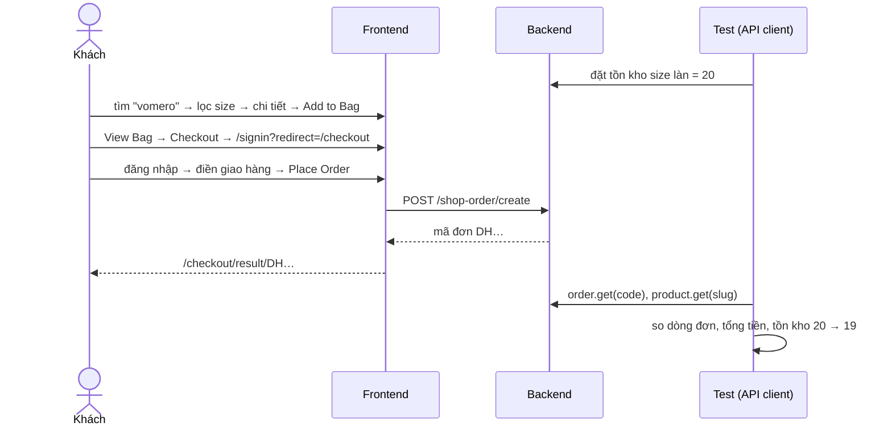
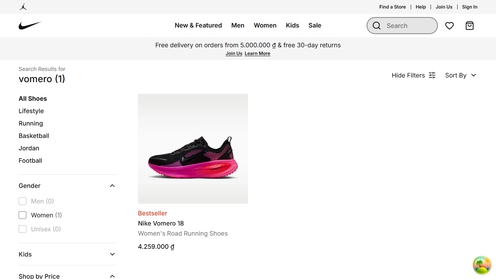
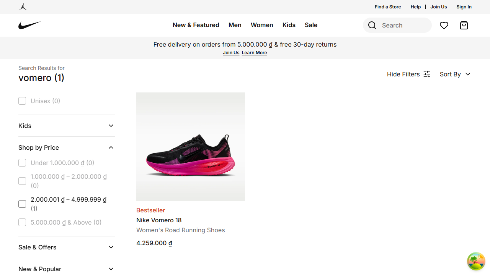
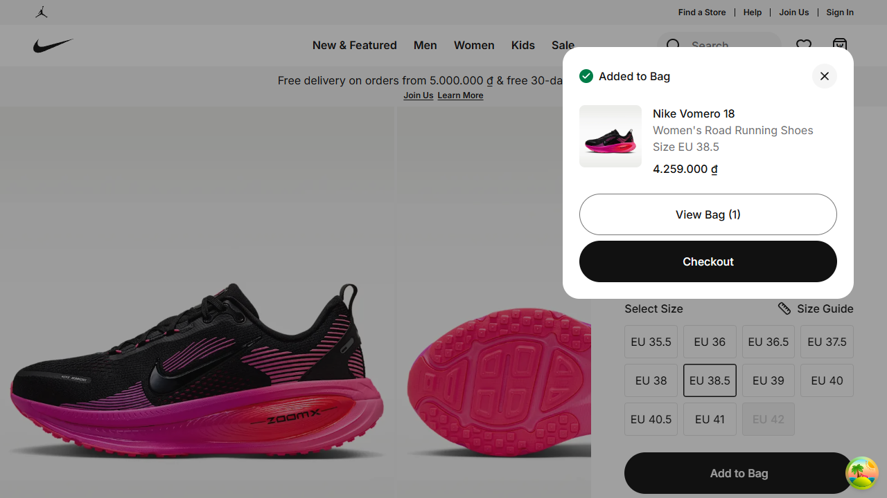
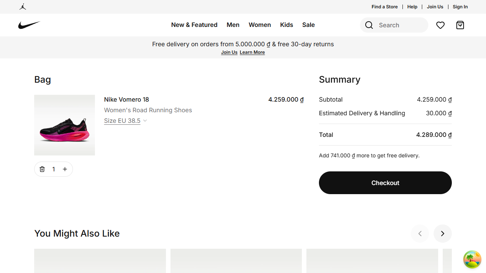
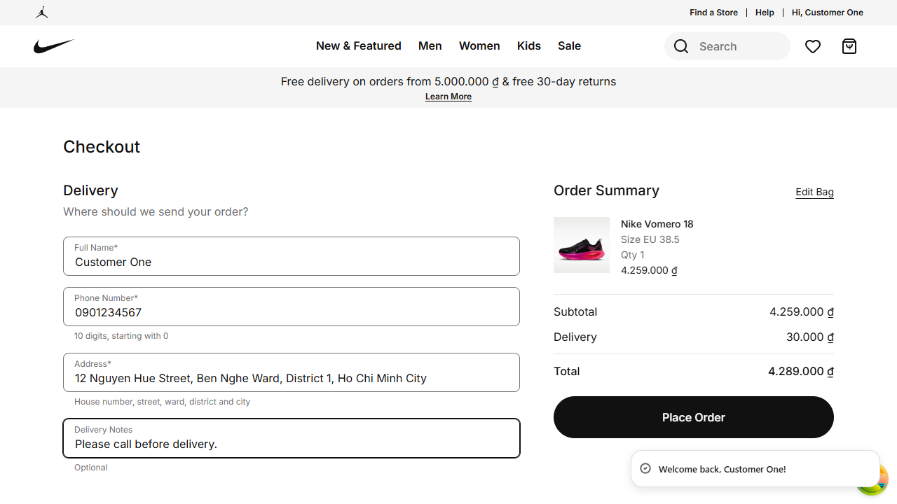
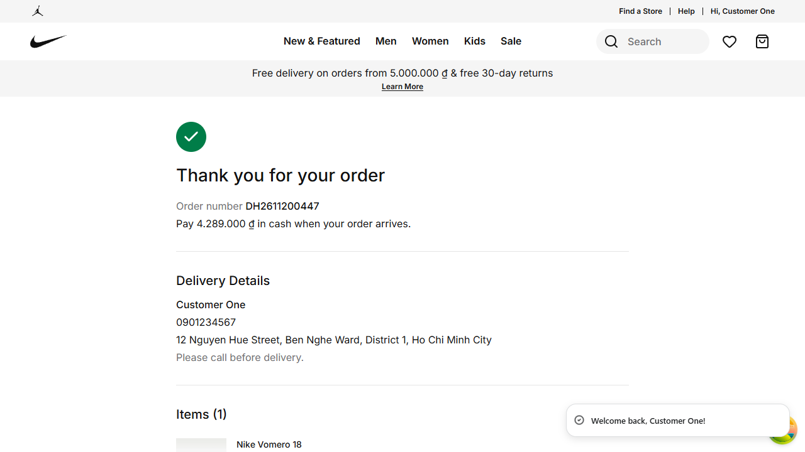

# Kiểm thử hồi quy: luồng xuyên suốt, bộ lọc data-driven, network mocking

> Lát 4.1 · plan: [plan/kiem-thu-hoi-quy.md](../../plan/kiem-thu-hoi-quy.md) · không đổi backend; sửa 2 lỗi nhỏ ở `frontend/` do test tìm ra; phần chính nằm ở `automation/`

## 1. Mục tiêu

Sau các lát chức năng (danh sách, chi tiết, giỏ hàng, đặt hàng), mỗi lát đã có spec nghiệm thu riêng. Lát này là lát kiểm thử đầu tiên của giai đoạn 4: **không thêm chức năng**, chỉ bổ sung các test nhìn xuyên nhiều lát cùng lúc để bắt lỗi hồi quy.

| Có làm | Không làm |
|---|---|
| 5 luồng mua hàng xuyên suốt (F1–F5), mỗi luồng kiểm cả giao diện lẫn API | Thêm chức năng, đổi hợp đồng API |
| 24 ca bộ lọc chạy data-driven **trên giao diện**, so ba chiều giao diện = dữ liệu mẫu = API | Sửa lỗi backend tìm thấy (ghi lại cho lát 4.4) |
| Network mocking mới: lỗi một lần, mất ảnh, chậm toàn tuyến, mạng chậm CDP, phát lại HAR | Chạy trên CI đêm, kiểm thử hình ảnh / a11y (lát sau) |
| Quy tắc tag (`@smoke` / `@regression` / `@flow` / `@mock`) có script kiểm tự động | |
| Chạy đủ 6 project × 2 pha hai lần liên tiếp đều xanh, sửa test chập chờn | |

## 2. Thành phần mới

```
automation/
├─ utils/network.js            apiPath, fail500, abortRoute, delayed, failOnce, countRequests, collectPageErrors, sleep
├─ data/flows.js               làn size theo project cho từng luồng (4 trình duyệt chạy song song không giẫm nhau)
├─ data/har/catalog.har        bản ghi API danh sách giày cho TC-15 (E2E_UPDATE_HAR=1 để ghi lại)
├─ scripts/check-tags.mjs      pnpm check:tags — kiểm ID trùng, test thiếu tag, quá 3 @smoke mỗi file
└─ tests/
   ├─ e2e-flows/kiem-thu-hoi-quy.spec.js      6 test luồng (@stock @flow)
   ├─ product-list/kiem-thu-hoi-quy.spec.js   ca bộ lọc sinh từ catalog-filters.json
   └─ network/kiem-thu-hoi-quy.spec.js        test mocking (@mock)
```

- **`utils/network.js`** gom các helper mà 5 spec cũ từng chép riêng (`fail500`, `delay`, `sleep`, `collectPageErrors`, regex URL API); 5 spec đó đã chuyển sang dùng chung. `failOnce` có đếm số lần gọi để test khẳng định đúng số request.
- **Page object**: thêm `HeaderComponent.searchFor(q)`, `ProductListPage.applyFilters(steps)` (desktop dùng sidebar, mobile gom các bước vào một lần mở ngăn kéo "Filter") và `expectUrlFilter`, `CartPage.expectSummary`.
- **Dữ liệu**: `catalog-filters.json` thêm trường `ui` cho 24 ca, mô tả cách bấm trên giao diện (điểm bắt đầu + các bước).
- **Làn size** (`FLOW_LANES`): mỗi project dùng một size riêng của cùng sản phẩm, nên 4 trình duyệt đặt hàng song song mà tồn kho vẫn kiểm đúng được (20 → 19).

## 3. Luồng xuyên suốt

| Luồng | Nội dung | Kiểm |
|---|---|---|
| F1 `@smoke` | Khách vãng lai: tìm "vomero" → lọc size → chi tiết → Add to Bag → giỏ → đăng nhập → COD | Tạm tính 4.259.000 ₫, phí giao 30.000 ₫, tổng 4.289.000 ₫; sau đăng nhập về `/checkout`; API: đơn 1 dòng, tồn 20 → 19, giỏ trống |
| F2 | Khách đã đăng nhập đi từ menu "Men" → "Football" → sắp xếp giá thấp → 2 đôi | Vượt 5.000.000 ₫ nên miễn phí giao hàng; tổng 5.258.000 ₫; tồn 20 → 18 |
| F3 | Khách mới tạo tài khoản ngay lúc thanh toán | Sau "Create Account" về `/checkout` (không về trang chủ), giỏ còn nguyên; chủ đơn là tài khoản vừa tạo |
| F4 | Mất mạng lúc "Place Order", có mạng lại | Báo lỗi kết nối, giỏ nguyên; có mạng đặt lại được **đúng một đơn** (tồn kho giảm 1) |
| F5a / F5b | Hết phiên khi đặt hàng: refresh thành công / refresh cũng 401 | F5a: 2 request `create`, 1 `refresh`, đặt thành công. F5b: phiên bị xoá, về `/signin?redirect=/checkout`, giỏ giữ nguyên, đăng nhập lại đặt được |



Mỗi luồng là một test chia `test.step` nên báo cáo HTML / Allure hiện từng chặng. Test thuộc nhóm `@stock` (tạo đơn, đổi tồn kho) nên chạy ở pha riêng.

## 4. Bộ lọc data-driven trên giao diện

Mỗi ca của `data/catalog-filters.json` sinh một test: bắt đầu ở `ui.start`, **bấm** các bước trên giao diện (không mở URL dựng sẵn), rồi kiểm bốn điều:

1. Tham số URL đúng bộ lọc (không phụ thuộc thứ tự).
2. Số trong tiêu đề bằng tổng mong đợi.
3. Tên các thẻ trên lưới (tối đa 12) đúng thứ tự dữ liệu mẫu; tổng = 0 thì kiểm trạng thái rỗng.
4. Gọi `GET /product/public/list` cùng bộ lọc, tên sản phẩm trùng với lưới — **giao diện = dữ liệu mẫu = API**.

| Nhóm | TC | Chạy ở | Ví dụ |
|---|---|---|---|
| Một nhóm (giới tính / trẻ em / khoảng giá / sale / nhãn) | TC-06 | chromium, firefox, webkit | `gender=men` → "Men's Shoes (12)"; biên giá 1.000.000 ₫, 2.000.000 ₫ (giá giảm), 5.000.000 ₫ rơi đúng khoảng |
| Từ khoá qua header | TC-07 | desktop 3 | `jordan` → 5; `air max` → 2; `air max plus` → 0 (sản phẩm ẩn không lộ) |
| Danh mục + kết hợp | TC-08 | desktop 3 | `/w/football?gender=women` → 0, trạng thái rỗng |
| Size (biên tồn kho) | TC-09 | desktop 3 | `size=42` → 21; `size=38` → 12 |
| Mobile (ngăn kéo "Filter" → "Apply") | TC-10 | mobile-chrome | 4 ca đại diện, lưới 2 cột |

## 5. Network mocking

| Kỹ thuật | TC | Tình huống | Kết quả |
|---|---|---|---|
| `failOnce` | TC-11 | API danh sách lỗi 500 hai lần đầu (query tự thử lại 1 lần), rồi "Try Again" | Hiện "Couldn't load products.", sau "Try Again" đủ 12 thẻ; đúng 3 request |
| `abort` ảnh | TC-12 | Mất toàn bộ ảnh `*.webp` (mô phỏng MinIO lỗi) ở `/`, `/w`, `/t/…`, `/cart` | Không `pageerror`; tên + giá vẫn hiện; ô ảnh giữ chiều cao; thêm giỏ vẫn chạy |
| `delay` toàn tuyến | TC-13 | Mọi `/api/**` trễ 800 ms, đi trọn luồng mua | Vùng `aria-busy` hiện khi chờ; nút "Placing Order…" bị khoá; vẫn tới trang xác nhận, đúng 1 request `create` |
| CDP throttle | TC-14 | Mạng chậm thật (trễ 1,5 giây, 1,6 Mbps) trên `/` và `/w` | Skeleton hiện trước rồi đủ 12 thẻ; không `pageerror` |
| Phát lại HAR | TC-15 | `routeFromHAR` cho `/w` chạy không cần backend | 12 thẻ đúng tên như lúc ghi; không request `/api/**` nào ra mạng thật |

## 6. Lỗi tìm được

| # | Lỗi | Nơi | Xử lý |
|---|---|---|---|
| 1 | Mất mạng lúc "Place Order": nút kẹt "Placing Order…" vô hạn, có mạng lại đơn **tự gửi** dù khách không bấm (TanStack Query `networkMode` mặc định tạm dừng mutation khi offline) | FE | Đã sửa: `networkMode: "always"` ở `createShopOrderMutationOptions`; lỗi mạng hiện ngay |
| 2 | Hết phiên khi đặt hàng (create và refresh đều 401): khách vẫn ở `/checkout`, bấm lại thì 401 mãi | FE | Đã sửa: hết token thì chuyển `/signin?redirect=/checkout`, giỏ giữ nguyên |
| 3 | `GlobalExceptionHandler` đổi mọi `DataAccessException` thành 400 "Invalid data" và không ghi log; khi nhiều request ghi đồng thời có lúc đăng ký trả 400 vô cớ | BE | **Chưa sửa** (ngoài phạm vi lát) — ghi lại cho lát 4.4 (bug report) |

## 7. Quy tắc tag và cách chạy

```bash
cd automation
pnpm check:tags                       # ID trùng, test thiếu tag, quá 3 @smoke mỗi file
pnpm test:flows                       # tests/e2e-flows (pha @stock)
pnpm test:mock                        # nhóm @mock
pnpm test                             # đủ 6 project × 2 pha
E2E_STOCK=1 pnpm exec playwright test tests/e2e-flows --repeat-each=3 --workers=1 --project=chromium --project=firefox --project=webkit --project=mobile-chrome
```

- `@smoke` tối đa 3 test mỗi file (đã hạ 5 test ở 2 spec cũ xuống `@regression`); trùng ID ở `tieng-anh-cua-hang` đã đổi thành TC-19b / TC-22b.
- Worker local mặc định **4** (đổi bằng `E2E_WORKERS`): 8 worker cùng xin module từ một tiến trình Vite dev làm `goto` Firefox / WebKit quá 30 giây.
- Test chập chờn được sửa mà **không tăng `timeout` / `retries`**: chờ đúng trạng thái (gallery cuộn xong trước khi bấm tiếp, ngăn kéo đã mở, ô lọc đã tick), tách TC-22 của `giao-dien-nike` thành ca data-driven.

## 8. Kết quả kiểm thử

| ID | Nội dung | Kết quả |
|---|---|---|
| TC-01 | F1 khách vãng lai tìm → lọc → mua `@smoke` | Pass (4 project) |
| TC-02 | F2 menu → sắp xếp → miễn phí giao hàng | Pass (desktop 3) |
| TC-03 | F3 tạo tài khoản lúc thanh toán | Pass (4 project) |
| TC-04 | F4 mất mạng khi đặt hàng | Pass (desktop 3), sau khi sửa lỗi #1 |
| TC-05a | F5a 401 một lần → refresh → gửi lại | Pass (desktop 3) |
| TC-05b | F5b refresh 401 → về `/signin` | Pass (desktop 3), sau khi sửa lỗi #2 |
| TC-06 → TC-09 | Bộ lọc data-driven trên giao diện | Pass |
| TC-10 | Bộ lọc qua ngăn kéo mobile | Pass (mobile-chrome) |
| TC-11 → TC-15 | Network mocking | Pass (TC-11, TC-13 theo hành vi thật của SUT) |
| TC-16 | `check:tags` bắt test thiếu tag / sai ID | Pass (1 test không tag + 1 sai ID → đúng 2 dòng, thoát 1) |
| TC-17 | Smoke đủ 5 project | Pass (pha thường 83 pass, pha stock 11 pass, 0 đỏ sau sửa) |
| TC-18 | Toàn bộ bộ test, lượt cuối không sửa gì giữa chừng | Pass: pha thường 741 pass / 0 đỏ / 0 flaky, pha stock 71 pass / 0 đỏ |
| TC-19 | Độ ổn định luồng `--repeat-each=3 --workers=1` | Pass (64 pass / 0 đỏ / 12 skip) |
| | **Tổng** | **19/19 TC pass** — Playwright 812 pass (741 + 71), 0 đỏ, 0 flaky; JUnit không đổi (lát không đụng backend) |

Cần ba lượt `pnpm test`: lượt 1 có 4 đỏ (3 do tải nặng / thao tác trượt, 1 là lỗi #3), lượt 2 còn 1 đỏ (TC-21 của `chi-tiet-giay`, chờ sai trạng thái cuộn của gallery), lượt 3 xanh hoàn toàn. Hai lỗi frontend đã sửa; test chập chờn sửa theo 5 nhóm nguyên nhân.

### Điểm lệch so với plan

- `HeaderComponent.searchFor` thay cho `search` (tên `search` đã là thuộc tính `SearchOverlay`).
- TC-05b kiểm "phiên bị xoá" bằng `auth-storage` không còn `accessToken` (trang `/signin` không có header).
- TC-11 đếm 3 request thay vì 2 (query danh sách có `retry: 1`); TC-13 kiểm vùng `aria-busy` thay vì khung xương ở trang chi tiết (khung xương chỉ hiện khi chờ quá 1 giây); TC-14 dùng trễ 1,5 giây + 1,6 Mbps thay vì "Slow 3G" 500 kbps.
- Lệnh TC-19 thêm `--workers=1` (các bản lặp cùng làn size chạy song song làm tồn kho lệch).

## 9. Hình ảnh chạy thử

Luồng F1 chạy có giao diện (chromium, slowMo 400).


Gõ "vomero" ở ô tìm kiếm, kết quả có thẻ "Nike Vomero 18" (F1 bước 1).


Lọc theo size của làn, URL có `size=…` và tiêu đề có `(1)` (F1 bước 2).


Popup "Added to Bag" với size và giá 4.259.000 ₫ (F1 bước 3).


Giỏ: Subtotal 4.259.000 ₫, Shipping 30.000 ₫, Total 4.289.000 ₫ (F1 bước 4).


Trang `/checkout` sau khi đăng nhập, "Cash on Delivery" đã chọn (F1 bước 5–6).


Trang xác nhận "Thank you for your order", trả 4.289.000 ₫ khi nhận hàng (F1 bước 6).
