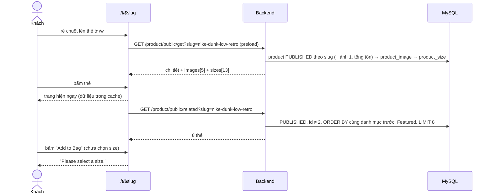

# Chi tiết giày

## 1. Mục tiêu và phạm vi

Khách (không cần đăng nhập) bấm một thẻ giày ở bất kỳ đâu (trang danh sách, trang chủ, gợi ý tìm kiếm) và thấy trang chi tiết thật thay cho trang tạm "Coming Soon": xem 5 ảnh (cuộn ngang, kéo chuột sang bên, bấm ảnh nhỏ), đọc giá / giảm giá / mô tả / mã sản phẩm, xem bảng quy đổi size, chọn một size còn hàng, được báo khi sắp hết hàng hoặc hết hàng, và lướt sang sản phẩm khác ở "You Might Also Like".
Nút "Add to Bag" đã kiểm tra "chưa chọn size" ở lát này; việc thêm vào giỏ thật thuộc lát `gio-hang`.

| Có làm | Không làm (để plan khác) |
|---|---|
| `GET /api/product/public/get?slug=` (chi tiết + 5 ảnh + lưới size có tồn kho) và `GET /api/product/public/related?slug=` (8 thẻ: cùng danh mục trước, thiếu thì bù sản phẩm khác), công khai | Thêm vào giỏ, popup "Added to Bag", số trên icon túi (lát `gio-hang`) — nút "Add to Bag" lúc đã chọn size chưa làm gì (§11 câu 1) |
| Trang `/t/$slug`: gallery cuộn ngang (~1,5 ảnh), nút ‹ ›, kéo chuột sang bên để đổi ảnh, thanh vị trí, dãy 5 ảnh nhỏ (không phóng to ảnh — đổi 19/11, §12) | Nút "Favourite ♡" (lát `yeu-thich`, §11 câu 1) |
| Cột thông tin: nhãn, tên, phụ đề, giá + giá gốc + "% off", cảnh báo "Just a few left. Order soon.", lưới size (hết hàng: mờ, không chọn được), lỗi "Please select a size.", trạng thái "Sold Out" | "View Product Details" (modal mô tả đầy đủ), "Colour Shown", "Country/Region of Origin", "Reviews", "How Others Are Wearing It", "Complete the Look" (§11 câu 4) |
| Hộp thoại "Size Guide" (bảng quy đổi EU / UK / US / cm theo giới tính sản phẩm, đánh dấu size đang chọn), accordion "Free Delivery and Returns" | Breadcrumb, chia sẻ, chọn màu (D4: không có màu) |
| "You Might Also Like" (dải cuộn ngang dùng lại `ProductRail` + `ProductCard`); trang "Product Not Found" cho slug không có / sản phẩm ẩn; skeleton khi tải; lỗi tải có "Try Again" | Visual regression / a11y của trang (lát 4.2) |
| Mobile: tên / giá trên gallery, vuốt ảnh 1 ảnh / màn, lưới size 3 cột | Quản trị sản phẩm (lát `quan-ly-giay`) |
| Rê chuột vào `ProductCard` tải sẵn dữ liệu chi tiết (`preload="intent"`); Back về `/w` giữ vị trí cuộn (việc còn lại từ danh-sach-giay §11 câu 9) | |
| `automation/`: `ProductApi.get/related`, hàm tính kết quả mong đợi từ `products.json`, `data/size-guide.json`, page object `ProductDetailPage`, `SizeGuideDialog` | |

## 2. Tác nhân và phân quyền

| Tác nhân | Quyền | Ghi chú |
|---|---|---|
| Khách chưa đăng nhập, khách đã đăng nhập, quản trị | `GET /product/public/get`, `GET /product/public/related` | Công khai nhờ mẫu `^/[a-z0-9-]+/public/.*` trong `JwtAuthenticationFilter`, **không** sửa filter, không `checkPermission`. Gửi token sai / hết hạn vẫn trả 200 |

Chỉ sản phẩm `status = 'PUBLISHED'` có trang chi tiết. Sản phẩm `HIDDEN` (id 31 `nike-air-max-plus-premium`) / `DRAFT` coi như không tồn tại (404, kể cả với quản trị — quản trị xem ở `/admin/products` của lát 3.1) và không bao giờ có trong `related`.

## 3. Luồng nghiệp vụ

**Luồng chính (desktop):**
1. Khách ở `/w` rê chuột lên thẻ "Nike Dunk Low Retro" → router tải sẵn `GET /product/public/get?slug=nike-dunk-low-retro`. Khách bấm → `/t/nike-dunk-low-retro`, trang hiện ngay (dữ liệu đã có), cuộn về đầu.
2. Trang hiện: trái là gallery 5 ảnh (ảnh 1 đầy đủ, ảnh 2 lộ một nửa); phải là "Just In", h1 "Nike Dunk Low Retro", "Men's Shoes", "3.519.000 ₫", 5 ảnh nhỏ (ảnh 1 viền đen), "Select Size" + "Size Guide", 13 ô size (EU 38.5, EU 46 mờ), "Add to Bag", mô tả, "Style: IQ0157-001", "Free Delivery and Returns". Song song FE gọi `GET /product/public/related?slug=nike-dunk-low-retro` → dải "You Might Also Like" 8 thẻ.
3. Khách bấm › (hoặc ảnh nhỏ thứ 3) → gallery cuộn tới ảnh đó, ảnh nhỏ tương ứng viền đen.
4. Khách giữ chuột trên ảnh và kéo sang trái → dải ảnh trượt theo tay, thả ra thì dừng đúng ở ảnh kế tiếp (kéo sang phải → ảnh trước). Bấm vào ảnh không mở gì (không có khung xem ảnh lớn).
5. Khách bấm "Size Guide" → hộp thoại bảng quy đổi 13 dòng của sản phẩm này; đóng.
6. Khách bấm "EU 42" → ô viền đen. Bấm "Add to Bag" → (lát này) không lỗi, không đổi trang; lát `gio-hang` gắn hành động thêm vào giỏ vào đúng nút này.

**Luồng thay thế:**
- A1 (chưa chọn size): bấm "Add to Bag" → chữ "Select Size" đỏ, lưới size viền đỏ, dưới lưới "Please select a size.", lưới cuộn vào giữa màn hình. Chọn một size → lỗi biến mất.
- A2 (sắp hết hàng): sản phẩm chưa chọn size có tổng tồn 1–3, hoặc size đang chọn có tồn 1–3 → dòng cam "Just a few left. Order soon." (vd `nike-vaporfly-4` hiện ngay; `nike-revolution-8` chỉ hiện khi chọn EU 42).
- A3 (hết hàng): mọi size tồn 0 → nhãn "Sold Out", mọi ô size mờ, nút "Sold Out" bị khoá thay cho "Add to Bag".
- A4 (sản phẩm khác): bấm thẻ ở "You Might Also Like" → `/t/<slug khác>`, cuộn về đầu, size bỏ chọn, gallery về ảnh 1.
- A5 (Back): từ `/t/...` bấm Back → về đúng trang danh sách, cùng bộ lọc, thẻ vừa bấm vẫn nằm trong khung nhìn (không tải lại trang 1).
- A6 (mobile): tên / giá ở trên gallery; vuốt ngang đổi ảnh (1 ảnh / màn); chạm ảnh không mở gì; lưới size 3 cột.
- A7 (từ tìm kiếm): gõ "pegasus" ở header → bấm gợi ý "Nike Pegasus 42" → `/t/nike-pegasus-42`.

**Ngoại lệ:**
- E1: slug không có / sản phẩm ẩn / nháp → trang **Product Not Found** (header + footer vẫn có) với "Shop All Shoes" và "Back to Home". API trả 404 "Product not found".
- E2: `get` lỗi (500, mất mạng) → "Couldn't load this product." + "Try Again".
- E3: `related` lỗi → chỉ khối "You Might Also Like" hiện "Couldn't load recommendations." + "Try Again"; phần trên vẫn dùng được.
- E4: `get` chậm (> 1 giây) → khung xương (skeleton) của trang tới khi có dữ liệu.



## 4. Cơ sở dữ liệu

**Không có migration.** Dùng bảng của lát `du-lieu-giay` (V19): `product`, `product_image`, `product_size`, `product_category`. `product.slug` đã UNIQUE (collation `utf8mb4_0900_ai_ci` → so không phân biệt hoa thường).

Quy ước dữ liệu dùng ở lát này (đã có sẵn từ `ShoeSeedData`):
- Ảnh: 5 dòng `product_image`, `sort_order` 1 → 5, id = `productId * 10 + sort_order` (sản phẩm 2 → 21 … 25).
- Size: theo giới tính (MEN / UNISEX 13 size EU 38.5 → 47, WOMEN 11 size EU 35.5 → 42, BOYS / GIRLS 8 size EU 35.5 → 40), id = `productId * 100 + thứ tự` (sản phẩm 2 → 201 … 213), sắp theo `size_value` tăng dần.
- **Tổng tồn** (`totalStock`) = `COALESCE(SUM(product_size.stock), 0)` (đã có trong thẻ).
- **Featured** = thứ tự của danh-sach-giay §5.1: còn hàng trước, rồi `JUST_IN` → `BESTSELLER` → không nhãn, rồi `created_time DESC, id DESC`.

Dữ liệu mẫu dùng cho test (tính từ `products.json`):

| Trường hợp | Sản phẩm |
|---|---|
| Hết hàng (mọi size 0) | id 9 `nike-p-6000` (WOMEN, 11 size) |
| Sắp hết: tổng tồn 3, chỉ EU 38 còn 3 | id 18 `nike-vaporfly-4` (10 size còn lại = 0) |
| Một size còn 1 đôi | id 13 `nike-revolution-8` (EU 42), id 20 `ja-4-blur-ep` (EU 43) |
| Đang giảm giá | id 4, 7, 12, 21, 27 (giảm 20%), id 19 `nike-precision-8-low` (2.119.000 → 2.000.000, giảm 5,6%) |
| Ẩn | id 31 `nike-air-max-plus-premium` |

## 5. Hợp đồng API (cố định — nguồn sự thật cho cả BE và FE)

Mọi response bọc `{ "code", "message", "result" }`. Prefix `/api`. Cả hai endpoint **không cần token**.

**Tham số `slug`** (bắt buộc, chuỗi): server `trim` rồi đổi chữ thường; so với `product.slug` của sản phẩm `PUBLISHED`. Rỗng sau `trim`, không có, hoặc sản phẩm không `PUBLISHED` → 404 (§5.3).

### 5.1 `GET /api/product/public/get?slug=` — công khai

`result` = **thẻ sản phẩm** (đủ field như `list` / `new-arrivals`: mọi cột của `product` + `imageUrl` + `totalStock`) cộng thêm:

| Field | Kiểu | Ghi chú |
|---|---|---|
| `images` | mảng `ProductImage` `{ id, productId, url, sortOrder }` | 5 phần tử, `sortOrder` 1 → 5 |
| `sizes` | mảng `ProductSize` `{ id, productId, sizeLabel, sizeValue, stock }` | theo `sizeValue` tăng dần; `stock` = số đôi còn (≥ 0) |

`images` / `sizes` **chỉ có** ở `get`: các API trả thẻ (`list`, `new-arrivals`, `suggest`, `related`) không có hai khoá này (không phải `null` — `@JsonInclude(NON_NULL)`).

Ví dụ `slug=nike-dunk-low-retro`:
```json
{
  "id": 2,
  "slug": "nike-dunk-low-retro",
  "styleCode": "IQ0157-001",
  "name": "Nike Dunk Low Retro",
  "subtitle": "Men's Shoes",
  "gender": "MEN",
  "categoryId": 1,
  "description": "You can always count on a classic. This Dunk Low features a synthetic leather and textile upper with zigzag stitching for a retro look. Like all Dunks, it has plush padding for game-changing comfort that lasts.",
  "price": 3519000,
  "salePrice": null,
  "badge": "JUST_IN",
  "status": "PUBLISHED",
  "createdTime": "2026-11-08T09:00:00",
  "updatedTime": "2026-11-08T09:00:00",
  "imageUrl": "http://localhost:9020/nike-public/products/nike-dunk-low-retro/1.webp",
  "totalStock": 220,
  "images": [
    { "id": 21, "productId": 2, "url": "http://localhost:9020/nike-public/products/nike-dunk-low-retro/1.webp", "sortOrder": 1 },
    { "id": 22, "productId": 2, "url": "http://localhost:9020/nike-public/products/nike-dunk-low-retro/2.webp", "sortOrder": 2 },
    { "id": 23, "productId": 2, "url": "http://localhost:9020/nike-public/products/nike-dunk-low-retro/3.webp", "sortOrder": 3 },
    { "id": 24, "productId": 2, "url": "http://localhost:9020/nike-public/products/nike-dunk-low-retro/4.webp", "sortOrder": 4 },
    { "id": 25, "productId": 2, "url": "http://localhost:9020/nike-public/products/nike-dunk-low-retro/5.webp", "sortOrder": 5 }
  ],
  "sizes": [
    { "id": 201, "productId": 2, "sizeLabel": "EU 38.5", "sizeValue": 38.5, "stock": 0 },
    { "id": 202, "productId": 2, "sizeLabel": "EU 39", "sizeValue": 39.0, "stock": 20 },
    { "id": 203, "productId": 2, "sizeLabel": "EU 40", "sizeValue": 40.0, "stock": 20 },
    { "id": 212, "productId": 2, "sizeLabel": "EU 46", "sizeValue": 46.0, "stock": 0 },
    { "id": 213, "productId": 2, "sizeLabel": "EU 47", "sizeValue": 47.0, "stock": 20 }
  ]
}
```
(`sizes` thật có đủ 13 phần tử 201 → 213; ví dụ chỉ chép 5. `sizeValue` là số JSON — 39 hay 39.0 đều được, FE so theo số.)

Tính chất test kiểm với **mọi** sản phẩm `PUBLISHED` (TC-02): `images` 5 phần tử đúng thứ tự, `url` kết thúc `/products/<slug>/<n>.webp`; `sizes` = lưới theo giới tính, `stock` theo `products.json`; `totalStock` = tổng `sizes[].stock`.

### 5.2 `GET /api/product/public/related?slug=` — công khai

`result` = mảng **thẻ sản phẩm** (đúng dạng thẻ của `new-arrivals`), tối đa **8** (`RELATED_LIMIT`):
- Sản phẩm `PUBLISHED`, **khác** sản phẩm đang xem.
- Thứ tự: **cùng danh mục trước**, sau đó các danh mục khác (bù cho đủ 8); trong mỗi phần theo **Featured** (§4). Sản phẩm hết hàng vì thế xếp cuối phần của nó.

Một truy vấn: `WHERE status = 'PUBLISHED' AND id <> :id ORDER BY (category_id = :categoryId) DESC, <Featured> LIMIT 8`.

Ví dụ (id; `*` = khác danh mục):

| `slug` | Danh mục | `result` (id theo thứ tự) |
|---|---|---|
| `nike-dunk-low-retro` (2) | Lifestyle | `5, 8, 1, 3, 11, 7, 4, 12` (không có 2, không có 9 hết hàng) |
| `nike-p-6000` (9) | Lifestyle | `2, 5, 8, 1, 3, 11, 7, 4` |
| `nike-revolution-8` (13) | Running | `14, 15, 18, 17, 16, 2*, 5*, 20*` |
| `nike-precision-8-low` (19) | Basketball | `20, 23, 22, 21, 2*, 5*, 14*, 24*` |
| `jordan-franchise` (28) | Jordan | `24, 25, 26, 27, 2*, 5*, 14*, 20*` |
| `nike-mercurial-vapor-17-elite` (29) | Football | `30, 2*, 5*, 14*, 20*, 23*, 24*, 25*` |

Phần tử đầu với `slug=nike-dunk-low-retro`:
```json
[
  {
    "id": 5,
    "slug": "nike-air-max-95-big-bubble-premium",
    "styleCode": "IQ0229-001",
    "name": "Nike Air Max 95 Big Bubble Premium",
    "subtitle": "Men's Shoes",
    "gender": "MEN",
    "categoryId": 1,
    "description": "…",
    "price": 5279000,
    "salePrice": null,
    "badge": "JUST_IN",
    "status": "PUBLISHED",
    "createdTime": "2026-11-07T09:00:00",
    "updatedTime": "2026-11-07T09:00:00",
    "imageUrl": "http://localhost:9020/nike-public/products/nike-air-max-95-big-bubble-premium/1.webp",
    "totalStock": 240
  }
]
```

### 5.3 Lỗi

| Tình huống | HTTP | Message (tiếng Anh) |
|---|---|---|
| `slug` không có sản phẩm, sản phẩm `HIDDEN` / `DRAFT`, hoặc rỗng sau `trim` (`slug=`, `slug=%20%20`) — cả `get` lẫn `related` | 404 | Product not found |
| Thiếu hẳn tham số `slug` — cả hai | 400 | Missing required parameter: slug (lỗi khung sẵn có) |
| Sai method (vd `POST /api/product/public/get`, `POST …/related`) | 405 | HTTP method not supported |

FE không hiện message API: 404 → trang "Product Not Found" (§6.8); lỗi khác → "Couldn't load this product." (§6.9). Không có lỗi quyền (công khai).

## 6. Giao diện (chuỗi cố định — test E2E chọn theo đúng các chuỗi này)

Mở ảnh `plan/ui-nike/10-chi-tiet.jpg`, `11-chi-tiet-mo-ta.jpg`, `13-loi-chua-chon-size.jpg`, `14-popup-da-them-vao-gio.jpg` (chỉ phần cảnh báo "Just a few left"), `17-co-the-ban-cung-thich.jpg` khi làm. Số đo / màu theo `plan/ui-nike/README.md`. Desktop = ≥ 1024px (`lg`); phần tử chỉ có ở một loại màn hình render theo `useIsDesktop()`. Tiền qua `formatVnd`.

### 6.1 Route, tiêu đề, bố cục

- Route `/t/$slug` (`routes/_shop/t.$slug.tsx`), thay trang tạm.
- `<title>`: `<tên sản phẩm> | Nike` (vd `Nike Dunk Low Retro | Nike`); không tìm thấy: `Product Not Found | Nike`.
- **Desktop**: hai cột `2fr / 1fr`. Trái: gallery sát mép trái màn hình (không lề). Phải: cột thông tin lề trái 48px, lề phải 48px, `sticky top-(--sh-header-offset)` khi cột thấp hơn khung nhìn. Dưới hai cột: "You Might Also Like" (lề 48px), rồi footer.
- **Mobile** (< 1024px), một cột lề 24px theo thứ tự: nhãn, h1, phụ đề, giá → gallery (tràn hết chiều ngang) → dãy ảnh nhỏ → cảnh báo tồn kho → chọn size → "Add to Bag" → mô tả → accordion → "You Might Also Like".
- Không có cuộn ngang toàn trang (`scrollWidth ≤ innerWidth`) ở cả hai loại màn hình.

### 6.2 Gallery

`<section aria-label="Product images">` (testid `pdp-gallery`), dải cuộn ngang native + `scroll-snap`, ẩn thanh cuộn.

| | Desktop | Mobile |
|---|---|---|
| Khung | cao `calc(100vh - 60px)` (tối thiểu 480px), nền `#F5F5F5` | vuông, rộng = màn hình |
| Mỗi ảnh | rộng 2/3 khung (thấy ~1,5 ảnh), `object-cover`, khe 4px | rộng 100% (1 ảnh / màn) |
| Nút ‹ › | góc dưới phải, tròn trắng 36px: **Previous image**, **Next image** (testid `pdp-gallery-prev` / `pdp-gallery-next`); khoá ở ảnh đầu / ảnh cuối | không có |
| Thanh vị trí | góc dưới trái, 5 gạch ngắn, gạch hiện tại dài + đậm (trang trí, `aria-hidden`) | dưới gallery, cùng kiểu |
| Kéo sang bên | giữ chuột trái trên dải ảnh và kéo → dải trượt theo (tắt `scroll-snap` khi đang kéo), con trỏ `grab` / `grabbing`; thả ra → cuộn `smooth` tới ảnh gần nhất, nhưng kéo quá 15% bề rộng một ảnh thì sang hẳn ảnh kế theo hướng kéo | vuốt native (không cần code) |

- Mỗi ảnh là một khối `<div>` (testid `pdp-gallery-image`, không bấm được), bên trong `, image n of 5" draggable="false">` theo `images[].sortOrder`. Bấm / chạm ảnh không mở gì.
- **Ảnh hiện tại** (dùng chung cho thanh vị trí, ảnh nhỏ, nút ‹ ›): đang ở cuối dải (`scrollLeft ≥ scrollWidth − clientWidth − 4`) → ảnh 5; ngược lại `round(scrollLeft / bề rộng một ảnh) + 1`. Cập nhật khi cuộn.
- ‹ › cuộn đúng một ảnh (`smooth`, tôn trọng `prefers-reduced-motion`).

### 6.3 (Bỏ) Khung xem ảnh lớn

Bỏ theo yêu cầu người dùng 19/11/2026 (§12): không có dialog phóng to ảnh; đổi ảnh bằng kéo sang bên (§6.2), nút ‹ › hoặc ảnh nhỏ.

### 6.4 Cột thông tin (từ trên xuống)

1. **Nhãn** (testid `pdp-badge`, 16px / 500, đỏ `#D33918`): đúng quy tắc `productBadgeLabel` của thẻ — **Sold Out** (tổng tồn 0) > **Just In** > **Bestseller** > **Sale**; không có thì bỏ dòng.
2. **h1** tên sản phẩm (24px / 500) · **phụ đề** (testid `pdp-subtitle`, 16px `#707072`).
3. **Giá** (testid `pdp-price-block`, một hàng, 16px / 500): không giảm → `price`; đang giảm → giá bán (testid `product-price`), cách 8px giá gốc trong `<s>` màu `#707072`, cách 8px **`<n>% off`** màu xanh `#007D48` (testid `pdp-discount`), `n = floor((price − salePrice) × 100 / price)` (id 19 → **5% off**, id 4 → **20% off**); `n < 1` thì không hiện dòng giảm.
4. **Dãy ảnh nhỏ** (`<div role="group" aria-label="Product thumbnails">`): 5 nút 70×70 (mobile 56×56), testid `pdp-thumbnail`, tên **Show image n**, ảnh hiện tại có `aria-current="true"` + viền đen 1px. Bấm → gallery cuộn tới ảnh n.
5. **Cảnh báo tồn kho** (testid `pdp-low-stock`, màu `#9E3500`, icon đồng hồ `Timer`): **Just a few left. Order soon.** Hiện khi `1 ≤ n ≤ 3` với `n` = `stock` của size đang chọn, hoặc `totalStock` khi chưa chọn size.
6. **Hàng tiêu đề size**: trái **Select Size** (id `pdp-size-label`, 16px / 500); phải nút **Size Guide** (icon thước, testid `pdp-size-guide`) → §6.5.
7. **Lưới size** (`RadioGroup`, `aria-labelledby="pdp-size-label"`, testid `pdp-size-grid`): 4 cột desktop / 3 cột mobile, khe 8px; mỗi ô là radio (testid `pdp-size-<sizeValue không có .0>`, vd `pdp-size-42`, `pdp-size-40.5`), tên = `sizeLabel` (**EU 42**), cao 48px, viền `#E5E5E5`, bo 4px; hover viền đen; đã chọn `aria-checked="true"` + viền đen 1.5px; `stock = 0` → `disabled`, nền `#F5F5F5`, chữ `#CACACB`. Phím mũi tên đi qua các ô còn hàng (Radix). Không có ô nào được chọn sẵn.
8. **Lỗi chưa chọn size** (ảnh 13): bấm "Add to Bag" khi chưa chọn → "Select Size" đổi màu `#D30005`, lưới bọc khung viền đỏ 1px bo 4px (`aria-invalid="true"`), ngay dưới lưới **Please select a size.** (testid `pdp-size-error`, `role="alert"`, đỏ), lưới cuộn vào giữa màn hình. Chọn size → lỗi biến mất.
9. **Nút chính** (testid `pdp-add-to-bag`, `ShopButton` primary cao 60px, rộng hết cột, cách lưới 24px): **Add to Bag**. Sản phẩm hết hàng (`totalStock = 0`): chữ **Sold Out**, `disabled`. Lát này: đã chọn size mà bấm → không làm gì (để lát `gio-hang`).
10. **Mô tả** (testid `pdp-description`, cách nút 40px, 16px, line-height 1.75): đoạn `description` nguyên văn; dưới là danh sách gạch đầu dòng một mục **Style: <styleCode>** (vd `Style: IQ0157-001`).
11. **Accordion** (kẻ trên + dưới, `Collapsible`, mặc định đóng): nút **Free Delivery and Returns** (`aria-expanded`, chevron xoay). Mở ra (testid `pdp-delivery`, 16px):
    - `Free standard delivery on orders of 5.000.000 ₫ or more. Orders under 5.000.000 ₫ have a 30.000 ₫ delivery fee.`
    - `Not the right fit? Return your order for free within 30 days.`
    - Hai link gạch chân: **Delivery** → `/info/delivery`, **Returns** → `/info/returns`.
    (Số tiền lấy từ hằng `FREE_SHIPPING_THRESHOLD = 5_000_000`, `SHIPPING_FEE = 30_000` ở `lib/shop/shipping.ts` — lát `gio-hang` / `dat-hang` dùng lại, D12.)

### 6.5 Hộp thoại "Size Guide"

`Dialog` (class `shop`, rộng tối đa 560px, testid `size-guide`), tiêu đề **Size Guide**, dòng phụ là phụ đề sản phẩm (vd `Men's Shoes`), đoạn **Find your size by foot length. If you're between sizes, we recommend sizing up.**, rồi bảng (shadcn `Table`):

- Cột: **EU** · **UK** · *(cột US theo giới tính)* · **Foot Length (cm)**.

| `gender` | Tiêu đề cột US | Giá trị (vd EU 42 / EU 38.5) |
|---|---|---|
| `MEN` | **US Men's** | `8.5` |
| `WOMEN` | **US Women's** | `10` |
| `UNISEX` | **US** | `M 8.5 / W 10` |
| `BOYS`, `GIRLS` | **US Kids'** | `6Y` (EU 38.5) |

- Dòng (testid `size-guide-row`): đúng các size của sản phẩm (cùng thứ tự lưới, kể cả size hết hàng); cột EU ghi số không có "EU" (`42`, `40.5`). Size đang chọn: `data-selected="true"`, chữ đậm, nền `#F5F5F5`.
- Nút ✕ **Close**; Esc / bấm nền cũng đóng.
- Bảng quy đổi (hằng `SIZE_CHART` ở `lib/shop/size-guide.ts`, theo bảng size nam của nike.com; US nữ = US nam + 1,5; trẻ em lớn = số US nam + "Y"):

| EU | UK | US nam | US nữ | US trẻ em | cm |
|---|---|---|---|---|---|
| 35.5 | 3 | 3.5 | 5 | 3.5Y | 22.5 |
| 36 | 3.5 | 4 | 5.5 | 4Y | 23 |
| 36.5 | 4 | 4.5 | 6 | 4.5Y | 23.5 |
| 37.5 | 4.5 | 5 | 6.5 | 5Y | 23.5 |
| 38 | 5 | 5.5 | 7 | 5.5Y | 24 |
| 38.5 | 5.5 | 6 | 7.5 | 6Y | 24 |
| 39 | 6 | 6.5 | 8 | 6.5Y | 24.5 |
| 40 | 6 | 7 | 8.5 | 7Y | 25 |
| 40.5 | 6.5 | 7.5 | 9 | — | 25.5 |
| 41 | 7 | 8 | 9.5 | — | 26 |
| 42 | 7.5 | 8.5 | 10 | — | 26.5 |
| 42.5 | 8 | 9 | 10.5 | — | 27 |
| 43 | 8.5 | 9.5 | 11 | — | 27.5 |
| 44 | 9 | 10 | 11.5 | — | 28 |
| 44.5 | 9.5 | 10.5 | 12 | — | 28.5 |
| 45 | 10 | 11 | 12.5 | — | 29 |
| 46 | 11 | 12 | 13.5 | — | 30 |
| 47 | 11.5 | 12.5 | 14 | — | 30.5 |

  (Trẻ em chỉ có EU 35.5 → 40 nên cột "—" không bao giờ hiện. Size không có trong bảng → cột UK / US / cm hiện `—`.)

### 6.6 "You Might Also Like"

`<section aria-labelledby>` (testid `related-products`), cách phần trên 80px: `ProductRail` có sẵn với tiêu đề h2 **You Might Also Like** (24px), nút **Previous products** / **Next products** (desktop), mỗi `<li>` một `ProductCard` (testid `product-card`) theo đúng thứ tự `related`.
- Đang tải: 3 thẻ skeleton (testid `product-card-skeleton`) trong dải.
- Lỗi: thay dải bằng `SectionError` **Couldn't load recommendations.** + **Try Again** (gọi lại `related`).
- Mảng rỗng: không hiện cả khối.
- Bấm thẻ → `/t/<slug>`: `#app-scroll` về đầu, size bỏ chọn, lỗi size biến mất, gallery + ảnh nhỏ về ảnh 1 (component chi tiết đặt `key={slug}`).

### 6.7 Đang tải

Loader chờ `get`. Quá 1 giây (mặc định `pendingMs` của router) → `pendingComponent` (testid `pdp-skeleton`, `aria-busy="true"`): khối xám thay gallery + các dòng xám thay tên / giá / lưới size (shadcn `Skeleton`), cùng bố cục §6.1.

### 6.8 Product Not Found

`get` trả 404 → loader `throw notFound()` → `notFoundComponent` (header + footer vẫn có; testid `pdp-not-found`), căn giữa, khung như `ShopError`:
- h1 **Product Not Found**
- đoạn **The product you're looking for isn't available. It may have been removed or the link may be incorrect.**
- link nút đen **Shop All Shoes** → `/w`; link nút viền **Back to Home** → `/`.

### 6.9 Lỗi tải

`get` lỗi khác 404 → `errorComponent` = `ShopError` **Couldn't load this product.** + mô tả mặc định "Check your connection and try again." + **Try Again** (`router.invalidate()`).

### 6.10 Thay đổi ở chỗ khác

- `ProductCard` (`components/shop/product/product-card.tsx`): `<Link preload="intent">` — rê chuột / focus thẻ ở mọi nơi (danh sách, trang chủ, tìm kiếm, "You Might Also Like") tải sẵn `get` của sản phẩm đó.
- **Back giữ vị trí cuộn**: về `/w…` từ trang chi tiết thì `#app-scroll` khôi phục vị trí cũ (router `scrollRestoration` theo pathname đã bật; nếu `#app-scroll` chưa được khôi phục thì gắn `data-scroll-restoration-id="app-scroll"` ở `routes/__root.tsx`). Danh sách đã có cache 60 giây nên chiều cao trang giữ nguyên.

## 7. Việc backend + automation (Claude, phiên A)

### 7.1 Spec nghiệm thu (viết trước khi code)

1. `api/ProductApi.js`: thêm `get(slug)` → `GET /product/public/get`, `related(slug)` → `GET /product/public/related` (`slug === undefined` → không gửi tham số; trả response thô).
2. `data/seed-products.js` — thêm (tính từ `products.json`, đúng §5; số ở §5 / §9 lấy từ bản nháp của các hàm này):
   - `RELATED_LIMIT = 8`, `LOW_STOCK_MAX = 3`, `seedBySlug(slug)`.
   - `expectedDetail(slug)` → `{ ...cardOf(p), categoryId, description, images: [{ id, productId, sortOrder, urlSuffix }], sizes: [{ id, productId, sizeLabel, sizeValue, stock }] }`.
   - `expectedRelated(slug)` → mảng `cardOf` theo §5.2 (dùng lại `catalogComparator('featured')`).
   - `discountPercent(p)` (`floor`, §6.4 mục 3), `lowStockShown(p, sizeLabel = null)` (§6.4 mục 5).
3. `data/size-guide.json`: bảng §6.5 (`rows: [{ eu, uk, usMen, usWomen, usKids, cm }]`) + tiêu đề cột US theo giới tính + ca data-driven của TC-19.
4. Page object:
   - **Mới** `pages/ProductDetailPage.js`: `goto(slug)`, `heading` (h1), `subtitle`, `badge`, `priceBlock`, `price`, `originalPrice` (`<s>`), `discount`, `gallery`, `galleryImages`, `galleryImage(n)`, `prevImage`, `nextImage`, `thumbnails`, `thumbnail(n)`, `currentImage()` (chỉ số 1–5 của ảnh nhỏ có `aria-current="true"`), `sizeGrid`, `size(value)`, `sizeLabel` ("Select Size"), `sizeError`, `sizeGuideButton`, `addToBag`, `lowStock`, `description`, `deliveryToggle`, `deliveryPanel`, `related` (khối), `relatedCards` (`ProductCard` theo chỉ số), `relatedNext`, `relatedPrev`, `skeleton`, `notFound`, `sizeColumnCount()` (số toạ độ x khác nhau của các ô size), `dragGallery(dx)` (giữ chuột ở giữa ảnh đang thấy, kéo `dx` px rồi thả), `sizeGuide` (`SizeGuideDialog`).
   - **Mới** `pages/components/SizeGuideDialog.js`: `root` (dialog "Size Guide"), `columnHeaders()`, `rows`, `row(eu)` → mảng chữ các ô, `selectedRow`, `close`.
   - `fixtures/index.js`: thêm `productDetailPage`.
5. Spec: `tests/api/chi-tiet-giay.api.spec.js` (TC-01 → TC-09), `tests/product-detail/chi-tiet-giay.spec.js` (TC-10 → TC-27).
6. `data/shop-routes.json`: thêm `{ "path": "/t/nike-air-max-plus-premium", "name": "Product Not Found" }` (quét chữ tiếng Việt TC-10 của tieng-anh-cua-hang). Không sửa spec cũ: `giao-dien-nike` TC-25 (`/t/nike-dunk-low-retro` không 404) và `danh-sach-giay` TC-28 (Back từ trang sản phẩm) vẫn đúng với trang thật.

### 7.2 Backend (module `business`, package `business.product`)

Theo thứ tự `backend/AGENTS.md`. Không migration, không sửa `JwtAuthenticationFilter`.

1. Entity `Product` (`entity/.../data/mysql/product/Product.java`): thêm hai field không phải cột, đều `@JsonInclude(JsonInclude.Include.NON_NULL)` (cách đã dùng ở `Resource.grantedActions`) để thẻ không có khoá thừa: `List<ProductImage> images`, `List<ProductSize> sizes`.
2. `ProductRepository`:
   - `getPublishedBySlug(String slug)`: `getOneByCriteriaWithJoin(cardFields(), PRODUCT, published().and(PRODUCT.SLUG.eq(slug)))`.
   - `listRelated(Integer productId, Integer categoryId, int limit)`: `getListByCriteriaWithJoin(cardFields(), PRODUCT, published().and(PRODUCT.ID.ne(productId)), orders, new Pageable().setLimit(limit))` với `orders` = `DSL.when(PRODUCT.CATEGORY_ID.eq(categoryId), 0).otherwise(1).asc()` + `catalogOrders(CatalogSort.FEATURED)` (hàm có sẵn).
   - `ProductImageRepository.listByProduct`, `ProductSizeRepository.listByProduct` đã có, dùng lại.
3. **Mới** `ProductDetailService extends BaseService<ProductRepository, Product, Integer>` (tách khỏi `ProductCatalogService` để không đổi constructor / test cũ), inject `ProductImageRepository`, `ProductSizeRepository`:
   - Hằng `RELATED_LIMIT = 8`, `PRODUCT_NOT_FOUND = "Product not found"`.
   - `Product findPublished(String slug)` (package-private): `trim` + `toLowerCase(Locale.ROOT)`; rỗng / `null` → `AppException(ErrorCode.DATA_NOT_FOUND, PRODUCT_NOT_FOUND)` **không** gọi repository; `getPublishedBySlug` trả `null` → cùng lỗi.
   - `Product get(String slug)`: `findPublished` → `setImages(imageRepository.listByProduct(id))`, `setSizes(sizeRepository.listByProduct(id))`.
   - `List<Product> related(String slug)`: `findPublished` → `repository.listRelated(id, categoryId, RELATED_LIMIT)`.
4. `ProductPublicController`: `@GetMapping("/product/public/get")` (`@RequestParam String slug`) và `@GetMapping("/product/public/related")` (`@RequestParam String slug`). Không `checkPermission`.
5. Unit test **mới** `business/src/test/java/vn/aeoc/business/product/service/ProductDetailServiceTest.java` (Mockito mock 3 repository, `new QueryExecutor(Runnable::run)`): TC-U1 → TC-U3.
6. `mvn -q "-Djooq.codegen.skip=true" -pl business -am test` → `sh scripts/ai/backend-restart.sh` → `pnpm test:api` (cả spec cũ, nhất là thẻ của `danh-sach-giay` / `giao-dien-nike` không đổi khoá) xanh. Ghi §12 "phiên A xong".

## 8. Việc frontend (Claude, phiên B)

Thứ tự theo `frontend/AGENTS.md`:

1. `lib/types/product.ts`: `ProductImageDTO { id; productId; url; sortOrder }`, `ProductSizeDTO { id; productId; sizeLabel; sizeValue: number; stock }`, `ProductDetailDTO extends ProductCardDTO { description: string; status: string; updatedTime: string; images: ProductImageDTO[]; sizes: ProductSizeDTO[] }`.
2. `lib/axios/product.ts`: `getProductDetail(slug)`, `getRelatedProducts(slug)` (`GET`, `params: { slug }`).
3. `lib/tanstack/options/product.ts`: `createProductDetailQueryOptions(slug)` (key `["products","detail",slug]`, `staleTime` 60 giây, `retry`: không thử lại khi 404, các lỗi khác 1 lần); `createRelatedProductsQueryOptions(slug)` (key `["products","related",slug]`, `staleTime` 60 giây, `retry: 1`). Không mutation / toast.
4. `lib/shop/`:
   - **mới** `product-detail.ts`: `LOW_STOCK_MAX = 3`, `discountPercent(product)`, `showLowStock(product, selectedSize)`, `sizeTestValue(sizeValue)` (`42.0` → `"42"`), `GALLERY_EDGE = 4`.
   - **mới** `size-guide.ts`: `SIZE_CHART` (§6.5), `usColumnTitle(gender)`, `usValue(gender, eu)`, `sizeGuideRows(product)`.
   - **mới** `shipping.ts`: `FREE_SHIPPING_THRESHOLD = 5_000_000`, `SHIPPING_FEE = 30_000` (D12).
5. `components/shop/product/`: `ProductPrice` thêm `variant="detail"` (một hàng + `pdp-discount`), mặc định giữ nguyên; `ProductCard` thêm `preload="intent"` (§6.10).
6. **Mới** `components/shop/product-detail/`:
   - `product-detail-page.tsx` — ghép trang theo `useIsDesktop()` (§6.1), giữ state `selectedSizeId`, `sizeError`, `imageIndex`; `key={slug}` ở route.
   - `product-gallery.tsx` (dải ảnh, ‹ ›, thanh vị trí, tính ảnh hiện tại §6.2, nhận `imageIndex` từ ngoài để cuộn tới, kéo chuột sang bên).
   - `product-summary.tsx` (nhãn, h1, phụ đề, giá), `product-thumbnails.tsx`, `low-stock-notice.tsx`.
   - `size-picker.tsx` (`RadioGroup` của `components/ui` + item tự dựng trên `RadioGroupPrimitive.Item`, không có chấm tròn; khung lỗi §6.4 mục 8), `size-guide-dialog.tsx`.
   - `product-description.tsx`, `delivery-returns.tsx` (`Collapsible`).
   - `related-products.tsx` (`ProductRail` + `ProductCard` + skeleton + `SectionError`), `product-detail-skeleton.tsx`, `product-not-found.tsx`.
7. Route: ghi đè `routes/_shop/t.$slug.tsx`: `loader` = `queryClient.ensureQueryData(createProductDetailQueryOptions(params.slug))`, axios lỗi 404 → `throw notFound()`; `head` → `<title>` §6.1; `component` đọc `useSuspenseQuery`, render `<ProductDetailPage key={slug} product={…} />`; `pendingComponent` (§6.7), `notFoundComponent` (§6.8), `errorComponent` (§6.9).
8. `routes/__root.tsx`: chỉ khi TC-24 cho thấy `#app-scroll` không được khôi phục — thêm `data-scroll-restoration-id="app-scroll"` (§6.10).
9. `frontend/AGENTS.md` mục "Khu cửa hàng": thêm `components/shop/product-detail/`, `lib/shop/{product-detail,size-guide,shipping}.ts`, `ProductCard` có `preload="intent"`; bỏ `/t/$slug` khỏi danh sách trang tạm.
10. `pnpm build && pnpm lint` xanh; `pnpm api:types` đối chiếu `Product` (`images`, `sizes`), `ProductImage`, `ProductSize` với type tay.

Component shadcn dùng: có sẵn `dialog`, `collapsible`, `radio-group`, `skeleton`, `table`, `ShopButton`, `ShopError`, `SectionError`, `ProductCard`, `ProductRail`, `ProductPrice`; **không** cần `shadcn add`.

## 9. Test case

API ở `automation/tests/api/chi-tiet-giay.api.spec.js`, giao diện ở `automation/tests/product-detail/chi-tiet-giay.spec.js`, JUnit ở `ProductDetailServiceTest.java`. Kết quả mong đợi tính bằng `expectedDetail` / `expectedRelated` / `discountPercent` / `lowStockShown` từ `products.json`; số trong bảng là giá trị với dữ liệu mẫu hiện tại. Tiền điều kiện chung: `test-support/reset` (global-setup). Không ghi project = chromium, firefox, webkit (bỏ qua mobile-chrome); "mobile" = chỉ mobile-chrome; "desktop 1440" = viewport 1440×900.

| ID | Loại | Mô tả | Tiền điều kiện | Bước | Kết quả mong đợi |
|---|---|---|---|---|---|
| TC-01 | api | Chi tiết một sản phẩm `@smoke` | không token | `GET /api/product/public/get?slug=nike-dunk-low-retro` | 200; field thẻ = `cardOf` (id 2, `price` 3519000, `salePrice` null, `badge` "JUST_IN", `totalStock` 220), `categoryId` 1, `description` = JSON; `images` 5 phần tử id 21 → 25, `sortOrder` 1 → 5, `url` kết thúc `/products/nike-dunk-low-retro/1.webp` → `/5.webp`; `sizes` 13 phần tử id 201 → 213, `sizeLabel` "EU 38.5" … "EU 47" tăng dần, `stock` 0 ở EU 38.5 (201) và EU 46 (212), còn lại 20 |
| TC-02 | api | Chi tiết khớp `products.json` với mọi sản phẩm (data-driven 30 slug) | — | `get` từng slug `PUBLISHED` | mỗi slug: 200, = `expectedDetail(slug)`; `totalStock` = tổng `sizes[].stock`; số size: MEN / UNISEX 13, WOMEN 11, BOYS / GIRLS 8; ví dụ `nike-p-6000`: 11 size đều `stock 0`, `totalStock 0`; `nike-vaporfly-4`: chỉ EU 38 `stock 3`, `totalStock 3`; `nike-revolution-8`: EU 42 `stock 1`, `totalStock 241`; `nike-precision-8-low`: `salePrice` 2000000 |
| TC-03 | api | Không tìm thấy | — | `get` với `slug` = `nike-air-max-plus-premium` (ẩn); `khong-co`; `` (rỗng); `%20%20`; không gửi `slug` | 4 ca đầu: 404, message "Product not found"; ca cuối: 400 "Missing required parameter: slug" |
| TC-04 | api | Chuẩn hoá `slug` | — | `get` với `%20nike-dunk-low-retro%20`; `NIKE-DUNK-LOW-RETRO` | cả hai 200, `id` 2, `slug` "nike-dunk-low-retro" |
| TC-05 | api | "You Might Also Like" — cùng danh mục trước `@smoke` | không token | `GET /api/product/public/related?slug=nike-dunk-low-retro` | 200; 8 thẻ id `5, 8, 1, 3, 11, 7, 4, 12`, mỗi thẻ = `cardOf` + `imageUrl` kết thúc `/products/<slug>/1.webp`; không có id 2 (chính nó), 9 (hết hàng), 31 (ẩn); không thẻ nào có khoá `images` / `sizes` |
| TC-06 | api | Bù sản phẩm khác danh mục (data-driven 30 slug) | — | `related` từng slug `PUBLISHED` | mỗi slug: = `expectedRelated(slug)` (đúng 8 thẻ, không có chính nó, không có id 31); ví dụ `nike-mercurial-vapor-17-elite`: `30, 2, 5, 14, 20, 23, 24, 25`; `nike-revolution-8`: `14, 15, 18, 17, 16, 2, 5, 20`; `nike-p-6000`: `2, 5, 8, 1, 3, 11, 7, 4` |
| TC-07 | api | `related` không tìm thấy | — | `related` với `nike-air-max-plus-premium`; `khong-co`; `%20`; không gửi `slug` | 3 ca đầu: 404 "Product not found"; ca cuối: 400 "Missing required parameter: slug" |
| TC-08 | api | Công khai + sai method | — | `get` và `related` (slug `nike-dunk-low-retro`) với `Authorization: Bearer abc.def.ghi`; `POST /api/product/public/get?slug=nike-dunk-low-retro`; `POST /api/product/public/related?slug=nike-dunk-low-retro` | token sai: 200, kết quả như TC-01 / TC-05; hai POST: 405 "HTTP method not supported" |
| TC-09 | api | Thẻ ở API khác không có khoá mới (hồi quy) | — | `list?limit=48`, `new-arrivals`, `suggest?q=nike` | mọi phần tử không có khoá `images`, `sizes`; vẫn đủ field thẻ cũ (`imageUrl`, `totalStock`) |
| TC-10 | e2e | Trang chi tiết mặc định (desktop) `@smoke` | khách | mở `/t/nike-dunk-low-retro` | `<title>` "Nike Dunk Low Retro \| Nike"; nhãn "Just In"; h1 "Nike Dunk Low Retro"; phụ đề "Men's Shoes"; giá "3.519.000 ₫", không có `<s>`, không có `pdp-discount`; 5 `pdp-gallery-image` không phải nút (img `src` kết thúc `/1.webp` → `/5.webp`, alt "Nike Dunk Low Retro, image 1 of 5"…); 5 `pdp-thumbnail`, chỉ ảnh 1 `aria-current="true"`; "Select Size", nút "Size Guide"; 13 radio "EU 38.5" … "EU 47" tăng dần, "EU 38.5" và "EU 46" `disabled`, không ô nào `aria-checked="true"`; nút "Add to Bag"; không có "Just a few left. Order soon."; `pdp-description` chứa mô tả JSON và "Style: IQ0157-001"; nút "Free Delivery and Returns" `aria-expanded="false"`; "You Might Also Like" 8 thẻ tên theo `expectedRelated` (đầu "Nike Air Max 95 Big Bubble Premium"); không có "Coming Soon"; không `pageerror` |
| TC-11 | e2e | Từ trang danh sách vào chi tiết, tải sẵn khi rê chuột | khách, `/w/basketball?gender=men` | rê chuột lên thẻ "Nike Precision 8 Low" (ghi request); bấm thẻ; Back | trước khi bấm đã có request `GET …/product/public/get?slug=nike-precision-8-low`; sau bấm: URL `/t/nike-precision-8-low`, h1 "Nike Precision 8 Low", nhãn "Sale", giá "2.000.000 ₫", `<s>` "2.119.000 ₫", "5% off"; tên / giá trùng thẻ vừa bấm; Back: URL `/w/basketball?gender=men`, h1 "Men's Basketball Shoes (1)" |
| TC-12 | e2e | Giá giảm và "% off" (data-driven 6 sản phẩm giảm giá) | khách | mở `/t/<slug>` của id 4, 7, 12, 19, 21, 27 | mỗi trang: `product-price` = `formatVnd(salePrice)`, `<s>` = `formatVnd(price)`, `pdp-discount` = `discountPercent(p) + "% off"` — id 19 "5% off", 5 sản phẩm còn lại "20% off" |
| TC-13 | e2e | Chọn size + lỗi chưa chọn size | khách, `/t/nike-dunk-low-retro` | bấm "Add to Bag"; bấm "EU 42"; bấm "Add to Bag"; focus "EU 42", nhấn ArrowRight | lần 1: "Please select a size." hiện, chữ "Select Size" màu `rgb(211, 0, 5)`, `pdp-size-grid` `aria-invalid="true"`, lưới nằm trong khung nhìn; chọn EU 42: `aria-checked="true"`, lỗi biến mất, `aria-invalid` hết; lần 2: không có lỗi, URL vẫn `/t/nike-dunk-low-retro`; ArrowRight: "EU 42.5" `aria-checked="true"`, "EU 42" `aria-checked="false"`; "EU 38.5" không chọn được (`disabled`) |
| TC-14 | e2e | Cảnh báo sắp hết hàng | khách | mở `/t/nike-vaporfly-4`; chọn "EU 38"; mở `/t/nike-revolution-8`; chọn "EU 42"; chọn "EU 41" | vaporfly: "Just a few left. Order soon." hiện ngay, 10 ô `disabled`, chỉ "EU 38" bấm được; chọn EU 38 vẫn hiện; revolution: lúc đầu không có; chọn EU 42 → hiện; chọn EU 41 → mất |
| TC-15 | e2e | Hết hàng | khách | mở `/t/nike-p-6000`; bấm "Size Guide" | nhãn "Sold Out"; 11 ô size đều `disabled`; nút `pdp-add-to-bag` chữ "Sold Out", `disabled`; không có nút "Add to Bag"; không có cảnh báo tồn kho; "Size Guide" vẫn mở được (11 dòng) |
| TC-16 | e2e | Gallery: nút ‹ › và ảnh nhỏ | khách, desktop 1440, `/t/nike-dunk-low-retro` | đọc; bấm "Next image"; bấm "Next image" 3 lần; bấm "Previous image"; bấm "Show image 1"; bấm "Show image 3" | đầu: "Previous image" `disabled`, ảnh nhỏ 1 hiện tại, ảnh 1 thấy trọn, ảnh 2 thấy một phần (bề rộng phần thấy 30–70%); sau 1 lần Next: ảnh nhỏ 2 hiện tại, `scrollLeft` > 0; sau 4 lần: ảnh nhỏ 5, "Next image" `disabled`; Previous: ảnh nhỏ 4; "Show image 1": ảnh nhỏ 1, "Previous image" `disabled`; "Show image 3": ảnh nhỏ 3, ảnh 3 nằm trong khung nhìn của gallery |
| TC-17 | e2e | Kéo ảnh sang bên (thay "Xem ảnh lớn", đổi 19/11) | khách, desktop 1440, `/t/nike-dunk-low-retro` | đọc con trỏ trên dải ảnh; kéo sang trái 40% bề rộng một ảnh; kéo sang trái thêm 3 lần; kéo sang phải 40%; kéo sang trái 5% rồi thả; bấm vào ảnh | con trỏ `grab`; sau kéo 1 lần: ảnh nhỏ 2 hiện tại, `scrollLeft` > 0; sau 4 lần: ảnh nhỏ 5, "Next image" `disabled`; kéo phải: ảnh nhỏ 4; kéo 5%: vẫn ảnh nhỏ 4 (về chỗ cũ); bấm ảnh: không có `dialog` nào, URL không đổi |
| TC-18 | e2e | Bảng size theo giới tính (data-driven `size-guide.json`) | khách | với `nike-air-force-1-07` (MEN), `nike-pegasus-42` (WOMEN), `ja-4-blur-ep` (UNISEX), `caitlin-1-midnight-fever` (GIRLS): mở trang, bấm "Size Guide", đọc bảng, "Close" | dialog "Size Guide", dòng phụ = phụ đề sản phẩm, đoạn "Find your size by foot length. If you're between sizes, we recommend sizing up."; cột "EU", "UK", `<US>`, "Foot Length (cm)" với `<US>` lần lượt "US Men's", "US Women's", "US", "US Kids'"; số dòng 13 / 11 / 13 / 8, cột EU = các size của sản phẩm; AF1 dòng 42 = `42, 7.5, 8.5, 26.5`; Pegasus dòng 38 = `38, 5, 7, 24`; Ja 4 dòng 42 = `42, 7.5, M 8.5 / W 10, 26.5`; Caitlin dòng 38.5 = `38.5, 5.5, 6Y, 24`; Close → dialog đóng |
| TC-19 | e2e | Bảng size đánh dấu size đang chọn | khách, `/t/nike-air-force-1-07` | chọn "EU 42"; bấm "Size Guide"; Esc | đúng 1 `size-guide-row` `data-selected="true"`, ô EU "42"; Esc đóng dialog, "EU 42" vẫn `aria-checked="true"` |
| TC-20 | e2e | Accordion "Free Delivery and Returns" | khách, `/t/nike-dunk-low-retro` | bấm "Free Delivery and Returns"; đọc; bấm "Delivery"; Back; bấm "Free Delivery and Returns" 2 lần | sau bấm: `aria-expanded="true"`, `pdp-delivery` có "Free standard delivery on orders of 5.000.000 ₫ or more. Orders under 5.000.000 ₫ have a 30.000 ₫ delivery fee." và "Not the right fit? Return your order for free within 30 days.", link "Delivery" href `/info/delivery`, "Returns" href `/info/returns`; bấm "Delivery" → URL `/info/delivery`; sau Back và bấm 2 lần: `aria-expanded="false"` |
| TC-21 | e2e | "You Might Also Like" + sang sản phẩm khác | khách, desktop 1440, `/t/nike-mercurial-vapor-17-elite` | đọc dải; bấm "Next products"; chọn "EU 42" ở trên, bấm "Show image 3"; bấm thẻ "Nike Dunk Low Retro" trong dải | 8 thẻ: "Nike Phantom 6 Low Academy", "Nike Dunk Low Retro", "Nike Air Max 95 Big Bubble Premium", "Nike Alphafly 4", "Ja 4 'Blur' EP", "Caitlin 1 'Midnight Fever'", "Air Jordan 1 Low SE 'Magic Ball'", "Jordan Spizike Low 'Jam Central'"; ban đầu "Previous products" `disabled`, sau Next thì bấm được; bấm thẻ → URL `/t/nike-dunk-low-retro`, h1 "Nike Dunk Low Retro", `#app-scroll.scrollTop = 0`, không ô size nào `aria-checked="true"`, ảnh nhỏ 1 hiện tại, dải mới có 8 thẻ đầu "Nike Air Max 95 Big Bubble Premium" |
| TC-22 | e2e | Product Not Found | khách | mở `/t/nike-air-max-plus-premium` (ẩn); mở `/t/khong-co`; bấm "Shop All Shoes" | cả hai: h1 "Product Not Found", "The product you're looking for isn't available. It may have been removed or the link may be incorrect.", link "Shop All Shoes" href `/w`, "Back to Home" href `/`; header + footer hiện; `<title>` "Product Not Found \| Nike"; không có `pdp-gallery`, không có "We can't find the page you're looking for."; bấm → URL `/w`, h1 "Shoes (30)" |
| TC-23 | e2e | Lỗi mạng (network mocking) | khách | (a) route `get` trả 500, mở `/t/nike-dunk-low-retro`, bỏ route, bấm "Try Again"; (b) route `related` trả 500, mở trang, bỏ route, bấm "Try Again"; (c) route `get` chậm 1,5 giây, mở trang | (a) "Couldn't load this product." + "Check your connection and try again." + "Try Again" → sau bấm h1 "Nike Dunk Low Retro"; (b) h1, lưới size, "Add to Bag" vẫn hiện; khối "You Might Also Like" có "Couldn't load recommendations." + "Try Again" → sau bấm 8 thẻ; (c) `pdp-skeleton` hiện với `aria-busy="true"` rồi biến mất, h1 hiện |
| TC-24 | e2e | Back giữ vị trí cuộn trang danh sách | khách, `/w` | cuộn tới khi có 24 thẻ; nhớ tên thẻ 20, bấm thẻ 20; Back | URL `/t/<slug thẻ 20>`, h1 = tên thẻ 20; sau Back: URL `/w`, ≥ 24 thẻ, **thẻ 20 nằm trong khung nhìn** (`toBeInViewport`), không có `product-card-skeleton`, không có request mới tới `list` với `page=1` |
| TC-25 | e2e | Từ gợi ý tìm kiếm vào chi tiết | khách, `/` desktop | bấm "Search", gõ "pegasus", bấm gợi ý "Nike Pegasus 42" | URL `/t/nike-pegasus-42`; h1 "Nike Pegasus 42"; phụ đề "Women's Road Running Shoes"; 11 ô size, "EU 36" và "EU 40.5" `disabled` |
| TC-26 | e2e | Bố cục + thao tác mobile | mobile, `/t/nike-dunk-low-retro` | đọc trang; cuộn gallery sang ngang một màn (`scrollLeft = clientWidth`); chạm ảnh 2; đọc lưới size; bấm "Add to Bag" | h1 nằm **trên** gallery (y nhỏ hơn); ảnh gallery rộng = bề rộng màn ±2px; không có nút "Previous image" / "Next image" ngoài dialog; sau cuộn: ảnh nhỏ 2 hiện tại; chạm → không có `dialog`, vẫn ảnh nhỏ 2; `sizeColumnCount() = 3`; "Add to Bag" rộng = bề rộng màn − 48px ±2px; bấm → "Please select a size." và lưới trong khung nhìn; `scrollWidth ≤ innerWidth`; `findVietnamese(main)` rỗng |
| TC-27 | e2e | Hồi quy | — | chạy `tests/home/giao-dien-nike.spec.js` (TC-25 `/t/nike-dunk-low-retro` không 404), `tests/system/tieng-anh-cua-hang.spec.js` (TC-10 quét chữ tiếng Việt, gồm route mới "Product Not Found"), `tests/product-list/danh-sach-giay.spec.js` (TC-28 Back từ trang sản phẩm); `pnpm test:smoke` | xanh trên cả 5 project |
| TC-U1 | unit | Chuẩn hoá `slug` + không tìm thấy | mock `getPublishedBySlug("nike-dunk-low-retro")` → sản phẩm id 2; `"khong-co"` → `null` | `get("  NIKE-Dunk-Low-Retro ")`; `get(null)`; `get("   ")`; `get("khong-co")` | lần 1: `getPublishedBySlug` nhận đúng `"nike-dunk-low-retro"`; `null` và `"   "`: ném `AppException` HTTP 404 "Product not found", **không** gọi `getPublishedBySlug` (`verifyNoInteractions`); `"khong-co"`: 404 "Product not found", không gọi `listByProduct` của ảnh / size |
| TC-U2 | unit | Ghép ảnh + size | mock sản phẩm id 2; `imageRepository.listByProduct(2)` → 5 ảnh; `sizeRepository.listByProduct(2)` → 13 size | `get("nike-dunk-low-retro")` | kết quả là đúng đối tượng sản phẩm mock, `images` = 5 ảnh mock, `sizes` = 13 size mock (giữ thứ tự), mỗi repository gọi đúng 1 lần với id 2 |
| TC-U3 | unit | `related` | mock sản phẩm id 19, `categoryId` 3; `listRelated` → 8 thẻ | `related("nike-precision-8-low")`; `related("khong-co")` (mock `null`) | lần 1: gọi `listRelated(19, 3, 8)`, trả đúng 8 thẻ mock, không gọi repository ảnh / size; lần 2: 404 "Product not found", không gọi `listRelated` |

Loại: `unit` = JUnit · `api` / `e2e` = `automation/`.

## 10. Tiêu chí hoàn thành

- [x] Mọi TC ở §9 pass (TC-10 → TC-25 trên chromium, firefox, webkit; TC-26 trên mobile-chrome)
- [x] `pnpm test:smoke`, `pnpm test:api` xanh; spec cũ ở TC-27 xanh
- [x] `mvn test` (business), `pnpm build`, `pnpm lint` (frontend + automation) xanh
- [x] `/t/$slug` không còn dùng `ComingSoonSection`
- [x] Có `docs/chuc-nang/chi-tiet-giay.md` kèm ảnh desktop (mặc định, lỗi chưa chọn size, sắp hết hàng, hết hàng, kéo ảnh, bảng size, Product Not Found) + mobile

## 11. Rủi ro / câu hỏi mở

Các câu dưới đã có đề xuất; nói "duyệt" là đồng ý cả đề xuất, muốn khác thì sửa câu đó.

1. **"Add to Bag" và "Favourite" ở lát này.** Đề xuất: hiện "Add to Bag" (kiểm tra chưa chọn size, trạng thái "Sold Out" làm xong ở đây); đã chọn size mà bấm thì **chưa làm gì** cho tới lát `gio-hang` (lát đó chỉ gắn hành động vào nút có sẵn). **Không** hiện nút "Favourite" cho tới lát `yeu-thich` (tránh nút bấm không có tác dụng). Phương án khác: hiện cả hai nút, bấm thì toast "Coming soon".
2. **"You Might Also Like" bù sản phẩm khác danh mục** cho đủ 8 (kế hoạch tổng ghi "cùng danh mục"): Football chỉ có 2 đôi nên nếu chỉ lấy cùng danh mục thì dải chỉ còn 1 thẻ. Đồng ý không? Nếu không, `related` chỉ trả cùng danh mục (Football 1 thẻ, Basketball / Jordan 4).
3. **Lộ số tồn kho thật** (`sizes[].stock`) ở API công khai: cần để FE tính "Just a few left" và để lát `gio-hang` chặn số lượng; nike.com không công bố số nhưng đồ án chạy local nên chấp nhận. Phương án khác: trả `available` + `lowStock` (bool) thay số.
4. **Bỏ "View Product Details"** (modal mô tả đầy đủ): mô tả trong `products.json` chỉ 150–470 ký tự nên hiện trọn trên trang, modal sẽ lặp y nguyên nội dung. Cũng bỏ "Colour Shown" / "Country/Region of Origin" vì dữ liệu không có; chỉ giữ "Style: …".
5. **Quy tắc "Just a few left. Order soon."**: theo size đang chọn (tồn 1–3), chưa chọn thì theo tổng tồn (1–3). Hệ quả: `nike-revolution-8` (EU 42 còn 1) chỉ cảnh báo khi chọn EU 42.
6. **"% off" làm tròn xuống** (id 19 giảm 5,6% → "5% off") để không ghi quá mức giảm thật.
7. **Bảng size tĩnh ở frontend** (theo bảng nam của nike.com, US nữ = nam + 1,5, trẻ em = số nam + "Y"), không lưu DB. Chỉ hiện các size của sản phẩm đang xem.
8. **Slug không phân biệt hoa thường** (`/t/NIKE-DUNK-LOW-RETRO` vẫn mở được, collation sẵn có) và sản phẩm `HIDDEN` / `DRAFT` 404 với cả quản trị.
9. **Trang "Product Not Found" riêng** (có "Shop All Shoes") thay vì 404 chung "We can't find the page you're looking for.", để khách bấm link cũ của sản phẩm đã ẩn có lối đi tiếp.
10. **Gồm việc còn lại của danh-sach-giay §11 câu 9** (Back giữ vị trí cuộn, TC-24) và **tải sẵn khi rê chuột** lên thẻ (`preload="intent"`, TC-11).

Rủi ro: TC-16 / TC-17 / TC-21 phụ thuộc cuộn `smooth` — test chờ trạng thái (`aria-current`, `disabled`) chứ không chờ thời gian; nếu WebKit chập chờn thì gallery bỏ hiệu ứng khi `navigator.webdriver` (ghi §12). TC-23 (c) / TC-24 phụ thuộc thời gian như lát trước: Firefox / WebKit chạy `--workers=4` nếu chập chờn. TC-24 có thể cần sửa `__root.tsx` (§8 bước 8).

## 12. Nhật ký thực hiện (do /cook và /doc-chuc-nang ghi — nối các phiên A/B/C)

| Thời điểm | Sự kiện |
|---|---|
| 2026-11-19 | Lập plan (draft). Danh sách `related`, % giảm, ca tồn kho ở §4 / §5 / §9 tính thử từ `products.json` bằng bản nháp của `expectedRelated` / `discountPercent` / `stockOf` |
| 2026-11-19 | Người dùng duyệt → approved. §11 theo đề xuất cả 10 câu: (1) "Add to Bag" kiểm tra size, đã chọn thì chưa làm gì, chưa hiện "Favourite"; (2) `related` bù danh mục khác cho đủ 8; (3) trả số tồn kho thật; (4) bỏ "View Product Details", chỉ "Style: …"; (5) cảnh báo theo size chọn / tổng tồn 1–3; (6) "% off" làm tròn xuống; (7) bảng size tĩnh ở FE; (8) slug không phân biệt hoa thường, HIDDEN / DRAFT 404; (9) trang "Product Not Found" riêng; (10) gồm Back giữ vị trí cuộn + `preload="intent"` |
| 2026-11-19 | /cook phiên A bắt đầu → `in-progress`. Preflight: MySQL / MinIO healthy, backend :9500 200. File bẩn có sẵn trước phiên: 219 dòng `git status` (lát `tieng-anh-cua-hang` + `go-lut` chưa commit: xoá plan / route LUT cũ, route tiếng Anh `cart` / `favorites` / `info.$page` / `admin/*`, V20, `shop-routes.json`…) — không đụng tới |
| 2026-11-19 | Spec nghiệm thu viết trước khi code (§7.1): `api/ProductApi.js` (`get`, `related`); `data/seed-products.js` (`RELATED_LIMIT`, `LOW_STOCK_MAX`, `seedBySlug`, `expectedDetail`, `expectedRelated`, `discountPercent`, `lowStockShown` — chạy thử ra đúng mọi số ở §4 / §5.2 / §9); `data/size-guide.json` (bảng §6.5 + 4 ca TC-18); page object `ProductDetailPage`, `components/ImageViewer`, `components/SizeGuideDialog`; fixture `productDetailPage`; `shop-routes.json` thêm `/t/nike-air-max-plus-premium` "Product Not Found"; `tests/api/chi-tiet-giay.api.spec.js` (TC-01 → TC-09), `tests/product-detail/chi-tiet-giay.spec.js` (TC-10 → TC-26; TC-18 tách 4 test theo giới tính; TC-27 = chạy lại spec cũ + smoke, không có test riêng). `--list`: 91 test / 3 file (gồm 5 project). `pnpm lint` 0 lỗi (8 cảnh báo cũ của tieng-anh-cua-hang). Ghi chú cho phiên B: `ProductDetailPage.galleryScroll()` tìm phần tử cuộn ngang là `pdp-gallery` hoặc con đầu tiên có `overflow-x: auto/scroll`; ô size đọc `disabled` bằng thuộc tính HTML `disabled` (Radix RadioGroup.Item là `<button>`); TC-23 (c) mở trang bằng `waitUntil: 'commit'` |
| 2026-11-19 | Backend (§7.2): `Product` thêm `images`, `sizes` (`@JsonInclude(NON_NULL)`); `ProductRepository.getPublishedBySlug`, `listRelated` (cùng danh mục trước + `catalogOrders(FEATURED)`); **mới** `ProductDetailService` (`RELATED_LIMIT = 8`, `PRODUCT_NOT_FOUND`, `findPublished` trim + lower, rỗng → 404 không gọi DB); `ProductPublicController` thêm `GET /product/public/get`, `/product/public/related`; **mới** `ProductDetailServiceTest` (TC-U1 → TC-U3, 8 test). Không migration, không sửa `JwtAuthenticationFilter`. Tự review diff theo `backend/CLAUDE.md`: không lỗi. `mvn -pl business -am test` xanh (ProductDetailServiceTest 8/8, test cũ 0 lỗi); restart backend OK (Flyway up to date); curl `get` / `slug=%20%20` / thiếu `slug` khớp §5.1 / §5.3. `pnpm test:api`: **121/121 pass** (9 test mới + mọi spec API cũ — thẻ `list` / `new-arrivals` / `suggest` không có khoá `images` / `sizes`). Không lệch plan. **phiên A xong** |
| 2026-11-19 | Phiên B: người dùng yêu cầu **bỏ phóng to ảnh khi bấm, thay bằng kéo sang bên**. Sửa plan trước: §1, §3 bước 4 / A6, §6.2 (dòng "Kéo sang bên", ảnh là `<div>` không phải nút), §6.3 bỏ, §7.1 bỏ `ImageViewer` + thêm `dragGallery(dx)`, §8, TC-10 / TC-17 / TC-26, §10. Spec sửa theo plan mới (không phải để cho xanh) |
| 2026-11-19 | Frontend (§8): `lib/types/product.ts` (`ProductImageDTO`, `ProductSizeDTO`, `ProductDetailDTO`), `lib/axios/product.ts` (`getProductDetail`, `getRelatedProducts`), `lib/tanstack/options/product.ts` (`createProductDetailQueryOptions` — 404 không thử lại; `createRelatedProductsQueryOptions`); **mới** `lib/shop/{product-detail,size-guide,shipping}.ts`; `ProductPrice` `variant="detail"`; `ProductCard` `preload="intent"`; **mới** `components/shop/product-detail/` (page, gallery kéo chuột, summary, thumbnails, low-stock, size-picker, size-guide-dialog, description, delivery-returns, related, skeleton, not-found); route `t.$slug.tsx` (loader `ensureQueryData`, 404 → `notFound()`, `head`, pending / notFound / error); token `--sh-disabled`; `frontend/AGENTS.md` thêm mục "Trang chi tiết". Không thêm component shadcn. `pnpm api:types` khớp type tay. `pnpm build` xanh, `pnpm lint` 0 lỗi (frontend 1 cảnh báo cũ, automation 8 cảnh báo cũ). **Không sửa `__root.tsx`** (§8 bước 8): TC-24 xanh với `scrollRestoration` sẵn có |
| 2026-11-19 | Sửa khi chạy E2E (lỗi code, không sửa spec): (1) Radix RadioGroup chỉ chọn ô khi phím mũi tên còn giữ lúc focus tới (focus dời trong `setTimeout`) → keydown + keyup liền nhau chỉ dời focus; `size-picker.tsx` tự ghi nhận phím mũi tên và chọn ô nhận focus (TC-13). (2) Mobile `#app-scroll.scrollWidth` 1790 > 412: chữ `sr-only` "Original price" (absolute) của thẻ giảm giá trong dải "You Might Also Like" lấy `#app-scroll` làm khối chứa nên thoát vùng cắt của `<ul>` → `ProductRail` thêm `relative` cho `<ul>` (TC-26; sửa luôn cho mọi dải). (3) Dãy ảnh nhỏ xuống dòng ở 1280px → một hàng, co tối đa 70px |
| 2026-11-19 | Đổi theo yêu cầu người dùng giữa phiên: bỏ khung xem ảnh lớn (xoá `image-viewer.tsx`, `automation/pages/components/ImageViewer.js`), ảnh gallery là `<div>`; kéo chuột: pointer events (chỉ chuột, desktop), tắt snap khi kéo, thả: ≤ 15% bề rộng ảnh → về ảnh cũ, hơn → ảnh gần nhất / tối thiểu ảnh kế. Spec sửa theo plan mới: TC-10 (ảnh không phải nút), TC-17 viết lại (kéo, chuyển vào nhóm desktop 1440), TC-26 (chạm không mở dialog), page object thêm `dragGallery(dx)`, `galleryImageWidth()`; ảnh tài liệu `05-xem-anh-lon` → `05-keo-anh` |
| 2026-11-19 | Nghiệm thu: chromium có giao diện (slowMo 400, `E2E_DOC_SHOTS`) **30/30 pass** (9 API + 21 UI, TC-26 bỏ qua ở chromium); TC-26 mobile-chrome pass; ảnh tài liệu 8 tấm ở `docs/chuc-nang/img/chi-tiet-giay/` (01 → 08). Spec lát + hồi quy TC-27 (`giao-dien-nike`, `tieng-anh-cua-hang`, `danh-sach-giay`) trên 4 project UI `--workers=4`: **275 pass / 2 đỏ** — firefox `giao-dien-nike` TC-22 (`goto` quá 30 giây khi tải nặng; chạy riêng xanh) và chromium TC-24 một lần; `pnpm test:smoke --workers=4`: **85/85 pass** (lần chạy mặc định trước đó 3 test firefox của lát cũ đỏ do quá tải, chạy riêng 12/12 xanh). TC-24 lặp 12 lần (3 trình duyệt) xanh |
| 2026-11-19 | **Rủi ro còn lại TC-24** (chưa sửa, để người dùng quyết): router-core lưu vị trí cuộn bằng `throttle(100ms)` và đọc key theo `router.state.location` **lúc hàm chạy** → nếu bấm thẻ < 100 ms sau lần cuộn cuối, vị trí bị ghi vào key của `/t/...`, Back về `/w` dùng vị trí cũ. Người dùng thật hầu như không gặp; test (cuộn rồi bấm ngay) thỉnh thoảng gặp khi máy tải nặng. Sửa phía app phải chạm nội bộ `@tanstack/router-core` (không phải dependency trực tiếp); phương án khác: spec chờ router lưu xong trước khi bấm. Lệch plan: §6.2 / §6.3 / TC-10 / TC-17 / TC-26 (đã sửa plan trước, dòng trên); `ProductGallery` điều khiển bằng ref (`scrollToImage`) thay vì prop `imageIndex` (§8 bước 6, không ảnh hưởng hợp đồng). **phiên B xong** |
| 2026-11-19 | /doc-chuc-nang: viết `docs/chuc-nang/chi-tiet-giay.md` (8 ảnh), thêm dòng vào `docs/chuc-nang/README.md`, plan → **done**. JUnit `ProductDetailServiceTest` 8/8; API 121/121; chromium 30/30; smoke 85/85. Commit + push `feature/chi-tiet-giay` + mở PR vào `main` |
