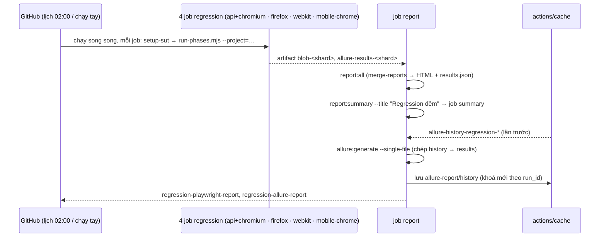

# CI và báo cáo kiểm thử

## 1. Mục tiêu và phạm vi

Lát thứ hai của giai đoạn 4 (D13, thứ tự 4.1 → **4.3** → 4.2 → 4.4). Lát này **không thêm chức năng và không thêm test nghiệp vụ**; chỉ làm hạ tầng chạy test và báo cáo.
Kết quả: (1) mỗi lần push, GitHub Actions dựng toàn bộ hệ thống và chạy nhóm `@smoke` trên 5 project; (2) mỗi đêm chạy **toàn bộ** bộ test, chia 4 job song song theo trình duyệt, rồi gộp thành một báo cáo; (3) báo cáo Allure đúng số liệu, có lịch sử (biểu đồ Trend), có phân loại lỗi, có nhóm theo lát; (4) một lệnh in bảng số liệu (theo project / khu vực / tag) dùng cho CI, cho quyển báo cáo và cho lát 4.4; (5) ảnh chụp CI + báo cáo cho quyển.

Hiện trạng (22/11/2026, đã kiểm):
- **CI chưa chạy được lần nào.** `.github/workflows/e2e-smoke.yml` (push / PR vào `main`, chỉ `api` + `chromium`) có 45 run từ 18/11 đến 20/11, run nào cũng `startup_failure` sau 0 giây, 0 job. Trang run ghi: *"The job was not started because recent account payments have failed or your spending limit needs to be increased."* Nghĩa là tài khoản GitHub đang bị chặn Actions vì thanh toán, file YAML không có lỗi (§11 câu 1). TC-20 phần CI của `khung-automation` vẫn còn treo, còn `docs/kiem-thu/kich-ban-demo.md` thì đang ghi là "CI chạy smoke mỗi lần push".
- **Allure sai số liệu:** `allure-results/` không bao giờ được dọn, nên đang dồn **13.014** file `*-result.json` của mọi lần chạy từ 18/11 đến 20/11. Hai pha cùng ghi vào một thư mục. Bản `allure-report/` sinh lần cuối ngày 18/11 chỉ có 42 test, toàn bộ là skip. Lệnh `allure generate --clean` xoá luôn `history/`, nên không bao giờ có Trend. Chưa có environment, executor, categories hay nhãn Behaviors.
- **Playwright HTML tách theo pha** (`playwright-report/` và `playwright-report-stock/`). Chưa có bảng tổng hợp: §12 của `kiem-thu-hoi-quy` phải ghi tay số test theo project và vẫn không tách được pass / skip theo project.
- Bộ test có 1046 test (`check:tags` ngày 20/11). Toàn bộ chạy local mất khoảng 13,8 phút với 4 worker.

| Có làm | Không làm (để lát khác) |
|---|---|
| Sửa `e2e-smoke.yml`: chạy mỗi lần push ở mọi nhánh (bỏ qua commit chỉ sửa tài liệu), 5 project, frontend chạy bản build, có job summary và artifact báo cáo gộp | Sửa lỗi thanh toán của tài khoản GitHub (người dùng tự làm, §11 câu 1) |
| Workflow mới `e2e-regression.yml`: lịch 02:00 giờ VN + chạy tay, ma trận 4 job (api + chromium, firefox, webkit, mobile-chrome), job `report` gộp HTML + Allure + bảng số liệu | GitHub Pages / đăng báo cáo công khai (§11 câu 5), Slack / email báo kết quả, branch protection / required check |
| Composite action `.github/actions/setup-sut` dùng chung: MySQL + MinIO, build + chạy backend, build frontend, cài trình duyệt | Self-hosted runner, chạy song song kiểu `--shard` trong cùng project |
| `run-phases.mjs` dọn `allure-results/` + `blob-report/` ở đầu mỗi lần chạy; reporter `blob` theo pha; `pnpm report:all` gộp hai pha (và các shard của CI) thành một báo cáo HTML + `results.json` | Visual regression, axe (lát 4.2) |
| Allure: giữ lịch sử (Trend), `environment`, `executor`, `categories` tiếng Việt, nhãn tự động (epic = lát, feature = khu vực, severity theo tag, link về plan) qua auto fixture, không sửa từng spec, bản `--single-file` để mở thẳng từ artifact | Test plan, `test-cases.xlsx`, ma trận truy vết, bug report, báo cáo kết quả hoàn chỉnh (lát 4.4, dùng lại `report:summary` của lát này) |
| `pnpm report:summary`: bảng Markdown theo project / khu vực / tag + danh sách test lỗi / chập chờn; ghi vào job summary của CI và file cho quyển | Sửa bug SUT #3 (backend `DataAccessException` → 400) đã ghi ở `kiem-thu-hoi-quy` (để 4.4) |
| `pnpm report:shots`: chụp ảnh Allure / HTML / trang Actions cho quyển; badge CI ở README | Thêm hoặc sửa test nghiệp vụ. Test chỉ đỏ trên CI vì khác môi trường thì sửa nguyên nhân (§8b bước 8), không thêm ca mới |
| Cập nhật `automation/README.md` §2, §3, §4, §6, README gốc; `docs/kiem-thu/` mục CI (tuỳ §11 câu 6) | |

## 2. Tác nhân

| Tác nhân | Vai trò trong lát | Ghi chú |
|---|---|---|
| Người phát triển (Claude / người dùng) | push nhánh → smoke; chạy tay regression (`workflow_dispatch`); chạy `pnpm test*` + `report:*` ở máy | push trong lúc cook cần người dùng cho phép (§11 câu 2) |
| GitHub Actions (lịch) | chạy regression lúc 02:00 giờ VN trên `main` | lịch chỉ chạy trên nhánh mặc định |
| Người đọc báo cáo (giảng viên, hội đồng, chính mình khi 4.4) | mở job summary, tải artifact HTML / Allure | |
| Tài khoản test | không có gì mới; dùng `admin@`, `noaccess@`, `khach1@`, `khach2@` như các lát trước | mỗi job CI có CSDL riêng |

## 3. Luồng

**L1 — Push (smoke):** 1. Push một commit lên nhánh bất kỳ có sửa ngoài `docs/`, `plan/`, `*.md`. 2. Workflow "E2E smoke" chạy: `setup-sut` (hạ tầng + backend + frontend bản build + 3 trình duyệt), rồi `pnpm test:smoke` (5 project × 2 pha). 3. Luôn chạy bước gộp: `report:all` → `report:summary --title "Smoke"` (ghi vào job summary) → khôi phục lịch sử Allure → `allure:generate --single-file` → lưu lịch sử. 4. Tải lên artifact `smoke-playwright-report`, `smoke-allure-report`; khi đỏ thì thêm `backend-log`. 5. PR có commit đó hiện check "E2E smoke / smoke".

**L2 — Đêm (regression):** 1. 02:00 giờ VN (hoặc chạy tay) → 4 job `regression (<shard>)` song song, mỗi job một máy ảo, hạ tầng riêng, chạy `run-phases.mjs <projects của shard>` (toàn bộ test của project, không lọc tag). 2. Mỗi job tải lên `blob-<shard>` và `allure-results-<shard>`. 3. Job `report` (chạy cả khi có shard đỏ) tải các artifact đó về, gộp HTML + `results.json`, viết bảng "Regression đêm" vào job summary, sinh Allure có lịch sử, tải lên `regression-playwright-report`, `regression-allure-report`.

**L3 — Máy local:** `pnpm test*` (dọn kết quả cũ → hai pha → blob theo pha) → `pnpm report:all` → `pnpm report:summary [--out <file>]` → `pnpm allure:generate` (giữ Trend giữa các lần chạy) → `pnpm allure:open`.

**Ngoại lệ:**
- E1. Có test đỏ: run đỏ, có annotation trỏ `file:dòng` (reporter `github`), job summary có mục "Test lỗi", artifact báo cáo và `backend-log` vẫn được tải lên.
- E2. Backend không lên sau 180 giây: bước "Chờ backend sẵn sàng" của `setup-sut` đỏ, in 80 dòng cuối log và tải lên `backend-log`. Các bước test bị bỏ qua; bước gộp báo cáo không có blob thì in cảnh báo, không làm hỏng thêm bước khác.
- E3. Commit chỉ sửa tài liệu: không có run smoke.
- E4. Một shard đỏ: các shard khác vẫn chạy (`fail-fast: false`); `report` vẫn gộp đủ phần có được.
- E5. Cache lịch sử Allure không còn (7 ngày không dùng): báo cáo không có Trend, không lỗi.
- E6. Push mới khi smoke của cùng nhánh đang chạy: run cũ bị huỷ (`cancel-in-progress`). Regression thì không huỷ.



## 4. Cơ sở dữ liệu

Không đổi. Mỗi job CI dùng MySQL + MinIO riêng trong máy ảo của nó, dữ liệu nạp từ Flyway + seed như máy local. `global-setup.js` reset ở đầu mỗi pha (như hiện có).

## 5. Hợp đồng (lệnh, biến môi trường, workflow) — cố định, test bám mục này

### 5.1 Lệnh `automation/package.json`

| Lệnh | Việc | Đầu ra |
|---|---|---|
| `pnpm test`, `test:smoke`, `test:regression`, `test:api`, `test:stock`, `test:flows`, `test:mock` | như cũ (qua `run-phases.mjs`). **Mới:** ở đầu lần chạy, xoá `allure-results/` và `blob-report/`, trừ khi `E2E_KEEP_RESULTS=1` | `blob-report/main/main-<tag>.zip`, `blob-report/stock/stock-<tag>.zip` (`<tag>` = `E2E_REPORT_TAG`, mặc định `local`), `allure-results/`, `playwright-report/`, `playwright-report-stock/` (giữ như cũ) |
| `pnpm report:all` → `node scripts/merge-reports.mjs [thư mục…]` | gom mọi `*.zip` trong các thư mục đã cho (mặc định `blob-report`, đọc đệ quy) rồi gọi `playwright merge-reports` | `playwright-report-all/index.html`, `playwright-report-all/results.json` |
| `pnpm report:summary` → `node scripts/summarize.mjs [--input <json>] [--title <tên>] [--out <file>]` | đọc `results.json` (mặc định `playwright-report-all/results.json`), in bảng §6.1 ra stdout; có `--out` thì ghi file; có biến `GITHUB_STEP_SUMMARY` thì **nối thêm** vào file đó. Luôn thoát 0 khi đọc được dữ liệu, kể cả khi có test đỏ | Markdown §6.1 |
| `pnpm allure:generate` → `node scripts/allure-generate.mjs [--single-file]` | (1) chép `allure-report/history/` → `allure-results/history/` nếu có; (2) ghi `allure-results/executor.json` (§6.3); (3) `allure generate allure-results --clean -o allure-report`; (4) có `--single-file` thì sinh thêm `allure-report-single/index.html` | `allure-report/` (có `history/`), `allure-report-single/index.html` |
| `pnpm allure:open` | như cũ | |
| `pnpm report:shots` → `node scripts/report-shots.mjs --out <thư mục> [--run <url run Actions>…]` | mở `allure-report/` (qua server tĩnh tạm), `playwright-report-all/` và các trang run công khai trên GitHub, rồi chụp ảnh theo danh sách §8b bước 9 | `<thư mục>/*.png` |

### 5.2 Biến môi trường mới / đổi

| Biến | Giá trị | Dùng ở |
|---|---|---|
| `E2E_FRONTEND` | `dev` (mặc định): `pnpm --dir ../frontend dev` · `preview`: `pnpm --dir ../frontend preview --strictPort` (phải `pnpm build` trước) | `playwright.config.js` `webServer` |
| `E2E_WORKERS` | số worker; mặc định **2 trên CI**, 4 ở local (trước đây CI cố định 2, không đổi được) | `playwright.config.js` |
| `E2E_REPORT_TAG` | tên đặt cho file blob, mặc định `local`; CI đặt `smoke` hoặc tên shard | reporter `blob` |
| `E2E_KEEP_RESULTS` | `1` = không dọn `allure-results/` / `blob-report/` | `run-phases.mjs` |
| `TZ` | CI đặt `Asia/Ho_Chi_Minh` cho cả job (JVM backend + Node), giống máy local | 2 workflow |
| `GITHUB_ACTIONS`, `GITHUB_WORKFLOW`, `GITHUB_RUN_NUMBER`, `GITHUB_RUN_ID`, `GITHUB_SERVER_URL`, `GITHUB_REPOSITORY`, `GITHUB_REF_NAME`, `GITHUB_SHA`, `GITHUB_STEP_SUMMARY` | do Actions cấp, chỉ đọc | `utils/report-env.js`, `summarize.mjs`, `allure-generate.mjs` |

Reporter trong `playwright.config.js`:
- Local dùng `list`, CI dùng `dot` + `github`.
- `html` theo pha giữ như cũ.
- **Mới:** `['blob', { outputDir: 'blob-report/<main|stock>', fileName: '<main|stock>-<E2E_REPORT_TAG>.zip' }]`.
- `allure-playwright` thêm `environmentInfo` (§6.3), `categories` (§6.2) và mẫu link `tms`.

### 5.3 Workflow và composite action

**`.github/actions/setup-sut/action.yml`** (composite):
- Input `browsers`: danh sách cách nhau bằng dấu cách, mặc định `chromium`.
- Các bước, lần lượt:
  1. Cài Java 21 (temurin, cache maven), pnpm 12.5.1, Node 22 (cache pnpm theo 2 lockfile).
  2. `cp backend/.env.example backend/.env`, `cp frontend/.env.example frontend/.env`.
  3. `docker compose -f docker-compose.local.yml --env-file backend/.env up -d --wait`.
  4. `mvn -q -B "-Djooq.codegen.skip=true" -pl app -am package -DskipTests`.
  5. Chạy nền `java -jar backend/app/target/aeoc-backend.jar > backend-run.log`. Chưa chờ ở bước này: trong lúc backend khởi động thì làm các bước 6–8.
  6. Frontend: `pnpm install --frozen-lockfile` + `pnpm build`.
  7. Automation: `pnpm install --frozen-lockfile`.
  8. `pnpm exec playwright install --with-deps <browsers>`.
  9. "Chờ backend sẵn sàng": chạy `sh .github/actions/setup-sut/wait-backend.sh`. Script gọi `GET http://localhost:${BACKEND_PORT:-9500}/api/v3/api-docs` tới khi trả 200, tối đa `${BACKEND_WAIT_S:-180}` giây. Quá hạn thì in `tail -80 backend-run.log` (nếu có) rồi thoát 1. Tách thành file riêng để kiểm được ở máy local (TC-10).

**`.github/workflows/e2e-smoke.yml`** (sửa):
- `name: E2E smoke`
- `on: push` (mọi nhánh, `paths-ignore: docs/**, plan/**, '**/*.md', .claude/**`) + `workflow_dispatch`. **Bỏ** `pull_request`, vì check của commit đã hiện trên PR (tránh chạy hai lần cho cùng một commit).
- `concurrency: e2e-smoke-${{ github.ref }}`, `cancel-in-progress: true` · `permissions: contents: read`
- Job `smoke`, tên hiển thị **"smoke (5 project)"**, `timeout-minutes: 40`, env `CI=true`, `TZ`, `E2E_FRONTEND=preview`, `E2E_REPORT_TAG=smoke`.
- Các bước:
  - `setup-sut` với `browsers: chromium firefox webkit` → `pnpm test:smoke`.
  - Các bước sau đều `if: always()`: `pnpm report:all` → `pnpm report:summary --title "Smoke"`.
  - Lịch sử Allure: `actions/cache/restore` khoá `allure-history-smoke-${{ github.ref_name }}-`, nếu không có thì `allure-history-smoke-main-` → `pnpm allure:generate --single-file` → `actions/cache/save` khoá `allure-history-smoke-${{ github.ref_name }}-${{ github.run_id }}`.
- Artifact: `smoke-playwright-report` (`playwright-report-all/`, 14 ngày) và `smoke-allure-report` (`allure-report-single/`, 14 ngày). Khi `failure()` thêm `backend-log` (7 ngày).

**`.github/workflows/e2e-regression.yml`** (mới):
- `name: E2E regression (nightly)`
- `on: schedule: cron '0 19 * * *'` (02:00 giờ VN) + `workflow_dispatch`. Trong lúc cook thêm **tạm** `push: branches: [feature/ci-bao-cao]` để kiểm, xoá trước phiên C (§12 ghi lại).
- `concurrency: e2e-regression`, `cancel-in-progress: false` · `permissions: contents: read`
- Job `test`, tên **"regression (${{ matrix.shard }})"**, `strategy.fail-fast: false`, `timeout-minutes: 60`. Ma trận:

| `shard` | `projects` | `browsers` |
|---|---|---|
| `api-chromium` | `--project=api --project=chromium` | `chromium` |
| `firefox` | `--project=firefox` | `chromium firefox` |
| `webkit` | `--project=webkit` | `chromium webkit` |
| `mobile-chrome` | `--project=mobile-chrome` | `chromium` |

  Shard `firefox` / `webkit` vẫn cài `chromium` vì project `setup` (đăng nhập sẵn, `Desktop Chrome`) chạy ở mọi shard.

  Bước chạy: `node scripts/run-phases.mjs ${{ matrix.projects }}`, env `E2E_REPORT_TAG=${{ matrix.shard }}`. Artifact (`if: always()`): `blob-<shard>` (`blob-report/`, 3 ngày), `allure-results-<shard>` (3 ngày). Khi `failure()` thêm `backend-log-<shard>`.
- Job `report`, tên **"report"**, `needs: test`, `if: always()`. Cài Node / pnpm / Java + `pnpm install` của automation, không cài trình duyệt, không dựng hạ tầng. Các bước:
  1. `actions/download-artifact` gộp `blob-*` vào `blob-report/` và `allure-results-*` vào `allure-results/`.
  2. Khôi phục cache `allure-history-regression-`.
  3. `pnpm report:all` → `pnpm report:summary --title "Regression đêm"` → `pnpm allure:generate --single-file`.
  4. Lưu cache `allure-history-regression-${{ github.run_id }}`.
  5. Artifact `regression-playwright-report` và `regression-allure-report` (14 ngày).

### 5.4 Lỗi / thông báo của script (nguyên văn, tiếng Việt vì là công cụ nội bộ)

| Tình huống | Mã thoát | Message |
|---|---|---|
| `report:all` không tìm thấy file `.zip` nào | 2 | `Không có blob report nào trong <thư mục> — chạy pnpm test* trước` |
| `report:summary` thiếu file đầu vào | 2 | `Không tìm thấy <file> — chạy pnpm report:all trước` |
| `allure:generate` khi `allure-results/` trống / không có | 2 | `allure-results/ trống — chạy pnpm test* trước` |
| `allure:generate` khi máy không có Java | 2 | `Cần Java 21 để sinh báo cáo Allure (kiểm bằng java -version)` |
| `report:shots` khi chưa có `allure-report/index.html` hoặc `playwright-report-all/index.html` | 2 | `Chưa có <file> — chạy pnpm report:all và pnpm allure:generate trước` |
| `wait-backend.sh`: backend không lên | 1 | `Backend không lên sau <BACKEND_WAIT_S>s` + 80 dòng cuối `backend-run.log` (giữ như workflow cũ) |

## 6. Chuỗi hiển thị (cố định — TC so đúng các chuỗi này)

### 6.1 Bảng số liệu của `report:summary`

```markdown
## Kết quả kiểm thử — <title, mặc định "Toàn bộ">

<Chạy ở> · nhánh `<nhánh>` · commit `<7 ký tự>` · <dd/MM/yyyy HH:mm> (giờ VN) · <thời lượng chạy>

### Theo project

| Project | Tổng | Đạt | Chập chờn | Lỗi | Bỏ qua | Tỉ lệ đạt | Thời gian chạy test |
|---|---|---|---|---|---|---|---|
| api | 146 | 146 | 0 | 0 | 0 | 100,0 % | 1 phút 12 giây |
| … | | | | | | | |
| **Tổng** | … | | | | | | |

### Theo khu vực

| Khu vực | Tổng | Đạt | Chập chờn | Lỗi | Bỏ qua |
|---|---|---|---|---|---|
| tests/api | … |

### Theo tag

| Tag | Tổng | Đạt | Chập chờn | Lỗi | Bỏ qua |
|---|---|---|---|---|---|
| @smoke | … |   (đúng 5 dòng: @smoke, @regression, @stock, @flow, @mock)

### Test lỗi (<n>)                ← chỉ có khi n > 0

| Test | Project | Lỗi |
|---|---|---|
| `tests/api/x.api.spec.js:12` TC-01 … | api | <dòng đầu của error.message, bỏ mã màu, ≤ 120 ký tự> |

### Test chập chờn (<n>)          ← chỉ có khi n > 0

| Test | Project | Số lần chạy |
|---|---|---|
```

Quy tắc đếm:
- Một dòng của bảng là một cặp (test, project). Project `setup` **không tính**.
- "Đạt" là `status = expected` mà không bị skip. "Chập chờn" là `flaky` (đỏ rồi xanh khi retry). "Lỗi" là `unexpected`. "Bỏ qua" là `skipped`.
- "Tỉ lệ đạt" = (Đạt + Chập chờn) / (Tổng − Bỏ qua), một chữ số thập phân, dấu phẩy, ví dụ "98,7 %". Mẫu số bằng 0 thì ghi "—".
- "Thời gian chạy test" là tổng `duration` của mọi lần chạy, không phải thời gian đồng hồ. Thời gian đồng hồ của cả lần chạy (`stats.duration`) nằm ở dòng đầu.
- Thời lượng viết dạng "45 giây", "2 phút 05 giây", "1 giờ 02 phút".
- "Khu vực" là thư mục cấp 1 dưới `tests/`.
- `<Chạy ở>` lấy theo §6.3.

### 6.2 Nhóm lỗi Allure (`automation/allure/categories.json`, theo thứ tự ưu tiên)

| # | Tên nhóm | Điều kiện |
|---|---|---|
| 1 | Lỗi kết nối / hạ tầng | `failed`, `broken`; message khớp `ECONNREFUSED\|ECONNRESET\|socket hang up\|net::ERR_\|NS_ERROR_\|Backend chưa chạy` |
| 2 | Hết thời gian của test | `failed`, `broken`; message khớp `Test timeout of \d+ms exceeded` |
| 3 | Sai kết quả mong đợi | `failed`; message khớp `expect\(` |
| 4 | Lỗi khác | `failed`, `broken` (mọi thứ còn lại) |
| 5 | Test chập chờn | `flaky: true` |

Mỗi test đỏ chỉ được nằm trong **một** nhóm từ 1 đến 4. Nếu Allure xếp một test vào nhiều nhóm thì sửa regex cho loại trừ lẫn nhau (TC-07).

### 6.3 Environment, executor, nhãn Allure

- `environmentInfo` (`utils/report-env.js`, `summarize.mjs` dùng chung), khoá theo đúng thứ tự:
  - "Chạy ở": `GitHub Actions · <GITHUB_WORKFLOW> #<GITHUB_RUN_NUMBER>` trên CI, `Máy local` ở máy.
  - "Nhánh": `GITHUB_REF_NAME` hoặc `git rev-parse --abbrev-ref HEAD`.
  - "Commit": 7 ký tự.
  - "Hệ điều hành": `os.type() os.release()`.
  - "Node": `process.version`.
  - "Playwright": phiên bản `@playwright/test`.
  - "Frontend": `<BASE_URL> (dev | preview)`.
  - "Backend": `API_URL`.
  - "Worker": số worker.
- `executor.json`:
  - CI: `{ "name": "GitHub Actions", "type": "github", "buildName": "<GITHUB_WORKFLOW> #<GITHUB_RUN_NUMBER>", "buildOrder": <GITHUB_RUN_NUMBER>, "buildUrl": "<GITHUB_SERVER_URL>/<GITHUB_REPOSITORY>/actions/runs/<GITHUB_RUN_ID>", "reportName": "Nike Shoes — <title>" }`.
  - Local: `{ "name": "Máy local", "type": "local", "buildName": "<yyyy-MM-dd HH:mm>", "buildOrder": <unix giây>, "reportName": "Nike Shoes — Toàn bộ" }`.
- Nhãn, gắn bằng auto fixture `allureLabels` ở `fixtures/index.js` (dùng `allure-js-commons`; spec không phải sửa):
  - `epic` = tên lát. Lấy từ `title` ở front matter của `plan/<plan-slug>.md`, phần trước " — " đầu tiên, bỏ đoạn "(…)" ở cuối. Ví dụ `dat-hang` → "Đặt hàng COD", `go-lut` → "Gỡ toàn bộ phần LUT", `khung-automation` → "Khung bộ automation test".
  - `plan-slug` = tên file spec bỏ `.spec.js` / `.api.spec.js`. Ngoại lệ: `auth`, `role`, `admin-login` → `khung-automation`. Không có plan thì dùng chính slug làm epic và không gắn link.
  - `feature` = "API" cho `tests/api/**`, còn lại `Giao diện · <khu vực>` (vd "Giao diện · checkout").
  - `severity` = `critical` nếu có `@smoke`, `normal` nếu có `@regression`.
  - Link loại `tms`, tên `plan/<plan-slug>.md`, URL `<repo>/blob/main/plan/<plan-slug>.md`. `<repo>` lấy từ `GITHUB_SERVER_URL/GITHUB_REPOSITORY` hoặc `git remote get-url origin` (bỏ `.git`).
- Số epic mong đợi:
  - Toàn bộ bộ test: **11** (khung-automation, go-lut, du-lieu-giay, giao-dien-nike, tieng-anh-cua-hang, dang-nhap-nike, danh-sach-giay, chi-tiet-giay, gio-hang, dat-hang, kiem-thu-hoi-quy).
  - Chỉ project `api`: **10** (không có kiem-thu-hoi-quy).

### 6.4 Tên trên GitHub

- Workflow "E2E smoke", "E2E regression (nightly)".
- Job "smoke (5 project)", "regression (api-chromium)", "regression (firefox)", "regression (webkit)", "regression (mobile-chrome)", "report".
- Artifact `smoke-playwright-report`, `smoke-allure-report`, `blob-<shard>`, `allure-results-<shard>`, `regression-playwright-report`, `regression-allure-report`, `backend-log`, `backend-log-<shard>`.
- Badge ở đầu `README.md` gốc và `automation/README.md`: `[](…/actions/workflows/e2e-smoke.yml)`, `[](…)`.

## 7. Việc backend (Claude)

Không có. CI chạy jar profile `local` như máy local; chỉ thêm `TZ=Asia/Ho_Chi_Minh` ở mức job (mã đơn `DH` + yyMMdd của backend và `timezoneId` của Playwright đều theo giờ VN, kể cả lúc chạy đêm 02:00 khi giờ UTC vẫn còn ở ngày hôm trước).

## 8. Việc frontend (Claude)

Không có. CI chỉ chạy `pnpm build` rồi `vite preview` ở :4500 (cấu hình `preview.port` đã có). Bản build ẩn dòng gợi ý "Test account: free@nike.local…" ở `/signin` (`import.meta.env.DEV`); không test nào dùng dòng này (đã grep).

Component shadcn dùng: không áp dụng.

## 8b. Việc của Claude (code test + CI, theo thứ tự)

Lát chỉ có hạ tầng test nên gộp phiên A + B như `kiem-thu-hoi-quy`: một phiên cook làm 1 → 10, phiên C (`/doc-chuc-nang`) viết tài liệu. Các TC loại `ci` cần §11 câu 1 (billing) và câu 2 (cho push). Chưa có hai điều này thì phiên cook làm xong phần local (TC-01 → TC-10), ghi §12 "chờ CI" và dừng lại.

Quyết định đã chốt sẵn:
- Blob tách theo pha (`blob-report/main`, `blob-report/stock`), vì reporter `blob` xoá `outputDir` ở đầu mỗi lần chạy. Tên file có `E2E_REPORT_TAG` để các shard không trùng tên khi gộp.
- Project `setup` chạy ở cả hai pha và ở mọi shard. Bảng số liệu bỏ qua project này. Nếu HTML gộp hiện `setup` trùng dòng thì chấp nhận, ghi §12.
- Không cache trình duyệt Playwright: tải lại cũng nhanh như khôi phục cache, theo khuyến nghị của Playwright.
- Lịch sử Allure lưu bằng `actions/cache`, không dùng GitHub Pages (§11 câu 5).
- `run-phases.mjs` dọn kết quả cũ khi được gọi, kể cả với `--phase=stock`. Gọi thẳng `playwright test` thì không dọn (cộng dồn) và README ghi rõ điều này.

1. `playwright.config.js`: `E2E_FRONTEND`, `E2E_WORKERS` dùng được cả trên CI, reporter theo §5.2. `scripts/run-phases.mjs`: dọn `allure-results/` + `blob-report/` (trừ khi `E2E_KEEP_RESULTS=1`). `.gitignore` của automation thêm `playwright-report-all/`, `allure-report-single/`.
2. `utils/report-env.js` (environment + thông tin lần chạy, dùng chung). `utils/report-labels.js` (khu vực, plan-slug, tên lát đọc từ `plan/*.md`, cache theo tiến trình). Auto fixture `allureLabels` trong `fixtures/index.js`. Thêm `allure-js-commons` vào devDependencies (pnpm không cho import gói phụ thuộc gián tiếp).
3. `automation/allure/categories.json` (§6.2); `allure-playwright` nhận `environmentInfo`, `categories`, link `tms`.
4. Các script `merge-reports.mjs`, `summarize.mjs`, `allure-generate.mjs`, `report-shots.mjs` + lệnh ở `package.json` (§5.1). Mọi message lỗi theo §5.4.
5. `.github/actions/setup-sut/action.yml` + `wait-backend.sh`, sửa `e2e-smoke.yml`, tạo `e2e-regression.yml` (kèm trigger push tạm).
6. Chạy TC-01 → TC-10 ở máy.
7. Push `feature/ci-bao-cao` (nếu §11 câu 1, 2 đã xong), chạy TC-11 → TC-15. Xong thì bỏ trigger tạm của regression.
8. Test chỉ đỏ trên CI (máy 4 vCPU, bản build, giờ UTC…): tìm nguyên nhân và sửa ở spec / page object / cấu hình như quy tắc của `kiem-thu-hoi-quy` (không tăng `timeout` / `retries` để che). Ghi từng ca vào §12, lỗi SUT ghi dạng "bug" cho 4.4.
9. Ảnh cho quyển ở `docs/chuc-nang/img/ci-bao-cao/` (`pnpm report:shots` + chụp tay nếu cần):
   - `01-actions-smoke.png` (run smoke xanh)
   - `02-actions-summary.png` (bảng §6.1 trong job summary)
   - `03-actions-regression.png` (đồ thị 4 job + report)
   - `04-actions-failed.png` (run đỏ TC-15 + annotation)
   - `05-allure-overview.png` (Overview + Trend)
   - `06-allure-behaviors.png`
   - `07-allure-categories.png`
   - `08-allure-test.png` (test có `test.step` + tệp đính kèm)
   - `09-playwright-report-all.png`

   Bảng số liệu local và CI lưu ở `docs/kiem-thu/so-lieu/<yyyy-mm-dd>-local.md` và `<yyyy-mm-dd>-ci-regression.md` (lát 4.4 dùng).
10. Tài liệu:
    - `automation/README.md`: §2 thêm lệnh mới và biến môi trường; §3 "Báo cáo" viết lại (gộp, summary, Allure có lịch sử, cách mở artifact tải về: `pnpm exec playwright show-report <thư mục>`, mở `allure-report-single/index.html` trực tiếp); §4 cây thư mục (`allure/`, `scripts/`, `.github/actions`); §6 "CI" viết lại (2 workflow, ma trận, cache, artifact, trigger, cách chạy tay `gh workflow run e2e-regression.yml`); badge.
    - README gốc: badge.
    - `docs/kiem-thu/`: mục CI, làm theo §11 câu 6.
    - Cuối cùng chạy `pnpm lint`, Prettier, `check:tags`.

## 9. Test case

Loại: `khung` = kiểm script / cấu hình / báo cáo ở máy local · `ci` = kiểm một lần chạy thật trên GitHub Actions (cần §11 câu 1, 2). Không có `unit` / `api` / `e2e` mới (lát không đổi SUT, không thêm test nghiệp vụ).

### 9.1 Ở máy local

| ID | Loại | Mô tả | Tiền điều kiện | Bước | Kết quả mong đợi |
|---|---|---|---|---|---|
| TC-01 | khung | `pnpm test*` dọn kết quả cũ, blob theo pha | backend chạy; `allure-results/` còn 13.014 file cũ; tạo thêm `allure-results/zz-old-result.json`, `blob-report/main/old.zip` | `pnpm test:api`; rồi `E2E_KEEP_RESULTS=1 pnpm test:api` | lần 1: không còn `zz-old-result.json` và `old.zip`; số file `*-result.json` = số test của lần chạy (= `--list` hai pha của project `api`); có `blob-report/main/main-local.zip` và `blob-report/stock/stock-local.zip`. Lần 2: số `*-result.json` gấp đôi lần 1 |
| TC-02 | khung | `report:all` gộp hai pha | sau TC-01 lần 1 (chạy lại `pnpm test:api` không giữ kết quả) | `pnpm report:all`; rồi xoá `blob-report/` và chạy lại | lần 1: có `playwright-report-all/index.html` + `results.json`; `results.json` có cả test pha thường (vd TC không `@stock` của `tests/api/dat-hang.api.spec.js`) lẫn test `@stock`; tổng số test = `--list` pha thường + pha stock của `api`. Lần 2: thoát 2, `Không có blob report nào trong blob-report — chạy pnpm test* trước` |
| TC-03 | khung | `report:summary` đúng định dạng §6.1 | sau TC-02 lần 1 | `pnpm report:summary`; `pnpm report:summary --out <scratch>/s.md`; `GITHUB_STEP_SUMMARY=<scratch>/gh.md pnpm report:summary` (gọi 2 lần); xoá `playwright-report-all/results.json` rồi gọi lại | stdout bắt đầu `## Kết quả kiểm thử — Toàn bộ`, dòng 3 có `Máy local · nhánh` + commit 7 ký tự; bảng "Theo project" có đúng 1 dòng `api` + dòng `**Tổng**` cùng số; Tỉ lệ đạt `100,0 %`; bảng "Theo khu vực" chỉ có `tests/api`; bảng "Theo tag" đủ 5 dòng; không có mục "Test lỗi". `s.md` giống stdout. `gh.md` chứa nội dung 2 lần (nối thêm). Khi thiếu file: thoát 2, `Không tìm thấy playwright-report-all/results.json — chạy pnpm report:all trước` |
| TC-04 | khung | Allure đúng số + có Trend | sau TC-02 lần 1; Java 21 | `pnpm allure:generate`; chạy lại `pnpm test:api` + `pnpm allure:generate`; gọi `pnpm allure:generate` với `PATH` không có `java` và không đặt `JAVA_HOME`; xoá `allure-results/` rồi `pnpm allure:generate` | lần 1: `allure-report/widgets/summary.json` `statistic.total` = Tổng ở TC-03 (api không có `setup`). Lần 2: `allure-report/history/history-trend.json` có 2 phần tử, `statistic.total` không đổi (không cộng dồn); Overview có biểu đồ "Trend" 2 cột. Không có Java: thoát 2, `Cần Java 21 để sinh báo cáo Allure (kiểm bằng java -version)`, `allure-report/` cũ còn nguyên. Không còn kết quả: thoát 2, `allure-results/ trống — chạy pnpm test* trước` |
| TC-05 | khung | Environment + executor | sau TC-04 | đọc `allure-report/widgets/environment.json`, `widgets/executors.json`; rồi đặt biến giả lập CI (`GITHUB_ACTIONS=true GITHUB_WORKFLOW="E2E smoke" GITHUB_RUN_NUMBER=7 GITHUB_RUN_ID=1 GITHUB_SERVER_URL=https://github.com GITHUB_REPOSITORY=Julytus/NIKE GITHUB_REF_NAME=feature/ci-bao-cao`) và chạy `pnpm test:api` + `pnpm allure:generate` | local: đủ 9 khoá §6.3 theo đúng thứ tự, "Chạy ở" = `Máy local`, "Commit" = `git rev-parse --short=7 HEAD`, "Frontend" kết thúc bằng `(dev)`; executor `Máy local`. Giả lập CI: "Chạy ở" = `GitHub Actions · E2E smoke #7`, "Nhánh" = `feature/ci-bao-cao`, executor `buildUrl` = `https://github.com/Julytus/NIKE/actions/runs/1` |
| TC-06 | khung | Nhãn Behaviors tự động | sau TC-04 | đọc `allure-results/*-result.json` của một test `@smoke` và một test `@regression` trong `tests/api/dat-hang.api.spec.js`, một test của `tests/api/role.api.spec.js`; mở tab Behaviors | `dat-hang`: `epic` "Đặt hàng COD", `feature` "API", `severity` `critical` / `normal` theo tag, link `tms` tên `plan/dat-hang.md`. `role`: `epic` "Khung bộ automation test", link `plan/khung-automation.md`. Behaviors có **10** epic (chỉ api). Không spec nào bị sửa (`git diff --stat tests/` rỗng) |
| TC-07 | khung | Nhóm lỗi + bảng có test đỏ / chập chờn | tạm thêm `tests/api/zz-tmp-ci.api.spec.js` (không commit) 4 test `@regression`: (a) `expect(1).toBe(2)`; (b) `test.setTimeout(1000)` rồi chờ 2 giây; (c) `request.get('http://localhost:9599/x')`; (d) đỏ khi `testInfo.retry === 0`, xanh khi retry | `node scripts/run-phases.mjs --phase=main --project=api --retries=1 -g "zz-tmp"` → `report:all` → `report:summary` → `allure:generate`; xoá file tạm, chạy lại `pnpm test:api` | `run-phases` thoát 1, `report:summary` thoát 0. Bảng: Lỗi 3, Chập chờn 1, Tỉ lệ đạt `25,0 %`; "Test lỗi (3)" có 3 dòng `tests/api/zz-tmp-ci.api.spec.js:<dòng>`, cột Lỗi lần lượt bắt đầu bằng `expect(received).toBe(expected)`, `Test timeout of 1000ms exceeded`, `apiRequestContext.get: connect ECONNREFUSED`; "Test chập chờn (1)" có Số lần chạy 2. Allure Categories: "Sai kết quả mong đợi" 1 (a), "Hết thời gian của test" 1 (b), "Lỗi kết nối / hạ tầng" 1 (c), "Test chập chờn" 1 (d); a, b, c mỗi test chỉ nằm trong một nhóm. Sau khi xoá file: `check:tags` 0 lỗi |
| TC-08 | khung | Smoke với frontend bản build (`preview`) | `pnpm --dir ../frontend build` xanh | `E2E_FRONTEND=preview pnpm test:smoke` | log webServer là `vite preview`; 0 lỗi ở cả hai pha, đủ 5 project; ghi số test + thời gian, so với chạy `dev` cùng máy (§12) |
| TC-09 | khung | Toàn bộ local, ba nguồn số khớp nhau | sau bước 1 → 5 | `pnpm test` (dev, 4 worker) → `pnpm report:all` → `pnpm report:summary --out ../docs/kiem-thu/so-lieu/<ngày>-local.md` → `pnpm allure:generate` | 0 lỗi, 0 chập chờn cả hai pha. "Tổng" ở bảng = tổng test của `results.json` trừ `setup` = `--list` hai pha trừ `setup`. Allure `statistic.total` = Tổng + số kết quả của `setup`. Behaviors có **11** epic. Trend có thêm 1 cột. Sau đó `pnpm report:shots --out <scratch>/shots` ra đủ 5 ảnh `05-…` → `09-…` (ảnh Actions cần `--run`, chụp ở TC-11 → TC-15); đổi tên tạm `playwright-report-all/` rồi gọi lại: thoát 2, `Chưa có playwright-report-all/index.html — chạy pnpm report:all và pnpm allure:generate trước` |
| TC-10 | khung | Tĩnh: workflow, lint, tag; script chờ backend | sau bước 5 | `docker run --rm -v "<repo>:/repo" -w /repo rhysd/actionlint:latest`; `pnpm lint`; `pnpm exec prettier --check .`; `pnpm check:tags`; `BACKEND_PORT=9599 BACKEND_WAIT_S=4 sh .github/actions/setup-sut/wait-backend.sh`; rồi chạy lại với cổng 9500 (backend đang chạy) | actionlint 0 lỗi (2 workflow, input của `setup-sut` khớp); ESLint 0 lỗi; Prettier sạch; `check:tags` 0 lỗi, số test không đổi so với trước lát (1046). `wait-backend.sh` ở cổng 9599: thoát 1 sau khoảng 4 giây, in `Backend không lên sau 4s`. Ở cổng 9500: thoát 0 ngay lần gọi đầu |

### 9.2 Trên GitHub Actions

| ID | Loại | Mô tả | Tiền điều kiện | Bước | Kết quả mong đợi |
|---|---|---|---|---|---|
| TC-11 | ci | Smoke xanh khi push | §11 câu 1, 2 xong; nhánh `feature/ci-bao-cao` | push; `gh run watch`; `gh run view <id> --json jobs,conclusion`; `gh api repos/Julytus/NIKE/actions/runs/<id>/artifacts` | run "E2E smoke" `success`, job "smoke (5 project)" < 40 phút (ghi thời gian từng bước vào §12). Job summary bắt đầu `## Kết quả kiểm thử — Smoke`, dòng đầu có `GitHub Actions · E2E smoke #<n>`, bảng "Theo project" đúng 5 dòng `api`, `chromium`, `firefox`, `webkit`, `mobile-chrome` + Tổng, Lỗi 0; Tổng = số test `@smoke` của `--list` hai pha trừ `setup`. Có artifact `smoke-playwright-report`, `smoke-allure-report`; tải `smoke-allure-report` về, mở `index.html` bằng `file://` thấy Overview |
| TC-12 | ci | Bỏ qua commit chỉ sửa tài liệu | sau TC-11 | push một commit chỉ sửa `plan/ci-bao-cao.md` (§12); `gh run list --commit <sha>` | không có run "E2E smoke" cho SHA đó |
| TC-13 | ci | Regression ma trận + gộp báo cáo | trigger push tạm của `e2e-regression.yml` | push; theo dõi run "E2E regression (nightly)" | 4 job `regression (api-chromium / firefox / webkit / mobile-chrome)` + `report` đều `success`. Summary `## Kết quả kiểm thử — Regression đêm` có 5 dòng project. Tổng và số từng project = TC-09 (cùng commit, cùng bộ test). `regression-playwright-report` mở bằng `show-report` thấy test của cả 5 project và các test `@stock`. Ghi thời gian từng job vào §12 |
| TC-14 | ci | Allure có lịch sử trên CI | sau TC-13 | "Re-run all jobs" run regression (hoặc push lần 2); tải `regression-allure-report`; `gh cache list` | lần 2: Overview có Trend 2 cột (`history-trend.json` 2 phần tử); `gh cache list` có khoá bắt đầu bằng `allure-history-regression-`. Tương tự, smoke chạy lần 2 trên nhánh có Trend 2 cột |
| TC-15 | ci | Đường đỏ có đủ dấu vết | sau TC-11 | commit tạm thêm `tests/api/zz-tmp-ci.api.spec.js` 1 test `@smoke` `TC-01 zz-tmp đỏ có chủ đích` (`expect(1).toBe(2)`) → push; sau đó `git revert` commit đó → push | run "E2E smoke" `failure`; có annotation trỏ `tests/api/zz-tmp-ci.api.spec.js:<dòng>`; summary "Test lỗi (1)" dòng `api` + `expect(received).toBe(expected)`; test chạy 3 lần (retries 2 trên CI); vẫn có `smoke-playwright-report`, `smoke-allure-report` (Categories: "Sai kết quả mong đợi" 1) và `backend-log`. Commit revert: run `success`. Chụp `04-actions-failed.png` |

## 10. Tiêu chí hoàn thành

- [x] TC-01 → TC-10 pass ở máy local
- [x] TC-11 → TC-15 pass trên GitHub Actions (cần §11 câu 1, 2); trigger push tạm của regression đã bỏ
- [x] `pnpm lint`, Prettier, `check:tags`, actionlint xanh; số test không đổi
- [x] Có `docs/kiem-thu/so-lieu/<ngày>-local.md`, `<ngày>-ci-regression.md` và 9 ảnh ở `docs/chuc-nang/img/ci-bao-cao/`
- [x] `automation/README.md` §2, §3, §4, §6 + badge cập nhật; `kich-ban-demo.md` không còn ghi điều chưa đúng về CI (§11 câu 6)
- [x] Có `docs/chuc-nang/ci-bao-cao.md` (chương "Tích hợp liên tục và báo cáo" của quyển: sơ đồ 2 workflow, bảng artifact, bảng số liệu, ảnh Allure / Actions)
- [ ] Sau khi người dùng merge: sáng hôm sau kiểm run đêm đầu tiên theo lịch (`gh run list --workflow e2e-regression.yml --event schedule`), ghi §12 (không thuộc phiên cook)

## 11. Rủi ro / câu hỏi mở

1. **(Chặn phần CI) Tài khoản GitHub đang bị khoá Actions vì thanh toán.** Cả 45 run đều dừng với "recent account payments have failed or your spending limit needs to be increased". Repo public thì Actions trên runner chuẩn vẫn miễn phí, nhưng GitHub chặn mọi job khi tài khoản có khoản thanh toán lỗi (có thể từ một gói khác như Copilot). Bạn cần vào **Settings → Billing and plans** để xử lý khoản lỗi hoặc đặt lại spending limit, rồi chạy tay `gh workflow run e2e-smoke.yml` (hoặc push) xem còn `startup_failure` không. Nếu lúc cook vẫn chưa xử lý được: làm xong phần local TC-01 → TC-10, ghi §12 "chờ CI" và để plan ở `in-progress`. Không đề xuất chạy thử bằng `act` trên Windows, vì phải lồng Docker để dựng compose, tốn công mà vẫn không chứng minh được CI thật.
2. **Cho phép push lúc cook?** CLAUDE.md không cho push khi bạn chưa bảo, nhưng TC-11 → TC-15 cần khoảng 5–8 lần push lên `feature/ci-bao-cao`: có 1 commit đỏ có chủ đích kèm commit revert (TC-15), và trigger tạm cho regression (sẽ bỏ trước phiên C). Không push `main`, không force push. Bạn đồng ý không?
3. **Smoke mỗi push chạy 5 project hay chỉ `api + chromium`?** Ước tính 5 project khoảng 15–20 phút (dựng hạ tầng khoảng 6 phút, test khoảng 125 lượt với 2 worker); `api + chromium` khoảng 10–12 phút. **Đề xuất 5 project**: khớp `pnpm test:smoke` ở máy và bắt lỗi riêng của Firefox / WebKit / mobile sớm. Repo public thì không tốn phút.
4. **CI chạy frontend bản build (`vite preview`)** thay vì Vite dev như máy local. Bản build nhanh và ổn định hơn trên máy 4 vCPU (ở máy local, Vite dev từng là nguyên nhân `goto` quá 30 giây), đồng thời kiểm luôn `pnpm build`. Khác biệt duy nhất đã biết là dòng gợi ý tài khoản test ở `/signin`, không test nào dùng. Máy local vẫn dùng dev; TC-08 chứng minh bộ smoke xanh với bản build. Đồng ý không?
5. **Lịch sử Allure lưu bằng `actions/cache`** (đề xuất): không công khai gì. Nhược điểm là cache tự hết hạn khi 7 ngày không dùng (chạy đêm thì luôn được dùng) và chỉ xem được qua artifact tải về. Cách khác là GitHub Pages: có link xem online, Trend giữ mãi, nhưng sẽ **công khai** ảnh / video / trace của trang mô phỏng Nike, trái với lưu ý "chỉ dùng học tập, chạy local, không deploy công khai" ở `thiet-ke-giay.md`. Chọn cache?
6. **Tài liệu bạn đang sửa dở:** `docs/kiem-thu/huong-dan-cai-dat-va-chay.md` và `docs/kiem-thu/kich-ban-demo.md` có thay đổi chưa commit (cùng với việc xoá `docs/Hướng-dẫn-trình-bày.pdf` và thêm `docs/kiem-thu/huong-dan-chay-va-kich-ban-demo.docx`). `kich-ban-demo.md` (phần 6, câu hỏi hay gặp) đang ghi "CI chạy smoke mỗi lần push", nên phải sửa sau lát này. Đề xuất: bạn commit phần của bạn trước khi cook. Nếu chưa commit, cook **không đụng** hai file đó, chỉ ghi vào §12 đoạn cần sửa để bạn (hoặc lát 4.4) chép vào.
7. **Dọn `allure-results/` mỗi lần `pnpm test*`:** báo cáo Allure chỉ còn lần chạy gần nhất (cộng Trend). 13.014 file cũ (18–20/11, đều là file sinh ra, đã gitignore) sẽ bị xoá ở lần chạy đầu tiên. Muốn gộp nhiều lần chạy thì dùng `E2E_KEEP_RESULTS=1`. Đồng ý không?
8. **Giờ chạy đêm 02:00 giờ VN** (cron `0 19 * * *` theo UTC). Lịch của GitHub có thể trễ 5–30 phút, và repo public không có commit nào trong 60 ngày thì GitHub tự tắt lịch. Lịch chỉ chạy trên `main`, nên trước khi bạn merge chỉ kiểm được bằng trigger tạm (TC-13). Giờ này được chứ?
9. **`paths-ignore`** (`docs/**`, `plan/**`, `**/*.md`, `.claude/**`): commit chỉ sửa tài liệu thì không chạy smoke, và PR chỉ có tài liệu sẽ không có check. Đồng ý không?
10. **Rủi ro test đỏ chỉ trên CI** (máy chậm hơn, bản build, giờ UTC ngoài phần đã đặt `TZ`): đã dự trù ở §8b bước 8. Nếu sửa xong vẫn còn ca chập chờn chỉ thấy trên CI thì ghi lại cho 4.4 kèm trace, không đánh dấu `skip`.

## 12. Nhật ký thực hiện (do /cook và /doc-chuc-nang ghi — nối các phiên A/B/C)

| Thời điểm | Sự kiện |
|---|---|
| 2026-11-22 | Lập plan (draft). Khảo sát: `e2e-smoke.yml` có 45 run (18–20/11) đều `startup_failure` sau 0 giây, 0 job; annotation trên trang run là "The job was not started because recent account payments have failed or your spending limit needs to be increased." (lỗi billing tài khoản, không phải YAML; `gh api …/actions/permissions` = enabled, all actions). `allure-results/` có 13.014 `*-result.json` dồn từ 18/11 đến 20/11; `allure-report/` sinh lần cuối 18/11 (42 test, toàn skip). Hai pha ghi chung `allure-results/`, HTML tách 2 thư mục. 1046 test (`check:tags` 20/11). Repo public, chưa bật Pages. Mã đơn tính theo `createdTime` backend trả về nên không lệch ngày giữa test và backend; vẫn đặt `TZ` cho giống local |
| 2026-11-22 | **Người dùng duyệt** (không sửa plan). Câu hỏi §11 lấy theo đề xuất của plan: (1) billing do người dùng xử lý; nếu lúc cook CI vẫn bị chặn thì làm xong TC-01 → TC-10, ghi "chờ CI"; (2) được push `feature/ci-bao-cao` khi cook (có commit đỏ tạm + revert, trigger tạm của regression; không push `main`, không force push); (3) smoke 5 project; (4) CI dùng frontend bản build (`vite preview`); (5) lịch sử Allure bằng `actions/cache`, không dùng GitHub Pages; (6) hai file `docs/kiem-thu/` đang sửa dở: chưa commit thì cook không đụng, ghi đoạn cần sửa vào §12; (7) dọn `allure-results/` mỗi lần `pnpm test*`; (8) chạy đêm 02:00 giờ VN; (9) giữ `paths-ignore` cho commit chỉ sửa tài liệu |
| 2026-11-22 | **Cook bắt đầu** (gộp A + B, lát chỉ hạ tầng test). Preflight: file bẩn có sẵn của người dùng `docs/Hướng-dẫn-trình-bày.pdf` (xoá), `docs/kiem-thu/huong-dan-cai-dat-va-chay.md`, `docs/kiem-thu/kich-ban-demo.md`, `docs/kiem-thu/huong-dan-chay-va-kich-ban-demo.docx` → cook không đụng, không commit. Docker MySQL / MinIO up, backend restart 200. Baseline `check:tags` 1046 test (api 146 = 130 + 16 stock; smoke 118) |
| 2026-11-22 | **Code xong bước 1 → 5**: `playwright.config.js` (`E2E_WORKERS` / `E2E_FRONTEND` / `E2E_REPORT_TAG`, reporter `list` hoặc `dot` + `github`, `blob` theo pha, allure `environmentInfo` + `categories` + mẫu link `tms`), `run-phases.mjs` dọn `allure-results/` + `blob-report/`, `utils/report-env.js`, `utils/report-labels.js`, auto fixture `allureLabels`, `allure-js-commons` 3.15.0, `allure/categories.json`, 4 script `merge-reports` / `summarize` / `allure-generate` / `report-shots`, composite action `setup-sut` + `wait-backend.sh`, `e2e-smoke.yml` viết lại, `e2e-regression.yml` mới (có trigger push tạm `feature/ci-bao-cao`). README automation §2 (lệnh + bảng biến môi trường), §3, §4, §6 + badge; README gốc badge + câu CI; `docs/kiem-thu/tai-lieu-hoc-playwright.md` §13 (file không bị sửa dở) |
| 2026-11-22 | **Lệch / bổ sung so với plan (chốt khi code):** (a) `allure-generate.mjs` nhận thêm `--title` (tuỳ chọn, mặc định "Toàn bộ") để `reportName` của executor là "Nike Shoes — Smoke" / "— Regression đêm" trên CI; (b) thêm bước đánh dấu `statusDetails.flaky` (lần chạy cuối `passed`, lần trước cùng `historyId` đỏ): Allure 2 không tự gắn flaky từ retry (chỉ có `retriesStatusChange`) và allure-playwright cũng không, nên thiếu bước này thì nhóm "Test chập chờn" của §6.2 luôn trống; (c) khoá lưu cache Allure thêm `-${{ github.run_attempt }}` để "Re-run all jobs" (TC-14) lưu được lịch sử mới (khoá trùng thì `cache/save` bỏ qua); khoá khôi phục vẫn theo tiền tố §5.3; (d) các bước báo cáo trên CI có điều kiện `hashFiles(...)`: không có blob / kết quả thì bước "Cảnh báo không có blob report" in `::warning::` thay vì làm đỏ thêm bước (E2); (e) `report-shots.mjs`: thứ tự `--run` = smoke xanh (01 + 02), regression (03), smoke đỏ (04); (f) xoá `automation/allure-report/` cũ (18/11, 42 skip) trước TC-04 vì nó sẽ thành một cột Trend sai |
| 2026-11-22 | **TC-01 ✅** lần 1: 13.014 file cũ + `zz-old-result.json` + `blob-report/main/old.zip` bị xoá; 146 `*-result.json` (= 130 + 16 `--list` của api); có `blob-report/main/main-local.zip`, `blob-report/stock/stock-local.zip`. Lần 2 `E2E_KEEP_RESULTS=1`: 292. (Lần chạy đầu đỏ vì `categories.json` ghi bằng heredoc bị mất `\\` → JSON sai; viết lại, chạy lại xanh.) **TC-02 ✅** `results.json` 146 test gồm cả pha thường (130) lẫn `@stock` (16); lưu ý: 16 test của `tests/api/dat-hang.api.spec.js` **đều** là `@stock`, nên ví dụ "TC không `@stock` của dat-hang.api" ở TC-02 không có, kiểm bằng các file api khác. Không có blob: thoát 2, message đúng §5.4. **TC-03 ✅** stdout đúng §6.1 (`Máy local · nhánh … · commit fccb0e8`, 1 dòng `api` 146 + Tổng 146, `100,0 %`, khu vực chỉ `tests/api`, tag 5 dòng, không có "Test lỗi"); `--out` giống stdout; `GITHUB_STEP_SUMMARY` gọi 2 lần → 2 bảng; thiếu file: thoát 2 đúng message |
| 2026-11-22 | **TC-04 ✅** lần 1 `statistic.total` 146; lần 2 `history-trend.json` 2 phần tử [146, 146]; không có Java (PATH bỏ thư mục có java, bỏ JAVA_HOME): thoát 2 đúng message, `allure-report/index.html` giữ nguyên mtime; không có `allure-results/`: thoát 2 đúng message. **TC-05 ✅** `environment.json` đủ 9 khoá đúng thứ tự, `Máy local`, commit `fccb0e8`, `Frontend http://localhost:4500 (dev)`, executor `Máy local`; giả lập CI: "GitHub Actions · E2E smoke #7", nhánh `feature/ci-bao-cao`, `buildUrl` `https://github.com/Julytus/NIKE/actions/runs/1`. **TC-06 ✅** dat-hang: epic "Đặt hàng COD", feature "API", severity `critical` (TC-01 @smoke) / `normal`, link `tms` `plan/dat-hang.md` → `https://github.com/Julytus/NIKE/blob/main/plan/dat-hang.md`; role: epic "Khung bộ automation test", `plan/khung-automation.md`; Behaviors 10 epic; `git diff --stat tests/` rỗng |
| 2026-11-22 | **TC-07 ✅** (file tạm `tests/api/zz-tmp-ci.api.spec.js`; ca (b) chờ bằng `setTimeout` thay `page.waitForTimeout` để không mở trình duyệt ở project api): `run-phases` thoát 1, `report:summary` thoát 0; bảng Lỗi 3, Chập chờn 1, `25,0 %`; "Test lỗi (3)" dòng :5 `expect(received).toBe(expected) // Object.is equality`, :9 `Test timeout of 1000ms exceeded.`, :14 `apiRequestContext.get: connect ECONNREFUSED ::1:9599`; "Test chập chờn (1)" 2 lần chạy. Allure Categories (sau khi thêm bước (b)): Sai kết quả mong đợi 1 (a), Hết thời gian 1 (b, status broken), Lỗi kết nối / hạ tầng 1 (c), Test chập chờn 1 (d); a, b, c mỗi test đúng một nhóm. Đã xoá file tạm |
| 2026-11-22 | **TC-08 ✅** `E2E_FRONTEND=preview pnpm test:smoke`: log `pw:webserver Starting WebServer process pnpm --dir ../frontend preview --strictPort` → `vite preview "--strictPort"`; pha thường 83 đạt + 30 bỏ qua (1,4 phút), pha stock 12 + 1 bỏ qua (37,8 giây); **126 giây**, 0 lỗi. So với `dev` cùng máy: 83 + 30 (2,0 phút), stock 11 đạt + 1 bỏ qua + **1 đỏ** (worker crash, dòng sau); **160 giây** |
| 2026-11-22 | **Ghi nhận cho 4.4 (chưa rõ nguyên nhân):** 2 lần worker Node thoát `code=3221226505` (0xC0000409, STATUS_STACK_BUFFER_OVERRUN — Node tự abort trên Windows, không phải lỗi assertion): `api` TC-07 tranh mua đôi cuối (pha stock, lần `test:api` thứ 4) và `firefox` F1 luồng xuyên suốt (pha stock, smoke `dev`). Chạy lại pha stock api 3 lần + toàn bộ TC-09: không lặp. Event Log Windows không có bản ghi node.exe. Node v24.15.0. Nếu lặp trên CI (Linux) thì điều tra tiếp; hiện coi là lỗi môi trường máy local |
| 2026-11-22 | **TC-09 ✅** `pnpm test` (dev, 4 worker): pha thường 741 đạt + 225 bỏ qua (16,1 phút), stock 71 + 17 (2,7 phút), **0 lỗi, 0 chập chờn**, 1136 giây. Bảng (`docs/kiem-thu/so-lieu/2026-11-22-local.md`): Tổng **1046** = `results.json` 1054 − 8 `setup` = `--list` hai pha trừ setup; Đạt 804, Bỏ qua 242, `100,0 %`; api 146 / chromium 225 (211 + 14 bỏ qua) / firefox 225 (188 + 37) / webkit 225 (188 + 37) / mobile-chrome 225 (71 + 154). Allure `statistic.total` **1050** = 1046 + **4** (không phải + 8: 4 test `setup` chạy ở cả hai pha cùng `historyId` nên Allure coi lần ở pha 2 là retry), passed 808, skipped 242; Behaviors **11** epic; Trend thêm 1 cột. `report:shots --out <scratch>` ra đủ 05 → 09 (đã chép vào `docs/chuc-nang/img/ci-bao-cao/`; 07 Categories trống vì không có test đỏ → chụp lại từ run TC-15; 08 là luồng F1 chromium có `test.step`, không có tệp đính kèm vì test xanh). Đổi tên `playwright-report-all/`: thoát 2 đúng message. Sửa `report-shots` trong lúc chạy: cây Categories trống thì không bấm; chọn test cho 08 theo tổng số bước đệ quy, ưu tiên `e2e-flows` chromium |
| 2026-11-22 | **TC-10 ✅** actionlint (docker `rhysd/actionlint:latest`) 0 lỗi; ESLint 0 lỗi (20 cảnh báo cũ ở spec, không thuộc lát); Prettier sạch; `check:tags` 1046 test, 0 lỗi, 0 cảnh báo. `wait-backend.sh` cổng 9599 / 4 giây: thoát 1, in `Backend không lên sau 4s` sau **7 giây** (curl trên Windows mất ~2 giây mỗi lần bị từ chối kết nối `localhost`; trên Linux là ngay); cổng 9500: thoát 0 ngay (`Backend sẵn sàng sau 0s`) |
| 2026-11-22 | **Cần sửa ở `docs/kiem-thu/kich-ban-demo.md`** (đang sửa dở, cook không đụng — §11 câu 6): dòng 135 → "Mở tab Actions: workflow *E2E smoke* chạy nhóm smoke trên 5 project mỗi lần push, *E2E regression (nightly)* chạy toàn bộ mỗi đêm 02:00 theo 4 trình duyệt rồi gộp báo cáo; job summary có bảng số liệu"; dòng 157 ("Có tích hợp CI không?") → "GitHub Actions: smoke 5 project mỗi push (bỏ qua commit chỉ sửa tài liệu), regression toàn bộ mỗi đêm theo ma trận 4 trình duyệt; báo cáo HTML gộp + Allure có Trend tải về làm artifact, bảng số liệu ở job summary". `huong-dan-cai-dat-va-chay.md` không nhắc CI |
| 2026-11-22 | **Phần local xong (TC-01 → TC-10 ✅), chờ CI.** Bước tạo nhánh `feature/ci-bao-cao` + commit + push (§8b bước 7) bị bộ phân loại quyền của Claude Code chặn → dừng để người dùng quyết định: tự tạo nhánh / commit / push, hoặc cấp quyền rồi `/cook ci-bao-cao` lại để chạy TC-11 → TC-15. Billing GitHub (§11 câu 1) chưa kiểm lại: 3 run gần nhất (20/11) vẫn `startup_failure`. Plan giữ `in-progress` |
| 2026-11-22 | **`/cook` lần 2 — vẫn chờ CI.** `gh run list`: không có run mới sau 20/11 (5 run gần nhất `startup_failure`), nên billing chưa kiểm được. `origin/main` (052f6cf) cùng cây với HEAD `fccb0e8` nên nhánh mới tách từ HEAD là sạch. `git switch -c feature/ci-bao-cao` + `git add` phần của lát lại bị bộ phân loại quyền chặn → dừng, chưa tạo nhánh / commit / push. Việc còn lại: tạo nhánh, commit (trừ `docs/Hướng-dẫn-trình-bày.pdf`, `docs/kiem-thu/huong-dan-cai-dat-va-chay.md`, `docs/kiem-thu/kich-ban-demo.md`, `docs/kiem-thu/huong-dan-chay-va-kich-ban-demo.docx`), push → TC-11 → TC-15 → bỏ trigger push tạm của `e2e-regression.yml` |
| 2026-11-22 | **`/cook` lần 3 — vẫn chờ CI (billing).** Người dùng đã tạo `feature/ci-bao-cao` và push 2 commit: `d5acff4` (phần của lát, 30 file) và `6ad6336` (4 file tài liệu của người dùng, cùng tiêu đề commit). Push kích hoạt run "E2E smoke" 44993547554 và "E2E regression (nightly)" 44993547731, đúng trigger (`paths-ignore` không chặn, trigger push tạm của regression hoạt động). Cả hai `failure` sau 2 giây, 0 bước; mọi job (smoke, 4 job regression, `report`) có annotation "The job was not started because your account is locked due to a billing issue." → vẫn là §11 câu 1, không phải lỗi YAML. TC-11 → TC-15 chưa chạy. Khi billing xong: `gh run rerun 44993547554` / `gh run rerun 44993547731` (hoặc push) rồi đi tiếp từ TC-11 |
| 2026-11-22 | **`/cook` lần 4 — billing đã gỡ, CI chạy thật.** Run 44993547554/44993547731 (commit `6ad6336`, attempt mới lúc 14:11 giờ VN). **TC-11 ✅** "E2E smoke" #1 `success`, job 4m34s: checkout 2 giây, Dựng SUT 2m01s, test 2m16s (pha thường 83 đạt + 30 bỏ qua, stock 12 + 1 — đúng như TC-08 local), gộp + summary + Allure + upload 9 giây. Summary `## Kết quả kiểm thử — Smoke`, dòng 3 `GitHub Actions · E2E smoke #1 · nhánh feature/ci-bao-cao · commit 6ad6336`, 5 dòng project, Tổng **118** (= 113 + 13 − 8 `setup`), Đạt 87, Bỏ qua 31, Lỗi 0, `100,0 %`. Artifact `smoke-playwright-report`, `smoke-allure-report`; tải về mở `index.html` bằng `file://`: Overview "Nike Shoes — Smoke", 122 case (= 118 + 4 `setup`), Environment đúng, executor "GitHub Actions E2E smoke #1", Trend trống (lần đầu). **TC-13 ❌ lần 1:** `api-chromium` (379 = 146 + 225 + 8 setup, 0 lỗi, 4m44s) và `mobile-chrome` (79 đạt − 8 setup = 71, 154 bỏ qua — khớp TC-09, 3m18s) xanh; `firefox` / `webkit` đỏ: mọi test `setup` lỗi `browserType.launch: Executable doesn't exist … chrome-headless-shell` → test UI bị bỏ qua. Nguyên nhân: **plan §5.3 sai** — project `setup` dùng `Desktop Chrome` ở mọi shard nhưng ma trận chỉ cài `firefox` / `webkit`. Sửa §5.3 (cột `browsers` → `chromium firefox`, `chromium webkit`, thêm câu giải thích) và `e2e-regression.yml` tương ứng. Commit + push sửa này **bị bộ phân loại quyền chặn** → chưa chạy lại. Ghi nhận: annotation "Node.js 20 is deprecated" cho các action `@v4` và "setup-java v4 is deprecated" (chỉ cảnh báo, không đổi trong lát này). Việc còn lại: commit `.github/workflows/e2e-regression.yml` + `plan/ci-bao-cao.md` → push → TC-13 (+ ghi thời gian job) → TC-14 (re-run) → TC-12 (commit chỉ sửa plan) → TC-15 (commit đỏ + revert) → bỏ trigger push tạm → ảnh 01–04 |
| 2026-11-22 | **`/cook` lần 5 — dừng ở commit.** Không có run mới (`origin/feature/ci-bao-cao` vẫn `6ad6336`; smoke 44993547554 `success`, regression 44993547731 `failure` như lần 4). `git add` + `git commit` bản sửa ma trận (`.github/workflows/e2e-regression.yml` + `plan/ci-bao-cao.md`) lại bị bộ phân loại quyền chặn. Việc còn lại không đổi: commit 2 file đó → push → TC-13 → TC-14 → TC-12 → TC-15 → bỏ trigger push tạm → ảnh 01–04 |
| 2026-11-22 | **`/cook` lần 6 — người dùng cấp quyền `git add/commit/revert/push` (`.claude/settings.local.json`).** Commit `6580edc` (sửa ma trận) → push. **TC-13 ✅** "E2E regression (nightly)" #2 (run 45024434406) `success`: `regression (api-chromium)` 4m59s, `(firefox)` 5m58s, `(webkit)` 7m16s, `(mobile-chrome)` 3m39s, `report` 34 giây; cả run 8 phút. Bảng gộp (`docs/kiem-thu/so-lieu/2026-11-22-ci-regression.md`, sinh lại từ `results.json` của artifact `regression-playwright-report` với biến môi trường của run để dòng đầu giống summary CI): Tổng **1046**, Đạt 804, Bỏ qua 242, Lỗi 0, Chập chờn 0, `100,0 %`; từng project trùng TC-09 (api 146; chromium 211 + 14; firefox 188 + 37; webkit 188 + 37; mobile-chrome 71 + 154); khu vực 11 dòng, tag `@stock` 84. Allure `statistic.total` 1050 (= 1046 + 4 `setup`, như TC-09). **TC-14 ✅** (bằng push lần 2 thay vì "Re-run all jobs"): run #2 khôi phục cache `allure-history-regression-44993547731-2` (của run #1 đỏ) và lưu `allure-history-regression-45024434406-1`; `history-trend.json` nhúng trong `regression-allure-report` có 2 phần tử (build 2: 1050 / 808 đạt; build 1: 1050 / 432 đạt — run #1 firefox / webkit bị bỏ qua). Smoke #2 (45024434362, `success`, 4m22s) cũng Trend 2 cột (122 / 91 cả hai). Artifact Allure là bản một file nên đọc Trend bằng cách giải base64 `d('history/history-trend.json', …)` trong `index.html`. Commit `6f60140`: **bỏ trigger push tạm** của `e2e-regression.yml` + file số liệu CI (actionlint lần này bị bộ phân loại quyền chặn chạy docker; thay đổi chỉ xoá 3 dòng `push`). Tiếp: TC-12 (commit này, chỉ sửa plan) → TC-15 |
| 2026-11-22 | **TC-12 ✅** commit `d7303d7` (chỉ sửa `plan/ci-bao-cao.md`): `gh run list --commit` = 0 run. Commit `6f60140` (bỏ trigger tạm) chỉ chạy "E2E smoke" (45025285213 `success`), không còn run regression → trigger tạm đã bỏ. **TC-15 ✅** commit `035e89f` thêm `tests/api/zz-tmp-ci.api.spec.js` → smoke #4 (45025729541) `failure` 4m49s; annotation `automation/tests/api/zz-tmp-ci.api.spec.js#L5`; bảng: Tổng 119, Lỗi 1, `98,9 %`, "Test lỗi (1)" `tests/api/zz-tmp-ci.api.spec.js:4` · api · `expect(received).toBe(expected) // Object.is equality`; test chạy **3** lần; artifact `smoke-playwright-report`, `smoke-allure-report` (Categories: "Sai kết quả mong đợi" 1), `backend-log`. `git revert` → `218b7e7` → smoke 45026271909 `success` 4m24s. **Ảnh:** `report:shots --run` ra 01 (smoke #2), 03 (regression #2), 04 (smoke đỏ #4), đã chép vào `docs/chuc-nang/img/ci-bao-cao/`. **02 chưa có:** GitHub chỉ hiện job summary cho người đã đăng nhập, trình duyệt ẩn danh của script không thấy (đã kiểm bằng innerText trang run) → sửa `report-shots.mjs` (cuộn xuống + chờ tối đa 20 giây, message nói rõ lý do) và **cần người dùng chụp tay** `02-actions-summary.png` từ run smoke 45024434362 khi đã đăng nhập (hoặc phiên C ghi chú thay ảnh). Cuối: ESLint 0 lỗi (20 cảnh báo cũ), Prettier sạch, `check:tags` 1046 test, 0 lỗi. TC-01 → TC-15 đều ✅. **phiên B xong** (lát gộp A + B) |
| 2026-11-22 | **`/doc-chuc-nang`**: viết `docs/chuc-nang/ci-bao-cao.md` (15/15 TC pass; Playwright 1046 test, 804 đạt, 242 bỏ qua, 0 lỗi; JUnit không đổi; 8 ảnh, thiếu `02-actions-summary.png` vì cần chụp tay khi đăng nhập), plan → done, commit + push + mở PR vào `main`. Còn lại sau merge: kiểm run đêm đầu tiên theo lịch |
