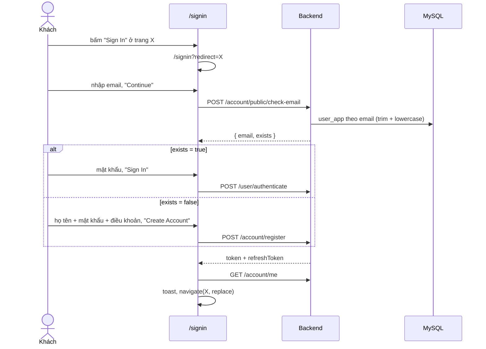

# Đăng nhập kiểu Nike

## 1. Mục tiêu và phạm vi

Khách vào trang riêng `/signin`, nhập email trước. Email đã có tài khoản thì sang bước nhập mật khẩu, chưa có thì sang bước tạo tài khoản. Xong thì quay về đúng trang đang xem trước đó.
Trang này **thay cho** hộp thoại "Sign In" / "Become a Nike Member" hiện có. Lát `dat-hang` (2.3) sẽ dùng lại `/signin?redirect=/checkout`.

| Có làm | Không làm (để plan khác) |
|---|---|
| `POST /api/account/public/check-email` (công khai) | Quên / đặt lại mật khẩu, xác minh email bằng mã |
| Route `/signin` (không header / footer), 3 bước trên cùng một trang: email → mật khẩu / tạo tài khoản | Đăng nhập Google / Facebook (§1 kế hoạch tổng) |
| Tham số `?redirect=` chỉ nhận đường dẫn nội bộ (chặn open redirect); đã đăng nhập mà vào `/signin` thì đi thẳng tới đích | Chọn quốc gia: chỉ hiện chữ "Vietnam", không có link "Change" (§11 câu 2) |
| Mọi lối vào "Sign In" / "Join Us" (dải trên, icon mobile, menu trượt, dải thông báo) thành link tới `/signin?redirect=<trang hiện tại>` | Trang `/login` quản trị: giữ nguyên |
| Xoá hộp thoại `ShopDialogs` + store `shop-dialog`; page object mới `SignInPage`, sửa các spec cũ dùng hộp thoại | Giới hạn số lần gọi check-email (§11 câu 1) |

## 2. Tác nhân và phân quyền

| Tác nhân | Quyền | Ghi chú |
|---|---|---|
| Khách chưa đăng nhập | `check-email`, `/account/register`, `/user/authenticate` (đều công khai) | |
| Người đã đăng nhập (khách hoặc quản trị) | — | Vào `/signin` thì bị chuyển thẳng tới `redirect` (hợp lệ) hoặc `/` |

`/account/public/check-email` đã công khai sẵn nhờ mẫu `^/[a-z0-9-]+/public/.*` trong `JwtAuthenticationFilter`, nên **không** sửa filter. Gửi token sai thì vẫn trả 200.

## 3. Luồng nghiệp vụ

**Luồng chính (đăng nhập):** 1. Đang ở trang X, khách bấm "Sign In" → `/signin?redirect=X`. 2. Nhập email, bấm "Continue" → FE gọi `check-email`. 3. `exists = true` → bước "What's your password?". 4. Nhập mật khẩu, bấm "Sign In" → `POST /user/authenticate` → lưu token, nạp `/account/me` → toast "Welcome back, <tên>!" → về X (thay lịch sử bằng `replace`, Back không quay lại `/signin`).

**Luồng thay thế:**
- A1 (tạo tài khoản): bước 3 trả `exists = false` → bước "Now let's make you a Nike Member." → nhập họ tên, mật khẩu, tick điều khoản, bấm "Create Account" → `POST /account/register` → toast "Account created. Welcome, <tên>!" → về X.
- A2 (sửa email): ở bước mật khẩu / tạo tài khoản bấm "Edit" → về bước email, ô email giữ giá trị cũ.
- A3 (đã đăng nhập): mở `/signin?redirect=X` khi đã có token → chuyển ngay tới X, không hiện form.
- A4 (không có / sai redirect): `redirect` thiếu hoặc không hợp lệ (§5.2) → sau khi đăng nhập về `/`.

**Ngoại lệ:**
- E1: email trống / sai định dạng → lỗi dưới ô, không gọi API.
- E2: sai mật khẩu → "Incorrect email or password.", ở lại bước mật khẩu, ô mật khẩu được xoá trắng và focus.
- E3: sai quá 10 lần (`login-max-failures`) → "Too many failed sign-in attempts. Please try again in a few minutes."
- E4: tài khoản bị khoá (`active = 0`) → "This account has been locked" (hành vi sẵn có, không có tài khoản mẫu bị khoá nên không test).
- E5: email vừa được đăng ký ở nơi khác giữa bước 3 và lúc tạo tài khoản → "This email is already registered." + nút "Sign in with this email" → sang bước mật khẩu.



## 4. Cơ sở dữ liệu

Không có migration (V20 vẫn là mới nhất). Dùng `user_app` sẵn có; tìm theo email qua `UserService.getUserByEmail` (trả `User` rỗng `id = null` khi không thấy).

## 5. Hợp đồng API (cố định — nguồn sự thật cho cả BE và FE)

Mọi response bọc `{ "code": …, "message": …, "result": … }`. Prefix `/api`.

### 5.1 `POST /api/account/public/check-email` — công khai

Chuẩn hoá: `trim()` rồi `toLowerCase(Locale.ROOT)`. Kiểm tra theo thứ tự: trống → lỗi 1; không chứa `@` hoặc dài hơn 255 ký tự → lỗi 2 (giống quy tắc của `/account/register`). Sau đó tra `user_app`. Tài khoản bị khoá vẫn tính là `exists = true`.

Request:
```json
{ "email": "  KHACH1@nike.Local " }
```
Response `result` (200):
```json
{ "email": "khach1@nike.local", "exists": true }
```
Email chưa có:
```json
{ "email": "new-1732012345678@test.local", "exists": false }
```

### 5.2 Quy tắc `redirect` (chỉ FE, không có API)

`safeRedirect(raw)` trả `raw` khi **đủ cả**: là chuỗi, bắt đầu bằng `/`, ký tự thứ hai không phải `/` hoặc `\`, không bắt đầu bằng `/signin`. Ngược lại trả `/`.
Ví dụ: `/w/basketball?gender=men` → giữ nguyên; `https://example.com`, `//example.com`, `/\example.com`, `javascript:alert(1)`, `/signin?redirect=/cart`, chuỗi rỗng → `/`.
Link "Sign In" / "Join Us" dựng `redirect = location.pathname + location.searchStr` (không kèm hash).

### 5.3 API dùng lại (không đổi)

`POST /api/user/authenticate` `{ email, plainPassword }`, `POST /api/account/register` `{ name, email, plainPassword }`, `GET /api/account/me`. Lỗi giữ nguyên như `ErrorCode` hiện tại.

### 5.4 Lỗi nghiệp vụ

| Tình huống | HTTP | Message (tiếng Anh, FE hiện nguyên văn) |
|---|---|---|
| check-email: thiếu `email`, `""` hoặc chỉ khoảng trắng | 400 | `Please enter your email.` |
| check-email: không có `@` hoặc > 255 ký tự | 400 | `Please enter a valid email address.` |
| authenticate: sai mật khẩu | 400 | `Incorrect email or password.` |
| authenticate: sai quá 10 lần | 429 | `Too many failed sign-in attempts. Please try again in a few minutes.` |
| authenticate: tài khoản bị khoá | 403 | `This account has been locked` |
| register: email đã có (`errorCode = EMAIL_EXISTS`) | 400 | `This email is already registered.` |
| register: mật khẩu sai độ dài | 400 | `Password must be 8 to 72 characters.` |

## 6. Giao diện (chuỗi cố định — test E2E chọn theo đúng các chuỗi này)

### 6.1 Khung trang `/signin`

- Route `/signin`, **không** có header, dải thông báo hay footer của cửa hàng. `<title>`: `Sign In | Nike`.
- Nền trắng, khối giữa rộng tối đa 460px (mobile: lề 16px hai bên, không cuộn ngang). Trên cùng: swoosh + Jumpman cao 24px; swoosh là link `aria-label="Nike Home"` về `/`.
- Tiêu đề `h1` 28px / 400, màu `--sh-fg`. Ô nhập: viền xám, bo 8px, cao 56px, label nổi trong ô (`Email*`, …; tên truy cập là chữ không có `*`: "Email", "Password", "Full name").
- Nút chính đen bo tròn, **căn phải**, cao 40px. Lỗi dưới ô: chữ đỏ 12px (`--sh-danger`). Lỗi server: khối `role="alert"` trên nút chính.
- Đổi bước thì focus vào ô đầu của bước mới. Phím Enter trong ô nào cũng gửi form của bước đó.

### 6.2 Bước 1 — email

- `h1` "Enter your email to join us or sign in."
- Dòng "Vietnam" (14px, không có link "Change").
- Ô "Email*" (`type="email"`, `autocomplete="email"`, tự focus).
- Dòng 14px màu `--sh-muted`: "By continuing, I agree to Nike's **Privacy Policy** and **Terms of Use**." — hai link gạch chân tới `/info/privacy-policy` và `/info/terms-of-use` (mở tab mới).
- Nút "Continue". Lúc gọi API: nút khoá, có spinner, `aria-busy="true"`, chữ vẫn là "Continue".
- Validate client: trống → "Please enter your email."; sai định dạng (zod `.email()`) → "Please enter a valid email address."
- Chỉ ở môi trường DEV: khung viền chấm "Test account: **free@nike.local**, password **Admin@123**" (giữ như form cũ).

### 6.3 Bước 2a — mật khẩu (`exists = true`)

- `h1` "What's your password?"
- Dòng email đã chuẩn hoá (vd `khach1@nike.local`) + nút chữ gạch chân "Edit".
- Ô "Password*" (`autocomplete="current-password"`), bên phải ô có nút icon mắt `aria-label="Show password"` (bấm → ô thành `type="text"`, nhãn nút đổi "Hide password").
- Nút "Sign In"; đang gửi: "Signing in…".
- Validate client: trống → "Please enter your password."
- Lỗi server hiện trong `role="alert"` (bảng §5.4). Sai mật khẩu thì xoá trắng ô mật khẩu và focus lại.
- Thành công: toast "Welcome back, <tên>!" → về `redirect`.

### 6.4 Bước 2b — tạo tài khoản (`exists = false`)

- `h1` "Now let's make you a Nike Member."
- Dòng email + nút "Edit" (như 6.3).
- Ô "Full name*" (`autocomplete="name"`), ô "Password*" (`autocomplete="new-password"`, nút mắt như 6.3), dưới ô mật khẩu là gợi ý xám 12px "At least 8 characters, with letters and numbers".
- Checkbox "I agree to Nike's **Privacy Policy** and **Terms of Use**." (hai link như 6.2).
- Nút "Create Account"; đang gửi: "Creating account…".
- Validate client (thứ tự ưu tiên trong mỗi ô, giữ nguyên chuỗi của `register-form.tsx` cũ):

| Label | Kiểu | Bắt buộc | Validate |
|---|---|---|---|
| Full name | text | có | trống → "Please enter your full name."; > 100 → "Full name must be at most 100 characters." |
| Password | password | có | < 8 → "Password must be at least 8 characters."; > 72 → "Password must be at most 72 characters."; không có chữ → "Password must contain a letter."; không có số → "Password must contain a number." |
| Điều khoản | checkbox | có | chưa tick → "You must agree to the terms to continue." |

- Lỗi `EMAIL_EXISTS`: alert "This email is already registered." + nút "Sign in with this email" → sang bước 2a, giữ email.
- Thành công: toast "Account created. Welcome, <tên>!" → về `redirect`.

### 6.5 Lối vào trong khung cửa hàng

Tất cả thành **link** (không còn mở hộp thoại), `href = /signin?redirect=<encode(path + search)>`:

| Vị trí | Chữ / tên truy cập | `data-testid` |
|---|---|---|
| Dải trên (desktop) | "Join Us", "Sign In" | `header-register`, `header-login` (giữ) |
| Icon tài khoản (mobile) | link `aria-label="Sign In"` | — |
| Menu trượt (mobile) | "Join Us", "Sign In" | — |
| Dải thông báo | "Join Us" | — |

Trang không còn phần tử `role="dialog"` tên "Sign In" hay "Become a Nike Member".

## 7. Việc backend + automation (Claude, phiên A)

### 7.1 Spec nghiệm thu (viết trước khi code)

1. `api/AccountApi.js`: thêm `checkEmail(body)` (gửi nguyên body, trả response thô).
2. Dữ liệu (data-driven):
   - `data/check-email-invalid.json`: các ca của TC-04 (`id`, `case`, `body`, `status`, `message`).
   - `data/signin-redirect.json`: các ca của TC-15 (`redirect` → URL mong đợi sau đăng nhập).
   - `data/join-invalid.json`: các ca mật khẩu / họ tên của TC-13.
3. Page object:
   - **Mới** `pages/SignInPage.js`: `goto({ redirect } = {})`, `heading`, `emailInput`, `continueButton`, `emailLine`, `editButton`, `passwordInput`, `togglePasswordButton`, `signInButton`, `nameInput`, `termsCheckbox`, `createAccountButton`, `alert`, `fieldError(text)`; hàm `submitEmail(email)`, `signIn({ email, password })` (email → mật khẩu), `join({ name, email, password })` (email → tạo tài khoản, tick điều khoản).
   - `pages/components/HeaderComponent.js`: `openLogin()` / `openRegister()` bấm link rồi chờ URL `/signin`; mobile: icon / menu trượt như cũ.
   - **Xoá** `pages/components/ShopLoginDialog.js`, `ShopRegisterDialog.js`; `pages/HomePage.js` bỏ `loginDialog`, `registerDialog`.
   - `fixtures/index.js`: thêm `signInPage`.
4. `tests/api/dang-nhap-nike.api.spec.js` (TC-01 → TC-06), `tests/account/dang-nhap-nike.spec.js` (TC-07 → TC-20).
5. **Sửa spec cũ dùng hộp thoại** (spec cũ sai so với plan mới, ghi §12): `tests/home/giao-dien-nike.spec.js` (các chỗ dùng `loginDialog` / `registerDialog`, quanh dòng 346, 549, 610, 615), `tests/system/go-lut.spec.js` (TC-13, TC-14, TC-15), `tests/system/tieng-anh-cua-hang.spec.js` (quét chữ tiếng Việt chuyển từ hộp thoại sang 3 bước của `/signin`). Ý nghĩa ca kiểm giữ nguyên, chỉ đổi cách mở / chọn phần tử.

### 7.2 Backend (module `business`, package `business.account`)

1. DTO theo vị trí quy định ở `backend/AGENTS.md`: `CheckEmailRequest { String email }`, `CheckEmailResponse { String email; boolean exists }` (JSON `exists` là boolean).
2. `AccountService.checkEmail(CheckEmailRequest)`: chuẩn hoá + kiểm tra theo §5.1; lỗi `new AppException(ErrorCode.BAD_REQUEST, "<message §5.4>")`; `exists = NVL(userService.getUserByEmail(email).getId()) > 0`. Chỉ đọc, không ghi DB, không dùng `LoginAttemptService`.
3. `AccountController`: `@PostMapping("/account/public/check-email")`.
4. Không sửa `JwtAuthenticationFilter` (đã công khai theo mẫu `/<x>/public/`), không migration.
5. Unit test `business/src/test/java/vn/aeoc/business/account/service/AccountServiceTest.java` (Mockito, mock `UserService`): TC-U1 → TC-U3.
6. Restart backend (`sh scripts/ai/backend-restart.sh`), chạy `pnpm test:api` → TC-01 → TC-06 xanh; ghi §12 "phiên A xong".

Unit test bắt buộc: TC-U1 → TC-U3. `mvn -q "-Djooq.codegen.skip=true" -pl business -am test` xanh.

## 8. Việc frontend (Claude, phiên B)

File cần tạo / sửa (thứ tự theo `frontend/AGENTS.md`):

1. `src/lib/types/account.ts`: `CheckEmailRequest`, `CheckEmailResponse { email: string; exists: boolean }`.
2. `src/lib/axios/account.ts`: `checkEmail(email)` → `POST /account/public/check-email`.
3. `src/lib/tanstack/options/account.ts`: `checkEmailMutationOptions` (`meta.silentError: true`, không toast). Giữ `loginMutationOptions`, `registerMutationOptions`.
4. `src/lib/sign-in-redirect.ts`: `safeRedirect(raw)` (§5.2) và `signInSearch(location)` → `{ redirect }` cho các link.
5. `src/routes/signin.tsx` (route gốc, **ngoài** `_shop` và `_auth` — `_auth` chuyển người có token sang `/admin`, không hợp với khách): `validateSearch` zod `{ redirect: z.string().optional() }`; `beforeLoad`: có `accessToken` thì `throw redirect({ href: safeRedirect(search.redirect) })`; `head` title "Sign In | Nike"; thêm class `shop` để dùng token màu cửa hàng.
6. `src/components/shop/account/sign-in/`:
   - `sign-in-page.tsx`: khung (§6.1) + state `{ step: "email" | "password" | "join", email }` giữ trong component (không lên URL, §11 câu 3); sau thành công `navigate({ href: safeRedirect(redirect), replace: true })`.
   - `email-step.tsx`, `password-step.tsx`, `join-step.tsx`: chuyển logic từ `login-form.tsx` / `register-form.tsx` sang; email không còn là ô nhập ở bước 2a / 2b.
7. Lối vào (§6.5): `layout/header/top-bar.tsx`, `layout/header/header-actions.tsx` (`MobileAccount`), `layout/header/mobile-menu.tsx` (bỏ `pendingDialog`, mục tài khoản thành `Link`), `layout/announcement-bar.tsx`.
8. Xoá: `components/shop/account/shop-dialogs.tsx`, `login-form.tsx`, `register-form.tsx`, `lib/stores/shop-dialog.ts`; bỏ `<ShopDialogs />` ở `layout/shop-shell.tsx`.
9. `routeTree.gen.ts` sinh lại khi `pnpm build`.

Component shadcn dùng: có sẵn `ShopField`, `ShopCheckbox`, `ShopButton` (`components/shop/ui/`), `Skeleton`, `sonner`; không cần `shadcn add`.

## 9. Test case

API ở `automation/tests/api/dang-nhap-nike.api.spec.js`, giao diện ở `automation/tests/account/dang-nhap-nike.spec.js`, JUnit ở `backend/business/src/test/java/vn/aeoc/business/account/service/AccountServiceTest.java`.
`<unique>` = email sinh bằng `utils/unique.js` (vd `new-<timestamp>@test.local`). Nhóm desktop bỏ qua ở `mobile-chrome`; TC-19 chỉ chạy ở `mobile-chrome`.

| ID | Loại | Mô tả | Tiền điều kiện | Bước | Kết quả mong đợi |
|---|---|---|---|---|---|
| TC-01 | api | check-email: email đã có | sau reset, không token | `POST /api/account/public/check-email` `{ "email": "khach1@nike.local" }` | 200; `result = { email: "khach1@nike.local", exists: true }` |
| TC-02 | api | check-email: email chưa có | — | body `{ "email": "<unique>" }` | 200; `exists = false`, `email` = `<unique>` viết thường |
| TC-03 | api | Chuẩn hoá trim + chữ thường | — | body `{ "email": "  KHACH1@nike.Local  " }` | 200; `email = "khach1@nike.local"`, `exists = true` |
| TC-04 | api | Validate (data-driven `check-email-invalid.json`) | — | body: `{}`; `{"email": ""}`; `{"email": "   "}`; `{"email": "khong-hop-le"}`; `{"email": "<251 chữ a>@x.vn"}` (256 ký tự) | 3 ca đầu: 400 `Please enter your email.`; 2 ca sau: 400 `Please enter a valid email address.` |
| TC-05 | api | Công khai: token sai vẫn dùng được | — | gọi như TC-01 với `Authorization: Bearer abc.def.ghi` | 200, kết quả giống TC-01 |
| TC-06 | api | Khớp với đăng ký / đăng nhập | — | check-email `<unique>` → `register` `{ name: "Join Test", email: <unique>, plainPassword: "Abc12345" }` → check-email lại → `user/authenticate` | lần 1 `exists = false`; register 200; lần 2 `exists = true`; authenticate 200 có `token` |
| TC-07 | e2e | Bước email hiển thị đúng | chưa đăng nhập | mở `/signin` | `<title>` "Sign In | Nike"; h1 "Enter your email to join us or sign in."; có "Vietnam"; ô "Email" được focus; link "Privacy Policy" `href=/info/privacy-policy`, "Terms of Use" `href=/info/terms-of-use`; nút "Continue"; **không** có link "Men" của header và không có footer |
| TC-08 | e2e | Validate email phía client | chưa đăng nhập | bấm "Continue" khi trống; nhập `abc` rồi bấm | lần lượt "Please enter your email.", "Please enter a valid email address."; không có request nào tới `check-email` (đếm qua `page.on('request')`); h1 không đổi |
| TC-09 | e2e | Đăng nhập: sai rồi đúng mật khẩu | sau reset | `/signin` → email `khach1@nike.local` + Enter → mật khẩu `WRONG_PASSWORD` → "Sign In" → mật khẩu `Admin@123` + Enter | sau email: h1 "What's your password?", có dòng `khach1@nike.local` + nút "Edit"; sai: alert "Incorrect email or password.", ô mật khẩu trống và đang focus; đúng: URL `/`, toast "Welcome back, Customer One!", dải trên có nút "Hi, Customer One" |
| TC-10 | e2e | Bước mật khẩu: trống + hiện / ẩn | ở bước mật khẩu của `khach1` | bấm "Sign In" khi trống; nhập `Admin@123`, bấm "Show password", rồi bấm "Hide password" | "Please enter your password."; ô `type="text"` rồi lại `type="password"`; không gọi `user/authenticate` khi trống |
| TC-11 | e2e | "Edit" quay về bước email | ở bước mật khẩu của `khach1` | bấm "Edit"; sửa thành `<unique>`, "Continue" | h1 "Enter your email…", ô email = `khach1@nike.local`; sau đó h1 "Now let's make you a Nike Member." và dòng `<unique>` |
| TC-12 | e2e | Tạo tài khoản thành công | — | `/signin` → `<unique>` → "Continue" → "Full name" `Join Test`, "Password" `Abc12345`, tick điều khoản → "Create Account" | URL `/`; toast "Account created. Welcome, Join Test!"; dải trên "Hi, Join Test"; `GET /account/me` bằng token trong trang trả `email = <unique>` |
| TC-13 | e2e | Validate tạo tài khoản (data-driven `join-invalid.json`) | ở bước tạo tài khoản | (a) bấm "Create Account" khi trống; (b) mật khẩu `abcdefgh`; (c) `12345678`; (d) `Abc1234`; (e) 73 ký tự `a1…`; (f) họ tên 101 ký tự | (a) "Please enter your full name.", "Password must be at least 8 characters.", "You must agree to the terms to continue."; (b) "Password must contain a number."; (c) "Password must contain a letter."; (d) "Password must be at least 8 characters."; (e) "Password must be at most 72 characters."; (f) "Full name must be at most 100 characters."; không gọi `account/register` |
| TC-14 | e2e | Email vừa bị đăng ký ở nơi khác | — | tới bước tạo tài khoản với `<unique>`; gọi API `register` cùng email; điền form hợp lệ → "Create Account"; bấm "Sign in with this email"; nhập `Abc12345` → "Sign In" | alert "This email is already registered." + nút "Sign in with this email"; sang h1 "What's your password?" với dòng `<unique>`; đăng nhập xong về `/` |
| TC-15 | e2e | Chặn open redirect (data-driven `signin-redirect.json`) | chưa đăng nhập | mở `/signin?redirect=<giá trị>` rồi đăng nhập `khach1` | `/w/basketball?gender=men` → URL đúng như vậy; `https://example.com`, `//example.com`, `/\example.com`, `javascript:alert(1)`, `/signin?redirect=/cart` → URL `/` (cùng origin) |
| TC-16 | e2e | Quay lại trang trước sau khi đăng nhập | chưa đăng nhập | mở `/w/basketball?gender=men`, bấm "Sign In" ở dải trên; đăng nhập `khach1`; bấm Back | URL `/signin?redirect=%2Fw%2Fbasketball%3Fgender%3Dmen`; sau đăng nhập URL `/w/basketball?gender=men` và có "Hi, Customer One"; Back **không** về `/signin` |
| TC-17 | e2e | Đã đăng nhập mà vào `/signin` | đăng nhập `khach1` | mở `/signin?redirect=/favorites`; mở `/signin` | lần 1 URL `/favorites`; lần 2 URL `/`; không lúc nào thấy h1 "Enter your email…" |
| TC-18 | e2e | Lối vào từ khung cửa hàng (desktop) | chưa đăng nhập, ở `/` | kiểm "Join Us" và "Sign In" ở dải trên, "Join Us" ở dải thông báo; bấm "Join Us" ở dải trên | cả ba là `link`, `href = /signin?redirect=%2F`; bấm xong URL `/signin?redirect=%2F`, h1 "Enter your email…"; không có `dialog` tên "Sign In" / "Become a Nike Member" |
| TC-19 | e2e | Mobile: lối vào + bố cục | `mobile-chrome`, chưa đăng nhập, ở `/` | bấm icon "Sign In"; kiểm bố cục; quay lại, mở menu trượt, bấm "Join Us" | URL `/signin?redirect=%2F`; `document.documentElement.scrollWidth <= innerWidth`; nút "Continue" thấy được không cần cuộn; từ menu trượt cũng tới `/signin?redirect=%2F` |
| TC-20 | e2e | Sai quá số lần | — | API: `register` `<unique>`; gọi `user/authenticate` sai 10 lần; UI: `/signin` → `<unique>` → mật khẩu đúng `Abc12345` → "Sign In" | alert "Too many failed sign-in attempts. Please try again in a few minutes."; vẫn ở h1 "What's your password?" |
| TC-U1 | unit | Chuẩn hoá + tồn tại | mock `getUserByEmail("khach1@nike.local")` trả `User` id 5 | `checkEmail(" KHACH1@nike.Local ")` | `email = "khach1@nike.local"`, `exists = true`; `getUserByEmail` được gọi đúng 1 lần với chuỗi đã chuẩn hoá |
| TC-U2 | unit | Không tồn tại | mock trả `new User()` (id null) | `checkEmail("x@y.vn")` | `exists = false` |
| TC-U3 | unit | Validate | — | `null` request; email `null`, `""`, `"  "`; `"abc"`; 256 ký tự | 4 ca đầu: `AppException` message "Please enter your email."; 2 ca sau: "Please enter a valid email address."; không gọi `UserService` |

## 10. Tiêu chí hoàn thành

- [x] Mọi TC ở §9 pass (TC-07 → TC-18, TC-20 chạy chromium, firefox, webkit; TC-19 ở mobile-chrome)
- [x] Các spec cũ đã sửa ở §7.1 bước 5 xanh; `pnpm test:smoke` xanh
- [x] `mvn test`, `pnpm build`, `pnpm lint` (frontend + automation) xanh
- [x] Không còn `ShopDialogs`, `useShopDialog`, `ShopLoginDialog`, `ShopRegisterDialog` trong repo
- [x] Có `docs/chuc-nang/dang-nhap-nike.md` kèm ảnh 3 bước (desktop + mobile)

## 11. Rủi ro / câu hỏi mở

1. **Dò email:** `check-email` cho biết email nào đã có tài khoản (nike.com cũng làm vậy). Đăng nhập hiện cố ý trả cùng một lỗi để không lộ điều này, nên API mới là chỗ lộ duy nhất. Đề xuất: chấp nhận vì đồ án chỉ chạy local, ghi rõ trong tài liệu kiểm thử là rủi ro đã biết, **không** giới hạn số lần gọi. Bạn muốn thêm giới hạn (vd 30 lần / phút / IP, trả 429) không?
2. **"Vietnam Change":** ảnh m10 có link "Change". Cửa hàng chỉ có một thị trường nên plan bỏ link, chỉ hiện "Vietnam". Đồng ý không?
3. **Bước nằm trong state, không lên URL:** F5 ở bước mật khẩu / tạo tài khoản sẽ về bước email (email mất). Đơn giản và giống nike.com. Nếu muốn F5 giữ bước thì thêm `?step=` + `email=` lên URL (email lộ trong lịch sử trình duyệt). Đề xuất: giữ trong state.
4. **Khách đăng nhập rồi vào `/login` quản trị** vẫn bị `_auth` chuyển sang `/admin` (rồi thấy trang không quyền). Hành vi sẵn có, không thuộc lát này.
5. **Ảnh skeleton** (ảnh 12 là trạng thái đang tải của nike.com): trang `/signin` không tải gì lúc mở nên không làm skeleton; chỉ có spinner trên nút khi đang gọi API.

## 12. Nhật ký thực hiện (do /cook và /doc-chuc-nang ghi — nối các phiên A/B/C)

| Thời điểm | Sự kiện |
|---|---|
| 2026-11-19 | Lập plan (draft) |
| 2026-11-19 | Người dùng duyệt → approved. §11 theo đề xuất: (1) không giới hạn check-email, ghi là rủi ro đã biết; (2) bỏ link "Change"; (3) bước giữ trong state |
| 2026-11-19 | /cook phiên A bắt đầu → in-progress. Preflight: MySQL / MinIO chạy, backend :9500 = 200. Cây làm việc có sẵn ~208 file bẩn chưa commit từ các lát trước (giao-dien-nike / tieng-anh-cua-hang / go-lut…, phần lớn chỉ là LF/CRLF + xoá file LUT) — không đụng tới |
| 2026-11-19 | Spec nghiệm thu (§7.1): `api/AccountApi.checkEmail`; data `check-email-invalid.json`, `signin-redirect.json`, `join-invalid.json`; page object mới `SignInPage` (+ `SIGN_IN_HEADINGS`, `fillJoin`, `signInWithEmailButton`, `expectStep`), fixture `signInPage`; `HeaderComponent` / `MobileMenu`: "Sign In" / "Join Us" chọn theo role `link`, `openLogin` / `openRegister` chờ URL `/signin`; xoá `ShopLoginDialog.js`, `ShopRegisterDialog.js`, bỏ `loginDialog` / `registerDialog` khỏi `HomePage`. `tests/api/dang-nhap-nike.api.spec.js` (TC-01→06, 10 test), `tests/account/dang-nhap-nike.spec.js` (TC-07→20). TC-17 kiểm "không lúc nào thấy h1 bước email" bằng MutationObserver ghi cờ vào sessionStorage; phiên đăng nhập sẵn gắn bằng `addInitScript` vào `localStorage['auth-storage']` (định dạng zustand persist) |
| 2026-11-19 | Sửa spec cũ (spec sai so với plan mới — hộp thoại bị bỏ, ý nghĩa ca kiểm giữ nguyên): `home/giao-dien-nike` TC-23a, TC-24, TC-27, TC-28 (mở `/signin` thay hộp thoại); `system/go-lut` TC-13→15 (đăng ký / đăng nhập qua `/signin`; ảnh `02-dang-ky` chụp ở bước tạo tài khoản); `system/tieng-anh-cua-hang` TC-11 (quét 3 bước `/signin`), TC-12, TC-15 (lỗi email ở bước email, lỗi mật khẩu ở bước mật khẩu), TC-16 (email sai định dạng ở bước email; email trùng tái hiện bằng cách đăng ký qua API giữa bước email và "Create Account", như TC-14 — không còn đường nào nhập email đã có vào form tạo tài khoản). `pnpm lint` 0 lỗi |
| 2026-11-19 | Backend (§7.2) — **lệch plan có chủ ý**: `backend/AGENTS.md` cấm DTO `XxxRequest` / `XxxResponse` nên body dùng thẳng entity `User` (chỉ đọc `email`, giống `/account/register`); kết quả là POJO `entity/data/response/CheckEmailResponse { email, boolean exists }` cạnh `TokenResponse` / `UserInfoResponse` (User không có trường `exists`). Hợp đồng JSON §5.1 không đổi. `AccountService.checkEmail` + `AccountController` `POST /account/public/check-email` (`@RequestBody(required = false)`); không migration, không sửa filter. Unit `AccountServiceTest` TC-U1→U3: 8/8 pass; `mvn -pl business -am test` 31 test xanh. Restart backend OK (Flyway up to date) |
| 2026-11-19 | Nhóm API: `dang-nhap-nike.api.spec.js` 10/10 pass; `pnpm test:api` 74/74 pass. Spec UI (TC-07→20, spec cũ đã sửa) sẽ đỏ tới khi xong frontend phiên B. **phiên A xong** |
| 2026-11-19 | /cook phiên B bắt đầu. Docker (container mới `nike-mysql` / `nike-minio`) và backend đang tắt → bật lại, Flyway áp 24 migration lên v20 (DB trống, seed nạp lại) |
| 2026-11-19 | Frontend (§8): `types/account.ts` (`CheckEmailRequest/Response`), `axios/account.checkEmail`, `checkEmailMutationOptions` (`silentError`, không toast), `lib/sign-in-redirect.ts` (`safeRedirect`, `signInSearch`), `routes/signin.tsx` (zod `.catch(undefined)`, `beforeLoad` có token → `redirect({ href, replace })`, title "Sign In \| Nike"), `components/shop/account/sign-in/` (`sign-in-page`, `email-step`, `password-step`, `join-step` + `sign-in-parts`: `StepHeading`, `EmailLine`, `LegalLinks`, `ServerAlert` dùng shadcn `Alert`, `SubmitButton`, `PasswordField`). Trang bọc `ShopShell` (token `.shop`, font, ép sáng, đồng bộ phiên). `ShopField` viết lại kiểu nhãn nổi trong ô (`aria-label` = nhãn không `*`, thêm `hint`, `trailing`) — chỉ 2 form bị xoá dùng nó trước đây. Lối vào (top-bar, icon mobile, menu trượt `ShopButton asChild` + `Link`, dải thông báo) thành link `/signin?redirect=…`. Xoá `shop-dialogs.tsx`, `login-form.tsx`, `register-form.tsx` (có thay đổi chưa commit từ lát trước — bỏ theo §8 bước 8), `stores/shop-dialog.ts`; cập nhật mục "Khu cửa hàng" của `frontend/AGENTS.md`. Không thêm component shadcn. `pnpm build` xanh (phải sinh `routeTree.gen.ts` bằng `vite build` trước vì `tsc -b` chạy trước plugin), `pnpm lint` 0 lỗi |
| 2026-11-19 | Sửa spec (spec sai so với plan / lỗi kỹ thuật test, ý nghĩa ca kiểm giữ nguyên): (1) `data/signin-redirect.json` ghi `"/example.com"` (mất dấu `\`) trong khi plan §5.2 / TC-15 là `/\example.com` → sửa giá trị JSON thành `"/\\example.com"`; `/example.com` là đường dẫn nội bộ hợp lệ nên FE giữ nguyên là đúng. (2) TC-17: WebKit báo trễ lần router đổi URL bằng `history.replaceState` thành điều hướng khác, `goto('/signin')` lần hai (xuất phát từ `/favorites`) bị "interrupted" 7/8 lần → thêm `page.goto('about:blank')` trước lần mở thứ hai (như lần một); sau sửa 24/24 xanh trên 3 trình duyệt |
| 2026-11-19 | E2E có giao diện (chromium, slowMo 400, ảnh tài liệu): `dang-nhap-nike.spec.js` + API 35/35 pass (TC-19 bỏ qua ở chromium); TC-19 `mobile-chrome` pass. Ảnh: `docs/chuc-nang/img/dang-nhap-nike/01-buoc-email.png`, `02-buoc-mat-khau.png`, `03-buoc-tao-tai-khoan.png`, `04-buoc-email-mobile.png`. Spec cũ đã sửa ở phiên A (`home/giao-dien-nike`, `system/go-lut`, `system/tieng-anh-cua-hang`) chromium 61 pass / 4 skip. Cài thêm trình duyệt Playwright Firefox + WebKit (máy chưa có). Firefox + WebKit spec của lát 48/48 pass với `--workers=4` (2 lần). Với 8 worker mặc định (máy 16 nhân) Firefox thỉnh thoảng treo lệnh click ~30s rồi timeout (TC-09 / TC-13b) — spec cũ `giao-dien-nike` cũng treo y hệt (TC-14 / TC-22) nên là do quá tải máy, không phải lỗi trang; chạy firefox/webkit toàn bộ thì dùng `--workers=4`. `pnpm test:smoke` (mọi project) 67 pass / 21 skip; `pnpm test:api` 74/74; automation `pnpm lint` 0 lỗi (8 warning `no-conditional-expect` cũ ở spec `tieng-anh-cua-hang`). Không còn `ShopDialogs` / `useShopDialog` / `ShopLoginDialog` / `ShopRegisterDialog` trong code. **phiên B xong** |
| 2026-11-19 | /doc-chuc-nang: viết `docs/chuc-nang/dang-nhap-nike.md` (4 ảnh), plan → done, commit + push + PR |
