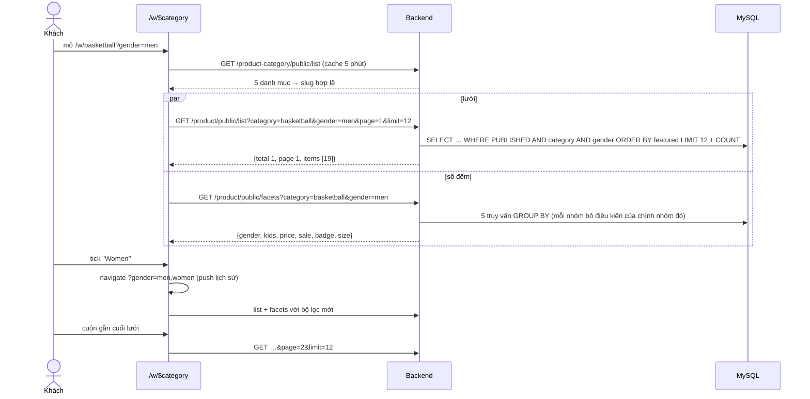

# Danh sách giày

## 1. Mục tiêu và phạm vi

Khách (không cần đăng nhập) mở `/w` hoặc `/w/<danh mục>` và thấy lưới giày thật thay cho trang tạm "Coming Soon". Khách lọc theo giới tính, trẻ em, khoảng giá, giảm giá, nhóm "Just In" / "Bestsellers", size; sắp xếp 4 kiểu; cuộn để tải thêm. Bộ lọc nằm trên URL nên F5, Back / Forward và chia sẻ link đều giữ nguyên.
Mỗi lựa chọn lọc có số sản phẩm bên cạnh (vd "Men (12)") để khách biết trước khi bấm; lựa chọn ra 0 sản phẩm thì bị mờ.
Mọi link sẵn có vào `/w` (mega menu, menu trượt, trang chủ, khung tìm kiếm "View All n Results", Enter) mở ra đúng kết quả.

| Có làm | Không làm (để plan khác) |
|---|---|
| `GET /api/product/public/list` (lọc + sắp xếp + phân trang) và `GET /api/product/public/facets` (đếm theo từng lựa chọn lọc), công khai | Trang chi tiết `/t/$slug` (lát `chi-tiet-giay`, vẫn là trang tạm) |
| Trang `/w`, `/w/$category`: tiêu đề có số lượng, sidebar 6 nhóm lọc, link danh mục, "Hide Filters", "Sort By", lưới 3 cột, tải thêm khi cuộn, skeleton, trạng thái rỗng / lỗi, "Related Categories" | Ô banner xen giữa lưới, breadcrumb (§11 câu 6) |
| Mobile: hàng pill lọc, ngăn kéo "Filter" toàn màn hình (sắp xếp + lọc + "Clear (n)" / "Apply"), lưới 2 cột | ♡ yêu thích trên thẻ (lát `yeu-thich`) |
| Mở rộng hợp đồng URL `/w` (plan tieng-anh-cua-hang §6.2): thêm khoá `size`; `price`, `badge` nhận nhiều giá trị ngăn dấu phẩy (giá trị đơn cũ vẫn hợp lệ) | Lọc theo màu, theo môn thể thao ngoài 5 danh mục (D4: không có màu) |
| Danh mục lạ `/w/khong-co` → trang 404 chung | Ghi nhớ vị trí cuộn khi Back từ trang chi tiết (§11 câu 9) |
| `automation/`: `ProductApi.list/facets`, hàm tính kết quả mong đợi từ `products.json`, page object `ProductListPage`, `FilterSidebar`, `FilterDrawer`; sửa spec cũ đang chờ "Coming Soon" ở `/w` | Visual regression / a11y của trang (lát 4.2) |

## 2. Tác nhân và phân quyền

| Tác nhân | Quyền | Ghi chú |
|---|---|---|
| Khách chưa đăng nhập, khách đã đăng nhập, quản trị | `GET /product/public/list`, `GET /product/public/facets` | Công khai nhờ mẫu `^/[a-z0-9-]+/public/.*` trong `JwtAuthenticationFilter`, **không** sửa filter, không `checkPermission`. Gửi token sai / hết hạn vẫn trả 200 |

Chỉ sản phẩm `status = 'PUBLISHED'` xuất hiện. Sản phẩm `HIDDEN` (id 31) / `DRAFT` không bao giờ có trong `items` và không được đếm trong `facets`.

## 3. Luồng nghiệp vụ

**Luồng chính (lọc trên desktop):**
1. Khách rê "Men" ở header → bấm "Basketball" → `/w/basketball?gender=men`.
2. Route nạp danh mục (`product-category/public/list`, đã có cache) → slug `basketball` có thật → FE gọi song song `GET /product/public/list?category=basketball&gender=men&page=1&limit=12` và `GET /product/public/facets?category=basketball&gender=men`.
3. Trang hiện h1 "Men's Basketball Shoes (1)", thẻ "Nike Precision 8 Low"; sidebar: "Gender (1)" mở, ô "Men" được tick; mỗi lựa chọn có số đếm, lựa chọn ra 0 thì mờ.
4. Khách tick "Women" → URL thành `/w/basketball?gender=men,women` (thêm một mục lịch sử) → gọi lại hai API → lưới và số đếm cập nhật, trang cuộn về đầu. Trong lúc chờ, lưới cũ vẫn hiện, mờ đi (`aria-busy="true"`).
5. Khách cuộn xuống gần cuối lưới → FE gọi `page=2` → thêm thẻ vào cuối, cho tới khi đủ `total`.

**Luồng thay thế:**
- A1 (sắp xếp): "Sort By" → "Price: Low-High" → URL thêm `sort=price-asc`, lưới xếp lại theo giá đang bán. Chọn "Featured" → bỏ khoá `sort` khỏi URL.
- A2 (ẩn bộ lọc): "Hide Filters" → sidebar ẩn, lưới giãn hết chiều ngang (vẫn 3 cột, thẻ to hơn), nút thành "Show Filters". Không ghi lên URL.
- A3 (đổi danh mục): bấm link danh mục ở đầu sidebar ("All Shoes", "Lifestyle"…) → sang `/w` / `/w/<slug>`, **giữ** mọi bộ lọc và sắp xếp, **bỏ** `q`.
- A4 (từ tìm kiếm): gõ "air max" + Enter ở header → `/w?q=air+max` → dòng nhỏ "Search Results for", h1 "air max (2)"; lọc thêm vẫn giữ `q`.
- A5 (mobile): bấm pill "Shop by Price" → ngăn kéo "Filter" mở, cuộn tới nhóm đó → chọn → "Apply" → URL cập nhật, ngăn kéo đóng. "Close" / Esc → bỏ các thay đổi chưa áp dụng.
- A6 (F5 / Back / Forward / mở link chia sẻ): đọc lại bộ lọc từ URL, sidebar tick đúng, nhóm có lựa chọn tự mở.
- A7 (Back từ trang chi tiết): dữ liệu các trang đã tải còn trong cache 60 giây nên lưới hiện ngay, không gọi lại trang 1.

**Ngoại lệ:**
- E1: không có sản phẩm khớp → "No products match your filters." + nút "Clear Filters" (bỏ mọi bộ lọc, giữ danh mục, `q`, sắp xếp).
- E2: tìm `q` không ra gì và không có bộ lọc → `We couldn't find anything for "<q>".` + link "Shop All Shoes" → `/w`.
- E3: slug danh mục không có → trang 404 chung "We can't find the page you're looking for." (FE chặn ở route; API cũng trả 404 "Category not found").
- E4: giá trị lạ trên URL (`gender=xyz`, `price=abc`, `sort=bad`, `size=abc`) → bị bỏ qua (FE `.catch(undefined)`, BE bỏ giá trị không nhận ra), trang vẫn mở bình thường.
- E5: `list` lỗi ở trang đầu → "Couldn't load products." + "Try Again"; lỗi khi tải thêm → dưới lưới "Couldn't load more products." + "Try Again", các thẻ đã có giữ nguyên.
- E6: `facets` lỗi → sidebar vẫn hiện đủ lựa chọn nhưng không có số đếm, không lựa chọn nào bị mờ; lọc vẫn dùng được.



## 4. Cơ sở dữ liệu

**Không có migration.** Dùng bảng của lát `du-lieu-giay` (V19): `product`, `product_size`, `product_image`, `product_category`. Index sẵn có đủ cho 31 sản phẩm: `product(status, gender)`, `product(category_id)`, `product_size(product_id, size_value)`.

Quy ước dữ liệu dùng ở lát này:
- **Giá đang bán** = `COALESCE(sale_price, price)`. Lọc khoảng giá và sắp xếp theo giá đều dùng giá này.
- **Còn hàng ở size v** = có dòng `product_size` với `size_value = v` và `stock > 0`.
- **Tổng tồn** (`totalStock`, đã có trong thẻ) = `COALESCE(SUM(product_size.stock), 0)`.

## 5. Hợp đồng API (cố định — nguồn sự thật cho cả BE và FE)

Mọi response bọc `{ "code", "message", "result" }`. Prefix `/api`. Cả hai endpoint **không cần token**.

### 5.0 Tham số lọc (dùng chung cho `list` và `facets`)

Tên khoá và giá trị **trùng hợp đồng URL `/w`** để FE chuyển thẳng search của URL sang API. Mọi tham số tuỳ chọn, kiểu chuỗi; server `trim`, so chữ thường; **giá trị không nhận ra bị bỏ qua** (không báo lỗi — quy tắc "validate định dạng chỉ ở frontend"). Một khoá mà mọi giá trị đều bị bỏ thì coi như không gửi.

| Tham số | Giá trị | Điều kiện SQL (trên sản phẩm `PUBLISHED`) |
|---|---|---|
| `category` | slug danh mục: `lifestyle`, `running`, `basketball`, `jordan`, `football` | `category_id = <id của slug>`; slug không có → **404** (§5.3) |
| `gender` | `men`, `women`, `unisex`, ngăn dấu phẩy | xem dòng `kids` |
| `kids` | `boys`, `girls`, ngăn dấu phẩy | `gender` và `kids` gộp thành **một** tập trên cột `product.gender` (`men → MEN`, `women → WOMEN`, `unisex → UNISEX`, `boys → BOYS`, `girls → GIRLS`), điều kiện `gender IN (tập)`. Khớp **đúng** giá trị: `men` không gồm `UNISEX` (§11 câu 1) |
| `price` | `under-1m`, `1m-2m`, `2m-5m`, `5m-plus`, ngăn dấu phẩy | OR các khoảng trên giá đang bán: `under-1m` < 1.000.000 · `1m-2m` 1.000.000 – 2.000.000 · `2m-5m` 2.000.001 – 4.999.999 · `5m-plus` ≥ 5.000.000 (hai đầu đều tính) |
| `sale` | `1` | `sale_price IS NOT NULL`; giá trị khác `1` bị bỏ |
| `badge` | `just-in`, `bestseller`, ngăn dấu phẩy | `badge IN ('JUST_IN', 'BESTSELLER' …)` |
| `size` | số EU, ngăn dấu phẩy, vd `42`, `40.5,42` | OR: `EXISTS (product_size WHERE product_id = product.id AND size_value IN (…) AND stock > 0)`; chuỗi không phải số bị bỏ |
| `q` | chuỗi | **cùng điều kiện** `suggest` (plan giao-dien-nike §5.3): tên / phụ đề / mã chứa `q`, không phân biệt hoa thường / dấu, `%` `_` `'` là ký tự thường; rỗng sau `trim` → bỏ |

Các nhóm khác nhau kết hợp bằng **AND**; các giá trị trong một nhóm kết hợp bằng **OR**.

### 5.1 `GET /api/product/public/list` — công khai

Thêm tham số:

| Tham số | Kiểu | Mặc định | Ghi chú |
|---|---|---|---|
| `sort` | chuỗi | `featured` | `featured`, `newest`, `price-desc`, `price-asc`; giá trị lạ → `featured` |
| `page` | số nguyên | 1 | < 1 → 1; vượt trang cuối → `items = []`, `total` vẫn đúng |
| `limit` | số nguyên | 12 | < 1 → 12; > 48 → 48 |

`page` / `limit` không phải số → 400 (§5.3).

Thứ tự (luôn kết thúc bằng `created_time DESC, id DESC` để ổn định):

| `sort` | ORDER BY |
|---|---|
| `featured` | còn hàng trước (`total_stock > 0`), rồi `badge`: `JUST_IN` → `BESTSELLER` → không nhãn, rồi `created_time DESC, id DESC` |
| `newest` | `created_time DESC, id DESC` |
| `price-desc` | giá đang bán giảm dần, rồi `created_time DESC, id DESC` |
| `price-asc` | giá đang bán tăng dần, rồi `created_time DESC, id DESC` |

Response `result` = `Page` như mọi danh sách (`total`, `page`, `items`); mỗi phần tử là **thẻ sản phẩm** đúng dạng `new-arrivals` / `suggest` (plan giao-dien-nike §5.2: `id, slug, styleCode, name, subtitle, gender, categoryId, price, salePrice, badge, createdTime, imageUrl, totalStock`). Ví dụ không tham số:

```json
{
  "total": 30,
  "page": 1,
  "items": [
    {
      "id": 2,
      "slug": "nike-dunk-low-retro",
      "styleCode": "IQ0157-001",
      "name": "Nike Dunk Low Retro",
      "subtitle": "Men's Shoes",
      "gender": "MEN",
      "categoryId": 1,
      "price": 3519000,
      "salePrice": null,
      "badge": "JUST_IN",
      "createdTime": "2026-11-08T09:00:00",
      "imageUrl": "http://localhost:9020/nike-public/products/nike-dunk-low-retro/1.webp",
      "totalStock": 220
    },
    {
      "id": 5,
      "slug": "nike-air-max-95-big-bubble-premium",
      "styleCode": "IQ0229-001",
      "name": "Nike Air Max 95 Big Bubble Premium",
      "subtitle": "Men's Shoes",
      "gender": "MEN",
      "categoryId": 1,
      "price": 5279000,
      "salePrice": null,
      "badge": "JUST_IN",
      "createdTime": "2026-11-07T09:00:00",
      "imageUrl": "http://localhost:9020/nike-public/products/nike-air-max-95-big-bubble-premium/1.webp",
      "totalStock": 240
    }
  ]
}
```
(10 phần tử còn lại của trang 1: id `14, 20, 23, 24, 25, 26, 22, 8, 15, 1`.)

Ví dụ với dữ liệu mẫu (test tính từ `products.json`, không ghi cứng — §7.1):

| Tham số | `total` | id theo thứ tự |
|---|---|---|
| (không có) — `featured`, 3 trang | 30 | `2, 5, 14, 20, 23, 24, 25, 26, 22, 8, 15, 1` · `3, 30, 29, 27, 21, 18, 17, 16, 11, 7, 4, 13` · `19, 12, 10, 28, 6, 9` (id 9 hết hàng nằm cuối) |
| `sort=newest` | 30 | `2, 5, 14, 20, 23, 24, 25, 26, 30, 29, 27, 22, …, 6, 3` |
| `sort=price-asc` | 30 | `3, 12, 10, 28, 6, 22, 11, 13, 19, 4, …` (769.000 → 815.000 → 889.000 → 889.000 …; id 10 trước id 28 vì mới hơn) |
| `sort=price-desc` | 30 | `14, 29, 18, 5, 17, 25, …` (8.059.000 → 7.479.000 …) |
| `gender=men` | 12 | `2, 5, 14, 24, 25, 1, 3, 30, 29, 4, 13, 19` |
| `kids=boys,girls` | 4 | `23, 22, 11, 12` |
| `gender=women&kids=girls` | 12 | (OR cùng một cột) |
| `gender=men&price=1m-2m&size=42` | 2 | `13, 19` (id 13 chỉ còn **1** đôi EU 42 — vẫn tính) |
| `category=basketball&gender=men` | 1 | `19` |
| `size=42` | 21 | không có id 6, 15, 26 (EU 42 hết), 9, 18, hàng trẻ em (không có EU 42) |
| `size=38` | 12 | có id 18 (EU 38 còn 3 đôi), không có id 9 |
| `sale=1` | 6 | `27, 21, 7, 4, 19, 12` |
| `price=under-1m,5m-plus` | 9 | |
| `q=air max` | 2 | `5, 8` (id 31 "Nike Air Max Plus Premium" ẩn) |
| `category=football&gender=women` | 0 | `items = []` |

### 5.2 `GET /api/product/public/facets` — công khai

Tham số: như §5.0 (bỏ qua `sort`, `page`, `limit` nếu có gửi).
Mỗi số = số sản phẩm `PUBLISHED` khớp **mọi bộ lọc của các nhóm khác** cộng thêm lựa chọn đó (đếm kiểu "bỏ nhóm của chính mình", để tick thêm một ô trong cùng nhóm biết trước sẽ ra bao nhiêu). `category` và `q` luôn áp. `gender` và `kids` là **một** nhóm. Khoá luôn đủ, thứ tự cố định, lựa chọn không có sản phẩm trả `0`.

`size`: mọi `size_value` có trong `product_size` của sản phẩm `PUBLISHED` (không phụ thuộc bộ lọc, tăng dần, với dữ liệu mẫu là 18 size); `count` = số sản phẩm khớp các nhóm khác **còn hàng** ở size đó; `label` = `"EU " + số` không có `.0`.

Response `result` khi không có tham số:
```json
{
  "gender": { "men": 12, "women": 10, "unisex": 4 },
  "kids": { "boys": 2, "girls": 2 },
  "price": { "under-1m": 4, "1m-2m": 5, "2m-5m": 16, "5m-plus": 5 },
  "sale": 6,
  "badge": { "just-in": 8, "bestseller": 5 },
  "size": [
    { "value": 35.5, "label": "EU 35.5", "count": 8 },
    { "value": 36, "label": "EU 36", "count": 10 },
    { "value": 36.5, "label": "EU 36.5", "count": 11 },
    { "value": 37.5, "label": "EU 37.5", "count": 11 },
    { "value": 38, "label": "EU 38", "count": 12 },
    { "value": 38.5, "label": "EU 38.5", "count": 22 },
    { "value": 39, "label": "EU 39", "count": 26 },
    { "value": 40, "label": "EU 40", "count": 25 },
    { "value": 40.5, "label": "EU 40.5", "count": 23 },
    { "value": 41, "label": "EU 41", "count": 23 },
    { "value": 42, "label": "EU 42", "count": 21 },
    { "value": 42.5, "label": "EU 42.5", "count": 16 },
    { "value": 43, "label": "EU 43", "count": 16 },
    { "value": 44, "label": "EU 44", "count": 15 },
    { "value": 44.5, "label": "EU 44.5", "count": 15 },
    { "value": 45, "label": "EU 45", "count": 14 },
    { "value": 46, "label": "EU 46", "count": 13 },
    { "value": 47, "label": "EU 47", "count": 11 }
  ]
}
```
`value` là số JSON (42 hoặc 42.0 đều được, FE so theo số).

Ví dụ khác dùng ở §9:
- `gender=men` → `gender` **không đổi** (12 / 10 / 4), `kids` 2 / 2; `price` 1 / 2 / 6 / 3; `sale` 2; `badge` 5 / 2; `size` EU 35.5 → EU 38 đều `0`, EU 42 `12`.
- `gender=men&price=1m-2m&size=42` → `gender` men 2, women 0, unisex 0; `kids` 0 / 0; `price` 1 / 2 / 6 / 3 (bỏ nhóm giá của chính nó); `sale` 1; `badge` 0 / 0; `size` EU 39 → EU 47 đều `2`, EU 38.5 `1`.
- `category=basketball` → `gender` men 1, women 0, unisex 2; `kids` 1 / 1; `price` 0 / 2 / 3 / 0; `sale` 2; `badge` 2 / 1.

Tính chất test kiểm (TC-09): với mọi nhóm G và lựa chọn o, `facets(f)[G][o]` = `total` của `list` với bộ lọc f nhưng nhóm G **chỉ** có o.

### 5.3 Lỗi

| Tình huống | HTTP | Message (tiếng Anh, FE không hiện — FE chặn ở route) |
|---|---|---|
| `category` là slug không có (vd `khong-co`) — cả `list` lẫn `facets` | 404 | Category not found |
| `page` / `limit` không phải số nguyên (vd `page=abc`) — `list` | 400 | `Invalid parameter: page` / `Invalid parameter: limit` (lỗi khung sẵn có) |
| Sai method (vd `POST /api/product/public/list`, `POST …/facets`) | 405 | HTTP method not supported |

Không có lỗi quyền (công khai). Tham số lọc sai giá trị **không** là lỗi (§5.0).

## 6. Giao diện (chuỗi cố định — test E2E chọn theo đúng các chuỗi này)

Mở ảnh `plan/ui-nike/01-danh-sach-dau-trang.jpg`, `02-danh-sach-nhan-the.jpg`, `03-bo-loc-mo-nhom.jpg`, `04-danh-muc-lien-quan.jpg`, `05-header-thu-gon-khi-cuon.jpg`, `06-an-bo-loc.jpg`, `m01` → `m04` khi làm. Số đo / màu theo `plan/ui-nike/README.md`. Desktop = ≥ 1024px (`lg`); phần tử chỉ có ở một loại màn hình render theo `useIsDesktop()` (không render cả hai rồi ẩn bằng CSS — `frontend/AGENTS.md`). Tiền qua `formatVnd`.

### 6.1 Route, URL, tiêu đề

- Route `/w` (`routes/_shop/w.index.tsx`) và `/w/$category` (`routes/_shop/w.$category.tsx`), thay trang tạm. `validateSearch: catalogSearchSchema`.
- **`catalogSearchSchema`** (`lib/shop/catalog-search.ts`) đổi so với plan tieng-anh-cua-hang §6.2 (mọi giá trị đơn cũ vẫn hợp lệ, link mega menu không đổi):

| Khoá | Trước | Sau |
|---|---|---|
| `price` | một giá trị (`z.enum`) | nhiều giá trị ngăn dấu phẩy, cùng 4 giá trị |
| `badge` | một giá trị | nhiều giá trị ngăn dấu phẩy: `just-in`, `bestseller` |
| `size` | (chưa có) | **mới**: số EU ngăn dấu phẩy, mỗi phần khớp `^\d{2}(\.5)?$`; sai → bỏ cả khoá |
| `gender`, `kids`, `sale`, `sort`, `q` | | giữ nguyên |

- **Khi FE ghi URL** (bấm lọc / sắp xếp / Apply): giá trị trong một khoá theo **thứ tự lựa chọn hiển thị** (vd `gender=men,women`, `price=under-1m,1m-2m`), `size` tăng dần (`size=40.5,42`); bỏ khoá rỗng; `sort=featured` → bỏ khoá `sort`; `q` giữ nguyên. Mỗi lần đổi là một mục lịch sử mới (push), rồi cuộn `#app-scroll` về đầu.
- **h1** (testid `catalog-title`) = `<tiêu đề> (<total>)`, vd `Men's Basketball Shoes (1)`. `<title>` = `<tiêu đề> | Nike` (không có số).
  - Có `q` (sau trim): dòng nhỏ phía trên h1 **Search Results for**; tiêu đề = `q` đúng như người dùng gõ (đã trim), vd h1 `air max (2)`, `<title>` `air max | Nike`.
  - Không có `q`: tiêu đề = `[đối tượng] [tên danh mục] Shoes`, trong đó **đối tượng** tính từ `gender` + `kids`:

| `gender` | `kids` | Đối tượng |
|---|---|---|
| đúng `men` | trống | Men's |
| đúng `women` | trống | Women's |
| đúng `unisex` | trống | Unisex |
| trống | đúng `boys` | Boys' |
| trống | đúng `girls` | Girls' |
| trống | `boys,girls` | Kids' |
| mọi trường hợp khác (trống cả hai, nhiều giá trị, có cả hai khoá) | | (không có) |

  Ví dụ: `/w` → **Shoes (30)**; `/w?gender=men` → **Men's Shoes (12)**; `/w?gender=men,women` → **Shoes (22)**; `/w?kids=boys,girls` → **Kids' Shoes (4)**; `/w/jordan` → **Jordan Shoes (5)**; `/w/basketball?gender=men` → **Men's Basketball Shoes (1)**; `/w/football?gender=women` → **Women's Football Shoes (0)**. `sale`, `badge`, `price`, `size`, `sort` không đổi tiêu đề.
- Đang tải lần đầu (chưa có `total`): h1 chỉ có tiêu đề, không có số.

### 6.2 Thanh tiêu đề (desktop)

Dính đầu vùng cuộn (dưới header khi header hiện; khi header ẩn thì dính sát mép trên), nền trắng. Trái: (dòng "Search Results for" nếu có) + h1 24px / 500. Phải:
- Nút (testid `filter-toggle`, icon ⚙): **Hide Filters** khi sidebar đang hiện, **Show Filters** khi đang ẩn.
- Nút (testid `sort-trigger`): **Sort By** khi `sort` mặc định, **Sort By: <nhãn>** khi khác (vd **Sort By: Price: Low-High**), chevron ⌄. Mở `DropdownMenu` căn phải, `DropdownMenuRadioGroup` 4 mục (role `menuitemradio`): **Featured**, **Newest**, **Price: High-Low**, **Price: Low-High** (↔ `featured`, `newest`, `price-desc`, `price-asc`). Chọn → đóng menu, ghi URL.

### 6.3 Sidebar lọc (desktop)

`<aside aria-label="Filters">` (testid `filter-sidebar`), rộng ~260px, dính khi cuộn, cuộn riêng nếu dài hơn màn hình. Ẩn bằng "Hide Filters" (trượt sang trái, lưới vẫn 3 cột và giãn ra).

1. **Link danh mục** — `<nav aria-label="Categories">` (testid `catalog-categories`): **All Shoes** → `/w`, rồi tên 5 danh mục theo `sortOrder` (Lifestyle, Running, Basketball, Jordan, Football) → `/w/<slug>`. Link **giữ** mọi khoá search trừ `q`. Link của trang hiện tại có `aria-current="page"`, chữ đậm. 16px / 500, không viền. Danh mục chưa tải xong / lỗi → chỉ còn "All Shoes".
2. **6 nhóm lọc** theo thứ tự, ngăn bởi kẻ `#E5E5E5`. Mỗi nhóm (testid `filter-group-<key>`) có nút tiêu đề (role `button`, `aria-expanded`, chevron) chữ `<tên nhóm>`, có lựa chọn thì `<tên nhóm> (<số lựa chọn>)` (vd **Gender (1)**). Mặc định **mở**: Gender, Shop by Price, và **mọi nhóm đang có lựa chọn**; còn lại đóng.

| key | Tên nhóm | Lựa chọn (chữ → giá trị URL → testid) | Kiểu |
|---|---|---|---|
| `gender` | **Gender** | Men → `gender=men` → `filter-gender-men` · Women → `women` → `filter-gender-women` · Unisex → `unisex` → `filter-gender-unisex` | checkbox |
| `kids` | **Kids** | Boys → `kids=boys` → `filter-kids-boys` · Girls → `girls` → `filter-kids-girls` | checkbox |
| `price` | **Shop by Price** | 4 nhãn `PRICE_RANGES` (Under 1.000.000 ₫ · 1.000.000 ₫ – 2.000.000 ₫ · 2.000.001 ₫ – 4.999.999 ₫ · 5.000.000 ₫ & Above) → `price=<value>` → `filter-price-<value>` | checkbox |
| `sale` | **Sale & Offers** | Sale → `sale=1` → `filter-sale-1` | checkbox |
| `badge` | **New & Popular** | Just In → `badge=just-in` → `filter-badge-just-in` · Bestsellers → `bestseller` → `filter-badge-bestseller` | checkbox |
| `size` | **Size** | 1 nút / phần tử `facets.size`, chữ `label` (vd **EU 40.5**), testid `filter-size-<value>` (vd `filter-size-40.5`, `filter-size-42`), lưới 3 cột, ô cao 40px viền `#E5E5E5` bo 4px | nút bật / tắt (`aria-pressed`) |

   - Checkbox vuông 20px (shadcn `Checkbox`), có `<label>`; testid đặt trên **checkbox** (phần tử có role `checkbox`). Sau chữ lựa chọn là số đếm `(n)` màu `#707072` (testid `filter-count`), lấy từ `facets` (§5.2).
   - Lựa chọn có số đếm `0` và **chưa** chọn → `disabled`, chữ mờ. Lựa chọn đã chọn luôn bấm được (để bỏ chọn). `facets` đang tải lần đầu / lỗi → không hiện số, không mờ ô nào.
   - Size: trước khi có `facets` (đang tải / lỗi) chỉ hiện các size đang chọn trên URL.

### 6.4 Lưới sản phẩm

- `<section aria-label="Products">` (testid `product-grid`): `ProductCard` có sẵn (testid `product-card`, plan giao-dien-nike §6.6 + nhãn tiếng Anh plan tieng-anh-cua-hang §6.6: **Sold Out** / **Just In** / **Bestseller** / **Sale**). Desktop 3 cột khe 12px, hàng cách ~48px; mobile 2 cột khe 4px.
- Đang tải trang đầu: `aria-busy="true"` + **6** thẻ skeleton (testid `product-card-skeleton`, shadcn `Skeleton`: ô vuông + 3 dòng). Đổi bộ lọc khi đã có dữ liệu: lưới cũ giữ nguyên, mờ 50%, `aria-busy="true"` tới khi có kết quả mới.
- **Tải thêm khi cuộn**: mỗi trang 12 thẻ (`limit=12`). Phần tử canh (sentinel) sau thẻ cuối, `IntersectionObserver` với root `#app-scroll`, `rootMargin` 600px → gọi trang tiếp khi còn thiếu (`số thẻ đã có < total`). Đang tải thêm: thêm **một hàng** skeleton (3 desktop / 2 mobile). Đủ `total` → không gọi nữa.
- Lỗi tải thêm: dưới lưới đoạn **Couldn't load more products.** + nút **Try Again** (gọi lại trang đó), các thẻ đã có giữ nguyên.
- Lỗi trang đầu: thay lưới bằng `SectionError` — **Couldn't load products.** + nút **Try Again**.
- Trống (testid `catalog-empty`, căn giữa, thay lưới):
  - có ít nhất một bộ lọc (`gender`, `kids`, `price`, `sale`, `badge`, `size`): **No products match your filters.** + nút viền **Clear Filters** → bỏ 6 khoá đó, giữ đường dẫn danh mục, `q`, `sort`.
  - không có bộ lọc, có `q`: `We couldn't find anything for "<q>".` + đoạn **Try a different search term.** + link nút đen **Shop All Shoes** → `/w`.
  - không có cả hai: **No products available right now.**

### 6.5 Cuối trang

Kẻ ngang, h2 **Related Categories** (testid `related-categories`), các pill viền xám `#CACACB` bo tròn: mọi danh mục **trừ** danh mục đang xem, theo `sortOrder`, chữ = tên danh mục, link `/w/<slug>` (không mang theo search). Ở `/w` hiện cả 5. Sau đó là footer.

### 6.6 Mobile (< 1024px)

- Không có sidebar, "Hide Filters", nút "Sort By" ở thanh tiêu đề.
- h1 20px như §6.1; dưới h1 là hàng link danh mục (cùng `catalog-categories`, cùng 6 link) cuộn ngang.
- Hàng pill lọc cuộn ngang, dính đầu trang cùng h1 khi cuộn: nút tròn icon ⚙ tên **Filter** (testid `filter-open`); 6 pill (testid `filter-pill-<key>`) chữ như tên nhóm §6.3, có lựa chọn thì `<tên> (<n>)` (vd **Gender (1)**), chevron ⌄.
- **Ngăn kéo** (shadcn `Sheet` `side="bottom"`, cao toàn màn hình, class `shop`; testid `filter-drawer`): dialog tên **Filter**, h2 **Filter**, nút tròn ✕ tên **Close**. Nội dung cuộn:
  1. Nhóm **Sort By**: `RadioGroup` 4 lựa chọn như §6.2 (Featured, Newest, Price: High-Low, Price: Low-High).
  2. 6 nhóm như §6.3, **luôn mở** (không có nút thu gọn), cùng testid lựa chọn; **không** hiện số đếm và **không** làm mờ (ngăn kéo sửa bản nháp nên số đếm theo URL sẽ sai — §11 câu 7).
  3. Đáy dính hai nút: viền **Clear (n)** (n = số giá trị lọc đang chọn trong bản nháp, không tính sắp xếp; n = 0 thì **Clear**) — bỏ mọi lựa chọn lọc và đưa sắp xếp về Featured **trong bản nháp**; đen **Apply** — ghi bản nháp lên URL, đóng ngăn kéo.
  - Mở bằng ⚙ → cuộn ở đầu; mở bằng pill → cuộn tới nhóm của pill. Bản nháp khởi tạo từ URL mỗi lần mở. ✕ / Esc / vuốt đóng → bỏ bản nháp, URL không đổi.
- Không có cuộn ngang toàn trang (`scrollWidth ≤ innerWidth`).

### 6.7 404

`/w/<slug không có>` → `NotFoundPage embedded` của layout `_shop` (header + footer vẫn có): **We can't find the page you're looking for.** + link **Back to Home**.

## 7. Việc backend + automation (Claude, phiên A)

### 7.1 Spec nghiệm thu (viết trước khi code)

1. `api/ProductApi.js`: thêm `list(params)` → `GET /product/public/list`, `facets(params)` → `GET /product/public/facets` (gửi nguyên object tham số, trả response thô).
2. `data/seed-products.js` — thêm hàm tính kết quả mong đợi từ `products.json` (theo đúng §5.0 – §5.2, đã chạy thử khi lập plan, số ở §5 lấy từ đây):
   - `CATALOG_PAGE_SIZE = 12`, `CATALOG_MAX_LIMIT = 48`, `PRICE_BOUNDS` (4 khoảng giá đang bán).
   - `parseCatalogFilter(filter)` (bỏ giá trị lạ như server), `matchesCatalog(product, parsed, skipGroup)`.
   - `expectedList(filter, { page = 1, limit = 12 } = {})` → `{ total, page, items: cardOf[] }` (4 kiểu sắp xếp §5.1).
   - `expectedFacets(filter)` → đúng dạng §5.2.
   - `catalogTitle(filter, categoryName)` → chuỗi tiêu đề §6.1 (không có số).
3. `data/catalog-filters.json` (data-driven TC-04, TC-05, TC-06): mỗi ca `{ id, case, filter, total }` — `total` ghi tay để dễ đọc, test kiểm thêm `= expectedList(filter).total` (lệch thì báo dữ liệu mẫu đổi).
4. Page object:
   - **Mới** `pages/ProductListPage.js`: `goto(path = '/w', search = {})`, `heading` (h1), `eyebrow` ("Search Results for"), `grid`, `cards` (`ProductCard` theo chỉ số), `cardNames()`, `skeletons`, `filterToggle`, `sortTrigger`, `sortBy(label)`, `categoryLink(name)`, `relatedCategories`, `emptyState`, `clearFiltersButton`, `loadMoreError`, `retryButton`, `loadAll()` (cuộn `#app-scroll` tới khi số thẻ = `total` trong h1), `columnCount()` (đếm số toạ độ x khác nhau của hàng thẻ đầu), `sidebar` (`FilterSidebar`), `drawer` (`FilterDrawer`), `filterPill(key)`, `filterOpenButton`.
   - **Mới** `pages/components/FilterSidebar.js`: `groupButton(key)`, `option(key, value)` (checkbox theo testid), `count(key, value)`, `size(value)`, `toggle(key, value)`.
   - **Mới** `pages/components/FilterDrawer.js`: `root` (dialog "Filter"), `sortOption(label)` (radio), `option(key, value)`, `clearButton`, `applyButton`, `closeButton`, `group(key)`.
   - `fixtures/index.js`: thêm `productListPage`.
5. Spec: `tests/api/danh-sach-giay.api.spec.js` (TC-01 → TC-13), `tests/product-list/danh-sach-giay.spec.js` (TC-14 → TC-30).
6. **Sửa spec cũ** (spec đúng với plan cũ nhưng sai với plan này — trang tạm bị thay; ý nghĩa ca kiểm giữ nguyên, ghi §12): `tests/system/tieng-anh-cua-hang.spec.js` TC-13 (mỗi link menu: h1 "Coming Soon" → h1 = `catalogTitle(...) + " (n)"`) và TC-14 (`/w?gioiTinh=nam&sapXep=moi-nhat`: h1 "Coming Soon" → h1 "Shoes (30)"). `tests/home/giao-dien-nike.spec.js` TC-25 (`/w`, `/w/lifestyle` không 404) vẫn đúng, không sửa.

### 7.2 Backend (module `business`, package `business.product`)

Theo thứ tự `backend/AGENTS.md`. Không migration, không sửa `JwtAuthenticationFilter`.

1. Entity (`entity/.../data/mysql/product/`):
   - `ProductFilter` (`@Data`): `String category, gender, kids, price, sale, badge, size, q, sort` — nhận thẳng query string (Spring bind vào object, `@ParameterObject` để OpenAPI liệt kê).
   - `ProductFacets` (`@Data`): `Map<String, Integer> gender, kids, price, badge` (`LinkedHashMap`, khoá = giá trị URL), `Integer sale`, `List<SizeCount> size`; lớp lồng `SizeCount { BigDecimal value; String label; Integer count; }`.
2. `business.product.repository.CatalogFilter` (record, đã chuẩn hoá): `Integer categoryId, Set<String> genders` (giá trị DB `MEN`…), `Set<String> priceRanges, boolean sale, Set<String> badges` (giá trị DB), `Set<BigDecimal> sizes, String keyword`. Enum `CatalogGroup { GENDER, PRICE, SALE, BADGE, SIZE }`, `CatalogSort { FEATURED, NEWEST, PRICE_DESC, PRICE_ASC }` cùng package.
3. `ProductRepository` (dùng hàm có sẵn của `AbsMysqlRepository`; điều kiện **chỉ tham chiếu `PRODUCT`**, bảng khác qua `DSL.exists`):
   - `sellingPrice()` = `DSL.coalesce(PRODUCT.SALE_PRICE, PRODUCT.PRICE)`.
   - `catalogCondition(CatalogFilter f, CatalogGroup skip)`: `publishedCondition()` + category + `keywordCondition` (có sẵn) + từng nhóm (bỏ nhóm `skip`; `skip = null` → áp đủ). Khoảng giá dùng `sellingPrice().between(a, b)` OR nhau; size `DSL.exists(selectOne().from(PRODUCT_SIZE).where(PRODUCT_SIZE.PRODUCT_ID.eq(PRODUCT.ID), PRODUCT_SIZE.SIZE_VALUE.in(…), PRODUCT_SIZE.STOCK.gt(0)))`.
   - `listCatalog(Condition, CatalogSort, Pageable)`: `getListByCriteriaWithJoin(cardFields(), PRODUCT, cond, orders(sort), pageable)`; `orders` theo bảng §5.1 (featured dùng lại subquery tổng tồn của `cardFields`: `DSL.when(stock.eq(0), 1).otherwise(0)`, rồi `DSL.when(BADGE = JUST_IN, 0).when(BADGE = BESTSELLER, 1).otherwise(2)`). `countCards(cond)` có sẵn.
   - Đếm facets: `countByGender(cond)` (`countGroupBy(PRODUCT.GENDER, …)`), `countByPriceRange(cond)` (một truy vấn `GROUP BY CASE` trên `sellingPrice()` → khoá `under-1m`…), `countOnSale(cond)` (`getCountWithCriteria(cond.and(SALE_PRICE.isNotNull()))`), `countByBadge(cond)`, `countInStockBySize(cond)` (viết tay: `select size_value, countDistinct(product_id) from product_size where stock > 0 and product_id in (select id from product where cond) group by size_value`), `listPublishedSizeValues()` (distinct, tăng dần).
4. `ProductCategoryRepository.getBySlug(String slug)` (`getOne(PRODUCT_CATEGORY.SLUG.eq(slug))`).
5. `ProductCatalogService`:
   - Hằng `CATALOG_PAGE_SIZE = 12`, `CATALOG_MAX_LIMIT = 48`, message `CATEGORY_NOT_FOUND = "Category not found"`.
   - `CatalogFilter toCatalogFilter(ProductFilter)`: tách dấu phẩy, `trim`, chữ thường, bỏ giá trị lạ (§5.0); `category` có giá trị → `categoryRepository.getBySlug` → `null` thì `throw new AppException(ErrorCode.DATA_NOT_FOUND, CATEGORY_NOT_FOUND)` **trước** khi truy vấn sản phẩm. `CatalogSort parseSort(String)` (lạ → `FEATURED`).
   - `Page<Product> list(ProductFilter filter, int page, int limit)`: kẹp `page`, `limit` (§5.1) → `pageQuery(pageable, () -> repository.listCatalog(cond, sort, pageable), () -> repository.countCards(cond))` với `cond = catalogCondition(f, null)`.
   - `ProductFacets facets(ProductFilter filter)`: mỗi nhóm gọi một hàm đếm với `catalogCondition(f, <nhóm đó>)`; `gender` / `kids` cùng một truy vấn rồi tách khoá; điền đủ khoá bằng `0` theo thứ tự §5.2; size ghép `listPublishedSizeValues()` với số đếm (thiếu → 0), `label = "EU " + value.stripTrailingZeros().toPlainString()`.
6. `ProductPublicController`: `@GetMapping("/product/public/list")` (`@ParameterObject ProductFilter filter`, `@RequestParam(defaultValue = "1") int page`, `@RequestParam(defaultValue = "12") int limit`) và `@GetMapping("/product/public/facets")` (`@ParameterObject ProductFilter filter`). Không `checkPermission`.
7. Unit test `business/src/test/java/vn/aeoc/business/product/service/ProductCatalogServiceTest.java` (thêm vào file có sẵn; Mockito mock 2 repository, `new QueryExecutor(Runnable::run)`): TC-U1 → TC-U4.
8. `mvn -q "-Djooq.codegen.skip=true" -pl business -am test` → `sh scripts/ai/backend-restart.sh` → `pnpm test:api` (cả spec cũ) xanh. Ghi §12 "phiên A xong".

## 8. Việc frontend (Claude, phiên B)

Thứ tự theo `frontend/AGENTS.md`:

1. `lib/types/product.ts`: `ProductListDTO = PagedResult<ProductCardDTO>`; `ProductFacetsDTO { gender: Record<"men"|"women"|"unisex", number>; kids: Record<"boys"|"girls", number>; price: Record<PriceRange, number>; sale: number; badge: Record<"just-in"|"bestseller", number>; size: { value: number; label: string; count: number }[] }`; `ProductListParams` (= khoá §5.0 + `sort`, `page`, `limit`, `category`).
2. `lib/axios/product.ts`: `listProducts(params)`, `getProductFacets(params)` (`GET`, `params`).
3. `lib/tanstack/options/product.ts`: `createProductListInfiniteOptions(params)` (`infiniteQueryOptions`, key `["products","list",params]`, `initialPageParam: 1`, `getNextPageParam`: số thẻ đã tải < `total` → trang + 1, `staleTime` 60 giây, `retry: 1`, `placeholderData: keepPreviousData`); `createProductFacetsQueryOptions(params)` (key `["products","facets",params không có sort]`, `staleTime` 60 giây, `retry: 1`, `keepPreviousData`). Không mutation / toast.
4. `lib/shop/catalog-search.ts`: schema mới (§6.1); `FILTER_GROUPS` (key, tên nhóm, lựa chọn, testid — §6.3), `SORT_OPTIONS` (§6.2), `CATALOG_PAGE_SIZE = 12`; hàm thuần `readFilters(search)` / `writeFilters(filters)` (chuẩn hoá thứ tự §6.1), `toggleFilter`, `clearFilters`, `activeFilterCount`, `catalogTitle(search, categoryName)`, `toListParams(search, category)`. `withScope`, `NAV_ITEMS`, `FEATURED_LINKS` giữ nguyên.
5. `hooks/use-load-more.ts`: `IntersectionObserver` (root `#app-scroll`, `rootMargin: "600px"`) gọi `fetchNextPage` khi sentinel hiện, có `hasNextPage` và không đang tải / không lỗi.
6. `components/shop/catalog/`:
   - `catalog-page.tsx` — ghép trang, đọc search + param, gọi 2 query, cuộn về đầu khi bộ lọc đổi, chọn bố cục theo `useIsDesktop()`.
   - `catalog-title-bar.tsx` (eyebrow, h1, `filter-toggle`, `sort-menu`), `sort-menu.tsx` (`DropdownMenu` + `DropdownMenuRadioGroup`).
   - `category-links.tsx` (`catalog-categories`), `filter-sidebar.tsx`, `filter-group.tsx` (nhóm thu gọn bằng `Collapsible`; biến thể `drawer` luôn mở, không số đếm), `filter-option.tsx` (`Checkbox` + label + `filter-count`), `size-grid.tsx` (`Toggle`).
   - `product-grid.tsx` (thẻ + skeleton + sentinel + lỗi tải thêm), `catalog-empty.tsx`, `related-categories.tsx`.
   - Mobile: `filter-pills.tsx`, `filter-drawer.tsx` (`Sheet` bottom, bản nháp trong state, `RadioGroup` sắp xếp).
7. Route: ghi đè `routes/_shop/w.index.tsx`, `routes/_shop/w.$category.tsx`: `validateSearch`; `loader` gọi `queryClient.ensureQueryData(productCategoriesQueryOptions)` (import `queryClient` từ `lib/tanstack/query-client`); `/w/$category` slug không có trong danh sách → `throw notFound()` + `notFoundComponent: () => <NotFoundPage embedded home="/" />`; `head` → `<title>` theo `catalogTitle`; `errorComponent` (danh mục lỗi) → `ShopError` **Couldn't load products.** + Try Again.
8. `frontend/AGENTS.md` mục "Khu cửa hàng": thêm `components/shop/catalog/`, schema `/w` mới (`size`, `price` / `badge` nhiều giá trị); bỏ `/w`, `/w/$danhMuc` khỏi danh sách trang tạm; sửa chữ cũ còn sót (`$danhMuc`, `giamGia`, `/yeu-thich`, `/gio-hang`, `/thong-tin/$trang` → `$category`, `sale`, `/favorites`, `/cart`, `/info/$page`).
9. `pnpm build && pnpm lint` xanh; `pnpm api:types` đối chiếu `Product`, `ProductFacets` với type tay.

Component shadcn dùng: có sẵn `checkbox`, `collapsible`, `dropdown-menu`, `radio-group`, `sheet`, `skeleton`, `ShopButton`, `SectionError`, `ShopError`, `ProductCard`; cần `pnpm dlx shadcn@latest add toggle` (nút size `aria-pressed`).

## 9. Test case

API ở `automation/tests/api/danh-sach-giay.api.spec.js`, giao diện ở `automation/tests/product-list/danh-sach-giay.spec.js`, JUnit ở `ProductCatalogServiceTest.java`. Mọi kết quả mong đợi tính bằng `expectedList` / `expectedFacets` / `catalogTitle` từ `products.json`; số trong bảng là giá trị với dữ liệu mẫu hiện tại. Tiền điều kiện chung: `test-support/reset` (global-setup). Không ghi project = chromium, firefox, webkit (bỏ qua mobile-chrome); "mobile" = chỉ mobile-chrome.

| ID | Loại | Mô tả | Tiền điều kiện | Bước | Kết quả mong đợi |
|---|---|---|---|---|---|
| TC-01 | api | Danh sách mặc định `@smoke` | không token | `GET /api/product/public/list` | 200; `total = 30`, `page = 1`, 12 phần tử id `2, 5, 14, 20, 23, 24, 25, 26, 22, 8, 15, 1`; từng phần tử = `cardOf` (đủ 13 field §5.1, `imageUrl` kết thúc `/products/<slug>/1.webp`); không có id 31 |
| TC-02 | api | Phân trang | — | `page=2`, `page=3`, `page=4` (`limit` mặc định) | trang 2: 12 phần tử `3, 30, 29, 27, 21, 18, 17, 16, 11, 7, 4, 13`; trang 3: 6 phần tử `19, 12, 10, 28, 6, 9`; trang 4: `items = []`, `total = 30`; ghép 3 trang = 30 id khác nhau đúng thứ tự `expectedList({}, {limit: 48})`; id 9 (Sold Out) cuối cùng |
| TC-03 | api | 4 kiểu sắp xếp (data-driven) | — | `sort` = `featured`, `newest`, `price-desc`, `price-asc`, mỗi lần `limit=48` | 30 id đúng `expectedList({sort})`; `price-asc` bắt đầu `3, 12, 10, 28` (769.000, 815.000, 889.000, 889.000), id 19 (giảm còn 2.000.000) đứng trước id 4 (2.119.000); `price-desc` bắt đầu `14, 29, 18`; giá đang bán của dãy `price-asc` không giảm, `price-desc` không tăng; `newest` bắt đầu `2, 5, 14` |
| TC-04 | api | Lọc từng nhóm + giá trị biên (data-driven `catalog-filters.json`) | — | `limit=48` với: `gender=men`; `gender=women,unisex`; `kids=boys,girls`; `gender=women&kids=girls`; mỗi `price` riêng; `price=under-1m,5m-plus`; `sale=1`; `badge=just-in`; `badge=bestseller`; `category=basketball`; `q=jordan`; `q=air max`; `q=air max plus` | `total` lần lượt 12, 14, 4, 12, 4 / 5 / 16 / 5, 9, 6, 8, 5, 5, 5, 2, 0; id khớp `expectedList`. Biên giá: id 6 (đúng 1.000.000) thuộc `1m-2m` không thuộc `under-1m`; id 19 (giá giảm đúng 2.000.000) thuộc `1m-2m`; id 25 (4.999.000) thuộc `2m-5m`; id 17 (đúng 5.000.000) thuộc `5m-plus`. Không ca nào có id 31 |
| TC-05 | api | Kết hợp nhiều nhóm (AND giữa nhóm, OR trong nhóm) | — | `gender=men&price=1m-2m&size=42`; `category=basketball&gender=men`; `sale=1&price=under-1m`; `category=football&gender=women` | lần lượt `total` 2 (id `13, 19`), 1 (id 19), 1 (id 12), 0 (`items = []`) |
| TC-06 | api | Lọc size = còn hàng ở size đó | — | `size=42`; `size=38`; `size=40.5,47`; `gender=women&size=42` | `size=42`: 21, **không** có id 6, 15, 26 (EU 42 `stock = 0`), id 9 (hết hàng), id 18; có id 13 (EU 42 còn 1 đôi); `size=38`: 12, có id 18 (EU 38 còn 3); `40.5,47`: 23; `women + 42`: 5 (id `8, 27, 17, 16, 7`) |
| TC-07 | api | Tham số lạ bị bỏ qua, không lỗi | — | `gender=xyz,men&price=abc&sort=bad&badge=x&size=abc,`; `sale=0`; `q=%20%20`; `gender=MEN` | ca 1: 200, giống hệt `gender=men` (12, thứ tự featured); `sale=0`: 30; `q` toàn khoảng trắng: 30; `gender=MEN` (chữ hoa): 12 |
| TC-08 | api | Facets mặc định | không token | `GET /api/product/public/facets` | 200; `result` = JSON §5.2 (= `expectedFacets({})`): `gender` 12 / 10 / 4, `kids` 2 / 2, `price` 4 / 5 / 16 / 5, `sale` 6, `badge` 8 / 5; `size` 18 phần tử EU 35.5 → EU 47 tăng dần, EU 42 `count = 21`, `label` không có ".0" (vd "EU 42") |
| TC-09 | api | Facets "bỏ nhóm của chính mình" + khớp `list` | — | `facets?gender=men`; `facets?gender=men&price=1m-2m&size=42`; với bộ thứ hai, gọi `list` cho từng lựa chọn của từng nhóm (nhóm đó chỉ còn lựa chọn ấy) | `gender=men`: `gender` vẫn 12 / 10 / 4, `price` 1 / 2 / 6 / 3, EU 35.5 → EU 38 `count = 0`; bộ thứ hai: `gender` men 2, women 0; `price` 1 / 2 / 6 / 3; `sale` 1; `badge` 0 / 0; **mọi** số facets = `total` của `list` tương ứng |
| TC-10 | api | Facets có danh mục / từ khoá | — | `facets?category=basketball`; `facets?q=jordan` | basketball: `gender` 1 / 0 / 2, `kids` 1 / 1, `price` 0 / 2 / 3 / 0, `sale` 2, `badge` 2 / 1; `q=jordan` = `expectedFacets({q:'jordan'})` (`price` 1 / 0 / 4 / 0, `badge` just-in 3); không số nào tính id 31 |
| TC-11 | api | Danh mục không tồn tại | — | `list?category=khong-co`; `facets?category=khong-co`; `list?category=khong-co&page=abc` | hai ca đầu: 404, message "Category not found"; ca 3: 400 (lỗi tham số kiểm trước) |
| TC-12 | api | Biên `page` / `limit` | — | `limit=0`; `page=0`; `page=-3&limit=5`; `limit=48`; `limit=1000`; `page=abc`; `limit=x` | `limit=0` → 12 phần tử; `page=0` → `page = 1`, giống mặc định; `page=-3&limit=5` → `page = 1`, 5 phần tử; `limit=48` và `1000` → 30 phần tử; `page=abc` → 400 "Invalid parameter: page"; `limit=x` → 400 "Invalid parameter: limit" |
| TC-13 | api | Công khai + sai method | — | `list` và `facets` với `Authorization: Bearer abc.def.ghi`; `POST /api/product/public/list`; `POST /api/product/public/facets` | token sai: 200, kết quả như TC-01 / TC-08; hai POST: 405 "HTTP method not supported" |
| TC-14 | e2e | Trang `/w` mặc định (desktop) `@smoke` | khách | mở `/w` | `<title>` "Shoes \| Nike"; h1 "Shoes (30)"; 12 `product-card`, tên theo thứ tự `expectedList({})` (đầu "Nike Dunk Low Retro", nhãn "Just In", giá "3.519.000 ₫", href `/t/nike-dunk-low-retro`); `catalog-categories` có 6 link "All Shoes" (`aria-current="page"`), "Lifestyle", "Running", "Basketball", "Jordan", "Football"; 6 nút nhóm theo thứ tự "Gender", "Kids", "Shop by Price", "Sale & Offers", "New & Popular", "Size"; chỉ "Gender" và "Shop by Price" `aria-expanded="true"`; `filter-count` của Men "(12)", Women "(10)", "Under 1.000.000 ₫" "(4)"; nút "Hide Filters", "Sort By"; "Related Categories" có 5 link; không có "Coming Soon"; không `pageerror` |
| TC-15 | e2e | Tải thêm khi cuộn + skeleton | khách, `/w`; route `page=2` chậm 800 ms | cuộn `#app-scroll` xuống cuối; đợi; cuộn tiếp tới hết | khi đang chờ trang 2: có `product-card-skeleton`; sau đó 24 thẻ, rồi 30 thẻ; đã gửi đúng các request `page=2`, `page=3`, **không** có `page=4`; thẻ 30 là "Nike P-6000" nhãn "Sold Out"; thẻ thứ 13 là "Nike Marina" |
| TC-16 | e2e | Lọc bằng checkbox, số đếm cập nhật | khách, `/w` | tick `filter-gender-men`; tick `filter-price-1m-2m`; mở "Size", bấm `filter-size-42`; bỏ tick Men | lần 1: URL `/w?gender=men`, h1 "Men's Shoes (12)", nút "Gender (1)", 12 thẻ đúng `expectedList({gender:'men'})`, số đếm giá "(1)", "(2)", "(6)", "(3)"; lần 2: `price=1m-2m`, h1 "Men's Shoes (2)"; lần 3: `size=42`, h1 "Men's Shoes (2)", 2 thẻ "Nike Revolution 8", "Nike Precision 8 Low", `filter-gender-women` bị `disabled` và số "(0)", nút "Size (1)"; lần 4: URL còn `price=1m-2m&size=42`, h1 "Shoes (2)"; sau mỗi lần trang ở đầu (`#app-scroll.scrollTop = 0`) |
| TC-17 | e2e | URL giữ trạng thái: mở thẳng, F5, Back / Forward | khách | mở `/w/basketball?gender=men&sort=price-asc`; F5; mở `/w`, tick Men, tick Women; Back; Back; Forward | lần 1 và sau F5: h1 "Men's Basketball Shoes (1)", `<title>` "Men's Basketball Shoes \| Nike", Men đã tick, link "Basketball" `aria-current="page"`, nút "Sort By: Price: Low-High"; sau tick Women: `gender=men,women`, h1 "Shoes (22)"; Back: `gender=men`, Women bỏ tick, h1 "Men's Shoes (12)"; Back: `/w`, h1 "Shoes (30)"; Forward: `gender=men` |
| TC-18 | e2e | Sắp xếp (data-driven 4 kiểu) | khách, `/w` | "Sort By" → lần lượt "Price: Low-High", "Price: High-Low", "Newest", "Featured" | URL `sort=price-asc` / `price-desc` / `newest` / không có khoá `sort`; 12 tên thẻ = `expectedList({sort})`; "Price: Low-High": thẻ đầu "Nike Marina" "769.000 ₫", giá 12 thẻ không giảm; "Price: High-Low": thẻ đầu "Nike Alphafly 4" "8.059.000 ₫"; nút đổi thành "Sort By: Newest"…, cuối cùng "Sort By" |
| TC-19 | e2e | Ẩn / hiện bộ lọc | khách, `/w`, desktop 1440 | đo rộng thẻ đầu; bấm "Hide Filters"; đo lại; bấm "Show Filters" | sau ẩn: `filter-sidebar` không hiện, nút "Show Filters", `columnCount() = 3`, thẻ rộng hơn trước; sau hiện: sidebar hiện, nút "Hide Filters", vẫn 3 cột; URL không đổi |
| TC-20 | e2e | Trạng thái rỗng + "Clear Filters" | khách | mở `/w/football?gender=women`; bấm "Clear Filters"; mở `/w?q=zzzz` | lần 1: h1 "Women's Football Shoes (0)", "No products match your filters.", 0 thẻ; bấm → URL `/w/football` không có search, h1 "Football Shoes (2)"; `/w?q=zzzz`: "Search Results for", h1 "zzzz (0)", `We couldn't find anything for "zzzz".`, "Try a different search term.", link "Shop All Shoes" href `/w` |
| TC-21 | e2e | Từ khung tìm kiếm sang kết quả | khách, `/` desktop | bấm "Search", gõ "air max", Enter; tick Women | URL `/w`, `q = "air max"`; "Search Results for"; h1 "air max (2)"; `<title>` "air max \| Nike"; 2 thẻ "Nike Air Max 95 Big Bubble Premium", "Nike Air Max Phenomena"; không có "Nike Air Max Plus Premium"; sau tick: URL giữ `q`, thêm `gender=women`, h1 "air max (1)" |
| TC-22 | e2e | Vào từ menu / trang chủ ra đúng kết quả | khách, `/` desktop | rê "Men" → "Basketball"; về `/`, bấm "Shop Now" (hero); về `/`, bấm "Kids" | lần 1: `/w/basketball?gender=men`, h1 "Men's Basketball Shoes (1)", 1 thẻ "Nike Precision 8 Low" nhãn "Sale", giá "2.000.000 ₫", giá gốc `<s>` "2.119.000 ₫"; lần 2: `/w?badge=just-in`, h1 "Shoes (8)", nút "New & Popular (1)" mở, `filter-badge-just-in` đã tick, 8 thẻ đều nhãn "Just In"; lần 3: `kids=boys,girls`, h1 "Kids' Shoes (4)", nhóm "Kids (2)" mở, Boys + Girls đã tick |
| TC-23 | e2e | Link danh mục + "Related Categories" | khách | mở `/w?gender=women`, bấm "Running" ở `catalog-categories`; đọc "Related Categories", bấm "Jordan"; bấm "All Shoes" | lần 1: URL `/w/running?gender=women`, h1 "Women's Running Shoes (4)", "Running" `aria-current="page"`; "Related Categories" có đúng 4 link Lifestyle, Basketball, Jordan, Football (không có Running), href `/w/<slug>` không search; lần 2: `/w/jordan`, h1 "Jordan Shoes (5)"; lần 3: `/w`, h1 "Shoes (30)" |
| TC-24 | e2e | Danh mục lạ → 404; tham số lạ không vỡ trang | khách | mở `/w/khong-co`; mở `/w?gender=xyz&price=abc&sort=bad&size=abc&sale=2` | lần 1: "We can't find the page you're looking for.", header + footer vẫn hiện, không có `product-grid`; lần 2: h1 "Shoes (30)", không ô nào được tick, nút "Sort By", không `pageerror` |
| TC-25 | e2e | Lưới size | khách | mở `/w`, mở "Size"; bấm `filter-size-38`; bấm `filter-size-42`; bấm `filter-size-38` lần nữa; mở `/w?gender=men`, mở "Size" | 18 nút "EU 35.5" … "EU 47" tăng dần; EU 38: `aria-pressed="true"`, URL `size=38`, h1 "Shoes (12)", có thẻ "Nike Vaporfly 4", không có "Nike P-6000"; thêm EU 42: `size=38,42`, h1 "Shoes (29)"; bỏ EU 38: `size=42`, h1 "Shoes (21)"; với `gender=men`: EU 35.5, 36, 36.5, 37.5, 38 `disabled`, EU 38.5 bấm được |
| TC-26 | e2e | Thanh tiêu đề + sidebar dính khi cuộn | khách, `/w` desktop | cuộn `#app-scroll` xuống 1500px; cuộn lên 200px | sau cuộn xuống: header `data-hidden="true"`; h1 và `filter-sidebar` vẫn nằm trong khung nhìn (h1 `y` trong 0 – 80px); sau cuộn lên: header `data-hidden="false"`, mép trên h1 ≥ mép dưới header (không bị che) |
| TC-27 | e2e | Lỗi mạng (network mocking) | khách | (a) route `list` trả 500, mở `/w`, bỏ route, bấm "Try Again"; (b) route `facets` trả 500, mở `/w`, tick Men; (c) mở `/w`, route `list` có `page=2` trả 500, cuộn xuống, bỏ route, bấm "Try Again"; (d) route `list` chậm 1 giây, mở `/w` | (a) "Couldn't load products." + "Try Again" → sau bấm 12 thẻ; (b) 12 thẻ, không có `filter-count`, không ô nào `disabled`, tick Men → h1 "Men's Shoes (12)"; (c) 12 thẻ giữ nguyên + "Couldn't load more products." + "Try Again" → sau bấm 24 thẻ; (d) `product-grid` `aria-busy="true"` + 6 `product-card-skeleton` rồi 12 thẻ, `aria-busy` hết |
| TC-28 | e2e | Back từ trang sản phẩm dùng lại dữ liệu | khách, `/w` | cuộn tới 24 thẻ; bấm thẻ thứ 20; Back | URL `/t/<slug thẻ 20>`; sau Back: URL `/w`, h1 "Shoes (30)", ≥ 24 thẻ hiện ngay (không skeleton), không có request mới tới `list` với `page=1` |
| TC-29 | e2e | Ngăn kéo lọc (mobile) | mobile, mở `/w?gender=men` | đọc hàng pill; bấm pill "Shop by Price"; tick "Under 1.000.000 ₫", chọn "Price: Low-High"; "Apply"; bấm "Filter"; "Clear (2)"; "Apply"; bấm "Filter", tick Women, "Close" | pill "Gender (1)", "Kids", "Shop by Price", "Sale & Offers", "New & Popular", "Size"; dialog "Filter" mở, nhóm "Shop by Price" trong khung nhìn, Men đã tick, radio "Featured" đã chọn, không có `filter-count`; sau tick + chọn: nút "Clear (2)"; Apply: dialog đóng, URL `gender=men&price=under-1m&sort=price-asc`, h1 "Men's Shoes (1)", thẻ "Nike Marina"; Clear: nút thành "Clear", hết tick, radio "Featured"; Apply: URL `/w` không search, h1 "Shoes (30)"; Close: URL vẫn `/w`, h1 "Shoes (30)"; `findVietnamese(dialog)` rỗng |
| TC-30 | e2e | Bố cục mobile | mobile, `/w` | đọc trang | `columnCount() = 2`; `scrollWidth ≤ innerWidth`; không có `filter-sidebar`, "Hide Filters", nút `sort-trigger`; có `filter-open` (tên "Filter") và 6 link `catalog-categories`; h1 "Shoes (30)" |
| TC-31 | e2e | Hồi quy | — | chạy `tests/system/tieng-anh-cua-hang.spec.js` (TC-13, TC-14 đã sửa §7.1 bước 6), `tests/home/giao-dien-nike.spec.js`, `tests/account/dang-nhap-nike.spec.js`, `tests/system/go-lut.spec.js`; `pnpm test:smoke` | xanh trên cả 5 project; TC-13 (tieng-anh): "Men" → "Basketball" ra h1 "Men's Basketball Shoes (1)", "Sale" → "Under 1.000.000 ₫" ra h1 "Shoes (1)", "New & Featured" ra h1 "Shoes (30)", "Kids" ra h1 "Kids' Shoes (4)" |
| TC-U1 | unit | Chuẩn hoá bộ lọc | mock `getBySlug("basketball")` trả danh mục id 3 | `toCatalogFilter` với `category "basketball"`, `gender " Men ,xyz"`, `kids "girls"`, `price "abc,1m-2m"`, `sale "1"`, `badge "just-in,x"`, `size "42, 40.5,abc,42"`, `q "  jordan "`; lần 2 `sale "0"`, `q "   "`, mọi khoá khác `null` | lần 1: `categoryId 3`, `genders {MEN, GIRLS}`, `priceRanges {1m-2m}`, `sale true`, `badges {JUST_IN}`, `sizes {40.5, 42}`, `keyword "jordan"`; lần 2: `sale false`, `keyword null`, mọi tập rỗng, `categoryId null`, không gọi `getBySlug`. `parseSort("bad")`, `parseSort(null)` → `FEATURED`; `parseSort("PRICE-ASC")` → `PRICE_ASC` |
| TC-U2 | unit | Kẹp `page` / `limit` | mock `listCatalog` → 2 sản phẩm, `countCards` → 30 | `list(filter, 0, 0)`; `list(filter, 3, 1000)` | lần 1: `listCatalog` nhận `Pageable` `page 1`, `limit 12`, `offset 0`; lần 2: `page 3`, `limit 48`, `offset 96`; kết quả `total 30`, `items` = mock |
| TC-U3 | unit | Danh mục không tồn tại | mock `getBySlug("khong-co")` → `null` | `list(filter{category:"khong-co"}, 1, 12)`; `facets(cùng filter)` | cả hai ném `AppException` HTTP 404, message "Category not found"; `ProductRepository` không được gọi (`verifyNoInteractions`) |
| TC-U4 | unit | Ghép facets: đủ khoá, thứ tự, nhãn size | mock: `countByGender` → `{MEN: 3, BOYS: 1}`, `countByPriceRange` → `{"2m-5m": 2}`, `countOnSale` → 1, `countByBadge` → `{}`, `listPublishedSizeValues` → `[40.5, 42.0]`, `countInStockBySize` → `{42.0: 2}` | `facets(new ProductFilter())` | `gender` = `{men: 3, women: 0, unisex: 0}` đúng thứ tự; `kids` `{boys: 1, girls: 0}`; `price` 4 khoá thứ tự `under-1m, 1m-2m, 2m-5m, 5m-plus` = `0, 0, 2, 0`; `sale 1`; `badge {just-in: 0, bestseller: 0}`; `size` = `[{40.5, "EU 40.5", 0}, {42, "EU 42", 2}]` |

Loại: `unit` = JUnit · `api` / `e2e` = `automation/`.

## 10. Tiêu chí hoàn thành

- [x] Mọi TC ở §9 pass (TC-14 → TC-28 trên chromium, firefox, webkit; TC-29, TC-30 trên mobile-chrome)
- [x] Spec cũ đã sửa ở §7.1 bước 6 xanh; `pnpm test:smoke`, `pnpm test:api` xanh
- [x] `mvn test` (business), `pnpm build`, `pnpm lint` (frontend + automation) xanh
- [x] `/w`, `/w/$category` không còn dùng `ComingSoonSection`
- [x] Có `docs/chuc-nang/danh-sach-giay.md` kèm ảnh desktop (mặc định, đang lọc, ẩn bộ lọc, rỗng) + mobile (lưới, ngăn kéo)

## 11. Rủi ro / câu hỏi mở

Các câu dưới đã có đề xuất; nói "duyệt" là đồng ý cả đề xuất, muốn khác thì sửa câu đó.

1. **"Men" có gồm giày Unisex không?** nike.com cho giày unisex hiện ở cả Men lẫn Women. Plan đề xuất **khớp đúng** (`men` chỉ ra `MEN`, Unisex là một ô riêng): mỗi sản phẩm thuộc đúng một lựa chọn nên số đếm cộng lại bằng tổng, dễ trình bày kỹ thuật phân vùng tương đương trong báo cáo. Hệ quả: "Men" → "Basketball" chỉ ra 1 đôi (2 đôi bóng rổ unisex id 20, 21 không hiện). Nếu muốn giống nike.com thì `men` = `MEN` + `UNISEX` (Men → Basketball ra 3).
2. **Thêm nhóm lọc "New & Popular"** (Just In / Bestsellers) vào sidebar dù ảnh nike.com không có: link "Just In", "Bestsellers", "Shop Now" đã đưa khách tới `/w?badge=…`, nếu không có ô nào hiện nhãn này thì khách không biết đang bị lọc và không bỏ được. Kéo theo `badge` và `price` nhận nhiều giá trị (link cũ vẫn chạy). Đồng ý không?
3. **Tách `facets` thành endpoint riêng** (kế hoạch tổng §5 ghi `list` trả `{items, total, facets}`): `list` giữ đúng dạng `Page` chung của dự án, tải thêm trang 2, 3 không phải tính lại số đếm; FE gọi song song hai API. Đổi lại mỗi lần lọc có 2 request.
4. **Lọc size = còn hàng ở size đó** (size hết hàng không tính), như nike.com. Hệ quả: sản phẩm hết sạch (id 9) không bao giờ ra khi lọc size.
5. **"Featured"** định nghĩa: còn hàng trước, rồi Just In → Bestseller → còn lại, cùng nhóm thì mới trước. Sản phẩm hết hàng luôn cuối.
6. **Không làm ô banner xen giữa lưới và breadcrumb** (kế hoạch tổng §2 có nhắc; đặc tả `ui-nike` và ảnh khung hình không có). Muốn có thì thêm ở lát `kiem-thu-giao-dien` hoặc lát riêng.
7. **Ngăn kéo mobile không hiện số đếm** vì đang sửa bản nháp (số theo URL sẽ sai khi tick thêm). Phương án khác: gọi `facets` theo bản nháp mỗi lần tick — đúng hơn nhưng thêm request và trạng thái tải trong ngăn kéo.
8. **Tải thêm tự động khi cuộn, 12 thẻ / lần** (30 sản phẩm = 3 lần), không có nút "Load More" (trừ khi lỗi: "Try Again"). 12 để test thấy rõ nhiều trang với dữ liệu nhỏ; nike.com dùng 24.
9. **Vị trí cuộn khi Back** từ trang chi tiết: router đã bật `scrollRestoration` theo pathname nhưng vùng cuộn là `#app-scroll`, chưa chắc khôi phục đúng. Plan chỉ kiểm dữ liệu được dùng lại (TC-28), không kiểm vị trí cuộn; lát `chi-tiet-giay` xem lại.
10. **Tiêu đề** dùng "Shoes" như nike.com (`/w` → "Shoes (30)") thay vì "All Shoes"; nhãn / sắp xếp / giá / size không đưa vào tiêu đề. Link danh mục ở sidebar giữ bộ lọc (bỏ `q`); "Related Categories" không giữ bộ lọc.

Rủi ro: TC-15 / TC-27 phụ thuộc thời gian (route chậm 800 ms – 1 giây); nếu Firefox / WebKit chập chờn khi chạy 8 worker như lát trước thì chạy hai project này với `--workers=4` (đã ghi ở §12 plan `dang-nhap-nike`).

## 12. Nhật ký thực hiện (do /cook và /doc-chuc-nang ghi — nối các phiên A/B/C)

| Thời điểm | Sự kiện |
|---|---|
| 2026-11-19 | Lập plan (draft). Số liệu ở §5 / §9 tính thử từ `products.json` bằng bản nháp của `expectedList` / `expectedFacets` |
| 2026-11-19 | Người dùng duyệt → approved. §11 theo đề xuất cả 10 câu: (1) `men` khớp đúng `MEN`, không gồm Unisex; (2) thêm nhóm "New & Popular", `price` / `badge` nhiều giá trị; (3) `facets` là endpoint riêng; (4) lọc size = còn hàng; (5) "Featured" như §5.1; (6) không banner / breadcrumb; (7) ngăn kéo mobile không số đếm; (8) 12 thẻ / lần, tự tải khi cuộn; (9) không kiểm vị trí cuộn khi Back; (10) tiêu đề "Shoes", link danh mục giữ bộ lọc |
| 2026-11-19 | /cook phiên A bắt đầu → in-progress. Preflight: Docker `nike-mysql` / `nike-minio` phải `up -d` (đang tắt), backend :9500 restart OK. Cây làm việc có sẵn ~246 file bẩn từ các lát trước (chưa commit, không đụng tới) |
| 2026-11-19 | Viết spec nghiệm thu (trước khi code): `api/ProductApi.js` (`list`, `facets`); `data/seed-products.js` (`CATALOG_PAGE_SIZE`, `CATALOG_MAX_LIMIT`, `PRICE_BOUNDS`, `parseCatalogFilter`, `matchesCatalog`, `catalogComparator`, `catalogProducts`, `expectedList`, `publishedSizeValues`, `expectedFacets`, `catalogTitle`) — chạy thử khớp mọi số ở §5 / §9; `data/catalog-filters.json` (thêm `ids` đầy đủ cho mọi ca và `contains` / `excludes` cho ca size để không phải `expect` có điều kiện); page object `ProductListPage`, `FilterSidebar`, `FilterDrawer` + fixture `productListPage`; `tests/api/danh-sach-giay.api.spec.js` (38 test TC-01 → TC-13), `tests/product-list/danh-sach-giay.spec.js` (TC-14 → TC-30). Sửa `tests/system/tieng-anh-cua-hang.spec.js` TC-13 (h1 = `catalogTitle + (total)` tính từ href menu) và TC-14 (h1 "Shoes (30)") theo §7.1 bước 6. Quy ước page object cho phiên B: testid `related-categories` đặt trên **khối** chứa h2 + các pill (để lấy link); số đếm `filter-count` nằm trong cùng dòng với checkbox (page object tìm tổ tiên gần nhất chứa `filter-count`); sidebar ẩn phải thật sự ẩn (`toBeHidden`), không chỉ dịch ra ngoài |
| 2026-11-19 | Backend (§7.2) xong, không migration, không đổi §5. Entity `ProductFilter`, `ProductFacets` (+ `SizeCount`); `business.product.repository`: record `CatalogFilter`, enum `CatalogGroup`, `CatalogSort` (`from(String)`); `ProductRepository`: `PRICE_RANGES`, `BADGE_JUST_IN/BESTSELLER`, `sellingPrice()`, `catalogCondition(f, skip)`, `listCatalog`, `countByGender`, `countByPriceRange` (GROUP BY CASE, hằng số `DSL.inline` để SELECT và GROUP BY trùng nhau dưới `ONLY_FULL_GROUP_BY`), `countOnSale`, `countByBadge`, `countInStockBySize`, `listPublishedSizeValues`; tách `totalStock()` dùng chung cho thẻ và sắp xếp Featured; `ProductCategoryRepository.getBySlug`; `ProductCatalogService.list/facets/toCatalogFilter/parseSort/sizeLabel`; `ProductPublicController` `GET /product/public/list`, `GET /product/public/facets`. Ghi chú: `backend/CLAUDE.md` còn câu cũ "Claude không sửa backend" — đã theo `CLAUDE.md` gốc (Claude làm toàn bộ), nên sửa câu này ở phiên C |
| 2026-11-19 | Tự review diff theo checklist `backend/AGENTS.md`: đạt. `mvn -pl business -am test` xanh (`ProductCatalogServiceTest` 8/8 gồm TC-U1 → TC-U4). Restart OK. `danh-sach-giay.api.spec.js` **38/38** xanh ngay lần đầu; `pnpm test:api` toàn bộ **112/112**; `pnpm lint` 0 lỗi (8 cảnh báo cũ có sẵn ở spec lát trước). curl: `list?category=khong-co` → 404 `Category not found`; `facets` trả `size[].value` dạng `36.0` (đúng §5.2: FE so theo số). **phiên A xong** — phiên B: `/clear` rồi `/cook danh-sach-giay` (frontend §8, rồi E2E `tests/product-list/danh-sach-giay.spec.js` + TC-13/14 đã sửa ở `tests/system/tieng-anh-cua-hang.spec.js`) |
| 2026-11-19 | /cook phiên B. Frontend (§8): `lib/types/product.ts` (`ProductListDTO`, `ProductFacetsDTO`, `ProductFilterParams`, `ProductListParams`), `lib/axios/product.ts` (`listProducts`, `getProductFacets`), `lib/tanstack/options/product.ts` (`createProductListInfiniteOptions`, `createProductFacetsQueryOptions`), `lib/shop/catalog-search.ts` (schema mới: `price` / `badge` nhiều giá trị, `size` nhận số hoặc chuỗi vì router đọc `size=42` thành số; `FILTER_GROUPS`, `SORT_OPTIONS`, `CATALOG_PAGE_SIZE`, `readFilters` / `writeFilters` (một size ghi dạng số → `size=42` không bị bọc ngoặc kép), `withFilters`, `withSort`, `toggleFilter`, `clearFilters`, `activeFilterCount`, `catalogTitle`, `toFilterParams`, `toListParams`), `hooks/use-load-more.ts`, `components/shop/catalog/` (13 file theo §8 bước 6 + `facets.ts`), route `w.index.tsx`, `w.$category.tsx`; biến CSS `--sh-header-offset` ở `shop-theme.css` (60px / 0 khi header `data-hidden="true"`) cho thanh tiêu đề + sidebar dính. shadcn thêm `toggle` (CLI sinh sai `import { cn } from "cn"` và cài nhầm gói npm `cn` → sửa import, `pnpm remove cn`). `frontend/AGENTS.md` mục "Khu cửa hàng" + comment `ComingSoonSection` đã cập nhật (§8 bước 8). `pnpm api:types`: `list` / `facets` / `ProductFacets` / `SizeCount` khớp type tay |
| 2026-11-19 | Điểm lệch / quyết định khi code (không đổi §5 / §6): (1) `/w` nạp danh mục bằng `prefetchQuery` (không ném lỗi) thay vì `ensureQueryData`, để danh mục lỗi chỉ còn "All Shoes" đúng §6.3; `/w/$category` vẫn `ensureQueryData` + `notFound()` + `errorComponent`. (2) Khi đổi bộ lọc, h1 tạm chỉ hiện tiêu đề (chưa có số) tới khi có `total` mới, để không hiện số cũ sai. (3) Menu "Sort By" để modal mặc định và tắt hiệu ứng đóng (`data-[state=closed]:animate-none!`): bấm lại nút khi menu cũ còn mờ dần thì Radix trả focus về nút muộn làm menu mới đóng ngay (TC-18 đỏ 3/3 trước khi sửa). Không sửa spec nào |
| 2026-11-19 | Tự review diff theo checklist `frontend/AGENTS.md` + `frontend/CLAUDE.md`: đạt. `pnpm build` xanh, `pnpm lint` 0 lỗi (1 cảnh báo cũ `data-table-advanced.tsx`). E2E `danh-sach-giay.spec.js`: chromium có giao diện (slowMo 400) **15/15**, mobile-chrome có giao diện **2/2**, firefox **15/15**, webkit **15/15** (TC-27 firefox hết 30 giây một lần khi chạy 4 worker; chạy riêng 3/3 xanh — đúng rủi ro §11). Ảnh tài liệu `docs/chuc-nang/img/danh-sach-giay/01` → `06` (mặc định, đang lọc, ẩn bộ lọc, rỗng, lưới mobile, ngăn kéo mobile; góc phải dưới có nút TanStack Query devtools của `pnpm dev`). TC-31: `tieng-anh-cua-hang.spec.js` (TC-13, TC-14 đã sửa ở phiên A) xanh 3 trình duyệt; `giao-dien-nike` + `dang-nhap-nike` + `go-lut` 150/152 (TC-22 footer firefox / webkit hết 30 giây dưới tải, chạy riêng 4/4 xanh); `pnpm test:smoke` 73/76 với 8 worker (3 ca firefox chập chờn: TC-09 dang-nhap, TC-18 giao-dien, TC-16 lát này — bấm trượt khi header ẩn / hiện làm sidebar dịch chuyển), chạy lại firefox `@smoke` với 4 worker **16/16**, TC-16 firefox riêng 5/5. **phiên B xong** — tiếp: `/clear` rồi `/doc-chuc-nang danh-sach-giay` (nhớ sửa câu cũ trong `backend/CLAUDE.md` đã ghi ở phiên A) |
| 2026-11-19 | /doc-chuc-nang (phiên C): viết `docs/chuc-nang/danh-sach-giay.md` (6 ảnh), sửa câu cũ "Claude không sửa backend" ở `backend/CLAUDE.md`, plan → done, commit + push + mở PR. Số liệu: JUnit `ProductCatalogServiceTest` 8/8, API 38/38, giao diện 15/15 (chromium, firefox, webkit) + 2/2 (mobile-chrome); vòng sửa BE 0, FE 1. `tests/system/tieng-anh-cua-hang.spec.js` (file mới chưa commit của lát `tieng-anh-cua-hang`) được sửa ở lát này nhưng để ngoài commit |
