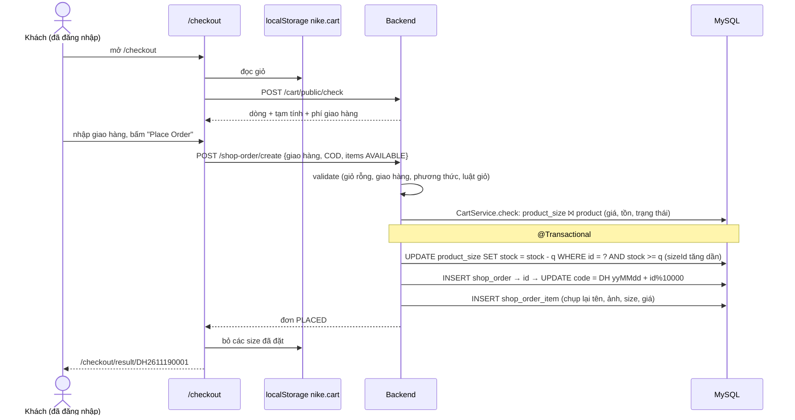

# Đặt hàng (COD)

## 1. Mục tiêu và phạm vi

Khách **đã đăng nhập** bấm "Checkout" ở giỏ / popup → trang `/checkout` thật: nhập thông tin giao hàng (tên điền sẵn theo tài khoản), phương thức "Cash on Delivery", xem tóm tắt đơn (dòng mua được, tạm tính, phí giao hàng, tổng) rồi bấm **Place Order**. Server tính lại giá từ DB, **trừ kho có điều kiện trong cùng transaction** (hai khách tranh đôi cuối thì chỉ một người được), sinh mã đơn `DH` + yyMMdd + 4 số, chụp lại thông tin sản phẩm vào dòng đơn. Đặt xong: các dòng đã đặt biến mất khỏi giỏ, khách sang trang xác nhận `/checkout/result/$code`.

**Tách lát** (lát 2.3 của thiết kế tổng quá lớn cho hai phiên cook: 2 bảng + 6 endpoint + 3 màn hình + job + cổng thanh toán giả). Đề xuất thứ tự (§11 câu 1):

| Thứ tự | Slug | Nội dung |
|---|---|---|
| 2.3 | `dat-hang` (plan này) | Đơn COD: bảng đơn, tạo đơn + trừ kho, xem đơn của mình, `/checkout`, trang xác nhận, pha test `@stock` |
| 2.3a | `thanh-toan-payos` | Phương thức payOS: tạo link (`expiredAt` 15 phút), trang thanh toán giả lập ở profile local (thay `mock-pay` đã gỡ cùng LUT), webhook kiểm chữ ký + chống xử lý lặp, job huỷ đơn quá 15 phút + hoàn kho, trạng thái chờ / huỷ / hết hạn ở trang kết quả |
| 2.4 | `don-cua-toi` | `my-list`, `cancel` (hoàn kho), `/orders`, `/orders/$code` |

| Có làm | Không làm (để plan khác) |
|---|---|
| V21: bảng `shop_order`, `shop_order_item` (chụp lại tên / ảnh / size / giá lúc đặt) | Cột / trạng thái riêng của payOS (`PENDING_PAYMENT`, mã payOS, hạn thanh toán, `paid_time`) — lát `thanh-toan-payos` thêm bằng V22 |
| `POST /api/shop-order/create` (chỉ `COD`): validate, giá từ DB (dùng lại `CartService.check`), phí giao hàng `ShippingPolicy`, trừ kho có điều kiện theo thứ tự `sizeId` tăng dần, rollback toàn bộ khi một bước lỗi | payOS, webhook, trang thanh toán giả, job huỷ quá hạn (lát `thanh-toan-payos`) |
| `GET /api/shop-order/get?code=` — chỉ chủ đơn xem được (đơn người khác → 404) | Danh sách đơn của tôi, huỷ đơn + hoàn kho, `/orders` (lát `don-cua-toi`) |
| `POST /api/test-support/stock` (đặt tồn kho một size — chuẩn bị dữ liệu test, chỉ profile local / test); `test-support/reset` xoá luôn đơn | Quản trị đơn, đổi trạng thái, resource `SHOP_ORDER` (lát `quan-ly-don-hang`) |
| Trang `/checkout` thật (bắt đăng nhập ở route), form giao hàng có validate, "Cash on Delivery", "Order Summary" (dòng không mua được bị loại + báo), lỗi tồn kho từ server, giỏ trống, khung xương, lỗi mạng | Sổ địa chỉ, nhớ địa chỉ lần trước, mã giảm giá, email xác nhận, header thu gọn kiểu trang thanh toán nike.com (§11 câu 6, 7) |
| Trang xác nhận `/checkout/result/$code` ("Thank you for your order", mã đơn, giao tới, dòng, tổng), "Order Not Found", lỗi tải | Kiểm "giá trong đơn không đổi khi quản trị sửa giá" (cần API sửa giá của lát `quan-ly-giay` — §11 câu 10) |
| Đặt xong bỏ các dòng đã đặt khỏi giỏ `nike.cart` (dòng không mua được giữ lại) | |
| `automation/`: **pha `@stock`** (test làm đổi tồn kho chạy riêng sau pha thường, mỗi pha reset dữ liệu — §7.1 bước 1), `OrderApi`, `TestSupportApi.setStock`, `data/orders.js`, `CheckoutPage`, `OrderResultPage`, storageState `khach1` / `khach2` | |

## 2. Tác nhân và phân quyền

| Tác nhân | Quyền | Ghi chú |
|---|---|---|
| Người đã đăng nhập (mọi chức vụ: khách, admin, noaccess) | `POST /shop-order/create`, `GET /shop-order/get` | Chỉ cần token hợp lệ (filter JWT chặn khi thiếu); **không** `checkPermission`, không resource. `get` chỉ trả đơn có `user_id` = người gọi |
| Chưa đăng nhập | — | API: 401 "Please sign in". Giao diện: vào `/checkout` hoặc `/checkout/result/$code` → `/signin?redirect=<đường dẫn>` |
| Role operator (`admin@nike.local`) | `POST /test-support/stock` | Như `test-support/reset`: URI `/test-support/` không có dòng resource nên chỉ operator qua `checkPermission`; controller chỉ có ở profile `local` / `test` |

Admin xem đơn của khách qua trang quản trị ở lát `quan-ly-don-hang`; endpoint khách `get` không cho admin xem đơn người khác (404).

## 3. Luồng nghiệp vụ

**Luồng chính (desktop):**
1. Khách chưa đăng nhập ở `/t/nike-air-force-1-07`, chọn "EU 42", "Add to Bag" → popup "Added to Bag" → bấm "Checkout" → `/signin?redirect=/checkout` → đăng nhập `khach1@nike.local` → về `/checkout`.
2. Trang gọi `POST /cart/public/check` với giỏ → "Order Summary": 1 dòng "Nike Air Force 1 '07", "Size EU 42", "Qty 1", "2.929.000 ₫"; Subtotal "2.929.000 ₫", Delivery "30.000 ₫", Total "2.959.000 ₫". Ô "Full Name" điền sẵn "Customer One"; "Cash on Delivery" đã chọn.
3. Khách nhập "Phone Number" `0901234567`, "Address" `12 Nguyen Hue Street, Ben Nghe Ward, District 1, Ho Chi Minh City`, "Delivery Notes" `Please call before delivery.`, bấm **Place Order** → nút thành "Placing Order…" (khoá).
4. `POST /shop-order/create` → server kiểm lại giỏ + tồn kho, trừ kho size 106 từ 20 → 19, ghi đơn `PLACED` + 1 dòng, trả đơn `DH2611190001`.
5. FE bỏ size 106 khỏi `nike.cart` (túi hết số), chuyển (thay lịch sử) sang `/checkout/result/DH2611190001`: "Thank you for your order", "Order number DH2611190001", "Pay 2.959.000 ₫ in cash when your order arrives.", thông tin giao hàng, 1 dòng, tổng, "Continue Shopping".

**Luồng thay thế:**
- A1 (đã đăng nhập sẵn): "Checkout" ở giỏ / popup → `/checkout` ngay (luật cũ của lát `gio-hang`).
- A2 (giỏ có dòng không mua được): dòng `OUT_OF_STOCK` / `UNAVAILABLE` không hiện ở "Order Summary", không gửi lên server; trên nút có thông báo "Some items in your bag aren't available and won't be included in this order."; đặt xong các dòng đó vẫn nằm trong giỏ.
- A3 (số lượng vượt tồn kho lúc mở trang): như giỏ — tự giảm về tồn kho (`reconcile`) + "We've updated some quantities to match available stock."
- A4 (tồn kho đổi giữa lúc xem và lúc bấm): server trả 400 "Only 1 left of Nike Pegasus 42 (EU 38). Please update your bag." → hiện trên nút, trang tải lại giỏ (giảm số lượng như A3), khách bấm lại để đặt.
- A5 (hai khách tranh đôi cuối): cả hai bấm cùng lúc, size còn 1 → một đơn thành công; người kia nhận "Nike Revolution 8 (EU 42) is sold out. Please update your bag."; tồn kho không bao giờ âm.
- A6 (đặt nhiều dòng): trừ kho theo thứ tự `sizeId` tăng dần (tránh deadlock khi hai đơn khoá chéo); một dòng lỗi → **rollback cả đơn** (dòng trước đã trừ cũng được trả lại).
- A7 (giỏ trống / không còn dòng mua được): trang hiện "Your bag is empty." + "Shop All Shoes", hoặc "None of the items in your bag are available right now." + "Go to Bag"; không có nút "Place Order".
- A8 (mobile): một cột: Delivery → Payment → Order Summary (có "Place Order").

**Ngoại lệ:**
- E1: form thiếu / sai (tên, SĐT, địa chỉ, độ dài) → lỗi dưới ô, focus ô lỗi đầu tiên, không gọi API.
- E2: mạng lỗi / server 500 khi đặt → thông báo trên nút, giỏ giữ nguyên, bấm lại được.
- E3: bấm "Place Order" hai lần → nút khoá ngay lần đầu, chỉ một request.
- E4: gọi API trực tiếp với dữ liệu sai → 400 với message §5.4; giá / tổng / trạng thái / chủ đơn client gửi kèm bị bỏ qua.
- E5: lỗi ghi DB sau khi đã trừ kho (vd địa chỉ dài quá cột) → 400 "Invalid request", transaction rollback, tồn kho không đổi.
- E6: mở `/checkout/result/<mã>` của người khác / không tồn tại → "Order Not Found".



## 4. Cơ sở dữ liệu

Migration: `V21__dat_hang.sql` (mới nhất hiện tại là V20).

**`shop_order`**

| Cột | Kiểu | Ràng buộc / ghi chú |
|---|---|---|
| id | INT AUTO_INCREMENT | PK |
| code | VARCHAR(20) NULL | UNIQUE `uk_shop_order_code`. Chỉ NULL trong lúc transaction tạo đơn đang chạy (cần `id` để sinh mã) |
| user_id | INT NOT NULL | FK `user_app(id)` ON DELETE RESTRICT |
| receiver_name | VARCHAR(100) NOT NULL | đã trim |
| phone | VARCHAR(20) NOT NULL | đã trim (FE bỏ khoảng trắng / dấu chấm / gạch) |
| address | VARCHAR(255) NOT NULL | đã trim |
| note | VARCHAR(255) NULL | trim, rỗng → NULL |
| item_count | INT NOT NULL | Σ quantity |
| subtotal | BIGINT NOT NULL | Σ line_total |
| shipping_fee | BIGINT NOT NULL | `ShippingPolicy.feeFor(subtotal)` |
| total | BIGINT NOT NULL | subtotal + shipping_fee |
| payment_method | VARCHAR(10) NOT NULL | lát này chỉ `COD` (lát sau thêm `PAYOS`) |
| status | VARCHAR(20) NOT NULL | lát này chỉ `PLACED`; thiết kế tổng: `PENDING_PAYMENT` → `PLACED` → `CONFIRMED` → `SHIPPING` → `DELIVERED` / `CANCELLED` |
| created_time, updated_time | DATETIME NOT NULL | service ghi `LocalDateTime.now(clock)` giờ `Asia/Ho_Chi_Minh` (cùng thời điểm dùng sinh mã) |

Index `idx_shop_order_user (user_id, created_time)` (cho `my-list` lát sau).

**`shop_order_item`** (chụp lại lúc đặt; sửa / ẩn sản phẩm sau đó không làm đổi đơn)

| Cột | Kiểu | Ràng buộc / ghi chú |
|---|---|---|
| id | INT AUTO_INCREMENT | PK; thứ tự id = thứ tự dòng trong request |
| order_id | INT NOT NULL | FK `shop_order(id)` ON DELETE CASCADE, index |
| size_id | INT NULL | FK `product_size(id)` ON DELETE SET NULL |
| product_id | INT NULL | FK `product(id)` ON DELETE SET NULL |
| product_slug | VARCHAR(150) NOT NULL | |
| product_name | VARCHAR(200) NOT NULL | |
| product_subtitle | VARCHAR(100) NOT NULL | |
| size_label | VARCHAR(20) NOT NULL | "EU 42" |
| image_url | VARCHAR(500) NULL | ảnh số 1 |
| unit_price | BIGINT NOT NULL | `salePrice ?? price` lúc đặt |
| quantity | INT NOT NULL | 1–10 |
| line_total | BIGINT NOT NULL | unit_price × quantity |

Xoá: không có xoá ở lát này. `POST /test-support/reset` xoá **toàn bộ** `shop_order_item` rồi `shop_order` trước khi xoá bảng sản phẩm (`ShoeSeedService.reloadDatabase`, theo `backend/AGENTS.md`).

**Mã đơn** = `"DH"` + `yyMMdd` (ngày của `created_time`) + `%04d` của `id % 10000`, vd id 7 ngày 19/11/2026 → `DH2611190007`. Không đụng nhau khi tạo song song (lấy từ `id`), duy nhất khi < 10.000 đơn / ngày; unique của DB vẫn chặn trùng. Sau reset id không quay về 1 (DELETE không reset AUTO_INCREMENT) nên test không giả định số cụ thể.

**Size dùng cho test** (size id = `productId × 100 + thứ tự`; tính bằng `sizeIdOf`). Mỗi test của pha `@stock` dùng size riêng để không giẫm nhau khi chạy song song; test API đặt lại tồn kho bằng `test-support/stock` ở đầu test nên chạy lại / retry vẫn đúng.

| Size id | Sản phẩm / size | Giá bán | Tồn seed | Dùng cho |
|---|---|---|---|---|
| 206 | `nike-dunk-low-retro` EU 42 | 3.519.000 | 20 | TC-01 |
| 1906 | `nike-precision-8-low` EU 42 | 2.000.000 (gốc 2.119.000) | 20 | TC-01 |
| 2506 · 1705 · 605 · 1203 | Spizike Low EU 42 · Zoom Fly 6 EU 38 · Offcourt EU 38 · Calm 2.0 EU 36.5 | 4.999.000 · 5.000.000 · 1.000.000 · 815.000 (gốc 1.019.000) | 20 | TC-02 phí giao hàng |
| 2405 | `air-jordan-1-low-se-magic-ball` EU 41 | 3.669.000 | 20 | TC-03 |
| 1305 | `nike-revolution-8` EU 41 | 1.909.000 | 20 | TC-04 (không đổi) |
| 201 · 1805 · 3106 · 999999 · 1304 | Dunk EU 38.5 (hết) · Vaporfly 4 EU 38 (còn 3) · Air Max Plus (HIDDEN) EU 42 · không tồn tại · Revolution 8 EU 40.5 | | 0 · 3 · 20 · — · 20 | TC-05 (không đổi) |
| 1307 | `nike-revolution-8` EU 42.5 | 1.909.000 | 20 → đặt 2 | TC-06 |
| 1306 · 1308 | Revolution 8 EU 42 · EU 43 | 1.909.000 | 1 · 20 → đặt 3 | TC-07 tranh mua |
| 2407 · 2408 · 2401–2403 · 2409 | AJ1 Low SE 'Magic Ball' EU 42.5 · EU 43 · EU 38.5–40 · EU 44 | 3.669.000 | 20 | TC-08 · TC-10 · TC-09 · TC-12 |
| 1309 | Revolution 8 EU 44 | 1.909.000 | 20 | TC-13 (không đổi) |
| 106 · 109 + 306 · 105 · 107 · 108 · 110 | AF1 '07 EU 42 · AF1 EU 44 + Marina EU 42 · AF1 EU 41 · AF1 EU 42.5 · AF1 EU 43 · AF1 EU 44.5 | 2.929.000 · 769.000 | 20 | TC-14 · TC-15 · TC-17 · TC-21 · TC-22 · TC-23 (giao diện, không so tồn kho chính xác) |
| 1603 · 1604 · 1605 · 1606 | `nike-pegasus-42` EU 36.5 · 37.5 · 38 · 38.5 | 3.829.000 | 20 | TC-18, một size cho mỗi project (chromium · firefox · webkit · mobile-chrome) |
| 406 | `nike-waffle-racer` EU 42 | 2.119.000 (gốc 2.649.000) | 20 | TC-19 |

## 5. Hợp đồng API (cố định — nguồn sự thật cho cả BE và FE)

Mọi response bọc `{ "code", "message", "result" }`; lỗi `{ "code", "errorCode", "message" }`. Prefix `/api`. Body / response là entity `ShopOrder`, `ShopOrderItem`, `ProductSize` (không DTO).

### 5.1 `POST /api/shop-order/create` — cần đăng nhập

**Request** (field khác bị bỏ qua: `id`, `code`, `userId`, `status`, `subtotal`, `shippingFee`, `total`, `itemCount`, giá trong `items`…):
```json
{
  "receiverName": "Customer One",
  "phone": "0901234567",
  "address": "12 Nguyen Hue Street, Ben Nghe Ward, District 1, Ho Chi Minh City",
  "note": "Please call before delivery.",
  "paymentMethod": "COD",
  "items": [
    { "sizeId": 206, "quantity": 1 },
    { "sizeId": 1906, "quantity": 2 }
  ]
}
```

**Response `result`** = đơn vừa tạo, đọc lại từ DB (giống hệt `get`):
```json
{
  "id": 7,
  "code": "DH2611190007",
  "userId": 34,
  "receiverName": "Customer One",
  "phone": "0901234567",
  "address": "12 Nguyen Hue Street, Ben Nghe Ward, District 1, Ho Chi Minh City",
  "note": "Please call before delivery.",
  "itemCount": 3,
  "subtotal": 7519000,
  "shippingFee": 0,
  "total": 7519000,
  "paymentMethod": "COD",
  "status": "PLACED",
  "createdTime": "2026-11-19T14:05:09",
  "updatedTime": "2026-11-19T14:05:09",
  "items": [
    { "id": 11, "orderId": 7, "sizeId": 206, "productId": 2, "productSlug": "nike-dunk-low-retro",
      "productName": "Nike Dunk Low Retro", "productSubtitle": "Men's Shoes", "sizeLabel": "EU 42",
      "imageUrl": "http://localhost:9020/nike-public/products/nike-dunk-low-retro/1.webp",
      "unitPrice": 3519000, "quantity": 1, "lineTotal": 3519000 },
    { "id": 12, "orderId": 7, "sizeId": 1906, "productId": 19, "productSlug": "nike-precision-8-low",
      "productName": "Nike Precision 8 Low", "productSubtitle": "Men's Basketball Shoes", "sizeLabel": "EU 42",
      "imageUrl": "http://localhost:9020/nike-public/products/nike-precision-8-low/1.webp",
      "unitPrice": 2000000, "quantity": 2, "lineTotal": 4000000 }
  ]
}
```
(`id`, `userId`, thời gian là ví dụ. `items` đúng thứ tự request.)

Ví dụ tổng (TC-02):

| `items` | `subtotal` | `shippingFee` | `total` |
|---|---|---|---|
| `[{2506, 1}]` | 4.999.000 | 30.000 | 5.029.000 |
| `[{1705, 1}]` | 5.000.000 | 0 | 5.000.000 |
| `[{605, 5}]` | 5.000.000 | 0 | 5.000.000 |
| `[{1203, 1}]` (giá giảm) | 815.000 | 30.000 | 845.000 |

### 5.2 `GET /api/shop-order/get?code=DH2611190007` — cần đăng nhập, chỉ chủ đơn

Response `result`: như 5.1. Đơn không có, của người khác (kể cả người gọi là admin), hoặc `code` rỗng → 404 "Order not found.".

### 5.3 Thứ tự kiểm khi tạo đơn (gặp lỗi đầu tiên thì dừng; bước 1–5 **không** ghi DB)

1. Thiếu token → 401 (filter). Body thiếu / không phải object / sai kiểu JSON → "Malformed request body" (lỗi khung).
2. `items` thiếu / rỗng → "Your bag is empty."
3. Thông tin giao hàng sau khi trim: `receiverName` rỗng → `phone` rỗng → `address` rỗng (message §5.4). Backend **không** kiểm định dạng SĐT / độ dài (việc của FE, theo `backend/AGENTS.md` — §11 câu 3).
4. `paymentMethod` khác đúng chuỗi `"COD"` (kể cả thiếu, `"cod"`, `"PAYOS"`) → "This payment method is not available."
5. Luật giỏ của lát `gio-hang` qua `CartService.check(items)`: > 50 dòng, `sizeId` thiếu / < 1, `quantity` ngoài 1–10, trùng size (đúng message của `gio-hang` §5.3) — rồi mới truy vấn DB.
6. Duyệt dòng theo **thứ tự request**, dòng đầu tiên không `AVAILABLE` → lỗi theo trạng thái (§5.4).
7. Trừ kho theo `sizeId` tăng dần: `UPDATE product_size SET stock = stock - q WHERE id = ? AND stock >= q`; 0 dòng (bị người khác mua trước) → kiểm lại dòng đó bằng `CartService.check` → lỗi theo trạng thái mới; transaction rollback (dòng đã trừ trước đó được trả lại).
8. Ghi đơn + mã + dòng. Lỗi DB (vd chuỗi dài quá cột) → rollback, 400 "Invalid request" (handler `DataAccessException` có sẵn).

### 5.4 `POST /api/test-support/stock` — operator, chỉ profile `local` / `test`

Request `{ "id": 2409, "stock": 7 }` (entity `ProductSize`, chỉ đọc `id`, `stock`). Response `result`: `{ "id": 2409, "productId": 24, "sizeLabel": "EU 44", "sizeValue": 44.0, "stock": 7 }`.

### 5.5 Lỗi

| Tình huống | HTTP | Message (tiếng Anh, FE hiện nguyên văn) |
|---|---|---|
| Không token (create / get / stock) | 401 | Please sign in |
| Token sai | 401 | Invalid or tampered token |
| Body hỏng / không phải object / sai kiểu field | 400 | Malformed request body |
| `items` thiếu / rỗng | 400 | Your bag is empty. |
| `receiverName` rỗng sau trim | 400 | Please enter the recipient's name. |
| `phone` rỗng sau trim | 400 | Please enter a phone number. |
| `address` rỗng sau trim | 400 | Please enter a delivery address. |
| `paymentMethod` ≠ `"COD"` | 400 | This payment method is not available. |
| > 50 dòng / size sai / số lượng sai / trùng size | 400 | Your bag can hold up to 50 different items. · Invalid size in bag. · Quantity must be between 1 and 10. · Each size can only appear once in the bag. |
| Dòng `UNAVAILABLE` (size không tồn tại, sản phẩm không `PUBLISHED`) | 400 | An item in your bag is no longer available. Please update your bag. |
| Dòng `OUT_OF_STOCK` | 400 | `<name> (<sizeLabel>) is sold out. Please update your bag.` — vd "Nike Dunk Low Retro (EU 38.5) is sold out. Please update your bag." |
| Dòng `INSUFFICIENT_STOCK` | 400 | `Only <stock> left of <name> (<sizeLabel>). Please update your bag.` — vd "Only 3 left of Nike Vaporfly 4 (EU 38). Please update your bag." |
| Lỗi ghi DB (chuỗi dài quá cột) | 400 | Invalid request |
| `get`: đơn không có / của người khác / `code` rỗng | 404 | Order not found. |
| `get`: thiếu tham số `code` | 400 | Missing required parameter: code |
| Sai method (`GET /api/shop-order/create`) | 405 | HTTP method not supported |
| `stock`: không phải operator | 403 | You don't have permission to perform this action. Path: /test-support/, Action: UPDATE (message có sẵn của `checkPermission`) |
| `stock`: size không tồn tại | 404 | Not found |
| `stock`: `stock` thiếu / < 0 | 400 | Stock must be 0 or more. |

## 6. Giao diện (chuỗi cố định — test E2E chọn theo đúng các chuỗi này)

Desktop = ≥ 1024px (`useIsDesktop()`). Tiền qua `formatVnd`. Màu theo token `--sh-*` (`--sh-danger` #D30005, `--sh-muted` #707072, xanh thành công #007D48 như popup "Added to Bag"). Nút `ShopButton`, ô nhập `ShopField` (nhãn nổi, lỗi đỏ dưới ô, `aria-invalid`). Trang nằm trong layout `_shop` (header + footer chung — §11 câu 6).

### 6.1 Bắt đăng nhập

`/checkout` và `/checkout/result/$code`: `beforeLoad` không có access token → `redirect` `/signin?redirect=<pathname>` (vd `/signin?redirect=%2Fcheckout%2Fresult%2FDH2611190007`). Đăng nhập xong `dang-nhap-nike` đưa về đúng trang. Hàm dùng chung `requireShopSignIn` (lát `don-cua-toi` dùng lại cho `/orders`).

### 6.2 `/checkout` — bố cục

- `<title>` **Checkout | Nike**. h1 **Checkout** (24px / 500).
- **Desktop**: khối giữa rộng tối đa 1100px, lề trên 40px; hai cột `minmax(0,1fr) / 400px`, khe 48px. Trái: §6.3 Delivery rồi §6.4 Payment. Phải: §6.5 Order Summary, `sticky top-(--sh-header-offset)`.
- **Mobile**: một cột lề 16px theo thứ tự Delivery → Payment → Order Summary (nút "Place Order" ở cuối, không dính đáy).
- Không cuộn ngang toàn trang. Nút "Place Order" chỉ render **một** lần (đổi bố cục bằng grid, không render hai bản).

### 6.3 Delivery (`<section aria-labelledby>`, testid `checkout-delivery`)

h2 **Delivery** (20px / 500), dưới là **Where should we send your order?** (`--sh-muted`). Form `noValidate`, các ô cách nhau 16px:

| Nhãn (tên truy cập) | Kiểu | Bắt buộc | Validate client (thứ tự, message nguyên văn) | Ghi chú |
|---|---|---|---|---|
| **Full Name** | text, `autoComplete="name"` | có | trim; rỗng → **Please enter the recipient's name.**; > 100 → **Name must be at most 100 characters.** | điền sẵn `user.name` (khi phiên tải xong muộn mà ô chưa bị sửa thì điền lúc đó) |
| **Phone Number** | `type="tel"`, `inputMode="numeric"`, `autoComplete="tel"` | có | bỏ khoảng trắng / `.` / `-`; rỗng → **Please enter a phone number.**; không khớp `^0\d{9}$` → **Enter a valid 10-digit phone number starting with 0.** | gợi ý **10 digits, starting with 0**; gửi lên bản đã bỏ ký tự ngăn |
| **Address** | text, `autoComplete="street-address"` | có | trim; rỗng → **Please enter a delivery address.**; > 255 → **Address must be at most 255 characters.** | gợi ý **House number, street, ward, district and city** |
| **Delivery Notes** | text | không | trim; > 255 → **Delivery notes must be at most 255 characters.** | gợi ý **Optional**; rỗng gửi `null` |

- Kiểm lúc bấm "Place Order" (schema zod), lỗi hiện dưới từng ô, focus ô lỗi đầu tiên; sửa một ô thì lỗi của ô đó biến mất. Không gọi API khi còn lỗi.

### 6.4 Payment (testid `checkout-payment`)

h2 **Payment**; `RadioGroup` tên **Payment Method** có đúng một lựa chọn (đã chọn sẵn): **Cash on Delivery** + mô tả **Pay in cash when your order arrives.** (`--sh-muted`). Lát `thanh-toan-payos` thêm lựa chọn thứ hai vào đây.

### 6.5 Order Summary (`<section aria-labelledby>`, testid `checkout-summary`)

- Hàng đầu: h2 **Order Summary** (20px / 500) + link **Edit Bag** → `/cart` (14px gạch chân, mép phải).
- Danh sách `<ul aria-label="Order items">`, chỉ các dòng `AVAILABLE` (sau khi đối soát), thứ tự như giỏ. Mỗi `<li data-testid="checkout-item" data-size-id="106">`: ảnh 80×80 (nền `#F5F5F5`, alt = tên); bên phải tên (testid `checkout-item-name`, 14px / 500), **Size EU 42** (`checkout-item-size`, `--sh-muted`), **Qty 1** (`checkout-item-qty`, `--sh-muted`), giá dòng `formatVnd(unitPrice × quantity)` (`checkout-item-price`) + nếu đang giảm giá `<s>` `formatVnd(price × quantity)` (`checkout-item-original-price`, `--sh-muted`).
- Kẻ ngang, rồi các hàng: **Subtotal** (`checkout-subtotal`) · **Delivery** (`checkout-shipping`: `shippingFee = 0` → **Free**, ngược lại `formatVnd`) · kẻ · **Total** (500, `checkout-total`).
- Thông báo (14px, icon ⓘ, `#9E3500`, mỗi cái một dòng, nằm trên nút):
  - có dòng `OUT_OF_STOCK` / `UNAVAILABLE` trong giỏ → **Some items in your bag aren't available and won't be included in this order.** (testid `checkout-excluded-notice`).
  - trong lần mở trang này có dòng bị tự giảm số lượng (A3, A4) → **We've updated some quantities to match available stock.** (testid `checkout-adjusted-notice`).
- Lỗi đặt hàng (§6.7) ngay trên nút: `role="alert"`, testid `checkout-error`, chữ `--sh-danger` 14px.
- Nút **Place Order** (testid `checkout-place-order`, `ShopButton` primary cao 60px, rộng hết cột, cách 24px). `disabled` khi: phiên đang tải; giỏ đang tải / đang tính lại (`isFetching`) / lỗi tải; không có dòng `AVAILABLE`; còn dòng `INSUFFICIENT_STOCK` chưa đối soát; đang gửi. Đang gửi: chữ **Placing Order…**, `aria-busy="true"`.

### 6.6 Trạng thái trang

- **Giỏ trống** (localStorage `[]`, không gọi API): thay hai cột bằng khối testid `checkout-empty`: **Your bag is empty.** + link nút đen **Shop All Shoes** → `/w`.
- **Không còn dòng mua được** (`itemCount = 0` sau `check`): khối `checkout-empty`: **None of the items in your bag are available right now.** + link nút đen **Go to Bag** → `/cart`.
- **Đang tải lần đầu**: khung xương `checkout-skeleton` (`aria-busy="true"`): 4 ô nhập xám bên trái, mỗi dòng giỏ một khối + 3 vạch bên phải.
- **Lỗi tải giỏ** (`check` lỗi sau 1 lần thử lại): ở cột phải `SectionError` **Couldn't load your bag.** + **Try Again**; form vẫn nhập được; "Place Order" khoá.
- Đối soát giỏ (`reconcile`) y như trang `/cart`: bỏ size không tồn tại, giảm dòng vượt tồn kho (+ ghi nhận cho `checkout-adjusted-notice`).

### 6.7 Bấm "Place Order"

1. Validate §6.3; lỗi → dừng.
2. Gửi `POST /shop-order/create` với `{ receiverName, phone, address, note, paymentMethod: "COD", items }`, `items` = các dòng `AVAILABLE` của lần `check` mới nhất (`{ sizeId, quantity }`, thứ tự như giỏ).
3. Thành công → bỏ đúng các `sizeId` đã gửi khỏi giỏ (`useCart.removeMany`), nạp sẵn đơn vào cache query `["shop-order", code]`, `navigate` tới `/checkout/result/$code` với `replace: true` (Back không quay lại form đã đặt). Không toast.
4. Lỗi có message từ server → hiện nguyên văn ở `checkout-error`, tải lại `check` của giỏ (để A3 / A4 tự giảm số lượng). Lỗi không có phản hồi (mất mạng / timeout) → **Couldn't place your order. Please check your connection and try again.** Giỏ không đổi, nút mở lại. Lỗi cũ biến mất khi bấm "Place Order" lần sau. Mutation `meta: { silentError: true }` (lỗi hiện trong trang như `/signin`, không toast).

### 6.8 Trang xác nhận `/checkout/result/$code`

- Route `routes/_shop/checkout.result.$code.tsx`, `<title>` **Order Confirmation | Nike**. Tải `GET /shop-order/get?code=` (không thử lại khi 404, các lỗi khác thử lại 1 lần). Khối giữa rộng tối đa 720px, lề trên 40px, một cột (desktop và mobile như nhau, mobile lề 16px).
- **Thành công** (testid `order-result`), từ trên xuống:
  1. Icon tròn xanh #007D48 có ✓ (48px) + h1 **Thank you for your order** (28px / 500).
  2. **Order number** + `<span data-testid="order-code">DH2611190007</span>` (500).
  3. **Pay 2.959.000 ₫ in cash when your order arrives.** (testid `order-pay-note`, số = `formatVnd(total)`).
  4. h2 **Delivery Details**: tên (`order-receiver`), SĐT (`order-phone`), địa chỉ (`order-address`), ghi chú (`order-note`, chỉ khi có).
  5. h2 **Items (3)** (số = `itemCount`): `<ul aria-label="Order items">`, mỗi `<li data-testid="order-item" data-size-id>`: ảnh 80×80 là link `/t/<productSlug>`, tên (`order-item-name`, link), phụ đề, **Size EU 42** (`order-item-size`), **Qty 2** (`order-item-qty`), `formatVnd(lineTotal)` (`order-item-price`).
  6. Các hàng **Subtotal** (`order-subtotal`) · **Delivery** (`order-shipping`, 0 → **Free**) · **Total** (`order-total`, 500) · **Payment Method** — **Cash on Delivery** (`order-payment`).
  7. Link nút đen **Continue Shopping** → `/w`.
- **Không thấy** (404): h1 **Order Not Found** (testid `order-not-found`), **We couldn't find this order in your account.**, link nút **Continue Shopping** → `/w`.
- **Đang tải**: `order-skeleton` (`aria-busy="true"`). **Lỗi khác**: `SectionError` **Couldn't load your order.** + **Try Again**.

### 6.9 Mobile

`/checkout` một cột (§6.2), các ô rộng hết khối (= màn − 32px), "Place Order" rộng hết. Trang xác nhận một cột. Cả hai không cuộn ngang, không còn chữ tiếng Việt (dữ liệu test dùng chữ không dấu).

## 7. Việc backend + automation (Claude, phiên A)

### 7.1 Spec nghiệm thu (viết trước khi code)

1. **Pha `@stock`** — cô lập test làm đổi tồn kho (nhiều spec cũ so tồn kho chính xác với `products.json`: `totalStock` của summary / thẻ / chi tiết, `gio-hang` TC-02 / TC-04…; chạy chung thì chập chờn):
   - `playwright.config.js`: `E2E_STOCK=1` → mọi project trừ `setup` có `grep: /@stock/`, ngược lại `grepInvert: /@stock/`; pha stock dùng `outputDir: test-results-stock`, HTML report `playwright-report-stock` (để không xoá kết quả pha thường); Allure chung `allure-results`.
   - **Mới** `scripts/run-phases.mjs`: chạy `playwright test --pass-with-no-tests <tham số>` hai lần — pha thường rồi pha stock (`E2E_STOCK=1`); mỗi lần global-setup reset dữ liệu nên pha stock bắt đầu sạch và lần chạy sau của pha thường cũng sạch. Pha 2 vẫn chạy khi pha 1 đỏ; mã thoát ≠ 0 nếu một pha đỏ; `--phase=main|stock` chỉ chạy một pha.
   - `package.json`: `test`, `test:smoke`, `test:regression`, `test:api` đi qua `run-phases.mjs` (tham số giữ nguyên, CI `pnpm test:smoke --project=api --project=chromium` không đổi); thêm `test:stock`, `report:stock`. `.gitignore` thêm `test-results-stock/`, `playwright-report-stock/`. `.github/workflows/e2e-smoke.yml`: artifact thêm `automation/playwright-report-stock/`. ESLint nhận `scripts/*.mjs` (globals node).
   - **Mới** `utils/lane.js`: `laneOf(testInfo)` → chromium 0, firefox 1, webkit 2, mobile-chrome 3 (khác → 0): test giao diện cần đặt tồn kho dùng size riêng theo project.
   - Quy ước ghi vào `automation/README.md` + `CLAUDE.md` (mục "Lệnh hay dùng"): test tạo đơn / đổi tồn kho phải nằm trong `test.describe('… @stock')`; chạy riêng: `E2E_STOCK=1 E2E_SLOWMO=400 pnpm exec playwright test <spec> --project=chromium --headed --workers=1`.
2. API client: **mới** `api/OrderApi.js` — `create(body)` (gửi nguyên body JSON như `CartApi.check`, `undefined` → không body), `createWithGet()`, `get(code)` (`code === undefined` → không gửi tham số); `api/TestSupportApi.js` thêm `setStock(sizeId, stock)` (body `{ id, stock }`, `stock === undefined` → bỏ khoá); `api/index.js` thêm `order`.
3. **Mới** `data/orders.js`: `DELIVERY` (giá trị §3 bước 3, `receiverName` "Customer One"), `ORDER_CODE_RE = /^DH\d{10}$/`, `orderBody(items, overrides)`, `expectedOrder(items, delivery)` (dựng từ `expectedCartCheck`: `itemCount`, `subtotal`, `shippingFee`, `total`, dòng chụp lại, ảnh so theo đuôi), `soldOutMessage(sizeId)`, `onlyLeftMessage(sizeId, n)`, `UNAVAILABLE_MESSAGE`, `PEGASUS_LANES = [1603, 1604, 1605, 1606]`, `yymmddOf(createdTime)`. Dữ liệu: `data/order-invalid.json` (TC-04), `data/order-shipping.json` (TC-02), `data/order-unavailable.json` (TC-05), `data/checkout-form-invalid.json` (TC-17).
4. `tests/auth.setup.js`: thêm storageState `khach1`, `khach2` (đăng nhập qua `/signin`, chờ "Hi, Customer One" / "Hi, Customer Two").
5. Page object:
   - **Mới** `pages/CheckoutPage.js`: `goto()`, `heading`, `fullName`, `phone`, `address`, `notes` (theo nhãn), `fieldError(locator)`, `payment` (radiogroup "Payment Method"), `cod` (radio "Cash on Delivery"), `summary`, `items` / `item(i)` (→ `CheckoutItem`: `name`, `size`, `qty`, `price`, `originalPrice`, `image`), `subtotal`, `shipping`, `total`, `excludedNotice`, `adjustedNotice`, `error`, `placeOrder`, `editBag`, `empty`, `shopAllShoes`, `goToBag`, `skeleton`, `loadError`, `tryAgain`, `fillDelivery(d)`.
   - **Mới** `pages/OrderResultPage.js`: `goto(code)`, `heading`, `code`, `payNote`, `receiver`, `phone`, `address`, `note`, `itemsHeading`, `items` / `item(i)` (→ `OrderItem`), `subtotal`, `shipping`, `total`, `payment`, `continueShopping`, `notFound`, `error`, `tryAgain`, `skeleton`.
   - `fixtures/index.js`: thêm `checkoutPage`, `orderResultPage`.
6. Spec (cả hai file bọc trong `test.describe('… @stock')`): `tests/api/dat-hang.api.spec.js` (TC-01 → TC-13), `tests/checkout/dat-hang.spec.js` (TC-14 → TC-23; desktop bỏ qua mobile-chrome, TC-23 chỉ mobile-chrome).
7. **Sửa spec cũ theo plan này** (lát này thay trang tạm `/checkout` — hành vi đổi có chủ đích, ghi §12):
   - `tests/cart/gio-hang.spec.js` TC-21 bước "đăng nhập → /checkout": thay kiểm "Coming Soon" bằng h1 "Checkout" (các kiểm khác giữ nguyên).
   - `data/shop-routes.json`: bỏ `/checkout` (khách chưa đăng nhập bị chuyển sang `/signin`, trang không có header cửa hàng); quét chữ tiếng Việt của `/checkout` và trang xác nhận chuyển sang TC-14 / TC-23.

### 7.2 Backend (module `business`)

Theo thứ tự `backend/AGENTS.md`. Không sửa `JwtAuthenticationFilter` (`/shop-order/**` đã cần token mặc định).

1. Migration `app/src/main/resources/db/migration/V21__dat_hang.sql`: hai bảng §4 (idempotent `CREATE TABLE IF NOT EXISTS`). Không thêm resource.
2. `sh scripts/ai/backend-restart.sh` (Flyway V21) → `mvn -q -DskipTests package` (jOOQ sinh `SHOP_ORDER`, `SHOP_ORDER_ITEM`).
3. Entity `entity/.../data/mysql/shoporder/`:
   - `ShopOrder` (đủ cột + `List<ShopOrderItem> items` không phải cột; hằng `STATUS_PLACED = "PLACED"`, `PAYMENT_COD = "COD"`).
   - `ShopOrderItem` (đủ cột; request chỉ đọc `sizeId`, `quantity`).
4. Repository:
   - **Mới** `business.shoporder.repository.ShopOrderRepository extends AbsMysqlRepository<ShopOrderRecord, ShopOrder, Integer>`: `getByCode(code)` (`getOne`), `updateCode(id, code)` (`updateFieldByCondition`), `deleteAll()`.
   - **Mới** `ShopOrderItemRepository`: `listByOrder(orderId)` (theo `id` tăng dần), `insertAll(items)` (`insertBatchReturning`), `deleteAll()`.
   - `product.repository.ProductSizeRepository`: thêm `decreaseStock(sizeId, quantity)` → số dòng (`dslContext.update … set STOCK = STOCK.minus(q) where ID.eq(sizeId).and(STOCK.ge(q))`), `updateStock(sizeId, stock)`.
5. Service:
   - **Mới** `business.product.service.ProductStockService extends BaseService<ProductSizeRepository, ProductSize, Integer>`: `boolean decrease(int sizeId, int quantity)`; `ProductSize setStock(ProductSize request)` (`id` không có → 404 `DATA_NOT_FOUND`; `stock` null / < 0 → 400 "Stock must be 0 or more."). Gói `shoporder` gọi kho qua service này (không gọi repository của gói `product`).
   - **Mới** `business.shoporder.service.ShopOrderService extends BaseService<ShopOrderRepository, ShopOrder, Integer>`, phụ thuộc `ShopOrderItemRepository`, `CartService`, `ProductStockService`, `Clock` (constructor `@Autowired` dùng `Clock.system(Asia/Ho_Chi_Minh)`, constructor thứ hai nhận `Clock` cho unit test — như `OrderService` cũ):
     - Hằng message §5.5.
     - `@Transactional ShopOrder create(Integer userId, ShopOrder request)`: đúng thứ tự §5.3; ghi đè `id`, `code`, `userId`, `status = PLACED`, `itemCount` / `subtotal` / `shippingFee` / `total` lấy từ `CartCheck`, `createdTime` / `updatedTime` = `now`; `insert` → `id` → `updateCode(id, codeOf(now, id))` → dòng chụp lại từ `CartLine` (`productSlug` = `slug`, `productName` = `name`, `productSubtitle` = `subtitle`, `imageUrl`, `sizeLabel`, `unitPrice`, `quantity`, `lineTotal`) → `insertAll` → trả `get(userId, code)`.
     - `static String codeOf(LocalDateTime time, int id)` (package-private để test).
     - `ShopOrder get(Integer userId, String code)`: không có / khác `userId` → 404 "Order not found."; gắn `items`.
     - `void deleteAll()` (dòng rồi đơn) — cho reset.
6. Controller:
   - **Mới** `business.shoporder.controller.ShopOrderController extends BaseController`, `URI = "/shop-order/"`: `POST /shop-order/create` (`@RequestBody ShopOrder`), `GET /shop-order/get` (`@RequestParam String code`); lấy `SecurityUtils.userId(principal)`, không `checkPermission`.
   - `testsupport.TestSupportController`: thêm `POST /test-support/stock` (`checkPermission(principal, URI, "UPDATE")`, gọi `ProductStockService.setStock`).
7. `product.seed.ShoeSeedService`: nhận `ShopOrderService`; `reloadDatabase()` gọi `shopOrderService.deleteAll()` **đầu tiên**; cập nhật javadoc.
8. Unit test: **mới** `business/src/test/java/vn/aeoc/business/shoporder/service/ShopOrderServiceTest.java` (mock `ShopOrderRepository`, `ShopOrderItemRepository`, `CartService`, `ProductStockService`; `Clock.fixed(2026-11-19T07:05:09Z, Asia/Ho_Chi_Minh)`; `new QueryExecutor(Runnable::run)`) — TC-U1 → TC-U6; **mới** `business/src/test/java/vn/aeoc/business/product/service/ProductStockServiceTest.java` — TC-U7; `app/src/test/java/vn/aeoc/app/ShoeSeedResetTest.java` thêm TC-U8.
9. `mvn -q "-Djooq.codegen.skip=true" -pl business -am test` → restart → `pnpm test:api` (cả hai pha; spec cũ vẫn xanh). Ghi §12 "phiên A xong".

## 8. Việc frontend (Claude, phiên B)

Thứ tự theo `frontend/AGENTS.md`:

1. **Mới** `lib/types/shop-order.ts`: `PaymentMethod = "COD"`, `ShopOrderStatus = "PLACED"`, `ShopOrderItemDTO`, `ShopOrderDTO`, `CreateShopOrderRequest { receiverName; phone; address; note: string | null; paymentMethod; items: CartItem[] }` (§5.1).
2. **Mới** `lib/axios/shop-order.ts`: `createShopOrder(body)` → `POST /shop-order/create`; `getShopOrder(code)` → `GET /shop-order/get`.
3. **Mới** `lib/tanstack/options/shop-order.ts`: `SHOP_ORDER_QUERY_KEY = ["shop-order"]`; `createShopOrderQueryOptions(code)` (key `[...SHOP_ORDER_QUERY_KEY, code]`, `retry`: không thử lại 404, các lỗi khác 1 lần); `createShopOrderMutationOptions` (`meta: { silentError: true }` — ngoại lệ có chủ đích như `/signin`, §6.7).
4. `lib/shop/`:
   - **mới** `require-sign-in.ts`: `requireShopSignIn(location)` cho `beforeLoad` (§6.1).
   - **mới** `checkout-form.ts`: schema zod §6.3 + `normalizePhone` + `toCreateRequest(values, lines)` (hàm thuần).
   - `cart-storage.ts`: thêm `removeItems(items, sizeIds)`.
5. `lib/stores/cart.ts`: thêm `removeMany(sizeIds)`.
6. **Mới** `components/shop/checkout/`: `checkout-page.tsx` (ghép §6.2, gọi `createCartCheckQueryOptions` + `reconcile` như `CartPage`, giữ cờ "đã tự giảm"), `delivery-form.tsx`, `payment-method.tsx` (`RadioGroup`), `checkout-summary.tsx`, `checkout-empty.tsx`, `checkout-skeleton.tsx`. Dùng lại `ShopField`, `ShopButton`, `SectionError`, `formatVnd`.
7. **Mới** `components/shop/order/`: `order-result-page.tsx`, `order-items.tsx`, `order-totals.tsx`, `order-not-found.tsx`, `order-skeleton.tsx` (lát `don-cua-toi` dùng lại `order-items` / `order-totals`).
8. Route: **xoá** `routes/_shop/checkout.tsx` (trang tạm) → **mới** `routes/_shop/checkout.index.tsx` (`beforeLoad: requireShopSignIn`, `head` **Checkout | Nike**, `CheckoutPage`) và `routes/_shop/checkout.result.$code.tsx` (`beforeLoad: requireShopSignIn`, `head` **Order Confirmation | Nike**). Hai file anh em (không lồng nhau) như `w.index.tsx` / `w.$category.tsx`.
9. `frontend/AGENTS.md` mục "Khu cửa hàng": thêm "Đặt hàng" (`components/shop/checkout/`, `components/shop/order/`, `requireShopSignIn`, `checkout-form.ts`); bỏ `/checkout` khỏi danh sách trang tạm.
10. `pnpm build && pnpm lint` xanh; `pnpm api:types` đối chiếu `ShopOrder`, `ShopOrderItem` với type tay.

Component shadcn dùng: có sẵn `radio-group`, `separator`, `skeleton`, `ShopButton`, `ShopField`, `SectionError`; **không** cần `shadcn add`.

## 9. Test case

API ở `automation/tests/api/dat-hang.api.spec.js`, giao diện ở `automation/tests/checkout/dat-hang.spec.js` — **tất cả thuộc pha `@stock`** (§7.1 bước 1). JUnit ở `ShopOrderServiceTest.java`, `ProductStockServiceTest.java`, `ShoeSeedResetTest.java`. Số trong bảng tính từ `products.json` (`expectedOrder` / `expectedCartCheck`). Tiền điều kiện chung: global-setup reset ở đầu pha stock; test API đặt lại tồn kho các size của mình bằng `setStock` trước khi so; "giao hàng hợp lệ" = `DELIVERY`. Giao diện: "khach1" / "khach2" = `storageState` đăng nhập sẵn; giỏ chuẩn bị bằng `setCart`. Không ghi project = chromium, firefox, webkit (bỏ qua mobile-chrome); "mobile" = chỉ mobile-chrome.

| ID | Loại | Mô tả | Tiền điều kiện | Bước | Kết quả mong đợi |
|---|---|---|---|---|---|
| TC-01 | api | Đặt COD hai dòng `@smoke` | token khach1; `setStock(206, 20)`, `setStock(1906, 20)` | `create` body §5.1 (`[{206,1},{1906,2}]`); `get(code)`; `GET /product/public/get` Dunk + Precision | 200; `code` khớp `ORDER_CODE_RE`; `userId` = id của khach1 (`/account/me`); `status` "PLACED", `paymentMethod` "COD"; 4 field giao hàng đúng như gửi; `itemCount` 3, `subtotal` 7519000, `shippingFee` 0, `total` 7519000; `items` = `expectedOrder`: thứ tự 206, 1906; dòng 1 "Nike Dunk Low Retro" / "Men's Shoes" / "EU 42" / `unitPrice` 3519000 / `lineTotal` 3519000 / `imageUrl` kết thúc `/products/nike-dunk-low-retro/1.webp`; dòng 2 `unitPrice` 2000000 (giá giảm), `quantity` 2, `lineTotal` 4000000; `get` trả **đúng bằng** kết quả `create`; tồn size 206 = 19, size 1906 = 18 |
| TC-02 | api | Phí giao hàng biên (data-driven `order-shipping.json`) | khach1 | 4 đơn ở bảng §5.1 "Ví dụ tổng" | `subtotal` / `shippingFee` / `total` đúng bảng: 4.999.000 → 30.000 / 5.029.000; 5.000.000 (1 đôi) → 0; 5 × 1.000.000 → 0; 815.000 (giá giảm, không phải 1.019.000) → 30.000 / 845.000; `itemCount` 1, 1, 5, 1 |
| TC-03 | api | Field do server quản, giá theo DB | khach1, `setStock(2405, 20)` | `create` với `items [{"sizeId":2405,"quantity":1,"unitPrice":1,"lineTotal":1}]` + `"id":999, "code":"DH0000000001", "userId":<id khach2>, "status":"DELIVERED", "subtotal":1, "shippingFee":0, "total":1, "itemCount":9` | 200; `id` ≠ 999; `code` ≠ "DH0000000001" và khớp regex; `userId` = khach1; `status` "PLACED"; `unitPrice` 3669000, `lineTotal` 3669000, `subtotal` 3669000, `shippingFee` 30000, `total` 3699000, `itemCount` 1 |
| TC-04 | api | Validate (data-driven `order-invalid.json`) | khach1, `setStock(1305, 20)`; body gốc = giao hàng hợp lệ + COD + `[{1305,1}]` | 17 ca: bỏ `items`; `items: []`; 51 dòng (51 size id khác nhau); `[{0,1}]`; `[{1305,0}]`; `[{1305,11}]`; `[{1305,1},{1305,2}]`; `receiverName "   "`; bỏ `phone`; `address ""`; `paymentMethod "PAYOS"`; bỏ `paymentMethod`; `paymentMethod "cod"`; `receiverName ""` + `[{1305,11}]`; body `[]`; body `"abc"`; `items [{"sizeId":1305,"quantity":"two"}]` | 400, message lần lượt: "Your bag is empty." × 2; "Your bag can hold up to 50 different items."; "Invalid size in bag."; "Quantity must be between 1 and 10." × 2; "Each size can only appear once in the bag."; "Please enter the recipient's name."; "Please enter a phone number."; "Please enter a delivery address."; "This payment method is not available." × 3; "Please enter the recipient's name." (giao hàng kiểm trước luật giỏ); "Malformed request body" × 3; sau 17 ca tồn size 1305 vẫn 20 |
| TC-05 | api | Dòng không mua được (data-driven `order-unavailable.json`) | khach1 | `[{201,1}]`; `[{1805,4}]`; `[{3106,1}]`; `[{999999,1}]`; `[{1304,1},{201,1}]`; `[{1805,4},{3106,1}]`; `[{3106,1},{1805,4}]` | 400, lần lượt: "Nike Dunk Low Retro (EU 38.5) is sold out. Please update your bag."; "Only 3 left of Nike Vaporfly 4 (EU 38). Please update your bag."; "An item in your bag is no longer available. Please update your bag." × 2; như ca 1; như ca 2; như ca 3 (dòng lỗi **đầu tiên theo thứ tự request**); tồn 1304 vẫn 20, 1805 vẫn 3 |
| TC-06 | api | Mua đúng hết tồn kho | khach1, `setStock(1307, 2)` | `create [{1307,2}]`; `create [{1307,1}]`; `POST /cart/public/check [{1307,1}]` | lần 1: 200, `subtotal` 3818000, `shippingFee` 30000, `total` 3848000, tồn 1307 = 0; lần 2: 400 "Nike Revolution 8 (EU 42.5) is sold out. Please update your bag."; `check`: `OUT_OF_STOCK` |
| TC-07 | api | Tranh mua đôi cuối (đồng thời) | token khach1 + khach2 | (a) 3 vòng: `setStock(1306, 1)` rồi khach1 và khach2 cùng gọi `create [{1306,1}]` (`Promise.all`); (b) `setStock(1308, 3)` rồi 5 request đồng thời `create [{1308,1}]` (khach1 × 3, khach2 × 2) | (a) mỗi vòng đúng một 200 + một 400 "Nike Revolution 8 (EU 42) is sold out. Please update your bag.", tồn 1306 = 0 sau mỗi vòng; (b) đúng 3 × 200, 2 × 400 "Nike Revolution 8 (EU 43) is sold out. Please update your bag.", tồn 1308 = 0 (không âm), 3 mã đơn khác nhau |
| TC-08 | api | Chuẩn hoá chuỗi | khach1, `setStock(2407, 20)` | `create [{2407,1}]` với `receiverName "  Customer One  "`, `phone " 0901234567 "`, `address "  12 Nguyen Hue Street  "`, `note "   "` | 200; `receiverName` "Customer One", `phone` "0901234567", `address` "12 Nguyen Hue Street", `note` `null` |
| TC-09 | api | Mã đơn | khach1, `setStock` 2401 · 2402 · 2403 = 20 | 3 `create` đồng thời (mỗi đơn một size) | 3 × 200; 3 `code` khác nhau, đều khớp `^DH\d{10}$`; với mỗi đơn: `code.slice(2,8)` = `yymmddOf(createdTime)`, `Number(code.slice(8))` = `id % 10000` |
| TC-10 | api | Xem đơn: chỉ chủ đơn | khach1 tạo đơn `[{2408,1}]` | `get(code)` bằng khach1, khach2, admin; `get("DH0000000000")`; `get("")`; `get()` (không tham số) | khach1: 200 = kết quả `create`; khach2, admin: 404 "Order not found."; mã không có: 404 "Order not found."; `code` rỗng: 404 "Order not found."; không tham số: 400 "Missing required parameter: code" |
| TC-11 | api | Đăng nhập + sai method | — | `create` / `get` không token; `create` với `Authorization: Bearer abc.def.ghi`; `GET /api/shop-order/create` có token khach1 | không token: 401 "Please sign in" (cả hai); token sai: 401 "Invalid or tampered token"; GET: 405 "HTTP method not supported" |
| TC-12 | api | `test-support/stock` | — | admin `setStock(2409, 7)`; `GET /product/public/get?slug=air-jordan-1-low-se-magic-ball`; khach1 `setStock(2409, 5)`; không token; admin `setStock(999999, 5)`; admin `setStock(2409, -1)`; admin bỏ `stock`; admin `setStock(2409, 20)` | admin: 200 `{ id: 2409, sizeLabel: "EU 44", stock: 7 }`, chi tiết sản phẩm size EU 44 `stock` 7; khach1: 403 "You don't have permission to perform this action. Path: /test-support/, Action: UPDATE"; không token: 401 "Please sign in"; 999999: 404 "Not found"; -1 và thiếu: 400 "Stock must be 0 or more."; cuối: `stock` 20 |
| TC-13 | api | Rollback khi ghi đơn lỗi | khach1, `setStock(1309, 20)` | `create [{1309,2}]` với `address` 300 ký tự `"a"` | 400 "Invalid request"; tồn 1309 vẫn 20 (đã trừ ở bước 7 rồi được rollback) |
| TC-14 | e2e | Đặt COD từ trang chi tiết (chưa đăng nhập) `@smoke` | khách chưa đăng nhập | `/t/nike-air-force-1-07` chọn "EU 42", "Add to Bag", bấm "Checkout" trong popup; đăng nhập khach1 ở `/signin`; đọc `/checkout`; nhập Phone / Address / Delivery Notes theo `DELIVERY`; bấm "Place Order"; đọc trang xác nhận; gọi API `get(code)` bằng khach1 | `/signin?redirect=/checkout` → sau đăng nhập URL `/checkout`, `<title>` "Checkout \| Nike", h1 "Checkout"; "Full Name" = "Customer One"; radio "Cash on Delivery" checked; 1 `checkout-item`: "Nike Air Force 1 '07", "Size EU 42", "Qty 1", "2.929.000 ₫"; Subtotal "2.929.000 ₫", Delivery "30.000 ₫", Total "2.959.000 ₫"; đúng 1 request `POST …/shop-order/create`, body `items` = `[{"sizeId":106,"quantity":1}]`; URL `/checkout/result/<code>` (`code` khớp regex), `<title>` "Order Confirmation \| Nike", h1 "Thank you for your order", `order-code` = `code`, `order-pay-note` "Pay 2.959.000 ₫ in cash when your order arrives.", `order-receiver` "Customer One", `order-phone` "0901234567", `order-address`, `order-note` "Please call before delivery.", "Items (1)", 1 `order-item` "Nike Air Force 1 '07" / "Size EU 42" / "Qty 1" / "2.929.000 ₫", `order-shipping` "30.000 ₫", `order-total` "2.959.000 ₫", `order-payment` "Cash on Delivery"; không còn `header-cart-count`, `nike.cart` = `[]`; API: `status` "PLACED", `total` 2959000; `findVietnamese(main)` rỗng ở cả hai trang; không `pageerror` |
| TC-15 | e2e | Nhiều dòng, miễn phí giao hàng, Back sau khi đặt | khach2, `setCart([{109,2},{306,1}])` | mở `/` rồi `/checkout`; nhập Phone / Address; "Place Order"; bấm Back của trình duyệt | "Full Name" = "Customer Two"; 2 `checkout-item` theo thứ tự 109 ("Nike Air Force 1 '07", "Size EU 44", "Qty 2", "5.858.000 ₫"), 306 ("Nike Marina", "Size EU 42", "Qty 1", "769.000 ₫"); Subtotal "6.627.000 ₫", Delivery "Free", Total "6.627.000 ₫"; trang xác nhận "Items (3)", 2 `order-item` cùng thứ tự, `order-shipping` "Free", `order-total` "6.627.000 ₫", `order-note` không có; Back → URL `/` (không quay lại `/checkout`) |
| TC-16 | e2e | Bắt đăng nhập ở route | khách chưa đăng nhập | mở `/checkout`; mở `/checkout/result/DH2611190001`; đăng nhập khach1 ở trang `/signin` vừa tới | `/checkout` → pathname `/signin`, `redirect` = `/checkout`; trang xác nhận → `redirect` = `/checkout/result/DH2611190001`; sau đăng nhập: URL `/checkout/result/DH2611190001`, h1 "Order Not Found", "We couldn't find this order in your account.", link "Continue Shopping" href `/w` |
| TC-17 | e2e | Validate form (data-driven `checkout-form-invalid.json`) | khach2, `setCart([{105,1}])`, mở `/checkout` | (1) xoá "Full Name", để trống Phone / Address, bấm "Place Order"; gõ lại tên; (2) Phone `12345`; (3) `1901234567`; (4) `090123456a`; (5) `+84901234567`; (6) tên 101 ký tự; (7) địa chỉ 256 ký tự; (8) ghi chú 256 ký tự; (9) biên hợp lệ: tên 100, địa chỉ 255, ghi chú 255 ký tự, Phone `0901 234 567` | (1) "Please enter the recipient's name.", "Please enter a phone number.", "Please enter a delivery address.", ba ô `aria-invalid="true"`, focus ở "Full Name"; gõ tên → lỗi tên mất, hai lỗi kia còn; (2)–(5) "Enter a valid 10-digit phone number starting with 0."; (6) "Name must be at most 100 characters."; (7) "Address must be at most 255 characters."; (8) "Delivery notes must be at most 255 characters."; (1)–(8) không có request `create`; (9) đúng 1 request, body `phone` "0901234567", `receiverName` dài 100, `note` dài 255 → trang xác nhận |
| TC-18 | e2e | Tồn kho đổi trước khi bấm "Place Order" | khach1; size = `PEGASUS_LANES[laneOf(testInfo)]`; API `setStock(size, 2)`; `setCart([{size,2}])` | mở `/checkout`; API `setStock(size, 1)`; bấm "Place Order"; bấm "Place Order" lần nữa | đầu: "Qty 2", Total "7.658.000 ₫", Delivery "Free"; sau lần 1: `checkout-error` = `onlyLeftMessage(size, 1)` (chromium: "Only 1 left of Nike Pegasus 42 (EU 36.5). Please update your bag."), vẫn ở `/checkout`; rồi "Qty 1", Delivery "30.000 ₫", Total "3.859.000 ₫", "We've updated some quantities to match available stock.", `nike.cart` = `[{size,1}]`; lần 2: trang xác nhận "Qty 1", `order-total` "3.859.000 ₫"; API tồn `size` = 0 |
| TC-19 | e2e | Giỏ có dòng không mua được | khach1, `setCart([{406,1},{201,1},{3106,1}])` | mở `/checkout`; "Place Order" | 1 `checkout-item` (406): "Nike Waffle Racer", "Size EU 42", "2.119.000 ₫" + `<s>` "2.649.000 ₫"; "Some items in your bag aren't available and won't be included in this order."; Subtotal "2.119.000 ₫", Delivery "30.000 ₫", Total "2.149.000 ₫"; body `items` = `[{"sizeId":406,"quantity":1}]`; sau khi đặt: `nike.cart` = `[{201,1},{3106,1}]`, `header-cart-count` "2" |
| TC-20 | e2e | Giỏ trống / không còn gì để đặt | khach1 | mở `/checkout` khi chưa có `nike.cart`, bấm "Shop All Shoes"; `setCart([{201,1}])` mở `/checkout`, bấm "Go to Bag" | ca 1: h1 "Checkout", "Your bag is empty.", không có nút "Place Order", không có request `check` / `create`; bấm → URL `/w`, h1 "Shoes (30)"; ca 2: "None of the items in your bag are available right now.", không có "Place Order"; bấm → URL `/cart` |
| TC-21 | e2e | Lỗi mạng, chậm, bấm hai lần (network mocking) | khach1, `setCart([{107,1}])`, mở `/checkout`, nhập giao hàng | (a) route `create` trả 500 `{ code: 500, errorCode: "INTERNAL_ERROR", message: "Something went wrong. Please try again later" }`, bấm "Place Order"; (b) route `create` `abort()`, bấm; (c) bỏ route, route `create` chậm 1,5 giây rồi cho qua, bấm "Place Order" hai lần liên tiếp | (a) `checkout-error` "Something went wrong. Please try again later", URL `/checkout`, `nike.cart` vẫn `[{107,1}]`, nút bấm được lại; (b) "Couldn't place your order. Please check your connection and try again."; (c) nút "Placing Order…" `disabled`, `aria-busy="true"`; đúng 1 request `create` tới server; sang trang xác nhận "Nike Air Force 1 '07" "Size EU 42.5" |
| TC-22 | e2e | Trang xác nhận: không phải của mình / lỗi tải | API khach1 tạo đơn `[{108,1}]` | khach2 mở `/checkout/result/<code>`; khach1: route `get` trả 500, mở trang, bỏ route, bấm "Try Again" | khach2: "Order Not Found", không có `order-code`; khach1: "Couldn't load your order." + "Try Again"; sau bấm: `order-code` = `code`, 1 `order-item` "Size EU 43", `order-total` "2.959.000 ₫" |
| TC-23 | e2e | Bố cục mobile | mobile, khach1, `setCart([{110,1}])` | mở `/checkout`; đọc bố cục; nhập giao hàng, cuộn tới "Place Order", bấm; đọc trang xác nhận | `checkout-delivery` nằm trên `checkout-summary` (đáy delivery ≤ đỉnh summary); ô "Address" rộng = `innerWidth − 32` ±2; `scrollWidth ≤ innerWidth` ở cả hai trang; `findVietnamese(main)` rỗng ở cả hai trang; trang xác nhận có `order-code`, "Size EU 44.5" |
| TC-24 | e2e | Hồi quy | — | `tests/cart/gio-hang.spec.js` (TC-21 sửa theo §7.1 bước 7), `tests/system/tieng-anh-cua-hang.spec.js` (TC-10 không còn `/checkout`), `tests/product-detail/chi-tiet-giay.spec.js`; `pnpm test:smoke`, `pnpm test:api` | xanh trên cả 5 project, cả pha thường lẫn pha stock; pha thường không chạy test `@stock` nào (`--list` của pha thường không chứa "dat-hang") |
| TC-U1 | unit | Thứ tự validate | mock mọi phụ thuộc | `create` với: `items` null; `[]`; tên "  "; phone null; address ""; `paymentMethod` "PAYOS"; tên "" + `quantity` 11 | `AppException` 400 lần lượt "Your bag is empty." × 2, "Please enter the recipient's name.", "Please enter a phone number.", "Please enter a delivery address.", "This payment method is not available.", "Please enter the recipient's name."; mọi ca **không** gọi `CartService.check`, `ProductStockService`, repository |
| TC-U2 | unit | Dòng không mua được | `CartService.check` trả lần lượt: dòng 1 `OUT_OF_STOCK` ("Nike Dunk Low Retro", "EU 38.5"); dòng `INSUFFICIENT_STOCK` stock 3 ("Nike Vaporfly 4", "EU 38"); `[AVAILABLE, UNAVAILABLE, OUT_OF_STOCK]` | `create` hợp lệ | message đúng §5.5 cho từng ca (ca 3: message `UNAVAILABLE` — dòng lỗi đầu tiên); không gọi `decrease`, không `insert` |
| TC-U3 | unit | Tạo đơn thành công | request `[{1906,2},{206,1},{1305,1}]`; `check` trả 3 dòng `AVAILABLE` cùng thứ tự (`itemCount` 4, `subtotal` 9428000, `shippingFee` 0); `decrease` → true; `insert` trả id 7; `Clock` cố định 19/11/2026 14:05:09 giờ VN | `create(34, request)` với request có `id` 999, `status` "DELIVERED", `total` 1 | `decrease` gọi theo thứ tự 206 → 1305 → 1906 (tăng dần); đơn được `insert` có `id` null, `userId` 34, `status` "PLACED", `paymentMethod` "COD", `itemCount` / `subtotal` / `shippingFee` / `total` lấy từ `CartCheck`, `createdTime` 2026-11-19T14:05:09; `updateCode(7, "DH2611190007")`; `insertAll` 3 dòng đúng thứ tự request, `orderId` 7, field chụp lại từ `CartLine` |
| TC-U4 | unit | Trừ kho thất bại (bị mua trước) | `check` lần đầu: 2 dòng `AVAILABLE` (206, 1306); `decrease(206)` → true, `decrease(1306)` → false; `check([{1306,1}])` lần hai → `OUT_OF_STOCK` | `create` | `AppException` 400 "Nike Revolution 8 (EU 42) is sold out. Please update your bag."; không `insert` đơn / dòng |
| TC-U5 | unit | Sinh mã | — | `codeOf(2026-11-19T14:05:09, 7)`; `(…, 12345)`; `(2026-01-02T00:00:01, 10000)` | "DH2611190007"; "DH2611192345"; "DH2601020000" |
| TC-U6 | unit | `get` | `getByCode` trả đơn `userId` 34 | `get(35, code)`; `get(34, "DH0000000000")` (null); `get(34, code)` | 404 "Order not found." × 2 (không đọc dòng); ca 3 có `items` từ `listByOrder` |
| TC-U7 | unit | `ProductStockService.setStock` | mock `ProductSizeRepository` | `{id: 999999, stock: 5}` (không có); `{id: 2409, stock: -1}`; `{id: 2409}`; `{id: 2409, stock: 7}` | 404; 400 "Stock must be 0 or more." × 2 (không cập nhật); ca 4 `updateStock(2409, 7)` |
| TC-U8 | unit | Reset xoá đơn (tích hợp, module app, cần DB local) | tạo 1 đơn bằng `ShopOrderService.create` | `ShoeSeedService.reset()` | `shop_order`, `shop_order_item` không còn dòng; tồn size đã đặt về giá trị `products.json` |

Loại: `unit` = JUnit · `api` / `e2e` = `automation/`.

## 10. Tiêu chí hoàn thành

- [x] Mọi TC ở §9 pass (TC-14 → TC-22 trên chromium, firefox, webkit; TC-23 trên mobile-chrome)
- [x] `pnpm test:smoke`, `pnpm test:api` xanh cả hai pha; spec cũ ở TC-24 xanh
- [x] `mvn test` (business), `pnpm build`, `pnpm lint` (frontend + automation) xanh
- [x] `/checkout` không còn `ComingSoonSection`; `automation/README.md` + `CLAUDE.md` có quy ước pha `@stock`
- [x] Có `docs/chuc-nang/dat-hang.md` kèm ảnh desktop (checkout đầy đủ, lỗi validate, lỗi tồn kho, dòng không mua được, trang xác nhận) + mobile (checkout, xác nhận)

## 11. Rủi ro / câu hỏi mở

Các câu dưới đã có đề xuất; nói "duyệt" là đồng ý cả đề xuất, muốn khác thì sửa câu đó.

1. **Tách lát 2.3** thành `dat-hang` (COD, plan này) → `thanh-toan-payos` (2.3a) → `don-cua-toi` (2.4) như bảng §1. Khi duyệt, tôi thêm dòng 2.3a vào §9 của `thiet-ke-giay.md` và lập plan `thanh-toan-payos` sau khi lát này xong. Phương án khác: gộp payOS vào plan này (khoảng 6 endpoint, 3 màn hình, job — vượt cỡ hai phiên cook).
2. **Pha `@stock`** (§7.1 bước 1): test tạo đơn chạy trong lần `playwright test` thứ hai, sau reset riêng, nên không làm sai các spec cũ đang so tồn kho chính xác; trong pha stock, test API dùng size riêng + `setStock`, test giao diện cần đặt tồn kho dùng size riêng theo project (`laneOf`). Phương án khác: (a) sửa spec cũ để so tồn kho "đọc lại từ API" thay vì `products.json` (yếu đi, không đề xuất); (b) project Playwright phụ thuộc nhau (pha stock chờ mọi project đọc xong) — chạy một spec lẻ sẽ kéo theo cả bộ đọc.
3. **Backend kiểm gì**: ngoài luật giỏ, tồn kho, tính tiền, backend kiểm thêm 3 field giao hàng không rỗng và `paymentMethod` = `COD` (lệch nhẹ khỏi `backend/AGENTS.md` "không kiểm trống / enum" vì cột NOT NULL và phương thức quyết định luồng). **Không** kiểm định dạng SĐT / độ dài (FE kiểm); chuỗi dài quá cột qua API trực tiếp → 400 "Invalid request" (TC-13). Phương án khác: backend kiểm cả định dạng SĐT + độ dài.
4. **Xem đơn của người khác → 404 "Order not found."** (không lộ là mã có tồn tại), khác thiết kế tổng §10 ghi 403. Phương án khác: 403 "Access denied".
5. **Đặt xong chỉ bỏ các dòng đã đặt khỏi giỏ**; dòng hết hàng / ngừng bán vẫn nằm trong giỏ để khách tự xử lý (TC-19).
6. **Trang `/checkout` giữ header / footer chung của cửa hàng** (nike.com dùng header thu gọn ở trang thanh toán). Đề xuất giữ cho gọn lát; muốn header thu gọn thì thêm layout riêng.
7. **Tên điền sẵn theo tài khoản; SĐT / địa chỉ nhập mỗi lần** (chưa nhớ địa chỉ lần trước, chưa có sổ địa chỉ). Phương án khác: nhớ địa chỉ lần trước ở localStorage theo user id.
8. **Mã đơn** giữ định dạng thiết kế tổng `DH` + yyMMdd + 4 số, 4 số = `id % 10000` (không phải bộ đếm theo ngày — không đụng nhau khi tạo song song, không cần bảng đếm). Phương án khác: đổi tiền tố sang tiếng Anh (vd `NK`) cho hợp giao diện tiếng Anh.
9. **Không chống đặt trùng** ngoài việc khoá nút khi đang gửi (CLAUDE.md cấm `Idempotency-Key`): mở hai tab cùng bấm thì có thể ra hai đơn, mỗi đơn trừ kho riêng.
10. **"Giá trong đơn không đổi khi quản trị sửa giá"** (thiết kế tổng §10) chưa test được ở lát này vì chưa có API sửa giá; lát `quan-ly-giay` thêm ca này (dữ liệu chụp lại sẵn trong `shop_order_item`).
11. **SĐT** chỉ nhận dạng Việt Nam 10 số bắt đầu bằng 0 (không nhận `+84`).
12. **Trang xác nhận ở `/checkout/result/$code`** (không phải `/orders/$code`) vì lát payOS dùng đúng URL này làm `returnUrl` / `cancelUrl`; lát `don-cua-toi` làm trang chi tiết đơn riêng `/orders/$code`.

Rủi ro: TC-07 phụ thuộc chạy đồng thời thật (5 request) — `UPDATE … AND stock >= q` bảo đảm kho không âm, test chỉ so tổng số thành công / thất bại nên không phụ thuộc thứ tự. TC-13 dựa vào MySQL `STRICT_TRANS_TABLES` (mặc định của image MySQL 8) để báo lỗi chuỗi dài; nếu môi trường tắt strict thì chuỗi bị cắt và đơn được tạo — phiên A kiểm `SELECT @@sql_mode` và ghi §12. Pha stock làm tổng thời gian `pnpm test` tăng thêm một lượt global-setup (reset ~ vài giây) + thời gian của các spec `@stock`. TC-21 (c) như các lát trước: Firefox / WebKit chạy `--workers=4` nếu chập chờn.

## 12. Nhật ký thực hiện (do /cook và /doc-chuc-nang ghi — nối các phiên A/B/C)

| Thời điểm | Sự kiện |
|---|---|
| 2026-11-19 | Lập plan (draft). Tách lát 2.3 (§1, §11 câu 1). Size id / giá / tồn ở §4 và số ở §9 tính từ `products.json` (`stockOf`, `sellingPrice`; size id = `productId × 100 + thứ tự`). `mock-pay` cũ đã bị gỡ ở lát `go-lut` (chỉ còn `business.payment.payos`), nên phần thanh toán giả lập thuộc lát `thanh-toan-payos` |
| 2026-11-19 | Người dùng duyệt → approved. §11 theo đề xuất cả 12 câu: (1) tách 2.3 → `dat-hang` (COD) + `thanh-toan-payos` (2.3a), đã thêm dòng 2.3a vào §9 `thiet-ke-giay.md`; (2) pha `@stock` chạy riêng; (3) backend kiểm 3 field giao hàng không rỗng + `paymentMethod` = COD, không kiểm định dạng SĐT / độ dài; (4) đơn người khác → 404; (5) chỉ bỏ dòng đã đặt khỏi giỏ; (6) giữ header chung; (7) chỉ điền sẵn tên; (8) mã `DH` + yyMMdd + `id % 10000`; (9) không chống đặt trùng ngoài khoá nút; (10) ca giá chụp lại để lát `quan-ly-giay`; (11) SĐT 10 số bắt đầu bằng 0; (12) trang xác nhận `/checkout/result/$code` |
| 2026-11-19 | `/cook` phiên A bắt đầu → `in-progress`. Preflight: MySQL / MinIO chạy, backend :9500 = 200. Có sẵn ~214 file bẩn chưa commit từ các lát trước (giao-dien-nike → gio-hang, `V20` chưa track…), không đụng tới. `SELECT @@GLOBAL.sql_mode` có `STRICT_TRANS_TABLES` → TC-13 dựa được vào lỗi chuỗi dài |
| 2026-11-19 | Bước 2 (spec trước code): pha `@stock` — `playwright.config.js` (`E2E_STOCK=1` → `grep @stock` cho mọi project trừ `setup`, ngược lại `grepInvert`; `test-results-stock/`, `playwright-report-stock/`), **mới** `scripts/run-phases.mjs` (gọi thẳng `@playwright/test/cli` bằng `node`, không qua shell), `package.json` (`test`, `test:smoke`, `test:regression`, `test:api` qua run-phases; thêm `test:stock`, `report:stock`), `.gitignore`, ESLint ignores, workflow CI (artifact thêm `playwright-report-stock/`), `utils/lane.js`, README §2 + CLAUDE.md. `api/OrderApi.js`, `TestSupportApi.setStock` / `setStockOk`, `data/orders.js` + 4 JSON, storageState `khach1` / `khach2` (`auth.setup.js`), `pages/CheckoutPage.js`, `pages/OrderResultPage.js`, fixture. Spec: `tests/api/dat-hang.api.spec.js` (TC-01 → TC-13, 16 test), `tests/checkout/dat-hang.spec.js` (TC-14 → TC-23). Sửa spec cũ theo §7.1 bước 7: `gio-hang` TC-21 kiểm h1 "Checkout" thay "Coming Soon"; `shop-routes.json` bỏ `/checkout`. `--list` pha thường không còn test `dat-hang` (TC-24 phần "pha thường không chạy @stock") |
| 2026-11-19 | Bước 3 backend: `V21__dat_hang.sql` (Flyway áp OK), jOOQ sinh `SHOP_ORDER` / `SHOP_ORDER_ITEM`; entity `shoporder.ShopOrder` / `ShopOrderItem`; `ShopOrderRepository`, `ShopOrderItemRepository`, `ProductSizeRepository.decreaseStock` / `updateStock`; **mới** `ProductStockService`, `ShopOrderService`, `ShopOrderController`; `TestSupportController` thêm `POST /test-support/stock`; `ShoeSeedService.reloadDatabase` xoá đơn đầu tiên. **Quyết định ngoài plan**: `create` chạy `@Transactional(isolation = READ_COMMITTED)` — với REPEATABLE READ mặc định, SELECT kiểm lại ở §5.3 bước 7 (sau khi `UPDATE … stock >= q` trả 0 dòng) đọc snapshot đầu transaction nên báo sai trạng thái; nếu kiểm lại vẫn thấy `AVAILABLE` (kho vừa được bù) thì báo "sold out" |
| 2026-11-19 | **Sửa plan §5.5 + §9 TC-12** (spec sai so với hệ thống, không phải code sai): `test-support/stock` bởi người không phải operator trả message có sẵn của `checkPermission` "You don't have permission to perform this action. Path: /test-support/, Action: UPDATE" (như `test-support/reset` ở lát du-lieu-giay), không phải "Access denied". Đã sửa `ORDER_MESSAGES.accessDenied` |
| 2026-11-19 | Bước 4: tự review diff backend theo checklist `backend/AGENTS.md` — không thấy lỗi. `mvn test -pl business` xanh (mới: `ShopOrderServiceTest` 6 = TC-U1 → TC-U6, `ProductStockServiceTest` 2 = TC-U7 + `decrease`); `ShoeSeedResetTest` (module app, DB local) 2/2 gồm TC-U8. Restart backend. `E2E_STOCK=1 … tests/api/dat-hang.api.spec.js` 16/16; `--repeat-each=3` 48/48 (một lần có 1 worker Node crash mã 0xC0000409 của Windows, không phải assertion, chạy lại xanh); `pnpm test:api` hai pha: pha thường 130 passed, pha stock 16 passed. curl: shape `create` / `get` / `stock` khớp §5 (`createdTime` dạng `2026-11-19T20:49:22`, `sizeValue` 44.0). Spec giao diện TC-14 → TC-23 mới `--list` (chưa chạy — chờ frontend phiên B). `pnpm lint` automation 0 lỗi. **phiên A xong** |
| 2026-11-19 | `/cook` phiên B — frontend (§8): **mới** `lib/types/shop-order.ts`, `lib/axios/shop-order.ts`, `lib/tanstack/options/shop-order.ts` (query 404 không thử lại, `staleTime` 60 giây; mutation `meta: { silentError: true }`), `lib/shop/require-sign-in.ts`, `lib/shop/checkout-form.ts` (zod §6.3, `normalizePhone`, `toCreateRequest`); `cart-storage.ts` `removeItems`, `useCart.removeMany`; **mới** `components/shop/checkout/` (page, delivery-form, payment-method, checkout-summary, checkout-empty, checkout-skeleton, checkout-layout.ts = lớp lưới dùng chung) và `components/shop/order/` (order-result-page, order-items, order-totals, order-not-found, order-skeleton); xoá `routes/_shop/checkout.tsx` → `checkout.index.tsx` + `checkout.result.$code.tsx`; `frontend/AGENTS.md` thêm mục "Đặt hàng", bỏ `/checkout` khỏi trang tạm. Không thêm component shadcn (dùng `RadioGroup`, `Separator`, `Skeleton` có sẵn). `pnpm api:types`: `ShopOrder` / `ShopOrderItem` khớp type tay (file `api.gen.ts` sinh lại, diff lớn vì các lát trước chưa sinh lại). `pnpm build` xanh, `pnpm lint` 0 lỗi (1 cảnh báo cũ) |
| 2026-11-19 | Chi tiết cài đặt (không đổi hợp đồng §5 / chuỗi §6): (1) `requireShopSignIn(location)` gọi trong `beforeLoad: ({ location }) => …`, redirect `replace: true`; (2) nút "Place Order" là `type="submit" form=<id form>` (Enter trong ô cũng đặt hàng), thêm khoá `useRef` chống bấm hai lần trước khi React render "Placing Order…"; (3) trong lúc chờ đối soát, dòng `INSUFFICIENT_STOCK` vẫn hiện với số lượng mua được (nút khoá) để danh sách không nháy rỗng; (4) đặt xong: giữ ảnh chụp giỏ cho trang tới khi rời trang, rồi `removeMany` **trước** `navigate` (lần đầu làm ngược lại — TC-19 webkit đọc giỏ ngay khi URL đổi thấy dòng chưa bị bỏ → sửa code theo đúng §6.7 bước 3); (5) cột Order Summary `sticky` **không** có `transition-[top]` — có transition thì khi header ẩn/hiện cột trượt dần, Playwright click trượt khỏi nút (TC-18 firefox: lần bấm 2 không gửi request) |
| 2026-11-19 | **Sửa kỹ thuật test** (WebKit, ý nghĩa ca kiểm giữ nguyên — cùng hiện tượng `dang-nhap-nike` §12): WebKit báo trễ lần router `history.replaceState` thành điều hướng mới, cắt ngang `goto` kế tiếp ("Frame load interrupted" / "interrupted by another navigation to /") → `utils/cart-storage.js` `setCart`: mở `/` xong thì `waitForLoadState('networkidle')`; TC-16: `page.goto('about:blank')` trước lần mở `/checkout/result/…`. Sau sửa webkit `--repeat-each=3` 27/27 |
| 2026-11-19 | Nghiệm thu: chromium + mobile-chrome có giao diện (slowMo 400, `E2E_DOC_SHOTS`) **10/10** (TC-14 → TC-22 chromium, TC-23 mobile); ảnh `docs/chuc-nang/img/dat-hang/01` → `07` (checkout, lỗi validate, lỗi tồn kho, dòng không mua được, xác nhận, checkout mobile, xác nhận mobile). Chromium + firefox `--repeat-each=3` **54/54**; webkit `--repeat-each=3` **27/27**; mobile-chrome TC-23 xanh. `pnpm test:smoke`: lần 1 pha stock 8/8 nhưng pha thường 3 test firefox của lát cũ (dang-nhap-nike TC-09, du-lieu-giay TC-13, danh-sach-giay TC-16) quá tải → chạy riêng 12/12 xanh; lần 2 **94/94 + 8/8**. `pnpm test:api` **130 + 16**. TC-24 hồi quy (`gio-hang`, `tieng-anh-cua-hang`, `chi-tiet-giay`, 5 project): **215 pass / 1 đỏ** = `chi-tiet-giay` TC-24 chromium "Back giữ vị trí cuộn" — đỏ ổn định từ trước lát này (đã ghi ở §12 `gio-hang` / `chi-tiet-giay`, chờ người dùng quyết). Automation `pnpm lint` 0 lỗi (18 cảnh báo cũ). **phiên B xong** |
| 2026-11-19 | `/doc-chuc-nang`: viết `docs/chuc-nang/dat-hang.md` (7 ảnh), thêm dòng vào `docs/chuc-nang/README.md`, plan → **done**. Ghi chú §10: TC-24 còn 1 test cũ đỏ (`chi-tiet-giay` TC-24 chromium "Back giữ vị trí cuộn") có từ trước lát này, không thuộc lát. Commit + push + PR |
