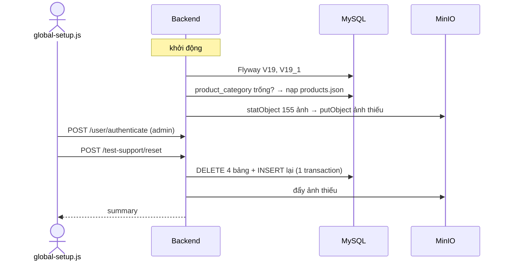

# Dữ liệu giày

## 1. Mục tiêu và phạm vi

Sau lát này DB và MinIO có sẵn **dữ liệu cửa hàng giày cố định, lặp lại được**: 5 danh mục, 30 sản phẩm đang bán (+ 1 sản phẩm ẩn), mỗi sản phẩm 5 ảnh webp và lưới size EU có tồn kho định sẵn.
Bộ automation test có hai API hỗ trợ: `POST /test-support/reset` đưa dữ liệu về trạng thái ban đầu (gọi một lần ở `global-setup.js` trước mỗi lần chạy test) và `GET /test-support/summary` để kiểm dữ liệu.
Đây là lát **chỉ backend + dữ liệu**; các lát `danh-sach-giay`, `chi-tiet-giay`, `gio-hang`, `dat-hang` dùng lại dữ liệu này và file `products.json` để tính kết quả mong đợi.

| Có làm | Không làm (để plan khác) |
|---|---|
| Migration V19: bảng `product_category`, `product`, `product_image`, `product_size`; module `CATALOG` + resource `PRODUCT` | Bảng `favorite` (`yeu-thich`), `shop_order`, `shop_order_item` (`dat-hang`) |
| Chọn tay 30 + 1 sản phẩm trên nike.com/vn → `products.json`; script tải 155 ảnh, đổi sang webp 1000 px, commit vào repo | API công khai `product/public/*`, `product-category/public/list` (`danh-sach-giay`, `chi-tiet-giay`) |
| `ShoeSeedService`: nạp DB khi bảng trống, đẩy ảnh còn thiếu lên MinIO khi khởi động, `reset`, `summary` | API quản trị sản phẩm `/product/*` (`quan-ly-giay`) |
| `POST /test-support/reset`, `GET /test-support/summary` (chỉ profile `local` / `test`, chỉ quản trị) | Giao diện (lát này không có màn hình mới) |
| Seed tài khoản khách `khach1@downbeat.local`, `khach2@downbeat.local` | Reset giỏ / đơn / yêu thích (các lát sau tự mở rộng `reset`) |
| `automation/`: `TestSupportApi`, `data/seed-products.js` (đọc `products.json`, tính số liệu mong đợi), `global-setup.js` gọi reset | Dọn tài khoản `auto+…@downbeat.local` do test đăng ký (§11 câu 3) |

## 2. Tác nhân và phân quyền

| Tác nhân | Quyền | Ghi chú |
|---|---|---|
| Quản trị (`admin@downbeat.local`, role operator) | Gọi `test-support/reset`, `test-support/summary` | Controller gọi `checkPermission(principal, "/test-support/", …)`; không có dòng `resource` cho URI này nên **chỉ role operator (hoặc API key)** qua được |
| `noaccess@`, khách (`free@`, `khach1@`, `khach2@`) | Không | 403 |
| Chưa đăng nhập | Không | 401 |
| Resource `PRODUCT` (module `CATALOG` "Cửa hàng", uri `/product/`) | VIEW, ADD, UPDATE, DELETE | Chỉ tạo dòng để lát 3.1 dùng; hiện trên `/admin/tai-nguyen`, `/admin/phan-quyen` |

## 3. Luồng nghiệp vụ

**Luồng chính:**
1. Backend khởi động trên DB sau V18 → Flyway chạy `V19__du_lieu_giay.sql` (4 bảng + module / resource) và seed `V19_1__seed_khach_test.sql` (profile local).
2. `ShoeSeedRunner` (ApplicationRunner, chạy sau Flyway): `product_category` trống → nạp từ `classpath:seed/giay/products.json` trong một transaction (5 danh mục, 31 sản phẩm, 155 ảnh, toàn bộ size). Sau đó đẩy lên MinIO các ảnh `products/<slug>/<n>.webp` còn thiếu.
3. `automation/global-setup.js`: kiểm backend sống → đăng nhập admin → `POST /test-support/reset` → dữ liệu sản phẩm về đúng `products.json` (kể cả id, tồn kho, giá, trạng thái).
4. Test gọi `GET /test-support/summary` để so số liệu với giá trị tính từ `products.json`.

**Luồng thay thế / ngoại lệ:**
- A1. Khởi động lại khi DB đã có dữ liệu → **không** nạp lại DB (giữ thay đổi của quản trị), chỉ đẩy ảnh còn thiếu.
- A2. MinIO bị xoá trắng → khởi động lại hoặc gọi `reset` sẽ đẩy lại đủ 155 ảnh.
- A3. Quản trị đã sửa tồn kho / giá / thêm sản phẩm (các lát sau) → `reset` xoá sạch 4 bảng sản phẩm rồi nạp lại; sản phẩm thêm mới (id > 31) biến mất.
- E1. MinIO không chạy lúc khởi động → ghi log cảnh báo, app vẫn lên; `summary.missingImages` > 0; lần `reset` sau đẩy lại.
- E2. Gọi `test-support/*` không token → 401; người không phải operator → 403.
- E3. Backend chạy profile khác `local` / `test` (vd `dev`) → controller không được tạo → 404 "Không tìm thấy API".
- E4. `products.json` sai cấu trúc → app không khởi động được (lỗi rõ ràng trong log); được chặn sớm bằng unit test TC-U1 → U5.



## 4. Cơ sở dữ liệu

Migration: `V19__du_lieu_giay.sql` (chỉ **schema** + module / resource, idempotent). Dữ liệu sản phẩm **không** nằm trong migration mà nạp từ `products.json` bằng code (lệch nhẹ so với `thiet-ke-giay.md` §7 bước 3, lý do: `reset` cần dùng lại đúng nguồn dữ liệu đó; §11 câu 1).

| Bảng | Cột | Kiểu | Ràng buộc / ghi chú |
|---|---|---|---|
| `product_category` | `id` | INT PK AUTO_INCREMENT | id cố định 1–5 từ JSON |
| | `slug` | VARCHAR(50) NOT NULL | UNIQUE |
| | `name` | VARCHAR(100) NOT NULL | |
| | `sort_order` | INT NOT NULL DEFAULT 0 | |
| `product` | `id` | INT PK AUTO_INCREMENT | id cố định 1–31 từ JSON |
| | `slug` | VARCHAR(150) NOT NULL | UNIQUE |
| | `style_code` | VARCHAR(30) NOT NULL | UNIQUE, vd `CW2288-111` |
| | `name` | VARCHAR(200) NOT NULL | tiếng Anh như nike.com |
| | `subtitle` | VARCHAR(100) NOT NULL | tiếng Việt, vd "Giày nam", "Giày bóng rổ nữ" |
| | `gender` | VARCHAR(10) NOT NULL | `MEN` / `WOMEN` / `UNISEX` / `BOYS` / `GIRLS` |
| | `category_id` | INT NOT NULL | FK → `product_category.id` (RESTRICT) |
| | `description` | TEXT NOT NULL | tiếng Anh |
| | `price` | BIGINT NOT NULL | VNĐ, giá gốc |
| | `sale_price` | BIGINT NULL | `CHECK (sale_price IS NULL OR sale_price < price)` |
| | `badge` | VARCHAR(20) NULL | `JUST_IN` / `BESTSELLER` / NULL |
| | `status` | VARCHAR(20) NOT NULL DEFAULT 'DRAFT' | `DRAFT` / `PUBLISHED` / `HIDDEN` |
| | `created_time`, `updated_time` | DATETIME NOT NULL | lấy từ JSON (cố định, không `NOW()`) để sắp xếp "Mới nhất" lặp lại được |
| `product_image` | `id` | INT PK AUTO_INCREMENT | `= product_id * 10 + sort_order` |
| | `product_id` | INT NOT NULL | FK → `product.id` ON DELETE CASCADE |
| | `url` | VARCHAR(500) NOT NULL | URL đầy đủ `{system.file-url}/{minio.bucket}/products/<slug>/<n>.webp` |
| | `sort_order` | TINYINT NOT NULL | 1–5; UNIQUE `(product_id, sort_order)` |
| `product_size` | `id` | INT PK AUTO_INCREMENT | `= product_id * 100 + thứ tự size (1..n)` |
| | `product_id` | INT NOT NULL | FK → `product.id` ON DELETE CASCADE |
| | `size_label` | VARCHAR(20) NOT NULL | "EU 40.5", "EU 42" (không ghi ".0"); UNIQUE `(product_id, size_label)` |
| | `size_value` | DECIMAL(4,1) NOT NULL | 40.5 |
| | `stock` | INT NOT NULL DEFAULT 0 | `CHECK (stock >= 0)` |

Index: `product(category_id)`, `product(status, gender)`, `product_size(product_id, size_value)`. Xoá: cứng (chỉ `reset` xoá; quản trị dùng `status = HIDDEN`).

Cùng file V19 (mẫu `INSERT … WHERE NOT EXISTS` như V4):
- module `CATALOG`, tên "Cửa hàng", mô tả "Sản phẩm, đơn hàng của cửa hàng giày".
- resource `PRODUCT`, tên "Quản lý sản phẩm", mô tả "Sản phẩm, ảnh, size và tồn kho", uri `/product/`, actions `["VIEW", "ADD", "UPDATE", "DELETE"]`, thuộc `CATALOG`.

Seed local `db/seed/V19_1__seed_khach_test.sql`: `khach1@downbeat.local` "Khách Một", `khach2@downbeat.local` "Khách Hai", role "Khách hàng", mật khẩu `Admin@123` (cùng hash với `free@` ở V5_1), `INSERT … WHERE NOT EXISTS`.

### 4.1 `products.json` (nguồn sự thật của dữ liệu mẫu)

Đường dẫn: `backend/business/src/main/resources/seed/giay/products.json`; ảnh: `backend/business/src/main/resources/seed/giay/<slug>/<1..5>.webp`.

```json
{
  "categories": [
    { "id": 1, "slug": "lifestyle", "name": "Lifestyle", "sortOrder": 1 },
    { "id": 2, "slug": "chay-bo",   "name": "Chạy bộ",   "sortOrder": 2 },
    { "id": 3, "slug": "bong-ro",   "name": "Bóng rổ",   "sortOrder": 3 },
    { "id": 4, "slug": "jordan",    "name": "Jordan",    "sortOrder": 4 },
    { "id": 5, "slug": "bong-da",   "name": "Bóng đá",   "sortOrder": 5 }
  ],
  "products": [
    {
      "id": 1,
      "slug": "nike-air-force-1-07",
      "styleCode": "CW2288-111",
      "name": "Nike Air Force 1 '07",
      "subtitle": "Giày nam",
      "gender": "MEN",
      "category": "lifestyle",
      "description": "The radiance lives on in the Nike Air Force 1 '07, the basketball original that puts a fresh spin on what you know best.",
      "price": 2929000,
      "salePrice": null,
      "badge": "BESTSELLER",
      "status": "PUBLISHED",
      "createdTime": "2026-09-01T09:00:00",
      "stock": { "EU 47": 0 },
      "sourceUrl": "https://www.nike.com/vn/t/air-force-1-07-shoes-…",
      "sourceImages": ["https://static.nike.com/a/images/…", "…", "…", "…", "…"]
    }
  ]
}
```

- Size suy ra từ `gender` (cố định, không ghi trong JSON); tồn mặc định 20, khoá `stock` chỉ ghi ngoại lệ:

| Giới tính | Size (theo thứ tự `size_value`) | Số size |
|---|---|---|
| `MEN`, `UNISEX` | EU 38.5, 39, 40, 40.5, 41, 42, 42.5, 43, 44, 44.5, 45, 46, 47 | 13 |
| `WOMEN` | EU 35.5, 36, 36.5, 37.5, 38, 38.5, 39, 40, 40.5, 41, 42 | 11 |
| `BOYS`, `GIRLS` | EU 35.5, 36, 36.5, 37.5, 38, 38.5, 39, 40 | 8 |

- **Phân bố bắt buộc** (tính trên 30 sản phẩm `PUBLISHED`; giá đang bán = `salePrice ?? price`):

| Tiêu chí | Yêu cầu |
|---|---|
| Danh mục | Lifestyle 12 · Chạy bộ 6 · Bóng rổ 5 · Jordan 5 · Bóng đá 2 |
| Giới tính | MEN 12 · WOMEN 10 · UNISEX 4 · BOYS 2 · GIRLS 2 |
| Khoảng giá đang bán | < 1.000.000 ≥ 4 · 1.000.000–2.000.000 ≥ 4 · 2.000.001–4.999.999 ≥ 4 · ≥ 5.000.000 ≥ 4 |
| Giá biên | có sản phẩm giá đang bán đúng **1.000.000**, **2.000.000**, **5.000.000** (cho test giá trị biên ở lát sau) |
| Giảm giá | đúng 6 sản phẩm có `salePrice` |
| Nhãn | đúng 8 `JUST_IN` (và là 8 sản phẩm có `createdTime` mới nhất), đúng 5 `BESTSELLER`; không trùng nhau |
| Tồn kho | 1 sản phẩm **hết hàng** (mọi size 0) · 1 sản phẩm **ít hàng** (tổng tồn 1–3, cho cảnh báo "Chỉ còn ít hàng") · 2 sản phẩm có đúng một size `stock = 1` (ca tranh mua đôi cuối) · mọi sản phẩm còn lại có 1–2 size `stock = 0`, các size khác 20 |
| Sản phẩm ẩn | id 31, `status: HIDDEN`, danh mục Lifestyle, MEN, không nhãn (cho ca "sản phẩm ẩn không hiện / mở link → không tìm thấy") |

Giá lấy theo nike.com/vn; được chỉnh để đủ phân bố trên (giữ đuôi `…000`).

## 5. Hợp đồng API (cố định — nguồn sự thật cho cả BE và FE)

Mọi response bọc `{ "code": …, "message": …, "result": … }`. Prefix `/api`. Hai endpoint chỉ có khi profile là `local` hoặc `test` (`@Profile({"local", "test"})` trên controller).

### 5.1 `GET /api/test-support/summary` — operator (`checkPermission(…, "/test-support/", "VIEW")`)

Response `result` (số ở các trường `sizes`, `outOfStockSizes`, `totalStock` là ví dụ; giá trị thật tính từ `products.json`):
```json
{
  "categories": 5,
  "products": 31,
  "publishedProducts": 30,
  "hiddenProducts": 1,
  "images": 155,
  "missingImages": 0,
  "sizes": 360,
  "outOfStockSizes": 52,
  "totalStock": 6150,
  "byCategory": { "lifestyle": 12, "chay-bo": 6, "bong-ro": 5, "jordan": 5, "bong-da": 2 },
  "byGender": { "MEN": 12, "WOMEN": 10, "UNISEX": 4, "BOYS": 2, "GIRLS": 2 },
  "onSale": 6,
  "justIn": 8,
  "bestseller": 5,
  "sample": {
    "id": 1,
    "slug": "nike-air-force-1-07",
    "imageUrls": [
      "http://localhost:9020/downbeat-public/products/nike-air-force-1-07/1.webp",
      "http://localhost:9020/downbeat-public/products/nike-air-force-1-07/2.webp",
      "http://localhost:9020/downbeat-public/products/nike-air-force-1-07/3.webp",
      "http://localhost:9020/downbeat-public/products/nike-air-force-1-07/4.webp",
      "http://localhost:9020/downbeat-public/products/nike-air-force-1-07/5.webp"
    ],
    "sizes": [
      { "id": 101, "sizeLabel": "EU 38.5", "sizeValue": 38.5, "stock": 20 },
      { "id": 102, "sizeLabel": "EU 39", "sizeValue": 39.0, "stock": 20 }
    ]
  }
}
```
- `categories`, `products`, `images`, `sizes`, `outOfStockSizes` (`stock = 0`), `totalStock`: đếm trên **toàn bộ** bảng (kể cả sản phẩm ẩn).
- `byCategory` (khoá = slug), `byGender`, `onSale`, `justIn`, `bestseller`: chỉ sản phẩm `PUBLISHED`.
- `missingImages`: số dòng `product_image` mà object tương ứng không có trên MinIO (`FileStorageService.existsPublic`).
- `sample`: sản phẩm id nhỏ nhất, ảnh theo `sort_order`, size theo `size_value` tăng dần.
- Kiểu trả về: `record SeedSummary` trong `business.testsupport` (không phải bảng nên không có POJO entity).

### 5.2 `POST /api/test-support/reset` — operator (`checkPermission(…, "/test-support/", "UPDATE")`)

Không có body. Xoá `product_size`, `product_image`, `product`, `product_category` rồi nạp lại từ `products.json` (một transaction, id giữ đúng công thức §4), sau đó đẩy ảnh thiếu lên MinIO.
Response `result`: đúng cấu trúc §5.1, thêm `"resetAt": "2026-11-18T20:15:03"`. Gọi nhiều lần liên tiếp cho cùng kết quả.

### 5.3 Không đổi

`/user/authenticate`, `/account/me`, `/resource/list`, `/module/list` giữ hợp đồng cũ; chỉ có thêm dữ liệu (module `CATALOG`, resource `PRODUCT`, hai tài khoản khách).

### 5.4 Lỗi

| Tình huống | HTTP | Message |
|---|---|---|
| `test-support/*` không token | 401 | "Chưa đăng nhập" (bộ lọc JWT dùng chung, sửa ở phiên A — xem §12) |
| `test-support/*` token sai | 401 | "Token không hợp lệ hoặc sai chữ ký" |
| `test-support/summary` bằng tài khoản không phải operator | 403 | "Bạn không có quyền thực hiện thao tác này! Path: /test-support/, Action: VIEW" |
| `test-support/reset` bằng tài khoản không phải operator | 403 | "Bạn không có quyền thực hiện thao tác này! Path: /test-support/, Action: UPDATE" |
| Profile khác `local` / `test` | 404 | "Không tìm thấy API" (handler hiện có) |

## 6. Giao diện (chuỗi cố định — test E2E chọn theo đúng các chuỗi này)

Lát này **không thêm màn hình**. Dữ liệu mới chỉ lộ ra ở các trang quản trị đã có:
- `/admin/tai-nguyen`: có dòng "Quản lý sản phẩm", mã `PRODUCT`, URI `/product/`.
- `/admin/phan-quyen`: ma trận có hàng "Quản lý sản phẩm".

## 7. Việc backend (Claude)

Thứ tự:

1. **Chọn dữ liệu** (làm đầu phiên A, trước khi code): chọn tay 31 sản phẩm trên nike.com/vn theo phân bố §4.1, ghi `products.json` (kèm `sourceUrl`, 5 `sourceImages`). Không cào hàng loạt; mỗi trang mở một lần.
2. `tools/seed/giay/` (Node, `package.json` riêng, phụ thuộc `sharp`): `fetch-images.mjs` đọc `products.json`, tải 155 URL trong `sourceImages` (giãn cách 1 giây, bỏ qua file đã có), đổi sang webp chiều rộng 1000 px chất lượng 80, ghi `backend/business/src/main/resources/seed/giay/<slug>/<n>.webp`. `README.md` ngắn: lệnh chạy, khi nào cần chạy lại. Ảnh commit vào repo (máy khác không cần mạng).
3. `V19__du_lieu_giay.sql` đúng §4; `db/seed/V19_1__seed_khach_test.sql`.
4. Restart backend → `mvn -pl entity generate-sources` sinh lại jOOQ; POJO `vn.aeoc.entity.data.mysql.product.{ProductCategory, Product, ProductImage, ProductSize}`.
5. `business.product.repository`: `ProductCategoryRepository`, `ProductRepository`, `ProductImageRepository`, `ProductSizeRepository` (đều `extends AbsMysqlRepository`, bảng nào cũng có `id`). Hàm đếm cho summary viết trong repository tương ứng (`fetchGroups` / biểu thức SQL riêng được phép theo `backend/AGENTS.md`).
6. `business.product.seed`:
   - `ShoeSeedData`: đọc `products.json` (Jackson) → danh sách bản ghi 4 bảng; **hàm thuần**, không đụng DB / MinIO: suy size từ gender (bảng §4.1), áp `stock`, tính id ảnh / size theo công thức §4, `sizeLabel` không có ".0". Unit test TC-U1 → U6 gọi thẳng lớp này.
   - `ShoeSeedService` (`extends BaseService<ProductRepository, Product, Integer>`): `seedIfEmpty()`, `reset()` (`@Transactional` cho phần DB: xoá theo thứ tự size → image → product → category, insert theo lô có id), `pushMissingImages()` (ngoài transaction; key `products/<slug>/<n>.webp`, content-type `image/webp`, dùng `FileStorageService.existsPublic` / `putPublic`; lỗi MinIO → log cảnh báo, không ném), `summary()`. URL ảnh dựng từ `system.file-url` + `minio.bucket` (cùng công thức `putPublic`).
   - `ShoeSeedRunner implements ApplicationRunner` (mọi profile): `seedIfEmpty()` rồi `pushMissingImages()`; log "Seed giày: nạp 31 sản phẩm" / "Seed giày: đã có dữ liệu, bỏ qua" và "Seed giày: đẩy n ảnh lên MinIO".
7. `business.testsupport`: `TestSupportController extends BaseController` (`@Profile({"local", "test"})`, `URI = "/test-support/"`), `SeedSummary` record. Không thêm dòng `resource` cho URI này.
8. `backend/AGENTS.md`: thêm một dòng ở mục mẫu code: dữ liệu mẫu giày nằm ở `seed/giay/products.json`, sửa dữ liệu thì sửa file này (không sửa bằng migration), và `reset` phải được các lát sau mở rộng khi thêm bảng tham chiếu `product` / `product_size` (xoá bảng con trước).
9. `automation/` (phiên A, trước khi code backend):
   - `api/TestSupportApi.js` (`summary()`, `reset()`), export ở `api/index.js`.
   - `data/seed-products.js`: đọc `../backend/business/src/main/resources/seed/giay/products.json` (đường dẫn tương đối theo `import.meta.url`), export `seedProducts`, `sizesOf(gender)`, `expectedSummary()` (đúng các khoá §5.1 trừ `missingImages`, `sample`, `resetAt`). Lát sau dùng lại để tính kết quả lọc mong đợi.
   - `data/accounts.js`: thêm `khach1`, `khach2`.
   - `global-setup.js`: sau khi kiểm backend sống, đăng nhập admin và gọi `reset`; bỏ qua khi `E2E_SKIP_RESET=1`; reset lỗi → dừng với thông báo "Không reset được dữ liệu test: <message>".
   - `tests/api/go-lut.api.spec.js` TC-10 / TC-11: bỏ `CATALOG` khỏi danh sách "phải vắng" (lát này thêm lại có chủ đích theo `go-lut` §4 "lát sau thêm lại module CATALOG"); vẫn kiểm `LUT`, `RECOMMEND`, `RECOMMENDER`, `SALES`, `DASHBOARD` vắng. Ghi lý do vào §12.

Unit test bắt buộc: TC-U1 → TC-U7 ở §9. `mvn -q -Djooq.codegen.skip=true test` xanh (TC-U7 cần Docker MySQL + MinIO như `ApplicationContextTest`).

## 8. Việc frontend (Claude)

Không có màn hình mới. Phiên B chỉ:
1. `cd frontend && pnpm api:types` khi backend mới đã chạy (OpenAPI có thêm `test-support`), `pnpm build && pnpm lint` xanh.
2. Chạy E2E TC-14, TC-15 có giao diện, chụp ảnh tài liệu, smoke toàn bộ.

Component shadcn dùng: không có.

## 9. Test case

API ở `automation/tests/api/du-lieu-giay.api.spec.js`, giao diện ở `automation/tests/admin/du-lieu-giay.spec.js`, JUnit ở `backend/business/src/test/java/vn/aeoc/business/product/seed/`.
"Mong đợi tính từ JSON" nghĩa là so với `expectedSummary()` của `data/seed-products.js`, không ghi cứng số.

| ID | Loại | Mô tả | Tiền điều kiện | Bước | Kết quả mong đợi |
|---|---|---|---|---|---|
| TC-01 | api | Summary: số lượng tổng | đăng nhập admin, sau reset | `GET /api/test-support/summary` | 200; `categories = 5`, `products = 31`, `publishedProducts = 30`, `hiddenProducts = 1`, `images = 155`, `missingImages = 0` |
| TC-02 | api | Summary: phân bố theo kế hoạch | như TC-01 | `GET /api/test-support/summary` | `byCategory = {lifestyle:12, chay-bo:6, bong-ro:5, jordan:5, bong-da:2}`; `byGender = {MEN:12, WOMEN:10, UNISEX:4, BOYS:2, GIRLS:2}`; `onSale = 6`, `justIn = 8`, `bestseller = 5` |
| TC-03 | api | Summary khớp `products.json` | như TC-01 | `GET /api/test-support/summary`, so với `expectedSummary()` | `sizes`, `outOfStockSizes`, `totalStock` và mọi khoá ở TC-01, TC-02 bằng đúng giá trị tính từ JSON |
| TC-04 | api | Sản phẩm mẫu: ảnh truy cập được, size đúng thứ tự | như TC-01 | đọc `result.sample`; `GET` từng URL trong `imageUrls` (không token) | `imageUrls` có 5 phần tử kết thúc `/1.webp` → `/5.webp`; mỗi URL 200, `content-type: image/webp`, thân > 1 KB; `sizes[0].id = 101`, `sizeValue` tăng dần, `sizeLabel` dạng `EU 38.5` / `EU 39` (không có ".0"), khớp `sizesOf(gender)` của sản phẩm id 1 |
| TC-05 | api | Reset trả về đúng dữ liệu ban đầu | đăng nhập admin | `POST /api/test-support/reset` | 200; `result` khớp `expectedSummary()`, `missingImages = 0`, có `resetAt` dạng `yyyy-MM-ddTHH:mm:ss`; `GET summary` ngay sau đó trả cùng số liệu |
| TC-06 | api | Reset gọi lặp không lỗi, id ổn định | đăng nhập admin | `POST reset` hai lần liên tiếp | cả hai 200, số liệu giống nhau; `sample.id = 1`, `sample.sizes[0].id = 101` cả hai lần |
| TC-07 | api | Không token / token sai | — | `GET /api/test-support/summary`, `POST /api/test-support/reset` không header `Authorization`, rồi với `Authorization: Bearer abc.def.ghi` | không token: cả hai 401 "Chưa đăng nhập"; token sai: cả hai 401 "Token không hợp lệ hoặc sai chữ ký" |
| TC-08 | api | Không phải operator | đăng nhập `noaccess@`, rồi `khach1@` | `GET summary`, `POST reset` bằng từng tài khoản | 403; summary: "Bạn không có quyền thực hiện thao tác này! Path: /test-support/, Action: VIEW"; reset: "… Action: UPDATE" |
| TC-09 | api | Resource `PRODUCT` và module `CATALOG` | đăng nhập admin | `GET /api/resource/list` (hết trang), `GET /api/module/list` | có resource `code = PRODUCT`, `name = "Quản lý sản phẩm"`, `uri = "/product/"`, actions đủ `VIEW, ADD, UPDATE, DELETE`, thuộc module `CATALOG`; module `CATALOG` tên "Cửa hàng"; vẫn không có resource `LUT`, `RECOMMEND`, `DASHBOARD`, module `RECOMMENDER`, `SALES` |
| TC-10 | api | Tài khoản khách test | — | `POST /api/user/authenticate` lần lượt `khach1@downbeat.local`, `khach2@downbeat.local` / `Admin@123` → `GET /api/account/me` | đăng nhập 200 có `result.token`; `me.roleName = "Khách hàng"`, `me.name` = "Khách Một" / "Khách Hai", `isOperator = 0` |
| TC-11 | api | Không có endpoint thừa ngoài hợp đồng | đăng nhập admin | `POST /api/test-support/summary`, `GET /api/test-support/reset` (sai method) | không trả 200 (405 hoặc 404); dữ liệu không đổi (summary sau đó khớp `expectedSummary()`) |
| TC-12 | api | global-setup đã reset trước khi chạy | chạy bộ test bình thường (không đặt `E2E_SKIP_RESET`) | trong spec: `GET summary` ở test đầu tiên | khớp `expectedSummary()` (kể cả khi trước đó DB có thay đổi tay) |
| TC-13 | e2e | Tài nguyên mới hiện ở trang quản trị | đăng nhập admin (storageState) | mở `/admin/tai-nguyen`, tìm "Quản lý sản phẩm" | có đúng một dòng "Quản lý sản phẩm" với mã `PRODUCT`, URI `/product/` |
| TC-14 | e2e | Ma trận phân quyền có hàng sản phẩm | đăng nhập admin | mở `/admin/phan-quyen` | ma trận tải được, có hàng "Quản lý sản phẩm" |
| TC-U1 | unit | `products.json` hợp lệ về cấu trúc | — | `ShoeSeedData.load()` | 5 danh mục, 31 sản phẩm; id sản phẩm 1–31 không trùng; `slug`, `styleCode` không trùng; mọi trường bắt buộc khác rỗng; `gender`, `badge`, `status`, `category` thuộc tập cho phép; `salePrice` null hoặc < `price` |
| TC-U2 | unit | Phân bố danh mục / giới tính / nhãn / giảm giá | — | đếm trên 30 sản phẩm `PUBLISHED` | đúng bảng "Phân bố bắt buộc" §4.1; 8 `JUST_IN` là 8 `createdTime` mới nhất; không sản phẩm nào vừa `JUST_IN` vừa `BESTSELLER`; id 31 là `HIDDEN` |
| TC-U3 | unit | Khoảng giá và giá biên | — | tính giá đang bán = `salePrice ?? price` | mỗi khoảng trong 4 khoảng §4.1 ≥ 4 sản phẩm; có giá đúng 1.000.000, 2.000.000, 5.000.000; mọi giá chia hết cho 1.000 |
| TC-U4 | unit | Size và id | — | `ShoeSeedData` dựng `product_size`, `product_image` | size đúng bảng theo gender, tăng dần; `sizeLabel` "EU 42" (không ".0"), "EU 40.5"; id size = `productId*100 + k`, id ảnh = `productId*10 + n`; khoá `stock` trong JSON chỉ dùng size có thật (sai → ném lỗi có tên sản phẩm + size) |
| TC-U5 | unit | Quy tắc tồn kho | — | tính tồn từng sản phẩm | đúng 1 sản phẩm hết hàng; đúng 1 sản phẩm tổng tồn 1–3; đúng 2 sản phẩm khác có đúng một size `stock = 1`; các sản phẩm còn lại có 1–2 size `stock = 0`, size khác 20 |
| TC-U6 | unit | File ảnh có trong resources | — | với mỗi sản phẩm, đọc `seed/giay/<slug>/<1..5>.webp` từ classpath | đủ 155 file; mỗi file bắt đầu bằng `RIFF….WEBP`, 1 KB < dung lượng ≤ 300 KB |
| TC-U7 | unit | Reset khôi phục sau khi dữ liệu bị đổi | `@SpringBootTest`, Docker MySQL + MinIO | đặt `stock = 0` cho size 101, đổi `price` sản phẩm 2, xoá sản phẩm 3, thêm sản phẩm id 99 → `reset()` | size 101 về tồn theo JSON, giá sản phẩm 2 về JSON, sản phẩm 3 có lại đủ 5 ảnh + size, sản phẩm 99 không còn; `summary()` khớp số liệu tính từ `ShoeSeedData` |

Không có ca "id không tồn tại → 404" vì lát này không có endpoint nhận id. Ca 404 theo profile (E3) chỉ kiểm khi review bằng cách đọc annotation `@Profile` (môi trường test chạy profile `local`).

## 10. Tiêu chí hoàn thành

- [x] Mọi TC ở §9 pass
- [x] `mvn test`, `pnpm build`, `pnpm lint` (frontend + automation) xanh
- [x] Khởi động trên DB sau V18: log "Successfully applied 2 migrations" (V19, V19_1) và "Seed giày: nạp 31 sản phẩm"; khởi động lần hai: "đã có dữ liệu, bỏ qua"
- [x] Mở tay 2–3 URL ảnh trên trình duyệt thấy đúng ảnh giày
- [x] Có `docs/chuc-nang/du-lieu-giay.md` (kèm bảng 30 sản phẩm: tên, danh mục, giới tính, giá, nhãn)

## 11. Rủi ro / câu hỏi mở

> **Người dùng chốt 18/11/2026: làm theo mọi phương án đề xuất bên dưới** — (1) nạp từ `products.json` bằng code; (2) có sản phẩm ẩn thứ 31 (155 ảnh); (3) reset không xoá tài khoản `auto+…`; (4) nike.com chặn thì dừng và nhờ người dùng gửi link / ảnh; (6) bỏ dòng `backend/**/src/test/` khỏi `.gitignore` ở phiên A để JUnit vào repo; (7) sửa `go-lut.api.spec.js` như §7 bước 9.

1. **Dữ liệu nạp bằng code thay vì migration** (`thiet-ke-giay.md` §7 bước 3 ghi "V19 nạp danh mục + 30 sản phẩm"). Đề xuất nạp từ `products.json` vì `reset` cần đúng nguồn dữ liệu đó, sửa dữ liệu không phải viết migration mới, và automation đọc được cùng file để tính kết quả mong đợi. Đồng ý không?
2. **Thêm sản phẩm ẩn thứ 31** (155 ảnh thay vì 150) để lát `danh-sach-giay` / `chi-tiet-giay` test được "sản phẩm HIDDEN không hiện / mở link → không tìm thấy" mà không phải đợi lát quản trị 3.1. Phương án khác: chỉ 30 sản phẩm, ca đó dời sang 3.1.
3. **Reset có xoá tài khoản `auto+…@downbeat.local` do test đăng ký không?** Đề xuất: **không** ở lát này (xoá user trong lúc worker khác đang chạy dễ làm test chập chờn); DB local chỉ phình vài dòng mỗi lần chạy.
4. **Truy cập nike.com**: trang dựng bằng JS, có thể chặn công cụ tải tự động. Nếu không đọc được tên / giá / ảnh ở phiên A, Claude dừng và nhờ bạn: (a) gửi danh sách link sản phẩm, hoặc (b) cho dùng ảnh tải tay vào `tools/seed/giay/raw/<slug>/`. Dung lượng dự kiến ~8–10 MB ảnh trong repo và trong jar.
5. **Ảnh và mô tả của Nike** chỉ dùng học tập, chạy local (quyết định D2 / lưu ý ở `thiet-ke-giay.md`); `tools/seed/giay/README.md` và tài liệu chức năng ghi lại điều này.
6. **Unit test backend không vào git**: `.gitignore` dòng `backend/**/src/test/` vẫn bỏ qua mọi JUnit (đã gặp ở `go-lut`). Lát này có 7 TC unit; đề xuất bỏ dòng đó để test vào repo và chạy được trên CI. Bạn quyết định trước khi cook.
7. Sửa `go-lut.api.spec.js` (bỏ `CATALOG` khỏi danh sách phải vắng) là sửa spec của lát đã xong, đúng ngoại lệ "spec sai so với plan mới" ở CLAUDE.md; ghi lý do ở §12.

## 12. Nhật ký thực hiện (do /cook và /doc-chuc-nang ghi — nối các phiên A/B/C)

| Thời điểm | Sự kiện |
|---|---|
| 2026-11-18 | Người dùng duyệt plan, chọn mọi phương án đề xuất ở §11. |
| 2026-11-18 19:50 | **Phiên A bắt đầu**, status `in-progress`. Preflight: MySQL / MinIO chạy, backend 200. File bẩn có sẵn trước phiên (từ `go-lut`, không đụng): xoá `docs/archive/lut/*`, `plan/_template.md`, các plan LUT + `plan/tasks/*`; sửa `plan/README.md`. |
| 2026-11-18 20:00 | **Chọn dữ liệu**: nike.com/vn đọc được (`__NEXT_DATA__`), không bị chặn. Mở 10 trang danh mục + 31 trang sản phẩm, mỗi trang một lần → `products.json` (31 sp, mô tả tiếng Anh nguyên văn, 5 `sourceImages` bản PDP 1280). Chỉnh để đủ phân bố §4.1: giá Offcourt W 1.019.000 → **1.000.000**, Zoom Fly 6 W 4.999.000 → **5.000.000**, Precision 8 Low giảm còn **2.000.000**, Calm 2.0 (trẻ em) giảm còn 815.000; giá giảm làm tròn đuôi `…000`; gender: Victori One / Ja 4 / A'Two → UNISEX, 2 giày bóng đá → MEN; nhãn đặt theo plan (không theo nhãn trên web); sửa tên thiếu dấu nháy "Jordan Spizike Low 'Jam Central'". id 9 hết hàng, id 18 ít hàng (EU 38 còn 3), id 13 / 20 có đúng một size còn 1 đôi, id 31 ẩn. |
| 2026-11-18 20:05 | `tools/seed/giay/` (sharp 0.34): tải đủ 155 ảnh → webp 1000 px q80, tổng 6,0 MB, mỗi file 2–300 KB; xem tay ảnh AF1 đúng giày. Bỏ dòng `backend/**/src/test/` khỏi `.gitignore` (§11 câu 6) → `backend/app/src/test`, `backend/business/src/test` (gồm test cũ `ApplicationContextTest`, `PayosSignatureTest`) sẽ vào git ở phiên C. |
| 2026-11-18 20:10 | **Spec nghiệm thu** (viết trước code): `tests/api/du-lieu-giay.api.spec.js` (TC-01 → TC-12), `tests/admin/du-lieu-giay.spec.js` (TC-13, TC-14), `api/TestSupportApi.js`, `data/seed-products.js`, `pages/ResourcePage.js` (+ fixture `resourcePage`), `accounts.js` thêm `khach1` / `khach2`, `global-setup.js` gọi reset (bỏ qua khi `E2E_SKIP_RESET=1`). `go-lut.api.spec.js` TC-11: bỏ `CATALOG` khỏi danh sách phải vắng — lát này thêm lại module `CATALOG` có chủ đích (go-lut §4), là spec sai so với plan mới chứ không phải sửa để xanh. |
| 2026-11-18 20:12 | **Sửa plan §5.4 + TC-07** (lệch hành vi có sẵn): không token thì bộ lọc JWT dùng chung trả 401 **"Chưa đăng nhập"** (`ErrorCode.LOGIN`), còn "Token không hợp lệ hoặc sai chữ ký" là của token sai. Không đổi bộ lọc (dùng chung mọi API, §5.3 giữ hợp đồng cũ); TC-07 kiểm cả hai ca. **TC-11**: sai method trước đây trả 500 "Lỗi hệ thống" → thêm `ErrorCode.METHOD_NOT_ALLOWED` + handler `HttpRequestMethodNotSupportedException` ở `GlobalExceptionHandler` → **405 "Phương thức HTTP không được hỗ trợ"** (áp dụng mọi API). |
| 2026-11-18 20:20 | **Backend**: V19 + seed V19_1 (Flyway "Successfully applied 2 migrations", v19.1); jOOQ sinh lại; POJO `entity.data.mysql.product.*`; 4 repository; `ShoeSeedData` (hàm thuần, kiểm cấu trúc JSON → `IllegalStateException`), `ShoeSeedService` (DB qua `TransactionTemplate` + `ReentrantLock` để hai lần reset song song không đan xen; đẩy ảnh ngoài transaction, lỗi MinIO chỉ cảnh báo), `ShoeSeedRunner` (gọi `FileStorageService.ensureBucket()` trước khi đẩy ảnh vì runner chạy trước `ApplicationReadyEvent`), `TestSupportController` `@Profile({"local","test"})`, `SeedSummary`. `backend/AGENTS.md` thêm dòng về `products.json` / `reloadDatabase()`. Lệch nhỏ: **TC-U7** đặt ở `backend/app/src/test/.../ShoeSeedResetTest.java` (cần `@SpringBootApplication` của module app), TC-U1 → U6 ở `business/src/test/.../product/seed/ShoeSeedDataTest.java`. |
| 2026-11-18 20:23 | **Tự review + kiểm**: review sửa 1 lỗi checklist (service tự dựng điều kiện jOOQ → chuyển vào `ProductRepository.countPublishedOnSale / countPublishedByBadge`). `mvn test` 12/12 xanh (ShoeSeedDataTest 7, ShoeSeedResetTest 1, ApplicationContextTest 1, PayosSignatureTest 3). Xoá trắng 4 bảng rồi restart → log "Seed giày: nạp 31 sản phẩm" + "đẩy 0 ảnh"; restart lần hai → "đã có dữ liệu, bỏ qua". Nhóm API **35/35 xanh** (du-lieu-giay 12, go-lut 11, auth 10, role 2); automation `pnpm lint` xanh. Kiểm tay: GET reset → 405, ảnh MinIO 200 `image/webp`. Summary thật: sizes 363, outOfStockSizes 59, totalStock 6025. |
| 2026-11-18 20:24 | **phiên A xong**. Phiên B: `cd frontend && pnpm api:types` (OpenAPI có `test-support`), `pnpm build && pnpm lint`; E2E có giao diện **TC-13, TC-14** (§8 ghi nhầm "TC-14, TC-15") ở `tests/admin/du-lieu-giay.spec.js` với `E2E_DOC_SHOTS=../docs/chuc-nang/img/du-lieu-giay`; rồi `pnpm test:smoke`. |
| 2026-11-18 20:40 | **Phiên B**: preflight MySQL / MinIO chạy, backend 200. `pnpm api:types` → `api.gen.ts` +130 dòng (`/test-support/reset`, `/test-support/summary`, `SeedSummary`); không màn hình mới nên không sửa code frontend khác. `pnpm build` xanh (cảnh báo chunk > 500 kB có sẵn), `pnpm lint` 0 lỗi (1 cảnh báo `react-hooks/exhaustive-deps` có sẵn ở `data-table-advanced.tsx`, không thuộc lát này). |
| 2026-11-18 20:42 | **E2E có giao diện** (chromium, `--headed`, slowMo 400): TC-13, TC-14 **2/2 xanh** (+ 2 bước setup đăng nhập). Ảnh tài liệu: `docs/chuc-nang/img/du-lieu-giay/01-tai-nguyen-san-pham.png` (dòng "Quản lý sản phẩm" / `PRODUCT` / `/product/` / module "Cửa hàng"), `02-phan-quyen-san-pham.png` (nhóm "Cửa hàng (1 tài nguyên)" trong ma trận). `pnpm test:smoke` mọi project **32/32 xanh**. Không lệch plan ngoài các điểm đã ghi ở phiên A (§8 ghi "TC-14, TC-15" là nhầm, thực tế TC-13, TC-14). |
| 2026-11-18 20:43 | **phiên B xong**. Phiên C: `/doc-chuc-nang du-lieu-giay` (tài liệu kèm bảng 30 sản phẩm theo §10; ảnh đã có). |
| 2026-11-18 21:00 | **Phiên C**: viết `docs/chuc-nang/du-lieu-giay.md` (21 TC pass: 14 Playwright + 7 unit; JUnit 12/12; API 35/35; smoke 32/32; 2 ảnh), plan → `done`, commit + push `feature/du-lieu-giay` + mở PR vào `main`. |
