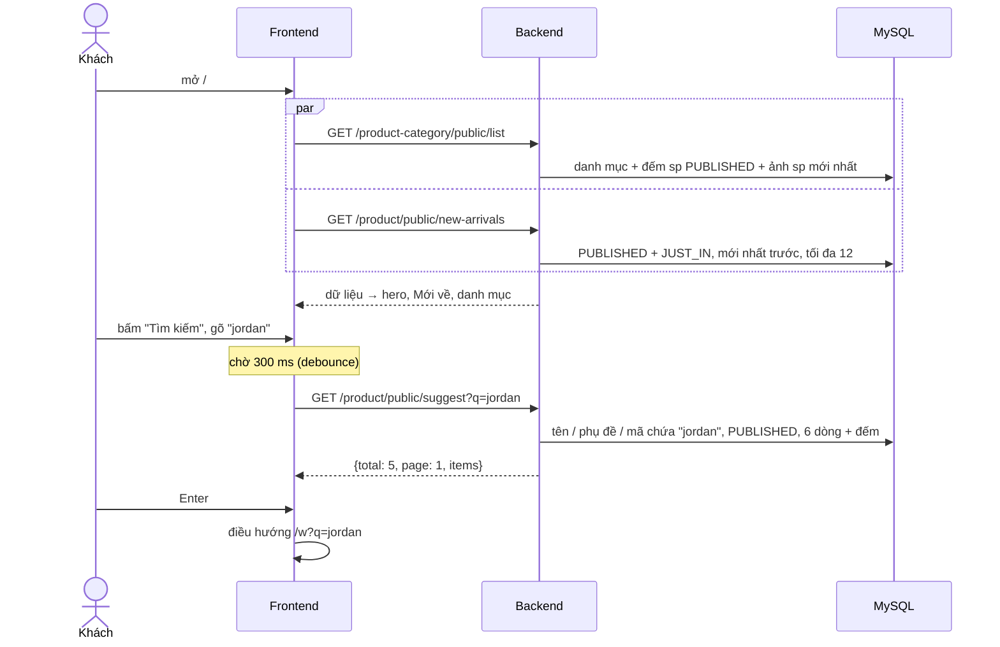

# Giao diện Nike

## 1. Mục tiêu và phạm vi

Sau lát này, mọi trang cửa hàng có **khung giao diện bám nike.com/vn**: dải trên, thanh chính có mega menu, khung tìm kiếm có gợi ý sản phẩm thật, dải thông báo, footer, menu trượt trên điện thoại.
Trang chủ `/` thay trang tạm "Cửa hàng đang được nâng cấp" bằng hero, dải "Mới về" (8 sản phẩm thật), khối Jordan và "Mua theo danh mục" (5 danh mục thật).
Các lát sau (`danh-sach-giay`, `chi-tiet-giay`, `gio-hang`…) chỉ việc đặt trang của mình vào khung này và dùng lại `ProductCard`, dải cuộn ngang, hợp đồng URL `/w`.

| Có làm | Không làm (để plan khác) |
|---|---|
| Token màu / font Nike cho khu cửa hàng, `formatVnd` ra `5.279.000 ₫`, favicon swoosh, dọn ảnh / video LUT trong `frontend/public/` | Trang đăng nhập riêng kiểu "nhập email trước" + `POST /account/public/check-email` (lát `dang-nhap-nike`, §11 câu 1). Lát này giữ hộp thoại đăng nhập / đăng ký hiện có, chỉ đổi style |
| Header: dải trên, thanh chính, mega menu 5 mục, ẩn khi cuộn xuống / hiện khi cuộn lên, dải thông báo | Số lượng trên icon túi (`gio-hang`), trang `/yeu-thich`, `/gio-hang` thật (`yeu-thich`, `gio-hang`) |
| Header + menu trượt (có panel con) + footer accordion trên điện thoại | Trang danh sách `/w` thật, `product/public/list` + facets (`danh-sach-giay`) |
| Khung tìm kiếm: "Tìm kiếm phổ biến", gợi ý sản phẩm, Enter → `/w?q=` | Trang chi tiết `/t/$slug` thật (`chi-tiet-giay`) |
| 3 API công khai: `GET /product-category/public/list`, `GET /product/public/new-arrivals`, `GET /product/public/suggest` (2 API đầu và `suggest` chuyển từ lát 1.4 sang, §11 câu 2) | Dark mode cho cửa hàng (Nike không có; trang quản trị vẫn đổi được, §11 câu 7) |
| Trang chủ: hero, "Mới về", khối Jordan, "Mua theo danh mục" | Banner xen giữa lưới danh sách (lát 1.4) |
| `ProductCard`, `ProductRail` (dải cuộn ngang) dùng lại ở lát sau | |
| Hợp đồng URL `/w` (`catalogSearchSchema`) + **trang tạm** cho `/w`, `/w/$danhMuc`, `/t/$slug`, `/yeu-thich`, `/gio-hang` để link trong header không ra 404 (§11 câu 4) | |
| 15 trang thông tin tĩnh `/thong-tin/$trang` cho link ở dải trên / footer | |
| `automation/`: `HomePage`, `HeaderComponent`, `SearchOverlay`, `MobileMenu`, `FooterComponent`, `ProductCard`, `InfoPage`, `ProductApi`; sửa `go-lut.spec.js` theo header mới | Visual regression (lát 4.2) |

## 2. Tác nhân và phân quyền

| Tác nhân | Quyền | Ghi chú |
|---|---|---|
| Khách chưa đăng nhập | Xem mọi trang của lát, gọi 3 API công khai | Đường dẫn `/<x>/public/...` đã được `JwtAuthenticationFilter` mở sẵn (`PUBLIC_FILE_PATH`), token sai / hết hạn bị bỏ qua chứ không 401 |
| Khách đã đăng nhập (`free@`, `khach1@`, `khach2@`) | Như trên + menu "Xin chào, <tên>" | Không thấy mục "Trang quản trị" |
| Quản trị (`admin@`, hoặc có quyền VIEW bất kỳ) | Như trên + mục "Trang quản trị" trong menu tài khoản | Quy tắc `useCanOpenAdmin` hiện có, giữ nguyên |

Không có resource mới, không có ca 403: cả ba API đều công khai.

## 3. Luồng nghiệp vụ

**Luồng chính:**
1. Khách mở `/`. Trang gọi song song `GET /product-category/public/list` và `GET /product/public/new-arrivals`; hiện header, hero, dải "Mới về" 8 thẻ, khối Jordan, 5 ô danh mục, footer.
2. Rê chuột vào "Nam" → mega menu 3 cột ("Danh mục", "Nổi bật", "Theo giá"), mọi link gắn `gioiTinh=nam` → bấm "Bóng rổ" → `/w/bong-ro?gioiTinh=nam` (trang tạm đến lát 1.4).
3. Bấm ô "Tìm kiếm" → khung tìm kiếm phủ đầu trang, ô nhập có focus, hiện "Tìm kiếm phổ biến". Gõ "jordan" → sau 300 ms gọi `GET /product/public/suggest?q=jordan` → 5 thẻ gợi ý + "Xem tất cả 5 kết quả". Enter → `/w?q=jordan`.
4. Cuộn trang xuống → thanh chính trượt ẩn; cuộn lên → hiện lại, dính đầu trang.
5. Bấm "Giao hàng" ở footer → `/thong-tin/giao-hang` (phí 30.000 ₫, miễn phí từ 5.000.000 ₫).

**Luồng thay thế:**
- A1. Màn < 1024px: không có dải trên và menu giữa; thanh chính còn swoosh + 4 icon (Tìm kiếm, Đăng nhập / tài khoản, Giỏ hàng, Menu). "Menu" mở ngăn trượt phải; bấm "Nam" → panel con "Nam" với 3 nhóm link như mega menu, nút "Quay lại". Footer thành accordion.
- A2. Đã đăng nhập: dải trên thay "Tham gia | Đăng nhập" bằng "Xin chào, <tên>" (menu: tên, email, [Trang quản trị], Đăng xuất); "Tham gia ngay" ở dải thông báo ẩn.
- A3. Bấm "Tham gia" / "Tham gia ngay" / "Đăng nhập" → mở hộp thoại đăng ký / đăng nhập hiện có.
- A4. Bấm thẻ sản phẩm → `/t/<slug>`; icon ♡ → `/yeu-thich`; icon túi → `/gio-hang` (đều là trang tạm "Sắp ra mắt" cho đến lát tương ứng).
- A5. Bấm pill "Tìm kiếm phổ biến" hoặc "Xem tất cả n kết quả" → `/w?q=<từ khoá>`; bấm thẻ gợi ý → `/t/<slug>`; khung tìm kiếm đóng.

**Ngoại lệ:**
- E1. `new-arrivals` lỗi → dải "Mới về" hiện "Không tải được sản phẩm mới." + nút "Thử lại". `product-category/public/list` lỗi → khối danh mục hiện "Không tải được danh mục." + "Thử lại"; mega menu / menu trượt không có cột "Danh mục" (hai cột kia vẫn hiện).
- E2. `suggest` lỗi → "Không tải được gợi ý. Nhấn Enter để xem tất cả kết quả."; Enter vẫn điều hướng.
- E3. Không có sản phẩm khớp (kể cả khi chỉ khớp sản phẩm ẩn) → "Không tìm thấy sản phẩm nào cho "<từ khoá>"." và vẫn hiện "Tìm kiếm phổ biến".
- E4. Ô tìm rỗng (hoặc chỉ khoảng trắng) + Enter → không làm gì, khung vẫn mở.
- E5. `/thong-tin/<slug không có>` → trang 404 chung ("Trang bạn đang tìm kiếm không tồn tại.").
- E6. API nhận từ khoá có `%`, `_`, `'` → coi là ký tự thường (không phải ký tự đại diện, không lỗi SQL).



## 4. Cơ sở dữ liệu

**Không có migration.** Dùng 4 bảng của lát `du-lieu-giay`. Chỉ thêm field không phải cột vào POJO (lấy từ subquery, cùng cách "field hiển thị lấy từ JOIN" ở `backend/AGENTS.md`):

| POJO | Field mới | Kiểu | Cách tính |
|---|---|---|---|
| `Product` | `imageUrl` | String | `product_image.url` có `sort_order = 1` của sản phẩm |
| | `totalStock` | Integer | `COALESCE(SUM(product_size.stock), 0)` của sản phẩm |
| `ProductCategory` | `productCount` | Integer | số `product` `status = 'PUBLISHED'` thuộc danh mục |
| | `imageUrl` | String (null được) | ảnh số 1 của sản phẩm `PUBLISHED` **mới nhất** trong danh mục (`created_time DESC, id DESC`); danh mục không có sản phẩm đang bán → `null` |

Bảng dùng collation `utf8mb4_0900_ai_ci` nên `LIKE` không phân biệt hoa thường và dấu ("giay bong ro" khớp "Giày bóng rổ").

## 5. Hợp đồng API (cố định — nguồn sự thật cho cả BE và FE)

Mọi response bọc `{ "code": …, "message": …, "result": … }`. Prefix `/api`. Cả ba endpoint **không cần token**; gửi token sai / hết hạn vẫn trả 200 như không gửi.
URL ảnh = `{system.file-url}/{minio.bucket}/products/<slug>/1.webp` (local: `http://localhost:9020/nike-public/...`), đúng giá trị đã lưu ở `product_image.url`.

### 5.1 `GET /api/product-category/public/list` — công khai

Không tham số. Trả **mọi** danh mục, sắp `sort_order` tăng, cùng thứ tự thì `id` tăng.

Response `result`:
```json
[
  { "id": 1, "slug": "lifestyle", "name": "Lifestyle", "sortOrder": 1, "productCount": 12,
    "imageUrl": "http://localhost:9020/nike-public/products/nike-dunk-low-retro/1.webp" },
  { "id": 2, "slug": "chay-bo", "name": "Chạy bộ", "sortOrder": 2, "productCount": 6,
    "imageUrl": "http://localhost:9020/nike-public/products/nike-alphafly-4/1.webp" },
  { "id": 3, "slug": "bong-ro", "name": "Bóng rổ", "sortOrder": 3, "productCount": 5,
    "imageUrl": "http://localhost:9020/nike-public/products/ja-4-blur-ep/1.webp" },
  { "id": 4, "slug": "jordan", "name": "Jordan", "sortOrder": 4, "productCount": 5,
    "imageUrl": "http://localhost:9020/nike-public/products/air-jordan-1-low-se-magic-ball/1.webp" },
  { "id": 5, "slug": "bong-da", "name": "Bóng đá", "sortOrder": 5, "productCount": 2,
    "imageUrl": "http://localhost:9020/nike-public/products/nike-phantom-6-low-academy/1.webp" }
]
```
`productCount` của Lifestyle là 12 (không tính sản phẩm ẩn id 31).

### 5.2 `GET /api/product/public/new-arrivals` — công khai

Không tham số. Sản phẩm `status = 'PUBLISHED'` **và** `badge = 'JUST_IN'`, sắp `created_time DESC, id DESC`, **tối đa 12**. Với dữ liệu mẫu: 8 sản phẩm, id theo thứ tự `2, 5, 14, 20, 23, 24, 25, 26`.

Response `result` (mảng "thẻ sản phẩm" — cùng dạng ở §5.3 và lát 1.4 dùng lại):
```json
[
  {
    "id": 2,
    "slug": "nike-dunk-low-retro",
    "styleCode": "IQ0157-001",
    "name": "Nike Dunk Low Retro",
    "subtitle": "Giày nam",
    "gender": "MEN",
    "categoryId": 1,
    "price": 3519000,
    "salePrice": null,
    "badge": "JUST_IN",
    "createdTime": "2026-11-08T09:00:00",
    "imageUrl": "http://localhost:9020/nike-public/products/nike-dunk-low-retro/1.webp",
    "totalStock": 220
  },
  {
    "id": 5,
    "slug": "nike-air-max-95-big-bubble-premium",
    "styleCode": "IQ0229-001",
    "name": "Nike Air Max 95 Big Bubble Premium",
    "subtitle": "Giày nam",
    "gender": "MEN",
    "categoryId": 1,
    "price": 5279000,
    "salePrice": null,
    "badge": "JUST_IN",
    "createdTime": "2026-11-07T09:00:00",
    "imageUrl": "http://localhost:9020/nike-public/products/nike-air-max-95-big-bubble-premium/1.webp",
    "totalStock": 240
  }
]
```
Các field POJO không chọn (`description`, `status`, `updatedTime`) có thể là `null`; frontend không dùng.

### 5.3 `GET /api/product/public/suggest?q=<từ khoá>` — công khai

| Tham số | Bắt buộc | Ý nghĩa |
|---|---|---|
| `q` | không | Từ khoá; server `trim`. Thiếu / rỗng / toàn khoảng trắng → `{ "total": 0, "page": 1, "items": [] }`, không truy vấn DB |

Điều kiện: `status = 'PUBLISHED'` **và** (`name` chứa `q` **hoặc** `subtitle` chứa `q` **hoặc** `style_code` chứa `q`), không phân biệt hoa thường / dấu; `%`, `_`, `'` trong `q` là ký tự thường (jOOQ `containsIgnoreCase` tự escape).
Sắp `created_time DESC, id DESC`, lấy **tối đa 6**; `total` là tổng số sản phẩm khớp. Lát 1.4 dùng **cùng điều kiện** này cho `?q=` của trang `/w`.

Ví dụ `q=jordan` → `result`:
```json
{
  "total": 5,
  "page": 1,
  "items": [
    {
      "id": 24,
      "slug": "air-jordan-1-low-se-magic-ball",
      "styleCode": "IX6375-001",
      "name": "Air Jordan 1 Low SE 'Magic Ball'",
      "subtitle": "Giày nam",
      "gender": "MEN",
      "categoryId": 4,
      "price": 3669000,
      "salePrice": null,
      "badge": "JUST_IN",
      "createdTime": "2026-11-03T09:00:00",
      "imageUrl": "http://localhost:9020/nike-public/products/air-jordan-1-low-se-magic-ball/1.webp",
      "totalStock": 240
    }
  ]
}
```
(4 phần tử còn lại: id 25, 26, 27, 28.) Ví dụ khác dùng ở §9: `q=nike` → `total = 22`, 6 phần tử id `2, 5, 14, 30, 29, 22`; `q=mule` → 1 phần tử id 27, `price = 4699000`, `salePrice = 3759000`.

### 5.4 Lỗi

Ba API không có lỗi nghiệp vụ (không có id, không có quyền). Chỉ có lỗi khung dùng chung:

| Tình huống | HTTP | Message |
|---|---|---|
| Gọi sai method (vd `POST /api/product/public/suggest`) | 405 | "Phương thức HTTP không được hỗ trợ" |
| Đường dẫn không tồn tại (vd `GET /api/product/public/khong-ton-tai`) | 404 | "Không tìm thấy API" |

## 6. Giao diện (chuỗi cố định — test E2E chọn theo đúng các chuỗi này)

Đặc tả số đo / màu ở [ui-nike/README.md](ui-nike/README.md) (ảnh 01, 05, 07, 08, 18, m01, m09). Mục này ghi chuỗi, hành vi, link. "Desktop" = ≥ 1024px (`lg`), "mobile" = < 1024px.
Tiền luôn qua `formatVnd`: `3519000` → `3.519.000 ₫` (dấu chấm ngăn nghìn, **khoảng trắng thường** trước `₫`).

### 6.1 Header (mọi trang cửa hàng)

Một `<header>` (landmark banner) gồm dải trên + thanh chính, dính đầu vùng cuộn `#app-scroll` với `top: -36px` (desktop) để dải trên cuộn mất còn thanh chính dính lại. Dải thông báo nằm **ngoài** header, cuộn mất bình thường.

**Link bỏ qua** (đã có): "Bỏ qua menu" → focus `#shop-main`.

**Dải trên** (chỉ desktop, cao 36px, nền `#F5F5F5`, 12px / 500):
- Trái: link icon Jumpman (SVG người dùng cung cấp, `plan/ui-nike/jordan-jumpman.svg`, cao 24px), tên `aria-label="Jordan"` → `/w/jordan`.
- Phải, ngăn bằng gạch đứng: link "Tìm cửa hàng" → `/thong-tin/tim-cua-hang` · link "Trợ giúp" → `/thong-tin/tro-giup` · chưa đăng nhập: nút "Tham gia" (mở hộp thoại đăng ký, testid `header-register`) · nút "Đăng nhập" (mở hộp thoại đăng nhập, testid `header-login`).
- Đã đăng nhập: thay hai nút bằng nút "Xin chào, <tên>" (testid `account-menu-trigger`) mở menu: dòng tên + email, "Trang quản trị" (testid `account-menu-admin`, chỉ khi có quyền như hiện tại) → `/admin`, "Đăng xuất" (testid `account-menu-logout`, toast "Đã đăng xuất" như hiện tại).
- Đang tải phiên (có token, chưa có `account/me`): skeleton `role="status"` tên "Đang tải tài khoản".

**Thanh chính** (cao 60px, nền trắng):
- Trái: swoosh, link tên "Nike - về trang chủ" (testid `header-logo`) → `/`.
- Giữa (desktop): `<nav aria-label="Danh mục chính">` 5 link, 16px / 500, hover gạch chân 2px:

| Mục | href khi bấm | Tham số phạm vi gắn vào **mọi** link trong mega menu của mục |
|---|---|---|
| Mới & Nổi bật | `/w?sapXep=moi-nhat` | (không) |
| Nam | `/w?gioiTinh=nam` | `gioiTinh=nam` |
| Nữ | `/w?gioiTinh=nu` | `gioiTinh=nu` |
| Trẻ em | `/w?treEm=be-trai,be-gai` | `treEm=be-trai,be-gai` |
| Giảm giá | `/w?giamGia=1` | `giamGia=1` |

- Phải (desktop): nút dạng ô bo tròn nền `#F5F5F5`, icon kính lúp + chữ "Tìm kiếm" (testid `header-search`); link icon tên "Yêu thích" → `/yeu-thich`; link icon tên "Giỏ hàng" → `/gio-hang` (testid `header-cart`).
- Mobile: nút icon "Tìm kiếm" (testid `header-search`); nút icon tài khoản — chưa đăng nhập tên "Đăng nhập" (mở hộp thoại đăng nhập), đã đăng nhập tên "Xin chào, <tên>" (mở menu tài khoản như trên); link icon "Giỏ hàng" → `/gio-hang`; nút icon "Menu" (testid `header-menu`).

**Ẩn / hiện khi cuộn**: cuộn `#app-scroll` xuống quá 96px → header trượt ẩn (`translateY(-100%)`, 200ms, tắt chuyển động khi `prefers-reduced-motion`); cuộn lên ≥ 8px → hiện lại. Không ẩn khi mega menu, khung tìm kiếm hoặc menu trượt đang mở. Header có `data-hidden="true|false"`.

**Dải thông báo** (testid `announcement-bar`, nền `#F5F5F5`, 14px, căn giữa): "Miễn phí giao hàng cho đơn từ 5.000.000 ₫ & đổi trả trong 30 ngày" + nút gạch chân "Tham gia ngay" (mở hộp thoại đăng ký; **ẩn khi đã đăng nhập**) + link gạch chân "Xem chi tiết" → `/thong-tin/giao-hang`. (Khác ảnh 01: ghi rõ ngưỡng D12 — §11 câu 5.)

### 6.2 Mega menu (desktop)

- Rê chuột vào một mục ≥ 150ms → bảng trắng toàn chiều ngang ngay dưới thanh chính (testid `mega-menu`), phần trang bên dưới phủ đen 20%. Rời chuột khỏi mục + bảng → đóng; Esc → đóng. Bấm chữ của mục → điều hướng theo bảng §6.1.
- 3 cột, tiêu đề 16px / 500, link 14px `#707072` (hover `#111`):

| Cột | Link (chữ nguyên văn) | Đường dẫn gốc (trước khi gắn tham số phạm vi) |
|---|---|---|
| Danh mục | tên danh mục từ §5.1, theo `sortOrder`: "Lifestyle", "Chạy bộ", "Bóng rổ", "Jordan", "Bóng đá" | `/w/<slug>` |
| Nổi bật | "Tất cả giày" | `/w` |
| | "Mới về" | `/w?nhan=moi-ve` |
| | "Bán chạy" | `/w?nhan=ban-chay` |
| | "Giảm giá" | `/w?giamGia=1` |
| Theo giá | "Dưới 1.000.000 ₫" | `/w?gia=duoi-1tr` |
| | "1.000.000 ₫ – 2.000.000 ₫" | `/w?gia=1-2tr` |
| | "2.000.001 ₫ – 4.999.999 ₫" | `/w?gia=2-5tr` |
| | "Từ 5.000.000 ₫" | `/w?gia=tu-5tr` |

Ví dụ: mục "Nam" → "Bóng rổ" = `/w/bong-ro?gioiTinh=nam`; mục "Giảm giá" → "Dưới 1.000.000 ₫" = `/w?giamGia=1&gia=duoi-1tr`. Danh mục lỗi / đang tải → cột "Danh mục" không hiện.

**Hợp đồng URL `/w` (lát 1.4 phải theo)** — `catalogSearchSchema` ở `lib/shop/catalog-search.ts`, mọi khoá tuỳ chọn, giá trị sai bị bỏ (`.catch(undefined)`):

| Khoá | Giá trị | Ghi chú |
|---|---|---|
| `gioiTinh` | `nam`, `nu`, `unisex`; nhiều giá trị ngăn bằng dấu phẩy | |
| `treEm` | `be-trai`, `be-gai`; ngăn bằng dấu phẩy | |
| `gia` | `duoi-1tr`, `1-2tr`, `2-5tr`, `tu-5tr` | nhãn ở bảng trên (dùng chung hằng `PRICE_RANGES`) |
| `giamGia` | số `1` | kiểu số để TanStack Router ghi `giamGia=1` (không bị bọc ngoặc kép) |
| `nhan` | `moi-ve`, `ban-chay` | lọc theo nhãn; không có trên sidebar |
| `sapXep` | `noi-bat` (mặc định), `moi-nhat`, `gia-giam`, `gia-tang` | |
| `q` | chuỗi | từ khoá tìm kiếm (điều kiện §5.3) |

### 6.3 Menu trượt (mobile)

- Nút "Menu" → ngăn trượt từ phải, rộng toàn màn hình, là dialog tên "Menu"; nút ✕ tên "Đóng menu".
- Danh sách chính: 5 nút "Mới & Nổi bật", "Nam", "Nữ", "Trẻ em", "Giảm giá" (chữ 24px / 500, chevron ›), rồi link "Jordan" (icon Jumpman + chữ "Jordan") → `/w/jordan`.
- Bấm một mục → panel con: nút "Quay lại" (‹ + chữ "Tất cả"), tiêu đề h2 = tên mục, link "Xem tất cả" → href khi bấm của mục (§6.1), rồi 3 nhóm "Danh mục" / "Nổi bật" / "Theo giá" với đúng các link + href như mega menu.
- Dưới danh sách chính: chưa đăng nhập → đoạn "Trở thành thành viên Nike để mua sắm nhanh hơn và theo dõi đơn hàng." + nút đen "Tham gia" + nút viền "Đăng nhập" (đóng menu rồi mở hộp thoại tương ứng). Đã đăng nhập → "Xin chào, <tên>" + nút "Đăng xuất".
- Cuối: link "Yêu thích" → `/yeu-thich`, "Giỏ hàng" → `/gio-hang`, "Trợ giúp" → `/thong-tin/tro-giup`.
- Bấm link bất kỳ → menu đóng và điều hướng.

### 6.4 Khung tìm kiếm

- Mở bằng nút "Tìm kiếm" (desktop / mobile). Dialog tên "Tìm kiếm" (testid `search-overlay`): desktop là khối trắng phủ phần trên (cao tối thiểu 220px), nền dưới phủ đen 40%; mobile toàn màn hình.
- Hàng trên: swoosh (desktop), ô `type="search"` tên "Tìm kiếm sản phẩm", placeholder "Tìm kiếm", `maxLength` 100, **focus sẵn**; nút "Huỷ".
- Ô rỗng: tiêu đề "Tìm kiếm phổ biến" + 6 link dạng pill: "air force 1", "jordan", "giày bóng rổ", "pegasus", "dép", "air max" (href `/w?q=<chữ của pill>`).
- Gõ (sau `trim` còn ≥ 1 ký tự) → chờ 300ms rồi gọi §5.3. Vùng kết quả testid `search-results`, `aria-busy="true"` khi đang tải (6 ô skeleton).
- Có kết quả: tiêu đề "Gợi ý sản phẩm", tối đa 6 thẻ nhỏ (testid `search-suggestion`, link `/t/<slug>`: ảnh vuông, tên, phụ đề, giá theo quy tắc `ProductCard` §6.6), dưới cùng link "Xem tất cả <total> kết quả" → `/w?q=<từ khoá đã trim>`. Lưới 2 cột (mobile) / 6 cột (desktop).
- Không có kết quả: `Không tìm thấy sản phẩm nào cho "<từ khoá đã trim>".` + vẫn hiện "Tìm kiếm phổ biến".
- API lỗi: "Không tải được gợi ý. Nhấn Enter để xem tất cả kết quả."
- Enter (từ khoá sau trim khác rỗng) / bấm pill / "Xem tất cả…" / thẻ gợi ý → đóng khung + điều hướng. Esc / "Huỷ" / bấm nền phủ → đóng, focus về nút "Tìm kiếm". Mở lại → ô rỗng.

### 6.5 Footer

- Desktop: kẻ trên `#E5E5E5`; 3 cột, tiêu đề h2 14px / 500, link 14px `#707072`. Góc phải icon địa cầu + "Việt Nam". Dòng cuối 12px: "© 2026 Nike, Inc. Bảo lưu mọi quyền." + 3 link pháp lý; dòng nhỏ "Dự án học tập mô phỏng nike.com, chạy local, không kinh doanh."
- Mobile: 3 nhóm thành accordion (nút tên nhóm, `aria-expanded`), **mặc định đóng**; "Việt Nam" + dòng cuối dưới cùng.

| Nhóm | Link → trang thông tin (h1 của trang = đúng chữ của link) |
|---|---|
| Tài nguyên | "Tìm cửa hàng" → `/thong-tin/tim-cua-hang` · "Trở thành thành viên" → `/thong-tin/thanh-vien` · "Gửi góp ý" → `/thong-tin/gop-y` |
| Trợ giúp | "Trợ giúp" → `/thong-tin/tro-giup` · "Tra cứu đơn hàng" → `/thong-tin/tra-cuu-don-hang` · "Giao hàng" → `/thong-tin/giao-hang` · "Đổi trả" → `/thong-tin/doi-tra` · "Phương thức thanh toán" → `/thong-tin/phuong-thuc-thanh-toan` · "Liên hệ" → `/thong-tin/lien-he` |
| Công ty | "Về Nike" → `/thong-tin/ve-nike` · "Tin tức" → `/thong-tin/tin-tuc` · "Tuyển dụng" → `/thong-tin/tuyen-dung` |
| Dòng cuối | "Điều khoản bán hàng" → `/thong-tin/dieu-khoan-ban-hang` · "Điều khoản sử dụng" → `/thong-tin/dieu-khoan-su-dung` · "Chính sách bảo mật" → `/thong-tin/chinh-sach-bao-mat` |

**Trang thông tin** `/thong-tin/$trang` (15 trang, nội dung ở `lib/shop/info-pages.ts`): khối giữa rộng tối đa 720px, h1 28px / 500, đoạn 16px line-height 1.75. Nội dung cố định của các trang test kiểm:
- `giao-hang`: "Phí giao hàng 30.000 ₫ cho mỗi đơn. Miễn phí giao hàng cho đơn có tạm tính từ 5.000.000 ₫." và "Đơn hàng được giao trong 3–5 ngày làm việc."
- `doi-tra`: "Đổi trả miễn phí trong 30 ngày kể từ khi nhận hàng, sản phẩm chưa qua sử dụng."
- `phuong-thuc-thanh-toan`: "Thanh toán khi nhận hàng (COD)" và "Chuyển khoản qua payOS".
- `tro-giup`: link tới "Giao hàng", "Đổi trả", "Phương thức thanh toán", "Liên hệ".
- `ve-nike`: "Đây là dự án học tập mô phỏng nike.com/vn, chỉ chạy local, không kinh doanh. Tên, logo, hình ảnh và mô tả sản phẩm thuộc về Nike, Inc."
- `lien-he`: "Email: hotro@nike.local"
- 9 trang còn lại: "Nội dung đang được cập nhật."
- Slug không có trong danh sách → `notFound()` → trang 404 chung.

### 6.6 Trang chủ `/`

`<title>` "Nike. Just Do It." (giữ). Lề 24px (mobile) / 48px (desktop), khoảng cách giữa các khối 48px / 84px.

1. **Hero** (testid `home-hero`): ảnh lớn nền `#F5F5F5` (alt rỗng, ảnh tĩnh trong `src/assets/home/`), dưới ảnh là khối căn giữa: dòng 16px / 500 "Mới về"; h1 "Bước vào mùa mới" (font Oswald 600, in hoa bằng CSS, 48px mobile / 88px desktop); đoạn "Những đôi giày vừa cập bến, sẵn sàng cho mọi hành trình của bạn."; nút đen "Mua ngay" → `/w?nhan=moi-ve`; nút viền "Xem tất cả giày" → `/w`.
2. **Mới về** (`<section>` gắn h2 "Mới về", testid `home-new-arrivals`): bên phải tiêu đề link "Xem tất cả" → `/w?nhan=moi-ve` và (desktop) hai nút tròn xám tên "Xem sản phẩm trước" / "Xem sản phẩm tiếp theo" (bị khoá khi ở đầu / cuối dải). Dải thẻ cuộn ngang (`ProductRail`, scroll-snap), desktop thấy 3 thẻ + lộ một phần thẻ thứ 4, mobile ~1,5 thẻ; thanh cuộn mảnh bên dưới. Thẻ theo thứ tự §5.2.
   - Đang tải: `aria-busy="true"` + 3 skeleton. Lỗi: "Không tải được sản phẩm mới." + nút "Thử lại". 0 sản phẩm: ẩn cả khối.
3. **Khối Jordan** (testid `home-jordan`): ảnh lớn (tĩnh) + dòng nhỏ "Jordan", h2 "Bay cao cùng Jordan", đoạn "Tinh thần bóng rổ từ sân đấu ra phố.", nút đen "Mua Jordan" → `/w/jordan`. Desktop hai cột (ảnh trái 60%), mobile xếp dọc.
4. **Mua theo danh mục** (`<section>` h2 "Mua theo danh mục", testid `home-categories`): lưới 2 cột (mobile) / 3 (md) / 5 (lg). Mỗi ô (testid `category-tile`) là link `/w/<slug>`: ảnh vuông `imageUrl` (null → nền xám trơn), pill trắng góc dưới trái chữ tên danh mục, dưới ảnh "<productCount> sản phẩm" (14px `#707072`). Ẩn ô có `productCount = 0`.
   - Đang tải: `aria-busy="true"` + 5 skeleton. Lỗi: "Không tải được danh mục." + nút "Thử lại".

**`ProductCard`** (testid `product-card`, cả thẻ là một link `/t/<slug>`; lát 1.4 dùng lại): ảnh vuông nền `#F5F5F5` (alt = tên sản phẩm, `loading="lazy"`), cách 12px rồi:
1. Nhãn đỏ `#D33918` 16px / 500 — **một** nhãn theo thứ tự ưu tiên: `totalStock = 0` → "Hết hàng"; `badge = JUST_IN` → "Mới về"; `badge = BESTSELLER` → "Bán chạy"; có `salePrice` → "Giảm giá"; còn lại không có dòng nhãn.
2. Tên 16px / 500. 3. Phụ đề 16px `#707072`.
4. Giá 16px / 500: không giảm → `formatVnd(price)`; đang giảm → `formatVnd(salePrice)`, dòng dưới giá gốc trong thẻ `<s>` màu `#707072` (chữ ẩn "Giá gốc" cho trình đọc màn hình nằm **ngoài** `<s>`).

### 6.7 Trang tạm (lát sau thay nội dung)

`/w`, `/w/$danhMuc`, `/t/$slug`, `/yeu-thich`, `/gio-hang` dùng khung cửa hàng, nội dung: h1 "Sắp ra mắt", đoạn "Trang này đang được xây dựng.", link "Về trang chủ" → `/`. Route `/w`, `/w/$danhMuc` đã khai `validateSearch: catalogSearchSchema`.

### 6.8 Hộp thoại đăng nhập / đăng ký

Giữ nguyên toàn bộ chữ, label, hành vi (page object `ShopLoginDialog`, `ShopRegisterDialog` không đổi). Chỉ đổi style theo token mới: nút chính đen bo tròn, tiêu đề font sans 24px / 500 (bỏ font display LUT).

## 7. Việc backend + automation (Claude, phiên A)

### 7.1 Spec nghiệm thu (viết trước khi code)

1. `api/ProductApi.js`: `categories()`, `newArrivals()`, `suggest(q)` (trả response thô để kiểm status), export ở `api/index.js`.
2. `data/seed-products.js` thêm hàm tính kết quả mong đợi từ `products.json` (không ghi cứng số trong test):
   - `normalizeText(s)`: `NFD` → bỏ dấu (`\p{M}`) → chữ thường (mô phỏng `utf8mb4_0900_ai_ci`; test không dùng chữ "đ").
   - `expectedCategories()`: theo `sortOrder`; `productCount` = số sản phẩm `PUBLISHED`; `imageSlug` = slug sản phẩm `PUBLISHED` có `createdTime` mới nhất (bằng nhau thì id lớn hơn).
   - `expectedNewArrivals()`: `PUBLISHED` + `JUST_IN`, `createdTime` giảm dần, tối đa 12, kèm `totalStock` = tổng `stockOf`.
   - `expectedSuggest(q)`: `{ total, items }` theo điều kiện §5.3 (trim; rỗng → total 0), tối đa 6.
3. `data/nav-links.json` (data-driven): 5 mục menu (chữ, href khi bấm, tham số phạm vi), các link cột "Nổi bật" / "Theo giá" (chữ + đường dẫn gốc), 15 link footer + trang thông tin (chữ, nhóm, slug). Test dựng href mong đợi từ file này + `expectedCategories()`.
4. Page object (thay `ShopHomePage`, theo `thiet-ke-giay.md` §8.1):
   - `pages/components/HeaderComponent.js`: dải trên, logo, nav, `megaMenu`, `hoverNav(name)`, `openSearch()`, nút tài khoản (`accountButton(name)` = nút tên `Xin chào, <tên>`), `openLogin()` / `openRegister()` (desktop bấm dải trên; mobile: icon tài khoản / mở menu trượt rồi bấm "Tham gia"), `expectLoggedOut()`, `scrollTo(y)` (cuộn `#app-scroll` bằng `evaluate`).
   - `pages/components/SearchOverlay.js`, `MobileMenu.js`, `FooterComponent.js`, `ProductCard.js` (tên, nhãn, giá, giá gốc, href — dùng lại ở lát 1.4).
   - `pages/HomePage.js` (hero, `newArrivals`, `categories`, `header`, `footer`, `loginDialog`, `registerDialog`); `pages/InfoPage.js`. Xoá `pages/ShopHomePage.js`.
   - `fixtures/index.js`: thêm `homePage`, `infoPage`; bỏ `shopHome`.
5. `tests/api/giao-dien-nike.api.spec.js` (TC-01 → TC-09), `tests/home/giao-dien-nike.spec.js` (TC-10 → TC-30).
6. **Sửa `tests/system/go-lut.spec.js`** (spec cũ sai so với plan mới, ghi §12): TC-12 kiểm trang chủ mới (`<title>`, h1 "Bước vào mùa mới", không có chữ "LUT") thay cho trang tạm; TC-13 / TC-15 mở đăng ký / đăng nhập qua `homePage.header.openRegister()` / `openLogin()` (nút "Đăng ký" đổi thành "Tham gia"; mobile nằm trong menu trượt), TC-15 kiểm `header.expectLoggedOut()`; TC-14 dùng `header.accountButton(...)`.

### 7.2 Backend (module `business`, package `business.product`)

1. POJO `vn.aeoc.entity.data.mysql.product.Product`: thêm `imageUrl` (String), `totalStock` (Integer). `ProductCategory`: thêm `productCount` (Integer), `imageUrl` (String). Không đổi bảng.
2. `ProductRepository`:
   - `publishedCondition()` = `PRODUCT.STATUS.eq("PUBLISHED")`.
   - `keywordCondition(String q)` = `NAME.containsIgnoreCase(q).or(SUBTITLE.containsIgnoreCase(q)).or(STYLE_CODE.containsIgnoreCase(q))` (escape sẵn `%` `_`). Để `public` vì lát 1.4 dùng lại.
   - `cardFields()` = `mergeFields(<subquery ảnh sort_order 1>.as("image_url"), <subquery COALESCE(SUM(stock),0)>.as("total_stock"))`.
   - `listCards(Condition, int limit)`: `cardFields()`, sắp `CREATED_TIME.desc(), ID.desc()`, `limit`. `countCards(Condition)` = `getCountWithCriteria`.
3. `ProductCategoryRepository.listWithStats()`: mọi cột + `product_count` (subquery đếm `PUBLISHED`) + `image_url` (subquery ảnh 1 của sản phẩm `PUBLISHED` mới nhất trong danh mục, `LIMIT 1`), sắp `SORT_ORDER.asc(), ID.asc()`.
4. `business.product.service.ProductCatalogService extends BaseService<ProductRepository, Product, Integer>` (nhận thêm `ProductCategoryRepository` — cùng package chức năng):
   - `categories()` → `listWithStats()`.
   - `newArrivals()` → `listCards(published.and(BADGE.eq("JUST_IN")), NEW_ARRIVALS_LIMIT = 12)`.
   - `suggest(String q)`: `trim`; rỗng → `Page` `{total 0, page 1, items []}` không gọi repository; còn lại `Page` `{total = countCards(cond), page 1, items = listCards(cond, SUGGEST_LIMIT = 6)}` với `cond = published.and(keyword)`.
   - Không cache (dữ liệu nhỏ; `test-support/reset` đổi dữ liệu giữa các lần chạy test).
5. `business.product.controller.ProductPublicController extends BaseController`: `GET /product-category/public/list`, `GET /product/public/new-arrivals`, `GET /product/public/suggest` (`@RequestParam(required = false) String q`). Không `checkPermission`. Lát 1.4 / 1.5 thêm `list`, `get`, `related` vào controller này.
6. Không sửa security (`/<x>/public/...` đã mở).
7. Unit test `business/src/test/.../product/service/ProductCatalogServiceTest.java`: TC-U1, TC-U2 (Mockito, `new QueryExecutor(Runnable::run)`).
8. Restart backend, chạy nhóm API (`pnpm test:api`) — TC-01 → TC-09 xanh; ghi §12 "phiên A xong".

Unit test bắt buộc: TC-U1, TC-U2. `mvn -q "-Djooq.codegen.skip=true" -pl business -am test` xanh.

## 8. Việc frontend (Claude, phiên B)

Thứ tự theo `frontend/AGENTS.md` (type → axios → options → component → route). Đọc ảnh `plan/ui-nike/` 01, 05, 07, 08, 18, m01, m03 (bố cục ngăn kéo), m09 trước khi dựng.

1. `pnpm add @fontsource/oswald`; `pnpm dlx shadcn@latest add navigation-menu`.
2. `lib/types/product.ts`: `ProductCardDTO` (`id, slug, styleCode, name, subtitle, gender, categoryId, price, salePrice: number | null, badge: "JUST_IN" | "BESTSELLER" | null, createdTime, imageUrl, totalStock`), `ProductCategoryDTO` (`id, slug, name, sortOrder, productCount, imageUrl: string | null`), `ProductSuggestDTO = PagedResult<ProductCardDTO>`.
3. `lib/axios/product.ts`: `getProductCategories()`, `getNewArrivals()`, `suggestProducts(q)`.
4. `lib/tanstack/options/product.ts`: `PRODUCTS_QUERY_KEY = ["products"]`; `productCategoriesQueryOptions` (`["products","categories"]`, `staleTime` 5 phút — dùng chung cho mega menu, menu trượt, trang chủ); `newArrivalsQueryOptions` (`staleTime` 60 giây); `createSuggestQueryOptions(q)` (`["products","suggest",q]`, `enabled: q.length > 0`, `staleTime` 30 giây). Cả ba `retry: 1` (mặc định của TanStack là 3 lần, trạng thái lỗi hiện sau ~7 giây — quá chậm cho người dùng và cho TC-12 / TC-21). Không có mutation / toast.
5. `lib/utils/money.ts`: `formatVnd` → `` `${new Intl.NumberFormat("vi-VN").format(n)} ₫` `` (khoảng trắng thường); xoá `formatCompact` (của LUT, không còn dùng).
6. `lib/shop/catalog-search.ts`: `catalogSearchSchema` (zod, §6.2), `PRICE_RANGES` (value + nhãn), `NAV_ITEMS` (chữ, search khi bấm, phạm vi), `FEATURED_LINKS`, hàm `withScope(search, scope)` trả `{ to, params, search }` cho `<Link>`.
7. `lib/shop/info-pages.ts`: map 15 slug → `{ title, paragraphs, links? }` đúng §6.5.
8. `components/brand/nike-swoosh.tsx`: chuyển từ `components/admin/` (sửa import ở admin + `_auth.tsx`). `components/brand/jordan-jumpman.tsx`: chép path từ `plan/ui-nike/jordan-jumpman.svg`, `fill="currentColor"`, `aria-hidden`, nhận `className` như `NikeSwoosh`.
9. `components/shop/shop-theme.css`: thay token LUT bằng token Nike (giữ tiền tố `--sh-*`): `--sh-bg #fff`, `--sh-fg #111`, `--sh-muted #707072`, `--sh-surface #f5f5f5`, `--sh-surface-hover #e5e5e5`, `--sh-border #e5e5e5`, `--sh-input-border #757575` (đạt 3:1), `--sh-primary #111` / hover `#707072`, `--sh-badge #d33918`, `--sh-warning #9e3500`, `--sh-danger #d30005`, `--sh-success #007d48`; font `"Helvetica Neue", Helvetica, Arial, sans-serif`; `.font-display` = Oswald. Xoá khối `.dark .shop` và các token hồng / band.
10. `components/shop/layout/shop-shell.tsx`: bỏ link Google Fonts (DM Sans, Space Grotesk, Playfair, Chivo Mono); import `@fontsource/oswald/600.css`; khi mount gỡ class `dark` khỏi `<html>` (khôi phục khi rời khu cửa hàng) để cửa hàng luôn sáng.
11. `components/shop/ui/shop-button.tsx`, `shop-field.tsx`, `account/shop-dialogs.tsx`: style Nike (bo tròn 30px, nút chính đen, ô nhập bo 8px cao 56px); chữ không đổi.
12. Header (`components/shop/layout/header/`):
    - `use-hide-on-scroll.ts`: lắng nghe `scroll` của `#app-scroll` (passive, `requestAnimationFrame`), ngưỡng §6.1, nhận cờ `paused`.
    - `shop-header.tsx` (khung + `data-hidden`), `top-bar.tsx`, `main-nav.tsx` + `mega-menu-panel.tsx` (shadcn `NavigationMenu`, `delayDuration={150}`, `NavigationMenuTrigger asChild` bọc `<Link>`, viewport toàn chiều ngang; nếu Radix không cho trigger là link thì tự làm bằng `onPointerEnter/Leave` + `onFocus` + Esc, ghi §12), `header-actions.tsx`, `account-menu.tsx` (tách từ `header-actions.tsx`, trigger "Xin chào, <tên>"), `mobile-menu.tsx` (`Sheet` side right, panel con bằng state), `search-overlay.tsx` (`Dialog`/`Sheet` side top; debounce 300ms bằng hook `useDebouncedValue`).
    - Giữ đủ testid `header-logo`, `header-login`, `header-register`, `account-menu-trigger`, `account-menu-admin`, `account-menu-logout`.
13. `components/shop/layout/announcement-bar.tsx`; `footer/shop-footer.tsx` (desktop 3 cột, mobile `Collapsible`); `shop-layout.tsx` (header → dải thông báo → `<main id="shop-main">` không padding chung, trang tự đặt lề → footer).
14. `components/shop/product/product-card.tsx`, `product-price.tsx` (quy tắc §6.6), `product-rail.tsx` (cuộn ngang native + scroll-snap, nút ‹ › `scrollBy` 80% chiều rộng, trạng thái khoá tính từ `scrollLeft` sai số 4px, cập nhật khi `scroll` / `resize`).
15. `components/shop/home/`: `home-hero.tsx`, `new-arrivals-section.tsx`, `jordan-feature.tsx`, `category-section.tsx`. Ảnh tĩnh: chép 2 ảnh từ `backend/business/src/main/resources/seed/giay/<slug>/<n>.webp` vào `src/assets/home/hero.webp`, `jordan.webp` (chọn ảnh lúc cook, ghi §12). Hero `fetchPriority="high"`, ảnh khác `loading="lazy"`.
16. `components/shop/info/info-page.tsx`, `components/shop/coming-soon-section.tsx` (trang tạm §6.7); xoá `components/shop/coming-soon-page.tsx`.
17. Route: `routes/_shop.tsx` (layout `ShopLayout` + `<Outlet />`), `routes/_shop/index.tsx` (trang chủ, `head` giữ title), `routes/_shop/thong-tin.$trang.tsx` (slug lạ → `throw notFound()`), trang tạm `routes/_shop/w.index.tsx`, `w.$danhMuc.tsx` (có `validateSearch`), `t.$slug.tsx`, `yeu-thich.tsx`, `gio-hang.tsx`. Xoá `routes/index.tsx`. Mọi link nội bộ dùng `<Link>` có kiểu.
18. `frontend/public/`: xoá file LUT (`home.mp4` 51 MB, `hero-wave-*.webp`, `nike.png`, `brand/`, `placeholder.svg` nếu không còn dùng); `favicon.svg` = swoosh đen trên nền trắng (viewBox vuông), bỏ `favicon.ico` + dòng `<link>` của nó; `site.webmanifest` tên "Nike".
19. `frontend/AGENTS.md`: viết lại mục "Khu cửa hàng" (layout `_shop`, token Nike, `ProductCard` / `ProductRail`, `catalog-search.ts`, trang tạm, không dark mode); bỏ nội dung LUT (`/luts`, `lib/mock`, `useLutDownload`).
20. `pnpm build && pnpm lint`; E2E có giao diện (`--headed`, slowMo 400) TC-10 → TC-30, chụp ảnh tài liệu `E2E_DOC_SHOTS=../docs/chuc-nang/img/giao-dien-nike`; `pnpm test:smoke`.

Component shadcn dùng: có sẵn trong `components/ui/`: `sheet`, `dialog`, `dropdown-menu`, `collapsible`, `skeleton`, `separator`, `button`; cần `shadcn add`: `navigation-menu`.

## 9. Test case

API ở `automation/tests/api/giao-dien-nike.api.spec.js`, giao diện ở `automation/tests/home/giao-dien-nike.spec.js`, JUnit ở `backend/business/src/test/java/vn/aeoc/business/product/service/`.
"Mong đợi tính từ JSON" = so với hàm ở `data/seed-products.js` (§7.1), không ghi cứng số. Nhóm desktop bỏ qua ở project `mobile-chrome`; nhóm mobile (TC-27 → TC-30) chỉ chạy ở `mobile-chrome`.

| ID | Loại | Mô tả | Tiền điều kiện | Bước | Kết quả mong đợi |
|---|---|---|---|---|---|
| TC-01 | api | Danh mục công khai | sau reset, không token | `GET /api/product-category/public/list`; `GET` từng `imageUrl` | 200; 5 phần tử, `slug` theo thứ tự `lifestyle, chay-bo, bong-ro, jordan, bong-da`, `name` "Lifestyle", "Chạy bộ", "Bóng rổ", "Jordan", "Bóng đá"; `productCount` = `12, 6, 5, 5, 2` (Lifestyle không tính id 31 ẩn) = `expectedCategories()`; `imageUrl` kết thúc `/products/<imageSlug>/1.webp` (lifestyle → `nike-dunk-low-retro`…); mỗi ảnh 200, `content-type: image/webp` |
| TC-02 | api | Mới về | sau reset | `GET /api/product/public/new-arrivals` | 200; 8 phần tử, id `2, 5, 14, 20, 23, 24, 25, 26` = `expectedNewArrivals()`; mỗi phần tử `badge = JUST_IN`; `slug`, `name`, `subtitle`, `price`, `salePrice` khớp JSON; `imageUrl` kết thúc `/products/<slug>/1.webp`; `totalStock` = tổng `stockOf` (id 2 → 220) |
| TC-03 | api | Gợi ý: tối đa 6 + tổng + thứ tự | sau reset | `GET /api/product/public/suggest?q=nike` | 200; `total = 22`, `page = 1`, 6 phần tử id `2, 5, 14, 30, 29, 22` (mới nhất trước) = `expectedSuggest('nike')`; không có id 31 |
| TC-04 | api | Gợi ý không phân biệt hoa thường / dấu, tìm cả phụ đề | sau reset | `suggest?q=GIAY BONG RO`, rồi `q=giày bóng rổ` | cả hai: `total = 5`, id `20, 23, 22, 21, 19` |
| TC-05 | api | Gợi ý theo mã sản phẩm + giá giảm | sau reset | `suggest?q=CW2288`; `suggest?q=mule` | `CW2288`: `total = 1`, id 1 "Nike Air Force 1 '07"; `mule`: 1 phần tử id 27, `price = 4699000`, `salePrice = 3759000`, `badge = null` |
| TC-06 | api | Sản phẩm ẩn không xuất hiện | sau reset | `suggest?q=air max`; `suggest?q=air max plus` | `air max`: `total = 2`, id `5, 8`; `air max plus` (chỉ khớp id 31 `HIDDEN`): `total = 0`, `items = []` |
| TC-07 | api | Từ khoá rỗng / ký tự đặc biệt | sau reset | `suggest` không có `q`; `q=`; `q=%20%20`; `q=%`; `q=_`; `q=' OR 1=1 --`; `q=a'two` | 5 ca đầu: 200 `{total: 0, page: 1, items: []}`; `' OR 1=1 --`: `total = 0`; `a'two`: `total = 1`, id 21 |
| TC-08 | api | Công khai: token sai vẫn đọc được | — | gọi 3 endpoint với `Authorization: Bearer abc.def.ghi` | cả ba 200, dữ liệu giống hệt khi không gửi token (TC-01, TC-02, `q=jordan`) |
| TC-09 | api | Sai method / sai đường dẫn | — | `POST` lần lượt 3 endpoint; `GET /api/product/public/khong-ton-tai` | `POST`: 405 "Phương thức HTTP không được hỗ trợ"; đường dẫn lạ: 404 "Không tìm thấy API" |
| TC-10 | e2e | Trang chủ đầy đủ (desktop) `@smoke` | khách | mở `/` | `<title>` "Nike. Just Do It."; h1 "Bước vào mùa mới"; "Mua ngay" href `/w?nhan=moi-ve`, "Xem tất cả giày" href `/w`; "Mới về" có 8 `product-card`, tên theo thứ tự `expectedNewArrivals()` (đầu "Nike Dunk Low Retro"), mỗi thẻ nhãn "Mới về", giá `formatVnd(price)` (thẻ 1 "3.519.000 ₫"), thẻ 1 href `/t/nike-dunk-low-retro`; "Mua Jordan" href `/w/jordan`; "Mua theo danh mục" 5 ô theo thứ tự, ô Lifestyle có "12 sản phẩm", href `/w/lifestyle`; footer hiện; không có lỗi `pageerror` |
| TC-11 | e2e | Dải "Mới về" cuộn ngang | khách, desktop | mở `/`; bấm "Xem sản phẩm tiếp theo" tới khi bị khoá (tối đa 6 lần) | ban đầu "Xem sản phẩm trước" bị khoá, "tiếp theo" bật; cuối cùng "tiếp theo" bị khoá, "trước" bật, thẻ "Air Jordan 1 Low SE 'Lola Bunny'" nằm trong viewport |
| TC-12 | e2e | Trạng thái tải / lỗi (network mocking) | khách | (a) `page.route` new-arrivals trả 500 → mở `/` → `unroute` → bấm "Thử lại" trong "Mới về"; (b) route danh mục chờ 1,5 giây; (c) route danh mục trả 500, rê chuột "Nam" | (a) "Không tải được sản phẩm mới." + nút "Thử lại"; sau khi thử lại có 8 thẻ; (b) `home-categories` có `aria-busy="true"` và skeleton, sau đó 5 ô, `aria-busy` khác `"true"`; (c) "Không tải được danh mục." + "Thử lại"; mega menu có "Nổi bật", "Theo giá", không có "Danh mục" |
| TC-13 | e2e | Header desktop + link | khách | mở `/`, đọc header và dải thông báo; bấm "Xem chi tiết" | link icon tên "Jordan" (có `svg`) `/w/jordan`, "Tìm cửa hàng" `/thong-tin/tim-cua-hang`, "Trợ giúp" `/thong-tin/tro-giup`; nút "Tham gia", "Đăng nhập"; logo href `/`; 5 link nav đúng href `nav-links.json`; "Yêu thích" `/yeu-thich`, "Giỏ hàng" `/gio-hang`; dải thông báo có "Miễn phí giao hàng cho đơn từ 5.000.000 ₫ & đổi trả trong 30 ngày"; "Xem chi tiết" → URL `/thong-tin/giao-hang`, h1 "Giao hàng" |
| TC-14 | e2e | Mega menu 5 mục (data-driven) | khách, desktop | với từng mục trong `nav-links.json`: rê chuột vào mục; đọc `mega-menu`; rê chuột ra hero; lần cuối rê vào "Nam" rồi nhấn Esc | `mega-menu` hiện với "Danh mục", "Nổi bật", "Theo giá"; đủ 13 link, mỗi href (so path + từng tham số) = đường dẫn gốc + tham số phạm vi của mục (vd "Nam" → "Bóng rổ" = `/w/bong-ro?gioiTinh=nam`; "Giảm giá" → "Dưới 1.000.000 ₫" = `/w?giamGia=1&gia=duoi-1tr`); rời chuột → ẩn; Esc → ẩn |
| TC-15 | e2e | Điều hướng từ menu, không ra 404 | khách, desktop | bấm "Nam"; quay lại `/`, rê "Nữ", bấm "Chạy bộ" trong mega menu | lần 1: path `/w`, `gioiTinh = nam`; lần 2: path `/w/chay-bo`, `gioiTinh = nu`, mega menu đóng; cả hai không có "Trang bạn đang tìm kiếm không tồn tại.", header + footer vẫn hiện |
| TC-16 | e2e | Header ẩn / hiện khi cuộn | khách, desktop | mở `/`; `header.scrollTo(900)`; `scrollTo(700)`; `scrollTo(0)` | ở đầu: "Tìm cửa hàng" và logo trong viewport; tại 900: logo **không** trong viewport; về 700 (cuộn lên): logo trong viewport, "Tìm cửa hàng" không; về 0: "Tìm cửa hàng" trong viewport |
| TC-17 | e2e | Mở / đóng khung tìm kiếm | khách, desktop | bấm "Tìm kiếm" → Esc; mở lại → "Huỷ"; mở lại → bấm vùng phủ (góc dưới màn hình); gõ "abc" → Esc → mở lại | dialog "Tìm kiếm" hiện, ô "Tìm kiếm sản phẩm" có focus, có "Tìm kiếm phổ biến" + 6 pill; Esc / "Huỷ" / bấm nền đều đóng; sau Esc focus ở nút "Tìm kiếm"; mở lại ô rỗng |
| TC-18 | e2e | Gợi ý khi gõ | khách | mở tìm kiếm, gõ "jordan"; bấm thẻ gợi ý đầu | `search-results` có `aria-busy="true"` rồi hết; 5 `search-suggestion`, tên theo thứ tự `expectedSuggest('jordan')` (đầu "Air Jordan 1 Low SE 'Magic Ball'"), giá "3.669.000 ₫"; link "Xem tất cả 5 kết quả" href `/w?q=jordan`; bấm thẻ đầu → URL `/t/air-jordan-1-low-se-magic-ball`, khung đóng |
| TC-19 | e2e | Enter / pill điều hướng | khách | gõ "  air force 1  " + Enter; mở lại, Enter với ô rỗng; bấm pill "giày bóng rổ" | lần 1: path `/w`, `q = "air force 1"`, khung đóng; ô rỗng + Enter: khung vẫn mở, URL không đổi; pill: `q = "giày bóng rổ"` |
| TC-20 | e2e | Không có kết quả / sản phẩm ẩn / giá giảm | khách | gõ lần lượt "xyzabc", "air max plus", "mule" | "xyzabc": `Không tìm thấy sản phẩm nào cho "xyzabc".` + vẫn có "Tìm kiếm phổ biến"; "air max plus": `Không tìm thấy sản phẩm nào cho "air max plus".`; "mule": 1 thẻ nhãn "Giảm giá", giá "3.759.000 ₫", `<s>` "4.699.000 ₫" |
| TC-21 | e2e | Gợi ý lỗi (network mocking) | khách | route `suggest` trả 500; gõ "jordan"; Enter | "Không tải được gợi ý. Nhấn Enter để xem tất cả kết quả."; Enter → path `/w`, `q = "jordan"` |
| TC-22 | e2e | Footer + 15 trang thông tin (data-driven) | khách, desktop | đọc footer; với từng link trong `nav-links.json` mở `/thong-tin/<slug>`; mở `/thong-tin/khong-co` | footer có 3 tiêu đề "Tài nguyên", "Trợ giúp", "Công ty", "Việt Nam", "© 2026 Nike, Inc. Bảo lưu mọi quyền."; 15 href đúng; mỗi trang h1 = chữ của link, không 404; "Giao hàng" chứa "30.000 ₫" và "5.000.000 ₫"; "Về Nike" chứa "dự án học tập"; slug lạ → "Trang bạn đang tìm kiếm không tồn tại." |
| TC-23 | e2e | Tài khoản ở dải trên | (a) khách `free@`; (b) storageState admin | (a) bấm "Đăng nhập" → đăng nhập qua hộp thoại → mở menu tài khoản; (b) mở `/`, mở menu, bấm "Trang quản trị" | (a) nút "Xin chào, Khách Miễn Phí"; "Tham gia", "Đăng nhập", "Tham gia ngay" biến mất; menu có `free@nike.local`, "Đăng xuất", không có "Trang quản trị"; (b) nút "Xin chào, Administrator", menu có "Trang quản trị" → URL `/admin` |
| TC-24 | e2e | "Tham gia" / "Tham gia ngay" mở đăng ký | khách, desktop | bấm "Tham gia" ở dải trên; đóng; bấm "Tham gia ngay" | cả hai lần mở hộp thoại có ô "Họ tên" và nút "Tạo tài khoản" |
| TC-25 | e2e | Trang tạm không 404 | khách | mở `/w`, `/w/lifestyle`, `/t/nike-dunk-low-retro`, `/yeu-thich`, `/gio-hang` | mỗi trang có header (banner) + footer (contentinfo), không có "Trang bạn đang tìm kiếm không tồn tại."; không lỗi `pageerror` (chỉ kiểm điều kiện còn đúng sau khi lát sau thay nội dung) |
| TC-26 | e2e | Khả năng truy cập cơ bản | khách, desktop | `AxeBuilder` (wcag2a, wcag2aa) trên `/` và `/thong-tin/giao-hang`; ở `/` nhấn Tab một lần rồi Enter | 0 vi phạm mức `serious` / `critical`; Tab đầu tiên hiện "Bỏ qua menu", Enter → focus nằm trong `#shop-main` |
| TC-27 | e2e | Header + trang chủ mobile `@smoke` | khách, `mobile-chrome` | mở `/`; bấm icon "Đăng nhập" | "Tìm cửa hàng" và link nav "Nam" không hiện; hiện nút "Tìm kiếm", "Đăng nhập", "Menu", link "Giỏ hàng"; "Mới về" 8 thẻ, "Mua theo danh mục" 5 ô; bấm "Đăng nhập" → hộp thoại "Đăng nhập" |
| TC-28 | e2e | Menu trượt mobile | khách, `mobile-chrome` | "Menu" → bấm "Nam" → đọc panel → "Quay lại" → "Tham gia"; mở lại "Menu" → link "Trợ giúp"; mở lại → "Đóng menu" | dialog "Menu" có 5 nút mục + link "Jordan"; panel "Nam": h2 "Nam", "Xem tất cả" href `/w?gioiTinh=nam`, "Bóng rổ" href `/w/bong-ro?gioiTinh=nam`, "Từ 5.000.000 ₫" href `/w?gioiTinh=nam&gia=tu-5tr`; "Quay lại" về danh sách chính; "Tham gia" → menu đóng + hộp thoại đăng ký; "Trợ giúp" → URL `/thong-tin/tro-giup`, menu đóng; "Đóng menu" → đóng |
| TC-29 | e2e | Footer accordion mobile | khách, `mobile-chrome` | cuộn tới footer; bấm "Trợ giúp" hai lần | ban đầu link "Giao hàng" ẩn, nút "Trợ giúp" `aria-expanded="false"`; bấm lần 1 → `true`, "Giao hàng" hiện; lần 2 → ẩn lại |
| TC-30 | e2e | Tìm kiếm mobile | khách, `mobile-chrome` | bấm "Tìm kiếm", gõ "dép", Enter | khung chiếm toàn màn hình; 5 `search-suggestion` theo `expectedSuggest('dép')`; Enter → path `/w`, `q = "dép"` |
| TC-U1 | unit | `suggest` từ khoá rỗng | — | `suggest(null)`, `suggest("")`, `suggest("   ")` | mỗi lần trả `Page` `total = 0`, `page = 1`, `items` rỗng; repository không được gọi (`verifyNoInteractions`) |
| TC-U2 | unit | `suggest` trim + giới hạn | repository mock: `countCards` → 22, `listCards` → 6 sản phẩm | `suggest("  nike  ")` | `listCards` được gọi với `limit = 6` và điều kiện dựng từ `"nike"` (đã trim); kết quả `total = 22`, `page = 1`, `items` là 6 sản phẩm của mock |

Không có ca "id không tồn tại → 404" và ca 403 vì ba API không nhận id và đều công khai; ca đường dẫn lạ → 404 ở TC-09.
Sửa spec cũ (không phải TC mới): `tests/system/go-lut.spec.js` TC-12 → TC-15 theo §7.1 bước 6.

## 10. Tiêu chí hoàn thành

- [x] Mọi TC ở §9 pass (API ở project `api`; e2e ở `chromium` + `mobile-chrome`; `pnpm test:smoke` mọi project xanh)
- [x] `mvn test`, `pnpm build`, `pnpm lint` (frontend + automation) xanh
- [x] `go-lut.spec.js` xanh sau khi sửa theo header mới
- [ ] Mở tay `/` ở 1440px và 390px: so với ảnh 01, 07, 08, 18, m01, m09 (bố cục, màu, khoảng cách) — một phần: chỉ xem tổng quan qua ảnh tài liệu, chưa so từng số đo (§12)
- [x] `frontend/public/` không còn file LUT; favicon là swoosh
- [x] Có `docs/chuc-nang/giao-dien-nike.md` (kèm ảnh trang chủ desktop / mobile, mega menu, khung tìm kiếm, menu trượt)

## 11. Rủi ro / câu hỏi mở

> **Người dùng chốt 18/11/2026: làm theo mọi phương án đề xuất bên dưới.** Câu 6: dùng SVG Jumpman người dùng gửi (`plan/ui-nike/jordan-jumpman.svg`). Câu 11: khôi phục `plan/_template.md` từ `HEAD`. Đã cập nhật §9 của `thiet-ke-giay.md` (thêm 1.3b `dang-nhap-nike`, chuyển 2 API sang 1.3).

1. **Tách lát.** Lát 1.3 trong `thiet-ke-giay.md` gồm cả trang đăng nhập kiểu "nhập email trước". Gộp lại sẽ thành 3 màn hình lớn + khung + 4 API, quá một phiên frontend. Đề xuất tách:
   - `giao-dien-nike` (plan này): khung + trang chủ + tìm kiếm.
   - `dang-nhap-nike` (1.3b, làm ngay sau): trang `/dang-nhap` (bước email → mật khẩu hoặc đăng ký), `POST /account/public/check-email`, quay lại trang trước sau khi đăng nhập (`?redirect=`, cần cho D8), thay hộp thoại bằng trang, quyết định gộp hay giữ `/login` của quản trị.
   Đồng ý thì khi duyệt tôi cập nhật bảng §9 của `thiet-ke-giay.md` (thêm 1.3b, chuyển 2 API ở câu 2 từ 1.4 sang 1.3).
2. **Lát 1.3 có backend** (kế hoạch tổng ghi "FE"): trang chủ, mega menu và tìm kiếm cần dữ liệu thật, nên kéo `product-category/public/list` + `product/public/suggest` từ lát 1.4 sang và thêm `product/public/new-arrivals`. Lát 1.4 còn `product/public/list` + facets. Phương án khác: dữ liệu tĩnh trong frontend (không có gợi ý tìm kiếm thật) — không đề xuất.
3. **Hợp đồng URL `/w` chốt ở lát này** (§6.2) vì link mega menu cần nó: thêm bộ lọc `nhan` (Mới về / Bán chạy, không có trên sidebar) mà lát 1.4 phải hỗ trợ; nhãn khoảng giá cuối là "Từ 5.000.000 ₫" (đúng nghĩa ≥ 5.000.000, kế hoạch tổng ghi "Trên 5.000.000₫"). Đồng ý không?
4. **Trang tạm "Sắp ra mắt"** cho `/w`, `/w/$danhMuc`, `/t/$slug`, `/yeu-thich`, `/gio-hang` để link không ra 404 và `<Link>` có kiểu biên dịch được; mỗi lát sau ghi đè file route của mình. Cùng lý do: 15 trang thông tin tĩnh cho link footer (nội dung ngắn, có thông tin thật về phí giao hàng / đổi trả / thanh toán và lưu ý "dự án học tập").
5. **Dải thông báo ghi rõ ngưỡng**: "Miễn phí giao hàng cho đơn từ 5.000.000 ₫ & đổi trả trong 30 ngày" thay cho "Miễn phí giao hàng & đổi trả trong 30 ngày" ở ảnh 01, để khách không bất ngờ khi giỏ dưới ngưỡng bị tính 30.000 ₫ (D12).
6. **Logo Jordan**: ~~dùng chữ "Jordan"~~ → đã có SVG Jumpman do người dùng cung cấp, lưu ở `plan/ui-nike/jordan-jumpman.svg` (cùng lưu ý D2: chỉ học tập, chạy local).
7. **Cửa hàng luôn giao diện sáng** (Nike không có dark mode): bỏ token tối của khu cửa hàng; trang quản trị và trang đăng nhập quản trị vẫn đổi sáng / tối như cũ.
8. **Font** (→ đổi 18/11/2026: Inter Variable + Anton, xem §12): chữ thường dùng `"Helvetica Neue", Helvetica, Arial` (giống trang quản trị); tiêu đề hero dùng **Oswald 600** tự host qua `@fontsource/oswald` (gần Nike Futura condensed, có tiếng Việt, không cần mạng khi chạy test). Breakpoint desktop 1024px (`lg`) thay vì 960px ở ui-nike cho đồng nhất với Tailwind.
9. **Ảnh hero / khối Jordan** chép từ ảnh sản phẩm đã có trong `seed/giay/` (ảnh nike.com, cùng lưu ý học tập D2), không lấy thêm ảnh nào từ mạng. → **Đổi 18/11/2026 (người dùng):** ảnh hero sản phẩm trông xấu; hero + khối Jordan dùng ảnh campaign tải từ static.nike.com (chỉ học tập, chạy local), xem §12.
10. **Sửa `go-lut.spec.js`** (TC-12 → TC-15) vì trang tạm và nút "Đăng ký" bị thay — spec cũ sai so với plan mới, không phải sửa cho xanh; ghi §12 lúc cook.
11. `plan/_template.md` bị xoá trong working tree (thay đổi chưa commit từ lát `go-lut`) trong khi `plan/README.md` và skill `plan-feature` vẫn dùng nó → đã khôi phục từ `HEAD` (đề xuất được chốt).

## 12. Nhật ký thực hiện (do /cook và /doc-chuc-nang ghi — nối các phiên A/B/C)

| Thời điểm | Sự kiện |
|---|---|
| 2026-11-18 | Lập plan (draft). Người dùng chọn mọi phương án đề xuất ở §11 và gửi SVG Jumpman → `plan/ui-nike/jordan-jumpman.svg`, dải trên dùng icon. Khôi phục `plan/_template.md` từ `HEAD`; cập nhật lộ trình `thiet-ke-giay.md` §9. Chờ "duyệt". |
| 2026-11-18 | Người dùng duyệt plan → `status: approved`. |
| 2026-11-18 | **Phiên A bắt đầu** (`/cook`: skill dự án không nạp được vào phiên nên làm theo `.claude/skills/cook/SKILL.md` bằng tay) → `status: in-progress`. Preflight: mysql / minio healthy, backend 200. File bẩn có sẵn (không phải của lát này): xoá `docs/archive/lut/*`, nhiều `plan/*.md` + `plan/tasks/*` của LUT, sửa `plan/README.md`, `plan/_template.md`, `plan/thiet-ke-giay.md`; chưa track `plan/giao-dien-nike.md`, `plan/ui-nike/jordan-jumpman.svg`. |
| 2026-11-18 | Spec nghiệm thu (§7.1): `api/ProductApi.js` (+ `api/index.js`), `data/seed-products.js` thêm `normalizeText`, `expectedCategories`, `expectedNewArrivals`, `expectedSuggest`, `cardOf`, `totalStockOf` — số tính ra khớp đúng §5 / §9 (danh mục 12/6/5/5/2, mới về `2,5,14,20,23,24,25,26`, `nike` 22 → `2,5,14,30,29,22`, `jordan` 5, `dép` 5…). `data/nav-links.json`. Page object `HeaderComponent`, `SearchOverlay`, `MobileMenu`, `FooterComponent`, `ProductCard`, `HomePage`, `InfoPage`; fixture `homePage`, `infoPage`; xoá `ShopHomePage.js`. Spec `tests/api/giao-dien-nike.api.spec.js` (TC-01→09), `tests/home/giao-dien-nike.spec.js` (TC-10→30, `--list` nạp được). ESLint: thêm `expectLoggedOut` vào `assertFunctionNames`. |
| 2026-11-18 | **Sửa `tests/system/go-lut.spec.js` TC-12→15** (spec cũ sai so với plan mới, §11 câu 10 — không phải sửa cho xanh): TC-12 kiểm title + h1 "Bước vào mùa mới" + `header.expectLoggedOut()` + không có "LUT"; TC-13 `header.openRegister()`; TC-14 `header.openLogin()` + `accountButton` ("Xin chào, <tên>"); TC-15 `expectLoggedOut()`. Sẽ đỏ đến khi phiên B xong frontend. |
| 2026-11-18 | **Quy ước giao diện spec E2E đang dùng — phiên B phải làm đúng** (chi tiết thêm ngoài §6, không đổi chữ §6): trong `product-card` / `search-suggestion` có testid con `product-name`, `product-subtitle`, `product-badge`, `product-price`, giá gốc trong `<s>`; nút về panel chính của menu trượt có **accessible name "Quay lại"** (chữ hiển thị "Tất cả", dùng `aria-label`); tiêu đề cột mega menu là chữ thường tìm bằng `getByText` (không cần heading); mega menu đúng 13 link; skeleton dùng `Skeleton` shadcn (`data-slot="skeleton"`), khối danh mục đang tải có đúng 5; ô tìm kiếm role `searchbox`; footer desktop tiêu đề nhóm h2, mobile là `button` có `aria-expanded`; nút "Tìm kiếm" (desktop + mobile) accessible name đúng "Tìm kiếm"; nút tài khoản (desktop + mobile icon) name "Xin chào, <tên>", nút icon mobile chưa đăng nhập name "Đăng nhập". TC-18 chậm `suggest` 800 ms bằng `page.route` để thấy ổn định `aria-busy="true"`. |
| 2026-11-18 | Backend (§7.2): POJO `Product` + `imageUrl`, `totalStock`; `ProductCategory` + `productCount`, `imageUrl`. `ProductRepository`: `publishedCondition`, `keywordCondition` (public), `cardFields` (subquery ảnh `sort_order = 1` + `COALESCE(SUM(stock), 0)`), `listCards(cond, limit)` (dùng `getListByCriteriaWithJoin` + `Pageable.setLimit`), `countCards`. `ProductCategoryRepository.listWithStats()`. `ProductCatalogService` (`suggest` dùng `pageQuery`, rỗng → `new Page<>(0, 1, [])` không gọi repository). `ProductPublicController` (3 GET, không `checkPermission`). Không migration, không sửa security. |
| 2026-11-18 | Tự review diff theo `backend/AGENTS.md`: không DTO, repository / service theo khuôn `AbsMysqlRepository` / `BaseService`, `Mapper.map(..., ApiResponse::okEntity)`, điều kiện chỉ tham chiếu `PRODUCT`, `containsIgnoreCase` tự escape `%` `_`, không cache. `mvn -pl business -am test` xanh (`ProductCatalogServiceTest` 4/4: TC-U1 ×3 null / "" / "   ", TC-U2). `backend-restart.sh` → sẵn sàng. `pnpm exec playwright test --project=api`: **giao-dien-nike 9/9 xanh**, toàn nhóm API 44/44 xanh. `pnpm lint` (automation) sạch. |
| 2026-11-18 | **phiên A xong**. Phiên B: `/clear` rồi `/cook giao-dien-nike` → bước 5 (frontend §8), chạy E2E TC-10→30 + `go-lut.spec.js` có giao diện, rồi `pnpm test:smoke`. |
| 2026-11-18 | **Phiên B bắt đầu** (skill `/cook` không nạp được, làm theo `SKILL.md` bằng tay). Frontend §8 xong: `@fontsource/oswald`; `lib/types/product.ts`, `lib/axios/product.ts`, `lib/tanstack/options/product.ts` (`retry: 1`); `formatVnd` → `5.279.000 ₫`, xoá `formatCompact`; `lib/shop/catalog-search.ts` + `CatalogLink`; `lib/shop/info-pages.ts`; `components/brand/` (swoosh chuyển từ `admin/`, Jumpman từ SVG người dùng); token Nike `shop-theme.css` (bỏ bản tối); `ShopShell` bỏ Google Fonts, gỡ `dark` bằng `MutationObserver` (ThemeProvider chạy effect sau con nên gỡ một lần không đủ); header / mega menu / khung tìm kiếm / menu trượt / dải thông báo / footer; `ProductCard`, `ProductPrice`, `ProductRail`; trang chủ 4 khối; trang thông tin; 5 trang tạm; route `_shop` (xoá `routes/index.tsx`, `coming-soon-page.tsx`). Ảnh tĩnh: hero = `nike-alphafly-4/4.webp`, Jordan = `air-jordan-1-low-se-magic-ball/1.webp`. `public/`: xoá `home.mp4`, `hero-wave-*`, `nike.png`, `brand/`, `placeholder.svg`, `favicon.ico`; `favicon.svg` swoosh đen nền trắng; manifest "Nike". Viết lại mục "Khu cửa hàng" của `frontend/AGENTS.md`. `pnpm api:types`: schema `Product` / `ProductCategory` khớp type tay. |
| 2026-11-18 | **Điểm lệch / quyết định khi code** (không đổi chữ §6, không đổi §5): (1) Mega menu **tự làm** bằng pointer / focus / Esc thay `NavigationMenu` của Radix (trigger Radix là nút bật / tắt, mục §6.1 phải là link) → không `shadcn add navigation-menu`. Thêm: đóng mega menu khi cuộn `#app-scroll` (để `hover` vào phần trang bên dưới không bị bảng che); `useHideOnScroll` đọc cờ `paused` ngay lúc có sự kiện cuộn nên cú cuộn làm đóng mega menu không làm ẩn header. (2) Phần chỉ có ở một màn hình (nút tài khoản / "Đăng nhập" icon, "Yêu thích", "Menu") render theo `useIsDesktop()` thay vì ẩn bằng CSS, để không có hai phần tử trùng tên / testid; nút "Tìm kiếm" là **một** nút cho cả hai màn hình. Footer "Việt Nam" một phần tử (đổi vị trí bằng CSS) vì `getByText` đếm cả phần tử ẩn. (3) Khung tìm kiếm trả focus về nút "Tìm kiếm" bằng `onCloseAutoFocus` + ref (Radix không tự trả khi không dùng `DialogTrigger` — TC-17 đỏ lần đầu). (4) `components/ui/sheet.tsx` thêm prop `showCloseButton` (giống `dialog.tsx`) để nút đóng có tên "Đóng menu". (5) `NotFoundPage` thêm prop `home`; `_shop` + `thong-tin.$trang` có `notFoundComponent` nên 404 hiện trong khung cửa hàng. (6) `__root.tsx`: về đầu trang khi đổi đường dẫn bằng cách cuộn `#app-scroll` (trước đây gọi `window.scrollTo`, không có tác dụng vì vùng cuộn là `#app-scroll`). (7) Menu trượt: "Tham gia" / "Đăng nhập" mở hộp thoại trong `onCloseAutoFocus` của Sheet (sau khi menu đóng hẳn) để hai lớp modal không tranh focus. |
| 2026-11-18 | Tự review diff theo `frontend/AGENTS.md`: không toast trong component / axios, `refetch()` chỉ ở nút "Thử lại" của query lỗi, mọi `queryKey` bắt đầu `PRODUCTS_QUERY_KEY`, link nội bộ đều `<Link>` có kiểu, `data-testid` đủ theo §6 + quy ước §12 phiên A. `pnpm build` xanh, `pnpm lint` 0 error (1 warning cũ ở `data-table-advanced.tsx`); `automation` lint sạch. |
| 2026-11-18 | **Nghiệm thu E2E.** Headless lần 1 (chromium): 28/29, đỏ TC-17 (focus không về nút "Tìm kiếm") → sửa code, xanh. `mobile-chrome`: 22 passed / 11 skipped (nhóm desktop). **Có giao diện** (`--headed`, slowMo 400, chromium, `giao-dien-nike.spec.js` + `go-lut.spec.js`): **29 passed / 4 skipped (nhóm mobile)**. `pnpm test:smoke` mọi project: **43 passed / 4 skipped**. Sau khi nới `line-height` tiêu đề hero / Jordan (dấu tiếng Việt trên chữ in hoa Oswald): chạy lại chromium + mobile-chrome 49 passed / 15 skipped. Ảnh tài liệu `docs/chuc-nang/img/giao-dien-nike/`: `01-trang-chu`, `02-mega-menu`, `03-tim-kiem`, `04-trang-thong-tin` (đã xoá ảnh của `go-lut.spec.js` lỡ ghi vào cùng thư mục). Chưa có ảnh mobile (`05-trang-chu-mobile`): `docShot` chỉ chụp ở project `chromium` nên TC-27 (chỉ chạy `mobile-chrome`) không chụp — phiên C chụp tay ở 390px hoặc sửa `docShot`. Chưa so tay với ảnh ui-nike ở 1440px / 390px (§10). |
| 2026-11-18 | **phiên B xong**. Phiên C: `/clear` rồi `/doc-chuc-nang giao-dien-nike`. |
| 2026-11-18 | **Phiên C** (`/doc-chuc-nang`): viết `docs/chuc-nang/giao-dien-nike.md` (6 ảnh; chụp thêm `05-trang-chu-mobile`, `06-menu-truot-mobile` bằng script Pixel 7 vì `docShot` chỉ chụp ở `chromium`), thêm dòng vào `docs/chuc-nang/README.md`. Số liệu: JUnit 16/16 (lát này 4), Playwright API 44/44 (lát này 9), chromium headed 29 pass / 4 skip, mobile-chrome 22 pass / 11 skip, smoke 43 pass / 4 skip; vòng sửa BE 0, FE 1 (TC-17). §10: mở tay chỉ xem tổng quan bố cục / màu qua ảnh tài liệu 1440 px + mobile, chưa so từng số đo với ảnh ui-nike. → `status: done`. |
| 2026-11-18 | Sau PR #4, người dùng chê ảnh hero (Alphafly 4 cam) và chọn lấy ảnh từ mạng (§11 câu 9): `src/assets/home/hero.webp` = ảnh campaign người chạy lúc hoàng hôn từ static.nike.com (2560×1244, 100 KB); `home-hero.tsx` thêm `object-[21%_50%]` cho mobile để người chạy nằm trong khung dọc. Ảnh tài liệu `01-trang-chu`, `05-trang-chu-mobile` chụp lại sau khi chuyển giao diện sang tiếng Anh. |
| 2026-11-18 | Người dùng chê ảnh hoàng hôn vẫn mờ (hạt film) và font khác nike.com → chạy web, so với nike.com/vn trực tiếp (1440px). **Ảnh:** hero = ảnh campaign Jordan nhóm người (static.nike.com, 2560×1244 webp, nét), khối Jordan = giày Jordan trên quả bóng rổ (1332×1400). **Font:** nike.com dùng Helvetica Now Text/Display + Nike Futura ND (bản quyền, không đưa file font vào repo) → chữ thường **Inter Variable** (`@fontsource-variable/inter`, cả `.nike-admin`), tiêu đề lớn **Anton** (`@fontsource/anton`), bỏ Oswald. **Hero** đổi bố cục như nike.com: ảnh tràn hết chiều ngang, chữ trắng + 2 nút trắng đè lên dưới ảnh, lớp tối dần; trang chủ: hero ngoài khối có lề. Dải thông báo chữ 16px, link 12px. Chuỗi / href giữ nguyên. `pnpm build` + lint xanh; chromium + mobile-chrome (`giao-dien-nike` + `go-lut`) 49 pass / 15 skip; chụp lại 6 ảnh tài liệu. |
