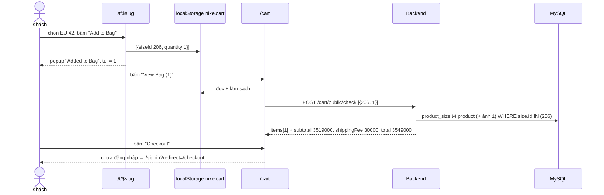

# Giỏ hàng

## 1. Mục tiêu và phạm vi

Khách (không cần đăng nhập) chọn size ở trang chi tiết, bấm "Add to Bag" → giày vào giỏ, popup "Added to Bag" xác nhận, số trên icon túi tăng. Ở `/cart` khách thấy từng dòng với giá / ảnh / tồn kho **mới nhất từ server**, tăng giảm số lượng, đổi size, xoá, xem tạm tính + phí giao hàng (30.000 ₫, miễn phí từ 5.000.000 ₫) + tổng, rồi bấm "Checkout" (chưa đăng nhập thì sang `/signin` rồi quay lại).
Giỏ lưu ở **localStorage** (D8), không có bảng; server chỉ có một API công khai `POST /cart/public/check` để tính lại giỏ. Đặt hàng thật thuộc lát `dat-hang`.

| Có làm | Không làm (để plan khác) |
|---|---|
| `POST /api/cart/public/check`: nhận `[{ sizeId, quantity }]`, trả từng dòng (tên, ảnh, size, giá đang bán, tồn kho, trạng thái) + `itemCount`, `subtotal`, `shippingFee`, `total`; validate số lượng 1–10, ≤ 50 dòng, không trùng size | Trang `/checkout` thật, tạo đơn, trừ kho (lát `dat-hang`) — lát này chỉ có trang tạm `/checkout` "Coming Soon" (§11 câu 1) |
| Giỏ ở localStorage khoá `nike.cart`, làm sạch dữ liệu hỏng khi đọc, đồng bộ giữa các tab | Đồng bộ giỏ lên server theo tài khoản, gộp giỏ khi đăng nhập |
| Trang chi tiết: "Add to Bag" thêm thật (cộng dồn, tối đa `min(10, tồn kho)`), lỗi khi đã đủ số lượng, popup "Added to Bag" (desktop góc phải, mobile trên cùng) tự đóng sau 5 giây | Nút "Favourite ♡" ở chi tiết / giỏ, khối "Favourites" ở giỏ (lát `yeu-thich`) |
| Số trên icon túi ở header (mọi trang cửa hàng) | Mã giảm giá, ước tính ngày giao |
| Trang `/cart`: dòng sản phẩm (ảnh, tên, phụ đề, chọn lại size, giá dòng, nút − / 🗑 / ＋), cảnh báo "Just a few left", dòng hết hàng / ngừng bán / tự giảm số lượng, tóm tắt + gợi ý miễn phí giao hàng, "Checkout", giỏ trống, skeleton, lỗi + "Try Again", "You Might Also Like" | "Free returns for Nike Members", dải "FREE DELIVERY" riêng của trang giỏ (dải thông báo chung đã có — §11 câu 9) |
| Mobile: popup trượt từ trên, giỏ một cột, "n items \| tổng", nút "Checkout" dính đáy | Visual regression / a11y của trang (lát 4.2) |
| `automation/`: `CartApi`, hàm tính kết quả mong đợi `expectedCartCheck`, tiện ích đọc / ghi localStorage, page object `CartPage`, `AddedToBagDialog`, cập nhật `HeaderComponent`, `ProductDetailPage` | |

## 2. Tác nhân và phân quyền

| Tác nhân | Quyền | Ghi chú |
|---|---|---|
| Khách chưa đăng nhập, khách đã đăng nhập, quản trị | `POST /cart/public/check` | Công khai nhờ mẫu `^/[a-z0-9-]+/public/.*` của `JwtAuthenticationFilter`, **không** sửa filter, không `checkPermission`. Token sai / hết hạn vẫn 200 |
| Khách chưa đăng nhập | Thêm vào giỏ, xem / sửa giỏ; bấm "Checkout" → `/signin?redirect=/checkout` | D8: thanh toán bắt buộc đăng nhập |
| Khách đã đăng nhập | Như trên; "Checkout" → `/checkout` | |

Giỏ gắn với **trình duyệt** (localStorage), không gắn tài khoản: đăng nhập / đăng xuất không làm đổi giỏ (§11 câu 7).

## 3. Luồng nghiệp vụ

**Luồng chính (desktop):**
1. Khách ở `/t/nike-dunk-low-retro` chọn "EU 42", bấm "Add to Bag" → localStorage `nike.cart` = `[{"sizeId":206,"quantity":1}]`; icon túi hiện số **1**; popup "Added to Bag" mở ở góc phải dưới header: ảnh, "Nike Dunk Low Retro", "Men's Shoes", "Size EU 42", "3.519.000 ₫", nút "View Bag (1)" và "Checkout". Popup tự đóng sau 5 giây.
2. Khách bấm "Add to Bag" lần nữa (vẫn EU 42) → cùng dòng thành `quantity 2`, số trên túi **2**, popup "View Bag (2)".
3. Khách bấm "View Bag (2)" → `/cart`. FE đọc giỏ, gọi `POST /cart/public/check` `[{"sizeId":206,"quantity":2}]` → 1 dòng: "Nike Dunk Low Retro", "Men's Shoes", "Size EU 42", "7.038.000 ₫", số lượng 2; tóm tắt: Subtotal "7.038.000 ₫", Estimated Delivery & Handling "Free", Total "7.038.000 ₫", "You qualify for free delivery."
4. Khách bấm − → số lượng 1 → gọi lại `check` → Subtotal "3.519.000 ₫", phí "30.000 ₫", Total "3.549.000 ₫", "Add 1.481.000 ₫ more to get free delivery."
5. Khách bấm "Checkout" → chưa đăng nhập: `/signin?redirect=/checkout`; đăng nhập xong về `/checkout` (trang tạm), giỏ vẫn nguyên.

**Luồng thay thế:**
- A1 (đủ số lượng): size đang chọn đã có trong giỏ `min(10, tồn kho)` đôi (vd `ja-4-blur-ep` EU 43 chỉ còn 1, đã có 1 trong giỏ) → không thêm, không mở popup, dưới nút hiện "You've reached the maximum quantity for this size."
- A2 (đóng popup): ✕ "Close", Esc, bấm ra ngoài, hoặc tự đóng sau 5 giây (giữ chuột trên popup thì không tự đóng).
- A3 (đổi size trong giỏ): bấm "Size EU 42" → danh sách size của sản phẩm (size hết hàng mờ) → chọn "EU 43" → dòng đổi sang size mới; nếu size mới đã có trong giỏ thì gộp thành một dòng, số lượng cộng dồn (tối đa `min(10, tồn kho)`).
- A4 (xoá): số lượng 1 thì nút trái là 🗑 "Remove" → dòng biến mất; giỏ hết dòng → trạng thái giỏ trống.
- A5 (giỏ thay đổi ở server): size hết hàng → dòng mờ "This size is sold out. Choose another size or remove it."; sản phẩm bị ẩn → "This product is no longer available."; số lượng vượt tồn kho → tự giảm về tồn kho + "Only 3 left in this size. We've updated your quantity."; `sizeId` không còn tồn tại → dòng tự bỏ khỏi giỏ. Các dòng không mua được không tính vào tạm tính.
- A6 (nhiều tab): tab B đang mở `/cart`, tab A thêm / sửa giỏ → tab B cập nhật số trên túi và danh sách (sự kiện `storage`).
- A7 (đã đăng nhập): "Checkout" → `/checkout` ngay.
- A8 (mobile): popup trượt từ trên, rộng hết màn hình; giỏ một cột, dưới tiêu đề "2 items | 7.038.000 ₫", nút "Checkout" dính đáy màn hình.

**Ngoại lệ:**
- E1: localStorage hỏng (không phải JSON, không phải mảng, phần tử sai kiểu, số lượng ngoài 1–10, trùng size, > 50 dòng) → FE làm sạch khi đọc (§4) rồi ghi lại; không bao giờ gửi dữ liệu sai lên server.
- E2: `check` lỗi (500, mất mạng) → "Couldn't load your bag." + "Try Again"; "Checkout" bị khoá.
- E3: `check` chậm → skeleton tới khi có dữ liệu (lần đầu); các lần sau giữ dữ liệu cũ (`aria-busy="true"`).
- E4: API nhận dữ liệu sai (gọi thẳng, bỏ qua FE) → 400 với message §5.3; giá client gửi kèm bị bỏ qua (giá luôn lấy từ DB).



## 4. Cơ sở dữ liệu

**Không có migration, không có bảng giỏ** (D8). `check` chỉ đọc `product_size`, `product`, `product_image` của lát `du-lieu-giay`; không giữ chỗ, không trừ kho.

**localStorage** (FE, khoá `nike.cart`): mảng JSON `[{ "sizeId": 206, "quantity": 2 }]`, thứ tự = thứ tự thêm (dòng mới ở **cuối**). Làm sạch mỗi lần đọc (`sanitizeCart`), kết quả khác bản đọc thì ghi lại:
1. Không parse được / không phải mảng → `[]`.
2. Bỏ phần tử không phải object, `sizeId` không phải số nguyên ≥ 1, `quantity` không phải số nguyên ≥ 1.
3. `quantity > 10` → `10`.
4. Trùng `sizeId` → gộp vào dòng đầu, cộng số lượng (tối đa 10).
5. Quá 50 dòng → giữ 50 dòng đầu.

Size id của dữ liệu mẫu = `productId × 100 + thứ tự trong lưới size` (lát `du-lieu-giay`). Các size dùng cho test (tính bằng `sizeIdOf(slug, label)` từ `products.json`):

| Size id | Sản phẩm / size | Giá đang bán | Tồn | Dùng cho |
|---|---|---|---|---|
| 206 | `nike-dunk-low-retro` EU 42 | 3.519.000 | 20 | dòng thường |
| 208 | `nike-dunk-low-retro` EU 43 | 3.519.000 | 20 | đổi size |
| 201 | `nike-dunk-low-retro` EU 38.5 | 3.519.000 | 0 | hết hàng |
| 1306 | `nike-revolution-8` EU 42 | 1.909.000 | 1 | sắp hết, + bị khoá |
| 1805 | `nike-vaporfly-4` EU 38 | 6.609.000 | 3 | vượt tồn kho |
| 2008 | `ja-4-blur-ep` EU 43 | 3.669.000 | 1 | A1 đủ số lượng |
| 1906 | `nike-precision-8-low` EU 42 | 2.000.000 (gốc 2.119.000) | 20 | giá giảm |
| 2506 | `jordan-spizike-low-jam-central` EU 42 | 4.999.000 | 20 | dưới ngưỡng miễn phí |
| 1705 | `nike-zoom-fly-6` EU 38 | 5.000.000 | 20 | đúng ngưỡng miễn phí |
| 605 | `nike-offcourt` EU 38 | 1.000.000 | 20 | 5 đôi = 5.000.000 |
| 3106 | `nike-air-max-plus-premium` EU 42 (HIDDEN) | 5.279.000 | 20 | ngừng bán |
| 999999 | không tồn tại | — | — | size id sai |

## 5. Hợp đồng API (cố định — nguồn sự thật cho cả BE và FE)

Mọi response bọc `{ "code", "message", "result" }`. Prefix `/api`. **Không cần token.**

### 5.1 `POST /api/cart/public/check` — công khai

**Request body**: mảng JSON, mỗi phần tử `{ "sizeId": integer, "quantity": integer }`; field khác (vd `price`) bị bỏ qua. Mảng rỗng hợp lệ.

**Response `result`**:

| Field | Kiểu | Ghi chú |
|---|---|---|
| `items` | mảng `CartLine` | đúng thứ tự request, mỗi phần tử request một dòng |
| `itemCount` | int | `Σ availableQuantity` |
| `subtotal` | long | `Σ lineTotal` |
| `shippingFee` | long | `0` nếu `subtotal = 0` hoặc `subtotal ≥ 5.000.000`; ngược lại `30.000` (D12) |
| `total` | long | `subtotal + shippingFee` |

`CartLine`:

| Field | Kiểu | Ghi chú |
|---|---|---|
| `sizeId`, `quantity` | int | chép từ request |
| `status` | string | `AVAILABLE` (tồn ≥ số lượng) · `INSUFFICIENT_STOCK` (0 < tồn < số lượng) · `OUT_OF_STOCK` (tồn 0) · `UNAVAILABLE` (size không tồn tại, hoặc sản phẩm không `PUBLISHED`) — xét theo thứ tự ngược lại |
| `availableQuantity` | int | `AVAILABLE` → `quantity`; `INSUFFICIENT_STOCK` → `stock`; còn lại `0` |
| `stock` | int | tồn của size; `UNAVAILABLE` → `0` (không lộ tồn của sản phẩm ẩn) |
| `productId`, `slug`, `name`, `subtitle`, `imageUrl`, `sizeLabel` | | thông tin hiển thị; **`null` hết** khi size không tồn tại; sản phẩm ẩn / nháp vẫn có (để khách biết dòng nào bị bỏ) |
| `price`, `salePrice` | long / long \| null | giá gốc, giá giảm hiện tại trong DB; `null` khi size không tồn tại |
| `unitPrice` | long \| null | `salePrice ?? price` |
| `lineTotal` | long | `unitPrice × availableQuantity` (`0` khi không mua được) |

Ví dụ request:
```json
[
  { "sizeId": 206, "quantity": 2 },
  { "sizeId": 1306, "quantity": 1 },
  { "sizeId": 201, "quantity": 1 },
  { "sizeId": 3106, "quantity": 1 },
  { "sizeId": 999999, "quantity": 1 },
  { "sizeId": 1805, "quantity": 5, "price": 1 }
]
```
Response `result`:
```json
{
  "items": [
    { "sizeId": 206, "quantity": 2, "status": "AVAILABLE", "availableQuantity": 2, "stock": 20,
      "productId": 2, "slug": "nike-dunk-low-retro", "name": "Nike Dunk Low Retro", "subtitle": "Men's Shoes",
      "imageUrl": "http://localhost:9020/nike-public/products/nike-dunk-low-retro/1.webp", "sizeLabel": "EU 42",
      "price": 3519000, "salePrice": null, "unitPrice": 3519000, "lineTotal": 7038000 },
    { "sizeId": 1306, "quantity": 1, "status": "AVAILABLE", "availableQuantity": 1, "stock": 1,
      "productId": 13, "slug": "nike-revolution-8", "name": "Nike Revolution 8", "subtitle": "…",
      "imageUrl": "…/products/nike-revolution-8/1.webp", "sizeLabel": "EU 42",
      "price": 1909000, "salePrice": null, "unitPrice": 1909000, "lineTotal": 1909000 },
    { "sizeId": 201, "quantity": 1, "status": "OUT_OF_STOCK", "availableQuantity": 0, "stock": 0,
      "productId": 2, "slug": "nike-dunk-low-retro", "name": "Nike Dunk Low Retro", "subtitle": "Men's Shoes",
      "imageUrl": "…/products/nike-dunk-low-retro/1.webp", "sizeLabel": "EU 38.5",
      "price": 3519000, "salePrice": null, "unitPrice": 3519000, "lineTotal": 0 },
    { "sizeId": 3106, "quantity": 1, "status": "UNAVAILABLE", "availableQuantity": 0, "stock": 0,
      "productId": 31, "slug": "nike-air-max-plus-premium", "name": "…", "subtitle": "…",
      "imageUrl": "…/products/nike-air-max-plus-premium/1.webp", "sizeLabel": "EU 42",
      "price": 5279000, "salePrice": null, "unitPrice": 5279000, "lineTotal": 0 },
    { "sizeId": 999999, "quantity": 1, "status": "UNAVAILABLE", "availableQuantity": 0, "stock": 0,
      "productId": null, "slug": null, "name": null, "subtitle": null, "imageUrl": null, "sizeLabel": null,
      "price": null, "salePrice": null, "unitPrice": null, "lineTotal": 0 },
    { "sizeId": 1805, "quantity": 5, "status": "INSUFFICIENT_STOCK", "availableQuantity": 3, "stock": 3,
      "productId": 18, "slug": "nike-vaporfly-4", "name": "Nike Vaporfly 4", "subtitle": "…",
      "imageUrl": "…/products/nike-vaporfly-4/1.webp", "sizeLabel": "EU 38",
      "price": 6609000, "salePrice": null, "unitPrice": 6609000, "lineTotal": 19827000 }
  ],
  "itemCount": 6,
  "subtotal": 28774000,
  "shippingFee": 0,
  "total": 28774000
}
```
(`…` = giá trị thật lấy từ `products.json`; test so bằng `expectedCartCheck`.)

Ví dụ tóm tắt (ca biên phí giao hàng, TC-03):

| Request | `subtotal` | `shippingFee` | `total` |
|---|---|---|---|
| `[]` | 0 | 0 | 0 |
| `[{2506, 1}]` | 4.999.000 | 30.000 | 5.029.000 |
| `[{1705, 1}]` | 5.000.000 | 0 | 5.000.000 |
| `[{605, 5}]` | 5.000.000 | 0 | 5.000.000 |
| `[{1906, 2}]` (giá giảm) | 4.000.000 | 30.000 | 4.030.000 |
| `[{201, 1}]` (chỉ dòng hết hàng) | 0 | 0 | 0 |

### 5.2 Quy tắc validate (theo thứ tự, gặp lỗi đầu tiên thì dừng, **không** truy vấn DB)

1. Body thiếu / không phải JSON / không phải mảng / phần tử sai kiểu JSON (vd `"quantity": "abc"`) → lỗi khung "Malformed request body".
2. Hơn 50 phần tử (`MAX_LINES`).
3. Duyệt từng phần tử theo thứ tự: phần tử `null` hoặc `sizeId` thiếu / < 1 → "Invalid size in bag."; `quantity` thiếu / < 1 / > 10 (`MAX_QUANTITY`) → "Quantity must be between 1 and 10."
4. Hai phần tử cùng `sizeId`.

### 5.3 Lỗi

| Tình huống | HTTP | Message (tiếng Anh) |
|---|---|---|
| Body thiếu, không phải mảng, JSON hỏng, sai kiểu field | 400 | Malformed request body (lỗi khung sẵn có) |
| Hơn 50 dòng | 400 | Your bag can hold up to 50 different items. |
| `sizeId` thiếu / < 1, phần tử `null` | 400 | Invalid size in bag. |
| `quantity` thiếu / < 1 / > 10 | 400 | Quantity must be between 1 and 10. |
| Trùng `sizeId` | 400 | Each size can only appear once in the bag. |
| Sai method (`GET /api/cart/public/check`) | 405 | HTTP method not supported |

`sizeId` không tồn tại / sản phẩm ẩn **không** phải lỗi (200, dòng `UNAVAILABLE`) — giỏ cũ của khách vẫn mở được. FE không hiện message 400 (FE đã làm sạch dữ liệu trước khi gửi); lỗi bất kỳ → §6.9.

## 6. Giao diện (chuỗi cố định — test E2E chọn theo đúng các chuỗi này)

Mở ảnh `plan/ui-nike/14-popup-da-them-vao-gio.jpg`, `09-gio-trong.jpg`, `15-gio-dang-tai.jpg`, `16-gio-co-hang.jpg`, `m06-gio-co-hang.jpg`, `m07-gio-tom-tat.jpg`, `m08-gio-chon-thanh-toan.jpg` khi làm. Màu / số đo theo `plan/ui-nike/README.md`. Desktop = ≥ 1024px (`useIsDesktop()`). Tiền qua `formatVnd`. Khác ảnh tham chiếu: chỉ **một** nút "Checkout" (D8), không có nút ♡, không có "Free returns for Nike Members", không có "Favourites".

### 6.1 Số trên icon túi (header)

- `count` = tổng `quantity` trong localStorage (gồm cả dòng không mua được, §11 câu 8). Cập nhật ngay khi giỏ đổi, kể cả từ tab khác.
- `count = 0`: như hiện tại, link tên **Bag**, không có số.
- `count > 0`: số nằm giữa icon túi (chữ 9px / 500, như nike.com), `<span data-testid="header-cart-count" aria-hidden="true">2</span>`; link tên **Bag, 1 item** / **Bag, 2 items** (`count > 99` → hiện `99+`, tên vẫn số thật). Có ở cả desktop và mobile; menu trượt mobile giữ nguyên chữ "Bag".

### 6.2 "Add to Bag" ở trang chi tiết (sửa `product-detail-page.tsx`)

- Chưa chọn size → giữ nguyên lỗi "Please select a size." (lát `chi-tiet-giay`).
- Đã chọn size: `max = min(10, stock của size)`; `current` = số lượng size đó trong giỏ.
  - `current < max` → `quantity + 1` (dòng mới thì thêm vào cuối), mở popup §6.3, ẩn lỗi §6.2.
  - `current ≥ max` → không đổi giỏ, không mở popup; dưới nút hiện **You've reached the maximum quantity for this size.** (testid `pdp-add-error`, `role="alert"`, màu lỗi `#D30005`, 14px). Đổi size / bấm lại khi đã giảm giỏ → lỗi biến mất.

### 6.3 Popup "Added to Bag"

`Dialog` (class `shop`, testid `added-to-bag`, `role="dialog"`, tên **Added to Bag**), nền trang phủ `rgba(17,17,17,0.4)`.

| | Desktop | Mobile |
|---|---|---|
| Vị trí | cố định, cách phải 48px, đỉnh ngay dưới header (`top: var(--sh-header-offset)` + 8px), rộng 420px, bo 24px, padding 24px | trên cùng màn hình, rộng 100%, bo dưới 24px, trượt từ trên xuống |

Nội dung từ trên xuống:
1. Hàng tiêu đề: icon tròn xanh `#007D48` có ✓ + **Added to Bag** (16px / 500); phải là nút tròn ✕ **Close**.
2. Hàng sản phẩm: ảnh 1 của sản phẩm 90×90 (nền `#F5F5F5`, alt = tên); bên phải: tên (16px / 500), phụ đề (`#707072`), **Size EU 42** (`#707072`), giá bán một đôi (`formatVnd(salePrice ?? price)`, 16px / 500).
3. Nút viền đầy chiều ngang cao 60px **View Bag (n)** (`n` = số trên túi sau khi thêm) → `/cart`; dưới nó cách 8px nút đen **Checkout** → §6.8 (luật Checkout).

Đóng: ✕, Esc, bấm nền, bấm một trong hai nút (sau khi điều hướng), hoặc **tự đóng sau 5 giây** kể từ lúc mở (con trỏ chuột đang nằm trên popup thì tạm dừng đếm, rời ra đếm lại từ đầu). Thêm lần nữa khi popup đang mở → nội dung cập nhật, đếm lại 5 giây. Focus vào nút "Close" khi mở (Radix), trả về nút "Add to Bag" khi đóng.

### 6.4 Trang `/cart` — route, bố cục

- Route `/cart` (`routes/_shop/cart.tsx`, thay trang tạm). `<title>`: **Bag | Nike**.
- **Desktop**: khối giữa rộng tối đa 1100px, căn giữa, lề trên 40px; hai cột `minmax(0,1fr) / 350px`, khe 40px. Trái: h1 **Bag** (24px / 500) + danh sách dòng. Phải: h2 **Summary** (24px / 500) + §6.6, `sticky top-(--sh-header-offset)`. Dưới hai cột: "You Might Also Like" (§6.10), rồi footer.
- **Mobile**: một cột lề 16px: h1 **Bag** căn giữa (24px), dưới là dòng `<n> items | <total>` (testid `cart-mobile-summary`, `#707072` cho phần số món; vd **2 items | 7.038.000 ₫**, **1 item | 3.549.000 ₫**; giỏ trống **0 items | —**), kẻ ngang → các dòng → Summary → "You Might Also Like". Nút "Checkout" **dính đáy màn hình** (lề 16px, nền trắng phía sau, đổ bóng trên nhẹ), luôn thấy khi cuộn.
- Không cuộn ngang toàn trang ở cả hai loại màn hình.

### 6.5 Dòng sản phẩm

`<ul aria-label="Bag items">`, mỗi dòng `<li data-testid="cart-item" data-size-id="206">`, kẻ ngang `#E5E5E5` giữa các dòng, padding dọc 24px. Thứ tự = thứ tự trong localStorage.

| Phần | Desktop | Mobile |
|---|---|---|
| Ảnh | 160×160, nền `#F5F5F5`, là link tới `/t/<slug>` (alt = tên) | 120×120 |
| Thông tin | tên (link `/t/<slug>`, testid `cart-item-name`, 16px / 500), phụ đề (`#707072`), nút chọn size (§6.5.1); giá ở mép phải | giá lên đầu, rồi tên, phụ đề, size |
| Số lượng | dưới ảnh: pill viền `#E5E5E5` bo tròn cao 40px | như desktop |

- **Giá dòng** (testid `cart-item-price`, 16px / 500): `formatVnd(unitPrice × quantity)`; đang giảm giá thì thêm `<s>` (testid `cart-item-original-price`, `#707072`) `formatVnd(price × quantity)` ngay sau. Vd 2 đôi `nike-precision-8-low`: **4.000.000 ₫** + ~~4.238.000 ₫~~.
- **Pill số lượng** (testid `cart-item-quantity`): nút trái — `quantity = 1`: icon 🗑 tên **Remove** (testid `cart-item-remove`); `quantity > 1`: icon − tên **Decrease quantity** (testid `cart-item-decrease`); giữa: số (testid `cart-item-qty`); phải: icon ＋ tên **Increase quantity** (testid `cart-item-increase`), `disabled` khi `quantity ≥ min(10, stock)`. Mỗi lần bấm đổi localStorage ngay (lạc quan), số trên túi đổi ngay, rồi gọi lại `check`.
- **Thông báo dưới pill** (14px), tối đa một dòng, ưu tiên từ trên xuống:
  1. Vừa bị tự giảm số lượng (A5) → icon ⓘ + **Only 3 left in this size. We've updated your quantity.** (testid `cart-item-notice`, `#9E3500`); giữ tới khi khách đổi số lượng / size của dòng đó hoặc rời trang.
  2. `OUT_OF_STOCK` → **This size is sold out. Choose another size or remove it.** (testid `cart-item-notice`, `#D30005`); ảnh + chữ mờ 50%; pill chỉ còn nút 🗑 **Remove** (không có số, không có ＋); nút chọn size vẫn dùng được.
  3. `UNAVAILABLE` (sản phẩm ẩn) → **This product is no longer available.** (testid `cart-item-notice`, `#D30005`); ảnh + chữ mờ 50%, tên và ảnh **không** là link, size là chữ thường (không chọn được), pill chỉ còn 🗑 **Remove**; không có giá.
  4. `AVAILABLE` và `1 ≤ stock ≤ 3` → icon đồng hồ + **Just a few left. Order soon.** (testid `cart-item-low-stock`, `#9E3500`, dùng lại `LowStockNotice`).
- Dòng có `productId = null` (size không tồn tại) **không hiện**: FE bỏ khỏi localStorage ngay khi nhận kết quả.

#### 6.5.1 Chọn lại size

`Select` (shadcn), trigger kiểu chữ gạch chân `#707072` **Size EU 42** (tên combobox = chữ đó, testid `cart-item-size`). Mở → tải `GET /product/public/get?slug=` (dùng `createProductDetailQueryOptions`, có cache); trong lúc tải chỉ có một mục khoá **Loading sizes…**. Mỗi mục là `sizeLabel` (**EU 38.5** … ), size `stock = 0` thì `disabled`; mục đang chọn có dấu ✓. Chọn size khác:
- size mới chưa có trong giỏ → thay `sizeId` tại chỗ (giữ vị trí dòng), số lượng giữ nguyên nhưng không quá `min(10, stock mới)`.
- size mới đã có trong giỏ → bỏ dòng cũ, dòng có sẵn cộng thêm số lượng, tối đa `min(10, stock mới)`.

### 6.6 Tóm tắt (Summary)

`<section aria-labelledby>` (testid `cart-summary`), các hàng 16px, hai đầu căn hai bên:

| Hàng | Giá trị (testid) |
|---|---|
| **Subtotal** | `formatVnd(subtotal)` (`cart-subtotal`) |
| **Estimated Delivery & Handling** | `shippingFee = 0` → **Free**; ngược lại `formatVnd(shippingFee)` (`cart-shipping`) |
| kẻ ngang | |
| **Total** (500) | `formatVnd(total)` (`cart-total`) |
| kẻ ngang | |

- Dưới hàng Total, gợi ý (testid `cart-delivery-hint`, 14px): `0 < subtotal < 5.000.000` → **Add 1.481.000 ₫ more to get free delivery.** (số = `5.000.000 − subtotal`); `subtotal ≥ 5.000.000` → **You qualify for free delivery.** (`#007D48`); `subtotal = 0` → không có.
- Giỏ trống, lỗi tải, hoặc mọi dòng không mua được (`itemCount = 0`): ba giá trị đều là **—**, không có gợi ý.
- Nút **Checkout** (testid `cart-checkout`, `ShopButton` primary cao 60px, rộng hết cột, cách 32px): `disabled` (nền `#F5F5F5`, chữ `#CACACB`) khi giỏ trống, đang tải lần đầu, lỗi tải, hoặc `itemCount = 0`. Bấm → §6.8. Dòng không mua được không chặn Checkout (§11 câu 3).

### 6.7 Giỏ trống / đang tải / lỗi

- **Trống** (localStorage `[]`, không gọi API): dưới h1 **There are no items in your bag.** (testid `cart-empty`), cách 24px link nút đen **Shop All Shoes** → `/w`; Summary như §6.6 với **—**; không có "You Might Also Like".
- **Đang tải lần đầu** (> 0 dòng, chưa có dữ liệu): `cart-skeleton` (`aria-busy="true"`, ảnh 15): mỗi dòng trong localStorage một khối (ô ảnh xám + 4 vạch + 2 chấm), Summary 4 vạch + nút xám. Các lần gọi lại sau khi sửa giỏ: giữ dữ liệu cũ, danh sách có `aria-busy="true"` tới khi xong.
- **Lỗi** (`check` thất bại sau 1 lần thử lại): thay danh sách bằng `SectionError` **Couldn't load your bag.** + **Try Again** (gọi lại `check`); Summary **—**, Checkout khoá.

### 6.8 Luật "Checkout" (giỏ + popup)

- Đã đăng nhập (`useShopSession().user` có) → `/checkout`.
- Chưa đăng nhập → `/signin?redirect=/checkout` (dùng `signInSearch`-kiểu `{ redirect: "/checkout" }`); đăng nhập xong `dang-nhap-nike` đưa về `/checkout`.
- Phiên đang tải (`loading`) → nút `disabled` tới khi biết.
- `/checkout` (`routes/_shop/checkout.tsx`) lát này là trang tạm `ComingSoonSection`, `<title>` **Checkout | Nike**; lát `dat-hang` ghi đè (§11 câu 1).

### 6.9 Đồng bộ và làm sạch

- Đọc localStorage qua `sanitizeCart` (§4) lúc khởi động app và khi có sự kiện `storage` khoá `nike.cart` (tab khác sửa) → store cập nhật → túi + trang giỏ vẽ lại, gọi lại `check`.
- Sau mỗi kết quả `check` **khớp với giỏ hiện tại** (không phải dữ liệu cũ giữ tạm): bỏ dòng `productId = null`; dòng `INSUFFICIENT_STOCK` → đặt `quantity = stock` + ghi nhận thông báo §6.5 mục 1.

### 6.10 "You Might Also Like" ở giỏ

Dùng lại `RelatedProducts` của trang chi tiết với `slug` của **dòng mua được đầu tiên** (`AVAILABLE` / `INSUFFICIENT_STOCK`); không có dòng nào như vậy → không hiện. Cách Summary 80px.

## 7. Việc backend + automation (Claude, phiên A)

### 7.1 Spec nghiệm thu (viết trước khi code)

1. `api/CartApi.js`: `check(body)` → `POST /cart/public/check` (truyền nguyên `body`, kể cả object / chuỗi sai để test validate; `body === undefined` → không gửi body); thêm vào `api/index.js` (`api.cart`).
2. `data/seed-products.js` — thêm: `MAX_CART_QUANTITY = 10`, `MAX_CART_LINES = 50`, `FREE_SHIPPING_THRESHOLD = 5_000_000`, `SHIPPING_FEE = 30_000`, `sizeIdOf(slug, label)`, `shippingFeeOf(subtotal)`, `expectedCartCheck(items)` (tính đủ §5.1 từ `products.json`, ảnh so theo đuôi `imageSuffixOf`).
3. `data/cart-invalid.json` (ca TC-05: body + message mong đợi), `data/cart-shipping.json` (ca TC-03 / TC-14), `data/cart-storage-dirty.json` (ca TC-19: chuỗi localStorage thô → giỏ mong đợi sau làm sạch).
4. `utils/cart-storage.js`: `CART_KEY = 'nike.cart'`, `setCart(page, items | rawString)` (mở `/` nếu chưa ở origin, ghi localStorage bằng `page.evaluate`, không dùng `addInitScript` để F5 không ghi đè), `readCart(page)`.
5. Page object:
   - **Mới** `pages/CartPage.js`: `goto()`, `heading`, `items`, `item(i)` / `itemBySizeId(id)` (→ `CartItem` có `name`, `subtitle`, `size`, `price`, `originalPrice`, `qty`, `remove`, `decrease`, `increase`, `notice`, `lowStock`, `imageLink`), `empty`, `shopAllShoes`, `skeleton`, `error`, `tryAgain`, `summary`, `subtotal`, `shipping`, `total`, `deliveryHint`, `checkout`, `mobileSummary`, `related`, `relatedCards`, `chooseSize(itemIndex, label)`, `sizeOptions()`.
   - **Mới** `pages/components/AddedToBagDialog.js`: `root`, `close`, `name`, `subtitle`, `size`, `price`, `image`, `viewBag`, `checkout`.
   - `pages/components/HeaderComponent.js`: `cartLink` đổi sang tên `/^Bag/` (tên có số từ lát này), thêm `cartCount`.
   - `pages/ProductDetailPage.js`: thêm `addError`, `addedToBag` (`AddedToBagDialog`), `addSize(label)` (chọn size + bấm "Add to Bag").
   - `fixtures/index.js`: thêm `cartPage`.
6. Spec: `tests/api/gio-hang.api.spec.js` (TC-01 → TC-09), `tests/cart/gio-hang.spec.js` (TC-10 → TC-26).
7. `data/shop-routes.json`: thêm `{ "path": "/checkout", "name": "Checkout" }` (quét chữ tiếng Việt TC-10 của `tieng-anh-cua-hang`).
8. **Sửa spec cũ theo plan này** (hành vi đổi có chủ đích, không phải để test xanh — ghi §12): `tests/product-detail/chi-tiet-giay.spec.js` TC-13 bước "bấm Add to Bag khi đã chọn size": nay mong đợi popup "Added to Bag" hiện, đóng bằng Esc rồi mới làm bước phím mũi tên (popup modal chặn bàn phím). Spec cũ khác không đổi: `giao-dien-nike` TC-25 (`/cart` không 404) và `tieng-anh-cua-hang` TC-10 (`/cart` có h1 "Bag") vẫn đúng với giỏ trống.

### 7.2 Backend (module `business`, package mới `business.cart`)

Theo thứ tự `backend/AGENTS.md`. Không migration, không sửa `JwtAuthenticationFilter`.

1. Entity (POJO không phải bảng, như `ProductFilter`) ở `entity/.../data/mysql/cart/`:
   - `CartItem { Integer sizeId; Integer quantity; }` (Jackson bỏ qua field lạ — mặc định Spring Boot).
   - `CartLine` đủ field §5.1 + `@JsonIgnore String productStatus` (dùng nội bộ để xét `UNAVAILABLE`).
   - `CartCheck { List<CartLine> items; int itemCount; long subtotal; long shippingFee; long total; }`.
2. `ProductSizeRepository.listCartRows(Collection<Integer> sizeIds)`: **một truy vấn** `product_size JOIN product` + subquery ảnh `sort_order = 1`, `WHERE product_size.id IN (...)`, alias cột theo tên field `CartLine` (`sizeId`, `stock`, `sizeLabel`, `productId`, `slug`, `name`, `subtitle`, `price`, `salePrice`, `imageUrl`, `productStatus`) → `fetchInto(CartLine.class)`. `sizeIds` rỗng → trả `List.of()` không truy vấn.
3. **Mới** `business.cart.ShippingPolicy` (lớp tiện ích, `final`): `FREE_SHIPPING_THRESHOLD = 5_000_000L`, `SHIPPING_FEE = 30_000L`, `static long feeFor(long subtotal)` (`subtotal ≤ 0` → 0). Lát `dat-hang` dùng lại.
4. **Mới** `business.cart.service.CartService extends BaseService<ProductSizeRepository, ProductSize, Integer>`:
   - Hằng `MAX_LINES = 50`, `MAX_QUANTITY = 10` và 4 message §5.3 (`AppException(ErrorCode.BAD_REQUEST, <message>)`).
   - `void validate(List<CartItem> items)` (package-private) theo §5.2 bước 2–4.
   - `CartCheck check(List<CartItem> items)`: `validate` → `listCartRows(sizeIds)` → map theo `sizeId` → dựng `CartLine` theo **thứ tự request** (không tìm thấy → dòng `UNAVAILABLE` toàn `null`), xét `status` / `availableQuantity` / `stock` / `unitPrice` / `lineTotal` (§5.1) → `itemCount`, `subtotal`, `shippingFee = ShippingPolicy.feeFor(subtotal)`, `total`.
5. **Mới** `business.cart.controller.CartPublicController`: `@PostMapping("/cart/public/check")` `@RequestBody List<CartItem> items`. Không `checkPermission`.
6. Unit test **mới** `business/src/test/java/vn/aeoc/business/cart/service/CartServiceTest.java` (Mockito mock `ProductSizeRepository`, `new QueryExecutor(Runnable::run)`) + `business/src/test/java/vn/aeoc/business/cart/ShippingPolicyTest.java`: TC-U1 → TC-U3.
7. `mvn -q "-Djooq.codegen.skip=true" -pl business -am test` → `sh scripts/ai/backend-restart.sh` → `pnpm test:api` (cả spec cũ) xanh. Ghi §12 "phiên A xong".

## 8. Việc frontend (Claude, phiên B)

Thứ tự theo `frontend/AGENTS.md`:

1. `lib/types/cart.ts`: `CartItem { sizeId; quantity }`, `CartLineStatus = "AVAILABLE" | "INSUFFICIENT_STOCK" | "OUT_OF_STOCK" | "UNAVAILABLE"`, `CartLineDTO`, `CartCheckDTO` (§5.1).
2. `lib/axios/cart.ts`: `checkCart(items: CartItem[])` → `POST /cart/public/check`.
3. `lib/tanstack/options/cart.ts`: `createCartCheckQueryOptions(items)` — key `["cart","check", items]`, `enabled: items.length > 0`, `staleTime: 0`, `placeholderData: keepPreviousData`, `retry: 1`, `refetchOnWindowFocus: true`. Không mutation.
4. `lib/shop/`:
   - **mới** `cart-storage.ts`: `CART_STORAGE_KEY = "nike.cart"`, `MAX_QUANTITY = 10`, `MAX_LINES = 50`, `sanitizeCart(raw: unknown): CartItem[]` (§4), `readCart()`, `writeCart(items)`, `cartCount(items)`, các hàm thuần `addItem(items, sizeId, max)`, `setQuantity(items, sizeId, q)`, `removeItem(items, sizeId)`, `changeSize(items, fromId, toId, max)` (gộp §6.5.1). Mọi truy cập storage bọc `try/catch`.
   - `shipping.ts`: thêm `amountToFreeShipping(subtotal)`.
   - **mới** `checkout.ts`: `useGoToCheckout()` (§6.8) trả `{ go, disabled }`.
5. **Mới** `lib/stores/cart.ts`: zustand `useCart` (`items`, `add`, `setQuantity`, `remove`, `changeSize`, `prune(sizeIds)`, `reload()`), khởi tạo bằng `readCart()`, mỗi lần đổi thì `writeCart`; một listener `window` `storage` (khoá `nike.cart`) gọi `reload()`.
6. Header: `components/shop/layout/header/header-actions.tsx` thêm số + tên link §6.1.
7. Trang chi tiết: `components/shop/product-detail/product-detail-page.tsx` — `addToBag` thật §6.2 + lỗi `pdp-add-error`; **mới** `added-to-bag-dialog.tsx` (§6.3, hẹn giờ 5 giây + dừng khi rê chuột, desktop / mobile theo `useIsDesktop()`).
8. **Mới** `components/shop/cart/`: `cart-page.tsx` (ghép §6.4, đối soát kết quả §6.9), `cart-line.tsx`, `cart-quantity.tsx`, `cart-size-select.tsx`, `cart-summary.tsx`, `cart-skeleton.tsx`, `cart-empty.tsx`. Dùng lại `LowStockNotice`, `RelatedProducts`, `ShopButton`, `SectionError`.
9. Route: ghi đè `routes/_shop/cart.tsx` (`head` → **Bag | Nike**, component `CartPage`); **mới** `routes/_shop/checkout.tsx` (trang tạm, `head` → **Checkout | Nike**).
10. `frontend/AGENTS.md` mục "Khu cửa hàng": thêm `components/shop/cart/`, `lib/stores/cart.ts`, `lib/shop/{cart-storage,checkout}.ts`, popup "Added to Bag"; bỏ `/cart` khỏi danh sách trang tạm, thêm `/checkout` (trang tạm tới lát `dat-hang`).
11. `pnpm build && pnpm lint` xanh; `pnpm api:types` đối chiếu `CartItem`, `CartLine`, `CartCheck` với type tay.

Component shadcn dùng: có sẵn `dialog`, `select`, `skeleton`, `separator`, `ShopButton`, `SectionError`, `LowStockNotice`, `RelatedProducts`; **không** cần `shadcn add`.

## 9. Test case

API ở `automation/tests/api/gio-hang.api.spec.js`, giao diện ở `automation/tests/cart/gio-hang.spec.js`, JUnit ở `CartServiceTest.java` + `ShippingPolicyTest.java`. Kết quả mong đợi tính bằng `expectedCartCheck` / `sizeIdOf` từ `products.json`; số trong bảng là giá trị với dữ liệu mẫu hiện tại. Giỏ chuẩn bị bằng `setCart` (localStorage) khi bước không nói "thêm từ trang chi tiết". Tiền điều kiện chung: `test-support/reset` (global-setup); mỗi test một context mới nên localStorage trống. Không ghi project = chromium, firefox, webkit (bỏ qua mobile-chrome); "mobile" = chỉ mobile-chrome; "desktop 1440" = viewport 1440×900.

| ID | Loại | Mô tả | Tiền điều kiện | Bước | Kết quả mong đợi |
|---|---|---|---|---|---|
| TC-01 | api | Kiểm tra giỏ nhiều trạng thái `@smoke` | không token | `POST /api/cart/public/check` với body ví dụ §5.1 (6 dòng, dòng cuối kèm `"price": 1`) | 200; `result` = `expectedCartCheck` = ví dụ §5.1: `items` đúng thứ tự `206, 1306, 201, 3106, 999999, 1805`; trạng thái `AVAILABLE, AVAILABLE, OUT_OF_STOCK, UNAVAILABLE, UNAVAILABLE, INSUFFICIENT_STOCK`; `availableQuantity` `2, 1, 0, 0, 0, 3`; dòng 3106 có `name` / `slug`, `stock` 0; dòng 999999 mọi field thông tin `null`; dòng 1805 `unitPrice` 6609000 (bỏ qua `price: 1`), `lineTotal` 19827000; `itemCount` 6, `subtotal` 28774000, `shippingFee` 0, `total` 28774000 |
| TC-02 | api | Mỗi sản phẩm đang bán (data-driven 30 sản phẩm) | — | mỗi sản phẩm `PUBLISHED`: `check` `[{ size còn hàng đầu tiên, quantity 1 }]` | 200; dòng `AVAILABLE`, `name` / `subtitle` / `slug` / `sizeLabel` / `price` / `salePrice` khớp `products.json`, `unitPrice` = giá đang bán, `imageUrl` kết thúc `/products/<slug>/1.webp`, `stock` = tồn của size; `subtotal` = `unitPrice`; `shippingFee` = `shippingFeeOf(subtotal)` |
| TC-03 | api | Phí giao hàng — giá trị biên (data-driven `cart-shipping.json`) | — | 6 request ở bảng §5.1 "Ví dụ tóm tắt" | đúng `subtotal` / `shippingFee` / `total` ở bảng: `[]` → 0 / 0 / 0; 4.999.000 → 30.000; 5.000.000 (1 đôi Zoom Fly 6) → 0; 5 × 1.000.000 → 0; 2 × 2.000.000 (giá giảm, không phải 2.119.000) → 30.000, `total` 4.030.000; chỉ dòng hết hàng → 0 / 0 / 0 |
| TC-04 | api | Số lượng biên hợp lệ | — | `[{206, 1}]`; `[{206, 10}]`; 50 dòng = 50 size id khác nhau đầu tiên của 30 sản phẩm (`quantity 1`) | cả ba 200; `[{206, 10}]`: `AVAILABLE`, `lineTotal` 35190000, `shippingFee` 0; 50 dòng: `items` 50 phần tử đúng thứ tự, = `expectedCartCheck` |
| TC-05 | api | Validate (data-driven `cart-invalid.json`) | — | `quantity` 0; 11; -1; thiếu `quantity`; `sizeId` 0; thiếu `sizeId`; phần tử `null`; `[{206,1},{206,2}]`; 51 dòng; body `{}`; body `"abc"`; không gửi body; `[{"sizeId":206,"quantity":"abc"}]`; `[{206, 11}, {0, 1}]` (lỗi đầu tiên thắng) | 400; message lần lượt: "Quantity must be between 1 and 10." × 4; "Invalid size in bag." × 3; "Each size can only appear once in the bag."; "Your bag can hold up to 50 different items."; "Malformed request body" × 4; "Quantity must be between 1 and 10." |
| TC-06 | api | Size không mua được | — | `[{201, 1}]`; `[{3106, 2}]`; `[{999999, 1}]`; `[{1805, 3}]`; `[{1805, 4}]`; `[{905, 1}]` (`nike-p-6000` EU 38) | lần lượt `OUT_OF_STOCK` (stock 0); `UNAVAILABLE` (`stock` 0, `name` có, `lineTotal` 0); `UNAVAILABLE` (thông tin `null`); `AVAILABLE` (stock 3, đúng bằng số lượng); `INSUFFICIENT_STOCK` (`availableQuantity` 3); `OUT_OF_STOCK`; ca 1, 2, 3, 6: `itemCount` 0, `subtotal` 0, `shippingFee` 0 |
| TC-07 | api | Công khai + sai method | — | TC-01 với `Authorization: Bearer abc.def.ghi`; `GET /api/cart/public/check` | token sai: 200, như TC-01; GET: 405 "HTTP method not supported" |
| TC-08 | api | `check` không giữ chỗ / không đổi kho | — | `check` `[{1306, 1}]` 3 lần; rồi `GET /product/public/get?slug=nike-revolution-8` | mỗi lần `AVAILABLE`, `stock` 1; size EU 42 (id 1306) ở `get` vẫn `stock` 1 |
| TC-09 | api | Giá luôn theo DB | — | `[{"sizeId":1906,"quantity":1,"price":1,"salePrice":1,"unitPrice":1,"lineTotal":1}]` | 200; `price` 2119000, `salePrice` 2000000, `unitPrice` 2000000, `lineTotal` 2000000, `subtotal` 2000000 |
| TC-10 | e2e | Thêm vào giỏ từ trang chi tiết `@smoke` | khách, `/t/nike-dunk-low-retro` | chọn "EU 42", bấm "Add to Bag"; đọc popup + header + localStorage; Esc; bấm "Add to Bag" lần nữa | lần 1: dialog "Added to Bag" có "Nike Dunk Low Retro", "Men's Shoes", "Size EU 42", "3.519.000 ₫", ảnh `src` kết thúc `/1.webp`, nút "View Bag (1)", "Checkout"; `header-cart-count` "1", link túi tên "Bag, 1 item"; `nike.cart` = `[{"sizeId":206,"quantity":1}]`; Esc → dialog đóng; lần 2: "View Bag (2)", count "2", tên "Bag, 2 items", `nike.cart` = `[{"sizeId":206,"quantity":2}]`; không `pageerror` |
| TC-11 | e2e | Đóng popup | khách, `/t/nike-dunk-low-retro`, đã chọn "EU 42" | (a) thêm, bấm "Close"; (b) thêm, bấm vào nền ngoài popup; (c) thêm, chờ; (d) thêm, rê chuột lên popup giữ 7 giây rồi rời ra; (e) thêm, bấm "View Bag (n)" | (a), (b) dialog đóng ngay; (c) sau 1 giây vẫn thấy, trong vòng 7 giây kể từ lúc mở thì đóng; (d) sau 7 giây vẫn thấy, rời chuột thì đóng trong vòng 7 giây; (e) URL `/cart`, h1 "Bag", dialog không còn |
| TC-12 | e2e | Giới hạn khi thêm | khách | `/t/ja-4-blur-ep` chọn "EU 43" (tồn 1), thêm 2 lần; chọn "EU 42"; `setCart([{206, 10}])`, mở `/t/nike-dunk-low-retro`, chọn "EU 42", thêm | ja-4 lần 1: popup "View Bag (1)"; lần 2: không có dialog, `pdp-add-error` "You've reached the maximum quantity for this size." (`role="alert"`), `nike.cart` vẫn `[{"sizeId":2008,"quantity":1}]`, count "1"; chọn EU 42 → lỗi biến mất; Dunk 10 đôi: cùng lỗi, `nike.cart` vẫn quantity 10 |
| TC-13 | e2e | Trang giỏ có hàng `@smoke` | khách, desktop 1440, `setCart([{206,1},{1906,2}])` | mở `/cart` | `<title>` "Bag \| Nike"; h1 "Bag"; h2 "Summary"; 2 `cart-item` theo thứ tự 206, 1906; dòng 1: tên "Nike Dunk Low Retro" (link `/t/nike-dunk-low-retro`), "Men's Shoes", combobox "Size EU 42", giá "3.519.000 ₫", không có `<s>`, nút "Remove", số "1", "Increase quantity" bấm được; dòng 2: "Nike Precision 8 Low", "Size EU 42", giá "4.000.000 ₫" + `<s>` "4.238.000 ₫", nút "Decrease quantity", số "2"; Subtotal "7.519.000 ₫", Delivery "Free", Total "7.519.000 ₫", gợi ý "You qualify for free delivery."; "Checkout" bấm được; `header-cart-count` "3"; đúng 1 request `POST …/cart/public/check` |
| TC-14 | e2e | Số lượng, xoá, phí giao hàng biên | khách, `setCart([{2506,1}])` | mở `/cart`; bấm "Increase quantity"; bấm "Decrease quantity"; bấm "Remove" | đầu: Subtotal "4.999.000 ₫", Delivery "30.000 ₫", Total "5.029.000 ₫", gợi ý "Add 1.000 ₫ more to get free delivery."; tăng: số "2", Subtotal "9.998.000 ₫", Delivery "Free", Total "9.998.000 ₫", "You qualify for free delivery.", `nike.cart` quantity 2, count "2"; giảm: về như đầu; Remove: "There are no items in your bag.", link "Shop All Shoes" href `/w`, Subtotal / Delivery / Total đều "—", "Checkout" `disabled`, không có `header-cart-count`, link túi tên "Bag", `nike.cart` = `[]`, không có "You Might Also Like" |
| TC-15 | e2e | Ngưỡng miễn phí giao hàng (data-driven 2 ca) | khách | `setCart([{1705,1}])` mở `/cart`; `setCart([{605,5}])` mở `/cart` | cả hai: Subtotal "5.000.000 ₫", Delivery "Free", Total "5.000.000 ₫", "You qualify for free delivery." |
| TC-16 | e2e | Giới hạn số lượng trong giỏ | khách | `setCart([{206,9}])` mở `/cart`, bấm "Increase quantity"; `setCart([{1306,1}])` mở `/cart` | Dunk: số "10", "Increase quantity" `disabled`, `nike.cart` quantity 10; Revolution: "Increase quantity" `disabled` (tồn 1), "Just a few left. Order soon." hiện ở dòng |
| TC-17 | e2e | Dòng không mua được + tự giảm số lượng | khách, `setCart([{206,1},{201,1},{3106,1},{999999,1},{1805,5}])` | mở `/cart` | 4 `cart-item` (206, 201, 3106, 1805; không có 999999); 201: "This size is sold out. Choose another size or remove it.", chỉ có nút "Remove", không có "Increase quantity"; 3106: "This product is no longer available.", tên không phải link, không có combobox size, không có giá, chỉ có "Remove"; 1805: số "3", "Only 3 left in this size. We've updated your quantity.", không có "Just a few left. Order soon."; Subtotal "23.346.000 ₫" (3.519.000 + 19.827.000), Delivery "Free"; `nike.cart` = `[{206,1},{201,1},{3106,1},{1805,3}]`; count "6"; "Checkout" bấm được |
| TC-18 | e2e | Đổi size trong giỏ | khách | `setCart([{206,2}])` mở `/cart`, bấm "Size EU 42", đọc danh sách, chọn "EU 43"; `setCart([{206,2},{208,9}])` mở `/cart`, ở dòng 1 chọn "EU 43" | danh sách 13 mục "EU 38.5" … "EU 47", "EU 38.5" và "EU 46" `disabled`; sau chọn: dòng "Size EU 43", số "2", `nike.cart` = `[{"sizeId":208,"quantity":2}]`; ca gộp: còn 1 `cart-item` "Size EU 43" số "10", `nike.cart` = `[{"sizeId":208,"quantity":10}]` |
| TC-19 | e2e | localStorage hỏng (data-driven `cart-storage-dirty.json`) | khách | ghi chuỗi thô vào `nike.cart` rồi mở `/cart`: `not json`; `{}`; `[{"sizeId":206,"quantity":999}]`; `[{"sizeId":-1,"quantity":1},{"sizeId":206,"quantity":0},"x",null]`; `[{"sizeId":206,"quantity":3},{"sizeId":206,"quantity":4}]` | ca 1, 2, 4: "There are no items in your bag.", `nike.cart` = `[]`, không gọi `check`; ca 3: 1 dòng số "10", `nike.cart` quantity 10; ca 5: 1 dòng số "7", `nike.cart` = `[{"sizeId":206,"quantity":7}]`; mọi ca không có `pageerror`, không có response 400 |
| TC-20 | e2e | Giữ giỏ qua F5, tab mới, đồng bộ hai tab | khách | thêm Dunk EU 42 từ trang chi tiết; F5; mở tab mới (cùng context) `/cart`; ở tab mới bấm "Increase quantity"; đọc tab cũ | sau F5: count "1"; tab mới: 1 dòng "Nike Dunk Low Retro" số "1"; sau tăng: tab cũ `header-cart-count` "2" mà không tải lại trang |
| TC-21 | e2e | Checkout khi chưa đăng nhập | khách, `setCart([{206,1}])` | mở `/cart`, bấm "Checkout"; đăng nhập `khach1@nike.local` / `Admin@123` ở `/signin`; quay lại; thêm Dunk EU 43 từ trang chi tiết, bấm "Checkout" trong popup | sau bấm: pathname `/signin`, query `redirect` = `/checkout`; đăng nhập xong: URL `/checkout`, `<title>` "Checkout \| Nike", "Coming Soon", `header-cart-count` "1", `nike.cart` vẫn `[{206,1}]`; popup "Checkout" (đã đăng nhập) → URL `/checkout` |
| TC-22 | e2e | Checkout khi đã đăng nhập | khách đăng nhập `khach2@nike.local` qua `/signin`, `setCart([{1306,1}])` | mở `/cart`, bấm "Checkout" | URL `/checkout` ngay (không qua `/signin`) |
| TC-23 | e2e | Lỗi mạng (network mocking) | khách, `setCart([{206,1}])` | (a) route `check` trả 500, mở `/cart`, bỏ route, bấm "Try Again"; (b) route `check` chậm 1,5 giây, mở `/cart` | (a) "Couldn't load your bag." + "Try Again", Subtotal / Delivery / Total "—", "Checkout" `disabled`, h1 "Bag" vẫn có; sau bấm: 1 dòng "Nike Dunk Low Retro", Total "3.549.000 ₫"; (b) `cart-skeleton` `aria-busy="true"` hiện rồi biến mất, dòng hiện |
| TC-24 | e2e | Số trên túi ở mọi trang + "You Might Also Like" | khách, desktop 1440, `setCart([{206,2},{1906,1}])` | mở `/`, `/w`, `/info/delivery`, `/cart` | 4 trang: `header-cart-count` "3", link tên "Bag, 3 items"; ở `/cart`: khối "You Might Also Like" 8 thẻ tên theo `expectedRelated('nike-dunk-low-retro')` |
| TC-25 | e2e | Bố cục + thao tác mobile | mobile, `setCart([{206,2}])` | mở `/cart`; đọc; mở `/t/nike-revolution-8`, chọn "EU 41", "Add to Bag" | `/cart`: h1 "Bag", `cart-mobile-summary` "2 items \| 7.038.000 ₫", ảnh dòng rộng 120px ±2, "Checkout" nằm trong khung nhìn (đáy, dính) dù `cart-summary` chưa trong khung nhìn; `header-cart-count` "2"; `scrollWidth ≤ innerWidth`; `findVietnamese(main)` rỗng; popup trên mobile: dialog "Added to Bag" rộng = bề rộng màn ±2, đỉnh popup ≤ 8px, "View Bag (3)" |
| TC-26 | e2e | Giỏ trống ban đầu + điều hướng | khách | mở `/cart` (chưa có `nike.cart`); bấm "Shop All Shoes" | không có request `check`; "There are no items in your bag.", Summary "—", "Checkout" `disabled`; bấm → URL `/w`, h1 "Shoes (30)" |
| TC-27 | e2e | Hồi quy | — | chạy `tests/product-detail/chi-tiet-giay.spec.js` (TC-13 sửa theo §7.1 bước 8), `tests/home/giao-dien-nike.spec.js` (TC-25 `/cart` không 404), `tests/system/tieng-anh-cua-hang.spec.js` (TC-10 gồm `/cart`, `/checkout`); `pnpm test:smoke` | xanh trên cả 5 project |
| TC-U1 | unit | Validate | mock `ProductSizeRepository` | `check` với: 51 dòng; `[null]`; `[{0,1}]`; `[{206,null}]`; `[{206,11}]`; `[{206,1},{206,1}]`; `[{206,11},{0,1}]` | lần lượt `AppException` HTTP 400 "Your bag can hold up to 50 different items.", "Invalid size in bag." × 2, "Quantity must be between 1 and 10." × 2, "Each size can only appear once in the bag.", "Quantity must be between 1 and 10."; mọi ca **không** gọi `listCartRows` (`verifyNoInteractions`) |
| TC-U2 | unit | Dựng dòng + tổng | mock `listCartRows([206,201,3106,999999,1805])` trả 4 dòng (206 stock 20 PUBLISHED giá 3519000; 201 stock 0; 3106 HIDDEN stock 20; 1805 stock 3 giá 6609000) theo thứ tự **khác** request | `check([{206,2},{201,1},{3106,1},{999999,1},{1805,5}])`; `check([])` | `items` đúng thứ tự request; trạng thái `AVAILABLE, OUT_OF_STOCK, UNAVAILABLE, UNAVAILABLE, INSUFFICIENT_STOCK`; 3106 `stock` 0, `lineTotal` 0; 999999 thông tin `null`; `itemCount` 5, `subtotal` 26865000, `shippingFee` 0, `total` 26865000; `listCartRows` gọi đúng 1 lần; `check([])`: tổng 0 / 0 / 0 và **không** gọi `listCartRows` |
| TC-U3 | unit | Phí giao hàng biên | — | `ShippingPolicy.feeFor` với 0; 1; 4_999_999; 5_000_000; 5_000_001 | 0; 30000; 30000; 0; 0 |

Loại: `unit` = JUnit · `api` / `e2e` = `automation/`.

## 10. Tiêu chí hoàn thành

- [x] Mọi TC ở §9 pass (TC-10 → TC-24, TC-26 trên chromium, firefox, webkit; TC-25 trên mobile-chrome)
- [ ] `pnpm test:smoke`, `pnpm test:api` xanh; spec cũ ở TC-27 xanh (còn `chi-tiet-giay` TC-24 chromium đỏ, ngoài lát — xem §12)
- [x] `mvn test` (business), `pnpm build`, `pnpm lint` (frontend + automation) xanh
- [x] `/cart` không còn dùng `ComingSoonSection`; "Add to Bag" ở trang chi tiết thêm thật
- [x] Có `docs/chuc-nang/gio-hang.md` kèm ảnh desktop (popup "Added to Bag", giỏ có hàng, giỏ có dòng hết hàng / ngừng bán / tự giảm, giỏ trống, đổi size) + mobile (giỏ, popup)

## 11. Rủi ro / câu hỏi mở

Các câu dưới đã có đề xuất; nói "duyệt" là đồng ý cả đề xuất, muốn khác thì sửa câu đó.

1. **"Checkout" khi chưa có lát `dat-hang`.** Đề xuất: làm sẵn luật điều hướng (chưa đăng nhập → `/signin?redirect=/checkout`, đã đăng nhập → `/checkout`) và thêm trang tạm `/checkout` "Coming Soon"; lát `dat-hang` ghi đè trang này và thêm chặn chưa đăng nhập ở route. Phương án khác: nút "Checkout" bấm thì toast "Coming soon".
2. **Số lượng trong giỏ vượt tồn kho** → FE **tự giảm** về tồn kho và báo "Only 3 left in this size. We've updated your quantity." (không bắt khách tự sửa). Phương án khác: giữ nguyên, báo lỗi đỏ và khoá "Checkout" tới khi khách tự giảm.
3. **Dòng hết hàng / ngừng bán** không tính vào tạm tính nhưng **không chặn "Checkout"** (đơn chỉ gồm các dòng mua được — lát `dat-hang` gửi đúng các dòng đó). Phương án khác: khoá "Checkout" tới khi khách xoá các dòng này.
4. **`sizeId` không tồn tại** (localStorage cũ / bị sửa tay) → dòng tự biến mất khỏi giỏ, không báo. Sản phẩm bị ẩn thì vẫn hiện để khách biết và tự xoá.
5. **Giới hạn khi thêm từ trang chi tiết** = `min(10, tồn kho của size)`; đủ rồi thì báo "You've reached the maximum quantity for this size." và không mở popup. Giới hạn 10 đôi / size và 50 dòng / giỏ áp ở cả FE lẫn server.
6. **Popup tự đóng sau 5 giây**, rê chuột lên thì dừng đếm (để kịp đọc / bấm). Popup là dialog modal (khoá bàn phím phía sau) — kéo theo sửa chi-tiet-giay TC-13 (§7.1 bước 8).
7. **Giỏ gắn với trình duyệt, không gắn tài khoản**: đăng xuất giữ nguyên giỏ, hai người dùng chung máy thấy chung giỏ; không gộp / đồng bộ giỏ theo tài khoản (thiết kế D8 chọn localStorage). Phương án khác: xoá giỏ khi đăng xuất.
8. **Số trên túi** = tổng số lượng trong localStorage, kể cả dòng hết hàng / ngừng bán (đếm được ngay không cần gọi API, như nike.com). Hệ quả: ở TC-17 túi hiện 6 dù chỉ 4 đôi mua được.
9. **Bỏ khỏi trang giỏ so với ảnh tham chiếu**: nút ♡ ở mỗi dòng và khối "Favourites" (để lát `yeu-thich` thêm), "Free returns for Nike Members", dải "FREE DELIVERY" riêng (dải thông báo chung của cửa hàng đã nói miễn phí giao hàng từ 5.000.000 ₫); **thêm** dòng gợi ý "Add … more to get free delivery." trong Summary vì giúp khách hơn một dải tĩnh. Bỏ ⓘ cạnh "Subtotal".
10. **"You Might Also Like" ở giỏ** lấy `related` của dòng mua được đầu tiên (dùng lại API lát `chi-tiet-giay`), giỏ trống thì ẩn.
11. **Đổi size bằng danh sách thả xuống** (`Select`) ngay tại dòng, gộp nếu size mới đã có trong giỏ; nike.com mở cả khung chọn lại sản phẩm — ở đây gọn hơn vì không có màu.
12. **Thứ tự dòng** = thứ tự thêm, dòng mới ở cuối; thêm lại size đã có thì chỉ tăng số lượng, không đổi vị trí.

Rủi ro: TC-11 (c) / (d) phụ thuộc thời gian thật (5 giây) — test chờ với khoảng dư (đóng trong vòng 7 giây), không dùng `page.clock` để còn kiểm hẹn giờ thật; nếu chập chờn thì chuyển sang `page.clock` (ghi §12). TC-20 (sự kiện `storage` giữa hai tab) cần hai page cùng context — WebKit có thể bắn sự kiện chậm, test chờ trạng thái chứ không chờ thời gian. TC-23 (b) như lát trước: Firefox / WebKit chạy `--workers=4` nếu chập chờn.

## 12. Nhật ký thực hiện (do /cook và /doc-chuc-nang ghi — nối các phiên A/B/C)

| Thời điểm | Sự kiện |
|---|---|
| 2026-11-19 | Lập plan (draft). Size id / giá / tồn ở §4, ví dụ §5.1 và số ở §9 tính thử từ `products.json` (`sizesOf`, `stockOf`; size id = `productId × 100 + thứ tự`) |
| 2026-11-19 | Người dùng duyệt → approved. §11 theo đề xuất cả 12 câu: (1) `/checkout` trang tạm, chưa đăng nhập → `/signin?redirect=/checkout`; (2) vượt tồn kho thì tự giảm + báo; (3) dòng hết hàng / ngừng bán không tính tiền, không chặn Checkout; (4) `sizeId` không tồn tại tự bỏ; (5) thêm tối đa `min(10, tồn)`; (6) popup tự đóng 5 giây, rê chuột dừng đếm; (7) giỏ gắn trình duyệt, đăng xuất giữ giỏ; (8) số trên túi đếm cả dòng không mua được; (9) bỏ ♡ / Favourites / Free returns / dải FREE DELIVERY, thêm gợi ý miễn phí giao hàng; (10) "You Might Also Like" theo dòng mua được đầu tiên; (11) đổi size bằng `Select`, gộp nếu trùng; (12) dòng mới ở cuối |
| 2026-11-19 | `/cook` phiên A bắt đầu → `in-progress`. Preflight: MySQL / MinIO chạy, backend 200. File bẩn có sẵn trước phiên (không phải của lát này): ~215 file của lát `tieng-anh-cua-hang` / `go-lut` chưa commit (đổi route sang tiếng Anh, xoá plan / docs LUT cũ, `plan/ui-nike/README.md`…) — giữ nguyên |
| 2026-11-19 | Spec nghiệm thu (viết trước code): `api/CartApi.js` (`check(body)` luôn gửi `Content-Type: application/json` + `JSON.stringify(body)`, `undefined` → không body; `checkWithGet()`), `api.cart`; `seed-products.js` thêm `MAX_CART_QUANTITY`, `MAX_CART_LINES`, `FREE_SHIPPING_THRESHOLD`, `SHIPPING_FEE`, `sizeIdOf`, `seedSizeOf`, `shippingFeeOf`, `expectedCartCheck` (đã đối chiếu: ra đúng ví dụ §5.1 và bảng tóm tắt); `data/cart-invalid.json` (14 ca), `cart-shipping.json` (6 ca, `ui: true` cho TC-15), `cart-storage-dirty.json` (5 ca); `utils/cart-storage.js` (`CART_KEY`, `setCart`, `readCart`); page object mới `CartPage` (+ `CartItem`), `components/AddedToBagDialog`; `HeaderComponent.cartLink` đổi tên regex `/^Bag(, \d+ items?)?$/` + `cartCount`; `ProductDetailPage` thêm `addError`, `addedToBag`, `addSize(label)`; fixture `cartPage`; `shop-routes.json` thêm `/checkout`. Spec `tests/api/gio-hang.api.spec.js` (TC-01 → TC-09), `tests/cart/gio-hang.spec.js` (TC-10 → TC-26; desktop skip mobile-chrome, TC-25 chỉ mobile-chrome). Sửa `chi-tiet-giay.spec.js` TC-13 theo §7.1 bước 8 (popup hiện → Esc → mới thử phím mũi tên) |
| 2026-11-19 | **Testid phiên B phải có thêm** (spec dùng, §6 không cấm, không đổi chuỗi): popup `added-to-bag-name`, `added-to-bag-subtitle`, `added-to-bag-size`, `added-to-bag-price`; dòng giỏ `cart-item-subtitle`. Ảnh popup cần `alt` = tên (§6.3). TC-02 bỏ qua `nike-p-6000` (hết hàng mọi size, không có "size còn hàng đầu tiên") → 29 sản phẩm được kiểm. TC-25 "Checkout dính đáy" kiểm bằng: nút trong khung nhìn và mép dưới ≥ chiều cao màn − 40px, cả trước và sau khi cuộn hết trang (thay cho "cart-summary chưa trong khung nhìn" vì giỏ 1 dòng có thể đã thấy Summary) |
| 2026-11-19 | Backend: entity POJO `entity/.../mysql/cart/{CartItem, CartLine (+ @JsonIgnore productStatus, hằng 4 trạng thái), CartCheck}`; `ProductSizeRepository.listCartRows` (1 truy vấn `product_size ⨝ product` + subquery ảnh 1, rỗng → `List.of()`); `business.cart.ShippingPolicy`, `business.cart.service.CartService` (validate §5.2 bước 2–4, dựng dòng theo thứ tự request), `business.cart.controller.CartPublicController`. Lệch quy tắc `backend/AGENTS.md` "không gọi repository của package khác": `CartService` dùng `ProductSizeRepository` (package product) đúng như plan §7.2 đã duyệt. Unit test `CartServiceTest` (5) + `ShippingPolicyTest` (5) — lần chạy đầu bắt lỗi thật: `check([])` vẫn gọi `listCartRows` (TC-U2 cấm) → service bỏ qua truy vấn khi giỏ rỗng. Không migration, không sửa filter |
| 2026-11-19 | Kiểm: `mvn test -pl business -am` xanh (cart 10/10); `backend-restart.sh` sẵn sàng (Flyway không có migration mới); `gio-hang.api.spec.js` **9/9 pass** lần đầu; `pnpm test:api` toàn bộ **130/130 pass**; `pnpm lint` (automation) 0 lỗi (18 cảnh báo `no-conditional-expect`, như spec cũ). curl: `productStatus` không lộ, `[null]` → 400 "Invalid size in bag.". Spec giao diện nạp được (`--list`: 79 test ở 3 file) — chưa chạy, chờ phiên B |
| 2026-11-19 | **phiên A xong.** Phiên B: frontend §8 (thêm testid ở dòng 3 trên), `pnpm api:types`, build + lint, rồi E2E `tests/cart/gio-hang.spec.js` + `tests/product-detail/chi-tiet-giay.spec.js` + TC-27 hồi quy |
| 2026-11-19 | Phiên B — frontend (§8): **mới** `lib/types/cart.ts`, `lib/axios/cart.ts`, `lib/tanstack/options/cart.ts`, `lib/shop/{cart-storage,checkout}.ts` (+ `reconcileCart` thuần cho §6.9), `lib/stores/cart.ts`; `shipping.ts` thêm `amountToFreeShipping`; header `CartLink` (số + tên "Bag, n items"); trang chi tiết thêm thật + `pdp-add-error` + **mới** `added-to-bag-dialog.tsx` (Radix Dialog ghép `DialogPortal` / `DialogOverlay` để đặt nền `rgba(17,17,17,0.4)`); **mới** `components/shop/cart/` (page, line, quantity, size-select dùng `Select`/`SelectTrigger`, summary, empty, skeleton); `LowStockNotice` nhận `testId`/`className`; route `cart.tsx` ghi đè, **mới** `checkout.tsx` (trang tạm); `shop-theme.css` chừa 92px đáy `#app-scroll` khi có nút Checkout dính đáy (mobile); `frontend/AGENTS.md` thêm mục "Giỏ hàng". Không thêm component shadcn. `pnpm api:types`: `CartItem` / `CartLine` / `CartCheck` khớp type tay (OpenAPI để optional như domain khác, không lộ `productStatus`). `pnpm build` xanh, `pnpm lint` 0 lỗi (1 cảnh báo cũ) |
| 2026-11-19 | Lệch / sửa trong lúc nghiệm thu: (1) **App**: popup dừng đếm theo `pointermove` thay vì `pointerenter` — Firefox cuộn nút "Add to Bag" lên đúng vùng popup và bắn `pointerenter` khi con trỏ đứng yên → popup không tự đóng (TC-11 c); khách chưa rê chuột thì vẫn phải tự đóng, đúng ý §6.3. (2) **Spec sai so với plan** (TC-10): bỏ 2 dòng kiểm `header-cart-count` lúc popup đang mở — popup là dialog modal (§11 câu 6) nên Radix `aria-hidden` cả header, landmark `banner` không còn; số trên túi vẫn được kiểm ngay sau Esc (`expectBagCount`). (3) **Spec đồng bộ** (TC-22): sau đăng nhập chờ nút "Hi, …" rồi mới `goto('/cart')` — Firefox huỷ `goto` (NS_BINDING_ABORTED) khi router còn chốt điều hướng SPA về "/" (như cách spec `giao-dien-nike` / `go-lut` chờ) |
| 2026-11-19 | Nghiệm thu: chromium có giao diện (slowMo 400, `E2E_DOC_SHOTS`) `gio-hang.spec.js` **17/17** + mobile-chrome TC-25 **1/1** (19 pass gồm setup); firefox + webkit `gio-hang` + `chi-tiet-giay` **72/72** (`--workers=4`); webkit + mobile-chrome toàn bộ spec lát + hồi quy TC-27 xanh; `pnpm test:smoke --workers=4` **92/92**; automation `pnpm lint` 0 lỗi (18 cảnh báo cũ). Ảnh `docs/chuc-nang/img/gio-hang/01` → `07` (popup, giỏ có hàng, dòng không mua được, giỏ trống, đổi size, giỏ mobile, popup mobile). **Còn đỏ (không thuộc lát này)**: `chi-tiet-giay` TC-24 "Back giữ vị trí cuộn" trên chromium nay đỏ ổn định (firefox / webkit xanh) — đúng rủi ro đã ghi ở §12 plan chi-tiet-giay (router lưu vị trí cuộn throttle 100 ms, test cuộn rồi bấm ngay → `/w` lưu 1961 thay vì 2820). Đã loại trừ lát này: tạm bỏ popup và bỏ số trên túi vẫn đỏ 3/3; cuộn xong chờ 500 ms rồi bấm thì Back khôi phục đúng. Cần người dùng quyết: sửa spec chờ router lưu xong, hay sửa app. firefox `giao-dien-nike` TC-22 hết 30 giây một lần khi tải nặng (như các lát trước). **phiên B xong** |
| 2026-11-19 | `/doc-chuc-nang` — viết `docs/chuc-nang/gio-hang.md` (7 ảnh), plan → **done**. Lưu ý: `chi-tiet-giay` TC-24 trên chromium vẫn đỏ (ngoài lát, chờ người dùng quyết) |
