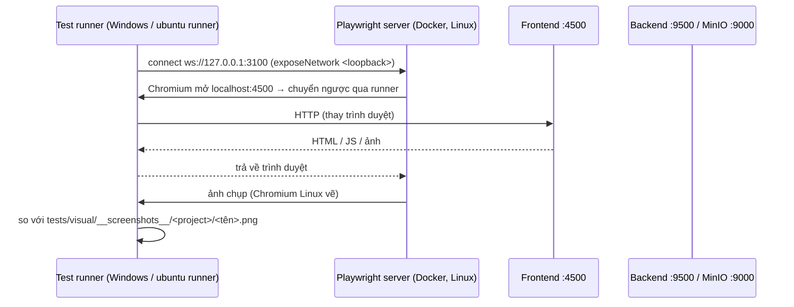

# Kiểm thử giao diện

## 1. Mục tiêu và phạm vi

Lát thứ ba của giai đoạn 4 (D13, thứ tự 4.1 → 4.3 → **4.2** → 4.4). Lát này chủ yếu viết code test; frontend chỉ sửa các lỗi a11y mà test tìm ra.
Sau lát này bộ test có thêm:
1. **Visual regression**: so ảnh chụp (`toHaveScreenshot`) các trang đã có trên desktop (`chromium`) và mobile (`mobile-chrome`, Pixel 7). Ảnh chuẩn được sinh ra giống hệt nhau ở máy Windows và trên CI (§3, §11 câu 1).
2. **Accessibility**: quét `@axe-core/playwright` theo WCAG 2.1 A + AA trên cùng các trang, cộng thêm các trạng thái tương tác (hộp thoại, menu, form lỗi).
3. **Sửa lỗi a11y ở frontend**, có bảng vi phạm trước và sau khi sửa. Lỗi nào không sửa trong lát thì ghi vào danh sách chấp nhận, chuyển cho 4.4.
4. Gắn cả hai nhóm vào CI của lát `ci-bao-cao`, có artifact ảnh diff và bảng a11y trong job summary.

Hiện trạng (22/11/2026, đã kiểm):
- `tests/visual/`, `tests/a11y/` mới có README. `@axe-core/playwright` 4.14.0 đã cài, chưa dùng. Chưa có ảnh chuẩn nào.
- CI (lát 4.3, đã merge vào `main` qua PR #10) chạy trên `ubuntu-latest`, còn máy phát triển là Windows 11. Font hiển thị khác nhau giữa hai nơi (Inter / Anton tự host qua `@fontsource`, nhưng cách vẽ chữ do hệ điều hành quyết định), nên ảnh chụp ở hai nơi không bao giờ trùng từng pixel.
- **Quét axe thử** (22/11, Vite dev, Chromium, tag `wcag2a/aa`, `wcag21a/aa`) trên 11 trang × 2 thiết bị và 9 trạng thái tương tác. Kết quả: phần lớn sạch, chỉ có 5 vi phạm. Chi tiết ở §8, kèm code gây lỗi:

| # | Trang / trạng thái | Rule | Mức | Phần tử |
|---|---|---|---|---|
| V1 | `/t/$slug` (desktop + mobile) | `scrollable-region-focusable` | serious | `.pdp-gallery-track` (dải ảnh cuộn ngang, không focus được bằng bàn phím) |
| V2 | `/login` (desktop + mobile) | `aria-prohibited-attr` | serious | `<div aria-label="Nike">` bọc logo ở `routes/_auth.tsx:28` |
| V3 | `/admin/roles` (mobile) | `button-name` | critical | 3 nút trên thanh công cụ của bảng ("Refresh", "Customize Columns", nút thêm / xoá): chữ bị `hidden lg:inline` nên dưới `lg` nút không còn tên |
| V4 | `/w`, menu "Sort By" đang mở | `aria-hidden-focus` | serious | Radix `DropdownMenu` ở chế độ modal gắn `aria-hidden` lên phần còn lại của trang, trong khi bên trong vẫn có phần tử focus được |
| V5 | Mọi trang khi chạy Vite dev | `aria-hidden-focus` | serious | `.tsqd-parent-container` (TanStack Query Devtools). Chỉ có ở bản dev, không có ở bản build → loại khỏi phạm vi quét |

| Có làm | Không làm (để lát khác) |
|---|---|
| `tests/visual/kiem-thu-giao-dien.spec.js`: 14 trang / trạng thái × 2 project, ảnh khung nhìn và ảnh thành phần (header, footer, thẻ sản phẩm), có che phần động; 1 ca chứng minh test bắt được thay đổi giao diện | So ảnh trên `firefox` / `webkit` (§11 câu 4). Chụp nguyên trang dài (`fullPage`) |
| Ảnh chuẩn duy nhất: trình duyệt chạy trong image Docker `mcr.microsoft.com/playwright:v1.63.0-noble` (Playwright server), test runner vẫn chạy trên máy (§3, §11 câu 1). Có `pnpm visual:server`, `test:visual`, `test:visual:update` | Dịch vụ so ảnh bên ngoài (Percy, Argos, Chromatic…) |
| `tests/a11y/kiem-thu-giao-dien.spec.js`: 11 nhóm trang / trạng thái × 2 project; `utils/a11y.js` (quét, lọc danh sách chấp nhận, thông báo lỗi dạng bảng); `data/a11y-known.json`; 1 ca chứng minh axe bắt được lỗi | Kiểm thử bàn phím / trình đọc màn hình thủ công, WCAG 2.2, rule `best-practice` của axe |
| Sửa V1 → V4 ở frontend (§8). Vi phạm mới gặp lúc cook thì làm theo quy tắc §8: sửa nếu đủ điều kiện, không thì ghi vào `a11y-known.json` + §12 cho 4.4 | Sửa lỗi a11y lớn (đổi thiết kế, bỏ thư viện): ghi lại cho 4.4 |
| `pnpm report:a11y`: bảng Markdown các vi phạm (theo trang × thiết bị × rule), dùng cho job summary và quyển (trước / sau) | Test plan, `test-cases.xlsx`, ma trận truy vết (lát 4.4) |
| Tag `@visual`, `@a11y`; cập nhật `check:tags`, `report:summary`, nhóm lỗi Allure | Trang của các lát chưa làm (`/favorites` thật, `/orders`, `/admin/products`…): lát nào thêm trang thì tự thêm vào danh sách §6 |
| CI: smoke và hai shard regression (`api-chromium`, `mobile-chrome`) bật Playwright server; artifact `visual-diff*` khi đỏ; job summary có bảng a11y | |
| Ảnh cho quyển: ảnh chuẩn, bộ ba expected / actual / diff, trang HTML report có thanh so sánh, ảnh phần tử vi phạm được khoanh đỏ, bảng trước / sau | |

## 2. Tác nhân

| Tác nhân | Dùng trong test | Ghi chú |
|---|---|---|
| Khách vãng lai | `/`, `/w`, `/t/$slug`, `/cart`, `/signin`, 404 | không đăng nhập |
| `khach1@nike.local` | `/checkout`, trang xác nhận đơn | storageState `.auth/khach1.json` (đã có) |
| `admin@nike.local` | `/admin`, `/admin/roles`, `/admin/permissions`, `/admin/resources`, `/admin/modules` | storageState `.auth/admin.json` |
| Không đăng nhập | `/login` (đăng nhập quản trị) | |
| Người phát triển | `pnpm visual:server`, `test:visual(:update)`, `test:a11y`, `report:a11y` | Docker Desktop đang chạy sẵn (MySQL / MinIO) |
| GitHub Actions | smoke mỗi push, regression đêm | như lát 4.3 |

## 3. Luồng

**L1 — Visual ở máy (Windows):**
1. `pnpm visual:server`: nếu container `nike-pw-server` chưa chạy thì chạy image `mcr.microsoft.com/playwright:v<phiên bản @playwright/test>-noble` với `playwright run-server`, mở cổng `127.0.0.1:3100`, rồi chờ cổng sẵn sàng.
2. `pnpm test:visual`: bật server nếu chưa bật, đặt `E2E_PW_WS=ws://127.0.0.1:3100/`, rồi gọi `run-phases.mjs --grep @visual`.
3. Spec visual dùng `test.use({ connectOptions: { wsEndpoint, exposeNetwork: '<loopback>' } })`: Chromium chạy trong container Linux, còn request tới `localhost:4500` / `:9500` / `:9000` (MinIO) được chuyển ngược qua test runner trên máy. Kết quả là ảnh do Chromium Linux vẽ, cùng font và cùng image với CI.
4. Mỗi test lần lượt: mở trang → `settle()` (§5.3) → `toHaveScreenshot('<tên>.png', { mask })`. Ảnh chuẩn nằm ở `tests/visual/__screenshots__/<project>/<tên>.png`.
5. Cập nhật ảnh chuẩn: `pnpm test:visual:update`, xem `git diff --stat` (chỉ có file `.png`), mở vài ảnh để kiểm bằng mắt, rồi commit.

**L2 — A11y:** test mở trang hoặc đưa trang về trạng thái cần quét (mở hộp thoại, bấm gửi form trống…), rồi gọi `scanA11y(page, testInfo, '<tên>')`. Hàm này chạy axe với 4 tag WCAG và loại phần devtools (§5.4). Mỗi vi phạm được đối chiếu với `data/a11y-known.json` và ghi `a11y-results/<project>/<tên>.json`. Test đỏ khi còn vi phạm `serious` / `critical` không có trong danh sách chấp nhận; vi phạm `moderate` / `minor` chỉ ghi annotation cảnh báo (§11 câu 3). Không cần Docker: a11y chạy trong Chromium bình thường.

**L3 — CI:** composite action `setup-sut` có input mới `pw-server: 'true'`. Khi bật, nó chạy `node automation/scripts/visual-server.mjs start` rồi ghi `E2E_PW_WS` vào `$GITHUB_ENV`. Smoke chạy `@smoke` (gồm TC-01 visual, TC-20 a11y). Regression chạy toàn bộ: shard `api-chromium` và `mobile-chrome` bật server, `firefox` / `webkit` không chạy visual / a11y. Khi đỏ, artifact `visual-diff` chứa bộ ba `*-expected.png`, `*-actual.png`, `*-diff.png`. Job summary có thêm bảng a11y (`report:a11y`).

**Ngoại lệ:**
- E1. Không đặt `E2E_PW_WS` (vd `pnpm test` thường ở máy): mọi test `@visual` **bỏ qua** với lý do `Cần Playwright server Docker — chạy pnpm test:visual hoặc pnpm visual:server rồi đặt E2E_PW_WS` (§5.5). Không chụp bằng trình duyệt Windows, nên không bao giờ sinh nhầm ảnh chuẩn Windows.
- E2. Đã đặt `E2E_PW_WS` nhưng server không chạy: test đỏ do lỗi kết nối (Allure xếp vào "Lỗi kết nối / hạ tầng"), không bỏ qua trong im lặng.
- E3. Docker không chạy / không có lệnh `docker`: `visual:server` thoát 2 kèm message §5.5.
- E4. Ảnh khác ảnh chuẩn: test đỏ với `expect(page).toHaveScreenshot(expected) failed` + `<n> pixels (ratio <r> of all image pixels) are different` (Playwright 1.63; sửa lúc cook, §12). Ảnh expected / actual / diff được đính kèm (HTML report có thanh kéo so sánh).
- E5. Chưa có ảnh chuẩn (lần đầu, hoặc trang mới): Playwright ghi ảnh actual làm ảnh chuẩn và test đỏ (`A snapshot doesn't exist… writing actual`). Trên CI (`CI=true`) dùng `updateSnapshots: 'none'`, nên trang mới không có ảnh chuẩn là đỏ hẳn, không tự ghi.
- E6. A11y có vi phạm nằm trong `a11y-known.json`: test xanh, có annotation `a11y-known` ghi rule + lý do. Mục trong danh sách không còn gặp ở lần quét nào: `report:a11y` liệt kê ở mục "Mục chấp nhận không còn gặp" để xoá.



## 4. Cơ sở dữ liệu

Không đổi. Ảnh chụp dựa trên dữ liệu mẫu cố định (`products.json`, reset ở `global-setup`). Pha thường không đổi tồn kho nên dòng "Just a few left" / "Sold Out" giữ ổn định. Trang xác nhận đơn tạo đơn thật nên nằm trong `describe('… @stock')`.

## 5. Hợp đồng (lệnh, biến môi trường, helper) — cố định, test bám mục này

### 5.1 Lệnh `automation/package.json`

| Lệnh | Việc |
|---|---|
| `pnpm visual:server [start\|stop\|status]` → `node scripts/visual-server.mjs` | `start` (mặc định): chạy container `nike-pw-server` nếu chưa chạy; image tag = phiên bản `@playwright/test` đọc từ `node_modules` (hiện `v1.63.0-noble`); lệnh `docker run -d --rm --name nike-pw-server --init --ipc=host -p 127.0.0.1:${E2E_PW_PORT:-3100}:3000 <image> /bin/sh -c "npx -y playwright@<ver> run-server --port 3000 --host 0.0.0.0"`; chờ cổng tối đa 120 giây; in `Playwright server sẵn sàng: ws://127.0.0.1:3100/`. Đã chạy rồi thì in `Playwright server đang chạy: ws://127.0.0.1:3100/` và thoát 0. `stop`: `docker stop nike-pw-server`. `status`: in một trong hai dòng trên, hoặc `Playwright server chưa chạy` (thoát 1) |
| `pnpm test:visual [tham số playwright]` → `node scripts/visual-server.mjs test …` | `start` → đặt `E2E_PW_WS` → `run-phases.mjs tests/visual/ --project=chromium --project=mobile-chrome …` (lọc theo thư mục thay cho `--grep @visual` để `-g` của người dùng còn lọc được — nhiều `--grep` bị Playwright gộp kiểu OR; sửa lúc cook, §12) |
| `pnpm test:visual:update` | như trên, thêm `--update-snapshots=all` |
| `pnpm test:a11y` | `run-phases.mjs tests/a11y/ --project=chromium --project=mobile-chrome` (như trên) |
| `pnpm report:a11y [--input a11y-results] [--title <tên>] [--out <file>]` → `node scripts/a11y-report.mjs` | đọc `a11y-results/**/*.json`, in bảng §6.3; có `--out` thì ghi file; có `GITHUB_STEP_SUMMARY` thì nối thêm. Luôn thoát 0 khi đọc được dữ liệu, kể cả khi có vi phạm |
| `pnpm test*` (cũ) | `run-phases.mjs` dọn thêm `a11y-results/` ở đầu lần chạy (như `allure-results/`, trừ khi `E2E_KEEP_RESULTS=1`) |

### 5.2 Biến môi trường và cấu hình

| Biến | Giá trị | Dùng ở |
|---|---|---|
| `E2E_PW_WS` | `ws://127.0.0.1:3100/`; không đặt thì test `@visual` bỏ qua (E1) | `utils/visual.js` |
| `E2E_PW_PORT` | cổng trên máy cho server, mặc định `3100` | `visual-server.mjs` |
| `E2E_DOC_SHOTS` | (đã có) thư mục ảnh tài liệu; lát này thêm: ca TC-15 chép bộ ba expected / actual / diff, ca a11y chụp phần tử vi phạm có khung đỏ | `utils/doc-shot.js`, spec |

`playwright.config.js`:
- `snapshotPathTemplate: '{testDir}/{testFileDir}/__screenshots__/{projectName}/{arg}{ext}'`. Không có `{platform}` vì ảnh luôn do Chromium Linux trong Docker vẽ.
- `expect.toHaveScreenshot: { animations: 'disabled', caret: 'hide', scale: 'css', threshold: 0.2, maxDiffPixelRatio: 0.002, stylePath: './tests/visual/screenshot.css' }`. Tỉ lệ 0,2 % để chịu được khử răng cưa lệch vài pixel; TC-17 đo lại thực tế, nếu luôn bằng 0 thì hạ xuống `maxDiffPixels: 0` và ghi §12. **Kết quả cook: TC-17 đo lệch 0 pixel → dùng `maxDiffPixels: 0`** (§12).
- `updateSnapshots: isCI ? 'none' : 'missing'`.
- Project `firefox`, `webkit`: `testIgnore` thêm `tests/visual/` và `tests/a11y/` (§11 câu 4).

`tests/visual/screenshot.css` (chỉ áp dụng lúc chụp):
```css
*, *::before, *::after { transition: none !important; animation: none !important; caret-color: transparent !important; }
::-webkit-scrollbar { display: none !important; }
.tsqd-parent-container, [data-testid="signin-dev-hint"] { display: none !important; }  /* chỉ có ở Vite dev */
```

### 5.3 `utils/visual.js`

| Hàm | Hợp đồng |
|---|---|
| `visualConnect()` | trả `{ wsEndpoint: E2E_PW_WS, exposeNetwork: '<loopback>' }`, không đặt biến thì trả `undefined`. Spec gọi `test.use({ connectOptions: visualConnect() })` ở đầu file |
| `requireVisualServer()` | `test.skip(!process.env.E2E_PW_WS, '<message E1>')`, gọi trong `beforeEach` |
| `settle(page)` | chờ `networkidle`; `document.fonts.ready`; không còn `[aria-busy="true"]` hay `[data-testid$="-skeleton"]` hiện; mọi `` **nằm trong khung nhìn** có `complete && naturalWidth > 0` (timeout 15 giây; quá thì test đỏ với `Ảnh chưa tải xong: <src>`); cuộn `#app-scroll` (hoặc `window`) về đầu trang; bỏ focus (`document.activeElement.blur()`) |
| `masks(page)` | danh sách locator luôn che (màu `#FF00FF`): `[data-testid="order-code"]`; trên trang quản trị dạng bảng thì che `tbody` và dòng tổng số bản ghi ở chân bảng (test khác chạy song song có thể thêm / sửa chức vụ) |

**Che gì / không che gì** (§11 câu 2): ảnh sản phẩm là file mẫu cố định trên MinIO nên **chờ tải xong rồi chụp, không che**. Ảnh chậm thì `settle` chờ; quá 15 giây thì đỏ, vì đó chính là lỗi cần thấy. Hiện không trang nào hiện ngày giờ (đã grep `new Date(` / `toLocaleDate` trong `frontend/src`), nên không cần `page.clock`. Lát sau (vd `don-cua-toi` có ngày đặt) thêm selector vào `masks`.

### 5.4 `utils/a11y.js` và `data/a11y-known.json`

`scanA11y(page, testInfo, name, { include?, exclude? } = {})`:
- `new AxeBuilder({ page }).withTags(['wcag2a', 'wcag2aa', 'wcag21a', 'wcag21aa']).exclude('.tsqd-parent-container')` (+ `include` / `exclude` truyền vào, vd chỉ quét `[role="dialog"]`).
- Mỗi vi phạm thành một dòng `{ page: name, project, rule, impact, nodes, targets[≤3], help, helpUrl, known: <lý do> | null }`. Một vi phạm là `known` khi có mục trong `a11y-known.json` trùng `rule`, có `pages` chứa `name` (hoặc `"*"`) và có `target` là chuỗi con của một selector.
- Ghi `a11y-results/<project>/<name>.json` (toàn bộ dòng + `incomplete` đếm theo rule) và `testInfo.attach('axe-<name>.json')`.
- `blocking` = dòng không `known` có impact `serious` / `critical` → `expect(blocking, formatViolations(blocking)).toEqual([])`. Message có dạng:
  ```
  Vi phạm WCAG 2.1 AA ở <name> (<project>): 2
    - [serious] scrollable-region-focusable × 1 — .pdp-gallery-track — Ensure elements that have scrollable content are accessible by keyboard
    - …
  ```
- Dòng `moderate` / `minor` không `known`: `testInfo.annotations.push({ type: 'a11y-warning', description: '<rule> × <n> ở <name>' })`.
- Có `E2E_DOC_SHOTS` và có vi phạm: tô `outline: 3px solid #e00` lên các phần tử vi phạm, chụp `a11y-<name>[-mobile].png` rồi gỡ outline.

`data/a11y-known.json`:
```json
{
  "$comment": "Vi phạm WCAG đã biết nhưng chưa sửa trong lát kiem-thu-giao-dien — chuyển lát 4.4 (bug report). Xoá mục khi đã sửa.",
  "items": [
    { "rule": "<axe rule id>", "pages": ["<tên quét>"], "target": "<chuỗi con của selector>", "reason": "<vì sao chưa sửa>", "ticket": "4.4" }
  ]
}
```
Bắt đầu với `items: []`. Chỉ thêm mục theo quy tắc §8.

### 5.5 Thông báo của script / helper (nguyên văn, tiếng Việt vì là công cụ nội bộ)

| Tình huống | Mã thoát / kết quả | Message |
|---|---|---|
| Test `@visual` khi không có `E2E_PW_WS` | skip | `Cần Playwright server Docker — chạy pnpm test:visual hoặc pnpm visual:server rồi đặt E2E_PW_WS` |
| `visual:server` khi không gọi được `docker` / daemon tắt | 2 | `Không gọi được Docker — bật Docker Desktop rồi chạy lại` |
| `visual:server` khi cổng không mở sau 120 giây | 1 | `Playwright server không lên sau 120s` + 40 dòng cuối `docker logs nike-pw-server` |
| `visual:server` khi cổng `E2E_PW_PORT` bị tiến trình khác chiếm | 2 | `Cổng 3100 đang bận — đặt E2E_PW_PORT khác` |
| `report:a11y` không có `a11y-results/` hoặc thư mục rỗng | 2 | `Không có kết quả a11y trong a11y-results — chạy pnpm test:a11y trước` |
| `settle` quá 15 giây mà ảnh chưa tải | test đỏ | `Ảnh chưa tải xong: <src>` |

### 5.6 Tag và công cụ báo cáo

- Tag mới `@visual` (mọi test trong `tests/visual/`) và `@a11y` (mọi test trong `tests/a11y/`), cộng thêm đúng một tag `@smoke` / `@regression` như quy tắc cũ.
- `check:tags`: thêm 2 **lỗi**: (6) test ở `tests/visual/` thiếu `@visual`, hoặc ở `tests/a11y/` thiếu `@a11y`; (7) `@visual` / `@a11y` xuất hiện ngoài hai thư mục đó. Bảng thống kê thêm cột `visual`, `a11y`.
- `report:summary`: bảng "Theo tag" thêm dòng `@visual`, `@a11y`.
- `allure/categories.json`: thêm 2 nhóm, đặt trước "Sai kết quả mong đợi" (các nhóm sau loại trừ chúng như mẫu hiện có):
  - "Khác biệt giao diện (ảnh chụp)": `messageRegex` khớp `toHaveScreenshot\(|of all image pixels\) are different|A snapshot doesn't exist` (sửa lúc cook, §12).
  - "Vi phạm khả năng truy cập": khớp `Vi phạm WCAG 2.1 AA`.

## 6. Danh sách trang / trạng thái và tên ảnh (cố định — TC bám mục này)

### 6.1 Visual (`tests/visual/kiem-thu-giao-dien.spec.js`, mỗi dòng chạy ở `chromium` và `mobile-chrome`)

| TC | Trang / trạng thái | Chuẩn bị | Ảnh (`__screenshots__/<project>/…`) | Che thêm |
|---|---|---|---|---|
| TC-01 | `/` trang chủ, khung nhìn đầu trang | — | `home.png` | — |
| TC-02 | Header, footer (ảnh thành phần) | `/`; footer cuộn vào khung nhìn | `header.png` (`<header>`), `footer.png` (`<footer>`) | — |
| TC-03 | `/w` danh sách | desktop: khung nhìn; mobile: thêm ngăn kéo "Filter" đang mở | `catalog.png`; mobile thêm `catalog-filter.png` | — |
| TC-04 | Thẻ sản phẩm (ảnh thành phần) | `/w`, thẻ đầu tiên và thẻ đầu tiên có giá gạch | `product-card.png`, `product-card-sale.png` | — |
| TC-05 | `/t/nike-dunk-low-retro` | khung nhìn; rồi bấm "Add to Bag" khi chưa chọn size | `pdp.png`, `pdp-size-error.png` (vùng chọn size + "Please select a size.") | — |
| TC-06 | `/t/nike-air-max-plus-premium` (sản phẩm ẩn) | — | `pdp-not-found.png` | — |
| TC-07 | `/cart` | giỏ 2 dòng ghi qua `setCart` (1 sản phẩm giá thường, 1 sản phẩm giảm giá, lấy từ `seed-products.js`); rồi giỏ rỗng | `cart.png`, `cart-empty.png` | — |
| TC-08 | `/signin` | bước email; rồi nhập `free@nike.local` → "Continue" | `signin-email.png`, `signin-password.png` | dòng gợi ý dev bị ẩn bằng CSS |
| TC-09 | `/checkout` (khach1) | giỏ 1 dòng; khung nhìn; rồi xoá trắng các ô và bấm "Place Order" | `checkout.png`, `checkout-errors.png` | — |
| TC-10 | `/checkout/result/$code` (khach1, `describe @stock`) | tạo đơn COD qua API (`apiAs('khach1').order.create`, size của làn `laneOf`) | `order-result.png` | `order-code` |
| TC-11 | `/khong-co-trang-nay` (404) | — | `not-found.png` | — |
| TC-12 | `/login` (quản trị) | — | `admin-login.png` | — |
| TC-13 | `/admin` (admin) | chờ heading "Hi, Administrator" | `admin-dashboard.png` | — |
| TC-14 | `/admin/roles` (admin) | bảng; rồi mở hộp thoại thêm chức vụ | `admin-roles.png`, `admin-role-dialog.png` (chỉ `[role="dialog"]`) | `tbody`, dòng tổng số bản ghi |
| TC-15 | Chứng minh bắt được thay đổi (`@regression`) | `/t/nike-dunk-low-retro`, chèn CSS đổi nền nút "Add to Bag" thành `#d33918` và dời giá xuống 6px | so với `pdp.png`, **phải** ném lỗi | — |

`@smoke`: TC-01. Còn lại `@regression`. Tổng 15 test × 2 project = **30** (TC-10 thuộc pha `@stock`).

### 6.2 A11y (`tests/a11y/kiem-thu-giao-dien.spec.js`, mỗi dòng chạy ở `chromium` và `mobile-chrome`)

| TC | Trang / trạng thái (tên quét) | Chuẩn bị |
|---|---|---|
| TC-20 | `home` | `/` |
| TC-21 | `catalog`, `catalog-sort` (desktop), `catalog-filter` (mobile) | `/w`; mở "Sort By" (desktop) / ngăn kéo "Filter" (mobile) |
| TC-22 | `pdp`, `pdp-size-error`, `pdp-size-guide`, `pdp-added` | `/t/nike-dunk-low-retro`; bấm "Add to Bag" khi chưa chọn size; mở "Size Guide"; chọn size còn hàng → "Add to Bag" (popup "Added to Bag") |
| TC-23 | `search` (desktop), `mobile-menu` (mobile) | `/`; mở khung tìm kiếm / menu mobile |
| TC-24 | `cart`, `cart-empty` | như TC-07 |
| TC-25 | `signin-email`, `signin-password`, `signin-join` | `/signin`; `free@nike.local` → bước mật khẩu; email mới → bước tạo tài khoản |
| TC-26 | `checkout`, `checkout-errors` | như TC-09 |
| TC-27 | `order-result` (`describe @stock`) | như TC-10 |
| TC-28 | `not-found`, `pdp-not-found` | 404; sản phẩm ẩn |
| TC-29 | `admin-login`, `admin-login-errors` | `/login`; bấm đăng nhập khi form trống |
| TC-30 | `admin-dashboard`, `admin-roles`, `admin-role-dialog`, `admin-permissions`, `admin-resources`, `admin-modules` | admin; mở hộp thoại thêm chức vụ |
| TC-31 | `home-injected`: chứng minh axe bắt được lỗi (`@regression`) | `/`, chèn `<button id="zz-a11y"><svg/></button>` vào `<main>` |

`@smoke`: TC-20. Tổng 12 test × 2 project = **24** (TC-27 thuộc pha `@stock`).

### 6.3 Bảng của `report:a11y`

```markdown
## Khả năng truy cập (WCAG 2.1 AA) — <title, mặc định "Toàn bộ">

<n> lần quét · <m> trang / trạng thái · chặn <b> · chấp nhận <k> · cảnh báo <w>

| Trang / trạng thái | Thiết bị | Rule | Mức | Phần tử | Trạng thái |
|---|---|---|---|---|---|
| pdp | desktop | scrollable-region-focusable | serious | 1 | **chặn** |
| … | mobile | … | … | … | chấp nhận — <reason> |

### Trang không có vi phạm (<x>)
home, catalog, … (gộp desktop / mobile; trang chỉ sạch ở một thiết bị thì ghi "(desktop)" / "(mobile)")

### Mục chấp nhận không còn gặp (<y>)      ← chỉ có khi y > 0
- <rule> ở <pages> — xoá khỏi data/a11y-known.json
```
"Thiết bị": `chromium` → `desktop`, `mobile-chrome` → `mobile`. Sắp xếp theo mức (critical → minor) rồi theo tên trang. Không có vi phạm nào thì bảng thay bằng dòng `Không có vi phạm.`

### 6.4 Thay đổi chuỗi / thuộc tính ở frontend (§8)

| Chỗ | Trước | Sau |
|---|---|---|
| `product-gallery.tsx`, `.pdp-gallery-track` | không focus được | `tabIndex={0}`, `role="region"`, `aria-label="Product images"`, viền focus `focus-visible:ring-2` (ring-inset); bỏ `aria-label="Product images"` ở `<section>` bao ngoài để không có hai region trùng tên (sửa lúc cook, §12) |
| `routes/_auth.tsx:28` | `<div aria-label="Nike">` | bỏ `aria-label` ở `div`; `NikeSwoosh` có `role="img"` + `aria-label="Nike"` (nếu component đã có `aria-hidden` thì truyền prop) |
| `data-table-advanced.tsx`, 4 nút thanh công cụ | tên chỉ nằm trong `<span className="hidden lg:inline">` | thêm `aria-label` đúng chữ đang hiện: `"Refresh"`, `"Customize Columns"`, `{deleteLabel}`, `{addLabel}` (tên truy cập không đổi, E2E cũ vẫn chạy) |
| `sort-menu.tsx` | `<DropdownMenu>` (modal) | `<DropdownMenu modal={false}>` |
| `email-step.tsx` dòng gợi ý dev | không có testid | `data-testid="signin-dev-hint"` |

## 7. Việc backend (Claude)

Không có.

## 8. Việc frontend (Claude)

Sửa V1 → V4 theo §6.4, thêm testid `signin-dev-hint`. Không đổi giao diện nhìn thấy (trừ viền focus của gallery, chỉ hiện khi focus bằng bàn phím), nên ảnh chuẩn không phải sinh lại. Nếu ảnh có đổi thì sinh lại và ghi §12.

**Quy tắc cho vi phạm mới gặp lúc cook** (không đoán trước được hết, vì các trạng thái `pdp-added`, `checkout-errors`… chưa quét thử được):
- **Sửa trong lát** khi thoả cả ba: nằm trong code của repo (không phải bên trong thư viện), sửa ≤ khoảng 30 dòng, và không làm lệch giao diện tham chiếu `plan/ui-nike`. Ví dụ: thiếu `aria-label` / `alt` / `<label>`, ARIA sai, độ tương phản của một token màu lệch nhẹ.
- **Ghi vào `a11y-known.json` + §12, chuyển 4.4** khi: lỗi nằm trong Radix / sonner / devtools; muốn sửa phải đổi thiết kế (vd màu xám `--sh-muted` của Nike trên nền `--sh-surface`); hoặc sửa xong lại làm đỏ E2E của lát khác mà không thể sửa nhỏ.
- Mỗi mục chấp nhận có `reason` cụ thể; §12 ghi bảng tóm tắt.

Sau khi sửa: `pnpm build`, `pnpm lint` xanh; spec E2E của khu vực bị đụng (`product-detail`, `admin`, `product-list`, `account`) xanh trên cả 4 trình duyệt.

Component shadcn dùng: không thêm.

## 8b. Việc của Claude (code test + CI, theo thứ tự)

Chia hai phiên như `/cook`. Phiên A = phần test (đóng vai "backend"), phiên B = sửa frontend + CI. Bảng "trước" phải chụp **trước khi** sửa frontend.

**Phiên A — test + hạ tầng so ảnh**
1. `playwright.config.js` (§5.2), `tests/visual/screenshot.css`, `.gitignore` thêm `a11y-results/`, `.env.example` thêm dòng `# E2E_PW_WS=ws://127.0.0.1:3100/`. `run-phases.mjs` dọn `a11y-results/`.
2. `scripts/visual-server.mjs` (§5.1, §5.5) + script `package.json`. Kiểm TC-16, TC-19.
3. `utils/visual.js` (§5.3), `tests/visual/kiem-thu-giao-dien.spec.js` (§6.1). Sinh ảnh chuẩn bằng `pnpm test:visual:update`, mở từng ảnh kiểm bằng mắt (không có skeleton, không thiếu ảnh, không có devtools). Rồi TC-17 (ổn định).
4. `utils/a11y.js`, `data/a11y-known.json` (rỗng), `tests/a11y/kiem-thu-giao-dien.spec.js` (§6.2), `scripts/a11y-report.mjs`.
5. Chạy `pnpm test:a11y` (**đỏ ở V1 → V4 là đúng**). Rồi `pnpm report:a11y --title "Trước khi sửa" --out ../docs/kiem-thu/so-lieu/2026-11-xx-a11y-truoc.md`, cùng `E2E_DOC_SHOTS=../docs/chuc-nang/img/kiem-thu-giao-dien` để chụp ảnh vi phạm. Ghi bảng vào §12.
6. `check:tags` (rule 6, 7, cột mới), `summarize.mjs` (tag), `allure/categories.json`. Kiểm TC-18, TC-32, TC-33.
7. `pnpm lint`, Prettier, `check:tags`. Ghi §12 "phiên A xong" kèm danh sách vi phạm cần sửa ở phiên B (V1 → V4 + vi phạm mới).

**Phiên B — sửa frontend + CI + chạy đủ**
8. Sửa frontend theo §8. `pnpm test:a11y` xanh; `report:a11y --title "Sau khi sửa" --out …-a11y-sau.md`. Chạy lại spec E2E của các khu vực bị đụng.
9. `pnpm test:visual` xanh với ảnh chuẩn cũ. Có ảnh đổi thì sinh lại, ghi lý do vào §12.
10. TC-15 với `E2E_DOC_SHOTS` → chép bộ ba expected / actual / diff; `pnpm report:shots` (mở rộng: chụp trang test TC-15 trong `playwright-report-all/` ở chế độ "Slider").
11. CI: `setup-sut` input `pw-server` (bước sau "Cài phụ thuộc automation": `node automation/scripts/visual-server.mjs start` → `echo "E2E_PW_WS=ws://127.0.0.1:3100/" >> $GITHUB_ENV`); `e2e-smoke.yml` bật `pw-server`, thêm bước `pnpm report:a11y --title "Smoke"` (always, có `a11y-results`) và artifact `visual-diff` (`if: failure()`, đường dẫn `automation/test-results*/**/*-diff.png`, `*-actual.png`, `*-expected.png`, 14 ngày); `e2e-regression.yml` thêm cột `pw-server` vào ma trận (`true` ở `api-chromium`, `mobile-chrome`), artifact `a11y-results-<shard>` (3 ngày) và `visual-diff-<shard>` khi đỏ, job `report` tải `a11y-results-*` về rồi chạy `report:a11y --title "Regression đêm"`.
12. `E2E_FRONTEND=preview pnpm test:visual` (TC-34) để chắc bản build cho ra ảnh giống bản dev.
13. `pnpm test` toàn bộ (với `E2E_PW_WS`) → `report:all` → `report:summary` → TC-35.
14. Push để kiểm CI (TC-36 → TC-38, cần §11 câu 5). Ghi §12 "phiên B xong".
15. README: `automation/README.md` (§2 lệnh mới, §4 thư mục `__screenshots__`, §6 CI, §9 tag), `tests/visual/README.md`, `tests/a11y/README.md` (viết lại: cách bật server, cập nhật ảnh chuẩn, đọc diff, quy tắc chấp nhận vi phạm).

## 9. Test case

Loại: `visual` / `a11y` = test Playwright trong spec của lát (§6) · `khung` = kiểm script / cấu hình / báo cáo ở máy · `fe` = kiểm phần sửa frontend · `ci` = kiểm một lần chạy thật trên GitHub Actions. Không có `unit` / `api` (lát không đổi backend).

### 9.1 Test trong spec (chạy ở `chromium` + `mobile-chrome`)

| ID | Loại | Mô tả | Tiền điều kiện | Bước | Kết quả mong đợi |
|---|---|---|---|---|---|
| TC-01 → TC-14 | visual | Ảnh trang / trạng thái theo §6.1 | Playwright server chạy; ảnh chuẩn đã commit | `pnpm test:visual` | 28 test xanh (14 × 2), mỗi test so đúng ảnh ghi ở §6.1; TC-10 chạy ở pha `@stock` |
| TC-15 | visual | Test bắt được thay đổi giao diện | đã có `pdp.png` của project; không phải `--update-snapshots` (nếu là thì skip với lý do `Không chạy khi cập nhật ảnh chuẩn`; chưa có ảnh chuẩn thì skip `Chưa có ảnh chuẩn pdp.png`) | chèn CSS (§6.1) → `await expect(expect(page).toHaveScreenshot('pdp.png', { timeout: 3000 })).rejects.toThrow(/pixels \(ratio [\d.]+ of all image pixels\) are different/)` (sửa lúc cook, §12) | test xanh; trong `test-results/` có `pdp-actual.png`, `pdp-expected.png`, `pdp-diff.png`; ảnh chuẩn `pdp.png` **không đổi** (`git status` sạch) |
| TC-20 → TC-30 | a11y | Quét WCAG 2.1 AA theo §6.2 | phiên B đã sửa xong §8 | `pnpm test:a11y` | 22 test xanh; `a11y-results/{chromium,mobile-chrome}/` đủ file theo các tên quét ở §6.2; không vi phạm `serious` / `critical` nào ngoài `a11y-known.json` |
| TC-31 | a11y | axe bắt được nút không có tên | — | chèn nút §6.2 → gọi `scanA11y` bên trong `expect(…).rejects` | lỗi ném ra có `Vi phạm WCAG 2.1 AA ở home-injected` và `[critical] button-name × 1 — #zz-a11y` |

### 9.2 Ở máy (khung)

| ID | Loại | Mô tả | Tiền điều kiện | Bước | Kết quả mong đợi |
|---|---|---|---|---|---|
| TC-16 | khung | Không có server thì bỏ qua visual | `E2E_PW_WS` không đặt | `node scripts/run-phases.mjs --grep @visual --project=chromium --reporter=line` | 0 lỗi; 15 test skip, lý do đúng message E1 §5.5; không có file mới trong `tests/visual/__screenshots__/` |
| TC-17 | khung | Ảnh ổn định qua nhiều lần chạy | sau bước 3 | `pnpm test:visual --repeat-each=3 --phase=main` | 0 lỗi, 0 chập chờn (14 test pha thường × 2 project × 3). Ghi vào §12 số pixel khác lớn nhất trong các lần chạy (đọc từ log) |
| TC-18 | khung | Cập nhật ảnh chuẩn chỉ đụng `.png` | ảnh chuẩn đã commit | `pnpm test:visual:update`; `git status --porcelain` | đúng 43 file `.png` (21 ảnh `chromium` + 22 ảnh `mobile-chrome`, thêm `catalog-filter.png`) nằm dưới `tests/visual/__screenshots__/{chromium,mobile-chrome}/`; ảnh không đổi thì git không báo thay đổi |
| TC-19 | khung | `visual:server` bật / tắt / lỗi | Docker Desktop chạy | `pnpm visual:server` hai lần; `pnpm visual:server status`; `pnpm visual:server stop`; `status`; chiếm cổng (`node -e "require('net').createServer().listen(3100)"`) rồi `start`; tắt Docker Desktop rồi `start` | lần 1: `Playwright server sẵn sàng: ws://127.0.0.1:3100/`; lần 2: `Playwright server đang chạy: …` (không tạo container thứ hai, `docker ps` chỉ có 1 `nike-pw-server`); sau `stop` thì `status` ra `Playwright server chưa chạy`, thoát 1; cổng bận → thoát 2 với `Cổng 3100 đang bận — đặt E2E_PW_PORT khác`; Docker tắt → thoát 2 với `Không gọi được Docker — bật Docker Desktop rồi chạy lại` |
| TC-32 | khung | `report:a11y` đúng §6.3, có "trước" và "sau" | sau bước 5 (còn vi phạm) và sau bước 8 | `pnpm report:a11y`; `--out <scratch>/a.md`; `GITHUB_STEP_SUMMARY=<scratch>/gh.md pnpm report:a11y` (gọi 2 lần); xoá `a11y-results/` rồi gọi | trước: dòng đầu `## Khả năng truy cập (WCAG 2.1 AA) — Toàn bộ`, có các dòng V1 (`pdp`, desktop + mobile), V2 (`admin-login`), V3 (`admin-roles`, mobile), V4 (`catalog-sort`, desktop) ở trạng thái **chặn**; số "chặn" = số dòng chặn. Sau: `chặn 0`. `gh.md` có 2 bảng nối nhau. Không có dữ liệu: thoát 2 với message §5.5 |
| TC-33 | khung | `check:tags`, summary, Allure nhận tag mới | sau bước 6 | `pnpm check:tags`; tạm thêm 1 test không có `@visual` vào `tests/visual/` và 1 test có `@a11y` vào `tests/api/` (không commit); chạy lại; xoá; sau TC-35 mở Allure Categories | lần 1: 0 lỗi, có cột `visual` = 30, `a11y` = 24; tổng test = 1046 + 54. Lần 2: 2 lỗi đúng rule 6, 7 (in `file:dòng`). `report:summary` có dòng `@visual`, `@a11y`. Một lần chạy cố ý đỏ (TC-15 bỏ `.rejects`, chạy tạm) được Allure xếp vào "Khác biệt giao diện (ảnh chụp)" |
| TC-34 | khung | Bản build cho ảnh giống bản dev | `pnpm --dir ../frontend build` | `E2E_FRONTEND=preview pnpm test:visual` | 0 lỗi với cùng ảnh chuẩn (devtools, dòng gợi ý dev bị ẩn bằng `screenshot.css`) |
| TC-35 | khung | Toàn bộ bộ test vẫn xanh | sau bước 8 → 12; server chạy; `E2E_PW_WS` đặt | `pnpm test` → `report:all` → `report:summary` → `report:a11y` | 0 lỗi, 0 chập chờn ở cả hai pha. Bảng "Theo project": `firefox` / `webkit` không có test visual / a11y (số không đổi so với trước lát), `chromium` và `mobile-chrome` mỗi project thêm 27 test (15 visual + 12 a11y). Thời gian chạy thêm ghi vào §12 |

### 9.3 Phần sửa frontend

| ID | Loại | Mô tả | Tiền điều kiện | Bước | Kết quả mong đợi |
|---|---|---|---|---|---|
| TC-40 | fe | Gallery focus được bằng bàn phím | — | `/t/nike-dunk-low-retro`, Tab tới vùng ảnh, nhấn `ArrowRight` (kiểm trong TC-22 `pdp`: focus vào `getByRole('region', { name: 'Product images' })`, `scrollLeft` tăng) | vùng có tên "Product images", focus thấy viền; `scrollable-region-focusable` không còn ở `pdp` |
| TC-41 | fe | Không lỡ đụng E2E cũ | sau bước 8 | `pnpm exec playwright test tests/product-detail tests/product-list tests/admin tests/account` (4 project UI) | 0 lỗi |
| TC-42 | fe | build + lint | sau bước 8 | `cd frontend && pnpm build && pnpm lint` | xanh |

### 9.4 Trên GitHub Actions (cần §11 câu 5)

| ID | Loại | Mô tả | Tiền điều kiện | Bước | Kết quả mong đợi |
|---|---|---|---|---|---|
| TC-36 | ci | Smoke xanh có visual + a11y | nhánh `feature/kiem-thu-giao-dien` | push; `gh run watch` | run "E2E smoke" `success`; log có `Playwright server sẵn sàng`; summary "Theo tag" có `@visual` ≥ 2 (TC-01 × 2 project), `@a11y` ≥ 2; có bảng `## Khả năng truy cập (WCAG 2.1 AA) — Smoke` với `chặn 0`. **Ảnh chuẩn sinh ở máy Windows khớp trên CI** (đây là điểm chính của §11 câu 1) |
| TC-37 | ci | Đỏ có chủ đích → có ảnh diff | sau TC-36 | commit tạm đổi màu nền nút chính ở `shop-theme.css` (một token) → push; xem run; rồi `git revert` → push | run `failure`; summary "Test lỗi" có TC-01 (chromium, mobile-chrome) với `toHaveScreenshot(expected) failed`; artifact `visual-diff` có `home-diff.png`; Allure Categories "Khác biệt giao diện (ảnh chụp)". Commit revert: run xanh. Ảnh diff chép vào `docs/chuc-nang/img/kiem-thu-giao-dien/` |
| TC-38 | ci | Regression có visual + a11y ở 2 shard | sau TC-36 | chạy tay `gh workflow run e2e-regression.yml --ref feature/kiem-thu-giao-dien` | 4 shard + report `success`; shard `firefox` / `webkit` không chạy visual / a11y; summary có bảng a11y "Regression đêm"; số test visual + a11y = TC-35 |

**Tổng: 27 test mới mỗi project UI** (54 lượt chạy), 11 TC khung / fe, 3 TC CI.

## 10. Tiêu chí hoàn thành

- [ ] TC-01 → TC-15, TC-20 → TC-31 xanh ở `chromium` + `mobile-chrome`; ảnh chuẩn đã commit (một bộ, Linux)
- [ ] TC-16 → TC-19, TC-32 → TC-35, TC-40 → TC-42 pass ở máy
- [ ] TC-36 → TC-38 pass trên GitHub Actions (ảnh chuẩn sinh ở máy Windows khớp trên CI)
- [ ] `pnpm lint`, Prettier, `check:tags` xanh; frontend `pnpm build` + `pnpm lint` xanh
- [ ] Có `docs/kiem-thu/so-lieu/<ngày>-a11y-truoc.md`, `<ngày>-a11y-sau.md`; `a11y-known.json` mỗi mục có lý do và đã ghi ở §12 cho 4.4
- [ ] Ảnh ở `docs/chuc-nang/img/kiem-thu-giao-dien/`: ảnh chuẩn home desktop / mobile, bộ ba expected / actual / diff (TC-15), HTML report chế độ Slider, ảnh diff từ CI (TC-37), ảnh vi phạm a11y có khung đỏ (trước khi sửa)
- [ ] README `automation/`, `tests/visual/`, `tests/a11y/` cập nhật
- [ ] Có `docs/chuc-nang/kiem-thu-giao-dien.md`

## 11. Rủi ro / câu hỏi mở

1. **Giữ ảnh chuẩn cho cả máy Windows lẫn CI Linux thế nào?** Ba cách:
   - **(A — đề xuất) Một bộ ảnh Linux, trình duyệt luôn chạy trong Docker.** Dùng image chính thức `mcr.microsoft.com/playwright:v1.63.0-noble` chạy `playwright run-server`; test runner vẫn chạy trên máy (Windows hoặc runner CI) và kết nối tới server với `exposeNetwork: '<loopback>'`, nên trình duyệt trong container vẫn mở được `localhost:4500/9500/9000`. Ở máy và trên CI là cùng một Chromium, cùng font, nên ảnh sinh ở máy khớp trên CI (TC-36 chứng minh). Ưu: một bộ ảnh, cập nhật ở máy là xong, không cần CI để sinh ảnh. Nhược: phải bật Docker để chạy visual (máy bạn vốn đã chạy Docker cho MySQL / MinIO); lần đầu tải image khoảng 2 GB; `pnpm test` thường mà không bật server thì visual bị bỏ qua (E1).
   - (B) Tách ảnh chuẩn theo hệ điều hành (hậu tố `-win32` / `-linux`, mặc định của Playwright). Chạy ở máy không cần Docker. Nhưng phải giữ hai bộ ảnh, mỗi lần đổi giao diện phải cập nhật cả hai, và bộ `-linux` chỉ sinh được bằng workflow chạy tay trên CI rồi tải artifact về commit.
   - (C) Chỉ so trên CI. Đơn giản nhất nhưng ở máy không thấy diff, khó demo và khó sửa.
   Chọn A?
2. **"Che ảnh tải chậm"**: plan **chờ** ảnh trong khung nhìn tải xong rồi chụp, **không che** ảnh sản phẩm. Lý do: ảnh là file mẫu cố định; che đi thì test không còn bắt được lỗi ảnh sai / vỡ khung. Chỉ che phần thật sự thay đổi: mã đơn, `tbody` của bảng quản trị (test khác chạy song song thêm chức vụ), devtools và dòng gợi ý dev (ẩn bằng CSS). Hiện không trang nào hiện ngày giờ. Đồng ý không?
3. **Mức vi phạm axe làm test đỏ:** đề xuất chỉ `serious` / `critical` (khớp `tests/a11y/README.md`); `moderate` / `minor` thì ghi annotation và hiện trong bảng §6.3, không làm đỏ. Lần quét thử không gặp vi phạm `moderate` / `minor` nào, nên hai cách hiện cho cùng kết quả. Hay muốn chặn mọi mức?
4. **Chỉ `chromium` + `mobile-chrome`** cho cả visual lẫn a11y (đúng yêu cầu "desktop + mobile-chrome"). Firefox / WebKit vẽ khác nên phải có thêm hai bộ ảnh; axe ra kết quả gần như nhau trên mọi engine vì rule chạy trên DOM. Thêm a11y cho `firefox` / `webkit` chỉ tốn khoảng 24 lượt chạy nữa nếu bạn muốn ma trận đẹp hơn. Giữ hai project?
5. **Nhánh và push lúc cook.** `ci-bao-cao` đã merge (PR #10), còn máy đang ở `feature/ci-bao-cao`. Đề xuất: lúc cook, chuyển sang `main` mới nhất rồi tạo `feature/kiem-thu-giao-dien`. TC-36 → TC-38 cần khoảng 3–4 lần push lên nhánh đó: 1 commit đỏ có chủ đích + 1 commit revert (TC-37), và 1 lần chạy tay regression. Không push `main`, không force push. Đồng ý không?
6. **Phiên bản Playwright và image phải trùng nhau.** `visual-server.mjs` đọc phiên bản từ `node_modules` nên tự khớp. Khi nâng `@playwright/test` thì Chromium mới có thể vẽ khác vài pixel → phải sinh lại ảnh chuẩn (README ghi rõ). Rủi ro nhỏ: `exposeNetwork` chuyển mọi request qua websocket nên chậm hơn; Vite dev phục vụ hàng trăm module mỗi lần tải trang. Nếu quá chậm thì visual dùng bản build (`E2E_FRONTEND=preview`), ghi §12.
7. **Vi phạm chưa biết:** lần quét thử chưa phủ được các trạng thái `pdp-added`, `checkout-errors` (kịch bản thử bấm hỏng) và trang xác nhận đơn. Vi phạm mới gặp ở đó làm theo quy tắc §8. Nếu số vi phạm mới vượt khoảng 5 rule thì dừng ở cuối phiên A, ghi §12 và hỏi bạn trước khi sửa.

## 12. Nhật ký thực hiện (do /cook và /doc-chuc-nang ghi — nối các phiên A/B/C)

| Thời điểm | Sự kiện |
|---|---|
| 2026-11-22 | Lập plan. Quét axe thử (Vite dev, Chromium) 11 trang × 2 thiết bị + 9 trạng thái: V1 → V5 (§1). Script thử để ở scratchpad, không vào repo |
| 2026-11-22 | Người dùng duyệt plan (status: approved). Các câu hỏi §11 theo phương án đề xuất |
| 2026-11-22 | `/cook` phiên A bắt đầu (status: in-progress). Preflight: file bẩn có sẵn `plan/README.md` (M), `plan/kiem-thu-giao-dien.md` (??); MySQL / MinIO healthy; backend :9500 = 200. Nhánh: vẫn ở `feature/ci-bao-cao` (cây trùng `origin/main` sau PR #10) — lệnh `git switch main` + tạo `feature/kiem-thu-giao-dien` (§11 câu 5) bị chặn quyền ở phiên này, để phiên C tạo nhánh như thường lệ |
| 2026-11-22 | Bước 1–2: `playwright.config.js` (`toHaveScreenshot`, `snapshotPathTemplate`, `updateSnapshots`, firefox / webkit bỏ `tests/(visual\|a11y)`), `screenshot.css`, `.gitignore`, `.env.example`, `run-phases.mjs` dọn `a11y-results/`; `scripts/visual-server.mjs` + script `package.json`. Image `mcr.microsoft.com/playwright:v1.63.0-noble` tải lần đầu vài phút. **TC-19 pass**: start lần 1 `sẵn sàng`, lần 2 `đang chạy` (1 container), `status` 0 / sau `stop` → `chưa chạy` thoát 1, cổng 3100 bị chiếm → thoát 2 đúng message, không gọi được docker → thoát 2 đúng message (giả lập bằng `PATH` không có `docker`; không tắt Docker Desktop thật vì MySQL / MinIO đang chạy trên đó) |
| 2026-11-22 | Bước 3: `utils/visual.js`, `tests/visual/kiem-thu-giao-dien.spec.js`. Sinh ảnh chuẩn bằng `pnpm test:visual:update`: **21 ảnh chromium + 22 ảnh mobile-chrome = 43** (khớp TC-18), đã mở xem: không skeleton, ảnh sản phẩm tải đủ, mã đơn / bảng quản trị bị che. **TC-16 pass**: không đặt `E2E_PW_WS` → 15 skip (14 pha thường + TC-10), đúng message E1, không sinh ảnh (một lần đầu tiến trình Playwright thoát `0xC0000409` trên Windows trước khi chạy test, chạy lại bình thường — lỗi môi trường, không lặp lại) |
| 2026-11-22 | Lệch plan lúc làm bước 3 (đã sửa plan): (1) Playwright 1.63 báo ảnh khác bằng `expect(page).toHaveScreenshot(expected) failed` + `<n> pixels (ratio <r> of all image pixels) are different`, **không có** `Screenshot comparison failed` → sửa E4, §5.6 (regex nhóm Allure), TC-15, TC-37; spec TC-15 dùng regex `pixels \(ratio … of all image pixels\) are different`. (2) **TC-17 pass với `maxDiffPixels: 0`**: lần 1 (`maxDiffPixelRatio: 0.002`) 82/82 trừ TC-15 mobile — giá dời 6px chỉ đổi vài trăm pixel < 0,2 % nên test **không bắt được**; đo lại với ngưỡng 0: mọi ảnh lệch **0 pixel** qua 3 lần × 2 project (sau khi sửa (3)) → giữ `maxDiffPixels: 0` như §5.2 dự liệu, TC-15 bắt được ở cả hai project (desktop 3317 px khác). Lần chạy cuối: `pnpm test:visual --repeat-each=3 --phase=main` 88/88 xanh, 0 chập chờn. (3) `/admin/roles`: số dòng / độ dài tên chức vụ đổi khi role.spec chạy song song → chân bảng xê dịch dù `tbody` bị che. `screenshot.css` thêm: `table-layout: fixed`, cột chọn 48px, chỉ hiện 3 dòng đầu một hàng chữ, bỏ viền dưới dòng 3 (trước đó lệch cố định 1px = 1740 pixel). (4) `pnpm test:visual` / `test:a11y` lọc theo thư mục `tests/visual/`, `tests/a11y/` thay cho `--grep @visual|@a11y`, vì Playwright gộp nhiều `--grep` kiểu OR nên `-g TC-xx` của người dùng không lọc được (§5.1 đã sửa). (5) Đơn ở TC-10 / TC-27 dùng size Air Max 95 `[505, 506, 507, 508]` theo `laneOf` (không spec @stock nào khác dùng sản phẩm 5) |
| 2026-11-22 | Bước 4–5: `utils/a11y.js` (quét bằng `expect.soft` để một test quét hết các trạng thái; TC-31 dùng `soft: false`; lần quét TC-31 ghi `demo: true` và `report:a11y` bỏ qua để bảng không bị "chặn" giả), `data/a11y-known.json` (`items: []`), `tests/a11y/kiem-thu-giao-dien.spec.js`, `scripts/a11y-report.mjs`. `E2E_DOC_SHOTS=../docs/chuc-nang/img/kiem-thu-giao-dien pnpm test:a11y`: **đỏ đúng dự kiến** 6 test (TC-21 desktop, TC-22 × 2 [V1 + TC-40 chưa focus được], TC-29 × 2, TC-30 mobile), 20 pass; pha stock 6/6 (TC-27 + TC-10 xanh). TC-31 pass ở cả hai project. Bảng "Trước khi sửa" → `docs/kiem-thu/so-lieu/2026-11-22-a11y-truoc.md`: 52 lần quét · 28 trang / trạng thái · **chặn 12** · chấp nhận 0 · cảnh báo 0. Đúng 4 rule V1 → V4, **không có vi phạm mới**: V1 `scrollable-region-focusable` (pdp, pdp-size-error × desktop + mobile), V2 `aria-prohibited-attr` (admin-login, admin-login-errors × 2), V3 `button-name` critical × 3 nút (admin-roles, **admin-resources, admin-modules** mobile — cùng `data-table-advanced`), V4 `aria-hidden-focus` (catalog-sort desktop). 23 trang / trạng thái sạch (kể cả pdp-added, pdp-size-guide, checkout-errors, order-result chưa quét thử lúc lập plan). 14 ảnh vi phạm có khung đỏ trong `docs/chuc-nang/img/kiem-thu-giao-dien/a11y-*.png`. Bản sao `a11y-results` "trước" ở scratchpad (không vào repo) |
| 2026-11-22 | **TC-32 phần "trước" pass**: dòng đầu `## Khả năng truy cập (WCAG 2.1 AA) — Toàn bộ`, có đủ V1 → V4 ở trạng thái **chặn**, `--out` ghi file, `GITHUB_STEP_SUMMARY` gọi 2 lần → 2 bảng nối nhau, thư mục không có / rỗng → thoát 2 đúng message. Phần "sau" (`chặn 0`) làm ở phiên B |
| 2026-11-22 | Bước 6: `check:tags` rule 6, 7 + cột `visual` / `a11y`; `summarize.mjs` thêm `@visual`, `@a11y`; `allure/categories.json` thêm "Khác biệt giao diện (ảnh chụp)", "Vi phạm khả năng truy cập" trước "Sai kết quả mong đợi" (hai nhóm sau loại trừ chúng; đã tự kiểm regex với 7 mẫu message). `eslint.config.js`: thêm `expectStep`, `shot`, `scanA11y` vào `assertFunctionNames`. **TC-33 phần ở máy pass**: `check:tags` 0 lỗi 0 cảnh báo, **1100 test = 1046 + 54**, `visual` = 30, `a11y` = 24, chromium / mobile-chrome +27 mỗi project, firefox / webkit không có; tạm thêm 2 test sai → đúng 2 lỗi rule 6, 7 có `file:dòng`, đã xoá. (Ca checkout lỗi form đưa vào hàm `submitEmptyDelivery` ở đầu file để rule 4 không cảnh báo nhầm — bấm "Place Order" khi form trống không gọi API.) Phần Allure Categories / `report:summary` kiểm ở TC-35 phiên B |
| 2026-11-22 | Bước 7: `pnpm lint` 0 lỗi (20 cảnh báo cũ ở file của lát trước, file mới không có), Prettier sạch, `check:tags` sạch. **Phiên A xong.** Phiên B: sửa V1 → V4 theo §6.4 (V3 sửa ở `data-table-advanced.tsx` là hết cả roles / resources / modules) + testid `signin-dev-hint`, rồi bước 8 → 15. Server `nike-pw-server` đang chạy (bật lại bằng `pnpm visual:server`). Chưa commit; nhánh vẫn `feature/ci-bao-cao` (xem dòng đầu phiên A) |
| 2026-11-22 | `/cook` phiên B bắt đầu. Preflight: MySQL / MinIO / `nike-pw-server` chạy, backend :9500 = 200; file bẩn = toàn bộ thay đổi phiên A (chưa commit) |
| 2026-11-22 | Bước 8 — sửa frontend §6.4 (6 file, +31 / −13): V1 `product-gallery.tsx` track `tabIndex=0` + `role="region"` + `aria-label="Product images"` + viền `focus-visible:ring-2 ring-inset`. **Lệch §6.4**: `<section>` bao ngoài vốn đã có `aria-label="Product images"` (cũng là region) → hai region trùng tên, locator TC-40 `getByRole('region', { name: 'Product images', exact: true })` sẽ vỡ strict mode → bỏ `aria-label` ở `section` (testid `pdp-gallery` giữ nguyên; không page object / spec nào dùng tên region của section). V2 `NikeSwoosh` thêm prop `label` (có → `role="img"` + `aria-label`, không → `aria-hidden` như cũ), `_auth.tsx` bỏ `aria-label` ở `div`, truyền `label="Nike"`. V3 `data-table-advanced.tsx` 4 nút có `aria-label` = chữ đang hiện. V4 `sort-menu.tsx` `modal={false}` (Prettier sắp lại thứ tự class của `DropdownMenuContent`, không đổi class). `email-step.tsx` testid `signin-dev-hint`. Không thêm component shadcn. **TC-42 pass**: `pnpm build` xanh, `pnpm lint` 0 lỗi (1 cảnh báo cũ `data-table-advanced.tsx:126`) |
| 2026-11-22 | `pnpm test:a11y`: **24/24 xanh** (22 pha thường + 2 pha stock; TC-40 trong TC-22: focus region → `ArrowRight` → `scrollLeft` tăng). `report:a11y --title "Sau khi sửa"` → `docs/kiem-thu/so-lieu/2026-11-22-a11y-sau.md`: 52 lần quét · 28 trang / trạng thái · **chặn 0** · chấp nhận 0 · cảnh báo 0; 28/28 trang sạch → **TC-32 pass** cả hai phần. `a11y-known.json` vẫn `items: []` (không có gì chuyển 4.4). **TC-41 pass**: `tests/product-detail product-list admin account` × 4 project UI: 304 passed, 0 failed (132 skip là ca giới hạn project có sẵn) |
| 2026-11-22 | Bước 9 — `pnpm test:visual` với ảnh chuẩn cũ: 4 đỏ, đã xử lý: (1) TC-08 `signin-email` × 2 project: ảnh chuẩn phiên A còn dòng gợi ý dev (lúc đó chưa có testid) — nay `screenshot.css` ẩn được đúng ý §5.2 → **sinh lại** `signin-email.png`, `signin-password.png` (2 project). (2) TC-10 `order-result` × 2 (58 / 140 px): khung che `order-code` rộng theo chữ (Inter không đều nét) → mỗi đơn mới lệch vài pixel; TC-17 phiên A chỉ chạy `--phase=main` nên không thấy. Sửa test-side: `screenshot.css` cố định `[data-testid='order-code']` `inline-block; width: 9rem` → **sinh lại** `order-result.png` (2 project). Đã mở xem ảnh mới. Kiểm lại `pnpm test:visual --repeat-each=3` **cả hai pha**: 84/84 + 6/6, 0 chập chờn. Ảnh chuẩn khác không đổi |
| 2026-11-22 | Bước 10 — TC-15 với `E2E_DOC_SHOTS`: `visual-pdp-{expected,actual,diff}.png` trong `docs/chuc-nang/img/kiem-thu-giao-dien/` (diff chỉ tô giá + nút "Add to Bag"); `pdp.png` không bị ghi đè. `report-shots.mjs` thêm ảnh `10-playwright-visual-slider.png` (lọc `TC-15 p:chromium` → mở test → tab "Slider"); chạy ở phiên C sau `report:all` + `allure:generate` |
| 2026-11-22 | Bước 11 — CI: `setup-sut` input `pw-server` (mặc định `'false'`; bước "Bật Playwright server (Docker) cho test @visual" sau "Cài phụ thuộc automation", ghi `E2E_PW_WS` vào `$GITHUB_ENV`); `e2e-smoke.yml` bật `pw-server`, bước "Bảng a11y → job summary" (`always()` + có `a11y-results/**/*.json`), artifact `visual-diff` (`failure()`, 14 ngày, `if-no-files-found: ignore`); `e2e-regression.yml` cột `pw-server` trong ma trận (`true` ở `api-chromium`, `mobile-chrome`), artifact `a11y-results-<shard>` (3 ngày) + `visual-diff-<shard>` khi đỏ, job `report` tải `a11y-results-*` rồi `report:a11y --title "Regression đêm"`. YAML parse hợp lệ; chưa chạy thật (TC-36 → TC-38 cần push) |
| 2026-11-22 | Bước 12 — **TC-34 pass**: `pnpm --dir ../frontend build` rồi `E2E_FRONTEND=preview pnpm test:visual`: 32/32 + 6/6 với cùng ảnh chuẩn |
| 2026-11-22 | Bước 15 — README: `automation/README.md` (§2 lệnh `visual:server`, `test:visual(:update)`, `test:a11y`, biến `E2E_PW_WS` / `E2E_PW_PORT`, dọn `a11y-results/`; §3 `report:a11y`, ảnh 10; §4 thư mục + bảng project firefox / webkit bỏ visual / a11y; §6 visual trên CI + 2 artifact mới; §9 tag `@visual` / `@a11y`, rule 6, 7), viết lại `tests/visual/README.md`, `tests/a11y/README.md`. `pnpm lint` 0 lỗi (20 cảnh báo cũ), Prettier sạch, `check:tags` 1100 test 0 lỗi 0 cảnh báo |
| 2026-11-22 | Bước 13 — **TC-35** (`E2E_PW_WS` đặt, Vite dev, 4 worker). Lần 1 (lỡ truyền `--reporter=line` nên không có blob / Allure, chỉ dùng làm số liệu): pha thường 791 passed / 225 skipped, pha stock 75 / 17, **0 lỗi, 0 chập chờn**, 17 phút 40 giây. Lần 2 (`pnpm test`, reporter mặc định) → `report:all` → `report:summary`: 1100 test = 1046 + 54; `chromium` / `mobile-chrome` 252 (= 225 + 27), `firefox` / `webkit` 225 (không đổi); `@visual` 30/30, `@a11y` 24/24 xanh; `report:a11y` chặn 0; 22 phút 36 giây. **3 lỗi ở `webkit`, đều hết thời gian** (`chi-tiet-giay` TC-12, `product-list/kiem-thu-hoi-quy` TC-08, `system/tieng-anh-cua-hang` TC-11) — spec không bị lát này đụng; chạy riêng 3 test × `--repeat-each=3` trên webkit: 9/9 xanh → chập chờn do tải (webkit 31 phút tổng thời gian test khi chạy cùng visual qua websocket), không phải lỗi chức năng. Thời gian chạy thêm của lát: visual ~50 giây + a11y ~70 giây khi chạy riêng; toàn bộ 17–23 phút. TC-35 coi là **đạt có ghi chú**; CI regression (retries 2, shard riêng) kiểm lại ở TC-38 |
| 2026-11-22 | **TC-33 phần Allure pass**: spec tạm `tests/visual/zz-tam-do.spec.js` (TC-99, chép TC-15 bỏ `.rejects`, đã xoá ngay; `pdp.png` không đổi) chạy với `--reporter=line,allure-playwright` → `allure:generate`: Categories có "Khác biệt giao diện (ảnh chụp)" chứa đúng lỗi `toHaveScreenshot(expected) failed … 2988 pixels`; timeout webkit vào "Hết thời gian của test" / "Lỗi khác". `report:summary` có dòng `@visual`, `@a11y`. Lưu ý phiên C: `allure-report/` hiện có TC-99 tạm (đỏ) — tiện cho ảnh `07-allure-categories.png`; muốn báo cáo sạch thì chạy lại `pnpm test` trước `report:shots` |
| 2026-11-22 | Bước 7 `/cook` — E2E có giao diện: `E2E_SLOWMO=400 … tests/a11y/kiem-thu-giao-dien.spec.js --project=chromium --headed --workers=1`: 11/11 xanh (+4 setup), 1,5 phút. Visual không chạy `--headed` được (trình duyệt nằm trong container Docker) — đã có `--repeat-each=3` + preview thay thế |
| 2026-11-22 | **Phiên B xong** (trừ phần CI). Tổng: visual 30/30 + a11y 24/24 xanh; TC-15 → TC-19, TC-32 → TC-34, TC-40 → TC-42 pass; TC-35 đạt có ghi chú (3 timeout webkit do tải). **Chưa làm: TC-36 → TC-38 (bước 14)** — cần tạo nhánh `feature/kiem-thu-giao-dien`, commit, push; `/cook` không được commit / push nên chuyển sang phiên C: sau khi `/doc-chuc-nang` tạo nhánh + push, xem run "E2E smoke" (TC-36), commit tạm đổi token màu nút chính ở `shop-theme.css` → push → run đỏ có artifact `visual-diff` → `git revert` → push (TC-37), `gh workflow run e2e-regression.yml --ref feature/kiem-thu-giao-dien` (TC-38), rồi `pnpm report:shots --out ../docs/chuc-nang/img/kiem-thu-giao-dien --run <smoke> --run <regression> --run <smoke đỏ>` (gồm ảnh 10 Slider). Ảnh tài liệu đã có: `a11y-*.png` (14, trước khi sửa), `visual-pdp-{expected,actual,diff}.png`. Server `nike-pw-server` đang chạy. Chưa commit; nhánh vẫn `feature/ci-bao-cao` |
