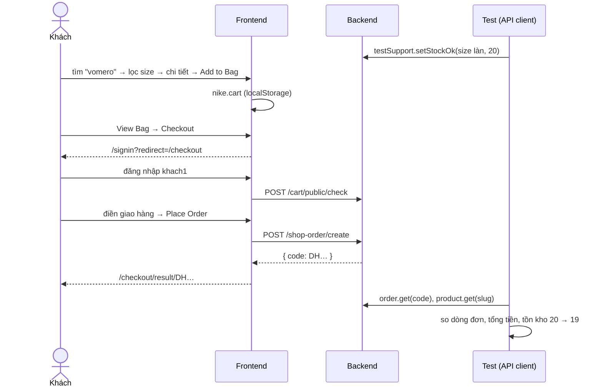

# Kiểm thử hồi quy

## 1. Mục tiêu và phạm vi

Lát đầu tiên của giai đoạn 4 (D13: làm kiểm thử trước các lát nghiệp vụ còn lại). Lát này **chỉ viết code test**, không thêm chức năng.
Kết quả: bộ test có thêm (1) các **luồng mua hàng xuyên suốt** nhiều lát, mỗi luồng kiểm đồng thời trên giao diện và qua API; (2) **bộ lọc chạy data-driven trên giao diện**, so ba chiều giao diện = dữ liệu mẫu = API; (3) **network mocking** cho những tình huống mà spec từng lát chưa có (mất mạng giữa luồng, hết phiên, mất ảnh, chậm toàn tuyến, phát lại HAR); (4) **quy tắc tag** có script kiểm tự động; (5) **chạy đủ 6 project × 2 pha** hai lần liên tiếp đều xanh, sửa các test chập chờn tìm được.

Hiện trạng (19/11/2026, đo bằng `playwright test --list`):
- 291 test (api + chromium), 165 test cho mỗi project firefox / webkit / mobile-chrome; 30 test ở pha `@stock`.
- Mọi test đã có đúng một tag `@smoke` (48) hoặc `@regression` (243).
- Network mocking đã có ở từng lát: 500 / abort / chậm / bấm hai lần ở `home`, `/w`, `/t`, `/cart`, `/checkout`, trang xác nhận. **Lát này không viết lại các ca đó.**
- `data/catalog-filters.json` (24 ca lọc) hiện chỉ dùng cho API; trên giao diện mới có TC-16 của `danh-sach-giay` (một vài lựa chọn).
- `tests/e2e-flows/` còn trống.

| Có làm | Không làm (để lát khác) |
|---|---|
| 5 luồng xuyên suốt ở `tests/e2e-flows/` (§3 F1 → F5), mỗi luồng kiểm thêm qua API (đơn, tồn kho, giỏ) | Bước xem / huỷ đơn (2.4), yêu thích (2.1), payOS (2.3a), quản trị duyệt đơn (3.2): các lát đó tự nối thêm bước vào luồng |
| Data-driven bộ lọc trên giao diện từ `catalog-filters.json` (24 ca), desktop 3 trình duyệt + 4 ca mobile | Thêm ca lọc mới ngoài file dữ liệu hiện có |
| Network mocking mới: mất mạng giữa luồng (`context.setOffline`), 401 → refresh token → gửi lại, refresh hỏng, mất ảnh sản phẩm, chậm toàn tuyến, phát lại HAR | Viết lại các ca 500 / abort / chậm đã có của từng lát |
| `utils/network.js`: gom hàm `fail500` / `delay` / mẫu URL API đang chép lặp ở 5 spec, các spec cũ chuyển sang dùng | Visual regression, axe (lát 4.2) |
| Tag `@flow`; script `scripts/check-tags.mjs` + `pnpm check:tags`; script `pnpm test:flows`; rà lại nhóm `@smoke` theo quy tắc §6.3 | GitHub Actions đầy đủ, Allure có lịch sử (lát 4.3) |
| Chạy `pnpm test` (6 project × 2 pha) hai lần liên tiếp; sửa nguyên nhân test chập chờn tìm được; ghi bảng kết quả theo project | Test plan, `test-cases.xlsx`, ma trận truy vết (lát 4.4; lát này chỉ chuẩn bị ID + tag sạch để 4.4 sinh tự động) |
| Lỗi của SUT tìm được khi chạy: lỗi nhỏ sửa luôn trong lát (ghi §12), lỗi lớn ghi lại cho lát 4.4 (§11 câu 2) | |
| Cập nhật `automation/README.md`, `tests/e2e-flows/README.md` | |

## 2. Tác nhân và phân quyền

| Tác nhân | Dùng trong test | Ghi chú |
|---|---|---|
| Khách vãng lai | không đăng nhập | F1 (đăng nhập giữa luồng), F3 (tạo tài khoản giữa luồng) |
| Khách `khach1@nike.local` / `Admin@123` ("Customer One") | đăng nhập giữa luồng ở F1; storageState `khach1` ở F4 | |
| Khách `khach2@nike.local` / `Admin@123` ("Customer Two") | storageState `khach2` ở F2 | |
| Khách mới `auto-…@nike.local` (sinh bằng `uniqueEmail()`) | F3 (đăng ký trên UI), F5 (đăng ký qua API, đăng nhập trên UI) | F5 cần phiên riêng vì refresh token dùng một lần (§11 câu 3) |
| Quản trị `admin@nike.local` | chỉ qua API: `testSupport.setStockOk`, đọc tồn kho | |

## 3. Luồng được kiểm

Mỗi luồng là **một test** trong `tests/e2e-flows/kiem-thu-hoi-quy.spec.js`, thuộc `test.describe('Luồng xuyên suốt @stock')` (tạo đơn, đổi tồn kho), chia bước bằng `test.step` để báo cáo HTML / Allure hiện từng chặng. Đầu test: `setStockOk(size của làn, 20)`; size theo project bằng `laneOf(testInfo)` (bảng §4) để 4 trình duyệt chạy song song không giẫm nhau.

**F1 — Khách vãng lai mua một đôi (luồng chính, `@smoke`, cả 4 project)** · Nike Vomero 18 (`nike-vomero-18`, 4.259.000 ₫)
1. `/` → icon tìm kiếm ở header → gõ `vomero` → Enter → `/w?q=vomero`, eyebrow "Search Results for", thẻ "Nike Vomero 18".
2. Lọc size của làn (desktop: sidebar nhóm "Size"; mobile: nút "Filter" → ngăn kéo → size → "Apply") → URL có `size=<giá trị>`, thẻ "Nike Vomero 18" vẫn còn, tiêu đề = `catalogTitle({ q: 'vomero', size })` có số `(1)`.
3. Bấm thẻ → `/t/nike-vomero-18` → chọn "EU <size>" → "Add to Bag" → popup "Added to Bag" có "Size EU <size>", "4.259.000 ₫", nút "View Bag (1)".
4. "View Bag (1)" → `/cart`: 1 dòng, Subtotal "4.259.000 ₫", Shipping "30.000 ₫", Total "4.289.000 ₫", gợi ý "Add 741.000 ₫ more to get free delivery." → "Checkout" → `/signin?redirect=/checkout`.
5. Đăng nhập `khach1@nike.local` (email → "Continue" → mật khẩu → "Sign In") → về `/checkout`, giỏ còn đúng 1 dòng, "Full Name" điền sẵn "Customer One".
6. Điền "Phone Number", "Address", "Delivery Notes" (`DELIVERY` ở `data/orders.js`) → "Cash on Delivery" đã chọn → "Place Order" → `/checkout/result/DH…`: "Thank you for your order", "Pay 4.289.000 ₫ in cash when your order arrives.", 1 dòng "Size EU <size>".
7. Kiểm qua API: `khach1.order.get(code)` có 1 dòng `{ sizeId: làn, quantity: 1 }`, `total = 4289000`; tồn kho size làn 20 → 19 (`product.get`); `nike.cart` trong localStorage là `[]` hoặc không còn dòng này; số trên icon túi biến mất.

**F2 — Khách đã đăng nhập, đi từ menu, vượt ngưỡng miễn phí giao hàng (desktop: chromium, firefox, webkit)** · Nike Phantom 6 Low Academy (`nike-phantom-6-low-academy`, 2.629.000 ₫)
1. storageState `khach2`. `/` → rê "Men" → mega menu cột "Categories" → "Football" → `/w/football?gender=men`, tiêu đề `catalogTitle({ gender: 'men' }, 'Football')` có `(2)`.
2. "Sort By" → "Price: Low-High" → URL có `sort=price-asc`, thẻ đầu "Nike Phantom 6 Low Academy", thẻ hai "Nike Mercurial Vapor 17 Elite".
3. Bấm thẻ đầu → chọn size làn → "Add to Bag" → "View Bag (1)" → `/cart`: Shipping "30.000 ₫".
4. "Increase quantity" → số lượng 2: Subtotal "5.258.000 ₫", Shipping "Free", Total "5.258.000 ₫", gợi ý "You qualify for free delivery." (biên ngưỡng 5.000.000 ₫ — D12).
5. "Checkout" → thẳng `/checkout` (đã đăng nhập, không qua `/signin`) → Shipping "Free" → điền giao hàng → "Place Order" → trang xác nhận "Pay 5.258.000 ₫ in cash when your order arrives.".
6. API: đơn có `{ sizeId: làn, quantity: 2 }`, `shippingFee = 0`, `total = 5258000`; tồn kho 20 → 18.

**F3 — Khách mới tạo tài khoản ngay lúc thanh toán (cả 4 project)** · Nike Air Max Phenomena (`nike-air-max-phenomena`, 4.409.000 ₫)
1. Không đăng nhập. Mở thẳng `/t/nike-air-max-phenomena` → chọn size làn → "Add to Bag" → popup "Checkout" → `/signin?redirect=/checkout`.
2. Nhập email mới `uniqueEmail()` → "Continue" → bước tạo tài khoản → "Full name" `Auto Flow Customer`, "Password" `Admin@123`, tick điều khoản → "Create Account" → về `/checkout`, giỏ còn 1 dòng, "Full Name" điền sẵn "Auto Flow Customer".
3. Điền giao hàng → "Place Order" → trang xác nhận.
4. API: đăng nhập bằng email mới → `order.get(code)` thấy đơn (chủ đơn là tài khoản vừa tạo); tồn kho 20 → 19.

**F4 — Mất mạng lúc đặt hàng, có mạng lại thì đặt được đúng một đơn (desktop 3 trình duyệt)** · Jordan Franchise (`jordan-franchise`, 889.000 ₫)
1. storageState `khach1`, giỏ chuẩn bị bằng `setCart` (1 đôi size làn) → `/checkout` → điền giao hàng.
2. `context.setOffline(true)` → "Place Order" → lỗi "Couldn't place your order. Please check your connection and try again.", vẫn ở `/checkout`, giỏ nguyên, nút "Place Order" bấm được lại.
3. `context.setOffline(false)` → "Place Order" → trang xác nhận.
4. API: tồn kho 20 → **19** (đúng một đơn được tạo dù bấm hai lần).

**F5 — Hết phiên giữa lúc đặt hàng (desktop 3 trình duyệt)** · Nike Offcourt (`nike-offcourt`, 1.000.000 ₫ — biên dưới khoảng giá "1m-2m")
- **F5a — refresh thành công:** tạo tài khoản mới qua API, đăng nhập trên `/signin` (phiên riêng của test), `setCart` 1 đôi size làn → `/checkout` → điền giao hàng → mock `POST /shop-order/create` trả **401 đúng một lần** (lần sau cho đi tiếp) → "Place Order" → FE tự gọi `POST /auth/refresh` rồi gửi lại → trang xác nhận. Kiểm: 2 request `create` (1 bị mock, 1 thật), 1 request `refresh`, tồn kho giảm đúng 1.
- **F5b — refresh cũng hỏng:** như trên nhưng mock `POST /auth/refresh` trả 401 → phiên bị xoá (`endSession`): kỳ vọng khách được đưa về `/signin?redirect=/checkout` (hoặc trang `/checkout` hiện yêu cầu đăng nhập), giỏ còn nguyên; đăng nhập lại → đặt được. Không có đơn nào được tạo trước khi đăng nhập lại. (Hành vi chưa có trong plan nào — §11 câu 4.)

**Luồng ngoại lệ đã phủ ở spec từng lát (không lặp):** size hết hàng, giỏ hỏng, tranh đôi cuối (`dat-hang` TC-18), khách xem đơn người khác, 500 / abort / chậm ở từng trang.

## 4. Dữ liệu kiểm thử

Không đổi CSDL. Size id = `productId × 100 + thứ tự size` (như `PEGASUS_LANES`). Các size dưới đây **chưa spec `@stock` nào dùng** (đã rà `dat-hang.spec.js`, `dat-hang.api.spec.js`, `data/order-*.json`) và đều còn hàng trong `products.json`:

| Luồng | Sản phẩm (id) | Giá bán | Làn chromium / firefox / webkit / mobile-chrome |
|---|---|---|---|
| F1 | Nike Vomero 18 (15, WOMEN) | 4.259.000 ₫ | 1506 (EU 38.5) / 1507 (EU 39) / 1508 (EU 40) / 1509 (EU 40.5) |
| F2 | Nike Phantom 6 Low Academy (30, MEN) | 2.629.000 ₫ | 3002 (EU 39) / 3003 (EU 40) / 3004 (EU 40.5) / — |
| F3 | Nike Air Max Phenomena (8, WOMEN) | 4.409.000 ₫ | 806 (EU 38.5) / 807 (EU 39) / 808 (EU 40) / 809 (EU 40.5) |
| F4 | Jordan Franchise (28, UNISEX) | 889.000 ₫ | 2802 / 2803 / 2804 / — |
| F5a / F5b | Nike Offcourt (6, WOMEN) | 1.000.000 ₫ | 602 / 603 / 604 / — (F5b dùng 607 / 608 / 609) |
| TC-13 (chậm toàn tuyến) | Nike Air Max Phenomena (8, WOMEN) | 4.409.000 ₫ | 802 (EU 36) / 803 (EU 36.5) / 804 (EU 37.5) / — |

Nhãn EU của size F4 / F5 lấy bằng `seedSizeOf(sizeId)`, không ghi cứng. Ghi các làn vào `data/flows.js` (`FLOW_LANES`), kèm `DELIVERY` dùng lại từ `data/orders.js`.

Dữ liệu mới:
- `data/flows.js`: `FLOW_LANES`, slug / tên / giá của 5 sản phẩm (đọc từ `seed-products.js`, không ghi cứng giá), hàm `sizeOfLane(flow, testInfo)`.
- `data/catalog-filters.json`: **thêm** (không sửa ca cũ) trường `ui` cho mỗi ca: `{ "start": "/w" | "/w/<category>" | "search", "steps": [["gender","men"], …] }` mô tả cách bấm trên giao diện; ca không bấm được trên giao diện (không có) thì ghi `"ui": null`.
- `data/har/catalog.har` (+ thư mục nội dung) cho TC-15, ghi lại bằng `E2E_UPDATE_HAR=1`.

## 5. Hợp đồng API được dùng (đã có, không đổi)

| Endpoint | Dùng ở | Kiểm |
|---|---|---|
| `GET /product/public/list` | TC-06 → TC-09 (so giao diện = API), F1 bước 2 | `total`, thứ tự `items[].name` |
| `GET /product/public/get?slug=` | F1 → F5 bước cuối | tồn kho size làn: `sizes[].stock` (số chính xác, vd `{ id: 1506, sizeLabel: 'EU 38.5', stock: 19 }`) |
| `POST /shop-order/create` | F4, F5 (mock 401) | đúng một đơn |
| `GET /shop-order/get?code=` | F1 → F5 | `items[{ sizeId, quantity }]`, `subtotal`, `shippingFee`, `total` |
| `POST /auth/refresh` | F5a (thật), F5b (mock 401) | số lần gọi |
| `POST /account/register`, `POST /user/authenticate` | F3 (đăng nhập lại để đọc đơn), F5 (tạo khách mới) | |
| `POST /test-support/stock` | đầu mỗi luồng | `setStockOk(size, 20)` |
### 5.4 Lỗi / thông báo được kiểm (nguyên văn, đều đã có trong SUT)

| Tình huống | Nơi hiện | Chuỗi |
|---|---|---|
| Mất mạng khi "Place Order" | `checkout-error` | "Couldn't place your order. Please check your connection and try again." |
| Lọc ra 0 kết quả | `catalog-empty` | (chuỗi rỗng hiện có của `danh-sach-giay` §6) |
| Tìm không ra (`q=air max plus`) | `catalog-empty` | `We couldn't find anything for "air max plus".` |
| Ảnh lỗi | — | không có chuỗi; kiểm bố cục + mua được (TC-12) |

## 6. Giao diện được kiểm và quy ước

### 6.1 Chuỗi dùng trong luồng (lấy từ page object hiện có — đã khớp UI thật)

"Search Results for", "Size", "Filter", "Apply", "Sort By", "Price: Low-High", "Add to Bag", "Added to Bag", "View Bag (n)", "Checkout", "Bag", "Summary", "Free", "You qualify for free delivery.", "Add <tiền> more to get free delivery.", "Increase quantity", "Continue", "Sign In", "Create Account", "Full Name", "Phone Number", "Address", "Delivery Notes", "Cash on Delivery", "Place Order", "Placing Order…", "Thank you for your order", "Pay <tiền> in cash when your order arrives.", "Continue Shopping".

Spec không chứa selector: mọi thao tác đi qua page object. Page object được thêm hàm (không đổi hàm cũ):
- `ProductListPage.applyFilters(steps)`: desktop bấm `sidebar.toggle` (mở nhóm nếu đóng), mobile mở ngăn kéo → `drawer.option` → "Apply"; chờ URL ổn định.
- `ProductListPage.expectUrlFilter(filter)`: so tham số URL không phụ thuộc thứ tự.
- `HeaderComponent.search(q)`: mở khung tìm kiếm, gõ, Enter (desktop + mobile).
- `CartPage.expectSummary({ subtotal, shipping, total, hint })`: chuyển hàm `expectSummary` đang nằm trong `gio-hang.spec.js` vào page object.

### 6.2 Tag

| Tag | Ý nghĩa | Ai gắn |
|---|---|---|
| `@smoke` | Đường chính của lát, chạy mỗi lần push | mỗi test đúng một trong `@smoke` / `@regression` |
| `@regression` | Mọi ca còn lại | |
| `@stock` | Đổi tồn kho / tạo đơn → pha 2 | gắn ở `test.describe` |
| `@flow` | Luồng xuyên suốt ở `tests/e2e-flows/` | gắn ở `test.describe`, thêm vào `@smoke` / `@regression` |
| `@mock` | Test có `page.route` / `routeFromHAR` / `setOffline` | gắn ở test, để lọc nhóm network mocking cho báo cáo |

### 6.3 Quy tắc `scripts/check-tags.mjs` (`pnpm check:tags`)

Đọc `playwright test --list --reporter=json` của cả hai pha, báo lỗi (thoát 1, in `file:dòng — lý do`) khi:
1. Test (trừ project `setup`) không có đúng một trong `@smoke` / `@regression`.
2. Tiêu đề không bắt đầu bằng ID `TC-\d{2}[a-z]?` (kể cả ca data-driven: `TC-06 gender=men`).
3. Trùng ID trong cùng một file mà không phải ca data-driven (ca data-driven cùng ID phải khác phần đuôi tiêu đề).
4. Test tạo đơn (gọi `order.create` / tới `/checkout` rồi "Place Order") nằm ngoài describe `@stock` — **chỉ cảnh báo** (khó phát hiện chắc chắn bằng tĩnh), dựa trên danh sách file trong pha `@stock`.
5. `@smoke` vượt ngưỡng: mỗi file ≤ 3 test `@smoke` (ca data-driven tính là 1) — cảnh báo, không thoát 1.

In thêm bảng thống kê theo file và theo project: tổng / smoke / regression / stock / flow / mock (dùng lại cho lát 4.4).

## 7. Việc backend (Claude)

Không có.

## 8. Việc frontend (Claude)

Không có chức năng mới. Chỉ sửa khi chạy test tìm ra lỗi của SUT và lỗi đó nhỏ, cục bộ (§11 câu 2); mỗi lần sửa ghi §12 + một dòng "bug" (mô tả, bước tái hiện, ảnh / trace) để lát 4.4 chép vào bug report. `pnpm build` + `pnpm lint` ở `frontend/` phải xanh nếu có sửa.

Component shadcn dùng: không áp dụng.

## 8b. Việc của Claude (code test, theo thứ tự)

Lát chỉ có code test nên gộp phiên A + B như `khung-automation`: một phiên cook làm 1 → 10, phiên C (`/doc-chuc-nang`) viết tài liệu.

1. `utils/network.js`: `apiPath(path)` → RegExp khớp `…/api<path>`(+ query), `fail500(route)`, `abortRoute(route)`, `delayed(ms)` (trả handler `continue` sau `ms`), `failOnce(status, body)` (trả lỗi lần đầu, lần sau `continue`), `countRequests(page, pattern)`. Đổi 5 spec cũ (`giao-dien-nike`, `danh-sach-giay`, `chi-tiet-giay`, `gio-hang`, `dat-hang`) sang dùng; chạy lại 5 spec đó trên chromium để chắc không đổi hành vi.
2. Page object (§6.1): `HeaderComponent.search`, `ProductListPage.applyFilters` / `expectUrlFilter`, `CartPage.expectSummary`; `gio-hang.spec.js` dùng `cartPage.expectSummary`.
3. `data/flows.js` (§4), trường `ui` trong `data/catalog-filters.json`.
4. `tests/e2e-flows/kiem-thu-hoi-quy.spec.js`: TC-01 → TC-05 (F1 → F5), describe `Luồng xuyên suốt @stock @flow`; mỗi bước lớn một `test.step`; bước cuối kiểm qua API. Chụp ảnh tài liệu bằng `docShot` ở các chặng của F1.
5. `tests/product-list/kiem-thu-hoi-quy.spec.js`: TC-06 → TC-10 (data-driven), sinh test bằng `for (const c of …)`, tiêu đề `TC-0x <c.case>`.
6. `tests/network/kiem-thu-hoi-quy.spec.js`: TC-11 → TC-15 (`@mock`); TC-13 nằm trong describe `@stock`.
7. `scripts/check-tags.mjs`; `package.json` thêm `check:tags`, `test:flows` (`run-phases.mjs --grep @flow`), `test:mock` (`--grep @mock`). Rà tag theo §6.3: sửa vi phạm mục 1–3; với cảnh báo mục 5, chuyển bớt `@smoke` sang `@regression` (ghi danh sách vào §12).
8. Chạy TC-16 → TC-19 (§9). Test chập chờn tìm được: tìm nguyên nhân (chờ sai trạng thái, dữ liệu dùng chung, cuộn / animation) và sửa ở spec / page object / SUT; **không** tăng `timeout` hay thêm `retries` để che. Ghi từng ca vào §12.
9. `automation/README.md`: mục "Luồng xuyên suốt", "Network mocking" (bảng kỹ thuật: `route.fulfill`, `route.abort`, trễ, `setOffline`, `failOnce`, `routeFromHAR`), "Quy tắc tag" (§6.2, §6.3), lệnh `test:flows` / `test:mock` / `check:tags`; cập nhật cây thư mục (`tests/e2e-flows`, `tests/network`, `data/har`). `tests/e2e-flows/README.md`: cách lát sau nối thêm bước (vd 2.4 thêm "xem đơn" sau F1 bước 6).
10. `pnpm lint` + Prettier sạch.

## 9. Test case

Loại: `e2e` = spec giao diện trong `automation/` · `khung` = kiểm bộ test / script / lần chạy. Không có `unit` / `api` mới (lát không đổi backend; kiểm API nằm trong bước cuối của các luồng).

### 9.1 Luồng xuyên suốt — `tests/e2e-flows/kiem-thu-hoi-quy.spec.js` (`@stock @flow`)

| ID | Loại | Mô tả | Tiền điều kiện | Bước | Kết quả mong đợi |
|---|---|---|---|---|---|
| TC-01 | e2e | F1 khách vãng lai: tìm → lọc → xem → thêm giỏ → đăng nhập → đặt COD `@smoke` | chưa đăng nhập; tồn size làn F1 = 20; 4 project | §3 F1 bước 1 → 7 | `/w?q=vomero&size=<làn>` có thẻ "Nike Vomero 18"; popup "View Bag (1)"; giỏ Subtotal "4.259.000 ₫" / Shipping "30.000 ₫" / Total "4.289.000 ₫" / "Add 741.000 ₫ more to get free delivery."; `/signin?redirect=/checkout`; sau đăng nhập về `/checkout` 1 dòng, "Full Name" = "Customer One"; trang xác nhận "Thank you for your order", "Pay 4.289.000 ₫ in cash when your order arrives."; API: đơn 1 dòng `{ sizeId: làn, quantity: 1 }`, `total` 4289000; tồn 19; giỏ localStorage không còn dòng; icon túi không có số |
| TC-02 | e2e | F2 khách đã đăng nhập: menu → danh mục → sắp xếp → 2 đôi, miễn phí giao hàng | storageState `khach2`; tồn làn F2 = 20; chromium / firefox / webkit (mobile skip) | §3 F2 bước 1 → 6 | `/w/football?gender=men` tiêu đề có `(2)`; sau "Price: Low-High" URL có `sort=price-asc`, thẻ 1 "Nike Phantom 6 Low Academy", thẻ 2 "Nike Mercurial Vapor 17 Elite"; giỏ 1 đôi Shipping "30.000 ₫", 2 đôi Subtotal "5.258.000 ₫" / Shipping "Free" / Total "5.258.000 ₫" / "You qualify for free delivery."; Checkout không qua `/signin`; xác nhận "Pay 5.258.000 ₫ in cash when your order arrives."; API `quantity` 2, `shippingFee` 0, `total` 5258000; tồn 18 |
| TC-03 | e2e | F3 khách mới tạo tài khoản lúc thanh toán | chưa đăng nhập; email `uniqueEmail()`; tồn làn F3 = 20; 4 project | §3 F3 bước 1 → 4 | sau "Create Account" về `/checkout` (không về `/`), giỏ 1 dòng, "Full Name" = "Auto Flow Customer"; đặt xong có trang xác nhận; API đăng nhập email mới → `order.get(code)` = 200, 1 dòng; tồn 19 |
| TC-04 | e2e | F4 mất mạng khi đặt hàng rồi có mạng lại | storageState `khach1`; giỏ 1 đôi làn F4; tồn 20; desktop 3 | §3 F4 bước 1 → 4 | offline: "Couldn't place your order. Please check your connection and try again.", URL `/checkout`, `nike.cart` = `[{ sizeId: làn, quantity: 1 }]`, "Place Order" enabled; online: trang xác nhận; tồn đúng **19** |
| TC-05a | e2e | F5a hết phiên: `create` 401 một lần → refresh → gửi lại | tài khoản mới (API) đăng nhập trên `/signin`; giỏ 1 đôi làn F5; tồn 20; desktop 3 | §3 F5a | trang xác nhận hiện; đếm được 2 request `shop-order/create` và 1 request `auth/refresh`; tồn đúng 19 |
| TC-05b | e2e | F5b hết phiên: refresh cũng 401 | như TC-05a, size làn F5b | §3 F5b; sau đó đăng nhập lại bằng tài khoản đó → "Place Order" | sau "Place Order" lần 1: không tới trang xác nhận, phiên bị xoá (header hiện "Sign In"), khách ở `/signin?redirect=/checkout` (§11 câu 4), `nike.cart` nguyên; tồn vẫn 20; đăng nhập lại → `/checkout` → đặt được, tồn 19 |

### 9.2 Bộ lọc data-driven trên giao diện — `tests/product-list/kiem-thu-hoi-quy.spec.js`

Mỗi ca của `data/catalog-filters.json` sinh một test. Với mỗi ca: bắt đầu ở `ui.start`, bấm `ui.steps` trên giao diện (không mở URL có sẵn tham số), rồi kiểm 4 điều: (1) tham số URL = `c.filter` (không phụ thuộc thứ tự); (2) số trong tiêu đề = `c.total` (= `expectedList(filter).total`); (3) tên các thẻ trên lưới (tối đa 12) đúng thứ tự `c.ids`; (4) gọi `GET /product/public/list` với cùng bộ lọc → `items[].name` trùng tên trên lưới (**giao diện = dữ liệu mẫu = API**). `total = 0` → kiểm `catalog-empty` thay cho (3).

| ID | Loại | Mô tả | Tiền điều kiện | Bước | Kết quả mong đợi |
|---|---|---|---|---|---|
| TC-06 | e2e | Lọc một nhóm bằng sidebar: 12 ca `single` a → l (phân vùng tương đương giới tính / trẻ em / khoảng giá, biên giá 1.000.000 ₫ (id 6) và 2.000.000 ₫ giá giảm (id 19) rơi vào "1m-2m", 5.000.000 ₫ (id 17) rơi vào "5m-plus"; sale; nhãn) | `/w`; chromium / firefox / webkit | tick các lựa chọn trong `ui.steps` | 4 điều ở trên; vd ca a: URL `gender=men`, tiêu đề "Men's Shoes (12)", 12 thẻ đúng thứ tự id `[2, 5, 14, 24, 25, 1, 3, 30, 29, 4, 13, 19]` |
| TC-07 | e2e | Tìm từ khoá qua header: ca `single` n, o, p | `/`; desktop 3 | `header.search(q)` | ca n `jordan` (5), ca o `air max` (2); ca p `air max plus` → 0 thẻ, `We couldn't find anything for "air max plus".` (sản phẩm ẩn id 31 không lộ ra) |
| TC-08 | e2e | Danh mục + kết hợp: ca `single` m và `combined` a → d | desktop 3 | ca có `category`: vào bằng link danh mục ở sidebar, rồi tick các nhóm còn lại | combined a `gender=men&price=1m-2m&size=42` → 2; b `/w/basketball?gender=men` → 1; c `sale=1&price=under-1m` → 1; d `/w/football?gender=women` → 0, `catalog-empty` |
| TC-09 | e2e | Lọc size (biên tồn kho): ca `size` a → d | desktop 3 | bấm nút size trong nhóm "Size" | size a `42` → 21 (không có id 6, 9, 15, 18, 26; có id 13 còn 1 đôi); b `38` → 12 (có id 18 còn 3 đôi); c `40.5,47` → 23; d `gender=women&size=42` → 5 |
| TC-10 | e2e | Mobile: lọc qua ngăn kéo "Filter" — 4 ca: single a, single i, combined a, size d | mobile-chrome | nút "Filter" → tick → "Apply" | ngăn kéo đóng; 4 điều như trên (lưới 2 cột) |

### 9.3 Network mocking nâng cao — `tests/network/kiem-thu-hoi-quy.spec.js` (`@mock`)

| ID | Loại | Mô tả | Tiền điều kiện | Bước | Kết quả mong đợi |
|---|---|---|---|---|---|
| TC-11 | e2e | Helper `failOnce`: lỗi lần đầu, thử lại thành công | `/w`; chromium | `page.route(list, failOnce(500))` → mở `/w` → "Try Again" | lần 1 "Couldn't load products."; sau "Try Again" 12 thẻ; `countRequests` = 2 (kiểm chính helper để các spec khác tin dùng) |
| TC-12 | e2e | Mất ảnh sản phẩm (MinIO lỗi): abort mọi request ảnh `*.webp` của sản phẩm | chưa đăng nhập; desktop 3 + mobile | mở `/`, `/w`, `/t/nike-vomero-18`, chọn "EU 39" → "Add to Bag" (chỉ thêm vào giỏ, không đặt hàng nên không đổi tồn kho), mở `/cart` | không có `pageerror`; mỗi trang vẫn hiện tên + giá; ô ảnh của thẻ giữ chiều cao > 0 (không xẹp lưới); "Add to Bag" mở popup "Added to Bag"; `/cart` có 1 dòng |
| TC-13 | e2e | Chậm toàn tuyến: mọi `/api/**` trễ 800 ms, đi trọn luồng mua (`@stock`) | storageState `khach1`; size làn TC-13 (§4), tồn 20; desktop 3 | `/t/nike-air-max-phenomena` → chọn size → "Add to Bag" → "View Bag" → "Checkout" → điền → "Place Order" | trong lúc chờ: `aria-busy="true"` ở lưới / giỏ / tóm tắt đơn hoặc skeleton hiện; nút "Placing Order…" bị khoá; cuối cùng tới trang xác nhận; không `pageerror`; đúng 1 request `create` |
| TC-14 | e2e | Mạng chậm thật (CDP throttle "Slow 3G") trên trang chủ + `/w` | chromium (CDP chỉ có ở Chromium) | `cdpSession.send('Network.emulateNetworkConditions', …)` → mở `/` rồi `/w` | skeleton của "Just In" và lưới hiện trước, sau đó đủ 12 thẻ; không `pageerror` |
| TC-15 | e2e | Phát lại HAR: trang `/w` chạy không cần backend | `data/har/catalog.har` đã ghi (`E2E_UPDATE_HAR=1` ghi lại); chromium | `page.routeFromHAR(har, { url: /\/api\//, notFound: 'abort' })` → `/w` → tick "Men" | 12 thẻ đúng tên như khi ghi HAR; sau tick: "Men's Shoes (12)"; không request `/api/**` nào ra mạng thật (đếm bằng `page.on('requestfinished')` + so với HAR) |

### 9.4 Tag, chạy đủ 4 trình duyệt (`khung`)

| ID | Loại | Mô tả | Tiền điều kiện | Bước | Kết quả mong đợi |
|---|---|---|---|---|---|
| TC-16 | khung | `pnpm check:tags` | sau bước 7 §8b | chạy script; rồi tạm thêm 1 test không tag + 1 test sai ID (không commit), chạy lại, xoá | lần 1 thoát 0, in bảng thống kê; lần 2 thoát 1, in đúng 2 dòng `file:dòng — lý do` |
| TC-17 | khung | Smoke đủ 5 project | backend + frontend chạy | `pnpm test:smoke` | 0 failed ở cả hai pha; TC-01 pass ở chromium, firefox, webkit, mobile-chrome; ghi số test + thời gian chạy vào §12 |
| TC-18 | khung | Toàn bộ bộ test, hai lần liên tiếp | `retries` = 0 (local) | `pnpm test` lần 1, sửa nếu đỏ, rồi lần 2 không sửa gì giữa chừng | lần 2: 0 failed, 0 flaky ở 6 project × 2 pha; §12 có bảng pass / skip / thời gian theo project |
| TC-19 | khung | Độ ổn định luồng | sau TC-18 | `E2E_STOCK=1 pnpm exec playwright test tests/e2e-flows --repeat-each=3 --workers=1 --project=chromium --project=firefox --project=webkit --project=mobile-chrome` | 0 failed (mỗi lần lặp `setStockOk` lại 20 nên tồn kho không cạn) |

## 10. Tiêu chí hoàn thành

- [x] Mọi TC ở §9 pass; TC-01 → TC-05 xem được có giao diện (`--headed`, slowMo 400) trên chromium
- [x] `pnpm lint`, `pnpm check:tags` xanh; Prettier sạch
- [x] 5 spec cũ dùng `utils/network.js` vẫn xanh trên chromium
- [x] Nếu có sửa SUT: `frontend` `pnpm build` + `pnpm lint` xanh, mỗi lỗi có dòng "bug" ở §12
- [x] Có `docs/chuc-nang/kiem-thu-hoi-quy.md` (chương "Kiểm thử hồi quy" của quyển: sơ đồ luồng F1, bảng data-driven, bảng kỹ thuật network mocking, bảng kết quả chạy 4 trình duyệt, ảnh báo cáo HTML / Allure có `test.step`)

## 11. Rủi ro / câu hỏi mở

1. **Thời gian chạy:** lát thêm khoảng 5 test luồng × 3–4 project + 24 ca lọc × 3 project + ~6 test mock ≈ 110 test giao diện. Ước tính `pnpm test` dài thêm 3–5 phút trên máy local. Nếu quá lâu, TC-06 → TC-09 chỉ chạy chromium + firefox (webkit chạy ở CI đêm, lát 4.3). **Bạn có muốn giới hạn ngay từ đầu không?**
2. **Lỗi SUT tìm được khi chạy:** đề xuất lỗi nhỏ, cục bộ (sửa < ~30 dòng ở FE, không đổi hợp đồng §5 của lát nào) thì sửa luôn trong lát này và ghi §12; lỗi lớn hơn hoặc phải đổi hợp đồng thì chỉ ghi lại để lát 4.4 làm bug report và người dùng quyết lát sửa. Đồng ý không?
3. **Refresh token dùng một lần:** F5 cố ý làm FE gọi `/auth/refresh` → refresh token cũ bị thu hồi. Nếu F5 dùng storageState `khach1` / `khach2` chung thì các test khác cầm refresh token đã chết (chỉ hỏng khi access token hết hạn, nhưng vẫn là rủi ro ngầm). Vì vậy F5 dùng tài khoản mới tạo trong test (§2).
4. **F5b chưa có đặc tả:** khi refresh hỏng, `endSession()` xoá token và phiên cửa hàng nhưng chỉ tự chuyển trang khi đang ở `/admin`. Trang `/checkout` đang mở có tự chuyển sang `/signin?redirect=/checkout` không thì chưa plan nào ghi. Đề xuất kỳ vọng như TC-05b (đưa về `/signin?redirect=/checkout`, giỏ nguyên). Nếu thực tế khác (vd ở lại `/checkout` với lỗi) thì: (a) sửa FE theo kỳ vọng này, hay (b) chấp nhận hành vi hiện có và sửa TC-05b? **Đề xuất (a).**
5. **TC-15 (HAR):** chủ yếu để trình bày kỹ thuật "tách giao diện khỏi backend" trong quyển. File HAR phải ghi lại mỗi khi API danh sách đổi hợp đồng. Giữ hay bỏ?
6. **TC-14 (CDP throttle)** chỉ chạy được trên Chromium; firefox / webkit / mobile skip có ghi lý do.
7. **Ngưỡng `@smoke` ≤ 3 test mỗi file** (§6.3 mục 5) có thể khiến vài spec cũ (vd `dang-nhap-nike`, `du-lieu-giay` API) phải hạ bớt `@smoke` xuống `@regression`. Đây chỉ là đổi tag, không đổi nội dung test; danh sách ghi ở §12.
8. Luồng chạy song song 4 project dùng chung `khach1` (F1 đăng nhập trên UI, F4 storageState). Đơn của các project khác nhau không đụng nhau vì khác size và mỗi test chỉ đọc đơn theo `code` của mình.

## 12. Nhật ký thực hiện (do /cook và /doc-chuc-nang ghi — nối các phiên A/B/C)

| Thời điểm | Sự kiện |
|---|---|
| 2026-11-19 | Lập plan (draft). Khảo sát: 291 test api + chromium (48 `@smoke`, 243 `@regression`, 0 test thiếu tag), 165 test mỗi project firefox / webkit / mobile-chrome, 30 test pha `@stock`; mocking 500 / abort / chậm đã có ở 5 spec; `e2e-flows/` trống. Size làn §4 đã rà không trùng size của spec `@stock` hiện có. |
| 2026-11-19 | **Người dùng duyệt** (không sửa plan). Câu hỏi §11 lấy theo mặc định của plan: (1) chưa giới hạn trình duyệt — TC-06 → TC-09 chạy chromium / firefox / webkit, chỉ thu hẹp nếu TC-18 cho thấy quá lâu (ghi lý do ở đây); (2) lỗi SUT nhỏ sửa luôn, lỗi lớn ghi lại cho 4.4; (4) phương án (a): sửa FE để TC-05b đúng kỳ vọng; (5) giữ TC-15 (HAR); (7) áp ngưỡng ≤ 3 `@smoke` mỗi file. |
| 2026-11-20 17:00 | **/cook bắt đầu** (gộp phiên A + B theo §8b) → `in-progress`. Preflight: mysql / minio healthy; backend chưa chạy → `backend-restart.sh` (Flyway: up to date). File bẩn có sẵn trước phiên (không phải của lát, không đụng): `frontend/src/main.tsx`, `frontend/src/routes/__root.tsx` (sửa TC-24 của chi-tiet-giay), `plan/README.md`, `plan/chi-tiet-giay.md`, `plan/thiet-ke-giay.md` (D13), `plan/kiem-thu-hoi-quy.md` (chưa track) |
| 2026-11-20 17:40 | §8b bước 1–7 xong. `utils/network.js` (`apiPath`, `ANY_API`, `fail500`, `abortRoute`, `delayed`, `failOnce` có `calls` + `times`, `countRequests`, `collectPageErrors`, `sleep`); 5 spec cũ bỏ bản chép `fail500` / `delay` / `sleep` / `collectPageErrors` / regex URL API, dùng `utils/network.js` (đồng thời chuẩn hoá CRLF → LF ở `chi-tiet-giay`, `gio-hang`, `dat-hang`). Page object: **`HeaderComponent.searchFor(q)`** (lệch §6.1: tên `search` đã là thuộc tính `SearchOverlay`), `ProductListPage.applyFilters(steps)` (desktop sidebar / mobile gom bước vào một lần mở ngăn kéo; bước `category` bấm link danh mục — link giữ bộ lọc đang có) + `expectUrlFilter(filter)`, `CartPage.expectSummary` (`gio-hang.spec.js` dùng). `data/flows.js` (`FLOW_LANES`, `flowOf`, `FLOW_STOCK`). `catalog-filters.json` thêm `ui` cho 24 ca, sinh bằng script có kiểm "mọi bước bấm không bị khoá (số đếm > 0)"; combined d phải tick "Women" ở `/w` **trước** rồi mới bấm "Football" (trên `/w/football` ô Women có số 0 nên bị khoá). `data/har/catalog.har` ghi bằng `E2E_UPDATE_HAR=1` (`updateContent: 'embed'`, 32 KB). `scripts/check-tags.mjs` + `check:tags`, `test:flows`, `test:mock`. ESLint: thêm `runCase` vào `assertFunctionNames` |
| 2026-11-20 17:40 | **Bug SUT #1 (đã sửa, TC-04):** mất mạng lúc "Place Order" → nút kẹt "Placing Order…" vô hạn, không báo lỗi; có mạng lại thì đơn **tự gửi** dù khách không bấm. Nguyên nhân: TanStack Query `networkMode: 'online'` (mặc định) tạm dừng mutation khi `navigator.onLine = false`. Tái hiện: đăng nhập, có giỏ, `/checkout`, điền form, tắt mạng (DevTools Offline / `context.setOffline(true)`), bấm "Place Order". Sửa: `networkMode: "always"` ở `createShopOrderMutationOptions` (`lib/tanstack/options/shop-order.ts`) → lỗi mạng ngay → "Couldn't place your order. Please check your connection and try again.". Ảnh / trace: `test-results-stock/…TC-04…` lần đỏ đầu |
| 2026-11-20 17:45 | **Bug SUT #2 (đã sửa, TC-05b, §11 câu 4 phương án a):** hết phiên khi đặt hàng (create 401, refresh cũng 401) → `endSession()` xoá token nhưng khách vẫn ở `/checkout`, hiện lỗi chung; bấm lại thì 401 mãi. Sửa: `onError` của "Place Order" (`components/shop/checkout/checkout-page.tsx`) kiểm `useAuthStore` hết access token → `navigate('/signin?redirect=/checkout', replace)`; giỏ giữ nguyên, đăng nhập lại về `/checkout`. `frontend` `pnpm build` + `pnpm lint` xanh (0 error). Spec TC-05b: `/signin` nằm ngoài layout cửa hàng nên "phiên bị xoá" kiểm bằng `auth-storage` không còn `accessToken` (thay cho "header hiện Sign In" ở §9 — trang không có header) |
| 2026-11-20 17:50 | Lệch §9 do hành vi có sẵn của SUT (không phải lỗi): **TC-11** query danh sách `retry: 1` → lần tải đầu gồm 2 request; `failOnce(500, …, { times: 2 })`, kỳ vọng `countRequests` = **3** (2 lỗi + 1 sau "Try Again") thay vì 2. **TC-13** `/t/$slug` dùng loader của router, khung xương chỉ hiện khi chờ > `pendingMs` 1 giây → với trễ 800 ms không có khung xương ở trang chi tiết (chỉ kiểm nội dung); `/checkout` dùng lại kết quả `check` đã cache từ `/cart` nên không có khung xương mà có vùng `aria-busy` (đối soát lại) — kiểm vùng `aria-busy`. **TC-14** "Slow 3G" 500 kbps làm request API xếp hàng sau ảnh sản phẩm của trang chủ > 10 giây → dùng latency 1500 ms + 1,6 Mbps; bật throttle sau khi app đã tải ở `/info/help` (Vite dev phục vụ hàng trăm module chưa đóng gói) rồi điều hướng trong app. **TC-15** `requestfinished` của `/api/**` đều có trong HAR + không request nào bị abort (`notFound: 'abort'`) |
| 2026-11-20 17:55 | Rà tag (§6.3): `check:tags` lần đầu 2 lỗi trùng ID → đổi tiêu đề `tests/admin/tieng-anh-cua-hang.spec.js` "TC-19 … hộp thoại quản trị" → **TC-19b**, "TC-22 URL quản trị tiếng Việt cũ là 404" → **TC-22b**. Cảnh báo `@smoke` > 3: hạ xuống `@regression` — `dang-nhap-nike.spec.js` TC-07, TC-16, TC-18 (giữ TC-09, TC-12, TC-19); `du-lieu-giay.api.spec.js` TC-12, TC-05 (giữ TC-01, TC-04, TC-10). Sau đó: 986 test, 0 lỗi, 0 cảnh báo. **TC-16 pass** (thêm tạm `zz-tmp-check-tags.spec.js` 1 test không tag + 1 test sai ID → thoát 1, đúng 2 dòng; xoá file → thoát 0) |
| 2026-11-20 17:55 | Chạy riêng từng spec mới: e2e-flows chromium 6/6, firefox 6/6, webkit 6/6, mobile-chrome 2/2 (+4 skip) khi chạy **từng project**; chạy 3 project cùng lúc (mặc định worker) có 8 đỏ do quá tải (timeout click / URL) — xử lý ở TC-18. product-list chromium + mobile 28/28. network chromium / firefox / webkit / mobile cả hai pha xanh |
| 2026-11-20 18:30 | **Sửa test chập chờn trong spec cũ (§8b bước 8)**, chạy 5 spec cũ đổi sang `utils/network.js` trên chromium: 103 pass + `dat-hang` (@stock) 13 pass; 2 đỏ khi chạy song song, chạy riêng xanh. (1) `chi-tiet-giay` TC-23 (c): khung xương chỉ hiện sau `pendingMs` 1 giây của router nên trễ 1,5 giây chỉ chừa ~0,5 giây, máy bận thì khung xương biến mất giữa `toBeVisible` và `toHaveAttribute` → trễ 3 giây + một khẳng định. (2) `giao-dien-nike` TC-22: 17 lần mở trang đầy đủ trong một test (Vite dev nạp lại toàn bộ module) > 30 giây → tách 15 trang thông tin thành ca data-driven **TC-22b** `/info/<slug>`; TC-22 giữ footer + href + nội dung mẫu + 404 (thử bấm link footer thay `goto` nhưng WebKit mỗi click ~1 giây do cuộn + header ẩn / hiện, bỏ). (3) **Worker local mặc định 4** (`playwright.config.js`, đổi bằng `E2E_WORKERS`): máy 16 nhân → mặc định 8 worker cùng xin module từ một tiến trình Vite dev, `goto` Firefox / WebKit có lúc > 30 giây (§12 các lát trước cũng chỉ ổn định với `--workers=4`). (4) `FilterSidebar.openGroup` và `ProductListPage.applyFilters`: bấm lại tới khi nhóm mở / lựa chọn ở trạng thái chọn (`data-state` checked / on — không sợ bấm hai lần bỏ tick): tick xong trang cuộn về đầu, sidebar dính + header ẩn / hiện dịch chuyển nên cú bấm kế tiếp có lúc trượt (TC-01 webkit, TC-06 `under-1m,5m-plus` firefox). Không tăng `timeout` / `retries` |
| 2026-11-20 18:30 | **TC-17** `pnpm test:smoke` (4 worker): pha thường 83 pass / 30 skip (2,5 phút); pha stock 11 pass, 1 đỏ (TC-01 webkit — `openGroup` trượt, đã sửa ở (4)) → sau sửa: luồng 4 project cùng lúc 20/20 + 4 setup xanh |
| 2026-11-20 18:30 | **TC-18 lần 1** `pnpm test` (1150 giây): pha thường **738 pass / 3 đỏ / 225 skip** (17,0 phút), pha stock **70 pass / 1 đỏ / 17 skip** (2,1 phút). Đỏ đều ở firefox: `chi-tiet-giay` TC-12 + `danh-sach-giay` TC-27 quá 30 giây khi tải nặng (chạy riêng xanh), TC-06 `under-1m,5m-plus` (sửa ở (4)), TC-05a `POST /account/register` trả **400 "Invalid data"** |
| 2026-11-20 18:30 | **Bug SUT #3 (ghi lại cho lát 4.4, không sửa — backend ngoài phạm vi lát):** `GlobalExceptionHandler.handleDataAccessException` đổi mọi `DataAccessException` thành 400 `BAD_REQUEST` "Invalid data" và **không ghi log** → lỗi hạ tầng (nghi khoá / deadlock MySQL khi nhiều request ghi đồng thời ở pha stock: đăng ký + tạo đơn + đặt tồn kho) hiện ra như lỗi dữ liệu của client và không chẩn đoán được. Tái hiện: TC-18 lần 1, firefox TC-05a (`test-results-stock/…26079…firefox`), chạy riêng không tái hiện. Đề xuất: log `warn` kèm nguyên nhân, trả 500 cho lỗi không phải ràng buộc dữ liệu |
| 2026-11-20 18:35 | Prettier: working copy trên Windows là CRLF (`core.autocrlf=true`) nên `prettier --check` báo cả file chưa đổi → `.prettierrc.json` thêm `"endOfLine": "auto"`, `.prettierignore` thêm `data/har`; `prettier --write .` (chỉ đổi định dạng, gồm 8 bảng JSON dữ liệu của lát trước được tách dòng). `pnpm lint` 0 lỗi. README `automation/` mục 2 (lệnh mới, `E2E_WORKERS`), 4 (cây thư mục), 5, mới 7 "Luồng xuyên suốt", 8 "Network mocking", 9 "Quy tắc tag"; `tests/e2e-flows/README.md` cách lát sau nối bước |
| 2026-11-20 (tiếp phiên) | Preflight lại: mysql / minio healthy, backend 200 (frontend do `webServer` tự bật). `pnpm lint` 0 lỗi (20 cảnh báo có sẵn), `check:tags` 1046 test, 0 lỗi, 0 cảnh báo. Lưu ý: `pnpm test --reporter=line` bị pnpm nuốt cờ → gọi thẳng `node scripts/run-phases.mjs --reporter=line` |
| 2026-11-20 (tiếp phiên) | **TC-18 lần 2** (14,7 phút): pha thường **740 pass / 1 đỏ / 225 skip** (12,8 phút), pha stock **71 pass / 0 đỏ / 17 skip** (2,0 phút). Đỏ: `chi-tiet-giay` TC-21 chromium — sang `/t/nike-dunk-low-retro` ảnh hiện tại vẫn là 3 (chờ 1). Nguyên nhân: `scrollRestoration` của TanStack Router ghi vị trí cuộn của **mọi** phần tử cuộn (CSS selector) qua `scroll` throttle 100 ms, khoá theo `router.state.location` lúc ghi; `expectCurrentImage(3)` đúng ngay khi dải ảnh mới cuộn mượt ~1,5 ảnh nên test bấm thẻ liên quan lúc cuộn còn chạy → vị trí dải ảnh cũ bị ghi dưới khoá trang mới và `restoreScroll` áp vào dải ảnh mới. Là lỗi **chờ sai trạng thái của spec** (người dùng thật phải cuộn xuống dải "You Might Also Like" mới bấm được, lâu hơn nhiều so với vài trăm ms cuộn mượt + 100 ms throttle) → thêm `ProductDetailPage.waitGallerySettled()` (`scrollLeft` không đổi qua 2 lần đọc cách 200 ms), TC-21 gọi sau khi chọn ảnh 3. Không đổi kỳ vọng, không tăng timeout. TC-21 `--repeat-each=5` chromium / firefox / webkit: 19/19 xanh. Ghi chú SUT (không sửa, cho 4.4): router lưu cả vị trí cuộn ngang của gallery / dải liên quan; điều hướng trong lúc phần tử còn cuộn có thể mang vị trí sang trang kế |
| 2026-11-20 (tiếp phiên) | **TC-18 lần 3** (không sửa gì trong lúc chạy, 13,8 phút): pha thường **741 pass / 0 đỏ / 0 flaky / 225 skip** (11,8 phút), pha stock **71 pass / 0 đỏ / 17 skip** (1,9 phút) → **TC-18 pass**. Số test đã chạy (pass + skip) theo project: pha thường api 130, chromium / firefox / webkit / mobile-chrome mỗi project 208, setup 4; pha stock api 16, mỗi trình duyệt 17, setup 4 (`--reporter=line` thay mất reporter html / allure nên không tách được pass / skip theo project; mọi project 0 đỏ) |
| 2026-11-20 (tiếp phiên) | **Sửa lệnh TC-19 ở §9 (lệnh sai, không phải SUT):** chạy như plan cũ (worker mặc định 4) có đỏ TC-01 — tồn kho 16 thay vì 19. `--repeat-each` tạo các bản sao **cùng làn size**, 4 worker chạy chúng song song, nên bản sao này `setStockOk(20)` trong lúc bản sao khác đặt hàng. Giả định "mỗi lần lặp `setStockOk` lại 20" chỉ đúng khi các lần lặp nối tiếp → thêm `--workers=1`. Spec không đổi; các làn §4 vẫn tách đúng giữa các project. (Một lần chạy lỡ dùng `--last-failed` ghi đè `test-results-stock` nên mất `error-context` của lần đỏ đầu, mobile-chrome repeat2; lần tái hiện `--repeat-each=6` cho cùng triệu chứng 16 ≠ 19 ở chromium) |
| 2026-11-20 (tiếp phiên) | **TC-19 pass** (`--workers=1`, 4,5 phút): 64 pass (60 lượt luồng = TC-01, TC-03 × 4 project + TC-02, TC-04, TC-05a, TC-05b × 3 desktop, mỗi ca 3 lần; + 4 setup) / 0 đỏ / 12 skip (mobile). **E2E có giao diện** (`--headed`, slowMo 400, chromium): `tests/e2e-flows` 10/10 (6 luồng + 4 setup), 1,1 phút; ảnh tài liệu F1 `docs/chuc-nang/img/kiem-thu-hoi-quy/01-tim-kiem.png` → `06-xac-nhan.png`. TC-17 (smoke) không chạy lại riêng: lượt 3 của TC-18 đã chạy toàn bộ (bao gồm mọi `@smoke`) sau lần sửa cuối, các thay đổi sau đó chỉ là README / plan. `pnpm lint` 0 lỗi, Prettier sạch, `check:tags` 1046 test 0 lỗi. Tổng kết TC: TC-01 → TC-19 pass; lệch plan đã ghi ở các dòng trên (`HeaderComponent.searchFor`, TC-05b kiểm phiên bằng `auth-storage`, TC-11 đếm 3 request, TC-13 / TC-14 điều chỉnh, lệnh TC-19 thêm `--workers=1`, worker local mặc định 4). Bug SUT: #1, #2 đã sửa ở FE; #3 (backend `DataAccessException` → 400 không log) ghi lại cho 4.4. **phiên B xong** → `/doc-chuc-nang kiem-thu-hoi-quy` |
| 2026-11-20 | **/doc-chuc-nang** → `docs/chuc-nang/kiem-thu-hoi-quy.md` (6 ảnh F1), plan `done`, branch `feature/kiem-thu-hoi-quy`, commit + push + PR vào `main` |
