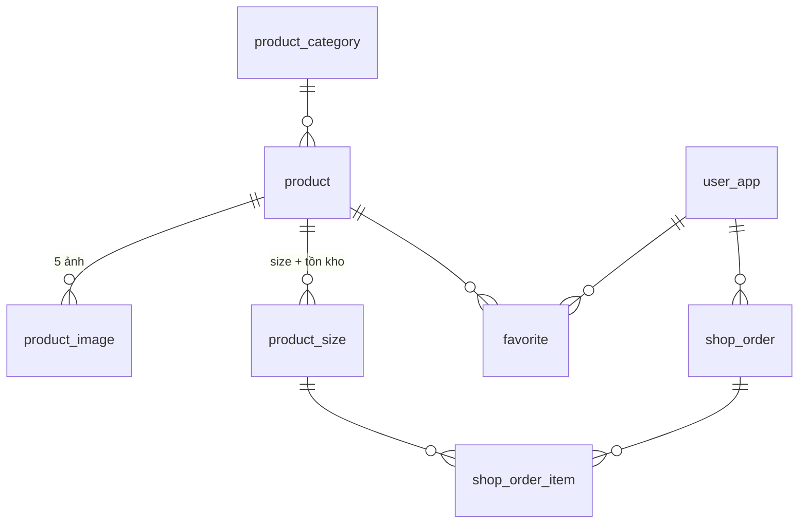

# Kế hoạch tổng: cửa hàng giày Nike và bộ automation test

**Đề tài đồ án:** *Xây dựng Automation test cho trang web thương mại điện tử bán giày dùng JavaScript với Playwright.*

Dự án có hai sản phẩm:

1. **Hệ thống được kiểm thử (SUT):** web bán giày mô phỏng [nike.com/vn/w/lifestyle-shoes](https://www.nike.com/vn/w/lifestyle-shoes-13jrmzy7ok)
   (danh sách có bộ lọc, chi tiết có gallery + chọn size, giỏ hàng, đặt hàng, quản trị). Dựng lại từ base DownBeat: giữ đăng nhập / phân quyền / MinIO / payOS, **gỡ hẳn toàn bộ phần LUT**.
2. **Bộ automation test (trọng tâm chấm điểm):** project Playwright viết bằng **JavaScript**, theo Page Object Model, có test UI + API,
   data-driven, chạy đa trình duyệt, báo cáo HTML / Allure, chạy CI trên GitHub Actions, kèm tài liệu kiểm thử (test plan, test case, ma trận truy vết, báo cáo lỗi).

Tài liệu này **không** dùng để `/cook` trực tiếp. Mỗi lát ở §9 có plan riêng `plan/<slug>.md`.

## 0. Các quyết định

### Đã chốt (18/11/2026)

| # | Quyết định |
|---|---|
| D1 | **Gỡ hẳn LUT**: kho LUT, danh mục / tác giả, đặc trưng màu, gói + subscription, tải LUT, bộ sưu tập, toàn bộ hệ gợi ý + đánh giá gợi ý, dashboard cũ, seed LUT. Không giữ song song |
| D2 | **Tên và logo Nike** (swoosh SVG, favicon), giao diện bám sát nike.com |
| D3 | **30 sản phẩm, mỗi sản phẩm 5 ảnh**, lấy từ nike.com/vn |
| D4 | **Không có màu (colorway)**: mỗi sản phẩm một giá, một bộ 5 ảnh, chỉ chọn **size** (có tồn kho theo size) |
| D5 | Bộ test viết bằng **JavaScript** (`.js`, ESM), không TypeScript |
| D6 | Chữ giao diện (menu, nút, nhãn, thông báo) **tiếng Việt**; **tên và mô tả sản phẩm giữ tiếng Anh** như trang gốc |
| D7 | Tiền **VNĐ**, hiển thị kiểu Việt Nam `5.279.000 ₫` (hàm dùng chung `formatVnd`) |
| D8 | **Giỏ hàng lưu ở localStorage**, không cần đăng nhập để thêm vào giỏ. **Thanh toán bắt buộc đăng nhập** (không có "Thanh toán khách"): giỏ chỉ có một nút "Thanh toán", chưa đăng nhập thì chuyển sang trang đăng nhập rồi quay lại; đặt hàng gửi danh sách (size, số lượng) lên server |
| D12 | Phí giao hàng **30.000 ₫**, miễn phí khi tạm tính ≥ 5.000.000 ₫ |
| D9 | Thanh toán **COD + payOS** (`mock-pay` ở profile local để test không phụ thuộc mạng) |
| D10 | Bộ test ở **thư mục riêng `automation/`** tại gốc repo (package.json, `playwright.config.js` riêng) |
| D11 | Báo cáo **Playwright HTML report + Allure** |

### Lưu ý

Tên, logo, ảnh và mô tả là tài sản của Nike, chỉ dùng cho **mục đích học tập, chạy local**: không deploy công khai, không bán thật, ghi rõ trong README và quyển báo cáo.
Dữ liệu lấy bằng cách chọn tay 30 sản phẩm (§7), không cào hàng loạt nike.com.

## 1. Phạm vi hệ thống (SUT)

| Có làm | Không làm |
|---|---|
| Danh sách giày: lọc giới tính, khoảng giá, giảm giá, size, danh mục; sắp xếp; tìm kiếm theo tên; tải thêm khi cuộn | Màu / colorway, đánh giá sao, bình luận |
| Chi tiết: gallery 5 ảnh, lưới size EU (size hết hàng bị mờ), bảng size, mô tả, mã sản phẩm, "Có thể bạn cũng thích" (cùng danh mục) | Hệ gợi ý cá nhân hoá (đã gỡ cùng LUT) |
| Yêu thích, giỏ hàng, đặt hàng (COD / payOS), lịch sử đơn, huỷ đơn chưa giao | Mã giảm giá, vận chuyển thật (phí ship cố định) |
| Đăng ký / đăng nhập khách (giữ nguyên) | Đăng nhập Google / Facebook |
| Quản trị: sản phẩm + ảnh + size / tồn kho, đơn hàng (đổi trạng thái), dashboard doanh thu | Nhiều kho |

## 2. Giao diện tham chiếu

> **Đặc tả chi tiết (số đo, màu, trạng thái, 18 ảnh khung hình từ video người dùng quay) ở [ui-nike/README.md](ui-nike/README.md). Khi khác với tóm tắt dưới đây thì theo file đó.**
> Những điểm video làm rõ: không có màu nên dãy ảnh nhỏ ở trang chi tiết là 5 ảnh của sản phẩm; rê chuột vào thẻ **không** đổi ảnh; gallery là dải cuộn ngang thấy ~1,5 ảnh;
> có cảnh báo "Chỉ còn ít hàng"; giỏ hàng chỉ một nút "Thanh toán" (D8, khác Nike có hai nút khách / thành viên); đăng nhập là trang riêng theo kiểu nhập email trước.

**Header** (mọi trang cửa hàng): dải xám trên cùng (logo Jordan bên trái; "Tìm cửa hàng | Trợ giúp | Tham gia | Đăng nhập" bên phải, đăng nhập rồi thì "Xin chào, <tên>");
thanh chính: swoosh, menu giữa "Mới & Nổi bật · Nam · Nữ · Trẻ em · Giảm giá", ô tìm kiếm bo tròn, icon ♡ (Yêu thích), icon túi (Giỏ, kèm số lượng);
dải thông báo "Miễn phí giao hàng & đổi trả trong 30 ngày". Cuộn xuống thì header ẩn, cuộn lên thì hiện lại.

**Trang danh sách** `/w` (tất cả), `/w/$danhMuc` (ảnh tham chiếu 1):
- Breadcrumb "Lifestyle / Giày", tiêu đề "Giày Lifestyle (n)".
- Bên phải: "Ẩn bộ lọc" (thu sidebar, lưới 3 → 4 cột), "Sắp xếp theo ⌄" (Nổi bật · Mới nhất · Giá: Cao → Thấp · Giá: Thấp → Cao).
- Sidebar dính khi cuộn, mỗi nhóm thu gọn được: **Giới tính** (Nam / Nữ / Unisex), **Trẻ em** (Bé trai / Bé gái),
  **Khoảng giá** (Dưới 1.000.000₫ · 1.000.000₫ – 2.000.000₫ · 2.000.001₫ – 4.999.999₫ · Trên 5.000.000₫), **Giảm giá & ưu đãi**, **Size** (lưới EU).
- Thẻ sản phẩm: ảnh vuông nền xám nhạt, nhãn đỏ ("Mới về" / "Bán chạy"), tên, phụ đề ("Giày nam"), giá (đang giảm thì giá mới + giá gốc gạch ngang + "Giảm 20%").
  Rê chuột vào thẻ: ảnh đổi sang ảnh thứ 2.
- Một ô banner xen giữa lưới (ảnh lớn + tiêu đề + nút "Mua ngay").
- Bộ lọc, sắp xếp nằm trên URL (`?gioiTinh=nam&gia=1-2tr&size=42&sapXep=gia-tang`): F5, back / forward, chia sẻ link đều giữ đúng. Không có kết quả → "Không tìm thấy sản phẩm phù hợp" + nút "Xoá bộ lọc".

**Trang chi tiết** `/t/$slug` (ảnh tham chiếu 2):
- Trái: 5 ảnh, hiện 2 ảnh lớn cạnh nhau, nút ‹ ›, chấm vị trí, nút kính lúp mở xem ảnh lớn toàn màn hình. Mobile: vuốt ngang.
- Phải (dính khi cuộn): tên, phụ đề, giá; dãy ảnh nhỏ (bấm để nhảy tới ảnh); "Chọn size" + "Bảng size"; lưới size EU 4 cột (hết hàng: mờ, không bấm được);
  "Thêm vào giỏ" (đen, bo tròn), "Yêu thích ♡". Chưa chọn size mà bấm thêm → khung size viền đỏ + "Vui lòng chọn size".
- Mô tả, "Mã: DM0011-002"; accordion "Giao hàng & đổi trả miễn phí".
- Khối "Có thể bạn cũng thích" (cùng danh mục, cuộn ngang).

**Sau khi thêm vào giỏ:** popup góc phải "Đã thêm vào giỏ ✓" (ảnh, tên, size, giá) + "Xem giỏ (n)" / "Thanh toán", tự đóng sau 5 giây.

Phong cách: nền trắng, chữ đen, font gần Helvetica Now (vd `Inter`), nút bo tròn 30px, không bóng đổ, nhiều khoảng trắng. Mọi phần tử chính có `data-testid` (quy ước ở §8.4).

## 3. Kiến trúc

Giữ: monorepo, JWT + refresh token, `user_app`, role / permission / resource, MinIO, Flyway, Caffeine, client payOS + kiểm chữ ký webhook, `SeedAssetLoader`.
Module `business` sau khi gỡ LUT còn `account` và thêm:

```
business.product    danh mục, sản phẩm, ảnh, size (API công khai + quản trị)
business.favorite   yêu thích
business.cart       giỏ hàng
business.shoporder  đặt hàng, thanh toán (dùng lại client payOS), huỷ, quản trị đơn
business.dashboard  doanh thu, số đơn, sản phẩm bán chạy, tồn kho thấp
```

Ảnh sản phẩm: bucket public `downbeat-public/products/<slug>/<1..5>.webp`, URL lưu thẳng vào bảng.

Hỗ trợ test (chỉ bật ở profile `local` / `test`):
- `POST /test-support/reset` đưa DB về dữ liệu mẫu ban đầu (tồn kho, giỏ, đơn, yêu thích của tài khoản test) để mỗi lần chạy test độc lập.
- `mock-pay` (đã có): giả lập payOS trả thành công / thất bại để test luồng thanh toán không cần mạng.

## 4. Cơ sở dữ liệu

Migration tiếp theo là **V18** (đang có tới V17). Tiền VND `bigint`, thời gian `datetime`, trạng thái `varchar` + hằng số trong code.

- **V18 gỡ LUT** (lát `go-lut`): `DROP` các bảng LUT, gói, đơn gói, subscription, tải, bộ sưu tập, gợi ý, đánh giá; xoá resource / permission tương ứng.
  Các file V3 → V17 giữ nguyên (Flyway không cho sửa migration đã chạy).
- **V19 cửa hàng giày** (lát `du-lieu-giay`).



| Bảng | Cột chính | Ghi chú |
|---|---|---|
| `product_category` | id, slug UNIQUE, name, sort_order | Lifestyle, Chạy bộ, Bóng rổ, Jordan, Bóng đá |
| `product` | id, slug UNIQUE, style_code UNIQUE, name, subtitle, gender (`MEN`/`WOMEN`/`UNISEX`/`BOYS`/`GIRLS`), category_id, description, price, sale_price NULL, badge (`JUST_IN`/`BESTSELLER`/null), status (`DRAFT`/`PUBLISHED`/`HIDDEN`), created_time, updated_time | `sale_price` < `price` |
| `product_image` | id, product_id, url, sort_order (1–5) | Ảnh 1 là ảnh thẻ, ảnh 2 hiện khi rê chuột |
| `product_size` | id, product_id, size_label ("EU 40.5"), size_value (40.5), stock, UNIQUE(product_id, size_label) | stock = 0 → ô size mờ |
| `favorite` | user_id, product_id, created_time, PK(user_id, product_id) | |
| `shop_order` | id, code UNIQUE (`DH` + yyMMdd + 4 số), user_id, receiver_name, phone, address, note, subtotal, shipping_fee, total, payment_method (`COD`/`PAYOS`), status, payos_order_code, created_time, paid_time, cancelled_time | status: `PENDING_PAYMENT` → `PLACED` → `CONFIRMED` → `SHIPPING` → `DELIVERED`, hoặc `CANCELLED` |
| `shop_order_item` | id, order_id, size_id, product_name, size_label, image_url, unit_price, quantity | Chụp lại thông tin lúc đặt |

Giỏ hàng **không có bảng**: lưu ở localStorage khoá `nike.cart` = `[{ sizeId, quantity }]` (số lượng 1–10, thêm trùng size thì cộng dồn, tối đa 10).
Trang giỏ gọi `cart/public/check` để lấy giá, ảnh, tồn kho mới nhất; dòng nào hết hàng / sản phẩm bị ẩn thì báo và không cho thanh toán dòng đó.

Quy tắc:
- Trừ kho trong cùng transaction lúc đặt: `UPDATE product_size SET stock = stock - ? WHERE id = ? AND stock >= ?`; 0 dòng → lỗi "Sản phẩm <tên> size <size> chỉ còn <n> đôi".
- Phí ship: 0₫ nếu tạm tính ≥ 5.000.000₫, ngược lại 30.000₫ (người dùng chốt 18/11/2026, khác nike.com/vn là 250.000₫).
- Đơn payOS quá 15 phút chưa trả → huỷ và hoàn kho (job mỗi phút). Khách chỉ huỷ được đơn `PENDING_PAYMENT` / `PLACED`; huỷ thì hoàn kho.

## 5. Nhóm API (theo quy ước `/<x>/public/...` cho công khai)

| Nhóm | Endpoint | Ai gọi |
|---|---|---|
| Danh mục | `GET /product-category/public/list` | công khai |
| Sản phẩm | `GET /product/public/list` (category, gender, priceRange, sale, size, q, sort, page, size) → `{items, total, facets}` | công khai |
| | `GET /product/public/get?slug=` · `GET /product/public/related?slug=` · `GET /product/public/suggest?q=` | công khai |
| Yêu thích | `GET /favorite/my-list` · `POST /favorite/add` · `POST /favorite/remove` | khách |
| Giỏ | `POST /cart/public/check` (body `[{sizeId, quantity}]` → giá, ảnh, tên, tồn kho, cảnh báo từng dòng) | công khai |
| Đơn hàng | `POST /shop-order/create` (body: người nhận + `items [{sizeId, quantity}]` + phương thức; giá luôn lấy từ DB, không tin giá client gửi) · `GET /shop-order/my-list` · `GET /shop-order/get` · `POST /shop-order/cancel/{id}` · `POST /shop-order/public/payos-webhook` | khách / payOS |
| Quản trị sản phẩm | `GET /product/list` · `POST /product/update` · `POST /product/image/upload` · `POST /product/size/update` · `POST /product/publish/{id}` · `POST /product/hide/{id}` | resource `PRODUCT` |
| Quản trị đơn | `GET /shop-order/list` · `POST /shop-order/status/{id}` | resource `SHOP_ORDER` |
| Dashboard | `GET /dashboard/summary` | resource `DASHBOARD` |
| Hỗ trợ test | `POST /test-support/reset` | chỉ profile `local` / `test` |

`facets` trả số lượng theo từng lựa chọn lọc (vd Nam (12), Nữ (9)) để sidebar hiện được.

## 6. Gỡ LUT: giữ gì, bỏ gì

| Giữ | Bỏ |
|---|---|
| `authenticate`, `base`, `entity`, `business.account` (đăng ký, `account/me` bỏ các trường gói / sở thích) | `business.lut`, `billing` (trừ client payOS chuyển sang `shoporder`), `download`, `collection`, `recommend`, `dashboard` cũ |
| Trang `/admin` khung + chức vụ / phân quyền / tài nguyên / module | Trang `/admin` LUT, đặc trưng màu, gợi ý, dashboard cũ |
| Hộp thoại đăng nhập / đăng ký | `/luts`, `/pricing`, `/bo-suu-tap`, `/goi-cua-toi`, trang chủ LUT, sidebar cửa hàng LUT |
| `SeedAssetLoader` (đổi nguồn sang ảnh giày) | `seed/kho-lut/**`, `tools/seed/kho-lut/**`, `docs/chuc-nang/*` của LUT chuyển vào `docs/archive/lut/` |

## 7. Dữ liệu mẫu (30 sản phẩm × 5 ảnh)

1. Claude chọn tay 30 sản phẩm trên nike.com/vn, phân bố đủ để test bộ lọc:
   - Danh mục: Lifestyle 12, Chạy bộ 6, Bóng rổ 5, Jordan 5, Bóng đá 2.
   - Giới tính: Nam 12, Nữ 10, Unisex 4, Bé trai 2, Bé gái 2.
   - Giá: mỗi khoảng giá ở §2 có ít nhất 4 sản phẩm; 6 sản phẩm đang giảm giá; 8 có nhãn "Mới về", 5 "Bán chạy".
   - Ghi vào `tools/seed/giay/products.json`: slug, style code, tên, phụ đề, giới tính, danh mục, mô tả, giá, giá giảm, nhãn, 5 URL ảnh, danh sách size.
2. Script `tools/seed/giay/fetch-images.mjs` tải đúng 150 URL đã liệt kê (giãn cách 1 giây), đổi về webp 1000 px, lưu vào
   `backend/business/src/main/resources/seed/giay/<slug>/<1..5>.webp`. Chạy một lần, kết quả commit vào repo, máy khác không cần mạng.
3. V19 nạp danh mục + 30 sản phẩm + ảnh + size. Tồn kho cố định (không ngẫu nhiên) để test lặp lại được: phần lớn size 20 đôi,
   mỗi sản phẩm 1–2 size `stock = 0`, và 2 sản phẩm có một size `stock = 1` (dùng cho ca test tranh mua đôi cuối).
4. `SeedAssetLoader` đẩy ảnh còn thiếu lên MinIO khi khởi động.
5. Tài khoản test: `admin@downbeat.local` (quản trị), `noaccess@downbeat.local` (không quyền), thêm `khach1@downbeat.local` / `khach2@downbeat.local` (khách, mật khẩu `Admin@123`).

## 8. Bộ automation test (trọng tâm đồ án)

### 8.1 Cấu trúc project `automation/`

```
automation/
  package.json                 "type": "module"; scripts: test, test:ui, test:api, test:smoke, test:regression, report, allure
  playwright.config.js         projects: setup (đăng nhập, lưu storageState) → chromium, firefox, webkit, mobile-chrome (Pixel 7), api
  .env.example                 BASE_URL, API_URL, tài khoản test
  pages/                       Page Object: HeaderComponent, HomePage, ProductListPage, FilterSidebar, ProductCard,
                               ProductDetailPage, CartPage, CheckoutPage, OrderHistoryPage, LoginDialog, admin/*
  api/                         API client: AuthApi, ProductApi, CartApi, OrderApi, AdminApi (dùng `request` của Playwright)
  fixtures/                    test.extend: pages, api, đăng nhập sẵn theo vai trò, reset dữ liệu trước mỗi file
  data/                        dữ liệu kiểm thử (JSON): bộ lọc, tài khoản, địa chỉ hợp lệ / không hợp lệ, dữ liệu biên
  utils/                       định dạng tiền, sinh dữ liệu ngẫu nhiên (faker), chờ API
  tests/
    auth/  product-list/  product-detail/  favorite/  cart/  checkout/  order/  admin/   (UI)
    api/                       test thuần API
    e2e-flows/                 luồng xuyên suốt: tìm → lọc → xem → thêm giỏ → đặt → huỷ
    visual/                    so ảnh chụp màn hình (toHaveScreenshot)
    a11y/                      kiểm tra khả năng truy cập (@axe-core/playwright)
```

### 8.2 Kỹ thuật được trình bày trong đồ án

| Kỹ thuật | Áp dụng ở đâu |
|---|---|
| Page Object Model + component object | Header, FilterSidebar, ProductCard dùng lại ở nhiều trang |
| Custom fixture (`test.extend`) | Đăng nhập theo vai trò, khởi tạo page object, reset dữ liệu |
| Global setup + `storageState` | Đăng nhập một lần, các test dùng lại phiên |
| Data-driven test | Lặp bộ lọc / khoảng giá / dữ liệu form từ `data/*.json` |
| Thiết kế ca kiểm thử | Phân vùng tương đương (khoảng giá, giới tính), giá trị biên (số lượng 0/1/10/11, ngưỡng miễn ship 4.999.999 / 5.000.000), bảng quyết định (trạng thái đơn × thao tác huỷ), chuyển trạng thái (vòng đời đơn) |
| API testing | Kiểm status, schema JSON, message lỗi, quyền (401 / 403) |
| Kết hợp API + UI | Chuẩn bị dữ liệu qua API (thêm giỏ, tạo đơn) rồi kiểm trên UI, và ngược lại |
| Network mocking (`page.route`) | Giả lỗi 500, mạng chậm, danh sách rỗng để kiểm thông báo lỗi trên UI |
| Visual regression | Thẻ sản phẩm, header, trang chi tiết |
| Accessibility | axe trên các trang chính |
| Đa trình duyệt + mobile | Chromium, Firefox, WebKit, Pixel 7 |
| Tag + chạy theo nhóm | `@smoke`, `@regression`, `@api`, `@visual` (`--grep`) |
| Song song + retry + trace | `fullyParallel`, `retries: 2` trên CI, trace / video khi lỗi |
| Báo cáo | Playwright HTML report + Allure (có lịch sử, biểu đồ) |
| CI/CD | GitHub Actions: dựng MySQL + MinIO + backend + frontend, chạy smoke mỗi push, regression mỗi đêm, đăng báo cáo làm artifact |

### 8.3 Tài liệu kiểm thử (cho quyển báo cáo, ở `docs/kiem-thu/`)

- **Test plan** (theo IEEE 829): phạm vi, chiến lược, môi trường, tiêu chí vào / ra, rủi ro.
- **Bộ test case** (`test-cases.xlsx`): ID, chức năng, tiền điều kiện, bước, dữ liệu, kết quả mong đợi, mức ưu tiên, loại (manual / auto), trạng thái.
- **Ma trận truy vết** yêu cầu → test case → file spec.
- **Báo cáo lỗi** (bug report) cho các lỗi tìm được khi chạy test, kèm ảnh / trace.
- **Báo cáo kết quả**: số test, tỉ lệ pass, thời gian chạy theo trình duyệt, độ phủ chức năng.

### 8.4 Quy ước để SUT dễ test (ghi vào `frontend/AGENTS.md`)

- Phần tử tương tác chính có `data-testid` dạng `<khu-vực>-<phần-tử>` (vd `filter-gender-men`, `product-card`, `pdp-size-42`, `pdp-add-to-cart`, `cart-item-qty`).
- Ưu tiên selector theo role + tên hiển thị (`getByRole`), `data-testid` dùng khi không có tên ổn định.
- Không dùng animation chặn tương tác; trạng thái tải có `aria-busy` để test chờ đúng lúc.

## 9. Lộ trình các lát

Mỗi lát đi theo luồng `/plan-feature` → `/cook` → `/doc-chuc-nang`. E2E nghiệm thu của mỗi lát viết thẳng vào `automation/` bằng page object, nên bộ test lớn dần theo hệ thống.

| Thứ tự | Slug | Nội dung | Phụ thuộc |
|---|---|---|---|
| **0. Khung** |
| 0.1 | `khung-automation` | Tạo `automation/` (§8.1): config đa trình duyệt, fixture, page object Header + LoginDialog, API client Auth, Allure, test đăng nhập / đăng ký hiện có, GitHub Actions chạy smoke. Cập nhật `CLAUDE.md`, skill `cook` sang `automation/` + JS | — |
| **1. Nền cửa hàng** |
| 1.1 | `go-lut` | V18 gỡ bảng; xoá code BE / FE / seed LUT (§6); `/` tạm trống; `/admin` chỉ còn phân quyền | 0.1 (cần `automation/`; không cook song song vì chung worktree) |
| 1.2 | `du-lieu-giay` | V19 schema §4, 30 sản phẩm × 5 ảnh, seed MinIO, resource `PRODUCT`, `test-support/reset` (BE) | 1.1 |
| 1.3 | `giao-dien-nike` | Header Nike (ẩn / hiện khi cuộn, mega menu, khung tìm kiếm), footer, dải thông báo, font, token màu, trang đăng nhập kiểu nhập email trước, trang chủ `/` (hero + "Mới về" + danh mục) (FE, theo [ui-nike/README.md](ui-nike/README.md)) | 1.1 |
| 1.4 | `danh-sach-giay` | `product-category/public/list`, `product/public/list` + facets, `suggest`; trang `/w`, `/w/$danhMuc`, tìm kiếm | 1.2, 1.3 |
| 1.5 | `chi-tiet-giay` | `product/public/get`, `related`; trang `/t/$slug`, xem ảnh lớn, bảng size | 1.4 |
| **2. Mua hàng** |
| 2.1 | `yeu-thich` | `favorite` + 3 API, ♡ ở thẻ / chi tiết, trang `/yeu-thich` | 1.5 |
| 2.2 | `gio-hang` | Giỏ localStorage, `cart/public/check`, popup "Đã thêm vào giỏ", số trên icon túi, trang `/gio-hang` (đổi size, số lượng, xoá, tạm tính, phí ship), không cần đăng nhập | 1.5 |
| 2.3 | `dat-hang` | `shop_order` + trừ / hoàn kho, COD + payOS (`mock-pay`), job huỷ quá hạn; "Thanh toán" yêu cầu đăng nhập (giỏ giữ nguyên sau khi đăng nhập), trang `/thanh-toan`, kết quả, đặt xong xoá giỏ | 2.2 |
| 2.4 | `don-cua-toi` | `my-list`, `get`, `cancel`; trang `/don-hang`, `/don-hang/$code` | 2.3 |
| **3. Quản trị** |
| 3.1 | `quan-ly-giay` | CRUD sản phẩm / ảnh / size + tồn kho, xuất bản / ẩn ở `/admin/san-pham` | 1.5 |
| 3.2 | `quan-ly-don-hang` | resource `SHOP_ORDER`, lọc theo trạng thái, đổi trạng thái (hoàn kho khi huỷ) ở `/admin/don-hang` | 2.3 |
| 3.3 | `dashboard-giay` | Doanh thu, số đơn, top sản phẩm, tồn kho thấp ở `/admin` | 2.3 |
| **4. Hoàn thiện kiểm thử (phần chấm điểm chính)** |
| 4.1 | `kiem-thu-hoi-quy` | Luồng xuyên suốt `e2e-flows/`, data-driven bộ lọc, network mocking, tag smoke / regression, chạy đủ 4 project trình duyệt | 2.4, 3.2 |
| 4.2 | `kiem-thu-giao-dien` | Visual regression + accessibility (axe), sửa lỗi a11y tìm được | 4.1 |
| 4.3 | `ci-bao-cao` | GitHub Actions đầy đủ (smoke mỗi push, regression mỗi đêm), Allure có lịch sử, ảnh / số liệu cho quyển | 4.1 |
| 4.4 | `tai-lieu-kiem-thu` | Test plan, `test-cases.xlsx`, ma trận truy vết, bug report, báo cáo kết quả (§8.3) | 4.1 → 4.3 |

Làm song song được (trong một lát, BE ∥ FE; giữa các lát thì cook lần lượt vì chung worktree): **1.2 ∥ 1.3**, **2.1 ∥ 2.2**, **3.1 ∥ 2.x**, **3.2 ∥ 3.3**, **4.2 ∥ 4.3**.

## 10. Ca kiểm thử trọng điểm xuyên lát

- Lọc kết hợp (Nam + 1–2 triệu + size 42) ra đúng số lượng, khớp facets và khớp API; F5 / back giữ bộ lọc.
- Sắp xếp theo giá đúng thứ tự (tính theo giá đang bán, kể cả giá giảm).
- Size hết hàng không bấm được; hai khách cùng đặt size chỉ còn 1 đôi → một người nhận lỗi tồn kho, kho không âm.
- Số lượng giỏ: 0 và 11 bị chặn, 1 và 10 được; thêm trùng size thì cộng dồn. Giỏ còn nguyên sau F5, đóng / mở tab, và sau khi đăng nhập.
- Sửa tay localStorage (giá giả, sizeId không tồn tại, số lượng 999) → server bỏ qua giá client, báo lỗi đúng, không tạo đơn sai.
- Phí ship: tạm tính 4.999.999₫ → 30.000₫, 5.000.000₫ → 0₫.
- Giá trong đơn là giá lúc đặt, không đổi khi quản trị sửa giá sau đó.
- Webhook payOS sai chữ ký bị từ chối; gọi lặp không xử lý hai lần. Đơn payOS quá 15 phút tự huỷ và hoàn kho.
- Khách không xem được đơn của khách khác (403); `noaccess` không vào được `/admin/san-pham`.
- Sản phẩm `HIDDEN` không hiện ở danh sách, mở link chi tiết → trang "Không tìm thấy sản phẩm".

## 11. Việc cần làm trước khi cook

- [ ] Cập nhật `CLAUDE.md`, `AGENTS.md`, `frontend/AGENTS.md`: mô tả dự án mới (cửa hàng giày Nike + đề tài automation test), thư mục `automation/` thay cho `frontend/tests/e2e/`, quy ước `data-testid` §8.4. (Làm trong lát 0.1.)
- [ ] Skill `cook` / `plan-feature`: đổi đường dẫn E2E sang `automation/tests/**/*.spec.js`, đổi tên đồ án "AEOC" trong mô tả. (Làm trong lát 0.1.)
- [ ] Thêm bảng tiến độ giày vào `docs/plan/README.md` (thay bảng LUT, bảng cũ chuyển vào `docs/archive/lut/`).
