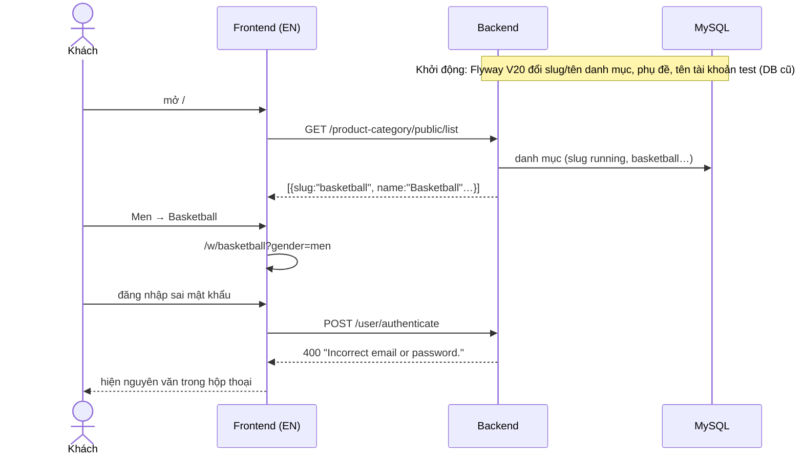

# Chuyển ngữ sang tiếng Anh (cửa hàng + quản trị)

## 1. Mục tiêu và phạm vi

Sau lát này, **mọi chữ người dùng nhìn thấy ở khu cửa hàng và trang quản trị** (kể cả trang `/login` quản trị: §6.9) (header, mega menu, tìm kiếm, menu trượt, footer, trang chủ, 15 trang thông tin, trang tạm, 404, hộp thoại đăng nhập / đăng ký, toast) là **tiếng Anh như nike.com**; URL, khoá query, slug danh mục, tên danh mục, phụ đề sản phẩm cũng tiếng Anh. **Chỉ tiền giữ VNĐ** `5.279.000 ₫` (D7).
**Mọi** thông báo API trả cho client (`ErrorCode`, lỗi khung, lỗi đăng ký / đăng nhập, lỗi nghiệp vụ của chức vụ / module / tài nguyên) chuyển tiếng Anh vì frontend hiện nguyên văn. Tên chức vụ / module / tài nguyên có sẵn trong DB cũng chuyển tiếng Anh.
Các lát sau (`dang-nhap-nike`, `danh-sach-giay`, `chi-tiet-giay`, `gio-hang`…) viết thẳng bằng tiếng Anh theo hợp đồng URL ở §6.2.

| Có làm | Không làm (để plan khác) |
|---|---|
| Toàn bộ chữ giao diện khu cửa hàng (`components/shop/**`, `routes/_shop/**`, `lib/shop/**`, `components/not-found-page.tsx`, toast của `lib/tanstack/options/account.ts`) | i18n nhiều ngôn ngữ / nút đổi ngôn ngữ (chỉ một ngôn ngữ: tiếng Anh) |
| Toàn bộ chữ trang quản trị + `/login` quản trị (`routes/admin*`, `routes/_auth*`, `components/admin/**`, `components/form/block/login-form.tsx`, `components/ui/form-dialog.tsx`, `hooks/use-bulk-delete.ts`, toast ở `lib/tanstack/options/{auth,role,module,resource,permission}.ts`) | Comment / Javadoc / log server (giữ tiếng Việt — tài liệu dự án viết tiếng Việt) |
| Đổi route: `/thong-tin/$trang` → `/info/$page`, `/gio-hang` → `/cart`, `/yeu-thich` → `/favorites`, `/w/$danhMuc` → `/w/$category` | Route quản trị: `/admin/chuc-vu` → `/admin/roles`, `/admin/phan-quyen` → `/admin/permissions`, `/admin/tai-nguyen` → `/admin/resources`, `/admin/module` → `/admin/modules` |
| Hợp đồng URL `/w` mới: `gender`, `kids`, `price`, `sale`, `badge`, `sort`, `q` (thay `gioiTinh`, `treEm`, `gia`, `giamGia`, `nhan`, `sapXep`) | Chuyển hướng (redirect) từ URL tiếng Việt cũ — dự án chạy local, không có link ngoài trỏ vào (§11 câu 3) |
| Dữ liệu: slug + tên 5 danh mục, phụ đề 31 sản phẩm (`products.json` + migration `V20` cập nhật DB đang có); tên 3 chức vụ, 2 module, 5 tài nguyên có sẵn; tên 4 tài khoản test | Dữ liệu người dùng tự nhập (chức vụ / tài khoản tạo tay có tên tiếng Việt giữ nguyên) |
| `ErrorCode` (toàn bộ), `GlobalExceptionHandler`, thông báo trong `UserService` (đăng ký / đổi mật khẩu / Google), `AuthController`, `BaseController`, `FileStorageService`, `RoleService`, `ModuleService`, `ResourceService` (lỗi trả cho client) | |
| `<html lang="en">`, `<title>` các trang cửa hàng + quản trị | |
| `automation/`: sửa page object, dữ liệu, spec cũ theo chuỗi mới (cả cửa hàng lẫn quản trị); thêm spec **quét chữ có dấu tiếng Việt** trên mọi trang cửa hàng + quản trị | Visual regression (lát 4.2) |
| Cập nhật tài liệu khung: `plan/thiet-ke-giay.md` §9 (tên route các lát sau), `plan/ui-nike/README.md` (ghi chú chuỗi), `CLAUDE.md`, `plan/_template.md` §5.4 ("Message tiếng Anh"); chụp lại ảnh `docs/chuc-nang/img/giao-dien-nike/` | Viết lại nội dung `docs/chuc-nang/giao-dien-nike.md` (chỉ thay ảnh + chuỗi trích dẫn) |

## 2. Tác nhân và phân quyền

| Tác nhân | Quyền | Ghi chú |
|---|---|---|
| Khách chưa đăng nhập | Xem mọi trang cửa hàng, gọi API công khai, đăng ký / đăng nhập | Không đổi quyền |
| Khách đã đăng nhập (`free@`, `khach1@`, `khach2@`) | Như trên + menu "Hi, <name>" | Tên hiển thị đổi sang tiếng Anh (§4) |
| Quản trị (`admin@`, chức vụ "Administrator") | Như trên + mục "Admin" trong menu tài khoản; mọi trang `/admin/*` | Không đổi quyền |
| Nhân viên không quyền (`noaccess@`, chức vụ "No Access") | Vào `/admin`, nhóm "System" không có mục nào; mở thẳng `/admin/roles` → "Access Denied" | Không đổi quyền |

Không có resource mới. Không có ca 403 mới; ca 401 / 403 / 404 / 405 có sẵn chỉ đổi message (§5).

## 3. Luồng nghiệp vụ

Lát không thêm luồng mới; mọi luồng của `giao-dien-nike` giữ nguyên, chỉ đổi chữ và URL. Luồng kiểm tra chính:

**Luồng chính:**
1. Khách mở `/` → header "New & Featured · Men · Women · Kids · Sale", hero "Step Into the New Season", dải "Just In", khối Jordan, "Shop by Category" với 5 ô "Lifestyle", "Running", "Basketball", "Jordan", "Football".
2. Rê chuột "Men" → mega menu 3 cột "Categories" / "Featured" / "Shop by Price" → bấm "Basketball" → `/w/basketball?gender=men`.
3. Bấm "Search", gõ "basketball shoes" → gợi ý 5 sản phẩm bóng rổ ("Men's Basketball Shoes", "Basketball Shoes"…), "View All 5 Results" → `/w?q=basketball+shoes`.
4. Footer "Delivery" → `/info/delivery`, h1 "Delivery", đoạn "Delivery costs 30.000 ₫ per order…".
5. "Join Us" → hộp thoại "Become a Nike Member"; đăng ký thành công → toast "Account created. Welcome, <name>!".
6. Quản trị mở `/login` → "Sign In", đăng nhập `admin@` → `/admin` "Hi, Administrator"; sidebar "Home" · nhóm "System": "Roles", "Permissions", "Resources", "Modules".
7. "Roles" → `/admin/roles` → "Add Role" → dialog "Create Role", nhập tên → "Create" → toast "Role created".

**Luồng thay thế / ngoại lệ:**
- A1. Mobile: menu trượt, panel con, footer accordion — cùng chữ như desktop (§6.3, §6.5).
- A2. Đăng nhập sai mật khẩu → hộp thoại hiện "Incorrect email or password." (từ API).
- A3. Đăng ký email đã có → "This email is already registered." + nút "Sign in with this email".
- E1. Mở URL tiếng Việt cũ (`/thong-tin/giao-hang`, `/gio-hang`, `/yeu-thich`) → trang 404 chung "We can't find the page you're looking for.".
- E2. `/w?gioiTinh=nam` (khoá cũ) → trang `/w` vẫn mở bình thường, khoá lạ bị bỏ qua, không lỗi.
- A4. Tạo chức vụ trùng tên "Administrator" → dialog hiện "Role name already exists".
- A5. `noaccess@` mở `/admin/roles` → "Access Denied".
- E4. URL quản trị cũ (`/admin/chuc-vu`, `/admin/phan-quyen`, `/admin/tai-nguyen`, `/admin/module`) → trang 404 chung.
- E3. API lỗi khung: sai method → 405 "HTTP method not supported"; sai đường dẫn → 404 "API not found"; thiếu token ở API cần đăng nhập → 401 "Please sign in".



## 4. Cơ sở dữ liệu

Migration: **`V20__tieng_anh_cua_hang.sql`** — chỉ `UPDATE` dữ liệu, không đổi cấu trúc bảng. Chạy được trên DB rỗng (không dòng nào khớp → không làm gì) và chạy một lần trên DB cũ. Nguồn sự thật cho DB mới / `test-support/reset` vẫn là `backend/business/src/main/resources/seed/giay/products.json` (sửa cùng nội dung).

**Danh mục** (`product_category`, khớp theo `id`; `products[].category` trong JSON đổi theo slug mới):

| id | slug cũ → mới | name cũ → mới |
|---|---|---|
| 1 | `lifestyle` (giữ) | Lifestyle (giữ) |
| 2 | `chay-bo` → `running` | Chạy bộ → Running |
| 3 | `bong-ro` → `basketball` | Bóng rổ → Basketball |
| 4 | `jordan` (giữ) | Jordan (giữ) |
| 5 | `bong-da` → `football` | Bóng đá → Football |

**Phụ đề sản phẩm** (`product.subtitle`, `UPDATE product SET subtitle = <mới> WHERE subtitle = <cũ>`):

| Cũ | Mới | id sản phẩm |
|---|---|---|
| Giày nam | Men's Shoes | 1, 2, 4, 5, 24, 25, 31 |
| Giày nữ | Women's Shoes | 7, 8, 9, 26, 27 |
| Dép nam | Men's Slides | 3 |
| Dép nữ | Women's Slides | 6 |
| Dép | Slides | 10, 28 |
| Giày bé trai | Boys' Shoes | 11 |
| Dép bé gái | Girls' Slides | 12 |
| Giày chạy bộ nam | Men's Road Running Shoes | 13 |
| Giày chạy bộ thi đấu nam | Men's Road Racing Shoes | 14 |
| Giày chạy bộ nữ | Women's Road Running Shoes | 15, 16 |
| Giày chạy bộ thi đấu nữ | Women's Road Racing Shoes | 17, 18 |
| Giày bóng rổ nam | Men's Basketball Shoes | 19 |
| Giày bóng rổ | Basketball Shoes | 20, 21 |
| Giày bóng rổ bé trai | Boys' Basketball Shoes | 22 |
| Giày bóng rổ bé gái | Girls' Basketball Shoes | 23 |
| Giày bóng đá sân cỏ tự nhiên nam | Men's Firm-Ground Low-Top Football Boots | 29 |
| Giày bóng đá nhiều mặt sân nam | Men's Multi-Ground Low-Top Football Boots | 30 |

`name`, `description`, `styleCode`, ảnh: đã là tiếng Anh, không đổi. Đường dẫn ảnh MinIO theo slug sản phẩm, không đổi.

**Tài khoản khách test** (`user_app.name`, khớp theo `email`; sửa luôn câu `INSERT` trong `db/seed/V5_1__…`, `V19_1__…` **không được** vì Flyway đã chạy — chỉ `UPDATE` ở V20):

| email | name cũ → mới |
|---|---|
| `free@nike.local` | Khách Miễn Phí → Free Member |
| `khach1@nike.local` | Khách Một → Customer One |
| `khach2@nike.local` | Khách Hai → Customer Two |

| `noaccess@nike.local` | Nhân viên không quyền → No Access Staff |

`admin@` tên "Administrator" (giữ). Email giữ nguyên (`CLAUDE.md`, `accounts.js` đã dùng).

**Chức vụ** (`role.name`, khớp theo tên cũ). `V5_1`, `V19_1` tra role theo tên "Khách hàng" nhưng đều chạy **trước** V20 (kể cả DB mới), nên đổi tên ở V20 an toàn; không có code Java nào tra role theo tên.

| Cũ | Mới |
|---|---|
| Quản trị | Administrator |
| Không quyền | No Access |
| Khách hàng | Customer |

**Module / tài nguyên** (khớp theo `code`):

| Bảng | code | name mới | description mới |
|---|---|---|---|
| `module` | `SYSTEM` | System | Access control: modules, resources, roles |
| `module` | `CATALOG` | Store | Products and orders of the shoe store |
| `resource` | `MODULE` | Module Management | Group resources by module |
| `resource` | `RESOURCE` | Resource Management | Permission-controlled resources (match controller URIs) |
| `resource` | `ROLE` | Role Management | Roles for admin accounts |
| `resource` | `PERMISSION` | Permissions | Grant actions on resources to each role |
| `resource` | `PRODUCT` | Product Management | Products, images, sizes and stock |

## 5. Hợp đồng API (cố định — nguồn sự thật cho cả BE và FE)

**Không thêm / đổi endpoint, request hay cấu trúc response.** Chỉ đổi **giá trị chữ**: dữ liệu danh mục / phụ đề (§4) và `message` lỗi (§5.4). Mọi response vẫn bọc `{ "code", "message", "result" }`.

### 5.1 `GET /api/product-category/public/list` — công khai

```json
[
  { "id": 1, "slug": "lifestyle", "name": "Lifestyle", "sortOrder": 1, "productCount": 12,
    "imageUrl": "http://localhost:9020/nike-public/products/nike-dunk-low-retro/1.webp" },
  { "id": 2, "slug": "running", "name": "Running", "sortOrder": 2, "productCount": 6, "imageUrl": "…/nike-alphafly-4/1.webp" },
  { "id": 3, "slug": "basketball", "name": "Basketball", "sortOrder": 3, "productCount": 5, "imageUrl": "…/ja-4-blur-ep/1.webp" },
  { "id": 4, "slug": "jordan", "name": "Jordan", "sortOrder": 4, "productCount": 5, "imageUrl": "…/air-jordan-1-low-se-magic-ball/1.webp" },
  { "id": 5, "slug": "football", "name": "Football", "sortOrder": 5, "productCount": 2, "imageUrl": "…/nike-phantom-6-low-academy/1.webp" }
]
```

### 5.2 `GET /api/product/public/new-arrivals` — công khai

Như cũ (8 phần tử id `2, 5, 14, 20, 23, 24, 25, 26`), `subtitle` mới, ví dụ id 2 `"subtitle": "Men's Shoes"`, id 14 `"Men's Road Racing Shoes"`, id 23 `"Girls' Basketball Shoes"`.

### 5.3 `GET /api/product/public/suggest?q=…` — công khai

Điều kiện không đổi. Ví dụ dùng ở §9 (test tính từ `products.json`, không ghi cứng):
- `q=basketball shoes` → `total = 5`, id `19, 20, 21, 22, 23` (thứ tự `created_time DESC, id DESC`).
- `q=slides` → `total = 5`, id `3, 6, 10, 12, 28`.
- `q=giày bóng rổ` (chữ cũ) → `total = 0`.
- `q=jordan` → `total = 5` (không đổi, khớp theo tên).

### 5.4 Thông báo lỗi (tiếng Anh, FE hiện nguyên văn)

**`ErrorCode`** — dịch **toàn bộ** enum (giữ nguyên `code` HTTP và tên hằng). Bảng dưới là các dòng test kiểm; các dòng còn lại (voucher, invoice, order… của dự án cũ) dịch theo cùng giọng, cook tự viết:

| Hằng | HTTP | Message mới |
|---|---|---|
| `UNAUTHORIZED` | 401 | Invalid or tampered token |
| `TOKEN_EXPIRED` | 401 | Token has expired |
| `LOGIN` | 401 | Please sign in |
| `FORBIDDEN` | 403 | Access denied |
| `LOCK_ACCOUNT` | 403 | This account has been locked |
| `INTERNAL_ERROR` | 500 | Something went wrong. Please try again later |
| `DUPLICATED_DATA` | 400 | Duplicate data |
| `INVALID_AUTHENTICATION_INFO` | 400 | Incorrect email or password. |
| `EMAIL_EXISTS` | 400 | This email is already registered. |
| `WRONG_LOGIN_INFO` | 400 | Incorrect sign-in details. Please check your email and password. |
| `MISSING_PASSWORD` | 400 | Please enter your password. |
| `MISSING_EMAIL_OR_PHONE` | 400 | Please enter your email. |
| `WEAK_PASSWORD` | 400 | Password must be 8 to 72 characters. |
| `REFRESH_TOKEN_INVALID` | 401 | Your session has expired. Please sign in again. |
| `LOGIN_TOO_MANY_ATTEMPTS` | 429 | Too many failed sign-in attempts. Please try again in a few minutes. |
| `DATA_NOT_FOUND` | 404 | Not found |
| `METHOD_NOT_ALLOWED` | 405 | HTTP method not supported |
| `BAD_REQUEST` | 400 | Invalid request |
| `FILE_TOO_LARGE` | 413 | File exceeds the allowed size |
| `FILE_TYPE_NOT_ALLOWED` | 415 | File type not supported |

**Thông báo viết tay** (không qua bảng enum):

| Chỗ | Tình huống | HTTP | Message mới |
|---|---|---|---|
| `UserService` đăng ký | `name` rỗng / toàn khoảng trắng | 400 | Please enter your full name. |
| `UserService` đăng ký | email sai định dạng | 400 | Please enter a valid email address. |
| `UserService` đổi mật khẩu | (4 câu hiện có) | 400 | Invalid user / Old and new passwords are required / New password must be different from the old one / User not found / Old password is incorrect |
| `UserService` Google | gọi Google lỗi | 400 | Couldn't verify with Google |
| `AuthController` | Google chưa bật | 400 | Google sign-in is not enabled |
| `AuthController` | đăng xuất thành công (`message` của 200) | 200 | Signed out successfully |
| `BaseController` | thiếu quyền | 403 | `You don't have permission to perform this action. Path: %s, Action: %s` |
| `GlobalExceptionHandler` | validation mặc định | 400 | Invalid data |
| | body JSON sai | 400 | Malformed request body |
| | thiếu tham số | 400 | `Missing required parameter: <tên>` |
| | tham số sai kiểu | 400 | `Invalid parameter: <tên>` |
| | đường dẫn API không có | 404 | API not found |
| `RoleService` | tên trùng / xoá chức vụ đang gán cho tài khoản | 400 | Role name already exists / This role is assigned to accounts and can't be deleted |
| `ModuleService` | code trùng | 400 | Module code already exists |
| `ResourceService` | code trùng / xoá tài nguyên hệ thống | 400 | Resource code already exists / System resources can't be deleted |
| `FileStorageService` | file quá lớn / không đọc được / nội dung sai đuôi | 413 / 400 / 415 | File exceeds the allowed size (10MB) / Couldn't read the file / File content doesn't match the .<ext> format |

Ràng buộc: sau lát này **không còn chữ có dấu tiếng Việt trong bất kỳ `message` nào backend trả về** — kiểm bằng TC-U1, TC-U3, TC-05, TC-09.

## 6. Giao diện (chuỗi cố định — test E2E chọn theo đúng các chuỗi này)

Bố cục, số đo, màu, testid, hành vi: **giữ nguyên** như `plan/giao-dien-nike.md` §6. Mục này chỉ ghi chuỗi / URL mới, theo đúng thứ tự §6 của plan đó. Viết hoa kiểu nike.com (Title Case cho nút / link điều hướng, câu thường cho đoạn văn). Tiền vẫn qua `formatVnd`.

**Chung:** `index.html` `<html lang="en">`. Link bỏ qua "Skip to main content". Thanh tiến trình route `aria-label="Loading page"`.

### 6.1 Header

| Chỗ | Cũ | Mới |
|---|---|---|
| Dải trên, link Jordan (aria) | Jordan | Jordan → `/w/jordan` |
| Dải trên | Tìm cửa hàng → `/thong-tin/tim-cua-hang` | **Find a Store** → `/info/find-a-store` |
| | Trợ giúp → `/thong-tin/tro-giup` | **Help** → `/info/help` |
| | Tham gia (testid `header-register`) | **Join Us** |
| | Đăng nhập (testid `header-login`) | **Sign In** |
| Đã đăng nhập | Xin chào, <tên> (testid `account-menu-trigger`) | **Hi, <name>** |
| Menu tài khoản | Trang quản trị / Đăng xuất | **Admin** / **Sign Out**; toast **Signed out** |
| Skeleton phiên | Đang tải tài khoản | **Loading account** |
| Logo (aria) | Nike - về trang chủ | **Nike Home** |
| `<nav>` aria-label | Danh mục chính | **Main menu** |
| Ô tìm kiếm (testid `header-search`) | Tìm kiếm | **Search** |
| Icon ♡ | Yêu thích → `/yeu-thich` | **Favourites** → `/favorites` |
| Icon túi (testid `header-cart`) | Giỏ hàng → `/gio-hang` | **Bag** → `/cart` |
| Mobile: nút menu (testid `header-menu`) | Menu | **Menu** |
| Dải thông báo (testid `announcement-bar`) | Miễn phí giao hàng cho đơn từ 5.000.000 ₫ & đổi trả trong 30 ngày · Tham gia ngay · Xem chi tiết | **Free delivery on orders from 5.000.000 ₫ & free 30-day returns** · **Join Us** (ẩn khi đã đăng nhập) · **Learn More** → `/info/delivery` |

Menu chính (chữ → href khi bấm → tham số phạm vi gắn vào mọi link trong mega menu của mục):

| Mục | href | Phạm vi |
|---|---|---|
| New & Featured | `/w?sort=newest` | (không) |
| Men | `/w?gender=men` | `gender=men` |
| Women | `/w?gender=women` | `gender=women` |
| Kids | `/w?kids=boys,girls` | `kids=boys,girls` |
| Sale | `/w?sale=1` | `sale=1` |

### 6.2 Mega menu + hợp đồng URL `/w`

| Cột | Link | Đường dẫn gốc |
|---|---|---|
| **Categories** | tên danh mục từ §5.1: Lifestyle, Running, Basketball, Jordan, Football | `/w/<slug>` |
| **Featured** | All Shoes | `/w` |
| | Just In | `/w?badge=just-in` |
| | Bestsellers | `/w?badge=bestseller` |
| | Sale | `/w?sale=1` |
| **Shop by Price** | Under 1.000.000 ₫ | `/w?price=under-1m` |
| | 1.000.000 ₫ – 2.000.000 ₫ | `/w?price=1m-2m` |
| | 2.000.001 ₫ – 4.999.999 ₫ | `/w?price=2m-5m` |
| | 5.000.000 ₫ & Above | `/w?price=5m-plus` |

Ví dụ: "Men" → "Basketball" = `/w/basketball?gender=men`; "Sale" → "Under 1.000.000 ₫" = `/w?sale=1&price=under-1m`.

**`catalogSearchSchema` mới** (`lib/shop/catalog-search.ts`; mọi khoá tuỳ chọn, giá trị sai bị bỏ bằng `.catch(undefined)`; lát 1.4 phải theo):

| Khoá | Giá trị | Thay cho |
|---|---|---|
| `gender` | `men`, `women`, `unisex`; nhiều giá trị ngăn dấu phẩy | `gioiTinh` (`nam`, `nu`, `unisex`) |
| `kids` | `boys`, `girls`; ngăn dấu phẩy | `treEm` (`be-trai`, `be-gai`) |
| `price` | `under-1m`, `1m-2m`, `2m-5m`, `5m-plus` | `gia` |
| `sale` | số `1` | `giamGia` |
| `badge` | `just-in`, `bestseller` | `nhan` (`moi-ve`, `ban-chay`) |
| `sort` | `featured` (mặc định), `newest`, `price-desc`, `price-asc` | `sapXep` |
| `q` | chuỗi | (giữ) |

Route: `/w`, `/w/$category` (đổi tên param từ `$danhMuc`), `/t/$slug` (giữ).

### 6.3 Menu trượt (mobile)

Dialog tên **Menu**, nút ✕ **Close menu**. Danh sách chính: New & Featured, Men, Women, Kids, Sale, rồi link "Jordan". Panel con: nút quay lại **All**, h2 = tên mục, link **Shop All** → href của mục, 3 nhóm **Categories** / **Featured** / **Shop by Price** như §6.2.
Chưa đăng nhập: đoạn **"Become a Nike Member to shop faster and track your orders."** + nút đen **Join Us** + nút viền **Sign In**. Đã đăng nhập: **Hi, <name>** + nút **Sign Out**. Cuối: **Favourites** → `/favorites`, **Bag** → `/cart`, **Help** → `/info/help`.

### 6.4 Khung tìm kiếm

| Chỗ | Mới |
|---|---|
| Dialog (testid `search-overlay`) | tên **Search** |
| Ô nhập | tên **Search products**, placeholder **Search** |
| Nút đóng | **Cancel** |
| Ô rỗng | tiêu đề **Popular Search Terms**; 6 pill: `air force 1`, `jordan`, `basketball shoes`, `pegasus`, `slides`, `air max` (href `/w?q=<chữ pill>`) |
| Có kết quả | tiêu đề **Top Suggestions**; link **View All <total> Results** → `/w?q=<từ khoá>` |
| Không có kết quả | `We couldn't find anything for "<từ khoá>".` (vẫn hiện Popular Search Terms) |
| API lỗi | **Couldn't load suggestions. Press Enter to see all results.** |

### 6.5 Footer + trang thông tin

Nhóm và link (h1 trang = đúng chữ link; route `/info/$page`):

| Nhóm | Link → slug |
|---|---|
| **Resources** | Find a Store → `find-a-store` · Become a Member → `membership` · Send Us Feedback → `feedback` |
| **Help** | Get Help → `help` · Order Status → `order-status` · Delivery → `delivery` · Returns → `returns` · Payment Options → `payment-options` · Contact Us → `contact-us` |
| **Company** | About Nike → `about-nike` · News → `news` · Careers → `careers` |
| Dòng cuối | Terms of Sale → `terms-of-sale` · Terms of Use → `terms-of-use` · Privacy Policy → `privacy-policy` |

Lưu ý: link "Help" ở dải trên / menu trượt → `/info/help`, trang đó có h1 **Get Help** (chữ của link footer).
Góc phải: icon địa cầu + **Vietnam**. Dòng cuối: **© 2026 Nike, Inc. All rights reserved.**; dòng nhỏ **Student project replicating nike.com. Runs locally, not a real store.** Mobile: accordion, mặc định đóng (giữ).

Nội dung test kiểm (`lib/shop/info-pages.ts`):
- `delivery`: "Delivery costs 30.000 ₫ per order. Orders with a subtotal of 5.000.000 ₫ or more ship free." và "Orders arrive within 3–5 business days."
- `returns`: "Free returns within 30 days of delivery for unworn items."
- `payment-options`: "Cash on Delivery (COD)" và "Bank transfer via payOS".
- `help`: link tới "Delivery", "Returns", "Payment Options", "Contact Us".
- `about-nike`: "This is a student project replicating nike.com/vn. It runs locally only and does not sell anything. Nike names, logos, images and product descriptions belong to Nike, Inc."
- `contact-us`: "Email: support@nike.local"
- 9 trang còn lại: "Content coming soon."
- `<title>`: `<h1> | Nike`. Slug lạ → 404 chung.

### 6.6 Trang chủ `/` + `ProductCard`

| Khối | Mới |
|---|---|
| `<title>` | Nike. Just Do It. (giữ) |
| Hero (testid `home-hero`) | dòng nhỏ **Just In**; h1 **Step Into the New Season**; đoạn **Fresh pairs just landed, ready for wherever you go next.**; nút **Shop Now** → `/w?badge=just-in`; nút viền **Shop All Shoes** → `/w` |
| Dải mới (testid `home-new-arrivals`) | h2 **Just In**; link **Shop All** → `/w?badge=just-in`; nút **Previous products** / **Next products**; lỗi **Couldn't load new arrivals.** + nút **Try Again** |
| Khối Jordan (testid `home-jordan`) | dòng nhỏ **Jordan**; h2 **Fly Higher with Jordan**; đoạn **Basketball spirit, from the court to the street.**; nút **Shop Jordan** → `/w/jordan` |
| Danh mục (testid `home-categories`) | h2 **Shop by Category**; dưới ảnh **<n> products** (n = 1 → **1 product**); lỗi **Couldn't load categories.** + **Try Again** |
| `ProductCard` nhãn | `totalStock = 0` → **Sold Out**; `JUST_IN` → **Just In**; `BESTSELLER` → **Bestseller**; có `salePrice` → **Sale** (thứ tự ưu tiên giữ) |
| Giá gốc (chữ ẩn trình đọc màn hình) | **Original price** |

### 6.7 Trang tạm + 404

- Trang tạm (`/w`, `/w/$category`, `/t/$slug`, `/favorites`, `/cart`): h1 **Coming Soon**, đoạn **This page is under construction.**, link **Back to Home** → `/`.
- 404 chung (`components/not-found-page.tsx`, dùng cả cho `/admin`): **We can't find the page you're looking for.** + link **Back to Home**.

### 6.8 Hộp thoại đăng nhập / đăng ký

**Đăng nhập** (`ShopLoginDialog`): tiêu đề **Sign In**, mô tả **Sign in to shop and track your orders.**; field **Email**, **Password**; checkbox **Show password**; nút **Sign In** (đang gửi **Signing in…**); dòng **Not a member? Join Us**; gợi ý **Test account: free@nike.local, password Admin@123**; nút ✕ **Close**. Toast thành công **Welcome back, <name>!**

| Field | Validate client → message |
|---|---|
| Email | rỗng → **Please enter your email.** · sai định dạng → **Please enter a valid email address.** |
| Password | rỗng → **Please enter your password.** |

**Đăng ký** (`ShopRegisterDialog`): tiêu đề **Become a Nike Member**, mô tả **Join us to shop and track your orders.**; field **Full name**, **Email**, **Password** (placeholder **At least 8 characters, with letters and numbers**); checkbox **Show password**; checkbox **I agree to Nike's Terms of Use and Privacy Policy.** (2 link → `/info/terms-of-use`, `/info/privacy-policy`); nút **Create Account** (đang gửi **Creating account…**); dòng **Already a member? Sign In**. Lỗi `EMAIL_EXISTS` thêm nút **Sign in with this email**. Toast **Account created. Welcome, <name>!**

| Field | Validate client → message |
|---|---|
| Full name | rỗng → **Please enter your full name.** · > 100 ký tự → **Full name must be at most 100 characters.** |
| Email | như đăng nhập |
| Password | < 8 → **Password must be at least 8 characters.** · > 72 → **Password must be at most 72 characters.** · không có chữ → **Password must contain a letter.** · không có số → **Password must contain a number.** |
| Điều khoản | chưa tick → **You must agree to the terms to continue.** |

Lỗi từ server hiện nguyên văn theo §5.4.

### 6.9 Trang quản trị + `/login` quản trị

Bố cục, testid, hành vi giữ nguyên. Route mới (đổi tên file route, sửa link sidebar / dropdown "Permissions" của chức vụ):

| Cũ | Mới |
|---|---|
| `/admin/chuc-vu` | `/admin/roles` |
| `/admin/phan-quyen` (`?roleId=`) | `/admin/permissions` (`?roleId=` giữ) |
| `/admin/tai-nguyen` | `/admin/resources` |
| `/admin/module` | `/admin/modules` |

`<title>` các trang quản trị: `<tiêu đề trang> | Nike Admin` (vd "Roles | Nike Admin"); `/admin` → "Dashboard | Nike Admin"; `/login` → "Sign In | Nike Admin".

**Trang `/login` quản trị** (`components/form/block/login-form.tsx`): tiêu đề **Sign In**, đoạn **Nike store admin.**; field **Email or phone number\*** (placeholder **e.g. example@gmail.com or 0987654321**), **Password\***; checkbox **Remember me**; ghi chú **Self sign-up is not available. An administrator will create your account and grant permissions.**; nút **Sign In** (đang gửi **Signing in...**). Validate: **Please enter your email or phone number** · **Invalid email or phone number** · **Please enter your password**. Toast **Signed in successfully**. Trang `/logout`: toast **Signed out successfully**.

**Khung quản trị:**

| Chỗ | Mới |
|---|---|
| Sidebar, dòng phụ dưới logo | **Admin** |
| Nhóm sidebar | **Main** (mục **Home** → `/admin`) · **System** (mục **Roles**, **Permissions**, **Resources**, **Modules**) |
| Menu người dùng (góc dưới) | **Role: <roleName>** · **Sign Out** |
| `/admin` | h1 **Hi, <name>** (chưa có tên: **Hi there**); đoạn **Pick a feature from the sidebar to get started.**; thẻ **Account** / **Current sign-in details** / **Role: <roleName>** |
| Đang tải | **Loading dashboard** · **Please wait a moment...** |
| Không kết nối | **Can't reach the server** · **Couldn't load account info. Make sure the backend is running and try again.** · **Try Again** · **Sign Out** |
| Không có quyền | **Access Denied** · **You don't have permission to view this page.** · **Please contact support if you think this is a mistake.** · **Back to Home** |
| Lỗi danh sách | **Couldn't load the list** · **Check the connection to the server and try again.** · **Try Again** |

**Bảng dữ liệu dùng chung** (`data-table-advanced`, `table-search-filter`, `form-dialog`, `delete-confirm-dialog`, `use-bulk-delete`):

| Cũ | Mới |
|---|---|
| Thêm mới / Xóa mục đã chọn | Add New / Delete Selected |
| Làm mới · Bộ lọc · Tùy chỉnh cột (Cột) · Xóa lọc | Refresh · Filters · Customize Columns (Columns) · Clear Filters |
| Không có dữ liệu. | No results. |
| `<x> trên <y> hàng được chọn.` | `<x> of <y> row(s) selected.` |
| Số hàng mỗi trang · `Trang <a> trên <b>` · Đang tải dữ liệu... | Rows per page · `Page <a> of <b>` · Loading data... |
| Tìm kiếm (label ô tìm) · Tất cả | Search · All |
| Chọn tất cả · `Chọn <tên>` · Thao tác · `Thao tác <tên>` (aria) | Select all · `Select <name>` · Actions · `Actions <name>` |
| Chỉnh sửa · Xóa · Phân quyền (dropdown) | Edit · Delete · Permissions |
| Lưu · Đang xử lý... · Hủy (form dialog) | Save · Processing... · Cancel |
| Tạo mới · Cập nhật (nút submit) | Create · Update |
| Dialog xoá: `Xóa <loại>` · `Bạn có chắc muốn xóa <tên>? Hành động này không thể hoàn tác.` · Hủy · Xóa / Đang xóa... | `Delete <type>` · `Are you sure you want to delete <name>? This action can't be undone.` · Cancel · Delete / Deleting... |
| Xoá nhiều: confirm `Bạn có chắc muốn xóa <n> <loại> đã chọn?`; toast Xóa thành công / Xóa thất bại / `Đã xóa a/n, f bản ghi thất bại` | `Are you sure you want to delete <n> selected <type>?`; **Deleted successfully** / **Delete failed** / `Deleted <a>/<n>, <f> failed` |
| Kích hoạt · Mô tả · Mặc định · Toàn quyền | Active · Description · Default · Full Access |
| Chưa phân module | Unassigned |

**Roles `/admin/roles`:** tiêu đề **Roles**; mô tả **Roles for admin accounts. Grant detailed permissions on the Permissions page.**; ô tìm placeholder **Search by role name...**; nút **Add Role**; cột **Role** (badge **Default**, **Full Access**); loại xoá **role**. Dialog **Create Role** / **Edit Role**, mô tả **Create a new role to grant permissions to users** / **Update role details**; field **Role name**; switch **Default role** (**Automatically assigned to newly registered accounts (only one role can be default)**), **Full access (Operator)** (**Skips resource permission checks — enable only for the top admin role**). Validate: **Please enter a role name** · **Role name must be at most 50 characters**. Toast **Role created** / **Role updated** / **Role deleted**; lỗi **Couldn't save role** / **Couldn't delete role** (kèm message server §5.4).

**Permissions `/admin/permissions`:** h1 **Permissions**; đoạn **Pick a role, then tick the actions allowed on each resource. Changes save instantly.**; label **Role**, placeholder **Select a role**, hậu tố ` (full access)`; alert **Full-access role** — `“<name>” bypasses the permission table: every resource is allowed. Turn off full access on the Roles page to set detailed permissions.`; alert **Read only** — **You don't have permission to update permissions.**; lỗi **Couldn't load permissions**; rỗng **No roles to assign permissions to (or you can't view the Roles page).**; bảng: cột **Resource**, **All**; nhóm `<module> (<n> resources)` (n = 1 → `resource`), checkbox `All module <module>`, `All <CODE>`, nhóm **Unassigned**; **No resources.** Toast **Permissions updated** / **Couldn't update permissions**.

**Resources `/admin/resources`:** tiêu đề **Resources**; mô tả **API groups (URI matches the controller) and the actions that can be granted.**; placeholder **Search by name, code, URI...**; lọc Module: **All** / **Unassigned**; nút **Add Resource**; cột **Resource**, **Module**, **Supported Actions**, **Active**; loại xoá **resource**, ghi chú xoá **Permissions granted on this resource to every role will also be removed.** Dialog **Create Resource** / **Edit Resource**, mô tả **Create a new resource to grant to roles** / **Update system resource details**; field **Resource name**, **Description**, **Code** (placeholder **e.g. PRODUCT**), **URI** (placeholder **e.g. /product/**), **Supported Actions** (aria `Action <ACTION>`); ghi chú **This is a system resource — Code/URI can't be changed because permissions match on this URI.** Validate: **Please enter a resource name** · **Resource name must be at most 300 characters** · **Description must be at most 300 characters** · **Please enter a code** · **Code must be at most 100 characters** · **Code may only contain uppercase letters, digits and _** · **Please enter a URI** · **URI must be at most 300 characters** · **URI must look like /resource-name/ (lowercase letters, digits, -)** · **Select at least one action**. Toast **Resource created** / **Resource updated** / **Resource deleted**; **Couldn't save resource** / **Couldn't delete resource**.

**Modules `/admin/modules`:** tiêu đề **Modules**; mô tả **Group resources into modules for the permission matrix.**; placeholder **Search by name, code...**; nút **Add Module**; cột **Module name**, **Description**, **Active** (aria `Toggle module <name>`); ghi chú xoá **Resources in this module move to “Unassigned” and are not deleted.** Dialog **Create Module** / **Edit Module**, mô tả **Create a new module to group resources** / **Update module details**; field **Module name**, **Code** (placeholder **e.g. SYSTEM**), **Description**, **Active**. Validate: **Please enter a module name** · **Module name must be at most 300 characters** + 3 câu Code / Description như Resources. Dialog **Assign Resources**: `Pick unassigned resources to add to <module>.`, ô **Search resources...**, **Loading resources...**, **Couldn't load resources.**, **No unassigned resources.**, **Load More** / **Loading...**, **Cancel**, `Assign (<n>)` / **Assigning...**. Toast **Module created** / **Module updated** / **Module deleted** / `Assigned <n> resources to the module`; lỗi **Couldn't save module** / **Couldn't delete module** / **Couldn't assign resources**.

Chuỗi quản trị nhỏ khác không có trong bảng trên (aria-label phụ, tooltip): dịch cùng giọng và cùng thuật ngữ (Role / Permission / Resource / Module / Action); TC-19 quét để không sót.

## 7. Việc backend + automation (Claude, phiên A)

### 7.1 Spec nghiệm thu (viết trước khi code)

1. `utils/vietnamese.js`: `VIETNAMESE_RE` = regex các chữ có dấu tiếng Việt (`[àáạảãâầấậẩẫăằắặẳẵèéẹẻẽêềếệểễìíịỉĩòóọỏõôồốộổỗơờớợởỡùúụủũưừứựửữỳýỵỷỹđ]`, cờ `i`); `findVietnamese(text)` trả mảng tối đa 10 đoạn ±20 ký tự quanh chữ tìm được (để báo lỗi dễ đọc). Không coi `₫` là chữ tiếng Việt.
2. `data/shop-routes.json` (data-driven cho TC-10): danh sách `{ path, name }` các trang cửa hàng: `/`, `/w`, `/w/basketball`, `/t/nike-dunk-low-retro`, `/favorites`, `/cart`, 15 trang `/info/<slug>`, `/khong-co-trang-nay` (404).
3. Sửa dữ liệu test theo §5.4 / §6: `data/nav-links.json` (khoá + chữ mới), `data/register-invalid.json` (message mới), `data/seed-products.js` (danh mục / phụ đề đọc từ `products.json` nên tự theo; sửa chú thích + mọi chữ ghi cứng), `data/accounts.js` (tên mới của `free@`, `khach1@`, `khach2@` nếu có).
4. Sửa page object theo chuỗi mới: cửa hàng `HeaderComponent`, `SearchOverlay`, `MobileMenu`, `FooterComponent`, `ProductCard`, `HomePage`, `InfoPage`, `NotFoundPage`, `ShopLoginDialog`, `ShopRegisterDialog`, `BasePage`; quản trị `AdminLoginPage`, `AdminLayout`, `RolePage`, `RoleDialog`, `PermissionPage`, `ResourcePage`, `DeleteConfirmDialog` (URL + chuỗi §6.9). Dữ liệu `data/role-names.json` (message validate mới, tên chức vụ test tiếng Anh), `utils/unique.js` (tiền tố tên sinh ra không dấu).
   `data/admin-routes.json` (data-driven cho TC-19): `/admin`, `/admin/roles`, `/admin/permissions`, `/admin/resources`, `/admin/modules`.
5. Sửa spec cũ (ghi §12 lý do: chuỗi / URL đổi theo D6, không phải sửa cho xanh): `tests/home/giao-dien-nike.spec.js`, `tests/system/go-lut.spec.js` (phần cửa hàng), `tests/api/giao-dien-nike.api.spec.js`, `tests/api/du-lieu-giay.api.spec.js`, `tests/api/auth.api.spec.js`, `tests/api/go-lut.api.spec.js`, `tests/api/role.api.spec.js`, `tests/admin/admin-login.spec.js`, `tests/admin/role.spec.js`, `tests/admin/du-lieu-giay.spec.js`.
6. Spec mới: `tests/api/tieng-anh-cua-hang.api.spec.js` (TC-01 → TC-09), `tests/system/tieng-anh-cua-hang.spec.js` (TC-10 → TC-17), `tests/admin/tieng-anh-cua-hang.spec.js` (TC-19 → TC-22).

### 7.2 Backend

1. `backend/app/src/main/resources/db/migration/V20__tieng_anh_cua_hang.sql`: `SET NAMES utf8mb4;` rồi các `UPDATE` ở §4 (danh mục theo `id`, phụ đề theo giá trị cũ, tên tài khoản theo `email`, chức vụ theo tên cũ, module / tài nguyên theo `code`). Không xoá / thêm dòng. Không sửa migration / seed cũ (Flyway checksum).
2. `backend/business/src/main/resources/seed/giay/products.json`: `categories[]` slug + name mới; `products[].category` theo slug mới; `products[].subtitle` theo §4.
3. `ShoeSeedData` / `ShoeSeedService`: không đổi logic (chỉ đọc JSON). Thông báo `IllegalStateException` / log giữ tiếng Việt (không ra client).
4. `base/constant/ErrorCode.java`: dịch toàn bộ message (§5.4).
5. `base/exception/GlobalExceptionHandler.java`: 5 chuỗi §5.4.
6. `authenticate/service/auth/UserService.java`, `RoleService.java`, `ModuleService.java`, `ResourceService.java`, `authenticate/controller/auth/AuthController.java`, `authenticate/controller/BaseController.java`, `authenticate/service/FileStorageService.java`: chuỗi trả client theo §5.4 (log giữ nguyên).
7. Unit test:
   - TC-U1 `base/src/test/.../constant/ErrorCodeTest.java`: duyệt `ErrorCode.values()`, không message nào khớp regex chữ có dấu tiếng Việt.
   - TC-U2 `business/src/test/.../product/seed/ShoeSeedDataTest.java` (thêm ca vào file có sẵn): nạp `products.json` thật, mọi `category.slug` khớp `^[a-z0-9-]+$`, mọi `category.name` / `product.subtitle` không có chữ có dấu.
   - TC-U3: test có sẵn của `RoleService` / `ModuleService` / `ResourceService` (hoặc thêm nếu chưa có): ca trùng tên / trùng code / xoá tài nguyên hệ thống ném `AppException` với message §5.4.
   - Sửa unit test cũ nào đang so message tiếng Việt (tìm bằng grep trong `src/test`).
8. `mvn -q "-Djooq.codegen.skip=true" -pl base,authenticate,business -am test` → `sh scripts/ai/backend-restart.sh` (kiểm dòng Flyway `V20`) → `pnpm test:api` xanh (cả spec cũ đã sửa). Ghi §12 "phiên A xong".

## 8. Việc frontend (Claude, phiên B)

Thứ tự theo `frontend/AGENTS.md`. Không đổi bố cục / style; chỉ chuỗi, route, khoá query.

1. `frontend/index.html`: `lang="en"`.
2. Route (đổi tên file, `routeTree.gen.ts` tự sinh lại khi `pnpm build` / dev):
   - `routes/_shop/thong-tin.$trang.tsx` → `routes/_shop/info.$page.tsx` (param `page`).
   - `routes/_shop/gio-hang.tsx` → `routes/_shop/cart.tsx`; `routes/_shop/yeu-thich.tsx` → `routes/_shop/favorites.tsx`.
   - `routes/_shop/w.$danhMuc.tsx` → `routes/_shop/w.$category.tsx` (param `category`).
   - Quản trị: `routes/admin/chuc-vu.tsx` → `roles.tsx`, `phan-quyen.tsx` → `permissions.tsx`, `tai-nguyen.tsx` → `resources.tsx`, `module.tsx` → `modules.tsx`.
   - Sửa mọi `<Link to=…>` / `navigate` trỏ tới các route trên (grep `thong-tin`, `gio-hang`, `yeu-thich`, `danhMuc`, `chuc-vu`, `phan-quyen`, `tai-nguyen`, `/admin/module"`).
3. `lib/shop/catalog-search.ts`: schema + `PRICE_RANGES` + `NAV_ITEMS` + `FEATURED_LINKS` theo §6.1 / §6.2; `withScope` dùng khoá mới. Grep toàn `src/` các khoá cũ (`gioiTinh`, `treEm`, `giamGia`, `sapXep`, `nhan`, `gia`) để không sót.
4. `lib/shop/info-pages.ts`: 15 slug + nội dung §6.5; `isInfoSlug` theo slug mới.
5. Component cửa hàng — dịch chuỗi theo §6 (kể cả `aria-label`, `sr-only`, `title`): `components/shop/layout/**` (header, top-bar, main-nav, mega-menu-panel, nav-groups, header-actions, account-menu, mobile-menu, search-overlay, footer, announcement-bar, shop-shell, route-progress, use-hide-on-scroll nếu có chữ), `components/shop/home/**`, `components/shop/product/**`, `components/shop/account/**`, `components/shop/ui/**`, `components/shop/coming-soon-section.tsx`, `components/shop/catalog-link.tsx`, `components/shop/info/info-page.tsx`, `components/not-found-page.tsx`.
6. `lib/tanstack/options/account.ts`: toast §6.8 ("Welcome back, <name>!", "Account created. Welcome, <name>!", "Signed out").
6b. Quản trị theo §6.9: `routes/admin.tsx`, `routes/admin/*.tsx`, `routes/_auth.tsx`, `routes/_auth/*.tsx`, `components/admin/**` (sidebar, table, role, module, resource, permission, các trang lỗi / tải / không quyền, delete-confirm), `components/form/block/login-form.tsx`, `components/ui/form-dialog.tsx`, `hooks/use-bulk-delete.ts`, `lib/tanstack/options/{auth,role,module,resource,permission}.ts`, `lib/types/*.ts` (nhãn hiển thị nếu có), `lib/utils/phone.ts` (message validate nếu hiển thị), `lib/axios/error.ts` / `lib/tanstack/query-client` (thông báo lỗi mặc định nếu có chữ hiển thị).
7. Comment / JSDoc trong code giữ tiếng Việt (quy ước dự án: tài liệu tiếng Việt). Chỉ chữ **hiển thị** đổi.
8. Kiểm: `grep` chữ có dấu trong toàn `frontend/src` chỉ còn ở dòng comment. `pnpm build && pnpm lint` xanh.
9. Tài liệu khung: `plan/thiet-ke-giay.md` (D6 ghi "đã làm ở lát `tieng-anh-cua-hang`", §9 thêm dòng 1.3a, đổi route các lát quản trị (`/admin/products`, `/admin/orders`) và cửa hàng: `/favorites`, `/cart`, `/checkout`, `/orders`, `/orders/$code`), `plan/ui-nike/README.md` (ghi chú: chữ trong file là nghĩa tiếng Việt, chuỗi tiếng Anh chốt trong plan từng lát), `plan/_template.md` §5.4 ("Message tiếng Anh"), `CLAUDE.md` (bỏ câu "Code đã viết trước 18/11/2026 còn chữ tiếng Việt, chuyển dần theo lát chuyển ngữ"; thêm "message API tiếng Anh"), `frontend/AGENTS.md` / `backend/AGENTS.md` nếu có quy ước chữ tiếng Việt, `.claude/skills/plan-feature/SKILL.md` (§5 "message tiếng Anh nguyên văn").
10. E2E: `E2E_SLOWMO=400 … tests/system/tieng-anh-cua-hang.spec.js --headed`, `tests/admin/tieng-anh-cua-hang.spec.js --headed`, rồi `pnpm test:smoke` + toàn bộ `tests/home`, `tests/system`, `tests/admin` (5 project). Chụp lại ảnh `docs/chuc-nang/img/giao-dien-nike/` bằng `doc-shot`. Ghi §12 "phiên B xong".

Component shadcn dùng: không thêm component mới (chỉ sửa chuỗi trong component có sẵn).

## 9. Test case

Ký hiệu: `PJ` = chạy trên mọi project trình duyệt (chromium, firefox, webkit, mobile-chrome); không ghi = chromium.

| ID | Loại | Mô tả | Tiền điều kiện | Bước | Kết quả mong đợi |
|---|---|---|---|---|---|
| TC-01 | api | Danh mục tiếng Anh | `test-support/reset` | `GET /product-category/public/list` | 200; 5 phần tử theo `sortOrder`, cặp (slug, name) đúng: (lifestyle, Lifestyle), (running, Running), (basketball, Basketball), (jordan, Jordan), (football, Football); `productCount` = 12, 6, 5, 5, 2 |
| TC-02 | api | Phụ đề tiếng Anh | reset | `GET /product/public/new-arrivals`; `GET /product/public/suggest?q=nike` | Mọi `subtitle` không khớp `VIETNAMESE_RE`; id 2 `"Men's Shoes"`, id 14 `"Men's Road Racing Shoes"`, id 23 `"Girls' Basketball Shoes"`; danh sách id + `subtitle` khớp `expectedNewArrivals()` / `expectedSuggest('nike')` |
| TC-03 | api | Tìm theo từ khoá tiếng Anh (data-driven) | reset | `suggest` với `basketball shoes`, `slides`, `giày bóng rổ`, `  Basketball Shoes  ` | lần lượt `total` 5 (id 19–23), 5 (id 3, 6, 10, 12, 28), 0, 5; items khớp `expectedSuggest(q)` |
| TC-04 | api | Lỗi đăng ký tiếng Anh (data-driven `register-invalid.json`) | — | `POST /account/register` 4 bộ: email `admin@nike.local`; mật khẩu `Abc@123`; email `khong-hop-le`; tên rỗng | 400 + message lần lượt "This email is already registered.", "Password must be 8 to 72 characters.", "Please enter a valid email address.", "Please enter your full name." |
| TC-05 | api | Lỗi xác thực / quyền / khung tiếng Anh (data-driven) | — | (a) `POST /user/authenticate` với `free@` sai mật khẩu; (b) `GET /account/me` không token; (c) token sai chữ ký; (d) `noaccess@` gọi `GET /role/list`; (e) `POST /api/product/public/suggest`; (f) `GET /api/product/public/khong-ton-tai` | (a) 400 "Incorrect email or password."; (b) 401 "Please sign in"; (c) 401 "Invalid or tampered token"; (d) 403 message bắt đầu "You don't have permission to perform this action."; (e) 405 "HTTP method not supported"; (f) 404 "API not found". Không message nào khớp `VIETNAMESE_RE` |
| TC-06 | api | Không tìm thấy dữ liệu | đăng nhập admin | `GET /role/get?id=999999` (endpoint quản trị có sẵn, id không tồn tại) | 404 "Not found" |
| TC-07 | api | Tên tài khoản test tiếng Anh | đăng nhập lần lượt `free@`, `khach1@`, `khach2@` | `GET /account/me` | `name` = "Free Member", "Customer One", "Customer Two" |
| TC-08 | api | Tên chức vụ / module / tài nguyên tiếng Anh | đăng nhập admin | `GET /role/list`, `GET /module/list`, `GET /resource/list` | Có chức vụ "Administrator", "No Access", "Customer"; module `SYSTEM` = "System", `CATALOG` = "Store"; tài nguyên `ROLE` = "Role Management", `PRODUCT` = "Product Management" (đủ 5 dòng §4); `name` / `description` của 7 dòng seed này không khớp `VIETNAMESE_RE` |
| TC-09 | api | Lỗi nghiệp vụ quản trị tiếng Anh (data-driven) | đăng nhập admin | (a) `POST /role/update` `{name: "Administrator"}`; (b) `POST /role/delete/1`; (c) `POST /module/update` code `SYSTEM` (không id); (d) `POST /resource/update` code `ROLE` (không id); (e) `POST /resource/delete/<id của ROLE>` | 400 + lần lượt "Role name already exists", "This role is assigned to accounts and can't be deleted", "Module code already exists", "Resource code already exists", "System resources can't be deleted" |
| TC-10 | e2e | **Quét chữ tiếng Việt mọi trang cửa hàng** (data-driven `shop-routes.json`, PJ) | khách chưa đăng nhập | Với mỗi route: mở trang, chờ `networkidle`, lấy `document.body.innerText` + mọi `aria-label` / `placeholder` / `alt` / `title` trong `<body>` | `findVietnamese(...)` rỗng ở **cả 22 route**; `<html lang>` = "en"; lỗi báo kèm route + đoạn chữ vi phạm |
| TC-11 | e2e | Quét chữ trong lớp phủ / hộp thoại (PJ) | `/` | Lần lượt mở: mega menu "Men" (desktop) / menu trượt + panel "Men" (mobile); khung tìm kiếm rỗng; gõ "basketball shoes" chờ gợi ý; gõ "zzzz" (không kết quả); hộp thoại Sign In; bấm Sign In khi rỗng (hiện lỗi validate); hộp thoại Join Us bấm Create Account khi rỗng | Mỗi trạng thái: `findVietnamese` của dialog / panel đang mở rỗng |
| TC-12 | e2e | Quét chữ khi đã đăng nhập | đăng nhập `free@` qua hộp thoại | Mở `/`, mở menu tài khoản | Nút "Hi, Free Member"; menu có "Sign Out", không có "Admin"; `findVietnamese` của trang + menu rỗng; toast "Welcome back, Free Member!" |
| TC-13 | e2e | URL mới từ menu (data-driven `nav-links.json`) | `/` desktop | Bấm "Men" → "Basketball"; "Sale" → "Under 1.000.000 ₫"; "New & Featured"; "Kids" | URL lần lượt `/w/basketball?gender=men`, `/w?sale=1&price=under-1m`, `/w?sort=newest`, `/w?kids=boys%2Cgirls` hoặc `kids=boys,girls`; mỗi trang hiện h1 "Coming Soon", không ra 404 |
| TC-14 | e2e | URL tiếng Việt cũ không còn | — | Mở `/thong-tin/giao-hang`, `/gio-hang`, `/yeu-thich`; mở `/w?gioiTinh=nam&sapXep=moi-nhat` | Ba URL đầu: "We can't find the page you're looking for."; URL cuối: h1 "Coming Soon", không lỗi console |
| TC-15 | e2e | Đăng nhập: lỗi client + lỗi server tiếng Anh | `/` | Mở Sign In, bấm "Sign In" khi rỗng; nhập `free@nike.local` / `SaiMatKhau1` bấm "Sign In" | Lần 1: "Please enter your email." và "Please enter your password."; lần 2: alert "Incorrect email or password." |
| TC-16 | e2e | Đăng ký: validate + email trùng | `/` | Mở "Join Us"; nhập tên rỗng, email `abc`, mật khẩu `abcdefgh`, không tick → "Create Account"; sửa thành tên "Test User", email `admin@nike.local`, mật khẩu `Abc@12345`, tick → "Create Account"; bấm "Sign in with this email" | Lần 1: "Please enter your full name.", "Please enter a valid email address.", "Password must contain a number.", "You must agree to the terms to continue."; lần 2: "This email is already registered." + nút "Sign in with this email"; bấm → hộp thoại "Sign In" với email đã điền sẵn |
| TC-17 | e2e | Trang thông tin + footer tiếng Anh (data-driven, desktop) | `/` | Bấm "Delivery" ở footer; mở `/info/help` | URL `/info/delivery`, h1 "Delivery", có "Delivery costs 30.000 ₫ per order. Orders with a subtotal of 5.000.000 ₫ or more ship free."; `/info/help` h1 "Get Help", có 4 link "Delivery", "Returns", "Payment Options", "Contact Us"; `<title>` "Get Help \| Nike" |
| TC-18 | e2e | Hồi quy toàn bộ | — | Chạy lại `tests/home/giao-dien-nike.spec.js` (TC-10 → TC-30 đã sửa chuỗi), `tests/system/go-lut.spec.js`, `tests/admin/*.spec.js` (đã sửa chuỗi / URL) | Xanh trên cả 5 project |
| TC-19 | e2e | **Quét chữ tiếng Việt trang quản trị** (data-driven `admin-routes.json`, chromium + mobile-chrome) | đăng nhập `admin@` | Mỗi route: mở trang, chờ bảng / ma trận tải xong; quét như TC-10 nhưng **bỏ qua ô dữ liệu** `<tbody td>` của bảng và tên chức vụ trong select (dữ liệu người dùng). Thêm: mở dialog "Add Role", "Add Resource", "Add Module", "Assign Resources", dialog xoá; bấm submit rỗng để hiện lỗi validate | `findVietnamese` rỗng ở mọi trang + dialog; tiêu đề bảng "Role", nút "Add Role", sidebar "Home", "Roles", "Permissions", "Resources", "Modules"; `<title>` "Roles \| Nike Admin" |
| TC-20 | e2e | Trang `/login` quản trị tiếng Anh | chưa đăng nhập | Mở `/login`; bấm "Sign In" khi rỗng; nhập `admin@nike.local` / sai mật khẩu; nhập đúng | Lần 1: "Please enter your email or phone number", "Please enter your password"; lần 2: "Incorrect email or password." và vẫn ở `/login`; lần 3: toast "Signed in successfully", `/admin` h1 "Hi, Administrator"; quét `/login` không có chữ tiếng Việt |
| TC-21 | e2e | CRUD chức vụ bằng chữ tiếng Anh | đăng nhập admin, tên chức vụ duy nhất `QA Role <id>` | "Add Role" → nhập tên → "Create"; tạo lại cùng tên; "Actions <tên>" → "Edit" đổi tên → "Update"; "Delete" → dialog "Delete role" → "Delete" | toast "Role created"; lần 2 dialog hiện "Role name already exists"; toast "Role updated"; toast "Role deleted", dòng biến mất |
| TC-22 | e2e | Không quyền + URL quản trị cũ | `noaccess@`; admin | `noaccess@` mở `/admin/roles`; admin mở `/admin/chuc-vu`, `/admin/phan-quyen`, `/admin/tai-nguyen`, `/admin/module` | `noaccess@`: "Access Denied", "You don't have permission to view this page."; admin: 4 URL cũ ra "We can't find the page you're looking for." |
| TC-U1 | unit | `ErrorCode` không còn tiếng Việt | — | Duyệt `ErrorCode.values()` | Không message nào khớp regex chữ có dấu |
| TC-U2 | unit | Dữ liệu mẫu tiếng Anh | — | Nạp `products.json` thật qua `ShoeSeedData` | 5 slug khớp `^[a-z0-9-]+$` và đúng §4; mọi `category.name`, `product.subtitle` không có chữ có dấu; 31 sản phẩm đều tham chiếu danh mục tồn tại |

| TC-U3 | unit | Lỗi nghiệp vụ quản trị tiếng Anh | Mockito | `RoleService` lưu tên trùng; `ModuleService` / `ResourceService` code trùng; xoá tài nguyên hệ thống | `AppException` với message đúng §5.4 |

Loại: `unit` = JUnit · `api` / `e2e` = `automation/`.

## 10. Tiêu chí hoàn thành

- [ ] Mọi TC ở §9 pass (TC-10, TC-11 trên cả 4 project trình duyệt; TC-19 trên chromium + mobile-chrome)
- [ ] `mvn test` (base, authenticate, business), `pnpm build`, `pnpm lint` (frontend + automation) xanh
- [ ] Flyway chạy `V20` trên DB local đang có; `test-support/reset` cho cùng dữ liệu
- [ ] Không còn chữ có dấu trong chuỗi hiển thị của `frontend/src` (chỉ còn trong comment)
- [ ] Tài liệu khung (§8 bước 9) đã cập nhật; có `docs/chuc-nang/tieng-anh-cua-hang.md`

## 11. Rủi ro / câu hỏi mở

Đã chốt khi duyệt (19/11/2026, người dùng: "gộp làm 1 hết luôn, duyệt" — các đề xuất còn lại theo mặc định của plan):

1. **Gộp cửa hàng + quản trị vào một lát** (không có lát `tieng-anh-quan-tri`). Lát lớn: ~110 file frontend, ~9 file backend, ~25 file automation. Phiên B có thể cần chia hai lượt cook (cửa hàng trước, quản trị sau) — ghi §12 giữa hai lượt.
2. Dịch **toàn bộ** `ErrorCode` và mọi message trả client.
3. **Không redirect** URL tiếng Việt cũ; trả 404 (TC-14, TC-22).
4. Từ ngữ theo nike.com: "Favourites" (route `/favorites`), "Bag" (route `/cart`), phụ đề trẻ em "Boys' / Girls'".
5. Tên tài khoản test: "Free Member", "Customer One", "Customer Two", "No Access Staff". Dữ liệu người dùng tự nhập không dịch; TC-19 bỏ qua ô dữ liệu của bảng.
6. **Chụp lại** ảnh `docs/chuc-nang/img/giao-dien-nike/` trong phiên B.
7. Lát `dang-nhap-nike` dùng route **`/signin`** cho cửa hàng (`/login` vẫn là trang đăng nhập quản trị) — ghi vào §9 `thiet-ke-giay.md` ở §8 bước 9.

Rủi ro: chức vụ do các lần chạy test trước tạo ra (tên tiếng Việt từ `role-names.json` cũ) còn trong DB local → không ảnh hưởng TC-19 vì bỏ qua ô dữ liệu; spec `role.spec.js` tự dọn chức vụ nó tạo.

## 12. Nhật ký thực hiện (do /cook và /doc-chuc-nang ghi — nối các phiên A/B/C)

| Thời điểm | Sự kiện |
|---|---|
| 2026-11-19 | Lập plan (draft) |
| 2026-11-19 | Người dùng yêu cầu gộp phần quản trị vào lát này và duyệt → thêm §6.9, TC-08/09, TC-19 → TC-22, TC-U3; `status: approved` |
| 2026-11-19 | /cook phiên A bắt đầu: `status: in-progress`. Preflight: MySQL/MinIO chạy, backend :9500 = 200; ~73 file bẩn có sẵn (lát giao-dien-nike + xoá plan cũ), không động vào |
| 2026-11-19 | Phiên A (dở): xong `ErrorCode` (dịch toàn bộ), `GlobalExceptionHandler`, `AuthController`, `BaseController`, `UserService`, `RoleService`, `ModuleService`, `ResourceService`, `FileStorageService`; `V20__tieng_anh_cua_hang.sql`; `products.json` (slug/name danh mục + 17 phụ đề, giữ định dạng). **Còn lại:** unit test TC-U1/U2/U3 + sửa test cũ so message tiếng Việt; toàn bộ §7.1 automation (utils/vietnamese.js, data, page object, sửa spec cũ, 3 spec mới); mvn test, restart, `pnpm test:api` |
| 2026-11-19 | Ngoài plan (người dùng yêu cầu ở lượt trước, giữ nguyên): banner `give-sport.png` trên hero (`home-hero.tsx`, testid `home-hero-banner`, alt tiếng Anh nên không ảnh hưởng TC-10); chữ đậm hơn ở `top-bar` / `main-nav` / `announcement-bar`; Swoosh `lg:h-[22px]`; `announcement-bar` `py-2` |
| 2026-11-19 | §7.1 xong. Mới: `utils/vietnamese.js` (`VIETNAMESE_RE`, `findVietnamese`, thêm `uiTextOf` / `scanVietnamese` quét innerText + aria-label/placeholder/alt/title, có `exclude`), `data/shop-routes.json` (22 route), `data/admin-routes.json` (5 route), `api/ResourceApi` thêm `update` / `delete` / `updateModule` (cho TC-09), `accounts.js` thêm `accountNames` / `seedRoleNames`, `unique.js` thêm `uniqueTitle` (`QA Role <id>`). Sửa `nav-links.json` (khoá + chữ mới, thêm `menuClicks` cho TC-13), `register-invalid.json`, `role-names.json` (message validate mới + `duplicateMessage`, `testRolePrefix`), 18 page object. 3 spec mới: `tests/api/tieng-anh-cua-hang.api.spec.js` (TC-01→09), `tests/system/tieng-anh-cua-hang.spec.js` (TC-10→17), `tests/admin/tieng-anh-cua-hang.spec.js` (TC-19→22). `--list` 394 test / 14 file; `pnpm lint` 0 lỗi (7 cảnh báo `no-conditional-expect`, chấp nhận vì nhánh desktop/mobile) |
| 2026-11-19 | Sửa spec cũ — **lý do: chuỗi / URL / khoá query / tên dữ liệu đổi theo D6 (plan §4, §5.4, §6), chỉ đổi giá trị mong đợi, không đổi hành vi được kiểm, không phải sửa cho xanh**: `home/giao-dien-nike.spec.js` (chữ §6, `/info/*`, `/favorites`, `/cart`, `gender/sale/price/badge`, pill `basketball shoes` / `slides`), `system/go-lut.spec.js` (menu Roles…, "Free Member", "Sign Out", chức vụ "No Access", tài nguyên "Role Management"), `api/giao-dien-nike` (slug/tên danh mục, message 405/404, TC-04 từ khoá đổi `basketball shoes`), `api/du-lieu-giay` (byCategory slug mới, message 401/403, "Store", "Product Management", tên khách), `api/auth` (message, chức vụ "Customer"), `api/go-lut` ("API not found", "Customer"), `api/role` (403, "Not found"), `admin/admin-login`, `admin/role` (toast "Role created/updated/deleted", "No results."…), `admin/du-lieu-giay`. Thêm ngoài danh sách §7.1: `tests/auth.setup.js` (lời chào `/^Hi[, ]/`) |
| 2026-11-19 | Điểm lệch nhỏ so với §9 (không đổi ý nghĩa): TC-09(b) lấy id chức vụ "Administrator" theo tên thay vì ghi cứng `1`; TC-05(c) dùng token thật đổi ký tự đầu chữ ký; TC-03 so tập id (thứ tự so qua `expectedSuggest`); TC-10/TC-19 không dùng `networkidle` (luật eslint `playwright/no-networkidle`) mà chờ h1 / bảng tải xong; TC-19 bỏ qua thêm `[data-slot="select-value"]` (tên chức vụ đang chọn = dữ liệu người dùng, §11.5); tag `@smoke` của TC-12/20/21 thay cho route đầu của TC-10/19 (luật `valid-test-tags` không nhận biểu thức) |
| 2026-11-19 | §7.2 mục 7: TC-U1 `base/.../constant/ErrorCodeTest.java` (3 ca; thêm `spring-boot-starter-test` scope test vào `base/pom.xml` vì module chưa có), TC-U2 thêm `tcU2_tiengAnh_danhMucVaPhuDe` vào `ShoeSeedDataTest` + sửa ca phân bố danh mục theo slug mới, TC-U3 `authenticate/.../service/auth/AdminServiceMessageTest.java` (5 ca Mockito). Sửa thêm dữ liệu test `app/.../ShoeSeedResetTest` (phụ đề "Men's Shoes"). `mvn test -pl base,authenticate,business -am`: 23 test xanh (base 3, authenticate 5, business 15) |
| 2026-11-19 | `backend-restart.sh`: Flyway "Migrating schema to version 20 - tieng anh cua hang", applied OK. `pnpm test:api`: **64/64 pass** (gồm 5 spec cũ đã sửa + 21 test mới). Spec E2E (TC-10→22) chưa chạy — chờ frontend phiên B. **phiên A xong** → `/clear` rồi `/cook tieng-anh-cua-hang` (phiên B: §8, có thể chia lượt cửa hàng / quản trị như §11.1) |
| 2026-11-19 | /cook phiên B bắt đầu (§8). `/cook` không nạp được như slash command trong phiên này — làm theo `.claude/skills/cook/SKILL.md` thủ công |
| 2026-11-19 | §8 xong. `index.html` `lang="en"`; đổi tên 8 file route (`info.$page`, `cart`, `favorites`, `w.$category`, `admin/{roles,permissions,resources,modules}`); `catalog-search.ts` (khoá `gender/kids/price/sale/badge/sort`), `info-pages.ts` (15 slug mới); dịch chuỗi ~60 file cửa hàng + quản trị theo §6 (kể cả aria / sr-only / toast / zod); thêm `head()` `<title>` "<trang> \| Nike Admin" cho `/admin/*` và `/login`; điều khoản ở form đăng ký thành 2 `Link` tới `/info/terms-of-use`, `/info/privacy-policy` (trước là `href="#"`). Grep chữ có dấu trong `frontend/src`: chỉ còn ở comment. `pnpm build` xanh, `pnpm lint` 0 lỗi (1 cảnh báo cũ `exhaustive-deps` ở `data-table-advanced`) |
| 2026-11-19 | E2E lần 1 (chromium, headed, slowMo 400): 42/44. Sửa: (a) **frontend** `admin-access-denied` tách 2 câu thành 2 `<p>` (§6.9 là 2 chuỗi riêng, `<br />` làm `getByText` exact không khớp — TC-22); (b) **spec sai plan** TC-10 route 404: đòi header cửa hàng, nhưng 404 ở gốc là trang 404 chung không có khung (giao-dien-nike §6.7) → chỉ bỏ bước chờ header cho route 404, vẫn quét chữ. Chạy lại toàn bộ: **44/44** |
| 2026-11-19 | Hồi quy `tests/home + system + admin + api`, 5 project: lần 1 lỗi 6. Sửa: (c) **frontend** "Mua ngay" / "Mua Jordan" (không dấu nên lọt grep) → "Shop Now" / "Shop Jordan"; (d) **page object sai quy ước** `MobileMenu.backButton` tìm name "All", nhưng quy ước giao-dien-nike §12 là aria-label riêng ("Quay lại" → "Back"), chữ hiển thị "All" → sửa page object thành "Back", giữ aria-label; (e) TC-26 có sẵn từ lát trước: Firefox cho `#app-scroll` (vùng cuộn) nhận Tab → thêm `tabIndex={-1}`; WebKit (Windows) Tab bỏ qua mọi link (mặc định Safari, Alt+Tab không bật được) → bước bàn phím của TC-26 bỏ qua trên webkit kèm annotation, phần axe vẫn chạy. Lần 2: **316 pass, 1 lỗi** firefox TC-22 footer (`page.goto` quá 30 s khi chạy song song; chạy riêng `--repeat-each=3` pass 3/3 → flaky do tải). `pnpm test:smoke`: **49/49** |
| 2026-11-19 | Chụp lại `docs/chuc-nang/img/giao-dien-nike/` 01–06. `utils/doc-shot.js` nay chụp cả `mobile-chrome` nhưng chỉ ảnh tên kết thúc `-mobile` (để không ghi đè ảnh desktop); thêm `docShot('06-menu-truot-mobile')` vào TC-28 (trước đây ảnh 05/06 không tự chụp lại được). Ảnh lát này ở `docs/chuc-nang/img/tieng-anh-cua-hang/`. Tài liệu khung (§8 bước 9): `thiet-ke-giay.md` (D6 đã làm, dòng 1.3a, route tiếng Anh các lát sau, `/signin`), `ui-nike/README.md`, `_template.md` §5.4, `CLAUDE.md`, `frontend/AGENTS.md`, `plan-feature/SKILL.md`. **phiên B xong** → `/clear` rồi `/doc-chuc-nang tieng-anh-cua-hang` |
| 2026-11-19 | Người dùng: bỏ phiên C (không viết `docs/chuc-nang/tieng-anh-cua-hang.md`) → `status: done`. Chưa commit / PR (thay đổi còn trong working tree của nhánh `feature/du-lieu-giay`) |
